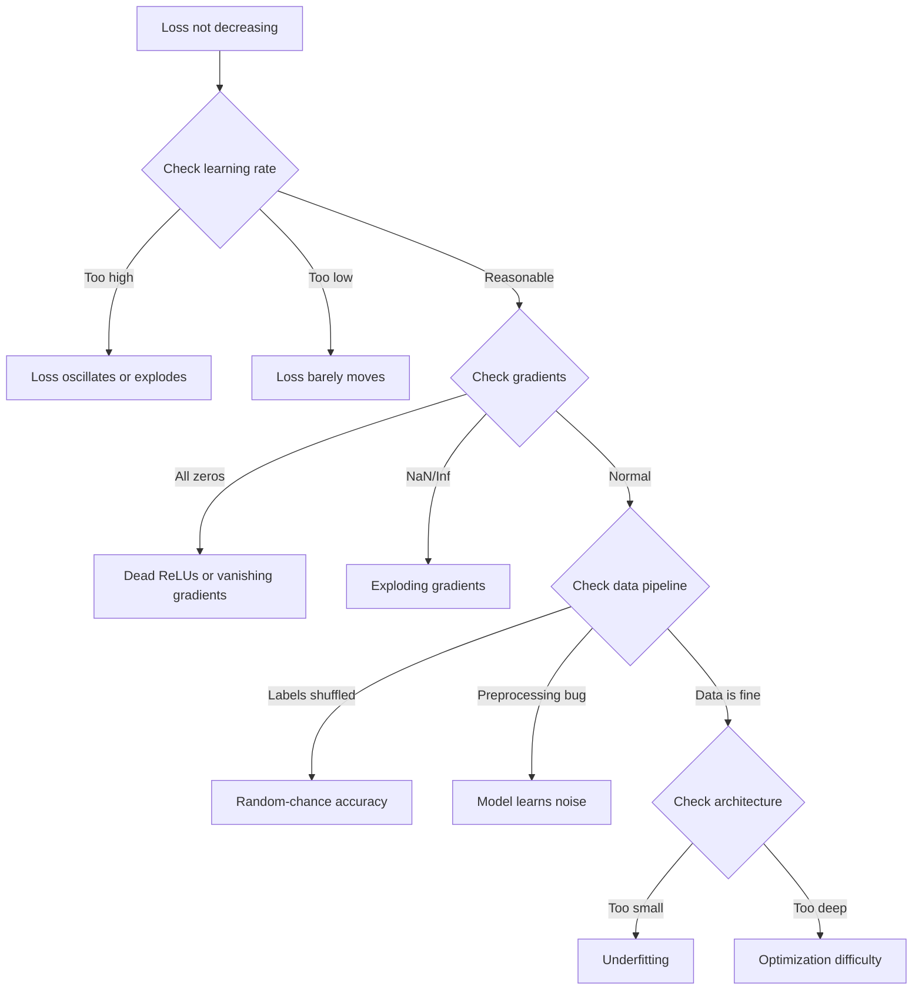
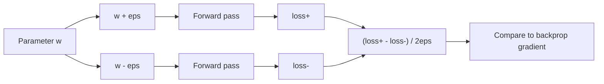
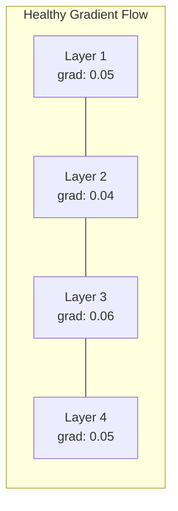
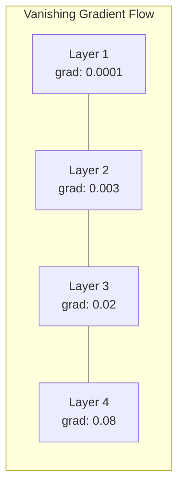
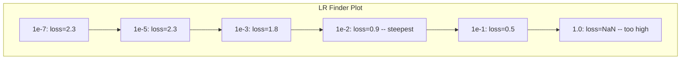

# Men-debug Neural Network

> Network-mu terkompilasi. Ia berjalan. Ia menghasilkan angka. Angkanya salah dan tidak ada yang crash. Selamat datang di jenis debugging tersulit -- jenis di mana tidak ada pesan error.

**Type:** Build
**Languages:** Python, PyTorch
**Prerequisites:** Phase 03 Lessons 01-10 (especially backpropagation, loss functions, optimizers)
**Time:** ~90 minutes

## Tujuan Pembelajaran

- Mendiagnosis kegagalan neural network yang umum (loss NaN, kurva loss datar, overfitting, osilasi) memakai strategi debugging sistematis
- Menerapkan teknik "overfit satu batch" untuk memverifikasi bahwa arsitektur model dan loop training-mu benar
- Memeriksa magnitudo gradien, distribusi aktivasi, dan norma bobot untuk mengidentifikasi masalah vanishing/exploding gradient
- Membangun checklist debugging yang mencakup pipeline data, arsitektur model, fungsi loss, optimizer, dan masalah learning rate

## Masalahnya

Software tradisional crash saat rusak. Null pointer melempar exception. Ketidakcocokan tipe gagal saat compile time. Off-by-one menghasilkan output yang jelas salah.

Neural network tidak memberimu kemewahan itu.

Neural network yang rusak berjalan sampai selesai, mencetak nilai loss, dan mengeluarkan prediksi. Loss mungkin menurun. Prediksi mungkin tampak masuk akal. Tetapi model diam-diam salah -- mempelajari jalan pintas, menghafal noise, atau konvergen ke minimum lokal yang tidak berguna. Peneliti Google memperkirakan 60-70% waktu debugging ML dihabiskan untuk bug "diam" yang tidak menghasilkan error tetapi menurunkan kualitas model.

Perbedaan antara model yang bekerja dan yang rusak sering kali satu baris yang salah tempat: `zero_grad()` yang hilang, dimensi yang tertranspos, learning rate yang meleset 10x. "Recipe for Training Neural Networks" (2019) yang kanonis dibuka dengan ini: "Kesalahan neural net paling umum adalah bug yang tidak crash."

Pelajaran ini mengajarimu menemukan bug itu.

## Konsepnya

### Pola Pikir Debugging

Lupakan debugging print-and-pray. Debugging neural network membutuhkan pendekatan sistematis karena loop umpan balik lambat (menit hingga jam per run training) dan gejalanya ambigu (loss buruk bisa berarti 20 hal berbeda).

Aturan emas: **mulai sederhana, tambah kompleksitas satu potong dalam satu waktu, dan verifikasi setiap potong secara independen.**



### Gejala 1: Loss Tidak Menurun

Ini keluhan paling umum. Loop training berjalan, epoch berlalu, dan loss tetap datar atau berosilasi liar.

**Learning rate salah.** Terlalu tinggi: loss berosilasi atau melonjak ke NaN. Terlalu rendah: loss menurun begitu lambat sampai tampak datar. Untuk Adam, mulai dari 1e-3. Untuk SGD, mulai dari 1e-1 atau 1e-2. Selalu coba 3 learning rate yang merentang 10x masing-masing (misalnya 1e-2, 1e-3, 1e-4) sebelum menyimpulkan hal lain yang salah.

**ReLU mati.** Jika neuron ReLU menerima input negatif besar, ia mengeluarkan 0 dan gradiennya 0. Ia tidak pernah aktif lagi. Jika cukup banyak neuron mati, network tidak bisa belajar. Cek: cetak fraksi aktivasi yang tepat 0 setelah setiap lapis ReLU. Jika >50% mati, beralihlah ke LeakyReLU atau kecilkan learning rate.

**Vanishing gradient.** Dalam network dalam dengan aktivasi sigmoid atau tanh, gradien menyusut eksponensial saat dipropagasikan mundur. Saat mencapai lapis pertama, mereka ~0. Lapis pertama berhenti belajar. Perbaiki: pakai ReLU/GELU, tambah residual connection, atau pakai batch normalization.

**Exploding gradient.** Masalah sebaliknya -- gradien tumbuh eksponensial. Umum di RNN dan network yang sangat dalam. Loss melonjak ke NaN. Perbaiki: gradient clipping (`torch.nn.utils.clip_grad_norm_`), kecilkan learning rate, atau tambah normalisasi.

### Gejala 2: Loss Menurun tetapi Model Buruk

Loss turun. Akurasi training mencapai 99%. Tetapi akurasi uji 55%. Atau model menghasilkan output omong kosong pada data nyata.

**Overfitting.** Model menghafal data training alih-alih mempelajari pola. Kesenjangan antara training dan validation loss tumbuh seiring waktu. Perbaiki: lebih banyak data, dropout, weight decay, early stopping, augmentasi data.

**Kebocoran data.** Data uji bocor ke training. Akurasi mencurigakan tingginya. Penyebab umum: shuffling sebelum splitting, preprocessing dengan statistik dari seluruh dataset, sampel duplikat antar split. Perbaiki: split dulu, preprocess kemudian, cek duplikat.

**Error label.** 5-10% label di kebanyakan dataset nyata salah (Northcutt et al., 2021 -- "Pervasive Label Errors in Test Sets"). Model mempelajari noise. Perbaiki: pakai confident learning untuk menemukan dan memperbaiki contoh salah label, atau pakai pemotongan loss untuk mengabaikan sampel loss-tinggi.

### Gejala 3: NaN atau Inf dalam Loss

Nilai loss menjadi `nan` atau `inf`. Training mati.

**Learning rate terlalu tinggi.** Update gradien overshoot begitu jauh sehingga bobot meledak. Perbaiki: kecilkan 10x.

**log(0) atau log(negatif).** Cross-entropy loss menghitung `log(p)`. Jika modelmu mengeluarkan tepat 0 atau probabilitas negatif, log meledak. Perbaiki: jepit prediksi ke `[eps, 1-eps]` di mana `eps=1e-7`.

**Pembagian nol.** Batch normalization membagi dengan standar deviasi. Batch dengan nilai konstan punya std=0. Perbaiki: tambah epsilon ke penyebut (PyTorch melakukannya default, tetapi implementasi kustom mungkin tidak).

**Overflow numerik.** Aktivasi besar yang diumpankan ke `exp()` menghasilkan Inf. Softmax sangat rentan. Perbaiki: kurangi dengan max sebelum mengeksponensiasi (trik log-sum-exp).

### Teknik 1: Pengecekan Gradien

Bandingkan gradien analitikmu (dari backprop) dengan gradien numerik (dari finite difference). Jika mereka tidak cocok, backward pass-mu punya bug.

Gradien numerik untuk parameter `w`:

```
grad_numerical = (loss(w + eps) - loss(w - eps)) / (2 * eps)
```

Metrik kesepakatan (perbedaan relatif):

```
rel_diff = |grad_analytical - grad_numerical| / max(|grad_analytical|, |grad_numerical|, 1e-8)
```

Jika `rel_diff < 1e-5`: benar. Jika `rel_diff > 1e-3`: nyaris pasti bug.



### Teknik 2: Statistik Aktivasi

Pantau rerata dan standar deviasi aktivasi setelah setiap lapis selama training. Network sehat menjaga aktivasi dengan rerata dekat 0 dan std dekat 1 (setelah normalisasi) atau setidaknya terbatas.

| Health indicator | Mean | Std | Diagnosis |
|-----------------|------|-----|-----------|
| Healthy | ~0 | ~1 | Network is learning normally |
| Saturated | >>0 or <<0 | ~0 | Activations stuck at extreme values |
| Dead | 0 | 0 | Neurons are dead (all zeros) |
| Exploding | >>10 | >>10 | Activations growing without bound |

### Teknik 3: Visualisasi Aliran Gradien

Plot magnitudo gradien rata-rata untuk setiap lapis. Dalam network sehat, magnitudo gradien seharusnya kira-kira mirip antar lapis. Jika lapis awal punya gradien 1000x lebih kecil daripada lapis akhir, kamu punya vanishing gradient.





### Teknik 4: Uji Overfit-Satu-Batch

Satu teknik debugging terpenting dalam deep learning.

Ambil satu batch kecil (8-32 sampel). Latih di atasnya selama 100+ iterasi. Loss seharusnya menuju mendekati nol dan akurasi training mencapai 100%. Jika tidak, model atau loop training-mu punya bug fundamental -- jangan lanjutkan ke training penuh.

Uji ini menangkap:

- Fungsi loss rusak
- Backward pass rusak
- Arsitektur terlalu kecil untuk merepresentasikan data
- Optimizer tidak terhubung ke parameter model
- Data dan label tidak sejajar

Ini butuh 30 detik untuk dijalankan dan menghemat berjam-jam debugging run training penuh.

### Teknik 5: Pencari Learning Rate

Leslie Smith (2017) mengusulkan menyapu learning rate dari sangat kecil (1e-7) ke sangat besar (10) selama satu epoch sambil merekam loss. Plot loss vs learning rate. Learning rate optimal kira-kira 10x lebih kecil daripada rate di mana loss mulai menurun tercepat.



LR terbaik dalam contoh ini: ~1e-3 (satu orde magnitudo sebelum titik tercuram).

### Bug PyTorch Umum

Inilah bug yang membuang jam kolektif terbanyak di komunitas PyTorch:

| Bug | Symptom | Fix |
|-----|---------|-----|
| Forgetting `optimizer.zero_grad()` | Gradients accumulate across batches, loss oscillates | Add `optimizer.zero_grad()` before `loss.backward()` |
| Forgetting `model.eval()` at test time | Dropout and batch norm behave differently, test accuracy varies between runs | Add `model.eval()` and `torch.no_grad()` |
| Wrong tensor shapes | Silent broadcasting produces wrong results, no error | Print shapes after every operation during debugging |
| CPU/GPU mismatch | `RuntimeError: expected CUDA tensor` | Use `.to(device)` on model AND data |
| Not detaching tensors | Computation graph grows forever, OOM | Use `.detach()` or `with torch.no_grad()` |
| In-place operations breaking autograd | `RuntimeError: modified by in-place operation` | Replace `x += 1` with `x = x + 1` |
| Data not normalized | Loss stuck at random-chance level | Normalize inputs to mean=0, std=1 |
| Labels as wrong dtype | Cross-entropy expects `Long`, got `Float` | Cast labels: `labels.long()` |

### Tabel Debugging Utama

| Symptom | Likely cause | First thing to try |
|---------|-------------|-------------------|
| Loss stuck at -log(1/num_classes) | Model predicting uniform distribution | Check data pipeline, verify labels match inputs |
| Loss NaN after a few steps | Learning rate too high | Reduce LR by 10x |
| Loss NaN immediately | log(0) or division by zero | Add epsilon to log/division operations |
| Loss oscillating wildly | LR too high or batch size too small | Reduce LR, increase batch size |
| Loss decreasing then plateaus | LR too high for fine-tuning phase | Add LR schedule (cosine or step decay) |
| Training acc high, test acc low | Overfitting | Add dropout, weight decay, more data |
| Training acc = test acc = chance | Model not learning anything | Run overfit-one-batch test |
| Training acc = test acc but both low | Underfitting | Bigger model, more layers, more features |
| Gradients all zero | Dead ReLUs or detached computation graph | Switch to LeakyReLU, check `.requires_grad` |
| Out of memory during training | Batch too large or graph not freed | Reduce batch size, use `torch.no_grad()` for eval |

```figure
learning-curves
```

## Bangun Sendiri

Toolkit diagnostik yang memantau aktivasi, gradien, dan kurva loss. Kamu akan sengaja merusak network dan memakai toolkit untuk mendiagnosis setiap masalah.

### Langkah 1: Kelas NetworkDebugger

Mengait ke model PyTorch untuk merekam statistik aktivasi dan gradien per lapis.

```python
import torch
import torch.nn as nn
import math


class NetworkDebugger:
    def __init__(self, model):
        self.model = model
        self.activation_stats = {}
        self.gradient_stats = {}
        self.loss_history = []
        self.lr_losses = []
        self.hooks = []
        self._register_hooks()

    def _register_hooks(self):
        for name, module in self.model.named_modules():
            if isinstance(module, (nn.Linear, nn.Conv2d, nn.ReLU, nn.LeakyReLU)):
                hook = module.register_forward_hook(self._make_activation_hook(name))
                self.hooks.append(hook)
                hook = module.register_full_backward_hook(self._make_gradient_hook(name))
                self.hooks.append(hook)

    def _make_activation_hook(self, name):
        def hook(module, input, output):
            with torch.no_grad():
                out = output.detach().float()
                self.activation_stats[name] = {
                    "mean": out.mean().item(),
                    "std": out.std().item(),
                    "fraction_zero": (out == 0).float().mean().item(),
                    "min": out.min().item(),
                    "max": out.max().item(),
                }
        return hook

    def _make_gradient_hook(self, name):
        def hook(module, grad_input, grad_output):
            if grad_output[0] is not None:
                with torch.no_grad():
                    grad = grad_output[0].detach().float()
                    self.gradient_stats[name] = {
                        "mean": grad.mean().item(),
                        "std": grad.std().item(),
                        "abs_mean": grad.abs().mean().item(),
                        "max": grad.abs().max().item(),
                    }
        return hook

    def record_loss(self, loss_value):
        self.loss_history.append(loss_value)

    def check_loss_health(self):
        if len(self.loss_history) < 2:
            return "NOT_ENOUGH_DATA"
        recent = self.loss_history[-10:]
        if any(math.isnan(v) or math.isinf(v) for v in recent):
            return "NAN_OR_INF"
        if len(self.loss_history) >= 20:
            first_half = sum(self.loss_history[:10]) / 10
            second_half = sum(self.loss_history[-10:]) / 10
            if second_half >= first_half * 0.99:
                return "NOT_DECREASING"
        if len(recent) >= 5:
            diffs = [recent[i+1] - recent[i] for i in range(len(recent)-1)]
            if max(diffs) - min(diffs) > 2 * abs(sum(diffs) / len(diffs)):
                return "OSCILLATING"
        return "HEALTHY"

    def check_activations(self):
        issues = []
        for name, stats in self.activation_stats.items():
            if stats["fraction_zero"] > 0.5:
                issues.append(f"DEAD_NEURONS: {name} has {stats['fraction_zero']:.0%} zero activations")
            if abs(stats["mean"]) > 10:
                issues.append(f"EXPLODING_ACTIVATIONS: {name} mean={stats['mean']:.2f}")
            if stats["std"] < 1e-6:
                issues.append(f"COLLAPSED_ACTIVATIONS: {name} std={stats['std']:.2e}")
        return issues if issues else ["HEALTHY"]

    def check_gradients(self):
        issues = []
        grad_magnitudes = []
        for name, stats in self.gradient_stats.items():
            grad_magnitudes.append((name, stats["abs_mean"]))
            if stats["abs_mean"] < 1e-7:
                issues.append(f"VANISHING_GRADIENT: {name} abs_mean={stats['abs_mean']:.2e}")
            if stats["abs_mean"] > 100:
                issues.append(f"EXPLODING_GRADIENT: {name} abs_mean={stats['abs_mean']:.2e}")
        if len(grad_magnitudes) >= 2:
            first_mag = grad_magnitudes[0][1]
            last_mag = grad_magnitudes[-1][1]
            if last_mag > 0 and first_mag / last_mag > 100:
                issues.append(f"GRADIENT_RATIO: first/last = {first_mag/last_mag:.0f}x (vanishing)")
        return issues if issues else ["HEALTHY"]

    def print_report(self):
        print("\n=== NETWORK DEBUGGER REPORT ===")
        print(f"\nLoss health: {self.check_loss_health()}")
        if self.loss_history:
            print(f"  Last 5 losses: {[f'{v:.4f}' for v in self.loss_history[-5:]]}")
        print("\nActivation diagnostics:")
        for item in self.check_activations():
            print(f"  {item}")
        print("\nGradient diagnostics:")
        for item in self.check_gradients():
            print(f"  {item}")
        print("\nPer-layer activation stats:")
        for name, stats in self.activation_stats.items():
            print(f"  {name}: mean={stats['mean']:.4f} std={stats['std']:.4f} zero={stats['fraction_zero']:.1%}")
        print("\nPer-layer gradient stats:")
        for name, stats in self.gradient_stats.items():
            print(f"  {name}: abs_mean={stats['abs_mean']:.2e} max={stats['max']:.2e}")

    def remove_hooks(self):
        for hook in self.hooks:
            hook.remove()
        self.hooks.clear()
```

### Langkah 2: Uji Overfit-Satu-Batch

```python
def overfit_one_batch(model, x_batch, y_batch, criterion, lr=0.01, steps=200):
    optimizer = torch.optim.Adam(model.parameters(), lr=lr)
    model.train()
    print("\n=== OVERFIT ONE BATCH TEST ===")
    print(f"Batch size: {x_batch.shape[0]}, Steps: {steps}")

    for step in range(steps):
        optimizer.zero_grad()
        output = model(x_batch)
        loss = criterion(output, y_batch)
        loss.backward()
        optimizer.step()

        if step % 50 == 0 or step == steps - 1:
            with torch.no_grad():
                preds = (output > 0).float() if output.shape[-1] == 1 else output.argmax(dim=1)
                targets = y_batch if y_batch.dim() == 1 else y_batch.squeeze()
                acc = (preds.squeeze() == targets).float().mean().item()
            print(f"  Step {step:3d} | Loss: {loss.item():.6f} | Accuracy: {acc:.1%}")

    final_loss = loss.item()
    if final_loss > 0.1:
        print(f"\n  FAIL: Loss did not converge ({final_loss:.4f}). Model or training loop is broken.")
        return False
    print(f"\n  PASS: Loss converged to {final_loss:.6f}")
    return True
```

### Langkah 3: Pencari Learning Rate

```python
def find_learning_rate(model, x_data, y_data, criterion, start_lr=1e-7, end_lr=10, steps=100):
    import copy
    original_state = copy.deepcopy(model.state_dict())
    optimizer = torch.optim.SGD(model.parameters(), lr=start_lr)
    lr_mult = (end_lr / start_lr) ** (1 / steps)

    model.train()
    results = []
    best_loss = float("inf")
    current_lr = start_lr

    print("\n=== LEARNING RATE FINDER ===")

    for step in range(steps):
        optimizer.zero_grad()
        output = model(x_data)
        loss = criterion(output, y_data)

        if math.isnan(loss.item()) or loss.item() > best_loss * 10:
            break

        best_loss = min(best_loss, loss.item())
        results.append((current_lr, loss.item()))

        loss.backward()
        optimizer.step()

        current_lr *= lr_mult
        for param_group in optimizer.param_groups:
            param_group["lr"] = current_lr

    model.load_state_dict(original_state)

    if len(results) < 10:
        print("  Could not complete LR sweep -- loss diverged too quickly")
        return results

    min_loss_idx = min(range(len(results)), key=lambda i: results[i][1])
    suggested_lr = results[max(0, min_loss_idx - 10)][0]

    print(f"  Swept {len(results)} steps from {start_lr:.0e} to {results[-1][0]:.0e}")
    print(f"  Minimum loss {results[min_loss_idx][1]:.4f} at lr={results[min_loss_idx][0]:.2e}")
    print(f"  Suggested learning rate: {suggested_lr:.2e}")

    return results
```

### Langkah 4: Pengecek Gradien

```python
def _flat_to_multi_index(flat_idx, shape):
    multi_idx = []
    remaining = flat_idx
    for dim in reversed(shape):
        multi_idx.insert(0, remaining % dim)
        remaining //= dim
    return tuple(multi_idx)


def gradient_check(model, x, y, criterion, eps=1e-4):
    model.train()
    x_double = x.double()
    y_double = y.double()
    model_double = model.double()

    print("\n=== GRADIENT CHECK ===")
    overall_max_diff = 0
    checked = 0

    for name, param in model_double.named_parameters():
        if not param.requires_grad:
            continue

        layer_max_diff = 0

        model_double.zero_grad()
        output = model_double(x_double)
        loss = criterion(output, y_double)
        loss.backward()
        analytical_grad = param.grad.clone()

        num_checks = min(5, param.numel())
        for i in range(num_checks):
            idx = _flat_to_multi_index(i, param.shape)
            original = param.data[idx].item()

            param.data[idx] = original + eps
            with torch.no_grad():
                loss_plus = criterion(model_double(x_double), y_double).item()

            param.data[idx] = original - eps
            with torch.no_grad():
                loss_minus = criterion(model_double(x_double), y_double).item()

            param.data[idx] = original

            numerical = (loss_plus - loss_minus) / (2 * eps)
            analytical = analytical_grad[idx].item()

            denom = max(abs(numerical), abs(analytical), 1e-8)
            rel_diff = abs(numerical - analytical) / denom

            layer_max_diff = max(layer_max_diff, rel_diff)
            checked += 1

        overall_max_diff = max(overall_max_diff, layer_max_diff)
        status = "OK" if layer_max_diff < 1e-5 else "MISMATCH"
        print(f"  {name}: max_rel_diff={layer_max_diff:.2e} [{status}]")

    model.float()

    print(f"\n  Checked {checked} parameters")
    if overall_max_diff < 1e-5:
        print("  PASS: Gradients match (rel_diff < 1e-5)")
    elif overall_max_diff < 1e-3:
        print("  WARN: Small differences (1e-5 < rel_diff < 1e-3)")
    else:
        print("  FAIL: Gradient mismatch detected (rel_diff > 1e-3)")
    return overall_max_diff
```

### Langkah 5: Network yang Sengaja Dirusak

Kini terapkan toolkit pada network rusak dan diagnosis masing-masing.

```python
def demo_broken_networks():
    torch.manual_seed(42)
    x = torch.randn(64, 10)
    y = (x[:, 0] > 0).long()

    print("\n" + "=" * 60)
    print("BUG 1: Learning rate too high (lr=10)")
    print("=" * 60)
    model1 = nn.Sequential(nn.Linear(10, 32), nn.ReLU(), nn.Linear(32, 2))
    debugger1 = NetworkDebugger(model1)
    optimizer1 = torch.optim.SGD(model1.parameters(), lr=10.0)
    criterion = nn.CrossEntropyLoss()
    for step in range(20):
        optimizer1.zero_grad()
        out = model1(x)
        loss = criterion(out, y)
        debugger1.record_loss(loss.item())
        loss.backward()
        optimizer1.step()
    debugger1.print_report()
    debugger1.remove_hooks()

    print("\n" + "=" * 60)
    print("BUG 2: Dead ReLUs from bad initialization")
    print("=" * 60)
    model2 = nn.Sequential(nn.Linear(10, 32), nn.ReLU(), nn.Linear(32, 32), nn.ReLU(), nn.Linear(32, 2))
    with torch.no_grad():
        for m in model2.modules():
            if isinstance(m, nn.Linear):
                m.weight.fill_(-1.0)
                m.bias.fill_(-5.0)
    debugger2 = NetworkDebugger(model2)
    optimizer2 = torch.optim.Adam(model2.parameters(), lr=1e-3)
    for step in range(50):
        optimizer2.zero_grad()
        out = model2(x)
        loss = criterion(out, y)
        debugger2.record_loss(loss.item())
        loss.backward()
        optimizer2.step()
    debugger2.print_report()
    debugger2.remove_hooks()

    print("\n" + "=" * 60)
    print("BUG 3: Missing zero_grad (gradients accumulate)")
    print("=" * 60)
    model3 = nn.Sequential(nn.Linear(10, 32), nn.ReLU(), nn.Linear(32, 2))
    debugger3 = NetworkDebugger(model3)
    optimizer3 = torch.optim.SGD(model3.parameters(), lr=0.01)
    for step in range(50):
        out = model3(x)
        loss = criterion(out, y)
        debugger3.record_loss(loss.item())
        loss.backward()
        optimizer3.step()
    debugger3.print_report()
    debugger3.remove_hooks()

    print("\n" + "=" * 60)
    print("HEALTHY NETWORK: Correct setup for comparison")
    print("=" * 60)
    model_good = nn.Sequential(nn.Linear(10, 32), nn.ReLU(), nn.Linear(32, 2))
    debugger_good = NetworkDebugger(model_good)
    optimizer_good = torch.optim.Adam(model_good.parameters(), lr=1e-3)
    for step in range(50):
        optimizer_good.zero_grad()
        out = model_good(x)
        loss = criterion(out, y)
        debugger_good.record_loss(loss.item())
        loss.backward()
        optimizer_good.step()
    debugger_good.print_report()
    debugger_good.remove_hooks()

    print("\n" + "=" * 60)
    print("OVERFIT-ONE-BATCH TEST (healthy model)")
    print("=" * 60)
    model_test = nn.Sequential(nn.Linear(10, 32), nn.ReLU(), nn.Linear(32, 2))
    overfit_one_batch(model_test, x[:8], y[:8], criterion)

    print("\n" + "=" * 60)
    print("LEARNING RATE FINDER")
    print("=" * 60)
    model_lr = nn.Sequential(nn.Linear(10, 32), nn.ReLU(), nn.Linear(32, 2))
    find_learning_rate(model_lr, x, y, criterion)

    print("\n" + "=" * 60)
    print("GRADIENT CHECK")
    print("=" * 60)
    model_grad = nn.Sequential(nn.Linear(10, 8), nn.ReLU(), nn.Linear(8, 2))
    gradient_check(model_grad, x[:4], y[:4], criterion)
```

## Gunakan

### Tool Bawaan PyTorch

```python
import torch
import torch.nn as nn

model = nn.Sequential(
    nn.Linear(768, 256),
    nn.ReLU(),
    nn.Linear(256, 10),
)

with torch.autograd.detect_anomaly():
    output = model(input_tensor)
    loss = criterion(output, target)
    loss.backward()

for name, param in model.named_parameters():
    if param.grad is not None:
        print(f"{name}: grad_mean={param.grad.abs().mean():.2e}")
```

### Integrasi Weights & Biases

```python
import wandb

wandb.init(project="debug-training")

for epoch in range(100):
    loss = train_one_epoch()
    wandb.log({
        "loss": loss,
        "lr": optimizer.param_groups[0]["lr"],
        "grad_norm": torch.nn.utils.clip_grad_norm_(model.parameters(), float("inf")),
    })

    for name, param in model.named_parameters():
        if param.grad is not None:
            wandb.log({f"grad/{name}": wandb.Histogram(param.grad.cpu().numpy())})
```

### TensorBoard

```python
from torch.utils.tensorboard import SummaryWriter

writer = SummaryWriter("runs/debug_experiment")

for epoch in range(100):
    loss = train_one_epoch()
    writer.add_scalar("Loss/train", loss, epoch)

    for name, param in model.named_parameters():
        writer.add_histogram(f"weights/{name}", param, epoch)
        if param.grad is not None:
            writer.add_histogram(f"gradients/{name}", param.grad, epoch)
```

### Checklist Debug (Sebelum Training Penuh)

1. Jalankan uji overfit-satu-batch. Jika gagal, berhenti.
2. Cetak ringkasan model -- verifikasi jumlah parameter wajar.
3. Jalankan satu forward pass dengan data acak -- cek bentuk output.
4. Latih 5 epoch -- verifikasi loss menurun.
5. Cek statistik aktivasi -- tidak ada lapis mati, tidak ada ledakan.
6. Cek aliran gradien -- tidak ada vanishing, tidak ada exploding.
7. Verifikasi pipeline data -- cetak 5 sampel acak beserta label.

## Rilis

Pelajaran ini menghasilkan:

- `outputs/prompt-nn-debugger.md` -- prompt untuk mendiagnosis kegagalan training neural network
- `outputs/skill-debug-checklist.md` -- checklist decision-tree untuk men-debug masalah training

Pola deployment kunci untuk debugging:

- Tambahkan hook monitoring ke skrip training produksi
- Log statistik aktivasi dan gradien ke W&B atau TensorBoard setiap N langkah
- Implementasikan peringatan otomatis untuk loss NaN, neuron mati (>80% nol), atau ledakan gradien
- Selalu jalankan uji overfit-satu-batch saat mengganti arsitektur atau pipeline data

## Latihan

1. **Tambahkan detektor exploding gradient.** Ubah `NetworkDebugger` agar mendeteksi saat gradien melebihi ambang dan otomatis menyarankan nilai gradient clipping. Uji pada network 20 lapis tanpa normalisasi.
2. **Bangun penghidup neuron mati.** Tulis fungsi yang mengidentifikasi neuron ReLU mati (selalu mengeluarkan 0) dan menginisialisasi ulang bobot masuknya dengan inisialisasi Kaiming. Tunjukkan bahwa ini memulihkan network di mana >70% neuron mati.
3. **Implementasikan pencari learning rate dengan plotting.** Perluas `find_learning_rate` agar menyimpan hasil sebagai CSV dan tulis skrip terpisah yang membaca CSV dan menampilkan kurva LR vs loss memakai matplotlib. Identifikasi LR optimal untuk ResNet-18 pada CIFAR-10.
4. **Buat validator pipeline data.** Tulis fungsi yang memeriksa: sampel duplikat antar split train/test, ketidakseimbangan distribusi label (rasio >10:1), normalisasi input (rerata dekat 0, std dekat 1), dan nilai NaN/Inf dalam data. Jalankan pada dataset yang sengaja dikorupsi.
5. **Debug kegagalan nyata.** Ambil mini-framework dari Pelajaran 10, selipkan bug halus (misalnya transpos matriks bobot dalam backward), dan pakai pengecekan gradien untuk menemukan tepat parameter mana yang gradiennya salah. Dokumentasikan proses debugging.

## Istilah Kunci

| Term | What people say | What it actually means |
|------|----------------|----------------------|
| Silent bug | "It runs but gives bad results" | A bug that produces no error but degrades model quality -- the dominant failure mode in ML |
| Dead ReLU | "The neurons died" | A ReLU neuron whose input is always negative, so it outputs 0 and receives 0 gradient permanently |
| Vanishing gradients | "Early layers stop learning" | Gradients shrink exponentially through layers, making weights in early layers effectively frozen |
| Exploding gradients | "Loss went to NaN" | Gradients grow exponentially through layers, causing weight updates so large they overflow |
| Gradient checking | "Verify backprop is correct" | Comparing analytical gradients from backprop to numerical gradients from finite differences |
| Overfit-one-batch | "The most important debug test" | Training on a single small batch to verify the model CAN learn -- if it cannot, something is fundamentally broken |
| LR finder | "Sweep to find the right learning rate" | Exponentially increasing the learning rate over one epoch and picking the rate just before loss diverges |
| Data leakage | "Test data leaked into training" | When information from the test set contaminates training, producing artificially high accuracy |
| Activation statistics | "Monitor layer health" | Tracking mean, std, and zero-fraction of each layer's output to detect dead, saturated, or exploding neurons |
| Gradient clipping | "Cap the gradient magnitude" | Scaling gradients down when their norm exceeds a threshold, preventing exploding gradient updates |

## Bacaan Lanjutan

- Smith, "Cyclical Learning Rates for Training Neural Networks" (2017) -- makalah yang memperkenalkan uji rentang learning rate (pencari LR)
- Northcutt et al., "Pervasive Label Errors in Test Sets Destabilize Machine Learning Benchmarks" (2021) -- menunjukkan 3-6% label di ImageNet, CIFAR-10, dan benchmark besar lainnya salah
- Zhang et al., "Understanding Deep Learning Requires Rethinking Generalization" (2017) -- makalah yang menunjukkan neural network bisa menghafal label acak, yang menjadi alasan uji overfit-satu-batch bekerja
- Dokumentasi PyTorch tentang `torch.autograd.detect_anomaly` dan `torch.autograd.set_detect_anomaly` untuk deteksi NaN/Inf bawaan
