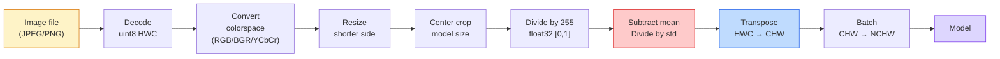
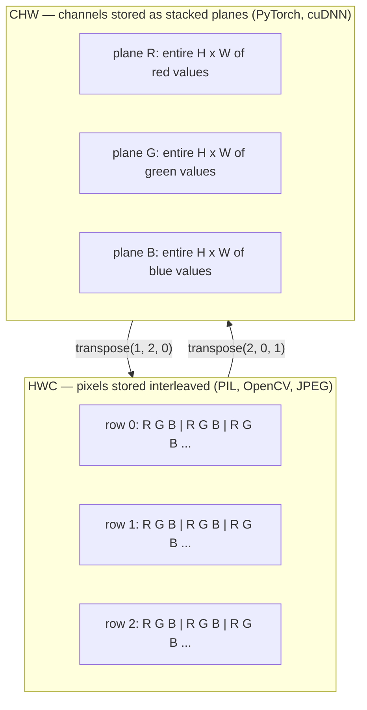

# Dasar-Dasar Gambar — Piksel, Channel, Ruang Warna

> Gambar adalah tensor sampel cahaya. Setiap model vision yang akan kamu pakai mulai dari satu fakta ini.

**Type:** Build
**Languages:** Python
**Prerequisites:** Phase 1 Lesson 12 (Tensor Operations), Phase 3 Lesson 11 (Intro to PyTorch)
**Time:** ~45 minutes

## Tujuan Pembelajaran

- Menjelaskan bagaimana scene kontinu didiskretisasi menjadi piksel dan mengapa keputusan sampling/kuantisasi menetapkan batas atas setiap model downstream
- Membaca, mengiris, dan memeriksa gambar sebagai array NumPy serta beralih lancar antara layout HWC dan CHW
- Mengonversi antara RGB, grayscale, HSV, dan YCbCr serta menjustifikasi mengapa setiap ruang warna ada
- Menerapkan preprocessing tingkat piksel (normalize, standardize, resize, channel-first) persis seperti yang diharapkan model vision PyTorch pretrained

## Masalahnya

Setiap makalah yang akan kamu baca, setiap bobot pretrained yang akan kamu unduh, setiap API vision yang akan kamu panggil mengasumsikan enkoding input spesifik. Berikan gambar `uint8` di mana model menginginkan `float32` dan ia tetap berjalan — dan diam-diam menghasilkan sampah. Beri BGR ke network yang dilatih pada RGB dan akurasi runtuh sepuluh poin. Beri input channels-last padahal ia mengharapkan channels-first dan conv layer pertama memperlakukan height sebagai kanal fitur. Tak satu pun melempar error. Ia hanya merusak metrikmu dan kamu menghabiskan seminggu memburu bug yang hidup dalam cara kamu memuat file.

Konvolusi tidak rumit begitu kamu tahu ia bergeser di atas apa. Bagian sulitnya adalah "gambar" berarti hal berbeda bagi kamera, dekoder JPEG, PIL, OpenCV, torchvision, dan kernel CUDA. Setiap stack punya urutan sumbu, rentang byte, dan konvensi channel sendiri. Insinyur vision yang tidak bisa menjaga ini tetap lurus mengirim pipeline rusak.

Pelajaran ini memperbaiki fondasi sehingga sisa fase bisa dibangun di atasnya. Pada akhirnya kamu akan tahu apa itu piksel, mengapa ada tiga angka per piksel bukan satu, apa arti sebenarnya "normalize dengan statistik ImageNet", dan cara berpindah antara dua-tiga layout yang akan diasumsikan setiap pelajaran lain di fase ini.

## Konsepnya

### Seluruh pipeline preprocessing sekilas

Setiap sistem vision produksi adalah sekuens transform reversibel yang sama. Salah satu langkah dan model melihat input berbeda dari yang ia dilatih.



Dua kotak merah dan biru adalah tempat 80% kegagalan diam hidup: standardisasi yang hilang dan layout yang salah.

### Piksel adalah sampel, bukan kotak

Sensor kamera menghitung foton yang mendarat pada grid detektor kecil. Setiap detektor mengintegrasikan cahaya selama sepersekian detik dan memancarkan voltase yang proporsional dengan jumlah foton yang mengenainya. Sensor lalu mendiskretisasi voltase itu menjadi integer. Satu detektor menjadi satu piksel.

```
Continuous scene                 Sensor grid                     Digital image
(infinite detail)                (H x W detectors)               (H x W integers)

    ~~~~~                        +--+--+--+--+--+                 210 198 180 155 120
   ~   ~   ~                     |  |  |  |  |  |                 205 195 178 152 118
  ~ light ~      ---->           +--+--+--+--+--+     ---->       200 190 175 150 115
   ~~~~~                         |  |  |  |  |  |                 195 185 170 148 112
                                 +--+--+--+--+--+                 188 180 165 145 108
```

Dua pilihan terjadi pada langkah ini dan mereka menetapkan batas atas semua yang downstream:

- **Sampling spasial** menentukan berapa detektor per derajat scene. Terlalu sedikit, dan tepi menjadi bergerigi (aliasing). Terlalu banyak, dan penyimpanan serta komputasi meledak.
- **Kuantisasi intensitas** menentukan seberapa halus voltase dibucket. 8 bit memberi 256 level dan standar untuk tampilan. 10, 12, 16 bit memberi gradasi lebih mulus dan penting untuk pencitraan medis, HDR, dan pipeline sensor mentah.

Piksel bukanlah kotak berwarna berluas. Ia adalah satu pengukuran. Saat kamu me-resize atau merotasi, kamu me-resampling grid pengukuran itu.

### Mengapa tiga channel

Satu detektor menghitung foton di seluruh spektrum tampak — itulah grayscale. Untuk mendapat warna, sensor menutupi grid dengan mosaik filter merah, hijau, dan biru. Setelah demosaicing, setiap lokasi spasial punya tiga integer: respons detektor berfilter merah, berfilter hijau, dan berfilter biru di dekatnya. Tiga integer itu adalah triplet RGB sebuah piksel.

```
One pixel in memory:

    (R, G, B) = (210, 140, 30)   <- reddish-orange

An H x W RGB image:

    shape (H, W, 3)     stored as   H rows of W pixels of 3 values
                                    each in [0, 255] for uint8
```

Tiga bukanlah sihir. Kamera depth menambah channel Z. Satelit menambah pita inframerah dan ultraviolet. Citra medis sering punya satu channel (X-ray, CT) atau banyak (hiperspektral). Jumlah channel adalah sumbu terakhir; lapis conv belajar mencampur menyeberanginya.

### Dua konvensi layout: HWC dan CHW

Tensor sama, dua urutan. Setiap pustaka memilih satu.

```
HWC (height, width, channels)           CHW (channels, height, width)

   W ->                                    H ->
  +-----+-----+-----+                     +-----+-----+
H |R G B|R G B|R G B|                   C |R R R R R R|
| +-----+-----+-----+                   | +-----+-----+
v |R G B|R G B|R G B|                   v |G G G G G G|
  +-----+-----+-----+                     +-----+-----+
                                          |B B B B B B|
                                          +-----+-----+

   PIL, OpenCV, matplotlib,              PyTorch, most deep learning
   almost every image file on disk       frameworks, cuDNN kernels
```

CHW ada karena kernel konvolusi bergeser menyeberangi H dan W. Menjaga sumbu channel di depan berarti setiap kernel melihat bidang 2D yang contiguous per channel, yang tervektorisasi bersih. Format disk menjaga HWC karena itu cocok dengan cara scanline keluar dari sensor.

Konversi satu baris yang akan kamu ketik seribu kali:

```
img_chw = img_hwc.transpose(2, 0, 1)      # NumPy
img_chw = img_hwc.permute(2, 0, 1)        # PyTorch tensor
```

Layout memori, divisualisasikan:



### Rentang byte dan dtype

Tiga konvensi mendominasi:

| Convention | dtype | Range | Where you see it |
|------------|-------|-------|------------------|
| Raw | `uint8` | [0, 255] | Files on disk, PIL, OpenCV output |
| Normalized | `float32` | [0.0, 1.0] | After `img.astype('float32') / 255` |
| Standardized | `float32` | roughly [-2, +2] | After subtracting mean and dividing by std |

Network konvolusional dilatih pada input terstandardisasi. Statistik ImageNet `mean=[0.485, 0.456, 0.406]`, `std=[0.229, 0.224, 0.225]` adalah rerata aritmetik dan standar deviasi tiga channel pada seluruh set training ImageNet, dihitung pada piksel [0, 1] yang dinormalisasi. Memberi `uint8` mentah ke model yang mengharapkan float terstandardisasi adalah kegagalan diam tunggal paling umum dalam vision terapan.

### Ruang warna dan mengapa mereka ada

RGB adalah format capture tetapi tidak selalu representasi paling berguna untuk model.

```
 RGB               HSV                       YCbCr / YUV

 R red             H hue (angle 0-360)       Y luminance (brightness)
 G green           S saturation (0-1)        Cb chroma blue-yellow
 B blue            V value/brightness (0-1)  Cr chroma red-green

 Linear to         Separates color from      Separates brightness from
 sensor output     brightness. Useful for    color. JPEG and most video
                   color thresholding, UI    codecs compress the chroma
                   sliders, simple filters   channels harder because the
                                             human eye is less sensitive
                                             to chroma detail than to Y.
```

Untuk kebanyakan CNN modern kamu memberi RGB. Kamu bertemu ruang lain saat:

- **HSV** — kode CV klasik, segmentasi berbasis warna, white-balancing.
- **YCbCr** — membaca internal JPEG, pipeline video, model super-resolusi yang beroperasi hanya pada Y.
- **Grayscale** — OCR, model dokumen, kasus apa pun di mana warna adalah variabel pengganggu bukan sinyal.

Grayscale dari RGB adalah jumlah berbobot, bukan rata-rata, karena mata manusia lebih sensitif terhadap hijau daripada merah atau biru:

```
Y = 0.299 R + 0.587 G + 0.114 B       (ITU-R BT.601, the classic weights)
```

### Rasio aspek, resizing, dan interpolasi

Setiap model punya ukuran input tetap (224x224 untuk kebanyakan pengklasifikasi ImageNet, 384x384 atau 512x512 untuk detektor modern). Gambarmu jarang cocok. Tiga pilihan resize yang penting:

- **Resize sisi pendek, lalu center crop** — resep ImageNet standar. Menjaga rasio aspek, membuang strip piksel tepi.
- **Resize dan pad** — menjaga rasio aspek dan setiap piksel, menambah bar hitam. Standar untuk deteksi dan OCR.
- **Resize langsung ke target** — meregangkan gambar. Murah, mendistorsi geometri, baik untuk banyak tugas klasifikasi.

Metode interpolasi menentukan bagaimana piksel antara dihitung saat grid baru tidak sejajar dengan yang lama:

```
Nearest neighbour     fastest, blocky, only choice for masks/labels
Bilinear              fast, smooth, default for most image resizing
Bicubic               slower, sharper on upscaling
Lanczos               slowest, best quality, used for final display
```

Aturan praktis: bilinear untuk training, bicubic atau lanczos untuk aset yang akan kamu lihat, nearest untuk apa pun yang berisi ID kelas integer.

```figure
conv-output-size
```

## Bangun Sendiri

### Langkah 1: Bangun tensor gambar dan periksa bentuknya

Mulai dengan gambar sintetis deterministik sehingga lab pertama berjalan offline hanya dengan NumPy. Dekoding file adalah batas terpisah: begitu dekoder JPEG atau PNG mengembalikan byte RGB, setiap operasi tensor di bawah sama.

```python
import numpy as np

def synthetic_rgb(h=128, w=192, seed=0):
    rng = np.random.default_rng(seed)
    yy, xx = np.meshgrid(np.linspace(0, 1, h), np.linspace(0, 1, w), indexing="ij")
    r = (np.sin(xx * 6) * 0.5 + 0.5) * 255
    g = yy * 255
    b = (1 - yy) * xx * 255
    rgb = np.stack([r, g, b], axis=-1) + rng.normal(0, 6, (h, w, 3))
    return np.clip(rgb, 0, 255).astype(np.uint8)

arr = synthetic_rgb()

print(f"type:   {type(arr).__name__}")
print(f"dtype:  {arr.dtype}")
print(f"shape:  {arr.shape}     # (H, W, C)")
print(f"min:    {arr.min()}")
print(f"max:    {arr.max()}")
print(f"pixel at (0, 0): {arr[0, 0]}")
```

Output harapan: `shape: (H, W, 3)`, `dtype: uint8`, rentang `[0, 255]`. Itulah representasi dekode kanonis entah byte berasal dari kamera, dekoder gambar, atau generator sintetis ini.

### Langkah 2: Pisahkan channel dan susun ulang layout

Tarik R, G, B terpisah, lalu konversi dari HWC ke CHW untuk PyTorch.

```python
R = arr[:, :, 0]
G = arr[:, :, 1]
B = arr[:, :, 2]
print(f"R shape: {R.shape}, mean: {R.mean():.1f}")
print(f"G shape: {G.shape}, mean: {G.mean():.1f}")
print(f"B shape: {B.shape}, mean: {B.mean():.1f}")

arr_chw = arr.transpose(2, 0, 1)
print(f"\nHWC shape: {arr.shape}")
print(f"CHW shape: {arr_chw.shape}")
```

Tiga bidang grayscale, satu per channel. CHW hanya menyusun ulang sumbu; tidak ada salinan data yang strictly perlu saat layout memori memungkinkan.

### Langkah 3: Konversi grayscale dan HSV

Grayscale jumlah-berbobot, lalu RGB-ke-HSV manual.

```python
def rgb_to_grayscale(rgb):
    weights = np.array([0.299, 0.587, 0.114], dtype=np.float32)
    return (rgb.astype(np.float32) @ weights).astype(np.uint8)

def rgb_to_hsv(rgb):
    rgb_f = rgb.astype(np.float32) / 255.0
    r, g, b = rgb_f[..., 0], rgb_f[..., 1], rgb_f[..., 2]
    cmax = np.max(rgb_f, axis=-1)
    cmin = np.min(rgb_f, axis=-1)
    delta = cmax - cmin

    h = np.zeros_like(cmax)
    mask = delta > 0
    argmax = np.argmax(rgb_f, axis=-1)
    rmax = mask & (argmax == 0)
    gmax = mask & (argmax == 1)
    bmax = mask & (argmax == 2)
    h[rmax] = ((g[rmax] - b[rmax]) / delta[rmax]) % 6
    h[gmax] = ((b[gmax] - r[gmax]) / delta[gmax]) + 2
    h[bmax] = ((r[bmax] - g[bmax]) / delta[bmax]) + 4
    h = h * 60.0

    s = np.divide(delta, cmax, out=np.zeros_like(delta), where=cmax > 0)
    v = cmax
    return np.stack([h, s, v], axis=-1)

gray = rgb_to_grayscale(arr)
hsv = rgb_to_hsv(arr)
print(f"gray shape: {gray.shape}, range: [{gray.min()}, {gray.max()}]")
print(f"hsv   shape: {hsv.shape}")
print(f"hue range: [{hsv[..., 0].min():.1f}, {hsv[..., 0].max():.1f}] degrees")
print(f"sat range: [{hsv[..., 1].min():.2f}, {hsv[..., 1].max():.2f}]")
print(f"val range: [{hsv[..., 2].min():.2f}, {hsv[..., 2].max():.2f}]")
```

Hue keluar dalam derajat, saturasi dan value dalam [0, 1]. Itu cocok dengan konvensi `hsv_full` OpenCV.

### Langkah 4: Normalize, standardize, dan balikkan

Pergi dari byte mentah ke tensor persis yang diharapkan model ImageNet pretrained, lalu kembali.

```python
mean = np.array([0.485, 0.456, 0.406], dtype=np.float32)
std = np.array([0.229, 0.224, 0.225], dtype=np.float32)

def preprocess_imagenet(rgb_uint8):
    x = rgb_uint8.astype(np.float32) / 255.0
    x = (x - mean) / std
    x = x.transpose(2, 0, 1)
    return x

def deprocess_imagenet(chw_float32):
    x = chw_float32.transpose(1, 2, 0)
    x = x * std + mean
    x = np.clip(x * 255.0, 0, 255).astype(np.uint8)
    return x

x = preprocess_imagenet(arr)
print(f"preprocessed shape: {x.shape}     # (C, H, W)")
print(f"preprocessed dtype: {x.dtype}")
print(f"preprocessed mean per channel:  {x.mean(axis=(1, 2)).round(3)}")
print(f"preprocessed std  per channel:  {x.std(axis=(1, 2)).round(3)}")

roundtrip = deprocess_imagenet(x)
max_diff = np.abs(roundtrip.astype(int) - arr.astype(int)).max()
print(f"roundtrip max pixel diff: {max_diff}    # should be 0 or 1")
```

Rerata per channel seharusnya dekat nol, std dekat satu. Pasangan preprocess/deprocess persis apa yang dilakukan setiap panggilan `transforms.Normalize` torchvision di baliknya.

### Langkah 5: Resize dari nol

Nearest neighbor membulatkan setiap koordinat output ke satu piksel sumber. Interpolasi bilinear menemukan empat piksel sekitar dan memadukannya menurut jarak. Kedua implementasi di bawah memakai koordinat endpoint-aligned sehingga piksel sumber pertama dan terakhir tetap.

```python
def resize_coordinates(source_length, target_length):
    if target_length == 1:
        return np.zeros(1, dtype=np.float32)
    return np.linspace(0, source_length - 1, target_length, dtype=np.float32)

def nearest_resize(image, target_height, target_width):
    y = np.rint(resize_coordinates(image.shape[0], target_height)).astype(int)
    x = np.rint(resize_coordinates(image.shape[1], target_width)).astype(int)
    return image[y[:, None], x[None, :]]

def bilinear_resize(image, target_height, target_width):
    y = resize_coordinates(image.shape[0], target_height)
    x = resize_coordinates(image.shape[1], target_width)
    y0 = np.floor(y).astype(int)
    x0 = np.floor(x).astype(int)
    y1 = np.minimum(y0 + 1, image.shape[0] - 1)
    x1 = np.minimum(x0 + 1, image.shape[1] - 1)
    wy = (y - y0)[:, None, None]
    wx = (x - x0)[None, :, None]

    source = image.astype(np.float32)
    top = source[y0[:, None], x0[None, :]] * (1 - wx)
    top += source[y0[:, None], x1[None, :]] * wx
    bottom = source[y1[:, None], x0[None, :]] * (1 - wx)
    bottom += source[y1[:, None], x1[None, :]] * wx
    result = top * (1 - wy) + bottom * wy
    return np.clip(np.rint(result), 0, 255).astype(image.dtype)

target_height = arr.shape[0] * 3
target_width = arr.shape[1] * 3
nearest = nearest_resize(arr, target_height, target_width)
bilinear = bilinear_resize(arr, target_height, target_width)

def local_roughness(x):
    gy = np.diff(x.astype(float), axis=0)
    gx = np.diff(x.astype(float), axis=1)
    return float(np.abs(gy).mean() + np.abs(gx).mean())

for name, out in [("nearest", nearest), ("bilinear", bilinear)]:
    print(f"{name:>8}  shape={out.shape}  roughness={local_roughness(out):6.2f}")
```

Nearest mendapat skor tertinggi pada roughness karena menjaga tepi keras. Bilinear lebih mulus karena setiap piksel baru memadukan dua posisi pada setiap sumbu. Pendamping runnable memperluas ide separable yang sama ke empat tetangga per sumbu dengan kernel kubik Catmull-Rom, lalu mencetak ketiga hasil tanpa pustaka gambar.

## Gunakan

PyTorch melakukan operasi yang sama pada tensor batched yang sadar-device. Kode di bawah me-resize sisi pendek, mengambil center crop, menstandardisasi setiap channel, dan menghasilkan tensor NCHW yang diharapkan model pretrained.

```python
import torch
import torch.nn.functional as F

image_hwc = torch.from_numpy(synthetic_rgb(256, 320))
batch = image_hwc.permute(2, 0, 1).unsqueeze(0).float() / 255.0

height, width = batch.shape[-2:]
scale = 256 / min(height, width)
resized_height = round(height * scale)
resized_width = round(width * scale)
batch = F.interpolate(
    batch,
    size=(resized_height, resized_width),
    mode="bilinear",
    align_corners=False,
    antialias=True,
)

top = (resized_height - 224) // 2
left = (resized_width - 224) // 2
batch = batch[:, :, top:top + 224, left:left + 224]

mean = torch.tensor([0.485, 0.456, 0.406]).view(1, 3, 1, 1)
std = torch.tensor([0.229, 0.224, 0.225]).view(1, 3, 1, 1)
batch = (batch - mean) / std

print(f"tensor dtype: {batch.dtype}")
print(f"batched shape: {tuple(batch.shape)}")
print(f"per-channel mean: {batch.mean(dim=(0, 2, 3)).tolist()}")
print(f"per-channel std:  {batch.std(dim=(0, 2, 3)).tolist()}")
```

Empat langkah, dalam urutan persis ini: konversi byte ke float dan tukar HWC ke NCHW, resize sisi pendek ke 256, ambil center crop 224x224, lalu kurangi rerata ImageNet dan bagi dengan standar deviasinya. Membalik urutan itu diam-diam mengubah apa yang sampai ke model.

## Rilis

Pelajaran ini menghasilkan:

- `outputs/prompt-vision-preprocessing-audit.md` — prompt yang mengubah card model atau card dataset apa pun menjadi checklist invarian preprocessing persis yang harus dipatuhi tim.
- `outputs/skill-image-tensor-inspector.md` — skill yang, diberikan tensor atau array berbentuk gambar apa pun, melaporkan dtype, layout, rentang, dan apakah ia tampak mentah, dinormalisasi, atau terstandardisasi.

## Latihan

1. **(Mudah)** Buat array RGB `uint8` 2x2 dengan empat warna berbeda. Konversi HWC ke CHW dan kembali, cetak kedua bentuk, dan buktikan round trip menjaga setiap nilai.
2. **(Sedang)** Tulis `standardize(img, mean, std)` dan inversnya yang bersama lolos uji `roundtrip_max_diff <= 1` pada gambar uint8 apa pun. Fungsimu harus bekerja pada satu gambar dalam HWC dan pada batch dalam NCHW dengan panggilan yang sama.
3. **(Sulit)** Ambil tensor 3-channel terstandardisasi ImageNet dan lewatkan melalui conv 1x1 yang mempelajari campuran berbobot RGB menjadi satu channel grayscale. Inisialisasi bobot ke `[0.299, 0.587, 0.114]`, bekukan, dan verifikasi output cocok dengan `rgb_to_grayscale` manualmu dalam error floating-point. Transform ruang-warna klasik lain apa yang bisa ditulis sebagai konvolusi 1x1?

## Istilah Kunci

| Term | What people say | What it actually means |
|------|----------------|----------------------|
| Pixel | "A coloured square" | One sample of light intensity at one grid location — three numbers for colour, one for grayscale |
| Channel | "The colour" | One of the parallel spatial grids stacked into an image tensor; last axis in HWC, first in CHW |
| HWC / CHW | "The shape" | Axis orderings for an image tensor; disk and PIL use HWC, PyTorch and cuDNN use CHW |
| Normalize | "Scale the image" | Divide by 255 so pixels live in [0, 1] — necessary but not sufficient |
| Standardize | "Zero-center" | Subtract mean and divide by std per channel so the input distribution matches what the model was trained on |
| Grayscale conversion | "Average the channels" | A weighted sum with coefficients 0.299/0.587/0.114 that matches human luminance perception |
| Interpolation | "How resize picks pixels" | The rule that decides output values when the new grid does not align with the old one — nearest for labels, bilinear for training, bicubic for display |
| Aspect ratio | "Width over height" | The ratio that distinguishes "resize and pad" from "resize and stretch" |

## Bacaan Lanjutan

- [Charles Poynton — A Guided Tour of Color Space](https://web.archive.org/web/20251220000525/https://poynton.ca/PDFs/Guided_tour.pdf) — perlakuan teknis paling jernih tentang mengapa ada begitu banyak ruang warna dan kapan masing-masing penting
- [PyTorch Vision Transforms Docs](https://pytorch.org/vision/stable/transforms.html) — seluruh pipeline transform yang benar-benar akan kamu rangkai di produksi
- [How JPEG Works (Colt McAnlis)](https://www.youtube.com/watch?v=F1kYBnY6mwg) — tur visual yang tajam tentang subsampling chroma, DCT, dan mengapa JPEG mengenkode YCbCr bukan RGB
- [ImageNet Preprocessing Conventions (torchvision models)](https://pytorch.org/vision/stable/models.html) — sumber kebenaran untuk `mean=[0.485, 0.456, 0.406]` dan mengapa setiap model di zoo mengharapkannya
