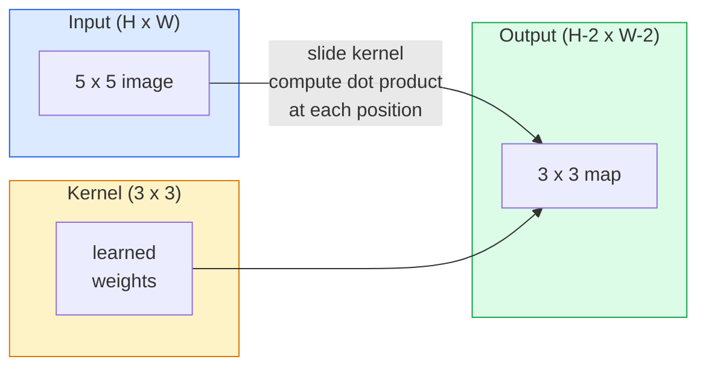
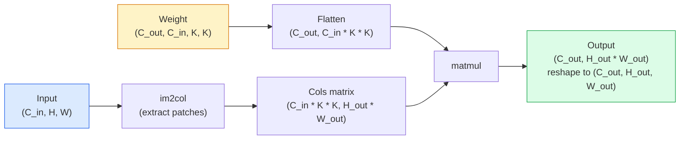

# Konvolusi dari Nol

> Konvolusi adalah dense layer mungil yang kamu geser menyeberangi gambar, memakai bobot yang sama di setiap lokasi.

**Type:** Build
**Languages:** Python
**Prerequisites:** Phase 3 (Deep Learning Core), Phase 4 Lesson 01 (Image Fundamentals)
**Time:** ~75 minutes

## Tujuan Pembelajaran

- Mengimplementasikan konvolusi 2D dari nol hanya memakai NumPy, termasuk versi nested-loop dan versi `im2col` yang tervektorisasi
- Menghitung ukuran spasial output untuk kombinasi ukuran input, ukuran kernel, padding, dan stride apa pun, serta menjustifikasi rumus `(H - K + 2P) / S + 1`
- Merancang kernel manual (edge, blur, sharpen, Sobel) dan menjelaskan mengapa masing-masing menghasilkan pola aktivasi seperti itu
- Menumpuk konvolusi menjadi ekstraktor fitur dan menghubungkan kedalaman tumpukan dengan ukuran receptive field

## Masalahnya

Fully connected layer pada gambar RGB 224x224 butuh 224 * 224 * 3 = 150.528 bobot input per neuron. Satu hidden layer berisi 1.000 unit sudah 150 juta parameter — sebelum kamu mempelajari sesuatu yang berguna. Lebih buruk, lapis itu tidak punya gagasan bahwa anjing di kiri-atas dan anjing di kanan-bawah adalah pola yang sama. Ia memperlakukan setiap posisi piksel sebagai independen, yang persis salah untuk gambar: menggeser kucing tiga piksel seharusnya tidak memaksa network mempelajari ulang konsepnya.

Dua properti yang dibutuhkan model gambar adalah **translation equivariance** (output bergeser saat input bergeser) dan **parameter sharing** (detektor fitur yang sama berjalan di mana-mana). Dense layer tidak memberimu keduanya. Konvolusi memberimu keduanya gratis.

Konvolusi tidak ditemukan untuk deep learning. Ia adalah operasi yang sama yang menggerakkan kompresi JPEG, Gaussian blur di Photoshop, deteksi tepi dalam vision industri, dan setiap filter audio yang pernah dikirim. Alasan CNN mendominasi ImageNet dari 2012 sampai 2020 adalah bahwa konvolusi adalah prior yang tepat untuk data di mana nilai berdekatan saling terkait dan pola yang sama bisa muncul di mana saja.

## Konsepnya

### Satu kernel, bergeser

Konvolusi 2D mengambil matriks bobot kecil bernama kernel (atau filter), menggesernya menyeberangi input, dan pada setiap lokasi menghitung jumlah produk element-wise. Jumlah itu menjadi satu piksel output.



Contoh 3x3 konkret pada input 5x5 (tanpa padding, stride 1):

```
Input X (5 x 5):                Kernel W (3 x 3):

  1  2  0  1  2                   1  0 -1
  0  1  3  1  0                   2  0 -2
  2  1  0  2  1                   1  0 -1
  1  0  2  1  3
  2  1  1  0  1

The kernel slides across every valid 3 x 3 window. Output Y is 3 x 3:

 Y[0,0] = sum( W * X[0:3, 0:3] )
 Y[0,1] = sum( W * X[0:3, 1:4] )
 Y[0,2] = sum( W * X[0:3, 2:5] )
 Y[1,0] = sum( W * X[1:4, 0:3] )
 ... and so on
```

Satu rumus itu — **bobot bersama, lokalitas, jendela geser** — adalah seluruh idenya. Selebihnya pembukuan.

### Rumus ukuran output

Diberikan ukuran spasial input `H`, ukuran kernel `K`, padding `P`, stride `S`:

```
H_out = floor( (H - K + 2P) / S ) + 1
```

Hafalkan ini. Kamu akan menghitungnya puluhan kali per arsitektur.

| Scenario | H | K | P | S | H_out |
|----------|---|---|---|---|-------|
| Valid conv, no padding | 32 | 3 | 0 | 1 | 30 |
| Same conv (preserves size) | 32 | 3 | 1 | 1 | 32 |
| Downsample by 2 | 32 | 3 | 1 | 2 | 16 |
| Pool 2x2 | 32 | 2 | 0 | 2 | 16 |
| Large receptive field | 32 | 7 | 3 | 2 | 16 |

"Same padding" berarti pilih P sehingga H_out == H saat S == 1. Untuk K ganjil, yaitu P = (K - 1) / 2. Itulah mengapa kernel 3x3 mendominasi — mereka adalah kernel ganjil terkecil yang masih punya pusat.

### Padding

Tanpa padding, setiap konvolusi menyusutkan feature map. Tumpuk 20 dan gambar 224x224 milikmu menjadi 184x184, yang membuang komputasi di perbatasan dan menyulitkan residual connection yang butuh bentuk cocok.

```
Zero padding (P = 1) on a 5 x 5 input:

  0  0  0  0  0  0  0
  0  1  2  0  1  2  0
  0  0  1  3  1  0  0
  0  2  1  0  2  1  0       Now the kernel can centre on pixel
  0  1  0  2  1  3  0       (0, 0) and still have three rows and
  0  2  1  1  0  1  0       three columns of values to multiply.
  0  0  0  0  0  0  0
```

Mode yang kamu temui dalam praktik: `zero` (paling umum), `reflect` (cerminkan tepi, menghindari batas keras dalam model generatif), `replicate` (salin tepi), `circular` (bungkus, dipakai dalam masalah toroidal).

### Stride

Stride adalah ukuran langkah geseran. `stride=1` adalah default. `stride=2` membelah dua dimensi spasial dan merupakan cara klasik melakukan downsample di dalam CNN tanpa lapis pooling terpisah — setiap arsitektur modern (ResNet, ConvNeXt, MobileNet) memakai conv berstride sebagai pengganti max-pool di suatu tempat.

```
Stride 1 on a 5 x 5 input, 3 x 3 kernel:

  starts: (0,0) (0,1) (0,2)        -> output row 0
          (1,0) (1,1) (1,2)        -> output row 1
          (2,0) (2,1) (2,2)        -> output row 2

  Output: 3 x 3

Stride 2 on the same input:

  starts: (0,0) (0,2)              -> output row 0
          (2,0) (2,2)              -> output row 1

  Output: 2 x 2
```

### Banyak channel input

Gambar nyata punya tiga channel. Konvolusi 3x3 pada input RGB sebenarnya adalah volume 3x3x3: satu irisan 3x3 per channel input. Pada setiap posisi spasial, kamu mengalikan dan menjumlahkan menyeberangi ketiga irisan dan menambah bias.

```
Input:   (C_in,  H,  W)        3 x 5 x 5
Kernel:  (C_in,  K,  K)        3 x 3 x 3 (one kernel)
Output:  (1,     H', W')       2D map

For a layer that produces C_out output channels, you stack C_out kernels:

Weight:  (C_out, C_in, K, K)   e.g. 64 x 3 x 3 x 3
Output:  (C_out, H', W')       64 x 3 x 3

Parameter count: C_out * C_in * K * K + C_out   (the + C_out is biases)
```

Baris terakhir itulah yang akan kamu hitung saat merencanakan model. Conv 3x3 64-channel pada input 3-channel punya `64 * 3 * 3 * 3 + 64 = 1.792` parameter. Murah.

### Trik im2col

Nested loop mudah dibaca tetapi lambat. GPU menginginkan perkalian matriks besar. Triknya: ratakan setiap jendela receptive-field dari input menjadi satu kolom matriks besar, ratakan kernel menjadi baris, dan seluruh konvolusi menjadi satu matmul.



Setiap implementasi conv produksi adalah varian dari ini plus trik cache-tiling (direct conv, Winograd, FFT conv untuk kernel besar). Pahami im2col dan kamu memahami intinya.

### Receptive field

Satu conv 3x3 melihat 9 piksel input. Tumpuk dua conv 3x3 dan sebuah neuron di lapis kedua melihat 5x5 piksel input. Tiga conv 3x3 memberi 7x7. Umumnya:

```
RF after L stacked K x K convs (stride 1) = 1 + L * (K - 1)

With strides:   RF grows multiplicatively with stride along each layer.
```

Seluruh alasan "3x3 sampai ke bawah" bekerja (VGG, ResNet, ConvNeXt) adalah bahwa dua conv 3x3 melihat area input yang sama dengan satu conv 5x5 tetapi dengan parameter lebih sedikit dan tambahan nonlinearitas di antaranya.

```figure
convolution-kernel
```

## Bangun Sendiri

### Langkah 1: Pad array

Mulai dengan primitif terkecil: fungsi yang mem-pad dengan nol di sekitar array H x W.

```python
import numpy as np

def pad2d(x, p):
    if p == 0:
        return x
    h, w = x.shape[-2:]
    out = np.zeros(x.shape[:-2] + (h + 2 * p, w + 2 * p), dtype=x.dtype)
    out[..., p:p + h, p:p + w] = x
    return out

x = np.arange(9).reshape(3, 3)
print(x)
print()
print(pad2d(x, 1))
```

Trik sumbu-ekor `x.shape[:-2]` berarti fungsi yang sama bekerja pada `(H, W)`, `(C, H, W)`, atau `(N, C, H, W)` tanpa modifikasi.

### Langkah 2: Konvolusi 2D dengan nested loop

Implementasi referensi — lambat, tetapi tegas. Inilah yang dilakukan `torch.nn.functional.conv2d` pada prinsipnya.

```python
def conv2d_naive(x, w, b=None, stride=1, padding=0):
    c_in, h, w_in = x.shape
    c_out, c_in_w, kh, kw = w.shape
    assert c_in == c_in_w

    x_pad = pad2d(x, padding)
    h_out = (h + 2 * padding - kh) // stride + 1
    w_out = (w_in + 2 * padding - kw) // stride + 1

    out = np.zeros((c_out, h_out, w_out), dtype=np.float32)
    for oc in range(c_out):
        for i in range(h_out):
            for j in range(w_out):
                hs = i * stride
                ws = j * stride
                patch = x_pad[:, hs:hs + kh, ws:ws + kw]
                out[oc, i, j] = np.sum(patch * w[oc])
        if b is not None:
            out[oc] += b[oc]
    return out
```

Empat loop bersarang (channel output, baris, kolom, plus penjumlahan implisit atas C_in, kh, kw). Ini ground truth yang akan jadi acuan setiap implementasi yang lebih cepat.

### Langkah 3: Verifikasi dengan kernel rancangan tangan

Bangun kernel Sobel vertikal, terapkan pada gambar step sintetis, dan saksikan tepi vertikal menyala.

```python
def synthetic_step_image():
    img = np.zeros((1, 16, 16), dtype=np.float32)
    img[:, :, 8:] = 1.0
    return img

sobel_x = np.array([
    [[-1, 0, 1],
     [-2, 0, 2],
     [-1, 0, 1]]
], dtype=np.float32)[None]

x = synthetic_step_image()
y = conv2d_naive(x, sobel_x, padding=1)
print(y[0].round(1))
```

Harapkan nilai positif besar pada kolom 7 (peningkatan kecerahan kiri-ke-kanan) dan nol di tempat lain. Satu print itu adalah sanity check bahwa matematikanya benar.

### Langkah 4: im2col

Ubah setiap jendela seukuran kernel dalam input menjadi kolom matriks. Untuk `C_in=3, K=3`, setiap kolom adalah 27 angka.

```python
def im2col(x, kh, kw, stride=1, padding=0):
    c_in, h, w = x.shape
    x_pad = pad2d(x, padding)
    h_out = (h + 2 * padding - kh) // stride + 1
    w_out = (w + 2 * padding - kw) // stride + 1

    cols = np.zeros((c_in * kh * kw, h_out * w_out), dtype=x.dtype)
    col = 0
    for i in range(h_out):
        for j in range(w_out):
            hs = i * stride
            ws = j * stride
            patch = x_pad[:, hs:hs + kh, ws:ws + kw]
            cols[:, col] = patch.reshape(-1)
            col += 1
    return cols, h_out, w_out
```

Masih loop Python, tetapi kini kerja beratnya adalah satu matmul tervektorisasi.

### Langkah 5: Conv cepat via im2col + matmul

Ganti loop rangkap empat dengan satu perkalian matriks.

```python
def conv2d_im2col(x, w, b=None, stride=1, padding=0):
    c_out, c_in, kh, kw = w.shape
    cols, h_out, w_out = im2col(x, kh, kw, stride, padding)
    w_flat = w.reshape(c_out, -1)
    out = w_flat @ cols
    if b is not None:
        out += b[:, None]
    return out.reshape(c_out, h_out, w_out)
```

Cek kebenaran: jalankan kedua implementasi dan bandingkan.

```python
rng = np.random.default_rng(0)
x = rng.normal(0, 1, (3, 16, 16)).astype(np.float32)
w = rng.normal(0, 1, (8, 3, 3, 3)).astype(np.float32)
b = rng.normal(0, 1, (8,)).astype(np.float32)

y_naive = conv2d_naive(x, w, b, padding=1)
y_im2col = conv2d_im2col(x, w, b, padding=1)

print(f"max abs diff: {np.max(np.abs(y_naive - y_im2col)):.2e}")
```

`max abs diff` seharusnya sekitar `1e-5` — perbedaannya adalah urutan akumulasi floating-point, bukan bug.

### Langkah 6: Bank kernel rancangan tangan

Lima filter yang menunjukkan apa yang bisa diekspresikan satu lapis conv sebelum training apa pun.

```python
KERNELS = {
    "identity": np.array([[0, 0, 0], [0, 1, 0], [0, 0, 0]], dtype=np.float32),
    "blur_3x3": np.ones((3, 3), dtype=np.float32) / 9.0,
    "sharpen": np.array([[0, -1, 0], [-1, 5, -1], [0, -1, 0]], dtype=np.float32),
    "sobel_x": np.array([[-1, 0, 1], [-2, 0, 2], [-1, 0, 1]], dtype=np.float32),
    "sobel_y": np.array([[-1, -2, -1], [0, 0, 0], [1, 2, 1]], dtype=np.float32),
}

def apply_kernel(img2d, kernel):
    x = img2d[None].astype(np.float32)
    w = kernel[None, None]
    return conv2d_im2col(x, w, padding=1)[0]
```

Diterapkan pada gambar grayscale apa pun, blur melembutkan, sharpen mempertajam tepi, Sobel-x menyalakan tepi vertikal, Sobel-y menyalakan tepi horizontal. Ini persis pola yang akhirnya dipelajari conv layer *pertama* yang terlatih dalam AlexNet dan VGG — karena model gambar yang bagus butuh detektor tepi dan blob apa pun tugas lanjutannya.

## Gunakan

`nn.Conv2d` PyTorch membungkus operasi yang sama dengan autograd, kernel CUDA, dan optimasi cuDNN. Semantik bentuk identik.

```python
import torch
import torch.nn as nn

conv = nn.Conv2d(in_channels=3, out_channels=64, kernel_size=3, stride=1, padding=1)
print(conv)
print(f"weight shape: {tuple(conv.weight.shape)}   # (C_out, C_in, K, K)")
print(f"bias shape:   {tuple(conv.bias.shape)}")
print(f"param count:  {sum(p.numel() for p in conv.parameters())}")

x = torch.randn(8, 3, 224, 224)
y = conv(x)
print(f"\ninput  shape: {tuple(x.shape)}")
print(f"output shape: {tuple(y.shape)}")
```

Tukar `padding=1` menjadi `padding=0` dan output turun ke 222x222. Tukar `stride=1` menjadi `stride=2` dan ia turun ke 112x112. Rumus sama yang kamu hafalkan di atas.

## Rilis

Pelajaran ini menghasilkan:

- `outputs/prompt-cnn-architect.md` — prompt yang, diberikan ukuran input, budget parameter, dan target receptive field, merancang tumpukan lapis `Conv2d` dengan K/S/P yang tepat pada setiap langkah.
- `outputs/skill-conv-shape-calculator.md` — skill yang menelusuri spec network lapis demi lapis dan mengembalikan bentuk output, receptive field, dan jumlah parameter untuk setiap blok.

## Latihan

1. **(Mudah)** Diberikan input grayscale 128x128 dan tumpukan `[Conv3x3(s=1,p=1), Conv3x3(s=2,p=1), Conv3x3(s=1,p=1), Conv3x3(s=2,p=1)]`, hitung ukuran spasial output dan receptive field pada setiap lapis dengan tangan. Verifikasi dengan `nn.Sequential` PyTorch berisi conv dummy.
2. **(Sedang)** Perluas `conv2d_naive` dan `conv2d_im2col` agar menerima argumen `groups`. Tunjukkan bahwa `groups=C_in=C_out` mereproduksi konvolusi depthwise dan bahwa jumlah parameternya `C * K * K` bukan `C * C * K * K`.
3. **(Sulit)** Implementasikan backward pass `conv2d_im2col` dengan tangan: diberikan gradien output, hitung gradien `x` dan `w`. Verifikasi terhadap `torch.autograd.grad` pada input dan bobot yang sama. Triknya: gradien im2col adalah `col2im`, dan ia harus mengakumulasi jendela yang tumpang tindih.

## Istilah Kunci

| Term | What people say | What it actually means |
|------|----------------|----------------------|
| Convolution | "Sliding a filter" | A learnable dot product applied at every spatial location with shared weights; mathematically a cross-correlation, but everyone calls it convolution |
| Kernel / filter | "The feature detector" | A small weight tensor of shape (C_in, K, K) whose dot product with a window of input produces one output pixel |
| Stride | "How far you jump" | The step size between consecutive kernel placements; stride 2 halves each spatial dimension |
| Padding | "Zeros on the edges" | Extra values added around the input so the kernel can centre on border pixels; `same` padding keeps output size equal to input size |
| Receptive field | "How much the neuron sees" | The patch of original input that a given output activation depends on, growing with depth and stride |
| im2col | "The GEMM trick" | Rearranging every receptive window into columns so convolution becomes one big matrix multiply — the core of every fast conv kernel |
| Depthwise conv | "One kernel per channel" | A conv with `groups == C_in`, computing each output channel from only its matching input channel; the backbone of MobileNet and ConvNeXt |
| Translation equivariance | "Shift in, shift out" | Property that shifting the input by k pixels shifts the output by k pixels; comes for free with shared weights |

## Bacaan Lanjutan

- [A guide to convolution arithmetic for deep learning (Dumoulin & Visin, 2016)](https://arxiv.org/abs/1603.07285) — diagram definitif padding/stride/dilasi yang diam-diam disalin setiap kursus
- [CS231n: Convolutional Neural Networks for Visual Recognition](https://cs231n.github.io/convolutional-networks/) — catatan kuliah kanonis, termasuk penjelasan im2col orisinal
- [The Annotated ConvNet (fast.ai)](https://nbviewer.org/github/fastai/fastbook/blob/master/13_convolutions.ipynb) — notebook yang berjalan dari konvolusi manual ke pengklasifikasi digit terlatih
- [Receptive Field Arithmetic for CNNs (Dang Ha The Hien)](https://distill.pub/2019/computing-receptive-fields/) — penjelasan interaktif berkualitas makalah tentang perhitungan receptive field
