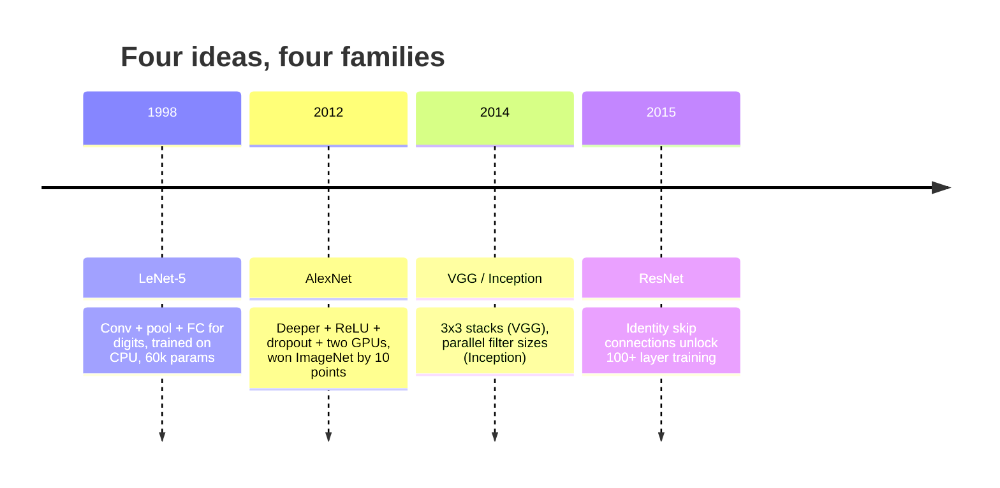
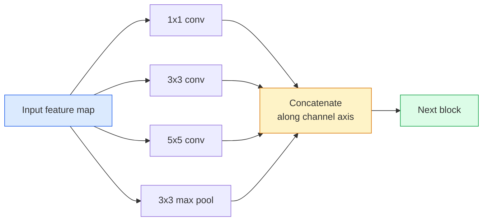
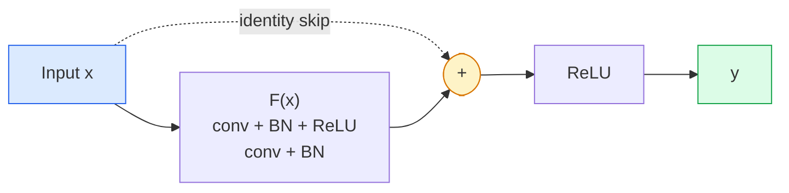

# CNN — LeNet sampai ResNet

> Setiap CNN besar tiga puluh tahun terakhir adalah resep conv–nonlinearitas–downsample yang sama dengan satu ide baru yang dibaut. Pelajari ide-idenya berurutan.

**Type:** Learn + Build
**Languages:** Python
**Prerequisites:** Phase 3 Lesson 11 (PyTorch), Phase 4 Lesson 01 (Image Fundamentals), Phase 4 Lesson 02 (Convolutions from Scratch)
**Time:** ~75 minutes

## Tujuan Pembelajaran

- Menelusuri silsilah arsitektur LeNet-5 -> AlexNet -> VGG -> Inception -> ResNet dan menyatakan satu ide baru yang disumbang setiap keluarga
- Mengimplementasikan LeNet-5, blok gaya VGG, dan BasicBlock ResNet di PyTorch, masing-masing di bawah 40 baris
- Menjelaskan mengapa residual connection mengubah network 1.000 lapis dari tak bisa dilatih menjadi state-of-the-art
- Membaca backbone modern (ResNet-18, ResNet-50) dan memprediksi bentuk output, receptive field, dan jumlah parameternya sebelum melihat sumbernya

## Masalahnya

Pada 2011, pengklasifikasi ImageNet terbaik mencapai sekitar 74% akurasi top-5. Pada 2012 AlexNet mencapai 85%. Pada 2015 ResNet mencapai 96%. Tanpa data baru. Tanpa generasi GPU baru. Peningkatan datang dari ide arsitektur. Insinyur vision yang bekerja harus tahu ide mana dari makalah mana karena setiap backbone produksi yang kamu kirim pada 2026 adalah rekombinasi potongan yang sama — dan karena ide-idenya terus berpindah: grouped conv berpindah dari CNN ke transformer, residual connection berpindah dari ResNet ke setiap LLM yang ada, batch normalisation hidup dalam diffusion model.

Mempelajari network ini berurutan juga membuatmu kebal terhadap kesalahan umum: meraih model terbesar yang tersedia padahal network seukuran LeNet akan menyelesaikan masalah. MNIST tidak butuh ResNet. Mengetahui kurva skala setiap keluarga memberitahumu di mana duduk padanya.

## Konsepnya

### Empat ide yang mengubah vision



Tidak ada hal lain dalam vision klasik yang penting sebesar empat lompatan ini.

### LeNet-5 (1998)

Pengenalan digit Yann LeCun. 60.000 parameter. Dua blok conv-pool, dua lapis fully connected, aktivasi tanh. Ia mendefinisikan templat yang diwarisi setiap CNN:

```
input (1, 32, 32)
  conv 5x5 -> (6, 28, 28)
  avg pool 2x2 -> (6, 14, 14)
  conv 5x5 -> (16, 10, 10)
  avg pool 2x2 -> (16, 5, 5)
  flatten -> 400
  dense -> 120
  dense -> 84
  dense -> 10
```

Semua yang disebut dunia modern sebagai CNN — konvolusi dan downsampling bergantian yang memberi makan head pengklasifikasi kecil — adalah LeNet dengan lapis lebih banyak, channel lebih besar, dan aktivasi lebih baik.

### AlexNet (2012)

Tiga perubahan yang bersama memecahkan ImageNet:

1. **ReLU** bukan tanh. Gradien berhenti lenyap. Training melesat enam kali lipat.
2. **Dropout** di head fully connected. Regularisasi menjadi lapis, bukan trik.
3. **Kedalaman dan lebar**. Lima lapis conv, tiga lapis dense, 60M parameter, dilatih pada dua GPU dengan model terbelah di keduanya.

Gambar 2 makalah masih menunjukkan belahan GPU sebagai dua aliran paralel. Paralelisme itu adalah jalan pintas hardware, bukan wawasan arsitektural — tetapi tiga ide di atas masih ada di setiap model yang kamu pakai.

### VGG (2014)

VGG bertanya: apa yang terjadi jika kamu hanya memakai konvolusi 3x3 dan kamu mendalam?

```
stack:   conv 3x3 -> conv 3x3 -> pool 2x2
repeat:  16 or 19 conv layers
```

Dua conv 3x3 melihat area input 5x5 yang sama dengan satu conv 5x5 tetapi dengan parameter lebih sedikit (2*9*C^2 = 18C^2 vs 25*C^2) dan tambahan ReLU di antaranya. VGG mengubah observasi ini menjadi seluruh arsitektur. Kesederhanaannya — satu jenis blok, diulang — menjadikannya titik acuan untuk semua yang datang sesudahnya.

Biaya: 138M parameter, lambat dilatih, mahal saat inference.

### Inception (2014, tahun yang sama)

Jawaban Google atas "ukuran kernel mana yang harus kupakai?" adalah: semuanya, paralel.



Setiap cabang berspesialisasi — 1x1 untuk pencampuran channel, 3x3 untuk tekstur lokal, 5x5 untuk pola lebih besar, pooling untuk fitur invarian-geser — dan concat membiarkan lapis berikutnya memilih cabang mana yang berguna. Inception v1 memakai konvolusi 1x1 di dalam setiap cabang sebagai bottleneck agar jumlah parameter tetap waras.

### Masalah degradasi

Pada 2015, VGG-19 bekerja dan VGG-32 tidak. Kedalaman seharusnya membantu, tetapi melewati ~20 lapis baik training maupun test loss memburuk. Itu bukan overfitting. Itu optimizer gagal menemukan bobot berguna karena gradien menyusut multiplikatif melalui setiap lapis.

```
Plain deep network:
  y = f_L( f_{L-1}( ... f_1(x) ... ) )

Gradient wrt early layer:
  dL/dW_1 = dL/dy * df_L/df_{L-1} * ... * df_2/df_1 * df_1/dW_1

Each multiplicative term has magnitude roughly (weight magnitude) * (activation gain).
Stack 100 of them with gains < 1 and the gradient is effectively zero.
```

VGG bekerja pada 19 lapis karena batch norm (dipublikasikan bersamaan) menjaga aktivasi terskala baik. Tetapi bahkan batch norm tidak bisa menyelamatkan kedalaman melampaui kira-kira 30 lapis.

### ResNet (2015)

He, Zhang, Ren, Sun mengusulkan satu perubahan yang memperbaiki semuanya:

```
standard block:   y = F(x)
residual block:   y = F(x) + x
```

`+ x` berarti lapis selalu bisa memilih tidak melakukan apa-apa dengan mendorong `F(x)` ke nol. ResNet 1.000 lapis kini paling buruk sama dengan network 1 lapis, karena setiap blok ekstra punya jalan keluar trivial. Dengan jaminan itu, optimizer bersedia membuat setiap blok *sedikit* berguna — dan sedikit berguna, ditumpuk 100 kali, adalah state-of-the-art.



Dua varian blok muncul di mana-mana:

- **BasicBlock** (ResNet-18, ResNet-34): dua conv 3x3, skip mengelilingi keduanya.
- **Bottleneck** (ResNet-50, -101, -152): 1x1 turun, 3x3 tengah, 1x1 naik, skip mengelilingi trio. Lebih murah saat jumlah channel tinggi.

Saat skip harus menyeberangi downsample (stride=2), jalur identitas diganti dengan conv 1x1 stride=2 agar bentuk cocok.

### Mengapa residual penting melampaui vision

Idenya sebenarnya bukan tentang klasifikasi gambar. Ia tentang mengubah network dalam dari "berdoa semoga gradien selamat" menjadi tool rekayasa yang andal dan bisa diskalakan. Setiap transformer yang akan kamu baca fase berikutnya punya skip connection yang persis sama di setiap blok. Tanpa ResNet, tidak ada GPT.

```figure
pooling
```

## Bangun Sendiri

### Langkah 1: LeNet-5

LeNet minimal yang setia. Aktivasi tanh, average pooling. Satu-satunya konsesi ke modernitas adalah kita memakai `nn.CrossEntropyLoss` di downstream bukan koneksi Gaussian orisinal.

```python
import torch
import torch.nn as nn
import torch.nn.functional as F

class LeNet5(nn.Module):
    def __init__(self, num_classes=10):
        super().__init__()
        self.conv1 = nn.Conv2d(1, 6, kernel_size=5)
        self.conv2 = nn.Conv2d(6, 16, kernel_size=5)
        self.pool = nn.AvgPool2d(2)
        self.fc1 = nn.Linear(16 * 5 * 5, 120)
        self.fc2 = nn.Linear(120, 84)
        self.fc3 = nn.Linear(84, num_classes)

    def forward(self, x):
        x = self.pool(torch.tanh(self.conv1(x)))
        x = self.pool(torch.tanh(self.conv2(x)))
        x = torch.flatten(x, 1)
        x = torch.tanh(self.fc1(x))
        x = torch.tanh(self.fc2(x))
        return self.fc3(x)

net = LeNet5()
x = torch.randn(1, 1, 32, 32)
print(f"output: {net(x).shape}")
print(f"params: {sum(p.numel() for p in net.parameters()):,}")
```

Output harapan: `output: torch.Size([1, 10])`, `params: 61,706`. Itulah seluruh pengklasifikasi digit yang memulai vision modern.

### Langkah 2: Blok VGG

Satu blok yang bisa dipakai ulang: dua conv 3x3, ReLU, batch norm, max pool.

```python
class VGGBlock(nn.Module):
    def __init__(self, in_c, out_c):
        super().__init__()
        self.conv1 = nn.Conv2d(in_c, out_c, kernel_size=3, padding=1)
        self.bn1 = nn.BatchNorm2d(out_c)
        self.conv2 = nn.Conv2d(out_c, out_c, kernel_size=3, padding=1)
        self.bn2 = nn.BatchNorm2d(out_c)
        self.pool = nn.MaxPool2d(2)

    def forward(self, x):
        x = F.relu(self.bn1(self.conv1(x)))
        x = F.relu(self.bn2(self.conv2(x)))
        return self.pool(x)

class MiniVGG(nn.Module):
    def __init__(self, num_classes=10):
        super().__init__()
        self.stack = nn.Sequential(
            VGGBlock(3, 32),
            VGGBlock(32, 64),
            VGGBlock(64, 128),
        )
        self.head = nn.Sequential(
            nn.AdaptiveAvgPool2d(1),
            nn.Flatten(),
            nn.Linear(128, num_classes),
        )

    def forward(self, x):
        return self.head(self.stack(x))

net = MiniVGG()
x = torch.randn(1, 3, 32, 32)
print(f"output: {net(x).shape}")
print(f"params: {sum(p.numel() for p in net.parameters()):,}")
```

Tiga blok VGG pada input seukuran CIFAR, adaptive pool, satu lapis linear. ~290k parameter. Cukup untuk CIFAR-10.

### Langkah 3: BasicBlock ResNet

Building block inti ResNet-18 dan ResNet-34.

```python
class BasicBlock(nn.Module):
    def __init__(self, in_c, out_c, stride=1):
        super().__init__()
        self.conv1 = nn.Conv2d(in_c, out_c, kernel_size=3, stride=stride, padding=1, bias=False)
        self.bn1 = nn.BatchNorm2d(out_c)
        self.conv2 = nn.Conv2d(out_c, out_c, kernel_size=3, stride=1, padding=1, bias=False)
        self.bn2 = nn.BatchNorm2d(out_c)
        if stride != 1 or in_c != out_c:
            self.shortcut = nn.Sequential(
                nn.Conv2d(in_c, out_c, kernel_size=1, stride=stride, bias=False),
                nn.BatchNorm2d(out_c),
            )
        else:
            self.shortcut = nn.Identity()

    def forward(self, x):
        out = F.relu(self.bn1(self.conv1(x)))
        out = self.bn2(self.conv2(out))
        out = out + self.shortcut(x)
        return F.relu(out)
```

`bias=False` pada lapis conv adalah konvensi batch-norm — parameter beta BN sudah menangani bias, sehingga membawa bias conv juga adalah pemborosan. `shortcut` hanya butuh conv nyata saat stride atau jumlah channel berubah; kalau tidak ia adalah identitas no-op.

### Langkah 4: ResNet mungil

Tumpuk empat grup BasicBlock menjadi ResNet yang bekerja untuk input seukuran CIFAR.

```python
class TinyResNet(nn.Module):
    def __init__(self, num_classes=10):
        super().__init__()
        self.stem = nn.Sequential(
            nn.Conv2d(3, 32, kernel_size=3, stride=1, padding=1, bias=False),
            nn.BatchNorm2d(32),
            nn.ReLU(inplace=True),
        )
        self.layer1 = self._make_group(32, 32, num_blocks=2, stride=1)
        self.layer2 = self._make_group(32, 64, num_blocks=2, stride=2)
        self.layer3 = self._make_group(64, 128, num_blocks=2, stride=2)
        self.layer4 = self._make_group(128, 256, num_blocks=2, stride=2)
        self.head = nn.Sequential(
            nn.AdaptiveAvgPool2d(1),
            nn.Flatten(),
            nn.Linear(256, num_classes),
        )

    def _make_group(self, in_c, out_c, num_blocks, stride):
        blocks = [BasicBlock(in_c, out_c, stride=stride)]
        for _ in range(num_blocks - 1):
            blocks.append(BasicBlock(out_c, out_c, stride=1))
        return nn.Sequential(*blocks)

    def forward(self, x):
        x = self.stem(x)
        x = self.layer1(x)
        x = self.layer2(x)
        x = self.layer3(x)
        x = self.layer4(x)
        return self.head(x)

net = TinyResNet()
x = torch.randn(1, 3, 32, 32)
print(f"output: {net(x).shape}")
print(f"params: {sum(p.numel() for p in net.parameters()):,}")
```

Empat grup berisi dua blok masing-masing. Stride 2 di awal grup 2, 3, 4. Jumlah channel berlipat ganda pada setiap downsample. Kira-kira 2,8M parameter. Itulah resep standar yang diskalakan bersih sampai ResNet-152.

### Langkah 5: Bandingkan efisiensi parameter-ke-fitur

Jalankan input yang sama melalui ketiga network dan bandingkan jumlah parameter.

```python
def summary(name, net, x):
    y = net(x)
    params = sum(p.numel() for p in net.parameters())
    print(f"{name:12s}  input {tuple(x.shape)} -> output {tuple(y.shape)}  params {params:>10,}")

x = torch.randn(1, 3, 32, 32)
summary("LeNet5",     LeNet5(),       torch.randn(1, 1, 32, 32))
summary("MiniVGG",    MiniVGG(),      x)
summary("TinyResNet", TinyResNet(),   x)
```

Tiga model, tiga era, tiga orde magnitudo dalam jumlah parameter. Untuk akurasi CIFAR-10, kamu butuh kira-kira: LeNet 60%, MiniVGG 89%, TinyResNet 93% setelah beberapa epoch training.

## Gunakan

`torchvision.models` memberimu versi pretrained dari semua di atas. Tanda tangan panggilan identik antar keluarga, yang persis merupakan poin abstraksi backbone.

```python
from torchvision.models import resnet18, ResNet18_Weights, vgg16, VGG16_Weights

r18 = resnet18(weights=ResNet18_Weights.IMAGENET1K_V1)
r18.eval()

print(f"ResNet-18 params: {sum(p.numel() for p in r18.parameters()):,}")
print(r18.layer1[0])
print()

v16 = vgg16(weights=VGG16_Weights.IMAGENET1K_V1)
v16.eval()
print(f"VGG-16   params: {sum(p.numel() for p in v16.parameters()):,}")
```

ResNet-18 punya 11,7M parameter. VGG-16 punya 138M. Akurasi top-1 ImageNet mirip (69,8% vs 71,6%). Residual connection membelikanmu kemenangan efisiensi parameter 12x. Itulah mengapa varian ResNet mendominasi dari 2016 sampai ViT tiba pada 2021 — dan masih mendominasi deployment dunia nyata di mana komputasi adalah batasnya.

Untuk transfer learning, resepnya selalu sama: muat pretrained, bekukan backbone, ganti head pengklasifikasi.

```python
for p in r18.parameters():
    p.requires_grad = False
r18.fc = nn.Linear(r18.fc.in_features, 10)
```

Tiga baris. Kamu kini punya pengklasifikasi CIFAR 10-kelas yang mewarisi representasi yang dibayar ImageNet.

## Rilis

Pelajaran ini menghasilkan:

- `outputs/prompt-backbone-selector.md` — prompt yang memilih keluarga CNN yang tepat (LeNet/VGG/ResNet/MobileNet/ConvNeXt) diberikan tugas, ukuran dataset, dan budget komputasi.
- `outputs/skill-residual-block-reviewer.md` — skill yang membaca modul PyTorch dan menandai kesalahan skip-connection (shortcut hilang saat stride berubah, urutan aktivasi shortcut, penempatan BN relatif terhadap penjumlahan).

## Latihan

1. **(Mudah)** Hitung parameter dengan tangan untuk `TinyResNet` lapis demi lapis. Bandingkan dengan `sum(p.numel() for p in net.parameters())`. Ke mana perginya mayoritas budget parameter — conv, BN, atau head pengklasifikasi?
2. **(Sedang)** Implementasikan blok Bottleneck (1x1 -> 3x3 -> 1x1 dengan skip) dan pakai untuk membangun network gaya ResNet-50 untuk CIFAR. Bandingkan param dengan `TinyResNet`.
3. **(Sulit)** Buang skip connection dari `BasicBlock`, latih network "plain" 34-blok dan ResNet 34-blok pada CIFAR-10 masing-masing 10 epoch. Plot training loss vs epoch untuk keduanya. Reproduksi hasil Gambar 1 He et al. di mana network plain yang dalam konvergen ke loss lebih tinggi daripada kembaran dangkalnya.

## Istilah Kunci

| Term | What people say | What it actually means |
|------|----------------|----------------------|
| Backbone | "The model" | The stack of convolutional blocks that produces the feature map fed to the task head |
| Residual connection | "Skip connection" | `y = F(x) + x`; lets the optimiser learn identity by setting F to zero, which makes arbitrary depth trainable |
| BasicBlock | "Two 3x3 convs with a skip" | The ResNet-18/34 building block: conv-BN-ReLU-conv-BN-add-ReLU |
| Bottleneck | "1x1 down, 3x3, 1x1 up" | The ResNet-50/101/152 block; cheap at high channel counts because the 3x3 runs on a reduced width |
| Degradation problem | "Deeper is worse" | Past ~20 plain conv layers, both training and test error increase; solved by residual connections, not by more data |
| Stem | "The first layer" | The initial conv that converts 3-channel input into the base feature width; usually 7x7 stride 2 for ImageNet, 3x3 stride 1 for CIFAR |
| Head | "The classifier" | The layers after the final backbone block: adaptive pool, flatten, linear(s) |
| Transfer learning | "Pretrained weights" | Loading a backbone trained on ImageNet and fine-tuning only the head on your task |

## Bacaan Lanjutan

- [Deep Residual Learning for Image Recognition (He et al., 2015)](https://arxiv.org/abs/1512.03385) — makalah ResNet; setiap gambar layak dipelajari
- [Very Deep Convolutional Networks (Simonyan & Zisserman, 2014)](https://arxiv.org/abs/1409.1556) — makalah VGG; masih referensi terbaik untuk "mengapa 3x3"
- [ImageNet Classification with Deep CNNs (Krizhevsky et al., 2012)](https://papers.nips.cc/paper_files/paper/2012/hash/c399862d3b9d6b76c8436e924a68c45b-Abstract.html) — AlexNet; makalah yang mengakhiri era fitur hand-crafted
- [Going Deeper with Convolutions (Szegedy et al., 2014)](https://arxiv.org/abs/1409.4842) — Inception v1; ide filter-paralel yang masih muncul dalam vision transformer
