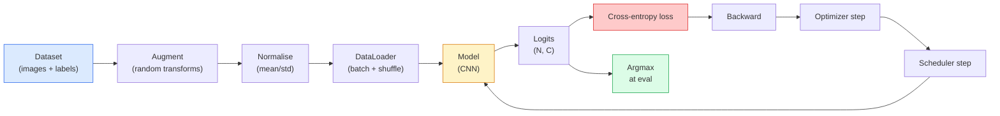

# Klasifikasi Gambar

> Pengklasifikasi adalah fungsi dari piksel ke distribusi probabilitas atas kelas. Selebihnya plumbing.

**Type:** Build
**Languages:** Python
**Prerequisites:** Phase 2 Lesson 09 (Model Evaluation), Phase 3 Lesson 10 (Mini Framework), Phase 4 Lesson 03 (CNNs)
**Time:** ~75 minutes

## Tujuan Pembelajaran

- Membangun pipeline klasifikasi gambar end-to-end pada CIFAR-10: dataset, augmentasi, model, loop training, evaluasi
- Menjelaskan peran setiap komponen (dataloader, loss, optimizer, scheduler, augmentasi) dan memprediksi bagaimana rusaknya salah satunya termanifestasi dalam kurva loss
- Mengimplementasikan mixup, cutout, dan label smoothing dari nol serta menjustifikasi kapan masing-masing layak ditambahkan
- Membaca confusion matrix dan tabel precision/recall per kelas untuk mendiagnosis kegagalan dataset dan model melampaui akurasi agregat

## Masalahnya

Setiap tugas vision yang dikirim mereduksi menjadi klasifikasi gambar pada level tertentu. Deteksi mengklasifikasi region. Segmentasi mengklasifikasi piksel. Retrieval merangking menurut kemiripan dengan centroid kelas. Memperbaiki klasifikasi — loop dataset, kebijakan augmentasi, loss, evaluasi — adalah skill yang berpindah ke setiap tugas lain di fase ini.

Kebanyakan bug klasifikasi tidak ada di model. Mereka hidup di pipeline: normalisasi rusak, set training tak teracak, augmentasi yang mendistorsi label, split validasi yang terkontaminasi data training, learning rate yang diam-diam divergen setelah epoch 30. CNN yang akan mencapai 93% pada CIFAR-10 dengan setup benar umumnya hanya mencapai 70-75% dengan setup rusak, dan kurva loss tampak masuk akal sepanjang waktu.

Pelajaran ini merangkai seluruh pipeline dengan tangan sehingga setiap bagian bisa diinspeksi. Kamu tidak akan memakai apa pun dari `torchvision.datasets` yang bisa menyembunyikan bug.

## Konsepnya

### Pipeline klasifikasi



Setiap baris dalam loop ini adalah tempat bug bisa hidup. Cross-entropy menerima logit mentah, bukan output softmax, sehingga `model(x).softmax()` apa pun sebelum loss diam-diam menghitung gradien yang salah. Augmentasi diterapkan hanya pada input, bukan label — kecuali mixup, yang mencampur keduanya. `optimizer.zero_grad()` harus terjadi sekali per langkah; melewatkannya mengakumulasi gradien dan tampak seperti learning rate yang sangat tidak stabil. Setiap bug itu meratakan kurva belajar tanpa melempar error.

### Cross-entropy, logit, dan softmax

Pengklasifikasi menghasilkan `C` angka per gambar yang disebut logit. Menerapkan softmax mengubahnya menjadi distribusi probabilitas:

```
softmax(z)_i = exp(z_i) / sum_j exp(z_j)
```

Cross-entropy mengukur negative log probability dari kelas yang benar:

```
CE(z, y) = -log( softmax(z)_y )
        = -z_y + log( sum_j exp(z_j) )
```

Bentuk kanan adalah yang stabil numerik (log-sum-exp). `nn.CrossEntropyLoss` PyTorch memfusi softmax + NLL dalam satu op dan menerima logit mentah langsung. Menerapkan softmax sendiri dulu nyaris selalu bug — kamu menghitung log(softmax(softmax(z))), kuantitas tak bermakna.

### Mengapa augmentasi bekerja

CNN punya bias induktif untuk translasi (dari pembagian bobot) tetapi tidak punya invariansi bawaan terhadap crop, flip, colour jitter, atau oklusi. Satu-satunya cara mengajarinya invariansi itu adalah menunjukkan piksel yang melatihnya. Setiap transform acak selama training adalah cara berkata: "dua gambar ini punya label yang sama; pelajari fitur yang mengabaikan perbedaannya."

```
Original crop:  "dog facing left"
Flip:           "dog facing right"       <- same label, different pixels
Rotate(+15):    "dog, slight tilt"
Colour jitter:  "dog in warmer light"
RandomErasing:  "dog with patch missing"
```

Aturannya: augmentasi harus menjaga label. Cutout dan rotasi pada digit bisa membalik "6" menjadi "9"; untuk dataset itu kamu memakai rentang rotasi lebih kecil dan memilih augmentasi yang menghormati invariansi spesifik-digit.

### Mixup dan cutmix

Augmentasi biasa mentransformasi piksel tetapi menjaga label one-hot. **Mixup** dan **cutmix** memecahnya dengan menginterpolasi keduanya.

```
Mixup:
  lambda ~ Beta(a, a)
  x = lambda * x_i + (1 - lambda) * x_j
  y = lambda * y_i + (1 - lambda) * y_j

Cutmix:
  paste a random rectangle of x_j into x_i
  y = area-weighted mix of y_i and y_j
```

Mengapa membantu: model berhenti menghafal target one-hot yang spiky dan belajar menginterpolasi antar kelas. Training loss naik, akurasi uji naik. Ia adalah upgrade robustness termurah untuk pengklasifikasi apa pun.

### Label smoothing

Sepupu mixup. Alih-alih berlatih melawan `[0, 0, 1, 0, 0]`, berlatihlah melawan `[eps/C, eps/C, 1-eps, eps/C, eps/C]` untuk `eps` kecil seperti 0,1. Menghentikan model menghasilkan logit yang tajam sewenang-wenang dan memperbaiki kalibrasi nyaris tanpa biaya. Bawaan dalam `nn.CrossEntropyLoss(label_smoothing=0.1)` sejak PyTorch 1.10.

### Evaluasi melampaui akurasi

Akurasi agregat menyembunyikan ketidakseimbangan. Pengklasifikasi biner 90-10 yang selalu memprediksi kelas mayoritas mencapai 90%. Tool yang benar-benar memberitahumu apa yang terjadi:

- **Akurasi per kelas** — satu angka per kelas; langsung menampilkan kategori yang berkinerja buruk.
- **Confusion matrix** — grid C x C dengan baris i kolom j = jumlah kelas benar i diprediksi sebagai kelas j; diagonal benar, off-diagonal adalah tempat modelmu hidup.
- **Top-1 / Top-5** — apakah kelas benar ada dalam 1 atau 5 prediksi teratas; Top-5 penting untuk ImageNet karena kelas seperti "Norwich terrier" vs "Norfolk terrier" sungguh ambigu.
- **Kalibrasi (ECE)** — apakah prediksi kepercayaan 0,8 benar 80% kali? Network modern sistematis terlalu percaya diri; perbaiki dengan temperature scaling atau label smoothing.

```figure
receptive-field
```

## Bangun Sendiri

### Langkah 1: Dataset sintetis deterministik

CIFAR-10 hidup di disk. Agar pelajaran ini reproduksibel dan cepat kita membangun dataset sintetis yang tampak seperti CIFAR — gambar RGB 32x32 dengan struktur spesifik-kelas yang harus dipelajari model. Pipeline yang persis sama bekerja tanpa perubahan pada CIFAR-10 nyata.

```python
import numpy as np
import torch
from torch.utils.data import Dataset


def synthetic_cifar(num_per_class=1000, num_classes=10, seed=0):
    rng = np.random.default_rng(seed)
    X = []
    Y = []
    for c in range(num_classes):
        centre = rng.uniform(0, 1, (3,))
        freq = 2 + c
        for _ in range(num_per_class):
            yy, xx = np.meshgrid(np.linspace(0, 1, 32), np.linspace(0, 1, 32), indexing="ij")
            r = np.sin(xx * freq) * 0.5 + centre[0]
            g = np.cos(yy * freq) * 0.5 + centre[1]
            b = (xx + yy) * 0.5 * centre[2]
            img = np.stack([r, g, b], axis=-1)
            img += rng.normal(0, 0.08, img.shape)
            img = np.clip(img, 0, 1)
            X.append(img.astype(np.float32))
            Y.append(c)
    X = np.stack(X)
    Y = np.array(Y)
    idx = rng.permutation(len(X))
    return X[idx], Y[idx]


class ArrayDataset(Dataset):
    def __init__(self, X, Y, transform=None):
        self.X = X
        self.Y = Y
        self.transform = transform

    def __len__(self):
        return len(self.X)

    def __getitem__(self, i):
        img = self.X[i]
        if self.transform is not None:
            img = self.transform(img)
        img = torch.from_numpy(img).permute(2, 0, 1)
        return img, int(self.Y[i])
```

Setiap kelas mendapat palet warna dan pola frekuensi sendiri, plus noise Gaussian agar model mempelajari sinyal bukan menghafal piksel. Sepuluh kelas, seribu gambar masing-masing, dipermutasi.

### Langkah 2: Normalisasi dan augmentasi

Dua transform yang dimiliki setiap pipeline vision.

```python
def standardize(mean, std):
    mean = np.array(mean, dtype=np.float32)
    std = np.array(std, dtype=np.float32)
    def _fn(img):
        return (img - mean) / std
    return _fn


def random_hflip(p=0.5):
    def _fn(img):
        if np.random.random() < p:
            return img[:, ::-1, :].copy()
        return img
    return _fn


def random_crop(pad=4):
    def _fn(img):
        h, w = img.shape[:2]
        padded = np.pad(img, ((pad, pad), (pad, pad), (0, 0)), mode="reflect")
        y = np.random.randint(0, 2 * pad)
        x = np.random.randint(0, 2 * pad)
        return padded[y:y + h, x:x + w, :]
    return _fn


def compose(*fns):
    def _fn(img):
        for fn in fns:
            img = fn(img)
        return img
    return _fn
```

Reflect-pad sebelum crop, bukan zero-pad, karena batas hitam adalah sinyal yang akan dipelajari model untuk diabaikan dengan cara yang tidak berguna.

### Langkah 3: Mixup

Mencampur dua gambar dan dua label di dalam langkah training. Diimplementasikan sebagai transform batch sehingga hidup di sebelah forward pass bukan di dalam dataset.

```python
def mixup_batch(x, y, num_classes, alpha=0.2):
    if alpha <= 0:
        return x, torch.nn.functional.one_hot(y, num_classes).float()
    lam = float(np.random.beta(alpha, alpha))
    idx = torch.randperm(x.size(0), device=x.device)
    x_mixed = lam * x + (1 - lam) * x[idx]
    y_onehot = torch.nn.functional.one_hot(y, num_classes).float()
    y_mixed = lam * y_onehot + (1 - lam) * y_onehot[idx]
    return x_mixed, y_mixed


def soft_cross_entropy(logits, soft_targets):
    log_probs = torch.log_softmax(logits, dim=-1)
    return -(soft_targets * log_probs).sum(dim=-1).mean()
```

`soft_cross_entropy` adalah cross-entropy melawan distribusi label-munak. Ia mereduksi ke kasus one-hot biasa saat target persis one-hot.

### Langkah 4: Loop training

Resep lengkap: satu pass atas data, gradien sekali per batch, scheduler di-step sekali per epoch.

```python
import torch
import torch.nn as nn
from torch.utils.data import DataLoader
from torch.optim import SGD
from torch.optim.lr_scheduler import CosineAnnealingLR

def train_one_epoch(model, loader, optimizer, device, num_classes, use_mixup=True):
    model.train()
    total, correct, loss_sum = 0, 0, 0.0
    for x, y in loader:
        x, y = x.to(device), y.to(device)
        if use_mixup:
            x_m, y_soft = mixup_batch(x, y, num_classes)
            logits = model(x_m)
            loss = soft_cross_entropy(logits, y_soft)
        else:
            logits = model(x)
            loss = nn.functional.cross_entropy(logits, y, label_smoothing=0.1)
        optimizer.zero_grad()
        loss.backward()
        optimizer.step()
        loss_sum += loss.item() * x.size(0)
        total += x.size(0)
        # Training accuracy vs the un-mixed labels `y` is only an approximation
        # when mixup is on (the model saw soft targets, not y). Treat it as a
        # rough progress signal; rely on val accuracy for real performance.
        with torch.no_grad():
            pred = logits.argmax(dim=-1)
            correct += (pred == y).sum().item()
    return loss_sum / total, correct / total


@torch.no_grad()
def evaluate(model, loader, device, num_classes):
    model.eval()
    total, correct = 0, 0
    loss_sum = 0.0
    cm = torch.zeros(num_classes, num_classes, dtype=torch.long)
    for x, y in loader:
        x, y = x.to(device), y.to(device)
        logits = model(x)
        loss = nn.functional.cross_entropy(logits, y)
        pred = logits.argmax(dim=-1)
        for t, p in zip(y.cpu(), pred.cpu()):
            cm[t, p] += 1
        loss_sum += loss.item() * x.size(0)
        total += x.size(0)
        correct += (pred == y).sum().item()
    return loss_sum / total, correct / total, cm
```

Lima invarian yang kamu cek setiap kali menulis loop training:

1. `model.train()` sebelum training, `model.eval()` sebelum evaluasi — membalik perilaku dropout dan batchnorm.
2. `.zero_grad()` sebelum `.backward()`.
3. `.item()` saat mengakumulasi metrik sehingga tidak ada yang menahan computation graph hidup.
4. `@torch.no_grad()` selama evaluasi — menghemat memori dan waktu, mencegah kecelakaan halus.
5. Argmax melawan logit mentah, bukan softmax — hasil sama, satu op lebih sedikit.

### Langkah 5: Rangkai semuanya

Pakai `TinyResNet` dari pelajaran sebelumnya, latih beberapa epoch, evaluasi.

```python
from main import synthetic_cifar, ArrayDataset
from main import standardize, random_hflip, random_crop, compose
from main import mixup_batch, soft_cross_entropy
from main import train_one_epoch, evaluate
# TinyResNet comes from the previous lesson (03-cnns-lenet-to-resnet).
# Adjust the import path to wherever you stored the previous lesson's code.
from cnns_lenet_to_resnet import TinyResNet  # example placeholder

X, Y = synthetic_cifar(num_per_class=500)
split = int(0.9 * len(X))
X_train, Y_train = X[:split], Y[:split]
X_val, Y_val = X[split:], Y[split:]

mean = [0.5, 0.5, 0.5]
std = [0.25, 0.25, 0.25]
train_tf = compose(random_hflip(), random_crop(pad=4), standardize(mean, std))
eval_tf = standardize(mean, std)

train_ds = ArrayDataset(X_train, Y_train, transform=train_tf)
val_ds = ArrayDataset(X_val, Y_val, transform=eval_tf)

train_loader = DataLoader(train_ds, batch_size=128, shuffle=True, num_workers=0)
val_loader = DataLoader(val_ds, batch_size=256, shuffle=False, num_workers=0)

device = "cuda" if torch.cuda.is_available() else "cpu"
model = TinyResNet(num_classes=10).to(device)
optimizer = SGD(model.parameters(), lr=0.1, momentum=0.9, weight_decay=5e-4, nesterov=True)
scheduler = CosineAnnealingLR(optimizer, T_max=10)

for epoch in range(10):
    tr_loss, tr_acc = train_one_epoch(model, train_loader, optimizer, device, 10, use_mixup=True)
    va_loss, va_acc, _ = evaluate(model, val_loader, device, 10)
    scheduler.step()
    print(f"epoch {epoch:2d}  lr {scheduler.get_last_lr()[0]:.4f}  "
          f"train {tr_loss:.3f}/{tr_acc:.3f}  val {va_loss:.3f}/{va_acc:.3f}")
```

Pada dataset sintetis, ini mencapai akurasi validasi nyaris sempurna dalam lima epoch, yang memang poinnya: pipeline benar, model bisa mempelajari apa yang bisa dipelajari. Tukar dataset dengan CIFAR-10 nyata dan loop yang sama berlatih ke ~90% tanpa perubahan.

### Langkah 6: Baca confusion matrix

Akurasi saja tidak pernah memberitahumu di mana model gagal. Confusion matrix bisa.

```python
def print_confusion(cm, labels=None):
    c = cm.shape[0]
    labels = labels or [str(i) for i in range(c)]
    print(f"{'':>6}" + "".join(f"{l:>5}" for l in labels))
    for i in range(c):
        row = cm[i].tolist()
        print(f"{labels[i]:>6}" + "".join(f"{v:>5}" for v in row))
    print()
    tp = cm.diag().float()
    fp = cm.sum(dim=0).float() - tp
    fn = cm.sum(dim=1).float() - tp
    prec = tp / (tp + fp).clamp_min(1)
    rec = tp / (tp + fn).clamp_min(1)
    f1 = 2 * prec * rec / (prec + rec).clamp_min(1e-9)
    for i in range(c):
        print(f"{labels[i]:>6}  prec {prec[i]:.3f}  rec {rec[i]:.3f}  f1 {f1[i]:.3f}")

_, _, cm = evaluate(model, val_loader, device, 10)
print_confusion(cm)
```

Baris adalah kelas benar, kolom adalah prediksi. Gugus jumlah off-diagonal antara kelas 3 dan 5 berarti model mengacaukan keduanya dan memberimu titik awal untuk pengumpulan data terarah atau augmentasi spesifik-kelas.

## Gunakan

`torchvision` membungkus semua di atas menjadi komponen idiomatis. Untuk CIFAR-10 nyata seluruh pipeline adalah empat baris plus loop training.

```python
from torchvision.datasets import CIFAR10
from torchvision.transforms import Compose, RandomCrop, RandomHorizontalFlip, ToTensor, Normalize

mean = (0.4914, 0.4822, 0.4465)
std = (0.2470, 0.2435, 0.2616)
train_tf = Compose([
    RandomCrop(32, padding=4, padding_mode="reflect"),
    RandomHorizontalFlip(),
    ToTensor(),
    Normalize(mean, std),
])
eval_tf = Compose([ToTensor(), Normalize(mean, std)])

train_ds = CIFAR10(root="./data", train=True,  download=True, transform=train_tf)
val_ds   = CIFAR10(root="./data", train=False, download=True, transform=eval_tf)
```

Dua hal yang perlu diperhatikan: mean/std **spesifik-dataset** — dihitung pada set training CIFAR-10, bukan ImageNet — dan reflect pad adalah kebijakan crop default komunitas. Menyalin-tempel statistik ImageNet ke sini adalah kebocoran akurasi ~1% yang tak tertangkap sampai seseorang memprofil model.

## Rilis

Pelajaran ini menghasilkan:

- `outputs/prompt-classifier-pipeline-auditor.md` — prompt yang mengaudit skrip training untuk lima invarian di atas dan menampilkan pelanggaran pertama.
- `outputs/skill-classification-diagnostics.md` — skill yang, diberikan confusion matrix dan daftar nama kelas, meringkas kegagalan per kelas dan mengusulkan satu perbaikan paling berdampak.

## Latihan

1. **(Mudah)** Latih model yang sama dengan dan tanpa mixup lima epoch pada dataset sintetis. Plot train dan val loss untuk keduanya. Jelaskan mengapa train loss dengan mixup lebih tinggi tetapi akurasi val mirip atau lebih baik.
2. **(Sedang)** Implementasikan Cutout — nol-kan kotak 8x8 acak di setiap gambar training — dan jalankan ablasi vs tanpa augmentasi, hflip+crop, hflip+crop+cutout, hflip+crop+mixup. Laporkan akurasi val masing-masing.
3. **(Sulit)** Bangun pipeline CIFAR-100 (100 kelas, ukuran input sama) dan reproduksi run training ResNet-34 hingga dalam 1% akurasi publikasi. Ekstra: sweep tiga learning rate dan dua weight decay, log ke CSV lokal, hasilkan tabel top-confusions confusion-matrix final.

## Istilah Kunci

| Term | What people say | What it actually means |
|------|----------------|----------------------|
| Logits | "Raw outputs" | The pre-softmax vector of C numbers per image; cross-entropy expects these, not softmaxed values |
| Cross-entropy | "The loss" | Negative log-probability of the correct class; combines log-softmax and NLL in one stable op |
| DataLoader | "The batcher" | Wraps a dataset with shuffling, batching, and (optional) multi-worker loading; gets blamed for half of training bugs |
| Augmentation | "Random transforms" | Any pixel-level transform at training time that preserves the label; teaches invariances the CNN does not have natively |
| Mixup / Cutmix | "Mix two images" | Blend both inputs and labels so the classifier learns smooth interpolations instead of hard boundaries |
| Label smoothing | "Softer targets" | Replace one-hot with (1-eps, eps/(C-1), ...); improves calibration and slightly boosts accuracy |
| Top-k accuracy | "Top-5" | The correct class is in the k highest-probability predictions; used on datasets with genuinely ambiguous classes |
| Confusion matrix | "Where errors live" | C x C table where entry (i, j) counts images of true class i predicted as j; diagonal is right, off-diagonal tells you what to fix |

## Bacaan Lanjutan

- [CS231n: Training Neural Networks](https://cs231n.github.io/neural-networks-3/) — masih tur paling jernih atas pipeline training dalam satu halaman
- [Bag of Tricks for Image Classification (He et al., 2019)](https://arxiv.org/abs/1812.01187) — setiap trik kecil yang bersama menambah 3-4% akurasi ResNet pada ImageNet
- [mixup: Beyond Empirical Risk Minimization (Zhang et al., 2017)](https://arxiv.org/abs/1710.09412) — makalah mixup orisinal; tiga halaman teori plus eksperimen meyakinkan
- [Why temperature scaling matters (Guo et al., 2017)](https://arxiv.org/abs/1706.04599) — makalah yang membuktikan network modern salah kalibrasi dan memperbaikinya dengan satu parameter skalar
