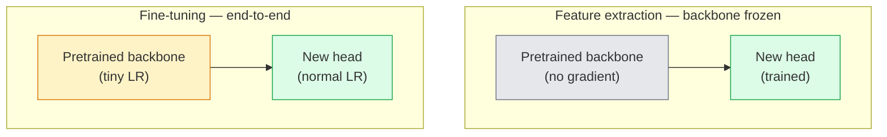

# Transfer Learning & Fine-Tuning

> Seseorang sudah menghabiskan sejuta GPU-hour untuk mengajarkan jaringan seperti apa tepi, tekstur, dan bagian objek itu. Kamu sebaiknya meminjam fitur-fitur itu sebelum melatih sendiri.

**Type:** Build
**Languages:** Python
**Prerequisites:** Phase 4 Lesson 03 (CNNs), Phase 4 Lesson 04 (Image Classification)
**Time:** ~75 minutes

## Tujuan Pembelajaran

- Membedakan feature extraction dari fine-tuning dan memilih yang tepat berdasarkan ukuran dataset, jarak domain, dan anggaran komputasi
- Memuat backbone pre-trained, mengganti classifier head-nya, dan melatih hanya head-nya hingga baseline yang berfungsi dalam kurang dari 20 baris
- Membekukan layer secara bertahap dengan learning rate diskriminatif supaya fitur generik awal mendapat update lebih kecil daripada fitur khusus-tugas di akhir
- Mendiagnosis tiga kegagalan umum: fitur yang menyimpang (feature drift) akibat LR terlalu tinggi pada blok yang di-unfreeze, runtuhnya statistik BN pada dataset kecil, dan catastrophic forgetting

## Masalahnya

Melatih **ResNet-50** pada ImageNet menghabiskan sekitar 2.000 GPU-hour. Sangat sedikit tim yang punya anggaran sebesar itu untuk setiap tugas yang mereka rilis. Yang hampir selalu dirilis setiap tim adalah backbone pre-trained dengan head baru yang dilatih pada beberapa ratus hingga beberapa ribu gambar khusus-tugas.

Ini bukan jalan pintas. Conv block pertama dari CNN mana pun yang dilatih pada ImageNet mempelajari tepi dan filter ala Gabor. Beberapa blok berikutnya mempelajari tekstur dan motif sederhana. Blok-blok tengah mempelajari bagian objek. Blok-blok terakhir mempelajari kombinasi yang mulai terlihat seperti 1.000 kategori ImageNet. 90% pertama dari hierarki itu mentransfer hampir tanpa perubahan ke pencitraan medis, inspeksi industri, data satelit, dan setiap tugas visi lainnya — karena alam punya kosakata tepi dan tekstur yang terbatas. 10% terakhir lah yang benar-benar kamu latih.

Mendapatkan transfer yang benar punya tiga bug yang menunggumu: menghancurkan fitur pre-trained dengan learning rate terlalu tinggi, membuat model kekurangan informasi dengan membekukan terlalu banyak, dan membiarkan statistik berjalan BatchNorm menyimpang ke dataset kecil yang tidak pernah dipelajari oleh sisa jaringan. Pelajaran ini sengaja membahas ketiganya.

## Konsepnya

### Feature extraction vs fine-tuning

Dua rezim, dipilih dari seberapa besar kamu mempercayai fitur pre-trained dan seberapa banyak data yang kamu punya.



Aturan praktis:

| Dataset size | Domain distance | Recipe |
|--------------|-----------------|--------|
| < 1k images | close to ImageNet | Freeze backbone, train head only |
| 1k-10k | close | Freeze first 2-3 stages, fine-tune the rest |
| 10k-100k | any | Fine-tune end-to-end with discriminative LR |
| 100k+ | far | Fine-tune everything; consider training from scratch if domain is far enough |

"Hampir mirip ImageNet" kira-kira berarti foto RGB alami dengan konten berupa objek. CT scan medis, citra satelit pengambilan-atas, dan mikroskopi adalah domain yang jauh — fiturnya masih membantu, tapi kamu perlu membiarkan lebih banyak layer beradaptasi.

### Mengapa membekukan bisa bekerja

Fitur ImageNet yang dipelajari CNN bukanlah spesialisasi untuk 1.000 kategori itu. Mereka spesialisasi pada statistik gambar alami: tepi pada orientasi tertentu, tekstur, pola kontras, primitif bentuk. Statistik itu stabil di hampir setiap domain visual yang bisa disebut manusia. Itulah sebabnya model yang dilatih pada ImageNet dan dievaluasi zero-shot pada CIFAR-10 hanya dengan linear head baru (tanpa fine-tuning backbone) mencapai akurasi 80%+. Head-nya belajar fitur-fitur mana dari yang sudah dipelajari yang perlu diberi bobot untuk tugas ini.

### Learning rate diskriminatif

Saat kamu membekukan kembali (unfreeze), layer awal seharusnya dilatih lebih lambat daripada layer akhir. Layer awal mengkodekan fitur generik yang ingin kamu pertahankan; layer akhir mengkodekan struktur khusus-tugas yang perlu kamu geser banyak.

```
Typical recipe:

  stage 0 (stem + first group): lr = base_lr / 100    (mostly fixed)
  stage 1:                       lr = base_lr / 10
  stage 2:                       lr = base_lr / 3
  stage 3 (last backbone group): lr = base_lr
  head:                          lr = base_lr  (or slightly higher)
```

Di PyTorch ini hanyalah daftar parameter group yang diberikan ke optimizer. Satu model, lima learning rate, nol kode ekstra.

### Masalah BatchNorm

Layer **BN** menyimpan buffer `running_mean` dan `running_var` yang dihitung di ImageNet. Jika tugasmu punya distribusi piksel yang berbeda — pencahayaan berbeda, sensor berbeda, ruang warna berbeda — buffer itu salah. Tiga opsi berdasarkan urutan preferensi:

1. **Fine-tune dengan BN dalam mode train.** Biarkan BN memperbarui statistik berjalan-nya bersama yang lain. Pilihan default saat dataset tugas berukuran sedang (>= 5k contoh).
2. **Bekukan BN dalam mode eval.** Pertahankan statistik ImageNet dan latih hanya bobotnya. Tepat saat datasetmu cukup kecil sehingga moving average BN akan berisik.
3. **Ganti BN dengan GroupNorm.** Menghilangkan masalah moving-average sepenuhnya. Dipakai pada backbone deteksi dan segmentasi di mana batch size per GPU sangat kecil.

Melakukan ini dengan salah menurunkan akurasi 5-15% secara diam-diam.

### Desain head

Classifier head terdiri dari 1-3 layer linear plus dropout opsional. Setiap backbone torchvision membawa head default yang kamu ganti:

```
backbone.fc = nn.Linear(backbone.fc.in_features, num_classes)          # ResNet
backbone.classifier[1] = nn.Linear(..., num_classes)                    # EfficientNet, MobileNet
backbone.heads.head = nn.Linear(..., num_classes)                       # torchvision ViT
```

Untuk dataset kecil, satu layer linear biasanya sudah cukup. Menambahkan hidden layer (Linear -> ReLU -> Dropout -> Linear) membantu saat distribusi tugas jauh dari distribusi training backbone.

### LR decay per layer

Versi lebih halus dari LR diskriminatif yang dipakai dalam fine-tuning modern (BEiT, DINOv2, fine-tune ViT-B). Alih-alih mengelompokkan layer ke dalam stage, beri setiap layer LR sedikit lebih kecil daripada layer di atasnya:

```
lr_layer_k = base_lr * decay^(L - k)
```

Dengan decay = 0.75 dan L = 12 transformer block, blok pertama dilatih pada `0.75^11 ≈ 0.04x` LR head. Ini lebih berarti untuk fine-tune transformer daripada untuk CNN, di mana LR berkelompok-stage biasanya sudah cukup.

### Apa yang dievaluasi

Run transfer-learning membutuhkan dua angka yang tidak akan kamu lacak pada run dari nol:

- **Akurasi pretrained-only** — akurasi head dengan backbone dibekukan. Ini lantaimu.
- **Akurasi fine-tuned** — model yang sama setelah training end-to-end. Ini langit-langitmu.

Jika fine-tuned lebih rendah dari pretrained-only, kamu punya bug learning rate atau BN. Selalu cetak keduanya.

```figure
transfer-learning
```

## Bangun Sendiri

### Langkah 1: Muat backbone pre-trained dan inspeksi

```python
import torch
import torch.nn as nn
from torchvision.models import resnet18, ResNet18_Weights

backbone = resnet18(weights=ResNet18_Weights.IMAGENET1K_V1)
print(backbone)
print()
print("classifier head:", backbone.fc)
print("feature dim:", backbone.fc.in_features)
```

`ResNet18` punya empat stage (`layer1..layer4`) plus stem dan head `fc`. Setiap backbone klasifikasi torchvision punya struktur yang analog.

### Langkah 2: Feature extraction — bekukan semuanya, ganti head-nya

```python
def make_feature_extractor(num_classes=10):
    model = resnet18(weights=ResNet18_Weights.IMAGENET1K_V1)
    for p in model.parameters():
        p.requires_grad = False
    model.fc = nn.Linear(model.fc.in_features, num_classes)
    return model

model = make_feature_extractor(num_classes=10)
trainable = sum(p.numel() for p in model.parameters() if p.requires_grad)
frozen = sum(p.numel() for p in model.parameters() if not p.requires_grad)
print(f"trainable: {trainable:>10,}")
print(f"frozen:    {frozen:>10,}")
```

Hanya `model.fc` yang bisa dilatih. Backbone-nya adalah feature extractor yang dibekukan.

### Langkah 3: Fine-tuning diskriminatif

Sebuah utilitas yang membangun parameter group dengan learning rate spesifik-stage.

```python
def discriminative_param_groups(model, base_lr=1e-3, decay=0.3):
    stages = [
        ["conv1", "bn1"],
        ["layer1"],
        ["layer2"],
        ["layer3"],
        ["layer4"],
        ["fc"],
    ]
    groups = []
    for i, names in enumerate(stages):
        lr = base_lr * (decay ** (len(stages) - 1 - i))
        params = [p for n, p in model.named_parameters()
                  if any(n.startswith(k) for k in names)]
        if params:
            groups.append({"params": params, "lr": lr, "name": "_".join(names)})
    return groups

model = resnet18(weights=ResNet18_Weights.IMAGENET1K_V1)
model.fc = nn.Linear(model.fc.in_features, 10)
for p in model.parameters():
    p.requires_grad = True

groups = discriminative_param_groups(model)
for g in groups:
    print(f"{g['name']:>10s}  lr={g['lr']:.2e}  params={sum(p.numel() for p in g['params']):>8,}")
```

`decay=0.3` berarti setiap stage dilatih pada 30% dari rate stage setelahnya. `fc` mendapat `base_lr`, `layer4` mendapat `0.3 * base_lr`, `conv1` mendapat `0.3^5 * base_lr ≈ 0.00243 * base_lr`. Terdengar ekstrem; secara empiris ini bekerja.

### Langkah 4: Penanganan BatchNorm

Helper untuk membekukan statistik berjalan BN tanpa membekukan bobotnya.

```python
def freeze_bn_stats(model):
    for m in model.modules():
        if isinstance(m, (nn.BatchNorm1d, nn.BatchNorm2d, nn.BatchNorm3d)):
            m.eval()
            for p in m.parameters():
                p.requires_grad = False
    return model
```

Panggil setelah kamu menyetel `model.train()` di awal setiap epoch. `model.train()` mengubah semuanya ke mode training; ini mengembalikannya hanya untuk layer BN.

### Langkah 5: Loop fine-tuning end-to-end minimal

```python
from torch.optim import SGD
from torch.utils.data import DataLoader
from torch.optim.lr_scheduler import CosineAnnealingLR
import torch.nn.functional as F

def fine_tune(model, train_loader, val_loader, device, epochs=5, base_lr=1e-3, freeze_bn=False):
    model = model.to(device)
    groups = discriminative_param_groups(model, base_lr=base_lr)
    optimizer = SGD(groups, momentum=0.9, weight_decay=1e-4, nesterov=True)
    scheduler = CosineAnnealingLR(optimizer, T_max=epochs)

    for epoch in range(epochs):
        model.train()
        if freeze_bn:
            freeze_bn_stats(model)
        tr_loss, tr_correct, tr_total = 0.0, 0, 0
        for x, y in train_loader:
            x, y = x.to(device), y.to(device)
            logits = model(x)
            loss = F.cross_entropy(logits, y, label_smoothing=0.1)
            optimizer.zero_grad()
            loss.backward()
            optimizer.step()
            tr_loss += loss.item() * x.size(0)
            tr_total += x.size(0)
            tr_correct += (logits.argmax(-1) == y).sum().item()
        scheduler.step()

        model.eval()
        va_total, va_correct = 0, 0
        with torch.no_grad():
            for x, y in val_loader:
                x, y = x.to(device), y.to(device)
                pred = model(x).argmax(-1)
                va_total += x.size(0)
                va_correct += (pred == y).sum().item()
        print(f"epoch {epoch}  train {tr_loss/tr_total:.3f}/{tr_correct/tr_total:.3f}  "
              f"val {va_correct/va_total:.3f}")
    return model
```

Lima epoch dengan resep di atas pada CIFAR-10 mengangkat `ResNet18-IMAGENET1K_V1` dari akurasi linear-probe zero-shot ~70% ke akurasi fine-tuned ~93%. Head-nya sendiri akan mentok di sekitar 86% tanpa pernah menyentuh backbone.

### Langkah 6: Unfreezing progresif

Jadwal yang membekukan satu stage per epoch dari akhir ke awal. Meredam feature drift dengan biaya beberapa epoch ekstra.

```python
def progressive_unfreeze_schedule(model):
    stages = ["layer4", "layer3", "layer2", "layer1"]
    yielded = set()

    def start():
        for p in model.parameters():
            p.requires_grad = False
        for p in model.fc.parameters():
            p.requires_grad = True

    def unfreeze(epoch):
        if epoch < len(stages):
            name = stages[epoch]
            yielded.add(name)
            for n, p in model.named_parameters():
                if n.startswith(name):
                    p.requires_grad = True
            return name
        return None

    return start, unfreeze
```

Panggil `start()` sekali sebelum epoch pertama. Panggil `unfreeze(epoch)` di awal setiap epoch. Bangun ulang optimizer setiap kali kumpulan parameter yang bisa dilatih berubah, jika tidak param frozen masih menyimpan momen yang di-cache dan membingungkannya.

## Gunakan

Untuk sebagian besar tugas nyata, `torchvision.models` + tiga baris sudah cukup. Mesin yang lebih berat di atas penting saat kamu menemui masalah yang tidak bisa diperbaiki oleh default bawaan pustaka.

```python
from torchvision.models import resnet50, ResNet50_Weights

model = resnet50(weights=ResNet50_Weights.IMAGENET1K_V2)
model.fc = nn.Linear(model.fc.in_features, num_classes)
optimizer = torch.optim.AdamW(model.parameters(), lr=1e-4, weight_decay=1e-4)
```

Dua default kelas-produksi lainnya:

- `timm` menghadirkan ~800 backbone visi pre-trained dengan API yang konsisten (`timm.create_model("resnet50", pretrained=True, num_classes=10)`). Untuk fine-tune apa pun di luar zoo torchvision, ini standarnya.
- Untuk transformer, `transformers.AutoModelForImageClassification.from_pretrained(name, num_labels=N)` memberimu ViT / BEiT / DeiT dengan semantik pemuatan yang sama seperti model teks.

## Rilis

Pelajaran ini menghasilkan:

- `outputs/prompt-fine-tune-planner.md` — prompt yang memilih feature extraction vs progressive vs end-to-end fine-tuning berdasarkan ukuran dataset, jarak domain, dan anggaran komputasi.
- `outputs/skill-freeze-inspector.md` — skill yang, diberikan sebuah model PyTorch, melaporkan parameter mana yang bisa dilatih, layer BatchNorm mana yang berada dalam mode eval, dan apakah optimizer benar-benar diberi parameter yang bisa dilatih.

## Latihan

1. **(Mudah)** Latih `ResNet18` sebagai linear probe (backbone dibekukan) dan sebagai full fine-tune pada dataset CIFAR-sintetis yang sama. Laporkan kedua akurasi berdampingan. Jelaskan gap mana yang menunjukkan fitur mentransfer dengan baik dan mana yang menunjukkan tidak.
2. **(Sedang)** Sengaja perkenalkan bug: setel `base_lr = 1e-1` pada stage backbone alih-alih head-nya. Tunjukkan loss training meledak, lalu pulihkan dengan menerapkan helper `discriminative_param_groups`. Catat LR di mana setiap stage mulai divergen.
3. **(Sulit)** Ambil dataset pencitraan medis (mis. CheXpert-small, PatchCamelyon, atau HAM10000) dan bandingkan tiga rezim: (a) backbone pre-trained ImageNet dibekukan + linear head; (b) fine-tune end-to-end pre-trained ImageNet; (c) training dari nol. Laporkan akurasi dan biaya komputasi untuk masing-masing. Pada ukuran dataset berapa training dari nol mulai bisa bersaing?

## Istilah Kunci

| Term | What people say | What it actually means |
|------|----------------|----------------------|
| Feature extraction | "Freeze and train head" | Backbone parameters frozen, only the new classifier head receives gradient |
| Fine-tuning | "Retrain end-to-end" | All parameters trainable, usually with much smaller LR than scratch training |
| Discriminative LR | "Smaller LR for early layers" | Optimizer parameter groups where early-stage LR is a fraction of late-stage LR |
| Layer-wise LR decay | "Smooth LR gradient" | Per-layer LR multiplied by decay^(L - k); common in transformer fine-tunes |
| Catastrophic forgetting | "The model lost ImageNet" | A too-high LR overwrites pretrained features before the new task signal is learnt |
| BN statistics drift | "Running mean is wrong" | BatchNorm running_mean/var computed on a different distribution than the current task, silently hurting accuracy |
| Linear probe | "Frozen backbone + linear head" | Evaluation of pretrained features — accuracy of the best linear classifier on top of the frozen representation |
| Catastrophic collapse | "Everything predicts one class" | Happens when fine-tuning with an LR high enough to destroy features before gradients from the head can stabilise |

## Bacaan Lanjutan

- [How transferable are features in deep neural networks? (Yosinski et al., 2014)](https://arxiv.org/abs/1411.1792) — the paper that quantified feature transferability across layers
- [Universal Language Model Fine-tuning (ULMFiT, Howard & Ruder, 2018)](https://arxiv.org/abs/1801.06146) — the original discriminative LR / progressive unfreezing recipe; the ideas transfer directly to vision
- [timm documentation](https://huggingface.co/docs/timm) — the reference for modern vision backbones and the exact fine-tune defaults they were trained with
- [A Simple Framework for Linear-Probe Evaluation (Kornblith et al., 2019)](https://arxiv.org/abs/1805.08974) — why linear-probe accuracy matters and how to report it correctly
