# Deteksi Objek — YOLO dari Nol

> Deteksi adalah klasifikasi plus regresi, dijalankan di setiap posisi pada feature map, lalu dirapikan dengan non-maximum suppression.

**Type:** Build
**Languages:** Python
**Prerequisites:** Phase 4 Lesson 03 (CNNs), Phase 4 Lesson 04 (Image Classification), Phase 4 Lesson 05 (Transfer Learning)
**Time:** ~75 minutes

## Tujuan Pembelajaran

- Menjelaskan desain grid-and-anchor yang mengubah deteksi menjadi masalah prediksi padat dan menyatakan arti setiap angka pada output tensor
- Menghitung Intersection-over-Union antar box dan mengimplementasikan non-maximum suppression dari nol
- Membangun head bergaya **YOLO** minimal di atas backbone pre-trained, termasuk loss klasifikasi, objectness, dan box-regression
- Membaca baris metrik deteksi (precision@0.5, recall, mAP@0.5, mAP@0.5:0.95) dan memilih tombol mana yang diputar berikutnya

## Masalahnya

Klasifikasi berkata "gambar ini anjing." Deteksi berkata "ada seekor anjing di piksel (112, 40, 280, 210), ada kucing di (400, 180, 560, 310), dan tidak ada apa-apa lagi di frame." Satu perubahan struktural itu — memprediksi sejumlah box berlabel yang variabel alih-alih satu label per gambar — adalah fondasi yang diandalkan oleh setiap sistem otonom, setiap produk pengawasan, setiap parser tata letak dokumen, dan setiap lini visi pabrik.

Deteksi juga tempat di mana setiap trade-off rekayasa dalam visi muncul sekaligus. Kamu ingin box yang akurat (regression head), kamu ingin kelas yang tepat untuk setiap box (classification head), kamu ingin model tahu kapan tidak ada yang terdeteksi (skor objectness), dan kamu ingin tepat satu prediksi per objek nyata (non-maximum suppression). Terlewat satu saja dari ini dan pipeline-nya akan melewatkan objek, melaporkan box halusinasi, atau memprediksi objek yang sama lima belas kali di posisi yang sedikit berbeda.

**YOLO** (You Only Look Once, Redmon et al. 2016) adalah desain yang membuat semua ini berjalan secara real time dengan melakukannya lewat satu forward pass conv net, dan keputusan struktural yang sama masih menjadi tulang punggung detektor modern (**YOLOv8**, **YOLOv9**, **YOLO-NAS**, **RT-DETR**). Pelajari intinya dan setiap varian menjadi penyusunan ulang dari komponen-komponen yang sama.

## Konsepnya

### Deteksi sebagai prediksi padat

Sebuah classifier mengeluarkan C angka per gambar. Detektor bergaya **YOLO** mengeluarkan `(S x S x (5 + C))` angka per gambar, di mana S adalah ukuran grid spasial.

```mermaid
flowchart LR
    IMG["Input 416x416 RGB"] --> BB["Backbone<br/>(ResNet, DarkNet, ...)"]
    BB --> FM["Feature map<br/>(C_feat, 13, 13)"]
    FM --> HEAD["Detection head<br/>(1x1 convs)"]
    HEAD --> OUT["Output tensor<br/>(13, 13, B * (5 + C))"]
    OUT --> DEC["Decode<br/>(grid + sigmoid + exp)"]
    DEC --> NMS["Non-max suppression"]
    NMS --> RESULT["Final boxes"]

    style IMG fill:#dbeafe,stroke:#2563eb
    style HEAD fill:#fef3c7,stroke:#d97706
    style NMS fill:#fecaca,stroke:#dc2626
    style RESULT fill:#dcfce7,stroke:#16a34a
```



Setiap sel grid `S * S` memprediksi `B` box. Untuk setiap box:

- 4 angka mendeskripsikan geometri: `tx, ty, tw, th`.
- 1 angka adalah skor objectness: "apakah ada objek yang berpusat di sel ini?"
- C angka adalah probabilitas kelas.

Total per sel: `B * (5 + C)`. Untuk VOC dengan `S=13, B=2, C=20`, itu 50 angka per sel.

### Mengapa grid dan anchor

Regresi polos akan memprediksi `(x, y, w, h)` untuk setiap objek sebagai koordinat absolut. Itu sulit bagi conv network karena menggeser gambar seharusnya tidak menggeser semua prediksi dengan jumlah yang sama — setiap objek terjangkar secara spasial. Grid menjawabnya dengan menetapkan setiap box ground-truth ke sel grid tempat pusatnya jatuh; hanya sel itulah yang bertanggung jawab atas objek itu.

**Anchor** menangani masalah kedua. Conv 3x3 tidak mudah meregresi box selebar 500 piksel dari feature cell dengan receptive field 16 piksel. Sebagai gantinya, kita mendefinisikan sebelumnya `B` bentuk box prior (anchor) per sel dan memprediksi delta kecil dari setiap anchor. Model belajar memilih anchor yang tepat dan menyesuaikannya sedikit alih-alih meregresi dari nol.

```
Anchor box priors (example for 416x416 input):

  small:   (30,  60)
  medium:  (75,  170)
  large:   (200, 380)

At each grid cell, every anchor emits (tx, ty, tw, th, obj, c_1, ..., c_C).
```

Detektor modern sering memakai **FPN** dengan kumpulan anchor berbeda per resolusi — anchor kecil pada peta resolusi-tinggi yang dangkal, anchor besar pada peta resolusi-rendah yang dalam. Ide yang sama, lebih banyak skala.

### Mendekode prediksi

`tx, ty, tw, th` mentah bukan koordinat box; itu target regresi yang harus ditransformasikan sebelum diplot:

```
centre x  = (sigmoid(tx) + cell_x) * stride
centre y  = (sigmoid(ty) + cell_y) * stride
width     = anchor_w * exp(tw)
height    = anchor_h * exp(th)
```

`sigmoid` menjaga offset pusat tetap di dalam sel. `exp` membiarkan lebar diskalakan bebas dari anchor tanpa pembalikan tanda. `stride` meniskalakan koordinat grid kembali ke piksel. Langkah decode ini sama di setiap versi **YOLO** sejak v2.

### IoU

Metrik kemiripan universal deteksi antar dua box:

```
IoU(A, B) = area(A intersect B) / area(A union B)
```

IoU = 1 berarti identik; IoU = 0 berarti tidak ada tumpang tindih. IoU antara prediksi dan box ground-truth-lah yang menentukan apakah sebuah prediksi dihitung sebagai true positive (biasanya IoU >= 0.5). IoU antara dua prediksi adalah yang dipakai **NMS** untuk menduplikasi.

### Non-maximum suppression

Conv network yang dilatih pada anchor bersebelahan sering memprediksi box yang tumpang tindih untuk objek yang sama. **NMS** menyimpan prediksi dengan confidence tertinggi dan menghapus prediksi lain apa pun dengan IoU di atas ambang batas.

```
NMS(boxes, scores, iou_threshold):
    sort boxes by score descending
    keep = []
    while boxes not empty:
        pick the top-scoring box, add to keep
        remove every box with IoU > iou_threshold to the picked box
    return keep
```

Ambang batas tipikal: 0.45 untuk deteksi objek. Detektor terbaru mengganti **NMS** standar dengan `soft-NMS`, `DIoU-NMS`, atau mempelajari penekananannya secara langsung (**RT-DETR**) tetapi tujuan strukturnya sama.

### Loss-nya

Loss **YOLO** adalah tiga loss yang ditambahkan dengan bobot:

```
L = lambda_coord * L_box(pred, target, where obj=1)
  + lambda_obj   * L_obj(pred, 1,     where obj=1)
  + lambda_noobj * L_obj(pred, 0,     where obj=0)
  + lambda_cls   * L_cls(pred, target, where obj=1)
```

Hanya sel yang berisi objek yang berkontribusi pada loss box-regression dan klasifikasi. Sel tanpa objek hanya berkontribusi pada loss objectness (mengajari model untuk diam). `lambda_noobj` biasanya kecil (~0.5) karena mayoritas besar sel kosong dan kalau tidak akan mendominasi total loss.

Varian modern menukar loss box MSE dengan **CIoU** / **DIoU** (yang mengoptimalkan IoU secara langsung), memakai **focal loss** untuk ketidakseimbangan kelas, dan menyeimbangkan objectness dengan **quality focal loss**. Struktur tiga-komponennya tidak berubah.

### Metrik deteksi

Akurasi tidak mentransfer ke deteksi. Empat angka yang mentransfer:

- **Precision@IoU=0.5** — dari prediksi yang dihitung sebagai positif, berapa yang benar-benar tepat.
- **Recall@IoU=0.5** — dari objek nyata, berapa yang kita temukan.
- **AP@0.5** — luas kurva precision-recall pada ambang IoU 0.5; satu angka per kelas.
- **mAP@0.5:0.95** — rata-rata AP di atas ambang IoU 0.5, 0.55, ..., 0.95. Metrik **COCO**; yang paling ketat dan paling informatif.

Laporkan keempatnya. Detektor yang kuat pada mAP@0.5 tetapi lemah pada mAP@0.5:0.95 mem-lokalisasi secara kasar tetapi tidak ketat; perbaiki dengan loss box-regression yang lebih baik. Detektor dengan precision tinggi dan recall rendah terlalu konservatif; turunkan ambang confidence atau naikkan bobot objectness.

```figure
object-detection-nms
```

## Bangun Sendiri

### Langkah 1: IoU

Tulang punggung seluruh pelajaran ini. Bekerja pada dua array box dalam format `(x1, y1, x2, y2)`.

```python
import numpy as np

def box_iou(boxes_a, boxes_b):
    ax1, ay1, ax2, ay2 = boxes_a[:, 0], boxes_a[:, 1], boxes_a[:, 2], boxes_a[:, 3]
    bx1, by1, bx2, by2 = boxes_b[:, 0], boxes_b[:, 1], boxes_b[:, 2], boxes_b[:, 3]

    inter_x1 = np.maximum(ax1[:, None], bx1[None, :])
    inter_y1 = np.maximum(ay1[:, None], by1[None, :])
    inter_x2 = np.minimum(ax2[:, None], bx2[None, :])
    inter_y2 = np.minimum(ay2[:, None], by2[None, :])

    inter_w = np.clip(inter_x2 - inter_x1, 0, None)
    inter_h = np.clip(inter_y2 - inter_y1, 0, None)
    inter = inter_w * inter_h

    area_a = (ax2 - ax1) * (ay2 - ay1)
    area_b = (bx2 - bx1) * (by2 - by1)
    union = area_a[:, None] + area_b[None, :] - inter
    return inter / np.clip(union, 1e-8, None)
```

Mengembalikan matriks IoU berpasangan berukuran `(N_a, N_b)`. Pakai terhadap satu box ground-truth dengan membuat salah satu array berbentuk `(1, 4)`.

### Langkah 2: Non-max suppression

```python
def nms(boxes, scores, iou_threshold=0.45):
    order = np.argsort(-scores)
    keep = []
    while len(order) > 0:
        i = order[0]
        keep.append(i)
        if len(order) == 1:
            break
        rest = order[1:]
        ious = box_iou(boxes[[i]], boxes[rest])[0]
        order = rest[ious <= iou_threshold]
    return np.array(keep, dtype=np.int64)
```

Deterministik, `O(N log N)` dari pengurutan, dan cocok dengan perilaku `torchvision.ops.nms` pada input yang identik.

### Langkah 3: Encoding dan decoding box

Konversi antara koordinat piksel dan target `(tx, ty, tw, th)` yang sebenarnya diregresi jaringan.

```python
def encode(box_xyxy, cell_x, cell_y, stride, anchor_wh):
    x1, y1, x2, y2 = box_xyxy
    cx = 0.5 * (x1 + x2)
    cy = 0.5 * (y1 + y2)
    w = x2 - x1
    h = y2 - y1
    tx = cx / stride - cell_x
    ty = cy / stride - cell_y
    tw = np.log(w / anchor_wh[0] + 1e-8)
    th = np.log(h / anchor_wh[1] + 1e-8)
    return np.array([tx, ty, tw, th])


def decode(tx_ty_tw_th, cell_x, cell_y, stride, anchor_wh):
    tx, ty, tw, th = tx_ty_tw_th
    cx = (sigmoid(tx) + cell_x) * stride
    cy = (sigmoid(ty) + cell_y) * stride
    w = anchor_wh[0] * np.exp(tw)
    h = anchor_wh[1] * np.exp(th)
    return np.array([cx - w / 2, cy - h / 2, cx + w / 2, cy + h / 2])


def sigmoid(x):
    return 1.0 / (1.0 + np.exp(-x))
```

Uji: encode sebuah box lalu decode — kamu harus mendapat kembali sesuatu yang sangat mirip aslinya (sejauh invers sigmoid tidak sepenuhnya dapat dibalik saat `tx` tidak berada di rentang pasca-sigmoid).

### Langkah 4: Sebuah head YOLO minimal

Satu conv 1x1 pada feature map, direshape ke `(B, S, S, num_anchors, 5 + C)`.

```python
import torch
import torch.nn as nn

class YOLOHead(nn.Module):
    def __init__(self, in_c, num_anchors, num_classes):
        super().__init__()
        self.num_anchors = num_anchors
        self.num_classes = num_classes
        self.conv = nn.Conv2d(in_c, num_anchors * (5 + num_classes), kernel_size=1)

    def forward(self, x):
        n, _, h, w = x.shape
        y = self.conv(x)
        y = y.view(n, self.num_anchors, 5 + self.num_classes, h, w)
        y = y.permute(0, 3, 4, 1, 2).contiguous()
        return y
```

Bentuk output: `(N, H, W, num_anchors, 5 + C)`. Dimensi terakhir memuat `[tx, ty, tw, th, obj, cls_0, ..., cls_{C-1}]`.

### Langkah 5: Penugasan ground-truth

Untuk setiap box ground-truth, tentukan `(cell, anchor)` mana yang bertanggung jawab.

```python
def assign_targets(boxes_xyxy, classes, anchors, stride, grid_size, num_classes):
    num_anchors = len(anchors)
    target = np.zeros((grid_size, grid_size, num_anchors, 5 + num_classes), dtype=np.float32)
    has_obj = np.zeros((grid_size, grid_size, num_anchors), dtype=bool)

    for box, cls in zip(boxes_xyxy, classes):
        x1, y1, x2, y2 = box
        cx, cy = 0.5 * (x1 + x2), 0.5 * (y1 + y2)
        gx, gy = int(cx / stride), int(cy / stride)
        bw, bh = x2 - x1, y2 - y1

        ious = np.array([
            (min(bw, aw) * min(bh, ah)) / (bw * bh + aw * ah - min(bw, aw) * min(bh, ah))
            for aw, ah in anchors
        ])
        best = int(np.argmax(ious))
        aw, ah = anchors[best]

        target[gy, gx, best, 0] = cx / stride - gx
        target[gy, gx, best, 1] = cy / stride - gy
        target[gy, gx, best, 2] = np.log(bw / aw + 1e-8)
        target[gy, gx, best, 3] = np.log(bh / ah + 1e-8)
        target[gy, gx, best, 4] = 1.0
        target[gy, gx, best, 5 + cls] = 1.0
        has_obj[gy, gx, best] = True
    return target, has_obj
```

Pemilihan anchor adalah "IoU bentuk terbaik dengan ground truth" — proxy murah yang cocok dengan penugasan YOLOv2/v3. v5 dan setelahnya memakai strategi yang lebih canggih (task-aligned matching, dynamic k) yang memperhalus ide yang sama.

### Langkah 6: Tiga loss-nya

```python
def yolo_loss(pred, target, has_obj, lambda_coord=5.0, lambda_obj=1.0, lambda_noobj=0.5, lambda_cls=1.0):
    has_obj_t = torch.from_numpy(has_obj).bool()
    target_t = torch.from_numpy(target).float()

    # box-regression loss: only on cells with objects
    box_pred = pred[..., :4][has_obj_t]
    box_true = target_t[..., :4][has_obj_t]
    loss_box = torch.nn.functional.mse_loss(box_pred, box_true, reduction="sum")

    # objectness loss
    obj_pred = pred[..., 4]
    obj_true = target_t[..., 4]
    loss_obj_pos = torch.nn.functional.binary_cross_entropy_with_logits(
        obj_pred[has_obj_t], obj_true[has_obj_t], reduction="sum")
    loss_obj_neg = torch.nn.functional.binary_cross_entropy_with_logits(
        obj_pred[~has_obj_t], obj_true[~has_obj_t], reduction="sum")

    # classification loss on cells with objects
    cls_pred = pred[..., 5:][has_obj_t]
    cls_true = target_t[..., 5:][has_obj_t]
    loss_cls = torch.nn.functional.binary_cross_entropy_with_logits(
        cls_pred, cls_true, reduction="sum")

    total = (lambda_coord * loss_box
             + lambda_obj * loss_obj_pos
             + lambda_noobj * loss_obj_neg
             + lambda_cls * loss_cls)
    return total, {"box": loss_box.item(), "obj_pos": loss_obj_pos.item(),
                   "obj_neg": loss_obj_neg.item(), "cls": loss_cls.item()}
```

Lima hyper-parameter yang di-hardcode atau di-sweep oleh setiap tutorial **YOLO**. Rasionya penting: `lambda_coord=5, lambda_noobj=0.5` mencerminkan paper YOLOv1 asli dan masih bekerja sebagai default yang wajar.

### Langkah 7: Pipeline inference

Decode output head mentah, terapkan sigmoid/exp, threshold pada objectness, lalu **NMS**.

```python
def postprocess(pred_tensor, anchors, stride, img_size, conf_threshold=0.25, iou_threshold=0.45):
    pred = pred_tensor.detach().cpu().numpy()
    grid_h, grid_w = pred.shape[1], pred.shape[2]
    num_anchors = len(anchors)

    boxes, scores, classes = [], [], []
    for gy in range(grid_h):
        for gx in range(grid_w):
            for a in range(num_anchors):
                tx, ty, tw, th, obj, *cls = pred[0, gy, gx, a]
                score = sigmoid(obj) * sigmoid(np.array(cls)).max()
                if score < conf_threshold:
                    continue
                cls_idx = int(np.argmax(cls))
                cx = (sigmoid(tx) + gx) * stride
                cy = (sigmoid(ty) + gy) * stride
                w = anchors[a][0] * np.exp(tw)
                h = anchors[a][1] * np.exp(th)
                boxes.append([cx - w / 2, cy - h / 2, cx + w / 2, cy + h / 2])
                scores.append(float(score))
                classes.append(cls_idx)

    if not boxes:
        return np.zeros((0, 4)), np.zeros((0,)), np.zeros((0,), dtype=int)
    boxes = np.array(boxes)
    scores = np.array(scores)
    classes = np.array(classes)
    keep = nms(boxes, scores, iou_threshold)
    return boxes[keep], scores[keep], classes[keep]
```

Itulah jalur evaluasi yang lengkap: head -> decode -> threshold -> **NMS**.

## Gunakan

`torchvision.models.detection` menghadirkan detektor kelas-produksi dengan struktur konseptual yang sama. Memuat model pre-trained hanya butuh tiga baris.

```python
import torch
from torchvision.models.detection import fasterrcnn_resnet50_fpn_v2

model = fasterrcnn_resnet50_fpn_v2(weights="DEFAULT")
model.eval()
with torch.no_grad():
    predictions = model([torch.randn(3, 400, 600)])
print(predictions[0].keys())
print(f"boxes:  {predictions[0]['boxes'].shape}")
print(f"scores: {predictions[0]['scores'].shape}")
print(f"labels: {predictions[0]['labels'].shape}")
```

Untuk pipeline inference real-time, `ultralytics` (YOLOv8/v9) adalah standarnya: `from ultralytics import YOLO; model = YOLO('yolov8n.pt'); model(img)`. Model menangani decoding dan **NMS** secara internal dan mengembalikan tripel `boxes / scores / labels` yang sama seperti yang kamu bangun di atas.

## Rilis

Pelajaran ini menghasilkan:

- `outputs/prompt-detection-metric-reader.md` — prompt yang mengubah baris `precision, recall, AP, mAP@0.5:0.95` menjadi diagnosis satu baris dan eksperimen berikutnya yang paling berguna.
- `outputs/skill-anchor-designer.md` — skill yang, diberikan dataset box ground-truth, menjalankan k-means pada `(w, h)` dan mengembalikan kumpulan anchor per level FPN plus statistik cakupan yang kamu butuhkan untuk memilih jumlah anchor yang tepat.

## Latihan

1. **(Mudah)** Implementasikan `box_iou` dan jalankan terhadap `torchvision.ops.box_iou` pada 1.000 pasang box acak. Verifikasi selisih absolut maksimum di bawah `1e-6`.
2. **(Sedang)** Port `yolo_loss` ke versi yang memakai loss box `CIoU` alih-alih MSE. Tunjukkan pada dataset sintetis 100 gambar bahwa CIoU konvergen ke mAP@0.5:0.95 akhir yang lebih baik daripada MSE dalam jumlah epoch yang sama.
3. **(Sulit)** Implementasikan inference multi-scale: berikan gambar yang sama pada tiga resolusi ke model, union-kan prediksi box, dan jalankan satu **NMS** di akhir. Ukur kenaikan mAP vs inference single-scale pada set held-out.

## Istilah Kunci

| Term | What people say | What it actually means |
|------|----------------|----------------------|
| Anchor | "Box prior" | A pre-defined box shape at each grid cell from which the network predicts deltas instead of absolute coordinates |
| IoU | "Overlap" | Intersection-over-union of two boxes; the universal similarity measure in detection |
| NMS | "Deduplicate" | Greedy algorithm that keeps highest-score predictions and removes overlapping ones above a threshold |
| Objectness | "Is there something here" | Per-anchor, per-cell scalar predicting whether an object is centred in that cell |
| Grid stride | "Downsample factor" | Pixels per grid cell; a 416-px input with a 13-grid head has stride 32 |
| mAP | "Mean average precision" | Average of the area under the precision-recall curve, averaged over classes and (for COCO) IoU thresholds |
| AP@0.5 | "PASCAL VOC AP" | Average precision with IoU threshold 0.5; the lenient version of the metric |
| mAP@0.5:0.95 | "COCO AP" | Average over IoU thresholds 0.5..0.95 step 0.05; the strict version and current community standard |

## Bacaan Lanjutan

- [YOLOv1: You Only Look Once (Redmon et al., 2016)](https://arxiv.org/abs/1506.02640) — the founding paper; every YOLO since is a refinement of this structure
- [YOLOv3 (Redmon & Farhadi, 2018)](https://arxiv.org/abs/1804.02767) — the paper that introduced multi-scale FPN-style heads; still the clearest diagram
- [Ultralytics YOLOv8 docs](https://docs.ultralytics.com) — the current production reference; covers dataset formats, augmentations, training recipes
- [The Illustrated Guide to Object Detection (Jonathan Hui)](https://jonathan-hui.medium.com/object-detection-series-24d03a12f904) — best plain-English tour of the full detector zoo; priceless for understanding how DETR, RetinaNet, FCOS, and YOLO relate
