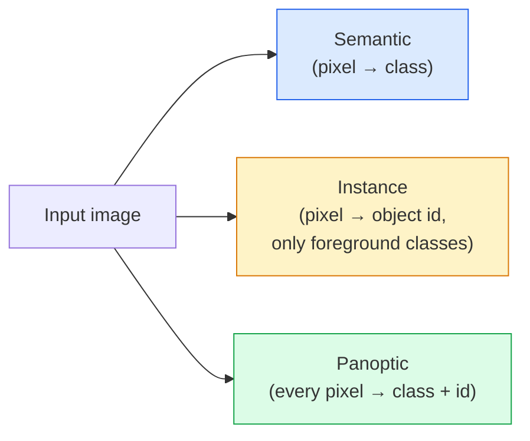
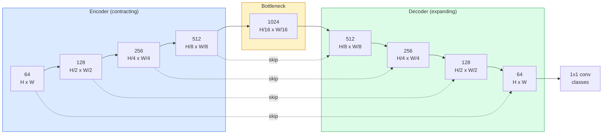

# Segmentasi Semantik — U-Net

> Segmentasi adalah klasifikasi di setiap piksel. U-Net membuatnya bekerja dengan memasangkan encoder downsampling dengan decoder upsampling dan menyambungkan skip connections di antara keduanya.

**Type:** Build
**Languages:** Python
**Prerequisites:** Phase 4 Lesson 03 (CNNs), Phase 4 Lesson 04 (Image Classification)
**Time:** ~75 minutes

## Tujuan Pembelajaran

- Membedakan segmentasi semantik, instance, dan panoptic serta memilih tugas yang tepat untuk sebuah masalah
- Membangun **U-Net** dari nol di PyTorch dengan encoder block, bottleneck, decoder dengan transposed convolution, dan skip connections
- Mengimplementasikan cross-entropy per piksel, Dice loss, dan loss gabungan yang menjadi default saat ini untuk segmentasi medis dan industri
- Membaca metrik IoU dan Dice per kelas serta mendiagnosis apakah skor buruk berasal dari recall objek-kecil, akurasi batas, atau ketidakseimbangan kelas

## Masalahnya

Klasifikasi mengeluarkan satu label per gambar. Deteksi mengeluarkan beberapa box per gambar. Segmentasi mengeluarkan satu label per piksel. Untuk input berukuran `H x W`, output-nya adalah tensor berbentuk `H x W` (semantik) atau `H x W x N_instances` (instance). Itu jutaan prediksi per gambar, bukan satu.

Struktur segmentasi lah yang membuatnya menopang hampir setiap produk visi prediksi-padat: pencitraan medis (mask tumor), mobil otonom (jalan, lajur, rintangan), satelit (cakupan bangunan, batas lahan), parsing dokumen (zona tata letak), robotika (regional yang bisa digenggam). Tidak ada tugas-tugas itu yang bisa diselesaikan dengan menggambar box di sekeliling objeknya; mereka butuh siluet yang persis.

Masalah arsitekturalnya sederhana dinyatakan tetapi tidak sederhana diselesaikan: kamu butuh jaringan melihat konteks global sebuah gambar (seperti apa adegan ini) dan detail piksel lokal (piksel mana persisnya jalan vs trotoar) secara bersamaan. CNN standar memampatkan secara spasial untuk mendapatkan konteks, dan itu membuang detail. **U-Net** adalah desain yang mendapat keduanya.

## Konsepnya

### Semantik vs instance vs panoptic



- **Semantik** berkata "piksel ini jalan, piksel itu mobil." Dua mobil bersebelahan menyatu jadi satu gumpalan.
- **Instance** berkata "piksel ini mobil #3, piksel itu mobil #5." Mengabaikan benda latar ("stuff" = langit, jalan, rumput).
- **Panoptic** menyatukan keduanya: setiap piksel mendapat label kelas, setiap instance mendapat id unik, stuff dan things sama-sama di-segmentasi.

Pelajaran ini membahas yang semantik. Pelajaran berikutnya (**Mask R-CNN**) membahas yang instance.

### Bentuk U-Net



Encoder membagi dua resolusi spasial sebanyak empat kali dan menggandakan channel. Decoder membalikannya: menggandakan resolusi spasial sebanyak empat kali dan membagi dua channel. **Skip connection** menggabungkan (concat) fitur encoder yang cocok dengan fitur decoder di setiap resolusi. Conv 1x1 terakhir memetakan `64 -> num_classes` pada resolusi penuh.

Mengapa skip connection diperlukan: decoder hanya telah melihat feature map kecil pada saat ia mencoba mengeluarkan prediksi level-piksel. Tanpa skip itu ia tidak bisa melokalisasi tepi dengan akurat karena informasi itu telah dipampatkan di encoder. Skip connection menyerahkan feature map resolusi-tinggi yang dihitung encoder saat turun.

### Transposed conv vs bilinear upsample

Decoder harus memperluas dimensi spasial. Dua opsi:

- **Transposed convolution** (`nn.ConvTranspose2d`) — upsample yang bisa dipelajari. Default **U-Net** secara historis. Bisa menghasilkan artefak checkerboard jika stride dan kernel size tidak membagi rata.
- **Bilinear upsample + conv 3x3** — upsample halus yang diikuti conv. Lebih sedikit artefak, lebih sedikit parameter, kini menjadi default modern.

Keduanya ada di lapangan. Untuk U-Net pertama, bilinear lebih aman.

### Cross-entropy pada grid piksel

Untuk segmentasi semantik dengan C kelas, output model adalah `(N, C, H, W)`. Target-nya adalah `(N, H, W)` dengan ID kelas bilangan bulat. Cross-entropynya identik dengan kasus klasifikasi, hanya saja diterapkan di setiap posisi spasial:

```
Loss = mean over (n, h, w) of -log( softmax(logits[n, :, h, w])[target[n, h, w]] )
```

`F.cross_entropy` di PyTorch menangani bentuk ini secara native. Tidak perlu reshape.

### Dice loss dan mengapa kamu membutuhkannya

Cross-entropy memperlakukan setiap piksel sama rata. Itu salah saat satu kelas mendominasi frame (pencitraan medis: 99% latar, 1% tumor). Jaringan bisa meraih akurasi 99% dengan memprediksi latar di mana-mana dan tetap tak berguna.

Dice loss memecahkannya dengan mengoptimalkan tumpang tindih antara mask prediksi dan mask benar secara langsung:

```
Dice(p, y) = 2 * sum(p * y) / (sum(p) + sum(y) + epsilon)
Dice_loss = 1 - Dice
```

di mana `p` adalah peta probabilitas sigmoid/softmax untuk sebuah kelas dan `y` adalah mask ground-truth biner. Loss-nya nol hanya saat tumpang tindihnya sempurna. Karena berbasis rasio, ketidakseimbangan kelas jadi tidak relevan.

Dalam praktiknya, pakai **combined loss**:

```
L = L_cross_entropy + lambda * L_dice       (lambda ~ 1)
```

Cross-entropy memberikan gradien yang stabil di awal training; Dice memfokuskan ekor training pada pencocokan bentuk mask yang sesungguhnya. Kombinasi ini adalah default pencitraan medis dan sulit dikalahkan pada dataset apa pun yang kelasnya timpang.

### Metrik evaluasi

- **Akurasi piksel** — persen piksel yang diprediksi dengan benar. Murah. Rusak pada data tidak seimbang karena alasan yang sama seperti akurasi pada klasifikasi.
- **IoU per kelas** — intersection over union untuk mask tiap kelas; rata-rata lintas kelas = mIoU.
- **Dice (F1 pada piksel)** — mirip IoU; `Dice = 2 * IoU / (1 + IoU)`. Pencitraan medis lebih memilih Dice, komunitas otomotif lebih memilih IoU; keduanya berkaitan monoton.
- **Boundary F1** — mengukur seberapa dekat batas prediksi dengan batas ground-truth, menenggelamkan bahkan pergeseran kecil. Penting untuk tugas presisi-tinggi seperti inspeksi semikonduktor.

Laporkan IoU per kelas, bukan hanya mIoU. Mean IoU menyembunyikan kelas yang berada di 15% saat sembilan lainnya di 85%.

### Trade-off resolusi input

Encoder **U-Net** membagi dua resolusi sebanyak empat kali, jadi input harus habis dibagi 16. Gambar medis sering 512x512 atau 1024x1024. Crop mobil otonom 2048x1024. Biaya memori **U-Net** berskala dengan `H * W * C_max`, dan pada 1024x1024 dengan 1024 channel bottleneck, forward pass-nya sudah memakai banyak gigabyte VRAM.

Dua solusi standar:
1. Ubin (tile) input — proses ubin 256x256 dengan overlap lalu jahit.
2. Ganti bottleneck dengan **dilated convolution** yang menjaga resolusi spasial lebih tinggi tapi melebarkan receptive field (keluarga DeepLab).

Untuk model pertama, input 256x256 dengan **U-Net** berbasis-64-channel training dengan nyaman pada VRAM 8 GB.

```figure
segmentation-flood
```

## Bangun Sendiri

### Langkah 1: Encoder block

Dua conv 3x3 dengan batch norm dan ReLU. Conv pertama mengubah jumlah channel; conv kedua mempertahankannya.

```python
import torch
import torch.nn as nn
import torch.nn.functional as F

class DoubleConv(nn.Module):
    def __init__(self, in_c, out_c):
        super().__init__()
        self.net = nn.Sequential(
            nn.Conv2d(in_c, out_c, kernel_size=3, padding=1, bias=False),
            nn.BatchNorm2d(out_c),
            nn.ReLU(inplace=True),
            nn.Conv2d(out_c, out_c, kernel_size=3, padding=1, bias=False),
            nn.BatchNorm2d(out_c),
            nn.ReLU(inplace=True),
        )

    def forward(self, x):
        return self.net(x)
```

Block ini dipakai ulang di mana-mana. `bias=False` karena beta BN-lah yang menangani biasnya.

### Langkah 2: Block down dan up

```python
class Down(nn.Module):
    def __init__(self, in_c, out_c):
        super().__init__()
        self.net = nn.Sequential(
            nn.MaxPool2d(2),
            DoubleConv(in_c, out_c),
        )

    def forward(self, x):
        return self.net(x)


class Up(nn.Module):
    def __init__(self, in_c, out_c):
        super().__init__()
        self.up = nn.Upsample(scale_factor=2, mode="bilinear", align_corners=False)
        self.conv = DoubleConv(in_c, out_c)

    def forward(self, x, skip):
        x = self.up(x)
        if x.shape[-2:] != skip.shape[-2:]:
            x = F.interpolate(x, size=skip.shape[-2:], mode="bilinear", align_corners=False)
        x = torch.cat([skip, x], dim=1)
        return self.conv(x)
```

Pemeriksaan bentuk yang hanya-spasial (`shape[-2:]`) menangani input yang dimensinya tidak habis dibagi 16; `F.interpolate` yang aman menyelaraskan tensor sebelum concat. Membandingkan bentuk penuh juga akan terpicu pada perbedaan jumlah channel, yang seharusnya jadi error keras, bukan interpolate diam-diam.

### Langkah 3: U-Net-nya

```python
class UNet(nn.Module):
    def __init__(self, in_channels=3, num_classes=2, base=64):
        super().__init__()
        self.inc = DoubleConv(in_channels, base)
        self.d1 = Down(base, base * 2)
        self.d2 = Down(base * 2, base * 4)
        self.d3 = Down(base * 4, base * 8)
        self.d4 = Down(base * 8, base * 16)
        self.u1 = Up(base * 16 + base * 8, base * 8)
        self.u2 = Up(base * 8 + base * 4, base * 4)
        self.u3 = Up(base * 4 + base * 2, base * 2)
        self.u4 = Up(base * 2 + base, base)
        self.outc = nn.Conv2d(base, num_classes, kernel_size=1)

    def forward(self, x):
        x1 = self.inc(x)
        x2 = self.d1(x1)
        x3 = self.d2(x2)
        x4 = self.d3(x3)
        x5 = self.d4(x4)
        x = self.u1(x5, x4)
        x = self.u2(x, x3)
        x = self.u3(x, x2)
        x = self.u4(x, x1)
        return self.outc(x)

net = UNet(in_channels=3, num_classes=2, base=32)
x = torch.randn(1, 3, 256, 256)
print(f"output: {net(x).shape}")
print(f"params: {sum(p.numel() for p in net.parameters()):,}")
```

Bentuk output `(1, 2, 256, 256)` — ukuran spasial sama dengan input, channel `num_classes`. Sekitar 7,7M parameter pada `base=32`.

### Langkah 4: Loss-nya

```python
def dice_loss(logits, targets, num_classes, eps=1e-6):
    probs = F.softmax(logits, dim=1)
    targets_one_hot = F.one_hot(targets, num_classes).permute(0, 3, 1, 2).float()
    dims = (0, 2, 3)
    intersection = (probs * targets_one_hot).sum(dim=dims)
    denom = probs.sum(dim=dims) + targets_one_hot.sum(dim=dims)
    dice = (2 * intersection + eps) / (denom + eps)
    return 1 - dice.mean()


def combined_loss(logits, targets, num_classes, lam=1.0):
    ce = F.cross_entropy(logits, targets)
    dc = dice_loss(logits, targets, num_classes)
    return ce + lam * dc, {"ce": ce.item(), "dice": dc.item()}
```

Dice dihitung per kelas lalu dirata-ratakan (Dice makro). `eps` mencegah pembagian nol pada kelas yang tidak ada dalam batch.

### Langkah 5: Metrik IoU

```python
@torch.no_grad()
def iou_per_class(logits, targets, num_classes):
    preds = logits.argmax(dim=1)
    ious = torch.zeros(num_classes)
    for c in range(num_classes):
        pred_c = (preds == c)
        true_c = (targets == c)
        inter = (pred_c & true_c).sum().float()
        union = (pred_c | true_c).sum().float()
        ious[c] = (inter / union) if union > 0 else torch.tensor(float("nan"))
    return ious
```

Mengembalikan vektor panjang C. `nan` menandai kelas yang tidak ada dalam batch — jangan rata-ratakan di atasnya saat menghitung mIoU.

### Langkah 6: Dataset sintetis untuk verifikasi end-to-end

Hasilkan bentuk pada latar berwarna supaya jaringan harus belajar bentuk, bukan warna piksel.

```python
import numpy as np
from torch.utils.data import Dataset, DataLoader

def synthetic_segmentation(num_samples=200, size=64, seed=0):
    rng = np.random.default_rng(seed)
    images = np.zeros((num_samples, size, size, 3), dtype=np.float32)
    masks = np.zeros((num_samples, size, size), dtype=np.int64)
    for i in range(num_samples):
        bg = rng.uniform(0, 1, (3,))
        images[i] = bg
        masks[i] = 0
        num_shapes = rng.integers(1, 4)
        for _ in range(num_shapes):
            cls = int(rng.integers(1, 3))
            color = rng.uniform(0, 1, (3,))
            cx, cy = rng.integers(10, size - 10, size=2)
            r = int(rng.integers(4, 12))
            yy, xx = np.meshgrid(np.arange(size), np.arange(size), indexing="ij")
            if cls == 1:
                mask = (xx - cx) ** 2 + (yy - cy) ** 2 < r ** 2
            else:
                mask = (np.abs(xx - cx) < r) & (np.abs(yy - cy) < r)
            images[i][mask] = color
            masks[i][mask] = cls
        images[i] += rng.normal(0, 0.02, images[i].shape)
        images[i] = np.clip(images[i], 0, 1)
    return images, masks


class SegDataset(Dataset):
    def __init__(self, images, masks):
        self.images = images
        self.masks = masks

    def __len__(self):
        return len(self.images)

    def __getitem__(self, i):
        img = torch.from_numpy(self.images[i]).permute(2, 0, 1).float()
        mask = torch.from_numpy(self.masks[i]).long()
        return img, mask
```

Tiga kelas: latar (0), lingkaran (1), persegi (2). Jaringan harus belajar membedakan bentuk.

### Langkah 7: Loop training

```python
def train_one_epoch(model, loader, optimizer, device, num_classes):
    model.train()
    loss_sum, total = 0.0, 0
    iou_sum = torch.zeros(num_classes)
    for x, y in loader:
        x, y = x.to(device), y.to(device)
        logits = model(x)
        loss, _ = combined_loss(logits, y, num_classes)
        optimizer.zero_grad()
        loss.backward()
        optimizer.step()
        loss_sum += loss.item() * x.size(0)
        total += x.size(0)
        iou_sum += iou_per_class(logits, y, num_classes).nan_to_num(0)
    return loss_sum / total, iou_sum / len(loader)
```

Jalankan ini 10-30 epoch pada dataset sintetis dan amati mIoU merangkak melewati 0.9 untuk kelas bentuk. Perhatikan bahwa `nan_to_num(0)` memperlakukan kelas yang absen dari sebuah batch sebagai nol; untuk IoU per kelas yang akurat, mask berdasarkan keberadaan dan pakai `torch.nanmean` lintas batch saat evaluasi alih-alih merata-ratakan di sini.

## Gunakan

Untuk produksi, `segmentation_models_pytorch` ("smp") membungkus setiap arsitektur segmentasi standar dengan backbone torchvision atau timm apa pun. Tiga baris:

```python
import segmentation_models_pytorch as smp

model = smp.Unet(
    encoder_name="resnet34",
    encoder_weights="imagenet",
    in_channels=3,
    classes=3,
)
```

Juga layak diketahui untuk kerja nyata:
- **DeepLabV3+** mengganti downsampling berbasis max-pool dengan conv berlubang (dilated) supaya bottleneck mempertahankan resolusi; batas lebih cepat pada data satelit dan mengemudi.
- **SegFormer** menukar encoder conv dengan transformer hierarkis; SOTA saat ini di banyak benchmark.
- **Mask2Former** / **OneFormer** menyatukan segmentasi semantik, instance, dan panoptic dalam satu arsitektur.

Ketiganya adalah pengganti langsung (drop-in) di `smp` atau `transformers` dengan data loader yang sama.

## Rilis

Pelajaran ini menghasilkan:

- `outputs/prompt-segmentation-task-picker.md` — prompt yang memilih di antara segmentasi semantik, instance, dan panoptic serta menyebutkan arsitektur untuk tugas tertentu.
- `outputs/skill-segmentation-mask-inspector.md` — skill yang melaporkan distribusi kelas, statistik mask prediksi, dan kelas-kelas yang kurang terprediksi atau batasnya buram.

## Latihan

1. **(Mudah)** Implementasikan `bce_dice_loss` untuk tugas segmentasi biner (foreground vs latar). Verifikasi pada dataset sintetis dua kelas bahwa loss gabungan konvergen lebih cepat daripada BCE sendirian saat foreground adalah 5% dari piksel.
2. **(Sedang)** Ganti up-block `nn.Upsample + conv` dengan up-block `nn.ConvTranspose2d`. Latih keduanya pada dataset sintetis dan bandingkan mIoU. Amati di mana artefak checkerboard muncul pada versi transposed-conv.
3. **(Sulit)** Ambil dataset segmentasi nyata (Oxford-IIIT Pets, split mini Cityscapes, atau subset medis) dan latih **U-Net** hingga selisih 2 poin IoU dari referensi `smp.Unet`. Laporkan IoU per kelas dan identifikasi kelas mana yang paling diuntungkan dengan menambahkan Dice ke loss.

## Istilah Kunci

| Term | What people say | What it actually means |
|------|----------------|----------------------|
| Semantic segmentation | "Label every pixel" | Per-pixel classification into C classes; instances of the same class merge |
| Instance segmentation | "Label every object" | Separates distinct instances of the same class; foreground-only |
| Panoptic segmentation | "Semantic + instance" | Every pixel gets a class; every thing instance also gets a unique id |
| Skip connection | "U-Net bridge" | Concatenation of encoder features into matching-resolution decoder features; preserves high-frequency detail |
| Transposed conv | "Deconvolution" | Learnable upsampling; can produce checkerboard artifacts |
| Dice loss | "Overlap loss" | 1 - 2|A ∩ B| / (|A| + |B|); optimises mask overlap directly and is robust to class imbalance |
| mIoU | "Mean intersection over union" | Average IoU across classes; the community-standard metric for segmentation |
| Boundary F1 | "Boundary accuracy" | F1 score computed on boundary pixels only; matters for precision-critical tasks |

## Bacaan Lanjutan

- [U-Net: Convolutional Networks for Biomedical Image Segmentation (Ronneberger et al., 2015)](https://arxiv.org/abs/1505.04597) — the original paper; the figure everyone copies is on page 2
- [Fully Convolutional Networks (Long et al., 2015)](https://arxiv.org/abs/1411.4038) — the paper that first made segmentation an end-to-end conv problem
- [segmentation_models_pytorch](https://github.com/qubvel/segmentation_models.pytorch) — the reference for production segmentation; every standard architecture plus every standard loss
- [iafoss, Unet34 submission with TTA (Kaggle notebook)](https://www.kaggle.com/code/iafoss/unet34-submission-tta-0-699-new-public-lb) — test-time augmentation for a U-Net on a real segmentation competition
