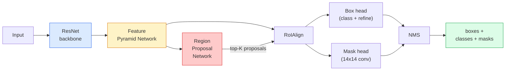

# Segmentasi Instance — Mask R-CNN

> Tambahkan satu cabang mask kecil ke detektor Faster R-CNN dan kamu punya segmentasi instance. Bagian sulitnya adalah RoIAlign, dan itu lebih sulit dari kelihatannya.

**Type:** Build + Learn
**Languages:** Python
**Prerequisites:** Phase 4 Lesson 06 (YOLO), Phase 4 Lesson 07 (U-Net)
**Time:** ~75 minutes

## Tujuan Pembelajaran

- Menelusuri arsitektur **Mask R-CNN** end-to-end: backbone, FPN, RPN, RoIAlign, box head, mask head
- Mengimplementasikan **RoIAlign** dari nol dan menjelaskan mengapa **RoIPool** tidak lagi dipakai
- Memakai model pre-trained torchvision `maskrcnn_resnet50_fpn_v2` untuk mask instance kualitas-produksi dan membaca format output-nya dengan benar
- Fine-tune **Mask R-CNN** pada dataset kustom kecil dengan mengganti box head dan mask head serta menjaga backbone tetap dibekukan

## Masalahnya

Segmentasi semantik memberimu satu mask per kelas. Segmentasi instance memberimu satu mask per objek, bahkan saat dua objek berbagi kelas. Menghitung individu, melacak lintas frame, dan mengukur benda (bounding box setiap bata di dinding, setiap sel di gambar mikroskop) semuanya menuntut segmentasi instance.

**Mask R-CNN** (He et al., 2017) memecahkannya dengan membingkai ulang segmentasi instance sebagai deteksi-tambah-sebuah-mask. Desainnya begitu bersih sehingga selama lima tahun berikutnya hampir semua paper segmentasi instance adalah varian **Mask R-CNN**, dan implementasi torchvision-nya masih menjadi default produksi untuk dataset kecil hingga sedang.

Masalah rekayasa yang sulit adalah sampling: bagaimana kamu memotong (crop) sebuah region fitur berukuran tetap dari proposal box yang sudut-sudutnya tidak selaras dengan batas piksel? Melakukan itu dengan salah mengurangi beberapa sepuluh poin mAP di mana-mana. **RoIAlign** adalah jawabannya.

## Konsepnya

### Arsitekturnya



Lima bagian untuk dipahami:

1. **Backbone** — ResNet-50 atau ResNet-101 yang dilatih pada ImageNet. Menghasilkan hierarki feature map pada stride 4, 8, 16, 32.
2. **FPN (Feature Pyramid Network)** — koneksi top-down + lateral yang memberi setiap level C channel fitur kaya-semantik. Deteksi menanyakan level FPN yang cocok dengan ukuran objek.
3. **RPN (Region Proposal Network)** — conv head kecil yang, di setiap posisi anchor, memprediksi "apakah ada objek di sini?" dan "bagaimana saya memperbaiki box-nya?". Menghasilkan ~1000 proposal per gambar.
4. **RoIAlign** — mengambil sampel patch fitur berukuran tetap (mis. 7x7) dari box apa pun pada level FPN mana pun. Sampling bilinear, tanpa kuantisasi.
5. **Heads** — box head dua layer yang memperbaiki box dan memilih kelas, plus conv head kecil yang mengeluarkan mask biner `28x28` untuk setiap proposal.

### Mengapa RoIAlign, bukan RoIPool

Fast R-CNN asli memakai RoIPool, yang membagi proposal box menjadi grid, mengambil fitur maksimum di setiap sel, dan membulatkan semua koordinat ke bilangan bulat. Pembulatan itu menyelaraskan feature map dari koordinat piksel input hingga seluruh piksel feature map — kecil pada gambar 224x224, tetapi bencana saat feature map-nya stride 32.

```
RoIPool:
  box (34.7, 51.3, 98.2, 142.9)
  round -> (34, 51, 98, 142)
  split grid -> round each cell boundary
  misalignment accumulates at every step

RoIAlign:
  box (34.7, 51.3, 98.2, 142.9)
  sample at exact float coordinates using bilinear interpolation
  no rounding anywhere
```

**RoIAlign** menaikkan mask AP sebesar 3-4 poin di **COCO** secara cuma-cuma. Setiap detektor yang peduli pada lokalisasi kini memakainya — YOLOv7 seg, **RT-DETR**, **Mask2Former** sama saja.

### RPN dalam satu paragraf

Di setiap posisi feature map, letakkan K box anchor dengan ukuran dan bentuk berbeda. Prediksi skor objectness untuk setiap anchor dan offset regresi untuk mengubah anchor menjadi box yang lebih pas. Simpan ~1.000 box teratas berdasarkan skor, terapkan NMS pada IoU 0.7, dan serahkan para penyintas ke heads. RPN dilatih dengan mini-loss-nya sendiri — struktur yang sama dengan loss YOLO dari Pelajaran 6, hanya saja dengan dua kelas (objek / bukan objek).

### Mask head-nya

Untuk setiap proposal (setelah RoIAlign), mask head adalah FCN mini: empat conv 3x3, satu deconv 2x, dan conv 1x1 terakhir yang menghasilkan `num_classes` output channel pada resolusi `28x28`. Hanya channel yang sesuai dengan kelas terprediksi yang disimpan; yang lain diabaikan. Ini memisahkan prediksi mask dari klasifikasi.

Upsample mask 28x28 ke ukuran piksel asli proposal untuk menghasilkan mask biner akhir.

### Loss-nya

**Mask R-CNN** punya empat loss yang dijumlahkan:

```
L = L_rpn_cls + L_rpn_box + L_box_cls + L_box_reg + L_mask
```

- `L_rpn_cls`, `L_rpn_box` — objectness + box regression untuk proposal RPN.
- `L_box_cls` — cross-entropy di atas (C+1) kelas (termasuk latar) pada classifier head-nya.
- `L_box_reg` — smooth L1 pada penyempurnaan box oleh head-nya.
- `L_mask` — binary cross-entropy per piksel pada output mask 28x28.

Setiap loss punya bobot default-nya sendiri; implementasi torchvision mengeksposnya sebagai argumen konstruktor.

### Format output

`torchvision.models.detection.maskrcnn_resnet50_fpn_v2` mengembalikan daftar dict, satu per gambar:

```
{
    "boxes":  (N, 4) in (x1, y1, x2, y2) pixel coordinates,
    "labels": (N,) class IDs, 0 = background so indices are 1-based,
    "scores": (N,) confidence scores,
    "masks":  (N, 1, H, W) float masks in [0, 1] — threshold at 0.5 for binary,
}
```

Mask-nya sudah beresolusi penuh gambar. Output head 28x28 telah di-upsample secara internal.

```figure
cv3-roialign-sampling
```

## Bangun Sendiri

### Langkah 1: RoIAlign dari nol

Ini satu-satunya komponen **Mask R-CNN** yang lebih mudah dipahami sebagai kode daripada sebagai prosa.

```python
import torch
import torch.nn.functional as F

def roi_align_single(feature, box, output_size=7, spatial_scale=1 / 16.0):
    """
    feature: (C, H, W) single-image feature map
    box: (x1, y1, x2, y2) in original image pixel coordinates
    output_size: side of the output grid (7 for box head, 14 for mask head)
    spatial_scale: reciprocal of the feature map stride
    """
    C, H, W = feature.shape
    x1, y1, x2, y2 = [c * spatial_scale - 0.5 for c in box]
    bin_w = (x2 - x1) / output_size
    bin_h = (y2 - y1) / output_size

    grid_y = torch.linspace(y1 + bin_h / 2, y2 - bin_h / 2, output_size)
    grid_x = torch.linspace(x1 + bin_w / 2, x2 - bin_w / 2, output_size)
    yy, xx = torch.meshgrid(grid_y, grid_x, indexing="ij")

    gx = 2 * (xx + 0.5) / W - 1
    gy = 2 * (yy + 0.5) / H - 1
    grid = torch.stack([gx, gy], dim=-1).unsqueeze(0)
    sampled = F.grid_sample(feature.unsqueeze(0), grid, mode="bilinear",
                            align_corners=False)
    return sampled.squeeze(0)
```

Setiap angka berada pada posisi yang diambil secara bilinear (bilinear sampling). Tanpa pembulatan, tanpa kuantisasi, tanpa gradien yang terbuang.

### Langkah 2: Bandingkan dengan RoIAlign torchvision

```python
from torchvision.ops import roi_align

feature = torch.randn(1, 16, 50, 50)
boxes = torch.tensor([[0, 10, 20, 100, 90]], dtype=torch.float32)  # (batch_idx, x1, y1, x2, y2)

ours = roi_align_single(feature[0], boxes[0, 1:].tolist(), output_size=7, spatial_scale=1/4)
theirs = roi_align(feature, boxes, output_size=(7, 7), spatial_scale=1/4, sampling_ratio=1, aligned=True)[0]

print(f"shape ours:   {tuple(ours.shape)}")
print(f"shape theirs: {tuple(theirs.shape)}")
print(f"max|diff|:    {(ours - theirs).abs().max().item():.3e}")
```

Dengan `sampling_ratio=1` dan `aligned=True`, keduanya cocok hingga selisih `1e-5`.

### Langkah 3: Muat Mask R-CNN pre-trained

```python
import torch
from torchvision.models.detection import maskrcnn_resnet50_fpn_v2, MaskRCNN_ResNet50_FPN_V2_Weights

model = maskrcnn_resnet50_fpn_v2(weights=MaskRCNN_ResNet50_FPN_V2_Weights.DEFAULT)
model.eval()
print(f"params: {sum(p.numel() for p in model.parameters()):,}")
print(f"classes (including background): {len(model.roi_heads.box_predictor.cls_score.out_features * [0])}")
```

46M parameter, 91 kelas (COCO). Kelas pertama (id 0) adalah latar; semua yang benar-benar dideteksi model dimulai dari id 1.

### Langkah 4: Jalankan inference

```python
with torch.no_grad():
    x = torch.randn(3, 400, 600)
    predictions = model([x])
p = predictions[0]
print(f"boxes:  {tuple(p['boxes'].shape)}")
print(f"labels: {tuple(p['labels'].shape)}")
print(f"scores: {tuple(p['scores'].shape)}")
print(f"masks:  {tuple(p['masks'].shape)}")
```

Tensor mask-nya berbentuk `(N, 1, H, W)`. Threshold di 0.5 untuk mendapatkan mask biner per objek:

```python
binary_masks = (p['masks'] > 0.5).squeeze(1)  # (N, H, W) boolean
```

### Langkah 5: Tukar heads untuk jumlah kelas kustom

Resep fine-tuning yang umum: gunakan ulang backbone, FPN, dan RPN; ganti dua classifier head.

```python
from torchvision.models.detection.faster_rcnn import FastRCNNPredictor
from torchvision.models.detection.mask_rcnn import MaskRCNNPredictor

def build_custom_maskrcnn(num_classes):
    model = maskrcnn_resnet50_fpn_v2(weights=MaskRCNN_ResNet50_FPN_V2_Weights.DEFAULT)
    in_features = model.roi_heads.box_predictor.cls_score.in_features
    model.roi_heads.box_predictor = FastRCNNPredictor(in_features, num_classes)
    in_features_mask = model.roi_heads.mask_predictor.conv5_mask.in_channels
    hidden_layer = 256
    model.roi_heads.mask_predictor = MaskRCNNPredictor(in_features_mask, hidden_layer, num_classes)
    return model

custom = build_custom_maskrcnn(num_classes=5)
print(f"custom cls_score.out_features: {custom.roi_heads.box_predictor.cls_score.out_features}")
```

`num_classes` harus menyertakan kelas latar, sehingga dataset dengan 4 kelas objek memakai `num_classes=5`.

### Langkah 6: Bekukan yang tidak perlu dilatih

Pada dataset kecil, bekukan backbone dan FPN-nya. Hanya objectness + regresi RPN dan kedua head yang belajar.

```python
def freeze_backbone_and_fpn(model):
    # torchvision Mask R-CNN packs the FPN inside `model.backbone` (as
    # `model.backbone.fpn`), so iterating `model.backbone.parameters()` covers
    # both the ResNet feature layers and the FPN lateral/output convs.
    for p in model.backbone.parameters():
        p.requires_grad = False
    return model

custom = freeze_backbone_and_fpn(custom)
trainable = sum(p.numel() for p in custom.parameters() if p.requires_grad)
print(f"trainable after freeze: {trainable:,}")
```

Pada dataset 500 gambar, inilah perbedaan antara konvergensi dan overfitting.

## Gunakan

Loop training lengkap untuk **Mask R-CNN** di torchvision berjumlah 40 baris dan tidak berubah secara bermakna antar tugas — tukar dataset dan jalan.

```python
def train_step(model, images, targets, optimizer):
    model.train()
    loss_dict = model(images, targets)
    losses = sum(loss for loss in loss_dict.values())
    optimizer.zero_grad()
    losses.backward()
    optimizer.step()
    return {k: v.item() for k, v in loss_dict.items()}
```

Daftar `targets` harus berisi dict per gambar dengan `boxes`, `labels`, dan `masks` (sebagai tensor biner `(num_instances, H, W)`). Model mengembalikan dict berisi empat loss saat training dan daftar prediksi saat eval, ditentukan oleh `model.training`.

Evaluator `pycocotools` menghasilkan mAP@IoU=0.5:0.95 baik untuk box maupun untuk mask; kamu butuh kedua angka itu untuk mengetahui apakah box head atau mask head-nya yang jadi bottleneck.

## Rilis

Pelajaran ini menghasilkan:

- `outputs/prompt-instance-vs-semantic-router.md` — prompt yang mengajukan tiga pertanyaan dan memilih instance vs semantik vs panoptic plus model persis untuk memulai.
- `outputs/skill-mask-rcnn-head-swapper.md` — skill yang menghasilkan 10 baris kode untuk menukar head pada model deteksi torchvision mana pun, diberikan `num_classes` baru.

## Latihan

1. **(Mudah)** Verifikasi RoIAlign-mu terhadap `torchvision.ops.roi_align` pada 100 box acak. Laporkan selisih absolut maksimum. Jalankan juga RoIPool (perilaku pra-2017) dan tunjukkan bahwa ia menyimpang ~1-2 piksel feature map pada box yang dekat tepi.
2. **(Sedang)** Fine-tune `maskrcnn_resnet50_fpn_v2` pada dataset kustom 50 gambar (dua kelas apa pun: balon, ikan, lobang jalan, logo). Bekukan backbone, latih 20 epoch, laporkan mask AP@0.5.
3. **(Sulit)** Ganti mask head **Mask R-CNN** dengan yang memprediksi pada 56x56 alih-alih 28x28. Ukur mAP@IoU=0.75 sebelum dan sesudah. Jelaskan mengapa gain (atau ketiadaannya) cocok dengan trade-off presisi-batas / memori yang diharapkan.

## Istilah Kunci

| Term | What people say | What it actually means |
|------|----------------|----------------------|
| Mask R-CNN | "Detection plus masks" | Faster R-CNN + a small FCN head that predicts a 28x28 mask per proposal per class |
| FPN | "Feature pyramid" | Top-down + lateral connections that give every stride level C channels of semantic-rich features |
| RPN | "Region proposer" | A small conv head that produces ~1000 object/no-object proposals per image |
| RoIAlign | "No-rounding crop" | Bilinearly samples a fixed-size feature grid from any float-coordinate box |
| RoIPool | "Pre-2017 crop" | Same purpose as RoIAlign but rounds box coordinates; obsolete |
| Mask AP | "Instance mAP" | Average precision computed with mask IoU instead of box IoU; the COCO instance segmentation metric |
| Binary mask head | "Per-class mask" | Predicts one binary mask per class for each proposal; only the predicted class's channel is kept |
| Background class | "Class 0" | The catch-all "no object" class; indices for real classes start at 1 |

## Bacaan Lanjutan

- [Mask R-CNN (He et al., 2017)](https://arxiv.org/abs/1703.06870) — the paper; section 3 on RoIAlign is the critical read
- [FPN: Feature Pyramid Networks (Lin et al., 2017)](https://arxiv.org/abs/1612.03144) — the FPN paper; every modern detector uses it
- [torchvision Mask R-CNN tutorial](https://pytorch.org/tutorials/intermediate/torchvision_tutorial.html) — the reference for the fine-tuning loop
- [Detectron2 model zoo](https://github.com/facebookresearch/detectron2/blob/main/MODEL_ZOO.md) — production implementations with trained weights for nearly every detection and segmentation variant
