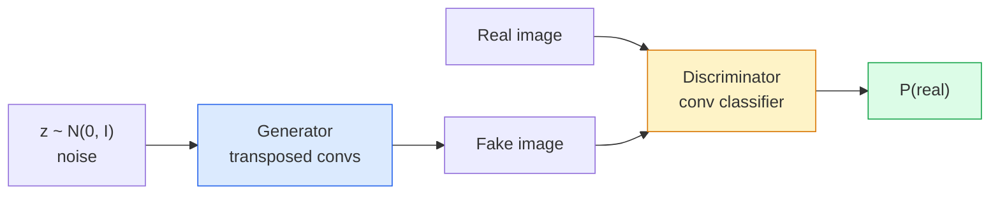
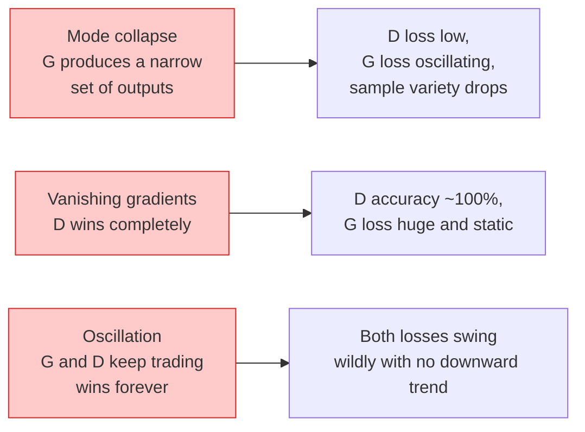

# Generasi Gambar — GAN

> Sebuah GAN adalah dua jaringan saraf dalam permainan yang tetap. Satu menggambar, satu mengkritik. Mereka membaik bersama sampai gambar-gambar itu menipu sang kritikus.

**Type:** Build
**Languages:** Python
**Prerequisites:** Phase 4 Lesson 03 (CNNs), Phase 3 Lesson 06 (Optimizers), Phase 3 Lesson 07 (Regularization)
**Time:** ~75 minutes

## Tujuan Pembelajaran

- Menjelaskan permainan minimax antara generator dan diskriminator serta mengapa keseimbangannya sesuai dengan p_model = p_data
- Mengimplementasikan **DCGAN** di PyTorch dan membuatnya menghasilkan gambar sintetis 32x32 yang koheren dalam kurang dari 60 baris
- Menstabilkan training GAN dengan tiga trik standar: loss non-saturating, **spectral norm**, **TTUR** (two-timescale update rule)
- Membaca kurva training yang membedakan konvergensi sehat dari mode collapse, osilasi, dan diskriminator-menang-sepenuhnya

## Masalahnya

Klasifikasi mengajari jaringan memetakan gambar ke label. Generasi membalik masalahnya: mengambil sampel gambar baru yang terlihat seperti berasal dari distribusi yang sama. Tidak ada output "benar" yang bisa kamu bandingkan (diff); hanya ada distribusi yang ingin kamu tiru.

Fungsi loss standar (MSE, cross-entropy) tidak bisa mengukur "apakah sampel ini berasal dari distribusi nyata." Meminimalkan error per piksel menghasilkan rata-rata yang buruk, bukan sampel yang realistis. Terobosannya adalah mempelajari loss-nya: latih jaringan kedua yang tugasnya membedakan yang nyata dari yang palsu, dan pakai penilaiannya untuk mendorong generator.

**GAN** (Goodfellow et al., 2014) mendefinisikan kerangka itu. Pada 2018 **StyleGAN** menghasilkan wajah 1024x1024 yang tak terbedakan dari foto. Model **diffusion** sejak itu merebut takhta dalam hal kualitas dan kontrol, tetapi setiap trik yang membuat diffusion praktis — pilihan normalisasi, ruang latensi, feature loss — pertama kali dipahami pada GAN.

## Konsepnya

### Dua jaringannya



**Generator** G mengambil vektor noise `z` dan mengeluarkan sebuah gambar. **Diskriminator** D mengambil sebuah gambar dan mengeluarkan satu skalar: probabilitas bahwa gambar itu nyata.

### Permainannya

G ingin D salah. D ingin benar. Secara formal:

```
min_G max_D  E_x[log D(x)] + E_z[log(1 - D(G(z)))]
```

Baca dari kanan ke kiri: D memaksimalkan akurasi pada gambar nyata (`log D(real)`) dan palsu (`log (1 - D(fake))`). G meminimalkan akurasi D pada yang palsu — ia ingin `D(G(z))` tinggi.

Goodfellow membuktikan bahwa minimax ini punya keseimbangan global di mana `p_G = p_data`, D mengeluarkan 0.5 di mana-mana, dan **Jensen-Shannon divergence** antara distribusi hasil-generasi dan nyata bernilai nol. Bagian sulit adalah sampai ke sana.

### Loss non-saturating

Bentuk di atas tidak stabil secara numerik. Di awal training, `D(G(z))` hampir nol untuk setiap yang palsu, sehingga `log(1 - D(G(z)))` punya gradien yang lenyap (vanishing) terhadap G. Perbaikannya: balik loss G.

```
L_D = -E_x[log D(x)] - E_z[log(1 - D(G(z)))]
L_G = -E_z[log D(G(z))]                          # non-saturating
```

Kini saat `D(G(z))` hampir nol, loss G besar dan gradiennya informatif. Setiap GAN modern melatih dengan varian ini.

### Aturan arsitektur DCGAN

Radford, Metz, Chintala (2015) menyuling bertahun-tahun eksperimen yang gagal menjadi lima aturan yang membuat training GAN stabil:

1. Ganti pooling dengan conv bertingkat (strided) untuk kedua jaringan.
2. Pakai batch norm di generator dan diskriminator, kecuali output G dan input D.
3. Hapus layer fully connected pada arsitektur yang lebih dalam.
4. G memakai ReLU di semua layer kecuali output (tanh untuk output di [-1, 1]).
5. D memakai LeakyReLU (negative_slope=0.2) di semua layer.

Setiap GAN berbasis conv modern (**StyleGAN**, **BigGAN**, **GigaGAN**) masih berawal dari aturan-aturan ini dan mengganti komponennya satu per satu.

### Mode gagal dan ciri-cirinya



- **Mode collapse**: G menemukan satu gambar yang menipu D dan hanya menghasilkan itu. Perbaikan: tambahkan **minibatch discrimination**, **spectral norm**, atau label-conditioning.
- **Diskriminator menang**: D menjadi terlalu kuat terlalu cepat, gradien G lenyap. Perbaikan: D yang lebih kecil, learning rate D lebih rendah, atau terapkan **label smoothing** pada label nyata.
- **Osilasi**: kedua jaringan saling menukar kemenangan tanpa pernah mendekati keseimbangan. Perbaikan: **TTUR** (D belajar lebih cepat dari G dengan faktor 2-4), atau beralih ke loss **Wasserstein**.

### Evaluasi

**GAN** tidak punya ground truth, jadi bagaimana kamu tahu mereka bekerja?

- **Inspeksi sampel** — cukup lihat 64 sampel di akhir setiap epoch. Tidak bisa ditawar.
- **FID (Fréchet Inception Distance)** — jarak antara distribusi fitur Inception-v3 dari set nyata dan set hasil-generasi. Lebih rendah lebih baik. Standar komunitas.
- **Inception Score** — lebih lama, lebih rapuh; lebih baik pakai FID.
- **Precision/Recall for generative models** — mengukur kualitas (precision) dan cakupan (recall) secara terpisah. Lebih informatif daripada FID saja.

Untuk run data-sintetis kecil, inspeksi sampel sudah cukup.

```figure
cv-gan-image
```

## Bangun Sendiri

### Langkah 1: Generator

Generator **DCGAN** kecil yang mengambil noise dimensi 64 dan menghasilkan gambar 32x32.

```python
import torch
import torch.nn as nn

class Generator(nn.Module):
    def __init__(self, z_dim=64, img_channels=3, feat=64):
        super().__init__()
        self.net = nn.Sequential(
            nn.ConvTranspose2d(z_dim, feat * 4, kernel_size=4, stride=1, padding=0, bias=False),
            nn.BatchNorm2d(feat * 4),
            nn.ReLU(inplace=True),
            nn.ConvTranspose2d(feat * 4, feat * 2, kernel_size=4, stride=2, padding=1, bias=False),
            nn.BatchNorm2d(feat * 2),
            nn.ReLU(inplace=True),
            nn.ConvTranspose2d(feat * 2, feat, kernel_size=4, stride=2, padding=1, bias=False),
            nn.BatchNorm2d(feat),
            nn.ReLU(inplace=True),
            nn.ConvTranspose2d(feat, img_channels, kernel_size=4, stride=2, padding=1, bias=False),
            nn.Tanh(),
        )

    def forward(self, z):
        return self.net(z.view(z.size(0), -1, 1, 1))
```

Empat transposed conv, masing-masing dengan `kernel_size=4, stride=2, padding=1` sehingga ia menggandakan ukuran spasial dengan bersih. Aktivasi output di [-1, 1] via tanh.

### Langkah 2: Diskriminator

Cerminan dari generator. LeakyReLU, conv bertingkat, berakhir dengan satu logit skalar.

```python
class Discriminator(nn.Module):
    def __init__(self, img_channels=3, feat=64):
        super().__init__()
        self.net = nn.Sequential(
            nn.Conv2d(img_channels, feat, kernel_size=4, stride=2, padding=1),
            nn.LeakyReLU(0.2, inplace=True),
            nn.Conv2d(feat, feat * 2, kernel_size=4, stride=2, padding=1, bias=False),
            nn.BatchNorm2d(feat * 2),
            nn.LeakyReLU(0.2, inplace=True),
            nn.Conv2d(feat * 2, feat * 4, kernel_size=4, stride=2, padding=1, bias=False),
            nn.BatchNorm2d(feat * 4),
            nn.LeakyReLU(0.2, inplace=True),
            nn.Conv2d(feat * 4, 1, kernel_size=4, stride=1, padding=0),
        )

    def forward(self, x):
        return self.net(x).view(-1)
```

Conv terakhir memampatkan feature map `4x4` menjadi `1x1`. Output-nya satu skalar per gambar; terapkan sigmoid hanya saat komputasi loss.

### Langkah 3: Langkah training

Selang-seling: perbarui D sekali, lalu G sekali, di setiap batch.

```python
import torch.nn.functional as F

def train_step(G, D, real, z, opt_g, opt_d, device):
    real = real.to(device)
    bs = real.size(0)

    # D step
    opt_d.zero_grad()
    d_real = D(real)
    d_fake = D(G(z).detach())
    loss_d = (F.binary_cross_entropy_with_logits(d_real, torch.ones_like(d_real))
              + F.binary_cross_entropy_with_logits(d_fake, torch.zeros_like(d_fake)))
    loss_d.backward()
    opt_d.step()

    # G step
    opt_g.zero_grad()
    d_fake = D(G(z))
    loss_g = F.binary_cross_entropy_with_logits(d_fake, torch.ones_like(d_fake))
    loss_g.backward()
    opt_g.step()

    return loss_d.item(), loss_g.item()
```

`G(z).detach()` dalam langkah D sangat krusial: kita tidak ingin gradien mengalir ke G selama update D-nya. Melupakan itu adalah bug pemula yang klasik.

### Langkah 4: Loop training penuh pada bentuk sintetis

```python
from torch.utils.data import DataLoader, TensorDataset
import numpy as np

def synthetic_images(num=2000, size=32, seed=0):
    rng = np.random.default_rng(seed)
    imgs = np.zeros((num, 3, size, size), dtype=np.float32) - 1.0
    for i in range(num):
        r = rng.uniform(6, 12)
        cx, cy = rng.uniform(r, size - r, size=2)
        yy, xx = np.meshgrid(np.arange(size), np.arange(size), indexing="ij")
        mask = (xx - cx) ** 2 + (yy - cy) ** 2 < r ** 2
        color = rng.uniform(-0.5, 1.0, size=3)
        for c in range(3):
            imgs[i, c][mask] = color[c]
    return torch.from_numpy(imgs)

device = "cuda" if torch.cuda.is_available() else "cpu"
data = synthetic_images()
loader = DataLoader(TensorDataset(data), batch_size=64, shuffle=True)

G = Generator(z_dim=64, img_channels=3, feat=32).to(device)
D = Discriminator(img_channels=3, feat=32).to(device)
opt_g = torch.optim.Adam(G.parameters(), lr=2e-4, betas=(0.5, 0.999))
opt_d = torch.optim.Adam(D.parameters(), lr=2e-4, betas=(0.5, 0.999))

for epoch in range(10):
    for (batch,) in loader:
        z = torch.randn(batch.size(0), 64, device=device)
        ld, lg = train_step(G, D, batch, z, opt_g, opt_d, device)
    print(f"epoch {epoch}  D {ld:.3f}  G {lg:.3f}")
```

`Adam(lr=2e-4, betas=(0.5, 0.999))` adalah default DCGAN — beta1 yang rendah mencegah istilah momentum menstabilkan permainan adversarial terlalu banyak.

### Langkah 5: Sampling

```python
@torch.no_grad()
def sample(G, n=16, z_dim=64, device="cpu"):
    G.eval()
    z = torch.randn(n, z_dim, device=device)
    imgs = G(z)
    imgs = (imgs + 1) / 2
    return imgs.clamp(0, 1)
```

Selalu beralih ke mode eval sebelum sampling. Untuk DCGAN ini penting karena statistik berjalan batch norm dipakai alih-alih statistik batch-nya.

### Langkah 6: Normalisasi spektral

Pengganti langsung (drop-in) untuk BN pada diskriminator yang menjamin jaringan 1-Lipschitz. Memperbaiki sebagian besar kegagalan "D menang terlalu keras".

```python
from torch.nn.utils import spectral_norm

def build_sn_discriminator(img_channels=3, feat=64):
    return nn.Sequential(
        spectral_norm(nn.Conv2d(img_channels, feat, 4, 2, 1)),
        nn.LeakyReLU(0.2, inplace=True),
        spectral_norm(nn.Conv2d(feat, feat * 2, 4, 2, 1)),
        nn.LeakyReLU(0.2, inplace=True),
        spectral_norm(nn.Conv2d(feat * 2, feat * 4, 4, 2, 1)),
        nn.LeakyReLU(0.2, inplace=True),
        spectral_norm(nn.Conv2d(feat * 4, 1, 4, 1, 0)),
    )
```

Tukar `Discriminator` dengan `build_sn_discriminator()` dan sering kali kamu tidak memerlukan trik TTUR lagi. **Spectral norm** adalah upgrade ketahanan tunggal termudah yang bisa kamu terapkan.

## Gunakan

Untuk generasi yang serius, pakai bobot pre-trained atau beralih ke **diffusion**. Dua pustaka standar:

- `torch_fidelity` menghitung FID / IS pada generator-mu tanpa menulis kode eval kustom.
- `pytorch-gan-zoo` (lawas) dan `StudioGAN` menghadirkan implementasi teruji dari DCGAN, WGAN-GP, SN-GAN, StyleGAN, dan BigGAN.

Pada 2026, GAN masih pilihan terbaik untuk: generasi gambar real-time (latensi <10 ms), style transfer, terjemahan image-to-image dengan kontrol presisi (Pix2Pix, CycleGAN). **Diffusion** menang pada fotorealisme dan conditioning berbasis teks.

## Rilis

Pelajaran ini menghasilkan:

- `outputs/prompt-gan-training-triage.md` — prompt yang membaca deskripsi kurva training dan memilih mode gagal (mode collapse, D-wins, osilasi) plus perbaikan tunggal yang direkomendasikan.
- `outputs/skill-dcgan-scaffold.md` — skill yang menulis kerangka DCGAN dari `z_dim`, `image_size` target, dan `num_channels`, termasuk loop training dan penyimpan sampel.

## Latihan

1. **(Mudah)** Latih DCGAN di atas pada dataset lingkaran sintetis dan simpan grid 16 sampel di akhir setiap epoch. Mulai epoch berapa lingkaran hasil-generasi menjadi jelas berbentuk lingkaran?
2. **(Sedang)** Ganti batch norm diskriminator dengan **spectral norm**. Latih kedua versi berdampingan. Mana yang konvergen lebih cepat? Mana yang variansnya lebih rendah di tiga seed?
3. **(Sulit)** Implementasikan DCGAN bersyarat (conditional): masukkan label kelas ke dalam G dan D (concat one-hot ke noise di G, concat satu channel embedding kelas di D). Latih pada dataset sintetis "lingkaran vs persegi" dari pelajaran 7 dan tunjukkan bahwa conditioning kelas bekerja dengan mengambil sampel pada label-label tertentu.

## Istilah Kunci

| Term | What people say | What it actually means |
|------|----------------|----------------------|
| Generator (G) | "The draws-stuff net" | Maps noise to images; trained to fool the discriminator |
| Discriminator (D) | "The critic" | Binary classifier; trained to distinguish real from generated images |
| Minimax | "The game" | min over G, max over D of an adversarial loss; equilibrium is p_G = p_data |
| Non-saturating loss | "The numerically sane version" | G's loss is -log(D(G(z))) instead of log(1 - D(G(z))) to avoid vanishing gradients early in training |
| Mode collapse | "Generator makes one thing" | G produces only a small subset of the data distribution; fix with SN, minibatch discrimination, or larger batch |
| TTUR | "Two learning rates" | D learns faster than G, typically by a factor of 2-4; stabilises training |
| Spectral norm | "1-Lipschitz layer" | A weight-normalisation that bounds each layer's Lipschitz constant; stops D from becoming arbitrarily steep |
| FID | "Fréchet Inception Distance" | Distance between Inception-v3 feature distributions of real and generated sets; the standard evaluation metric |

## Bacaan Lanjutan

- [Generative Adversarial Networks (Goodfellow et al., 2014)](https://arxiv.org/abs/1406.2661) — the paper that started it all
- [DCGAN (Radford, Metz, Chintala, 2015)](https://arxiv.org/abs/1511.06434) — the architecture rules that made GANs trainable
- [Spectral Normalization for GANs (Miyato et al., 2018)](https://arxiv.org/abs/1802.05957) — the single most useful stabilisation trick
- [StyleGAN3 (Karras et al., 2021)](https://arxiv.org/abs/2106.12423) — the SOTA GAN; reads like a greatest-hits album of every trick from the last decade
