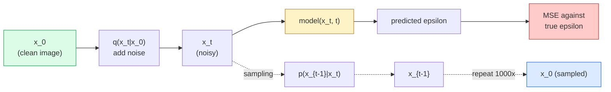

# Generasi Gambar — Model Diffusion

> Sebuah model diffusion belajar menghapus noise (denoise). Latih ia untuk menghapus sedikit noise dari gambar berisik, ulangi itu ke belakang seribu kali, dan kamu punya generator gambar.

**Type:** Build
**Languages:** Python
**Prerequisites:** Phase 4 Lesson 07 (U-Net), Phase 1 Lesson 06 (Probability), Phase 3 Lesson 06 (Optimizers)
**Time:** ~75 minutes

## Tujuan Pembelajaran

- Menurunkan proses forward penambahan-noise `x_0 -> x_1 -> ... -> x_T` dan menjelaskan mengapa `q(x_t | x_0)` bentuk tertutup berlaku untuk t apa pun
- Mengimplementasikan objective training bergaya **DDPM** yang meregresi noise yang ditambahkan di setiap langkah, dan sampler yang berjalan kembali dari noise murni ke sebuah gambar
- Membangun **U-Net** bersyarat-waktu (time-conditioned) yang cukup kecil untuk dilatih di CPU dan memprediksi noise untuk timestep mana pun
- Menjelaskan perbedaan antara sampling DDPM dan DDIM, dan kapan masing-masing tepat (Pelajaran 23 membahas flow matching dan rectified flow secara mendalam)

## Masalahnya

**GAN** menghasilkan sekali-jalan (one-shot): noise masuk, gambar keluar, satu forward pass. Mereka cepat tetapi sulit dilatih. Model **diffusion** menghasilkan secara iteratif: mulai dari noise murni, denoise dalam langkah-langkah kecil, gambar muncul. Mereka lambat tetapi mudah dilatih. Selama lima tahun terakhir sifat kedua-lah yang mendominasi: tim kecil mana pun bisa melatih model diffusion dan mendapat sampel yang masuk akal; training GAN adalah keterampilan yang kamu pelajari bertahun-tahun lewat run-run gagal.

Di luar stabilitas training, struktur iteratif diffusion-lah yang membuka segala yang dilakukan generasi gambar modern: conditioning teks, inpainting, editing gambar, super-resolution, gaya yang bisa dikontrol. Setiap langkah sampling loop adalah tempat untuk menyuntikkan batasan baru. Hook itulah mengapa **Stable Diffusion**, **Imagen**, **DALL-E 3**, **Midjourney**, dan setiap model gambar yang bisa dikontrol yang akan kamu pakai semuanya berbasis diffusion.

Pelajaran ini membangun **DDPM** minimal: forward penambahan-noise, backward denoise, loop training. Pelajaran berikutnya (**Stable Diffusion**) menyambungkannya ke sistem produksi dengan **VAE**, text encoder, dan classifier-free guidance.

## Konsepnya

### Proses forward

Ambil sebuah gambar `x_0`. Tambahkan sedikit noise Gaussian untuk mendapat `x_1`. Tambahkan sedikit lagi untuk mendapat `x_2`. Teruskan selama T langkah sampai `x_T` hampir tak terbedakan dari noise Gaussian murni.

```
q(x_t | x_{t-1}) = N(x_t; sqrt(1 - beta_t) * x_{t-1},  beta_t * I)
```

`beta_t` adalah jadwal variance kecil, biasanya linier dari 0,0001 hingga 0,02 selama T=1000 langkah. Setiap langkah sedikit memperkecil sinyal dan menyuntik noise baru.

### Lompatan bentuk tertutup

Menambahkan noise satu langkah demi satu langkah adalah rantai Markov, tetapi matematikanya bisa dilipat: kamu bisa mengambil sampel `x_t` langsung dari `x_0` dalam satu langkah.

```
Define alpha_t = 1 - beta_t
Define alpha_bar_t = prod_{s=1..t} alpha_s

Then:
  q(x_t | x_0) = N(x_t; sqrt(alpha_bar_t) * x_0,  (1 - alpha_bar_t) * I)

Equivalently:
  x_t = sqrt(alpha_bar_t) * x_0 + sqrt(1 - alpha_bar_t) * epsilon
  where epsilon ~ N(0, I)
```

Persamaan tunggal inilah alasan utama diffusion menjadi praktis. Selama training kamu memilih `t` acak, mengambil sampel `x_t` langsung dari `x_0`, dan melatih dalam satu langkah — tanpa simulasi rantai Markov penuh.

### Proses reverse

Proses forward sudah tetap. Proses reverse `p(x_{t-1} | x_t)` adalah yang dipelajari jaringan saraf. Model diffusion tidak memprediksi `x_{t-1}` secara langsung; mereka memprediksi noise `epsilon` yang ditambahkan pada langkah t, dan matematikanya menurunkan `x_{t-1}` dari situ.



### Loss training-nya

Untuk setiap langkah training:

1. Ambil sampel gambar nyata `x_0`.
2. Ambil sampel timestep `t` secara seragam dari [1, T].
3. Ambil sampel noise `epsilon ~ N(0, I)`.
4. Hitung `x_t = sqrt(alpha_bar_t) * x_0 + sqrt(1 - alpha_bar_t) * epsilon`.
5. Prediksi `epsilon_theta(x_t, t)` dengan jaringannya.
6. Minimalkan `|| epsilon - epsilon_theta(x_t, t) ||^2`.

Sesimpel itu. Jaringan saraf belajar memprediksi noise pada timestep mana pun. Loss-nya adalah MSE. Tidak ada permainan adversarial, tidak ada collapse, tidak ada osilasi.

### Sampler (DDPM)

Untuk menghasilkan: mulai dari `x_T ~ N(0, I)` dan berjalan mundur satu langkah demi satu langkah.

```
for t = T, T-1, ..., 1:
    eps = model(x_t, t)
    x_{t-1} = (1 / sqrt(alpha_t)) * (x_t - (beta_t / sqrt(1 - alpha_bar_t)) * eps) + sqrt(beta_t) * z
    where z ~ N(0, I) if t > 1, else 0
return x_0
```

Kuncinya adalah bahwa meskipun conditional reverse umumnya tidak diketahui dalam bentuk tertutup, untuk proses forward Gaussian spesifik ini ia diketahui. Koefisien yang jelek penampilannya adalah apa yang aturan Bayes berikan kepadamu.

### Mengapa 1000 langkah

Jadwal noise forward dipilih sedemikian rupa sehingga setiap langkah menambahkan tepat cukup noise sehingga langkah reverse-nya hampir Gaussian. Terlalu sedikit langkah dan langkah reverse jauh dari Gaussian, jaringannya tidak bisa memodelkannya dengan baik. Terlalu banyak langkah dan sampling menjadi mahal dengan gain yang makin mengecil. T=1000 dengan jadwal linier adalah default DDPM.

### DDIM: sampling 20x lebih cepat

Training-nya sama. Sampling-nya berubah. **DDIM** (Song et al., 2020) mendefinisikan proses reverse deterministik yang melompati timestep tanpa training ulang. Sampling dalam 50 langkah dengan DDIM memberikan kualitas yang mendekati DDPM 1000 langkah. Setiap sistem produksi memakai DDIM atau varian yang lebih cepat lagi (DPM-Solver, Euler ancestral).

### Time conditioning

Jaringan `epsilon_theta(x_t, t)` perlu mengetahui timestep mana yang sedang ia denoise. Model diffusion modern menyuntik `t` via time embedding sinusoidal (ide yang sama dengan positional encoding di transformer) yang dijumlahkan ke feature map di setiap level U-Net.

```
t_embedding = sinusoidal(t)
feature_map += MLP(t_embedding)
```

Tanpa time conditioning, jaringan harus menebak level noise dari gambar itu sendiri, yang bekerja tetapi jauh kurang sample-efficient.

```figure
cv-diffusion-image
```

## Bangun Sendiri

### Langkah 1: Jadwal noise

```python
import torch

def linear_beta_schedule(T=1000, beta_start=1e-4, beta_end=2e-2):
    return torch.linspace(beta_start, beta_end, T)


def precompute_schedule(betas):
    alphas = 1.0 - betas
    alphas_cumprod = torch.cumprod(alphas, dim=0)
    return {
        "betas": betas,
        "alphas": alphas,
        "alphas_cumprod": alphas_cumprod,
        "sqrt_alphas_cumprod": torch.sqrt(alphas_cumprod),
        "sqrt_one_minus_alphas_cumprod": torch.sqrt(1.0 - alphas_cumprod),
        "sqrt_recip_alphas": torch.sqrt(1.0 / alphas),
    }

schedule = precompute_schedule(linear_beta_schedule(T=1000))
```

Hitung sekali di muka, ambil berdasarkan indeks selama training dan sampling.

### Langkah 2: Diffusion forward (q_sample)

```python
def q_sample(x0, t, noise, schedule):
    sqrt_a = schedule["sqrt_alphas_cumprod"][t].view(-1, 1, 1, 1)
    sqrt_one_minus_a = schedule["sqrt_one_minus_alphas_cumprod"][t].view(-1, 1, 1, 1)
    return sqrt_a * x0 + sqrt_one_minus_a * noise
```

Bentuk tertutup satu baris. `t` adalah batch timestep, satu per gambar dalam batch.

### Langkah 3: U-Net time-conditioned mungil

```python
import torch.nn as nn
import torch.nn.functional as F
import math

def timestep_embedding(t, dim=64):
    half = dim // 2
    freqs = torch.exp(-math.log(10000) * torch.arange(half, device=t.device) / half)
    args = t[:, None].float() * freqs[None]
    emb = torch.cat([args.sin(), args.cos()], dim=-1)
    return emb


class TinyUNet(nn.Module):
    def __init__(self, img_channels=3, base=32, t_dim=64):
        super().__init__()
        self.t_mlp = nn.Sequential(
            nn.Linear(t_dim, base * 4),
            nn.SiLU(),
            nn.Linear(base * 4, base * 4),
        )
        self.t_dim = t_dim
        self.enc1 = nn.Conv2d(img_channels, base, 3, padding=1)
        self.enc2 = nn.Conv2d(base, base * 2, 4, stride=2, padding=1)
        self.mid = nn.Conv2d(base * 2, base * 2, 3, padding=1)
        self.dec1 = nn.ConvTranspose2d(base * 2, base, 4, stride=2, padding=1)
        self.dec2 = nn.Conv2d(base * 2, img_channels, 3, padding=1)
        self.time_proj = nn.Linear(base * 4, base * 2)

    def forward(self, x, t):
        t_emb = timestep_embedding(t, self.t_dim)
        t_emb = self.t_mlp(t_emb)
        t_proj = self.time_proj(t_emb)[:, :, None, None]

        h1 = F.silu(self.enc1(x))
        h2 = F.silu(self.enc2(h1)) + t_proj
        h3 = F.silu(self.mid(h2))
        d1 = F.silu(self.dec1(h3))
        d2 = torch.cat([d1, h1], dim=1)
        return self.dec2(d2)
```

U-Net dua-level dengan time conditioning yang disuntik di bottleneck. Perbesar kedalaman dan lebar untuk gambar nyata.

### Langkah 4: Loop training

```python
def train_step(model, x0, schedule, optimizer, device, T=1000):
    model.train()
    x0 = x0.to(device)
    bs = x0.size(0)
    t = torch.randint(0, T, (bs,), device=device)
    noise = torch.randn_like(x0)
    x_t = q_sample(x0, t, noise, schedule)
    pred = model(x_t, t)
    loss = F.mse_loss(pred, noise)
    optimizer.zero_grad()
    loss.backward()
    optimizer.step()
    return loss.item()
```

Itulah seluruh loop training-nya. Tanpa permainan GAN, tanpa loss khusus, satu panggilan MSE.

### Langkah 5: Sampler (DDPM)

```python
@torch.no_grad()
def sample(model, schedule, shape, T=1000, device="cpu"):
    model.eval()
    x = torch.randn(shape, device=device)
    betas = schedule["betas"].to(device)
    sqrt_one_minus_a = schedule["sqrt_one_minus_alphas_cumprod"].to(device)
    sqrt_recip_alphas = schedule["sqrt_recip_alphas"].to(device)

    for t in reversed(range(T)):
        t_batch = torch.full((shape[0],), t, dtype=torch.long, device=device)
        eps = model(x, t_batch)
        coef = betas[t] / sqrt_one_minus_a[t]
        mean = sqrt_recip_alphas[t] * (x - coef * eps)
        if t > 0:
            x = mean + torch.sqrt(betas[t]) * torch.randn_like(x)
        else:
            x = mean
    return x
```

1000 forward pass untuk menghasilkan satu batch sampel. Dalam kode nyata kamu akan menukar ini dengan sampler DDIM 50 langkah.

### Langkah 6: Sampler DDIM (deterministik, ~20x lebih cepat)

```python
@torch.no_grad()
def sample_ddim(model, schedule, shape, steps=50, T=1000, device="cpu", eta=0.0):
    model.eval()
    x = torch.randn(shape, device=device)
    alphas_cumprod = schedule["alphas_cumprod"].to(device)

    ts = torch.linspace(T - 1, 0, steps + 1).long()
    for i in range(steps):
        t = ts[i]
        t_prev = ts[i + 1]
        t_batch = torch.full((shape[0],), t, dtype=torch.long, device=device)
        eps = model(x, t_batch)
        a_t = alphas_cumprod[t]
        a_prev = alphas_cumprod[t_prev] if t_prev >= 0 else torch.tensor(1.0, device=device)
        x0_pred = (x - torch.sqrt(1 - a_t) * eps) / torch.sqrt(a_t)
        sigma = eta * torch.sqrt((1 - a_prev) / (1 - a_t) * (1 - a_t / a_prev))
        dir_xt = torch.sqrt(1 - a_prev - sigma ** 2) * eps
        noise = sigma * torch.randn_like(x) if eta > 0 else 0
        x = torch.sqrt(a_prev) * x0_pred + dir_xt + noise
    return x
```

`eta=0` sepenuhnya deterministik (input noise yang sama selalu menghasilkan output yang sama). `eta=1` mengembalikan DDPM.

## Gunakan

Untuk kerja produksi, pakai `diffusers`:

```python
from diffusers import DDPMScheduler, UNet2DModel

unet = UNet2DModel(sample_size=32, in_channels=3, out_channels=3, layers_per_block=2)
scheduler = DDPMScheduler(num_train_timesteps=1000)
```

Pustaka ini menghadirkan scheduler siap pakai (DDPM, DDIM, DPM-Solver, Euler, Heun), U-Net yang bisa dikonfigurasi, pipeline untuk text-to-image dan image-to-image, serta helper fine-tuning LoRA.

Untuk riset, `k-diffusion` (Katherine Crowson) punya implementasi referensi yang paling setia dan varian sampling terbaik.

## Rilis

Pelajaran ini menghasilkan:

- `outputs/prompt-diffusion-sampler-picker.md` — prompt yang memilih DDPM / DDIM / DPM-Solver / Euler berdasarkan target kualitas, anggaran latensi, dan jenis conditioning.
- `outputs/skill-noise-schedule-designer.md` — skill yang menghasilkan jadwal beta linier, cosinus, atau sigmoid diberikan T dan level korupsi target, plus plot diagnostik rasio signal-to-noise dari waktu ke waktu.

## Latihan

1. **(Mudah)** Visualisasikan proses forward: ambil satu gambar dan plot `x_t` pada `t in [0, 100, 250, 500, 750, 1000]`. Verifikasi bahwa `x_1000` tampak seperti noise Gaussian murni.
2. **(Sedang)** Latih TinyUNet pada dataset lingkaran-sintetis selama 20 epoch dan ambil sampel 16 lingkaran. Bandingkan sampling DDPM (1000 langkah) dan DDIM (50 langkah) — apakah mereka menghasilkan gambar serupa dari seed noise yang sama?
3. **(Sulit)** Implementasikan jadwal noise cosinus (Nichol & Dhariwal, 2021): `alpha_bar_t = cos^2((t/T + s) / (1 + s) * pi / 2)`. Latih model yang sama dengan jadwal linier dan cosinus dan tunjukkan bahwa cosinus memberi sampel lebih baik pada jumlah langkah rendah.

## Istilah Kunci

| Term | What people say | What it actually means |
|------|----------------|----------------------|
| Forward process | "Add noise over time" | Fixed Markov chain that corrupts an image into Gaussian noise over T steps |
| Reverse process | "Denoise step by step" | Learned distribution that walks back from noise to image |
| Epsilon prediction | "Predict the noise" | The training target: `epsilon_theta(x_t, t)` predicts the noise added at step t |
| Beta schedule | "Noise amounts" | Sequence of T small variances that define how much noise enters per step |
| alpha_bar_t | "Cumulative retain factor" | Product of (1 - beta_s) up to time t; bigger t means less signal left |
| DDPM sampler | "Ancestral, stochastic" | Samples each x_{t-1} from its conditional Gaussian; 1000 steps |
| DDIM sampler | "Deterministic, fast" | Rewrites sampling as a deterministic ODE; 20-100 steps with similar quality |
| Time conditioning | "Tell the model which t" | Sinusoidal embedding of t injected into the U-Net so it knows the noise level |

## Bacaan Lanjutan

- [Denoising Diffusion Probabilistic Models (Ho et al., 2020)](https://arxiv.org/abs/2006.11239) — the paper that made diffusion practical and beat GANs on FID
- [Improved DDPM (Nichol & Dhariwal, 2021)](https://arxiv.org/abs/2102.09672) — cosine schedule and v-parameterisation
- [DDIM (Song, Meng, Ermon, 2020)](https://arxiv.org/abs/2010.02502) — the deterministic sampler that made real-time inference possible
- [Elucidating the Design Space of Diffusion (Karras et al., 2022)](https://arxiv.org/abs/2206.00364) — a unified view of every diffusion design choice; current best reference
