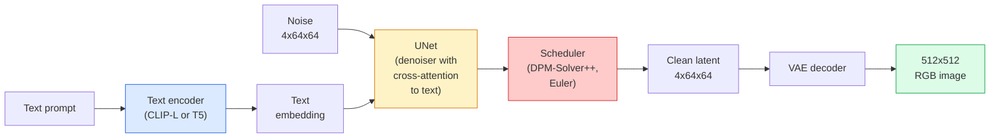

# Stable Diffusion — Arsitektur & Fine-Tuning

> Stable Diffusion adalah sebuah DDPM yang berjalan di ruang latensi sebuah VAE pre-trained, di-condition lewat teks via cross-attention, diambil sampelnya dengan solver ODE deterministik cepat, dan diarahkan oleh classifier-free guidance.

**Type:** Learn + Use
**Languages:** Python
**Prerequisites:** Phase 4 Lesson 10 (Diffusion), Phase 7 Lesson 02 (Self-Attention)
**Time:** ~75 minutes

## Tujuan Pembelajaran

- Menelusuri lima bagian pipeline **Stable Diffusion**: VAE, text encoder, U-Net, scheduler, safety checker — dan apa yang sebenarnya dilakukan masing-masing
- Menjelaskan **latent diffusion** dan mengapa training di ruang latensi 4x64x64 (alih-alih gambar 3x512x512) menurunkan komputasi 48x tanpa kehilangan kualitas
- Memakai `diffusers` untuk menghasilkan gambar, menjalankan image-to-image, inpainting, dan generasi berpandu ControlNet
- Fine-tune **Stable Diffusion** dengan **LoRA** pada dataset kustom kecil dan memuat adapter LoRA saat inference

## Masalahnya

Melatih **DDPM** langsung pada gambar RGB 512x512 itu mahal. Setiap langkah training melakukan backprop melalui U-Net yang melihat 3x512x512 = 786.432 nilai input, dan sampling membutuhkan 50+ forward pass melalui U-Net yang sama. Pada tingkat kualitas Stable Diffusion 1.5 (rilis 2022), diffusion ruang-piksel akan membutuhkan sekitar 256 GPU-month training dan 10-30 detik per gambar di GPU konsumen.

Trik yang membuat text-to-image bobot-terbuka menjadi praktis adalah **latent diffusion** (Rombach et al., CVPR 2022). Latih sebuah VAE yang memetakan gambar 3x512x512 ke tensor latensi 4x64x64 dan sebaliknya, lalu lakukan diffusion di ruang latensi itu. Komputasi turun `(3*512*512)/(4*64*64) = 48x`. Sampling turun dari puluhan detik menjadi di bawah dua detik di GPU yang sama.

Hampir setiap model generasi gambar modern — **SDXL**, **SD3**, **FLUX**, HunyuanDiT, Wan-Video — adalah model latent diffusion dengan variasi pada autoencoder, denoiser (U-Net atau DiT), dan conditioning teks. Pelajari **Stable Diffusion** dan kamu telah mempelajari templatnya.

## Konsepnya

### Pipeline-nya



- **VAE** — autoencoder yang dibekukan. Encoder mengubah gambar menjadi latents (dipakai untuk img2img dan training). Decoder mengubah latents kembali menjadi gambar.
- **Text encoder** — text encoder **CLIP** (SD 1.x/2.x), CLIP-L + CLIP-G (SDXL), atau T5-XXL (SD3/FLUX). Menghasilkan urutan token embedding.
- **U-Net** — denoiser-nya. Punya layer cross-attention yang attend dari latents ke text embedding di setiap tingkat resolusi.
- **Scheduler** — algoritma sampling (DDIM, Euler, DPM-Solver++). Memilih sigma, mencampurkan noise terprediksi kembali ke latensi.
- **Safety checker** — filter opsional NSFW / konten terlarang pada gambar output.

### Classifier-free guidance (CFG)

Conditioning teks polos mempelajari `epsilon_theta(x_t, t, c)` untuk setiap prompt `c`. **CFG** melatih jaringan yang sama dengan `c` dibuang 10% dari waktu (diganti embedding kosong), menghasilkan satu model yang memprediksi noise bersyarat maupun tanpa syarat. Saat inference:

```
eps = eps_uncond + w * (eps_cond - eps_uncond)
```

`w` adalah guidance scale. `w=0` berarti tanpa syarat, `w=1` berarti conditional polos, `w>1` mendorong output menjadi "lebih terkondisi pada prompt" dengan biaya keragaman. Default SD adalah `w=7.5`.

**CFG** adalah alasan text-to-image bekerja pada kualitas produksi. Tanpanya, prompt hanya memengaruhi output dengan lemah; dengannya, prompt mendominasi.

### Geometri ruang latensi

Latent 4-channel VAE bukan sekadar gambar yang dikompresi. Ia adalah manifold tempat aritmetika secara kasar sesuai dengan edit semantik (prompt engineering + interpolasi sama-sama hidup di sini), dan tempat diffusion U-Net telah dilatih untuk membelanjakan seluruh anggaran pemodelannya. Mendecode sebuah latent acak 4x64x64 tidak menghasilkan gambar yang tampak acak — ia menghasilkan sampah, karena hanya submanifold latents tertentu yang men-decode menjadi gambar valid.

Dua konsekuensi:

1. **Img2img** = encode gambar ke latensi, tambahkan noise sebagian, jalankan denoiser, decode. Struktur gambar bertahan karena encoding hampir invertibel; konten berubah berdasarkan prompt.
2. **Inpainting** = sama dengan img2img tetapi denoiser hanya memperbarui region yang di-mask; region yang tidak di-mask dipertahankan pada latensi terencode.

### Arsitektur U-Net

U-Net SD adalah versi besar dari TinyUNet dari Pelajaran 10 dengan tiga tambahan:

- **Transformer block** di setiap resolusi spasial, berisi self-attention + cross-attention ke text embedding.
- **Time embedding** via MLP pada encoding sinusoidal.
- **Skip connection** antara encoder dan decoder pada resolusi yang cocok.

Total parameter di SD 1.5: ~860M. SDXL: ~2,6B. FLUX: ~12B. Lompatan parameter sebagian besar ada di layer attention.

### Fine-tuning LoRA

Full fine-tune **Stable Diffusion** membutuhkan 20+ GB VRAM dan memperbarui 860M parameter. **LoRA** (Low-Rank Adaptation) menjaga model dasar tetap dibekukan dan menyuntikkan matriks dekomposisi-rank kecil ke layer attention. Sebuah adapter LoRA untuk SD biasanya 10-50 MB, dilatih dalam 10-60 menit di satu GPU konsumen, dan dimuat saat inference sebagai modifikasi drop-in.

```
Original: W_q : (d_in, d_out)   frozen
LoRA:     W_q + alpha * (A @ B)   where A : (d_in, r), B : (r, d_out)

r is typically 4-32.
```

**LoRA** adalah cara hampir semua fine-tune komunitas didistribusikan. CivitAI dan Hugging Face meng-hosting jutaan di antaranya.

### Scheduler yang akan kamu lihat

- **DDIM** — deterministik, ~50 langkah, sederhana.
- **Euler ancestral** — stokastik, 30-50 langkah, sampel sedikit lebih kreatif.
- **DPM-Solver++ 2M Karras** — deterministik, 20-30 langkah, default produksi.
- **LCM / TCD / Turbo** — model konsistensi dan varian hasil-distilasi; 1-4 langkah dengan biaya sedikit kualitas.

Menukar scheduler adalah perubahan satu baris di `diffusers` dan terkadang memperbaiki masalah sampel tanpa training ulang apa pun.

```figure
cv3-latent-compression
```

## Bangun Sendiri

Pelajaran ini memakai `diffusers` end-to-end alih-alih membangun ulang **Stable Diffusion** dari nol. Bagian yang perlu kamu bangun ulang (VAE, text encoder, U-Net, scheduler) adalah topik pelajarannya masing-masing; di sini tujuannya adalah kelihaian (fluency) dengan API produksi.

### Langkah 1: Text-to-image

```python
import torch
from diffusers import StableDiffusionPipeline

pipe = StableDiffusionPipeline.from_pretrained(
    "runwayml/stable-diffusion-v1-5",
    torch_dtype=torch.float16,
).to("cuda")

image = pipe(
    prompt="a dog riding a skateboard in tokyo, studio ghibli style",
    guidance_scale=7.5,
    num_inference_steps=25,
    generator=torch.Generator("cuda").manual_seed(42),
).images[0]
image.save("dog.png")
```

`float16` memperkecil VRAM setengahnya tanpa penurunan kualitas yang terlihat. `num_inference_steps=25` dengan DPM-Solver++ default menyamai `num_inference_steps=50` dengan DDIM.

### Langkah 2: Tukar scheduler-nya

```python
from diffusers import DPMSolverMultistepScheduler, EulerAncestralDiscreteScheduler

pipe.scheduler = DPMSolverMultistepScheduler.from_config(pipe.scheduler.config)
pipe.scheduler = EulerAncestralDiscreteScheduler.from_config(pipe.scheduler.config)
```

State scheduler terpisah dari bobot U-Net. Kamu bisa training dengan DDPM dan mengambil sampel dengan scheduler mana pun.

### Langkah 3: Image-to-image

```python
from diffusers import StableDiffusionImg2ImgPipeline
from PIL import Image

img2img = StableDiffusionImg2ImgPipeline.from_pretrained(
    "runwayml/stable-diffusion-v1-5",
    torch_dtype=torch.float16,
).to("cuda")

init_image = Image.open("dog.png").convert("RGB").resize((512, 512))
out = img2img(
    prompt="a dog riding a skateboard, oil painting",
    image=init_image,
    strength=0.6,
    guidance_scale=7.5,
).images[0]
```

`strength` adalah seberapa banyak noise yang ditambahkan sebelum denoising (0,0 = tanpa perubahan, 1,0 = regenerasi penuh). 0,5-0,7 adalah rentang standar untuk style transfer.

### Langkah 4: Inpainting

```python
from diffusers import StableDiffusionInpaintPipeline

inpaint = StableDiffusionInpaintPipeline.from_pretrained(
    "runwayml/stable-diffusion-inpainting",
    torch_dtype=torch.float16,
).to("cuda")

image = Image.open("dog.png").convert("RGB").resize((512, 512))
mask = Image.open("dog_mask.png").convert("L").resize((512, 512))

out = inpaint(
    prompt="a cat",
    image=image,
    mask_image=mask,
    guidance_scale=7.5,
).images[0]
```

Piksel putih dalam mask adalah area yang akan diregenerasi. Piksel hitam dipertahankan.

### Langkah 5: Pemuatan LoRA

```python
pipe.load_lora_weights(
    "artificialguybr/studioghibli-redmond-1-5v-studio-ghibli-lora-for-liberteredmond-sd-1-5",
    weight_name="StudioGhibliRedmond-15V-LiberteRedmond-StdGBRedmAF-StudioGhibli.safetensors",
)
pipe.fuse_lora(lora_scale=0.8)

image = pipe(prompt="a village square, StdGBRedmAF, Studio Ghibli").images[0]
```

Frasa pemicu dari model card (`StdGBRedmAF, Studio Ghibli`) menyalakan gayanya. `lora_scale` mengendalikan kekuatan; 0,0 = tanpa efek, 1,0 = efek penuh. `fuse_lora` memasak (bake) adapter ke dalam bobot secara in-place demi kecepatan, tetapi mencegah penukaran. Panggil `pipe.unfuse_lora()` sebelum memuat adapter lain.

### Langkah 6: Training LoRA (garis besar)

Training LoRA yang nyata hidup di `peft` atau `diffusers.training`. Kerangkanya:

```python
# Pseudocode
for step, batch in enumerate(dataloader):
    images, prompts = batch
    latents = vae.encode(images).latent_dist.sample() * 0.18215

    t = torch.randint(0, num_train_timesteps, (batch_size,))
    noise = torch.randn_like(latents)
    noisy_latents = scheduler.add_noise(latents, noise, t)

    text_emb = text_encoder(tokenizer(prompts))

    pred_noise = unet(noisy_latents, t, text_emb)  # LoRA weights injected here

    loss = F.mse_loss(pred_noise, noise)
    loss.backward()
    optimizer.step()
```

Hanya matriks LoRA yang menerima gradien; U-Net dasar, VAE, dan text encoder dibekukan. Dengan batch size 1 dan gradient checkpointing, ini muat di 8 GB VRAM.

## Gunakan

Dalam produksi, keputusan yang benar-benar kamu ambil:

- **Keluarga model**: SD 1.5 untuk fine-tune komunitas open-source, SDXL untuk fidelity lebih tinggi, SD3 / FLUX untuk state of the art dan persyaratan lisensi yang ketat.
- **Scheduler**: DPM-Solver++ 2M Karras untuk 20-30 langkah, LCM-LoRA saat latensi di bawah 1 detik.
- **Presisi**: `float16` di 4080/4090, `bfloat16` di A100 dan yang lebih baru, `int8` (via `bitsandbytes` atau `compel`) saat VRAM menipis.
- **Conditioning**: teks polos sudah bekerja; untuk kontrol lebih kuat, tambahkan **ControlNet** (canny, depth, pose) di atas pipeline dasar.

Untuk generasi batch, `AUTO1111` / `ComfyUI` adalah alat komunitas; untuk API produksi, `diffusers` + `accelerate` atau `optimum-nvidia` dengan kompilasi TensorRT.

## Rilis

Pelajaran ini menghasilkan:

- `outputs/prompt-sd-pipeline-planner.md` — prompt yang memilih SD 1.5 / SDXL / SD3 / FLUX plus scheduler dan presisi diberikan anggaran latensi, target fidelity, dan batasan lisensi.
- `outputs/skill-lora-training-setup.md` — skill yang menulis konfigurasi training LoRA lengkap untuk dataset kustom termasuk caption, rank, batch size, dan learning rate.

## Latihan

1. **(Mudah)** Hasilkan prompt yang sama dengan `guidance_scale` pada `[1, 3, 5, 7.5, 10, 15]`. Deskripsikan bagaimana gambar berubah. Pada nilai guidance berapa artefak muncul?
2. **(Sedang)** Ambil foto nyata apa pun, jalankan melalui `StableDiffusionImg2ImgPipeline` pada `strength` di `[0.2, 0.4, 0.6, 0.8, 1.0]`. Strength mana yang mempertahankan komposisi sambil mengubah gaya? Mengapa 1,0 mengabaikan input sepenuhnya?
3. **(Sulit)** Latih sebuah **LoRA** pada 10-20 gambar satu subjek (peliharaan, logo, karakter) dan hasilkan adegan baru yang memuat subjek itu. Laporkan rank LoRA dan langkah training yang menghasilkan pelestarian identitas terbaik tanpa overfitting ke gambar input.

## Istilah Kunci

| Term | What people say | What it actually means |
|------|----------------|----------------------|
| Latent diffusion | "Diffuse in latents" | Run the entire DDPM in the VAE latent space (4x64x64) instead of pixel space (3x512x512); 48x compute saving |
| VAE scale factor | "0.18215" | Constant that rescales the VAE's raw latent to roughly unit variance; hardcoded in every SD pipeline |
| Classifier-free guidance | "CFG" | Mix conditional and unconditional noise predictions; the single most impactful inference knob |
| Scheduler | "Sampler" | The algorithm that turns noise + model predictions into a denoised latent trajectory |
| LoRA | "Low-rank adapter" | Small rank-decomposition matrices that fine-tune attention layers without touching base weights |
| Cross-attention | "Text-image attention" | Attention from latent tokens to text tokens; injects prompt information at every U-Net level |
| ControlNet | "Structure conditioning" | A separately-trained adapter that steers SD with an extra input (canny, depth, pose, segmentation) |
| DPM-Solver++ | "The default scheduler" | Second-order deterministic ODE solver; best quality at low step counts (20-30) in 2026 |

## Bacaan Lanjutan

- [High-Resolution Image Synthesis with Latent Diffusion (Rombach et al., 2022)](https://arxiv.org/abs/2112.10752) — the Stable Diffusion paper; includes every ablation that justifies the design
- [Classifier-Free Diffusion Guidance (Ho & Salimans, 2022)](https://arxiv.org/abs/2207.12598) — the CFG paper
- [LoRA: Low-Rank Adaptation of Large Language Models (Hu et al., 2021)](https://arxiv.org/abs/2106.09685) — LoRA was NLP-first; it transferred to SD with almost no changes
- [diffusers documentation](https://huggingface.co/docs/diffusers) — the reference for every SD / SDXL / SD3 / FLUX pipeline
