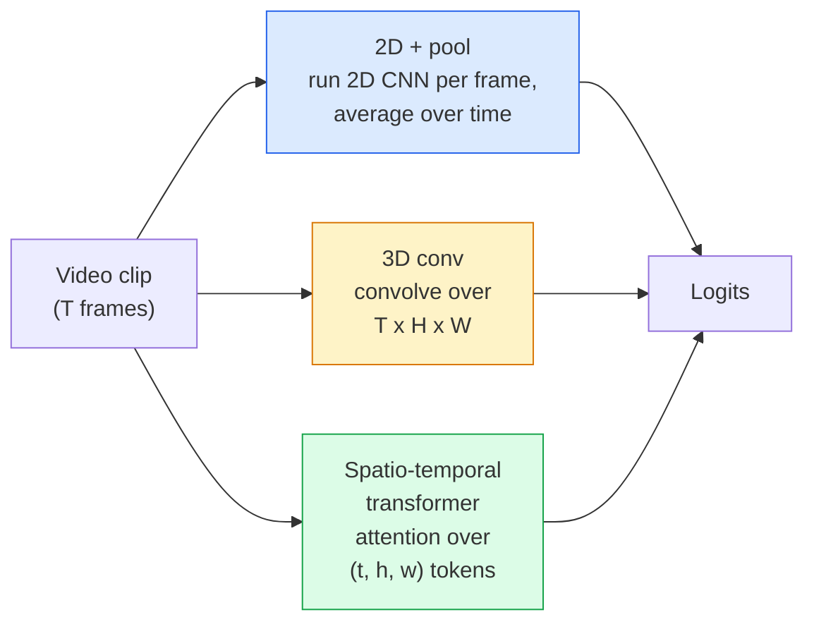

# Pemahaman Video — Pemodelan Temporal

> Sebuah video adalah urutan gambar plus fisika yang menyambungkannya. Setiap model video memperlakukan waktu sebagai sumbu ekstra (3D conv), urutan untuk di-attend (transformer), atau fitur yang diekstrak sekali lalu di-pool (2D+pool).

**Type:** Learn + Build
**Languages:** Python
**Prerequisites:** Phase 4 Lesson 03 (CNNs), Phase 4 Lesson 04 (Image Classification)
**Time:** ~45 minutes

## Tujuan Pembelajaran

- Membedakan tiga pendekatan pemodelan video utama (2D+pool, 3D conv, transformer spasio-temporal) dan memprediksi trade-off biaya serta akurasi mereka
- Mengimplementasikan frame sampling, temporal pooling, dan classifier baseline 2D+pool di PyTorch
- Menjelaskan mengapa kernel 3D "inflated" **I3D** mentransfer dengan baik dari bobot ImageNet dan apa yang dilakukan conv (2+1)D yang terfaktorisasi secara berbeda
- Membaca dataset serta metrik pengenalan aksi standar: Kinetics-400/600, UCF101, Something-Something V2; akurasi top-1 pada tingkat clip dan video

## Masalahnya

Video 30 detik pada 30 fps berisi 900 gambar. Dengan naif, klasifikasi video adalah klasifikasi gambar yang dijalankan 900 kali diikuti semacam agregasi. Itu bekerja saat aksinya terlihat di hampir setiap frame (video olahraga, memasak, senam) dan gagal buruk saat aksinya justru didefinisikan oleh gerakan itu sendiri: "mendorong sesuatu dari kiri ke kanan" tampak seperti dua benda diam di setiap frame.

Pertanyaan inti untuk setiap arsitektur video adalah: kapan struktur temporal dimodelkan, dan bagaimana? Jawabannya menggerakkan segala hal lain — biaya komputasi, strategi pretraining, apakah kamu bisa memakai ulang bobot ImageNet, dataset apa yang dilatihi model.

Pelajaran ini sengaja lebih pendek daripada pelajaran gambar statis. Mesin gambar inti sudah tersedia, dan pemahaman video sebagian besar tentang cerita temporalnya: sampling, pemodelan, dan agregasi.

## Konsepnya

### Tiga keluarga arsitektur



### 2D + pool

Ambil sebuah CNN 2D (ResNet, EfficientNet, ViT). Jalankan secara independen pada setiap frame yang disampel. Rata-ratakan (atau max-pool, atau attention-pool) embedding per frame. Berikan vektor yang sudah di-pool ke sebuah classifier.

Kelebihan:
- Pretraining ImageNet mentransfer langsung.
- Paling sederhana untuk diimplementasikan.
- Murah: T frame * biaya inference satu gambar.

Kekurangan:
- Tidak bisa memodelkan gerakan. Aksi = agregasi dari penampilan (appearance).
- Temporal pooling tidak peduli urutan; "buka pintu" dan "tutup pintu" tampak sama.

Kapan dipakai: tugas yang berat pada appearance, transfer learning pada dataset video kecil, baseline awal.

### Conv 3D

Ganti kernel 2D (H, W) dengan kernel 3D (T, H, W). Jaringan melakukan konvolusi di spasial dan waktu sekaligus. Keluarga awal: C3D, I3D, SlowFast.

Trik I3D: ambil model 2D ImageNet pre-trained, "inflasi" setiap kernel 2D dengan menyalinnya di sepanjang sumbu waktu baru. Conv 2D 3x3 menjadi conv 3D 3x3x3. Ini memberikan model 3D bobot pre-trained yang kuat alih-alih melatih dari nol.

Kelebihan:
- Secara langsung memodelkan gerakan.
- Inflasi I3D memberikan transfer learning cuma-cuma.

Kekurangan:
- FLOPs T/8 lebih banyak daripada padanan 2D-nya (untuk kernel temporal dari 3 bertumpuk 3 kali).
- Kernel temporal kecil; gerakan jangka panjang membutuhkan pendekatan piramida atau dual-stream.

Kapan dipakai: pengenalan aksi di mana gerakan-lah sinyalnya (Something-Something V2, Kinetics dengan kelas yang berat gerakan).

### Transformer spasio-temporal

Tokenisasikan video menjadi grid patch ruang-waktu dan attend ke semua itu. TimeSformer, ViViT, Video Swin, VideoMAE.

Pola attention yang berarti:
- **Joint** — satu attention besar di atas (t, h, w). Kuadratik terhadap `T*H*W`; mahal.
- **Divided** — dua attention per block: satu untuk waktu, satu untuk spasial. Skala yang mendekati linier.
- **Factorised** — attention waktu berselang-seling dengan attention spasial di antara block.

Kelebihan:
- Akurasi SOTA di setiap benchmark utama.
- Mentransfer dari image transformer (ViT) via inflasi patch.
- Mendukung video konteks panjang lewat attention jarang (sparse).

Kekurangan:
- Rakus komputasi.
- Membutuhkan pemilihan pola attention yang hati-hati atau runtime membengkak.

Kapan dipakai: dataset besar, pemahaman video fidelity-tinggi, tugas multimodal video+teks.

### Sampling frame

Clip 10 detik pada 30 fps berisi 300 frame; memberikan ketiganya ke model mana pun adalah pemborosan. Strategi standar:

- **Sampling seragam** — pilih T frame merata di sepanjang clip. Default untuk 2D+pool.
- **Sampling padat (dense)** — jendela T frame berurutan acak. Umum untuk conv 3D karena gerakan membutuhkan frame tetangga.
- **Multi-clip** — sampel beberapa jendela T frame dari video yang sama, klasifikasikan masing-masing, rata-ratakan prediksi saat pengujian.

T biasanya 8, 16, 32, atau 64. T lebih tinggi = sinyal temporal lebih banyak dengan komputasi lebih banyak.

### Evaluasi

Dua tingkat:
- **Akurasi clip-level** — model melihat satu clip T frame, melaporkan top-k.
- **Akurasi video-level** — rata-rata prediksi clip-level di atas beberapa clip per video; lebih tinggi dan lebih stabil.

Selalu laporkan keduanya. Model yang memperoleh 78% clip / 82% video sangat bergantung pada perata-rataan saat pengujian; yang memperoleh 80% / 81% lebih robust per clip.

### Dataset yang akan kamu temui

- **Kinetics-400 / 600 / 700** — dataset aksi serbaguna. 400k clip; URL YouTube (banyak yang kini mati).
- **Something-Something V2** — aksi yang didefinisikan gerakan ("memindahkan X dari kiri ke kanan"). Tidak bisa diselesaikan oleh 2D+pool.
- **UCF-101**, **HMDB-51** — lebih lama, lebih kecil, masih dilaporkan.
- **AVA** — *lokalisasi* aksi dalam ruang dan waktu; lebih sulit daripada klasifikasi.

```figure
v4-video-temporal
```

## Bangun Sendiri

### Langkah 1: Sampler frame

Sampler seragam dan padat yang bekerja pada daftar frame (atau tensor video).

```python
import numpy as np

def sample_uniform(num_frames_total, T):
    if num_frames_total <= T:
        return list(range(num_frames_total)) + [num_frames_total - 1] * (T - num_frames_total)
    step = num_frames_total / T
    return [int(i * step) for i in range(T)]


def sample_dense(num_frames_total, T, rng=None):
    rng = rng or np.random.default_rng()
    if num_frames_total <= T:
        return list(range(num_frames_total)) + [num_frames_total - 1] * (T - num_frames_total)
    start = int(rng.integers(0, num_frames_total - T + 1))
    return list(range(start, start + T))
```

Keduanya mengembalikan `T` indeks yang kamu pakai untuk menyilet (slice) tensor video.

### Langkah 2: Sebuah baseline 2D+pool

Jalankan ResNet-18 2D di setiap frame, average-pool fiturnya, klasifikasikan.

```python
import torch
import torch.nn as nn
from torchvision.models import resnet18, ResNet18_Weights

class FramePool(nn.Module):
    def __init__(self, num_classes=400, pretrained=True):
        super().__init__()
        weights = ResNet18_Weights.IMAGENET1K_V1 if pretrained else None
        backbone = resnet18(weights=weights)
        self.features = nn.Sequential(*(list(backbone.children())[:-1]))  # global avg pool kept
        self.head = nn.Linear(512, num_classes)

    def forward(self, x):
        # x: (N, T, 3, H, W)
        N, T = x.shape[:2]
        x = x.view(N * T, *x.shape[2:])
        feats = self.features(x).view(N, T, -1)
        pooled = feats.mean(dim=1)
        return self.head(pooled)

model = FramePool(num_classes=10)
x = torch.randn(2, 8, 3, 224, 224)
print(f"output: {model(x).shape}")
print(f"params: {sum(p.numel() for p in model.parameters()):,}")
```

Sebelas juta parameter, pre-trained ImageNet, berjalan per frame, merata-ratakan, mengklasifikasikan. Baseline ini sering berada dalam jarak 5-10 poin dari model 3D yang benar pada tugas yang berat appearance — terkadang lebih baik, karena ia memakai ulang backbone ImageNet yang lebih kuat.

### Langkah 3: Conv 3D bergaya I3D yang di-inflate

Ubah satu conv 2D menjadi conv 3D dengan mengulang bobot di sepanjang sumbu waktu baru.

```python
def inflate_2d_to_3d(conv2d, time_kernel=3):
    out_c, in_c, kh, kw = conv2d.weight.shape
    weight_3d = conv2d.weight.data.unsqueeze(2)  # (out, in, 1, kh, kw)
    weight_3d = weight_3d.repeat(1, 1, time_kernel, 1, 1) / time_kernel
    conv3d = nn.Conv3d(in_c, out_c, kernel_size=(time_kernel, kh, kw),
                        padding=(time_kernel // 2, conv2d.padding[0], conv2d.padding[1]),
                        stride=(1, conv2d.stride[0], conv2d.stride[1]),
                        bias=False)
    conv3d.weight.data = weight_3d
    return conv3d

conv2d = nn.Conv2d(3, 64, kernel_size=3, padding=1, bias=False)
conv3d = inflate_2d_to_3d(conv2d, time_kernel=3)
print(f"2D weight shape:  {tuple(conv2d.weight.shape)}")
print(f"3D weight shape:  {tuple(conv3d.weight.shape)}")
x = torch.randn(1, 3, 8, 56, 56)
print(f"3D output shape:  {tuple(conv3d(x).shape)}")
```

Pembagian dengan `time_kernel` menjaga magnitudo aktivasi tetap kira-kira konstan — penting agar tidak merusak statistik batch-norm pada pass pertama.

### Langkah 4: Conv (2+1)D terfaktorisasi

Pecah sebuah conv 3D menjadi conv 2D (spasial) dan conv 1D (temporal). Receptive field sama, parameter lebih sedikit, akurasi lebih baik di beberapa benchmark.

```python
class Conv2Plus1D(nn.Module):
    def __init__(self, in_c, out_c, kernel_size=3):
        super().__init__()
        mid_c = (in_c * out_c * kernel_size * kernel_size * kernel_size) \
                // (in_c * kernel_size * kernel_size + out_c * kernel_size)
        self.spatial = nn.Conv3d(in_c, mid_c, kernel_size=(1, kernel_size, kernel_size),
                                 padding=(0, kernel_size // 2, kernel_size // 2), bias=False)
        self.bn = nn.BatchNorm3d(mid_c)
        self.act = nn.ReLU(inplace=True)
        self.temporal = nn.Conv3d(mid_c, out_c, kernel_size=(kernel_size, 1, 1),
                                  padding=(kernel_size // 2, 0, 0), bias=False)

    def forward(self, x):
        return self.temporal(self.act(self.bn(self.spatial(x))))

c = Conv2Plus1D(3, 64)
x = torch.randn(1, 3, 8, 56, 56)
print(f"(2+1)D output: {tuple(c(x).shape)}")
```

Jaringan R(2+1)D penuh sama dengan ResNet-18 dengan setiap conv 3x3 diganti `Conv2Plus1D`.

## Gunakan

Dua pustaka menutupi kerja video produksi:

- `torchvision.models.video` — R(2+1)D, MViT, Swin3D dengan bobot Kinetics pre-trained. API yang sama dengan model gambar.
- `pytorchvideo` (Meta) — model zoo, data loader untuk Kinetics / SSv2 / AVA, transform standar.

Untuk model video Vision-Language (video captioning, video QA), pakai `transformers` (`VideoMAE`, `VideoLLaMA`, `InternVideo`).

## Rilis

Pelajaran ini menghasilkan:

- `outputs/prompt-video-architecture-picker.md` — prompt yang memilih 2D+pool / I3D / (2+1)D / transformer berdasarkan appearance-vs-gerakan, ukuran dataset, dan anggaran komputasi.
- `outputs/skill-frame-sampler-auditor.md` — skill yang memeriksa sampler sebuah pipeline video dan menandai bug umum: indeks off-by-one, sampling tidak merata saat `num_frames < T`, ketiadaan crop yang mempertahankan aspect ratio, dll.

## Latihan

1. **(Mudah)** Hitung FLOPs (perkiraan) untuk FramePool dengan T=8 vs ResNet 3D bergaya I3D dengan T=8. Berikan alasan mengapa 2D+pool 3-5x lebih murah.
2. **(Sedang)** Hasilkan dataset video sintetis: bola acak yang bergerak ke arah acak, dilabeli berdasarkan arah gerakan ("kiri-ke-kanan", "kanan-ke-kiri", "diagonal-atas"). Latih FramePool di atasnya. Tunjukkan bahwa ia mencapai akurasi nyaris peluang (chance), membuktikan bahwa appearance saja tidak cukup untuk tugas gerakan.
3. **(Sulit)** Bangun R(2+1)D-18 dengan mengganti setiap Conv2d di ResNet-18 dengan `Conv2Plus1D`. Inflate bobot conv pertama dari ResNet-18 pre-trained ImageNet. Latih pada dataset gerakan dari latihan 2 dan kalahkan FramePool.

## Istilah Kunci

| Term | What people say | What it actually means |
|------|----------------|----------------------|
| 2D + pool | "Per-frame classifier" | Run a 2D CNN on every sampled frame, average-pool features across time, classify |
| 3D convolution | "Spatio-temporal kernel" | Kernel that convolves over (T, H, W); can model motion natively |
| Inflation | "Lift 2D weights to 3D" | Initialise 3D conv weights by repeating a 2D conv's weights along the new time axis, then divide by kernel_T to preserve activation scale |
| (2+1)D | "Factorised conv" | Split 3D into 2D spatial + 1D temporal; fewer parameters, extra non-linearity between |
| Divided attention | "Time then space" | Transformer block with two attentions per layer: one over tokens at the same frame, one over tokens at the same position |
| Clip | "T-frame window" | A sampled subsequence of T frames; the unit a video model consumes |
| Clip vs video accuracy | "Two eval settings" | Clip = one sample per video, video = average across multiple sampled clips |
| Kinetics | "The ImageNet of video" | 400-700 action classes, 300k+ YouTube clips, the standard video pretraining corpus |

## Bacaan Lanjutan

- [I3D: Quo Vadis, Action Recognition (Carreira & Zisserman, 2017)](https://arxiv.org/abs/1705.07750) — introduces inflation and the Kinetics dataset
- [R(2+1)D: A Closer Look at Spatiotemporal Convolutions (Tran et al., 2018)](https://arxiv.org/abs/1711.11248) — factorised conv, still a strong baseline
- [TimeSformer: Is Space-Time Attention All You Need? (Bertasius et al., 2021)](https://arxiv.org/abs/2102.05095) — the first strong video transformer
- [VideoMAE (Tong et al., 2022)](https://arxiv.org/abs/2203.12602) — masked autoencoder pretraining for video; current dominant pretraining recipe
