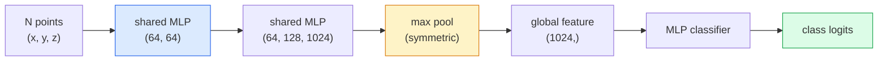

# Visi 3D — Point Cloud & NeRF

> Visi 3D datang dalam dua rasa. Point cloud adalah output mentah sensor. NeRF adalah medan volumetrik yang dipelajari. Keduanya menjawab "apa di mana dalam ruang."

**Type:** Learn + Build
**Languages:** Python
**Prerequisites:** Phase 4 Lesson 03 (CNNs), Phase 1 Lesson 12 (Tensor Operations)
**Time:** ~45 minutes

## Tujuan Pembelajaran

- Membedakan representasi 3D eksplisit (point cloud, mesh, voxel) dan implisit (signed distance field, NeRF) serta kapan masing-masing dipakai
- Memahami trik fungsi simetris **PointNet** yang membuat jaringan saraf invarien-permutasi di atas set titik yang tidak berurutan
- Menelusuri satu forward pass NeRF: ray casting, rendering volumetrik, positional encoding, MLP density+colour head
- Memakai `nerfstudio` atau `instant-ngp` untuk rekonstruksi 3D pre-trained dari sekumpulan kecil gambar berposisi

## Masalahnya

Sebuah kamera menghasilkan gambar 2D. Sebuah LIDAR menghasilkan sekumpulan titik 3D tanpa urutan. Pipeline structure-from-motion menghasilkan awan sparse dari keypoint 3D. Sebuah **NeRF** merekonstruksi seluruh adegan 3D dari segelintir gambar berposisi. Semuanya adalah "visi" tetapi tidak ada yang tampak seperti tensor padat yang diinginkan CNN.

Visi 3D penting karena hampir setiap tugas robot bernilai-tinggi berjalan di 3D: grasping, penghindaran rintangan, navigasi, oklusi AR, penangkapan konten 3D. Insinyur visi yang hanya memahami gambar 2D terkunci keluar dari irisan bidang yang tumbuh tercepat (konten AR/VR, robotika, tumpukan mobil otonom, rekonstruksi 3D berbasis NeRF untuk real estate atau konstruksi).

Dua representasi mendominasi karena alasan berbeda. Point cloud adalah yang diberikan sensor kepadamu secara cuma-cuma. **NeRF** dan penerusnya (**3D Gaussian splatting**, neural SDF) adalah yang kamu dapat ketika kamu meminta jaringan saraf mempelajari sebuah adegan.

## Konsepnya

### Point cloud

Point cloud adalah set tidak berurutan dari N titik di R^3, opsional masing-masing dengan fitur (warna, intensitas, normal).

```
cloud = [
  (x1, y1, z1, r1, g1, b1),
  (x2, y2, z2, r2, g2, b2),
  ...
  (xN, yN, zN, rN, gN, bN),
]
```

Tanpa grid, tanpa konektivitas. Dua sifat membuat ini sulit bagi jaringan saraf:

- **Invariansi permutasi** — output tidak boleh bergantung pada urutan titik.
- **N variabel** — satu model harus menangani cloud berbagai ukuran.

**PointNet** (Qi et al., 2017) memecahkan keduanya dengan satu ide: terapkan MLP bersama (shared) ke setiap titik, lalu agregasi dengan fungsi simetris (max pool). Hasilnya adalah vektor berukuran tetap yang tidak bergantung pada urutan.

```
f(P) = max_{p in P} MLP(p)
```

Inilah seluruh inti **PointNet**. Varian yang lebih dalam (PointNet++, Point Transformer) menambahkan sampling hirarkis dan agregasi lokal tetapi trik fungsi simetrisnya tidak berubah.

### Arsitektur PointNet



"MLP bersama" berarti MLP yang sama berjalan pada setiap titik secara independen. Diimplementasikan sebagai conv 1x1 di sepanjang dimensi titik demi efisiensi.

### Neural Radiance Fields (NeRF)

**NeRF** (Mildenhall et al., 2020) mengambil pertanyaan "bisakah kita merekonstruksi adegan 3D dari N foto?" dan menjawabnya dengan jaringan saraf yang adalah adegan itu sendiri. Jaringan memetakan `(x, y, z, viewing_direction)` ke `(density, colour)`. Merender tampilan baru adalah loop ray casting di sepanjang jaringan ini.

```
NeRF MLP:  (x, y, z, theta, phi) -> (sigma, r, g, b)

To render a pixel (u, v) of a new view:
  1. Cast a ray from the camera through pixel (u, v)
  2. Sample points along the ray at distances t_1, t_2, ..., t_N
  3. Query the MLP at each point
  4. Composite the colours weighted by (1 - exp(-sigma * dt))
  5. The sum is the rendered pixel colour
```

Sebuah loss membandingkan piksel hasil-render dengan piksel ground-truth pada foto training. Backprop melalui langkah rendering memperbarui MLP-nya. Tanpa ground truth 3D, tanpa geometri eksplisit — adegan itu disimpan di bobot MLP.

### Positional encoding dalam NeRF

MLP vanilla pada `(x, y, z)` tidak bisa merepresentasikan detail frekuensi-tinggi karena MLP cenderung secara spektral ke frekuensi rendah. NeRF memperbaikinya dengan mengenkode setiap koordinat menjadi vektor fitur Fourier sebelum MLP:

```
gamma(p) = (sin(2^0 pi p), cos(2^0 pi p), sin(2^1 pi p), cos(2^1 pi p), ...)
```

Hingga L=10 tingkat frekuensi. Ini trik yang sama yang dipakai transformer untuk posisi, dan ia muncul lagi dalam time conditioning diffusion (Pelajaran 10). Tanpanya, NeRF tampak buram.

### Rendering volumetrik

```
C(r) = sum_i T_i * (1 - exp(-sigma_i * delta_i)) * c_i

T_i  = exp(- sum_{j<i} sigma_j * delta_j)
delta_i = t_{i+1} - t_i
```

`T_i` adalah transmitansi — berapa banyak cahaya yang bertahan sampai titik i. `(1 - exp(-sigma_i * delta_i))` adalah opasitas di titik i. `c_i` adalah warnanya. Piksel akhir adalah jumlah berbobot di sepanjang ray.

### Apa yang menggantikan NeRF

NeRF murni lambat dilatih (berjam-jam) dan lambat dirender (beberapa detik per gambar). Silsilahnya sejak itu:

- **Instant-NGP** (2022) — encoding hash-grid mengganti input posisi MLP; dilatih dalam hitungan detik.
- **Mip-NeRF 360** — menangani adegan tak-berbatas dan anti-aliasing.
- **3D Gaussian Splatting** (2023) — mengganti medan volumetrik dengan jutaan Gaussian 3D; dilatih dalam hitungan menit, dirender secara real time. Default produksi saat ini.

Hampir setiap produk NeRF nyata pada 2026 sebenarnya adalah 3D Gaussian splatting. Model mentalnya masih NeRF.

### Dataset dan benchmark

- **ShapeNet** — klasifikasi dan segmentasi model CAD 3D sebagai point cloud.
- **ScanNet** — pemindaian indoor nyata untuk segmentasi.
- **KITTI** — point cloud LIDAR outdoor untuk mobil otonom.
- **NeRF Synthetic** / **Blended MVS** — dataset gambar berposisi untuk view synthesis.
- Dataset **Mip-NeRF 360** — adegan nyata tak-berbatas.

```figure
nerf-rays
```

## Bangun Sendiri

### Langkah 1: Classifier PointNet

```python
import torch
import torch.nn as nn

class PointNet(nn.Module):
    def __init__(self, num_classes=10):
        super().__init__()
        self.mlp1 = nn.Sequential(
            nn.Conv1d(3, 64, 1),    nn.BatchNorm1d(64),   nn.ReLU(inplace=True),
            nn.Conv1d(64, 64, 1),   nn.BatchNorm1d(64),   nn.ReLU(inplace=True),
        )
        self.mlp2 = nn.Sequential(
            nn.Conv1d(64, 128, 1),  nn.BatchNorm1d(128),  nn.ReLU(inplace=True),
            nn.Conv1d(128, 1024, 1), nn.BatchNorm1d(1024), nn.ReLU(inplace=True),
        )
        self.head = nn.Sequential(
            nn.Linear(1024, 512),   nn.BatchNorm1d(512),  nn.ReLU(inplace=True),
            nn.Dropout(0.3),
            nn.Linear(512, 256),    nn.BatchNorm1d(256),  nn.ReLU(inplace=True),
            nn.Dropout(0.3),
            nn.Linear(256, num_classes),
        )

    def forward(self, x):
        # x: (N, 3, num_points) — transposed for Conv1d
        x = self.mlp1(x)
        x = self.mlp2(x)
        x = torch.max(x, dim=-1)[0]       # (N, 1024)
        return self.head(x)

pts = torch.randn(4, 3, 1024)
net = PointNet(num_classes=10)
print(f"output: {net(pts).shape}")
print(f"params: {sum(p.numel() for p in net.parameters()):,}")
```

Sekitar 1,6M parameter. Berjalan pada 1.024 titik per cloud.

### Langkah 2: Positional encoding

```python
def positional_encoding(x, L=10):
    """
    x: (..., D) -> (..., D * 2 * L)
    """
    freqs = 2.0 ** torch.arange(L, dtype=x.dtype, device=x.device)
    args = x.unsqueeze(-1) * freqs * 3.141592653589793
    sinc = torch.cat([args.sin(), args.cos()], dim=-1)
    return sinc.reshape(*x.shape[:-1], -1)

x = torch.randn(5, 3)
y = positional_encoding(x, L=10)
print(f"input:  {x.shape}")
print(f"encoded: {y.shape}     # (5, 60)")
```

Mengalikan dengan `2^l * pi` memberikan frekuensi yang makin tinggi secara bertahap.

### Langkah 3: MLP NeRF mini

```python
class TinyNeRF(nn.Module):
    def __init__(self, L_pos=10, L_dir=4, hidden=128):
        super().__init__()
        self.L_pos = L_pos
        self.L_dir = L_dir
        pos_dim = 3 * 2 * L_pos
        dir_dim = 3 * 2 * L_dir
        self.trunk = nn.Sequential(
            nn.Linear(pos_dim, hidden), nn.ReLU(inplace=True),
            nn.Linear(hidden, hidden),  nn.ReLU(inplace=True),
            nn.Linear(hidden, hidden),  nn.ReLU(inplace=True),
            nn.Linear(hidden, hidden),  nn.ReLU(inplace=True),
        )
        self.sigma = nn.Linear(hidden, 1)
        self.color = nn.Sequential(
            nn.Linear(hidden + dir_dim, hidden // 2), nn.ReLU(inplace=True),
            nn.Linear(hidden // 2, 3), nn.Sigmoid(),
        )

    def forward(self, x, d):
        x_enc = positional_encoding(x, self.L_pos)
        d_enc = positional_encoding(d, self.L_dir)
        h = self.trunk(x_enc)
        sigma = torch.relu(self.sigma(h)).squeeze(-1)
        rgb = self.color(torch.cat([h, d_enc], dim=-1))
        return sigma, rgb

nerf = TinyNeRF()
x = torch.randn(128, 3)
d = torch.randn(128, 3)
s, c = nerf(x, d)
print(f"sigma: {s.shape}   rgb: {c.shape}")
```

Mungil dibanding NeRF asli (yang punya 2 trunk MLP berkedalaman 8). Cukup untuk mendemonstrasikan arsitekturnya.

### Langkah 4: Rendering volumetrik di sepanjang sebuah ray

```python
def volumetric_render(sigma, rgb, t_vals):
    """
    sigma: (..., N_samples)
    rgb:   (..., N_samples, 3)
    t_vals: (N_samples,) distances along the ray
    """
    delta = torch.cat([t_vals[1:] - t_vals[:-1], torch.full_like(t_vals[:1], 1e10)])
    alpha = 1.0 - torch.exp(-sigma * delta)
    trans = torch.cumprod(torch.cat([torch.ones_like(alpha[..., :1]), 1.0 - alpha + 1e-10], dim=-1), dim=-1)[..., :-1]
    weights = alpha * trans
    rendered = (weights.unsqueeze(-1) * rgb).sum(dim=-2)
    depth = (weights * t_vals).sum(dim=-1)
    return rendered, depth, weights


N = 64
t_vals = torch.linspace(2.0, 6.0, N)
sigma = torch.rand(N) * 0.5
rgb = torch.rand(N, 3)
rendered, depth, weights = volumetric_render(sigma, rgb, t_vals)
print(f"rendered colour: {rendered.tolist()}")
print(f"depth:           {depth.item():.2f}")
```

Satu ray, 64 sampel, dikomposit menjadi satu piksel RGB dan sebuah depth.

## Gunakan

Untuk kerja nyata:

- `nerfstudio` (Tancik et al.) — pustaka referensi saat ini untuk NeRF / Instant-NGP / Gaussian Splatting. Command-line plus web viewer.
- `pytorch3d` (Meta) — rendering dapat-diferensiasi, utilitas point cloud, operasi mesh.
- `open3d` — pemrosesan point cloud, registrasi, visualisasi.

Untuk deployment, **3D Gaussian splatting** sebagian besar telah menggantikan NeRF murni karena ia merender 100x lebih cepat. Kualitas rekonstruksinya sebanding.

## Rilis

Pelajaran ini menghasilkan:

- `outputs/prompt-3d-task-router.md` — prompt yang mengarahkan ke representasi 3D yang tepat (point cloud, mesh, voxel, NeRF, Gaussian splat) berdasarkan tugas dan data input.
- `outputs/skill-point-cloud-loader.md` — skill yang menulis `Dataset` PyTorch untuk file .ply / .pcd / .xyz dengan normalisasi, centering, dan sampling titik yang benar.

## Latihan

1. **(Mudah)** Tunjukkan bahwa **PointNet** invarien-permutasi: jalankan cloud yang sama dua kali, sekali dengan titik-titiknya diacak. Verifikasi output identik sejauh noise floating-point.
2. **(Sedang)** Implementasikan fungsi pembentuk ray minimal yang, diberikan intrinsik kamera dan pose, menghasilkan asal dan arah ray untuk setiap piksel gambar H x W.
3. **(Sulit)** Latih TinyNeRF pada dataset sintetis berisi tampilan hasil-render dari kubus berwarna (dihasilkan via rendering dapat-diferensiasi atau ray tracer sederhana). Laporkan loss rendering pada epoch 1, 10, dan 100. Mulai epoch berapa model menghasilkan tampilan yang bisa dikenali?

## Istilah Kunci

| Term | What people say | What it actually means |
|------|----------------|----------------------|
| Point cloud | "3D points from LIDAR" | Unordered set of (x, y, z) + optional features per point |
| PointNet | "First neural net on point clouds" | Shared MLP per point + symmetric (max) pool; permutation-invariant by construction |
| NeRF | "MLP that is the scene" | Network mapping (x, y, z, dir) to (density, colour); rendered by ray casting |
| Positional encoding | "Fourier features" | Encode each coordinate into sin/cos at multiple frequencies to overcome MLP low-frequency bias |
| Volumetric rendering | "Ray integration" | Composite samples along a ray into a single pixel using transmittance and alpha |
| Instant-NGP | "Hash-grid NeRF" | Replaces NeRF's coordinate MLP with a multi-resolution hash grid; 100-1000x faster |
| 3D Gaussian splatting | "Millions of Gaussians" | Scene = collection of 3D Gaussians; renders in real time, trains in minutes |
| SDF | "Signed distance field" | Function returning signed distance to the nearest surface; another implicit representation |

## Bacaan Lanjutan

- [PointNet (Qi et al., 2017)](https://arxiv.org/abs/1612.00593) — the permutation-invariant classifier
- [NeRF (Mildenhall et al., 2020)](https://arxiv.org/abs/2003.08934) — the paper that made 3D reconstruction from photos a neural-net problem
- [Instant-NGP (Müller et al., 2022)](https://arxiv.org/abs/2201.05989) — hash grids, 1000x speedup
- [3D Gaussian Splatting (Kerbl et al., 2023)](https://arxiv.org/abs/2308.04079) — the architecture that replaced NeRFs in production
