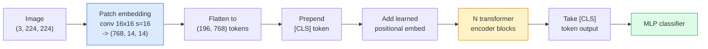

# Vision Transformer (ViT)

> Potong gambar menjadi patch, perlakukan setiap patch sebagai sebuah kata, jalankan transformer standar. Jangan menoleh ke belakang.

**Type:** Build
**Languages:** Python
**Prerequisites:** Phase 7 Lesson 02 (Self-Attention), Phase 4 Lesson 04 (Image Classification)
**Time:** ~45 minutes

## Tujuan Pembelajaran

- Mengimplementasikan patch embedding, positional embedding yang dipelajari, class token, dan transformer encoder block dari nol untuk membangun **ViT** minimal
- Menjelaskan mengapa ViT dahulu dianggap membutuhkan data pre-training raksasa sampai DeiT dan MAE membuktikan sebaliknya
- Membandingkan ViT, Swin, dan ConvNeXt pada prior arsitekturalnya (tanpa prior, window attention lokal, backbone conv)
- Fine-tune sebuah ViT pre-trained pada dataset kecil memakai `timm` dan resep linear-probe / fine-tune standar

## Masalahnya

Selama satu dekade, konvolusi adalah sinonim dari computer vision. CNN punya inductive bias yang kuat — lokalitas, ekuivarian translasi — yang tidak ada yang mengira bisa kamu ganti. Lalu Dosovitskiy et al. (2020) menunjukkan bahwa transformer polos yang diterapkan pada patch gambar yang diratakan, tanpa mesin konvolusi sama sekali, bisa menyamai atau mengalahkan CNN terbaik pada skala besar.

Syaratnya adalah "pada skala besar." ViT pada ImageNet-1k kalah dari ResNet. ViT yang di-pretrain pada ImageNet-21k atau JFT-300M lalu di-fine-tune pada ImageNet-1k mengalahkannya. Kesimpulannya adalah transformer kekurangan prior yang berguna tetapi bisa mempelajarinya dari data yang cukup. Karya-karya berikutnya (DeiT, MAE, DINO) menunjukkan bahwa dengan resep training yang tepat — augmentasi kuat, pre-training self-supervised, distilasi — ViT juga training dengan baik pada data kecil.

Pada 2026, CNN murni masih kompetitif di perangkat edge (**ConvNeXt** adalah yang terkuat), tetapi transformer mendominasi sisanya: segmentasi (**Mask2Former**, **SegFormer**), deteksi (**DETR**, **RT-DETR**), multimodal (**CLIP**, SigLIP), video (**VideoMAE**, VJEPA). Struktur block ViT adalah yang perlu kamu kuasai.

## Konsepnya

### Pipeline-nya



Tujuh langkah. Patch -> token -> attention -> classifier. Setiap varian (DeiT, Swin, ConvNeXt, pre-training MAE) mengubah satu atau dua dari tujuh dan membiarkan sisanya.

### Patch embedding

Conv pertama adalah rahasianya. Kernel size 16, stride 16, sehingga gambar 224x224 menjadi grid 14x14 dari patch 16x16, masing-masing diproyeksikan ke embedding dimensi 768. Conv tunggal itu sekaligus memecah menjadi patch dan memproyeksikan secara linier.

```
Input:  (3, 224, 224)
Conv (3 -> 768, k=16, s=16, no padding):
Output: (768, 14, 14)
Flatten spatial: (196, 768)
```

196 patch = 196 token. Dimensi fitur setiap token adalah 768 (ViT-B), 1024 (ViT-L), atau 1280 (ViT-H).

### Class token

Satu vektor yang dipelajari dan di-prepend ke urutan:

```
tokens = [CLS; patch_1; patch_2; ...; patch_196]   shape (197, 768)
```

Setelah N transformer block, output `[CLS]` adalah representasi gambar global. Classifier head hanya membaca vektor tunggal ini.

### Positional embedding

Transformer tidak punya gagasan bawaan tentang posisi spasial. Tambahkan sebuah vektor yang dipelajari ke setiap token:

```
tokens = tokens + learned_pos_embedding   (also shape (197, 768))
```

Embedding itu adalah parameter model; training berbasis gradien mengadaptasikannya ke struktur gambar 2D. Alternatif sinusoidal 2D ada tetapi jarang dipakai dalam praktiknya.

### Transformer encoder block

Standar. Multi-head self-attention, MLP, residual connection, pre-LayerNorm.

```
x = x + MSA(LN(x))
x = x + MLP(LN(x))

MLP is two-layer with GELU: Linear(d -> 4d) -> GELU -> Linear(4d -> d)
```

ViT-B/16 menumpuk 12 block ini, masing-masing dengan 12 attention head, total 86M parameter.

### Mengapa pre-LN

Transformer awal memakai post-LN (`x = LN(x + sublayer(x))`) dan kesulitan training melampaui 6-8 layer tanpa warmup. Pre-LN (`x = x + sublayer(LN(x))`) melatih jaringan yang lebih dalam secara stabil tanpa warmup. Setiap ViT dan setiap LLM modern memakai pre-LN.

### Trade-off ukuran patch

- Patch 16x16 -> 196 token, standar.
- Patch 32x32 -> 49 token, lebih cepat tetapi resolusi lebih rendah.
- Patch 8x8 -> 784 token, lebih halus tetapi biaya attention O(n^2) berskala buruk.

Patch lebih besar = token lebih sedikit = lebih cepat tetapi detail spasial berkurang. SwinV2 memakai patch 4x4 dalam window hierarkis.

### Resep DeiT untuk training ViT pada ImageNet-1k

ViT asli membutuhkan JFT-300M untuk mengalahkan CNN. DeiT (Touvron et al., 2020) melatih ViT-B hingga top-1 81,8% pada ImageNet-1k saja dengan empat perubahan:

1. Augmentasi berat: RandAugment, Mixup, CutMix, Random Erasing.
2. Stochastic depth (membuang seluruh block secara acak selama training).
3. Repeated augmentation (gambar yang sama diambil sampelnya 3 kali per batch).
4. Distilasi dari guru CNN (opsional, menaikkan akurasi lebih jauh).

Setiap resep training ViT modern turunan dari DeiT.

### Swin vs ConvNeXt

- **Swin** (Liu et al., 2021) — attention berbasis window. Setiap block attend di dalam window lokal; block berselang-seling menggeser window untuk mencampur informasi antar window. Mengembalikan prior lokalitas ala CNN sambil mempertahankan operator attention.
- **ConvNeXt** (Liu et al., 2022) — CNN yang didesain ulang sehingga menyamai pilihan arsitektur Swin (depthwise conv, LayerNorm, GELU, inverted bottleneck). Menunjukkan bahwa gap-nya bukan "attention vs konvolusi" melainkan "resep training modern + arsitektur."

Pada 2026, ConvNeXt-V2 dan Swin-V2 sama-sama kelas-produksi; pilihan yang tepat tergantung inference stack-mu (ConvNeXt mengompilasi lebih baik untuk edge) dan korpus pre-training-nya.

### Pre-training MAE

Masked Autoencoder (He et al., 2022): mask 75% patch secara acak, latih encoder untuk memproses hanya 25% yang terlihat, latih decoder kecil untuk merekonstruksi patch yang di-mask dari output encoder. Setelah pre-training, buang decoder-nya dan fine-tune encoder-nya.

**MAE** membuat ViT bisa dilatih pada ImageNet-1k saja, mencapai SOTA, dan menjadi resep self-supervised default saat ini.

```figure
batchnorm-inference
```

## Bangun Sendiri

### Langkah 1: Patch embedding

```python
import torch
import torch.nn as nn

class PatchEmbedding(nn.Module):
    def __init__(self, in_channels=3, patch_size=16, dim=192, image_size=64):
        super().__init__()
        assert image_size % patch_size == 0
        self.proj = nn.Conv2d(in_channels, dim, kernel_size=patch_size, stride=patch_size)
        num_patches = (image_size // patch_size) ** 2
        self.num_patches = num_patches

    def forward(self, x):
        x = self.proj(x)
        return x.flatten(2).transpose(1, 2)
```

Satu conv, satu flatten, satu transpose. Itulah seluruh langkah gambar-ke-token.

### Langkah 2: Transformer block

Pre-LN, multi-head self-attention, MLP dengan GELU, residual connection.

```python
class Block(nn.Module):
    def __init__(self, dim, num_heads, mlp_ratio=4, dropout=0.0):
        super().__init__()
        self.ln1 = nn.LayerNorm(dim)
        self.attn = nn.MultiheadAttention(dim, num_heads, dropout=dropout, batch_first=True)
        self.ln2 = nn.LayerNorm(dim)
        self.mlp = nn.Sequential(
            nn.Linear(dim, dim * mlp_ratio),
            nn.GELU(),
            nn.Dropout(dropout),
            nn.Linear(dim * mlp_ratio, dim),
            nn.Dropout(dropout),
        )

    def forward(self, x):
        a, _ = self.attn(self.ln1(x), self.ln1(x), self.ln1(x), need_weights=False)
        x = x + a
        x = x + self.mlp(self.ln2(x))
        return x
```

`nn.MultiheadAttention` menangani pembagian ke head, scaled dot-product, dan proyeksi output. `batch_first=True` supaya bentuknya `(N, seq, dim)`.

### Langkah 3: Si ViT-nya

```python
class ViT(nn.Module):
    def __init__(self, image_size=64, patch_size=16, in_channels=3,
                 num_classes=10, dim=192, depth=6, num_heads=3, mlp_ratio=4):
        super().__init__()
        self.patch = PatchEmbedding(in_channels, patch_size, dim, image_size)
        num_patches = self.patch.num_patches
        self.cls_token = nn.Parameter(torch.zeros(1, 1, dim))
        self.pos_embed = nn.Parameter(torch.zeros(1, num_patches + 1, dim))
        self.blocks = nn.ModuleList([
            Block(dim, num_heads, mlp_ratio) for _ in range(depth)
        ])
        self.ln = nn.LayerNorm(dim)
        self.head = nn.Linear(dim, num_classes)
        nn.init.trunc_normal_(self.pos_embed, std=0.02)
        nn.init.trunc_normal_(self.cls_token, std=0.02)

    def forward(self, x):
        x = self.patch(x)
        cls = self.cls_token.expand(x.size(0), -1, -1)
        x = torch.cat([cls, x], dim=1)
        x = x + self.pos_embed
        for blk in self.blocks:
            x = blk(x)
        x = self.ln(x[:, 0])
        return self.head(x)

vit = ViT(image_size=64, patch_size=16, num_classes=10, dim=192, depth=6, num_heads=3)
x = torch.randn(2, 3, 64, 64)
print(f"output: {vit(x).shape}")
print(f"params: {sum(p.numel() for p in vit.parameters()):,}")
```

Sekitar 2,8M parameter — sebuah ViT mini yang bisa ditangani di CPU. ViT-B yang nyata 86M; definisi kelas yang sama dengan `dim=768, depth=12, num_heads=12`.

### Langkah 4: Uji kewarasan — inference satu gambar

```python
logits = vit(torch.randn(1, 3, 64, 64))
print(f"logits: {logits}")
print(f"probs:  {logits.softmax(-1)}")
```

Seharusnya berjalan tanpa error. Probabilitasnya berjumlah 1.

## Gunakan

`timm` menghadirkan setiap varian ViT dengan bobot pre-trained ImageNet. Satu baris:

```python
import timm

model = timm.create_model("vit_base_patch16_224", pretrained=True, num_classes=10)
```

`timm` adalah default produksi untuk vision transformer pada 2026. Mendukung ViT, DeiT, Swin, Swin-V2, ConvNeXt, ConvNeXt-V2, MaxViT, MViT, EfficientFormer, dan lusinan lainnya di bawah API yang sama.

Untuk kerja multimodal (gambar + teks), `transformers` menghadirkan **CLIP**, SigLIP, BLIP-2, LLaVA. Image encoder di semuanya adalah varian ViT.

## Rilis

Pelajaran ini menghasilkan:

- `outputs/prompt-vit-vs-cnn-picker.md` — prompt yang memilih di antara ViT, ConvNeXt, atau Swin berdasarkan ukuran dataset, komputasi, dan inference stack.
- `outputs/skill-vit-patch-and-pos-embed-inspector.md` — skill yang memverifikasi bahwa bentuk patch embedding dan positional embedding sebuah ViT cocok dengan panjang urutan yang diharapkan model, menangkap bug porting yang paling umum.

## Latihan

1. **(Mudah)** Cetak bentuk setiap tensor perantara untuk satu forward pass melalui ViT mini di atas. Konfirmasi: input `(N, 3, 64, 64)` -> patch `(N, 16, 192)` -> dengan CLS `(N, 17, 192)` -> input classifier `(N, 192)` -> output `(N, num_classes)`.
2. **(Sedang)** Fine-tune sebuah `timm` ViT-S/16 pre-trained pada dataset CIFAR-sintetis dari Pelajaran 4. Bandingkan dengan fine-tune ResNet-18 pada data yang sama. Laporkan waktu training dan akurasi akhir.
3. **(Sulit)** Implementasikan pre-training MAE untuk ViT mini: mask 75% patch, latih encoder plus sebuah decoder kecil untuk merekonstruksi patch yang di-mask. Evaluasi akurasi linear-probe pada data sintetis sebelum dan sesudah pre-training.

## Istilah Kunci

| Term | What people say | What it actually means |
|------|----------------|----------------------|
| Patch embedding | "The first conv" | A conv with kernel size = stride = patch size; turns the image into a grid of token embeddings |
| Class token | "[CLS]" | A learned vector prepended to the token sequence; its final output is the global image representation |
| Positional embedding | "Learned pos" | A learned vector added to every token so the transformer knows where each patch came from |
| Pre-LN | "LayerNorm before sublayer" | The stable transformer variant: `x + sublayer(LN(x))` instead of `LN(x + sublayer(x))` |
| Multi-head attention | "Parallel attention" | Standard transformer attention split into num_heads independent subspaces, concatenated afterwards |
| ViT-B/16 | "Base, patch 16" | The canonical size: dim=768, depth=12, heads=12, patch_size=16, image=224; ~86M params |
| DeiT | "Data-efficient ViT" | ViT trained on ImageNet-1k alone with strong augmentation; proved large pretraining datasets are not strictly required |
| MAE | "Masked autoencoder" | Self-supervised pretraining: mask 75% of patches, reconstruct; the dominant ViT pretraining recipe |

## Bacaan Lanjutan

- [An Image is Worth 16x16 Words (Dosovitskiy et al., 2020)](https://arxiv.org/abs/2010.11929) — the ViT paper
- [DeiT: Data-efficient Image Transformers (Touvron et al., 2020)](https://arxiv.org/abs/2012.12877) — how to train ViT on ImageNet-1k alone
- [Masked Autoencoders are Scalable Vision Learners (He et al., 2022)](https://arxiv.org/abs/2111.06377) — MAE pretraining
- [timm documentation](https://huggingface.co/docs/timm) — the reference for every vision transformer you will use in production
