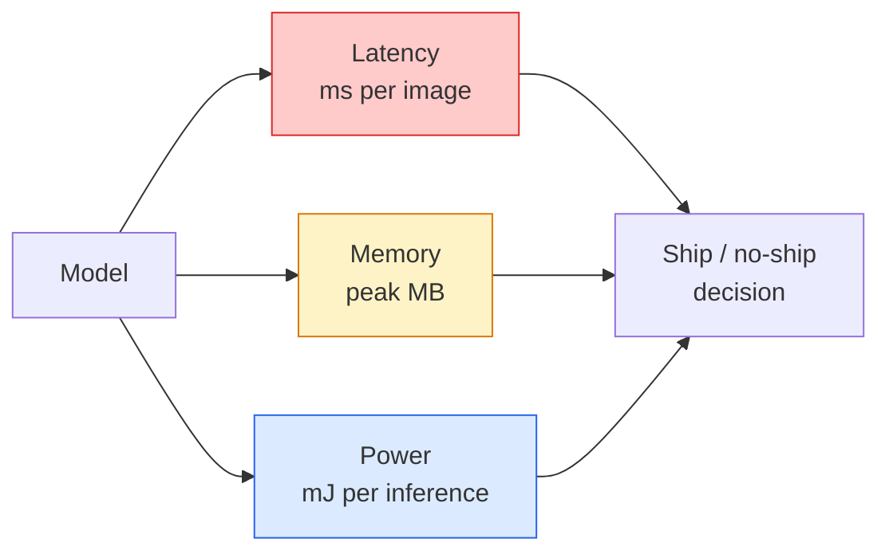

# Visi Real-Time — Deployment Edge

> Inference edge adalah disiplin untuk membuat model berakurasi 90 berjalan pada 30 fps di perangkat dengan RAM 2 GB. Setiap poin persentase akurasi ditukar dengan milidetik latensi.

**Type:** Learn + Build
**Languages:** Python
**Prerequisites:** Phase 4 Lesson 04 (Image Classification), Phase 10 Lesson 11 (Quantization)
**Time:** ~75 minutes

## Tujuan Pembelajaran

- Mengukur latensi inference, memori puncak, dan throughput untuk model PyTorch apa pun, serta membaca trade-off FLOPs / params / latensi
- Mengkuantisasi (quantise) sebuah model visi ke INT8 memakai post-training quantization PyTorch dan memverifikasi penurunan akurasi < 1%
- Mengekspor ke ONNX dan mengompilasi dengan ONNX Runtime atau TensorRT; menyebutkan tiga kegagalan ekspor yang paling umum beserta perbaikannya
- Menjelaskan kapan memilih MobileNetV3, EfficientNet-Lite, ConvNeXt-Tiny, atau MobileViT untuk sebuah batasan edge

## Masalahnya

Sebuah model visi waktu-training adalah monster floating-point. 100M parameter, 10 GFLOPs per forward pass, 2 GB VRAM. Tidak ada satupun yang muat di ponsel, unit infotainment mobil, kamera industri, atau drone. Merilis sebuah sistem visi berarti memasukkan prediksi yang sama ke dalam anggaran yang 100x lebih kecil.

Tiga tombol melakukan sebagian besar pekerjaan: pilihan model (arsitektur lebih kecil dengan resep sama), kuantisasi (INT8 alih-alih FP32), dan inference runtime (ONNX Runtime, TensorRT, Core ML, TFLite). Mendapatkan semuanya dengan benar adalah perbedaan antara demo yang berjalan di sebuah workstation dan produk yang rilis di modul kamera $30.

Pelajaran ini menyiapkan disiplin pengukuran lebih dulu (kamu tidak bisa mengoptimalkan yang tidak bisa kamu ukur), lalu membahas ketiga tombolnya. Tujuannya bukan mempelajari setiap runtime edge, melainkan mengetahui tuas apa yang ada dan bagaimana memverifikasi masing-masing melakukan apa yang kamu kira.

## Konsepnya

### Tiga anggaran



- **Latensi**: p50, p95, p99. Hanya merata-ratakan p50 menyembunyikan perilaku ekor yang penting untuk sistem real-time.
- **Memori puncak**: nilai maksimum yang pernah dilihat perangkat, bukan rata-rata steady-state. Penting karena OOM mematikan di target embedded.
- **Daya / energi**: milijoule per inference di perangkat bertenaga baterai. Sering di-proksi dengan utilisasi CPU/GPU * waktu.

Sebuah tabel (model, latensi, memori, akurasi) adalah dasar pengambilan keputusan edge. Setiap sel diukur di perangkat target, bukan di workstation.

### Disiplin pengukuran

Tiga aturan yang harus diikuti setiap profil edge:

1. **Warm up** model dengan 5-10 forward pass dummy sebelum mengukur. Cache dingin dan kompilasi JIT menghasilkan angka pertama yang tidak representatif.
2. **Sinkronkan** beban kerja GPU dengan `torch.cuda.synchronize()` sebelum dan sesudah blok berwaktu. Tanpa ini kamu mengukur dispatch kernel, bukan eksekusi kernel.
3. **Tetapkan ukuran input** ke resolusi produksi. Latensi pada 224x224 bukan latensi pada 512x512.

### FLOPs sebagai proksi

FLOPs (operasi floating-point per inference) adalah proksi murah yang tidak tergantung perangkat untuk latensi. Berguna untuk perbandingan arsitektur, menyesatkan sebagai wall-clock absolut. Sebuah model dengan FLOPs 10% lebih banyak bisa 2x lebih cepat dalam praktik karena ia memakai op yang ramah-hardware (depthwise conv mengompilasi dengan baik, conv 7x7 besar tidak).

Aturan: pakai FLOPs untuk pencarian arsitektur, pakai latensi on-device untuk keputusan deployment.

### Kuantisasi dalam satu paragraf

Ganti bobot dan aktivasi FP32 dengan INT8. Ukuran model turun 4x, bandwidth memori turun 4x, komputasi turun 2-4x pada hardware yang punya kernel INT8 (setiap mobile SoC modern, setiap GPU NVIDIA dengan Tensor Core). Penurunan akurasi pada tugas visi biasanya 0,1-1 poin persentase dengan kuantisasi statis pasca-training.

Jenisnya:

- **Dinamis** — kuantisasi bobot ke INT8, aktivasi dihitung dalam FP. Mudah, speedup kecil.
- **Statis (post-training)** — kuantisasi bobot + kalibrasi rentang aktivasi pada set kalibrasi kecil. Jauh lebih cepat daripada dinamis.
- **Quantization-aware training (QAT)** — mensimulasikan kuantisasi selama training sehingga model belajar mengelilinginya. Akurasi terbaik, membutuhkan data berlabel.

Untuk visi, kuantisasi statis pasca-training memberikan 95% manfaatnya dengan 5% usahanya. Pakai QAT hanya saat penurunan akurasi akibat PTQ tidak dapat diterima.

### Pruning dan distilasi

- **Pruning** — buang bobot yang tidak penting (berbasis magnitude) atau channel (terstruktur). Bekerja baik pada model over-parameterized; kurang berguna pada arsitektur yang sudah ringkas.
- **Distilasi** — latih sebuah student kecil untuk meniru logits guru besar. Sering memulihkan sebagian besar akurasi yang hilang akibat pengecilan model. Standar untuk model edge produksi.

### Inference runtime

- **PyTorch eager** — lambat, bukan untuk deployment. Pakai hanya untuk pengembangan.
- **TorchScript** — lawas. Digantikan oleh `torch.compile` dan ekspor ONNX.
- **ONNX Runtime** — runtime yang netral. CPU, CUDA, CoreML, TensorRT, OpenVINO semuanya punya provider ONNX. Mulai dari sini.
- **TensorRT** — kompilator NVIDIA. Latensi terbaik di GPU NVIDIA (workstation dan Jetson). Terintegrasi dengan ONNX Runtime atau berdiri sendiri.
- **Core ML** — runtime Apple untuk iOS/macOS. Membutuhkan `.mlmodel` atau `.mlpackage`.
- **TFLite** — runtime Google untuk Android/ARM. Membutuhkan `.tflite`.
- **OpenVINO** — runtime Intel untuk CPU/VPU. Membutuhkan `.xml` + `.bin`.

Dalam praktik: ekspor PyTorch -> ONNX -> pilih runtime untuk targetnya. ONNX adalah lingua franca-nya.

### Pemilih arsitektur edge

| Budget | Model | Why |
|--------|-------|-----|
| < 3M params | MobileNetV3-Small | Compiles everywhere, good baseline |
| 3-10M | EfficientNet-Lite-B0 | Best accuracy per param on TFLite |
| 10-20M | ConvNeXt-Tiny | Best accuracy-per-param, CPU-friendly |
| 20-30M | MobileViT-S or EfficientViT | Transformer with ImageNet accuracy |
| 30-80M | Swin-V2-Tiny | If stack supports window attention |

Kuantisasikan semuanya ke INT8 kecuali kamu punya alasan spesifik untuk tidak.

```figure
cnn-param-count
```

## Bangun Sendiri

### Langkah 1: Ukur latensi dengan benar

```python
import time
import torch

def measure_latency(model, input_shape, device="cpu", warmup=10, iters=50):
    model = model.to(device).eval()
    x = torch.randn(input_shape, device=device)
    with torch.no_grad():
        for _ in range(warmup):
            model(x)
        if device == "cuda":
            torch.cuda.synchronize()
        times = []
        for _ in range(iters):
            if device == "cuda":
                torch.cuda.synchronize()
            t0 = time.perf_counter()
            model(x)
            if device == "cuda":
                torch.cuda.synchronize()
            times.append((time.perf_counter() - t0) * 1000)
    times.sort()
    return {
        "p50_ms": times[len(times) // 2],
        "p95_ms": times[int(len(times) * 0.95)],
        "p99_ms": times[int(len(times) * 0.99)],
        "mean_ms": sum(times) / len(times),
    }
```

Warm up, sinkronkan, pakai `time.perf_counter()`. Laporkan persentil, bukan hanya mean.

### Langkah 2: Penghitungan parameter dan FLOP

```python
def parameter_count(model):
    return sum(p.numel() for p in model.parameters())

def flops_estimate(model, input_shape):
    """
    Rough FLOP count for a conv/linear-only model. For production use `fvcore` or `ptflops`.
    """
    total = 0
    def conv_hook(m, inp, out):
        nonlocal total
        c_out, c_in, kh, kw = m.weight.shape
        h, w = out.shape[-2:]
        total += 2 * c_in * c_out * kh * kw * h * w
    def linear_hook(m, inp, out):
        nonlocal total
        total += 2 * m.in_features * m.out_features
    hooks = []
    for m in model.modules():
        if isinstance(m, torch.nn.Conv2d):
            hooks.append(m.register_forward_hook(conv_hook))
        elif isinstance(m, torch.nn.Linear):
            hooks.append(m.register_forward_hook(linear_hook))
    model.eval()
    with torch.no_grad():
        model(torch.randn(input_shape))
    for h in hooks:
        h.remove()
    return total
```

Untuk proyek nyata pakai `fvcore.nn.FlopCountAnalysis` atau `ptflops`; keduanya menangani setiap tipe modul dengan benar.

### Langkah 3: Kuantisasi statis pasca-training

```python
def quantise_ptq(model, calibration_loader, backend="x86"):
    import torch.ao.quantization as tq
    model = model.eval().cpu()
    model.qconfig = tq.get_default_qconfig(backend)
    tq.prepare(model, inplace=True)
    with torch.no_grad():
        for x, _ in calibration_loader:
            model(x)
    tq.convert(model, inplace=True)
    return model
```

Tiga langkah: konfigurasi, prepare (sisipkan observer), kalibrasi dengan data nyata, convert (fuse + kuantisasi). Membutuhkan model yang di-fuse (`Conv -> BN -> ReLU` -> `ConvBnReLU`), yang ditangani oleh `torch.ao.quantization.fuse_modules`.

### Langkah 4: Ekspor ke ONNX

```python
def export_onnx(model, sample_input, path="model.onnx"):
    model = model.eval()
    torch.onnx.export(
        model,
        sample_input,
        path,
        input_names=["input"],
        output_names=["output"],
        dynamic_axes={"input": {0: "batch"}, "output": {0: "batch"}},
        opset_version=17,
    )
    return path
```

`opset_version=17` adalah default yang aman pada 2026. `dynamic_axes` memungkinkanmu menjalankan model ONNX dengan batch size sembarang.

### Langkah 5: Benchmark dan bandingkan rezim

```python
import torch.nn as nn
from torchvision.models import mobilenet_v3_small

def compare_regimes():
    model = mobilenet_v3_small(weights=None, num_classes=10)
    params = parameter_count(model)
    flops = flops_estimate(model, (1, 3, 224, 224))
    lat_fp32 = measure_latency(model, (1, 3, 224, 224), device="cpu")
    print(f"FP32 MobileNetV3-Small: {params:,} params  {flops/1e9:.2f} GFLOPs  "
          f"p50={lat_fp32['p50_ms']:.2f}ms  p95={lat_fp32['p95_ms']:.2f}ms")
```

Jalankan fungsi yang sama untuk `resnet50`, `efficientnet_v2_s`, dan `convnext_tiny` dan kamu punya tabel perbandingan yang kamu butuhkan untuk keputusan deployment.

## Gunakan

Stack produksi konvergen ke salah satu dari tiga jalur:

- **Web / serverless**: PyTorch -> ONNX -> ONNX Runtime (provider CPU atau CUDA). Paling mudah, cukup baik untuk sebagian besar.
- **Edge NVIDIA (Jetson, GPU server)**: PyTorch -> ONNX -> TensorRT. Latensi terbaik, usaha rekayasa terbesar.
- **Mobile**: PyTorch -> ONNX -> Core ML (iOS) atau TFLite (Android). Kuantisasikan sebelum ekspor.

Untuk pengukuran, `torch-tb-profiler`, `nvprof` / `nsys`, dan Instruments di macOS memberikan rincian layer-per-layer. `benchmark_app` (OpenVINO) dan `trtexec` (TensorRT) memberikan angka CLI mandiri.

## Rilis

Pelajaran ini menghasilkan:

- `outputs/prompt-edge-deployment-planner.md` — prompt yang memilih backbone, strategi kuantisasi, dan runtime diberikan perangkat target dan SLA latensi.
- `outputs/skill-latency-profiler.md` — skill yang menulis skrip benchmark latensi lengkap dengan warmup, sinkronisasi, persentil, dan pelacakan memori.

## Latihan

1. **(Mudah)** Ukur latensi p50 untuk `resnet18`, `mobilenet_v3_small`, `efficientnet_v2_s`, dan `convnext_tiny` pada 224x224 di CPU. Laporkan tabelnya dan identifikasi arsitektur mana yang punya akurasi-per-ms terbaik.
2. **(Sedang)** Terapkan kuantisasi statis pasca-training pada `mobilenet_v3_small`. Laporkan latensi FP32 vs INT8 serta penurunan akurasi pada subset held-out CIFAR-10 atau sejenisnya.
3. **(Sulit)** Ekspor `convnext_tiny` ke ONNX, jalankan melalui `onnxruntime` dengan `CPUExecutionProvider`, dan bandingkan latensinya dengan baseline eager PyTorch. Identifikasi layer pertama di mana ONNX Runtime lebih cepat dan jelaskan mengapa.

## Istilah Kunci

| Term | What people say | What it actually means |
|------|----------------|----------------------|
| Latency | "How fast" | Time from input to output; p50/p95/p99 percentiles, not mean |
| FLOPs | "Model size" | Floating-point ops per forward pass; rough proxy for compute cost |
| INT8 quantisation | "8-bit" | Replace FP32 weights/activations with 8-bit integers; ~4x smaller, 2-4x faster |
| PTQ | "Post-training quantisation" | Quantise a trained model without retraining; easy, usually enough |
| QAT | "Quantisation-aware training" | Simulate quantisation during training; best accuracy, requires labelled data |
| ONNX | "The neutral format" | Model exchange format supported by every mainstream inference runtime |
| TensorRT | "NVIDIA compiler" | Compiles ONNX into an optimised engine for NVIDIA GPUs |
| Distillation | "Teacher -> student" | Train a small model to mimic a big model's logits; recovers most lost accuracy |

## Bacaan Lanjutan

- [EfficientNet (Tan & Le, 2019)](https://arxiv.org/abs/1905.11946) — compound scaling for efficient architectures
- [MobileNetV3 (Howard et al., 2019)](https://arxiv.org/abs/1905.02244) — mobile-first architecture with h-swish and squeeze-excite
- [Accelerating Inference Up to 6x Faster in PyTorch with Torch-TensorRT (NVIDIA)](https://developer.nvidia.com/blog/accelerating-inference-up-to-6x-faster-in-pytorch-with-torch-tensorrt/) — how to actually get the throughput numbers in the paper
- [ONNX Runtime docs](https://onnxruntime.ai/docs/) — quantisation, graph optimisation, provider selection
