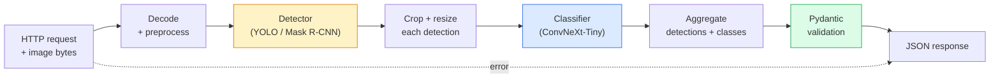

# Membangun Pipeline Visi Lengkap — Capstone

> Sebuah sistem visi produksi adalah rantai model dan aturan yang dijahit dengan kontrak data. Komponen-komponennya sudah ada di fase ini; capstone menyambungkannya end-to-end.

**Type:** Build
**Languages:** Python
**Prerequisites:** Phase 4 Lessons 01-15
**Time:** ~120 minutes

## Tujuan Pembelajaran

- Mendesain pipeline visi produksi yang mendeteksi objek, mengklasifikasikannya, dan mengeluarkan JSON terstruktur — dengan setiap jalur kegagalan ditangani
- Menyisipkan sebuah detektor (**Mask R-CNN** atau **YOLO**), sebuah classifier (**ConvNeXt-Tiny**), dan sebuah kontrak data (**Pydantic**) ke dalam satu layanan
- Melakukan benchmark pipeline end-to-end dan mengidentifikasi bottleneck pertama (biasanya preprocessing, lalu detektor)
- Merilis layanan FastAPI minimal yang menerima unggahan gambar, menjalankan pipeline, dan mengembalikan deteksi beserta klasifikasinya

## Masalahnya

Model visi individual itu berguna; produk visi adalah rantai dari mereka. Audit rak ritel adalah sebuah detektor plus classifier produk plus pipeline OCR harga. Mobil otonom adalah detektor 2D plus detektor 3D plus segmenter plus tracker plus perencana. Pra-skrining medis adalah segmenter plus classifier region plus UI klinis.

Menyambung rantai-rantai itulah bagian yang memisahkan prototipe ML dari produk. Setiap antarmuka antar model adalah tempat baru bagi bug. Setiap transformasi koordinat, setiap normalisasi, setiap resize mask adalah kandidat kegagalan diam-diam. Pipeline sekuat antarmuka terlemahnya.

Capstone ini menyiapkan pipeline viable minimum: deteksi + klasifikasi + output terstruktur + layer serving. Segala sesuatu lain di Fase 4 masuk ke kerangka ini: tukar Mask R-CNN dengan YOLOv8, tambahkan head OCR, tambahkan cabang segmentasi, tambahkan tracker. Arsitekturnya stabil; komponen-komponennya bisa dicolok-lepas.

## Konsepnya

### Pipeline-nya



Tujuh tahap. Dua tahap model-nya mahal; lima tahap lainnya adalah tempat bug bersembunyi.

### Kontrak data dengan Pydantic

Setiap batas model menjadi objek bertipe. Ini mengubah kegagalan diam-diam menjadi yang keras.

```
Detection(
    box: tuple[float, float, float, float],   # (x1, y1, x2, y2), absolute pixels
    score: float,                              # [0, 1]
    class_id: int,                             # from detector's label map
    mask: Optional[list[list[int]]],           # RLE-encoded if present
)

PipelineResult(
    image_id: str,
    detections: list[Detection],
    classifications: list[Classification],
    inference_ms: float,
)
```

Ketika sebuah detektor mengembalikan box dalam `(cx, cy, w, h)` alih-alih `(x1, y1, x2, y2)`, validasi Pydantic gagal di batas dan kamu mengetahuinya segera alih-alih men-debug crop hulu yang diam-diam mengembalikan region kosong.

### Ke mana latensi pergi

Tiga kebenaran berlaku di hampir setiap pipeline visi:

1. **Preprocessing sering menjadi blok tunggal terbesar.** Mendecode JPEG, mengonversi ruang warna, resize — ini terikat CPU dan mudah dilupakan.
2. **Detektor mendominasi waktu GPU.** 70-90% waktu GPU ada di forward pass deteksi.
3. **Postprocessing (NMS, encode/decode RLE) murah di GPU, mahal di CPU.** Selalu profil dengan target yang sebenarnya.

Mengetahui distribusilah yang mengubah optimasi menjadi daftar yang diprioritaskan.

### Mode gagal

- **Deteksi kosong** — kembalikan daftar kosong, jangan crash. Catat ke log.
- **Box di luar batas** — clamp ke ukuran gambar sebelum crop.
- **Crop sangat kecil** — lewati klasifikasi untuk box yang lebih kecil dari input minimum classifier.
- **Unggahan rusak** — respons 400 dengan kode error spesifik, bukan 500.
- **Kegagalan pemuatan model** — gagal saat startup layanan, bukan pada permintaan pertama.

Sebuah pipeline produksi menangani masing-masing hal ini tanpa menulis `try/except` generik yang menyembunyikan kegagalannya. Setiap kegagalan mendapat kode bernama dan sebuah respons.

### Batching

Sebuah layanan produksi melayani banyak klien. Menggabungkan deteksi dan klasifikasi lintas permintaan melipatgandakan throughput. Trade-off-nya: latensi ekstra karena menunggu batch terisi. Pengaturan tipikal: kumpulkan permintaan hingga 20 ms, gabungkan dalam satu batch, proses, distribusikan respons. `torchserve` dan `triton` melakukan ini secara native; layanan kecil dengan beban yang dapat diprediksi membuat micro-batcher mereka sendiri.

```figure
v4-vision-pipeline
```

## Bangun Sendiri

### Langkah 1: Kontrak data

```python
from pydantic import BaseModel, Field
from typing import List, Optional, Tuple

class Detection(BaseModel):
    box: Tuple[float, float, float, float]
    score: float = Field(ge=0, le=1)
    class_id: int = Field(ge=0)
    mask_rle: Optional[str] = None


class Classification(BaseModel):
    detection_index: int
    class_id: int
    class_name: str
    score: float = Field(ge=0, le=1)


class PipelineResult(BaseModel):
    image_id: str
    detections: List[Detection]
    classifications: List[Classification]
    inference_ms: float
```

Lima detik kode menghemat satu jam debugging di pipeline apa pun yang serius.

### Langkah 2: Sebuah kelas Pipeline minimal

```python
import time
import numpy as np
import torch
from PIL import Image

class VisionPipeline:
    def __init__(self, detector, classifier, class_names,
                 device="cpu", min_crop=32):
        self.detector = detector.to(device).eval()
        self.classifier = classifier.to(device).eval()
        self.class_names = class_names
        self.device = device
        self.min_crop = min_crop

    def preprocess(self, image):
        """
        image: PIL.Image or np.ndarray (H, W, 3) uint8
        returns: CHW float tensor on device
        """
        if isinstance(image, Image.Image):
            image = np.asarray(image.convert("RGB"))
        tensor = torch.from_numpy(image).permute(2, 0, 1).float() / 255.0
        return tensor.to(self.device)

    @torch.no_grad()
    def detect(self, image_tensor):
        return self.detector([image_tensor])[0]

    @torch.no_grad()
    def classify(self, crops):
        if len(crops) == 0:
            return []
        batch = torch.stack(crops).to(self.device)
        logits = self.classifier(batch)
        probs = logits.softmax(-1)
        scores, cls = probs.max(-1)
        return list(zip(cls.tolist(), scores.tolist()))

    def run(self, image, image_id="anonymous"):
        t0 = time.perf_counter()
        tensor = self.preprocess(image)
        det = self.detect(tensor)

        crops = []
        detections = []
        valid_indices = []
        for i, (box, score, cls) in enumerate(zip(det["boxes"], det["scores"], det["labels"])):
            x1, y1, x2, y2 = [max(0, int(b)) for b in box.tolist()]
            x2 = min(x2, tensor.shape[-1])
            y2 = min(y2, tensor.shape[-2])
            detections.append(Detection(
                box=(x1, y1, x2, y2),
                score=float(score),
                class_id=int(cls),
            ))
            if (x2 - x1) < self.min_crop or (y2 - y1) < self.min_crop:
                continue
            crop = tensor[:, y1:y2, x1:x2]
            crop = torch.nn.functional.interpolate(
                crop.unsqueeze(0),
                size=(224, 224),
                mode="bilinear",
                align_corners=False,
            )[0]
            crops.append(crop)
            valid_indices.append(i)

        class_preds = self.classify(crops)

        classifications = []
        for valid_idx, (cls_id, cls_score) in zip(valid_indices, class_preds):
            classifications.append(Classification(
                detection_index=valid_idx,
                class_id=int(cls_id),
                class_name=self.class_names[cls_id],
                score=float(cls_score),
            ))

        return PipelineResult(
            image_id=image_id,
            detections=detections,
            classifications=classifications,
            inference_ms=(time.perf_counter() - t0) * 1000,
        )
```

Setiap antarmuka bertipe. Setiap jalur kegagalan punya keputusan penanganan yang spesifik.

### Langkah 3: Sambungkan detektor dan classifier

```python
from torchvision.models.detection import maskrcnn_resnet50_fpn_v2
from torchvision.models import convnext_tiny

# Use ImageNet-pretrained weights for a realistic pipeline without training
detector = maskrcnn_resnet50_fpn_v2(weights="DEFAULT")
classifier = convnext_tiny(weights="DEFAULT")
class_names = [f"imagenet_class_{i}" for i in range(1000)]

pipe = VisionPipeline(detector, classifier, class_names)

# Smoke test with a synthetic image
test_image = (np.random.rand(400, 600, 3) * 255).astype(np.uint8)
result = pipe.run(test_image, image_id="demo")
print(result.model_dump_json(indent=2)[:500])
```

### Langkah 4: Layanan FastAPI

```python
from fastapi import FastAPI, UploadFile, HTTPException
from io import BytesIO

app = FastAPI()
pipe = None  # initialised on startup

@app.on_event("startup")
def load():
    global pipe
    detector = maskrcnn_resnet50_fpn_v2(weights="DEFAULT").eval()
    classifier = convnext_tiny(weights="DEFAULT").eval()
    pipe = VisionPipeline(detector, classifier, class_names=[f"c{i}" for i in range(1000)])

@app.post("/detect")
async def detect_endpoint(file: UploadFile):
    if file.content_type not in {"image/jpeg", "image/png", "image/webp"}:
        raise HTTPException(status_code=400, detail="unsupported image type")
    data = await file.read()
    try:
        img = Image.open(BytesIO(data)).convert("RGB")
    except Exception:
        raise HTTPException(status_code=400, detail="cannot decode image")
    result = pipe.run(img, image_id=file.filename or "upload")
    return result.model_dump()
```

Jalankan dengan `uvicorn main:app --host 0.0.0.0 --port 8000`. Uji dengan `curl -F 'file=@dog.jpg' http://localhost:8000/detect`.

### Langkah 5: Benchmark pipeline

```python
import time

def benchmark(pipe, num_runs=20, image_size=(400, 600)):
    img = (np.random.rand(*image_size, 3) * 255).astype(np.uint8)
    pipe.run(img)  # warm up

    stages = {"preprocess": [], "detect": [], "classify": [], "total": []}
    for _ in range(num_runs):
        t0 = time.perf_counter()
        tensor = pipe.preprocess(img)
        t1 = time.perf_counter()
        det = pipe.detect(tensor)
        t2 = time.perf_counter()
        crops = []
        for box in det["boxes"]:
            x1, y1, x2, y2 = [max(0, int(b)) for b in box.tolist()]
            x2 = min(x2, tensor.shape[-1])
            y2 = min(y2, tensor.shape[-2])
            if (x2 - x1) >= pipe.min_crop and (y2 - y1) >= pipe.min_crop:
                crop = tensor[:, y1:y2, x1:x2]
                crop = torch.nn.functional.interpolate(
                    crop.unsqueeze(0), size=(224, 224), mode="bilinear", align_corners=False
                )[0]
                crops.append(crop)
        pipe.classify(crops)
        t3 = time.perf_counter()
        stages["preprocess"].append((t1 - t0) * 1000)
        stages["detect"].append((t2 - t1) * 1000)
        stages["classify"].append((t3 - t2) * 1000)
        stages["total"].append((t3 - t0) * 1000)

    for stage, times in stages.items():
        times.sort()
        print(f"{stage:12s}  p50={times[len(times)//2]:7.1f} ms  p95={times[int(len(times)*0.95)]:7.1f} ms")
```

Output tipikal di CPU: preprocess ~3 ms, detect 300-500 ms, classify 20-40 ms, total 350-550 ms. Di GPU, detect menjadi 20-40 ms dan preprocess + classify mulai lebih berarti secara relatif.

## Gunakan

Templat produksi konvergen ke struktur yang sama, plus:

- **Versioning model** — selalu catat nama model dan hash bobot di respons.
- **Trace ID per permintaan** — catat waktu setiap tahap untuk setiap permintaan sehingga kamu bisa menghubungkan respons lambat dengan tahapnya.
- **Jalur fallback** — jika classifier timeout, kembalikan deteksi tanpa klasifikasi alih-alih gagalkan seluruh permintaan.
- **Filter keamanan** — filter NSFW / PII berjalan setelah klasifikasi, sebelum respons meninggalkan layanan.
- **Endpoint batch** — `/detect_batch` yang menerima daftar URL gambar untuk pemrosesan massal.

Untuk serving produksi, `torchserve`, `Triton Inference Server`, dan `BentoML` menangani batching, versioning, metrics, dan health check out of the box. Menjalankan `FastAPI` secara langsung sudah cukup untuk prototipe dan produk skala kecil.

## Rilis

Pelajaran ini menghasilkan:

- `outputs/prompt-vision-service-shape-reviewer.md` — prompt yang meninjau kode sebuah layanan visi untuk pelanggaran bentuk kontrak/respons dan menyebutkan bug pertama yang mematahkan.
- `outputs/skill-pipeline-budget-planner.md` — skill yang, diberikan latensi dan throughput target, mengalokasikan anggaran waktu ke setiap tahap pipeline dan menandai tahap mana yang akan meleset dari anggarannya lebih dulu.

## Latihan

1. **(Mudah)** Jalankan pipeline pada 10 gambar dari dataset terbuka mana pun. Laporkan waktu rata-rata per tahap dan distribusi jumlah deteksi per gambar.
2. **(Sedang)** Tambahkan sebuah field output mask ke `Detection` dan enkode sebagai RLE. Verifikasi JSON tetap di bawah 1MB bahkan untuk gambar berisi 10 objek.
3. **(Sulit)** Tambahkan sebuah micro-batcher di depan classifier: kumpulkan crop hingga 10 ms, klasifikasikan semuanya dalam satu panggilan GPU, kembalikan hasil per permintaan. Ukur kenaikan throughput pada 10 permintaan bersamaan per detik dan latensi yang ditambahkan.

## Istilah Kunci

| Term | What people say | What it actually means |
|------|----------------|----------------------|
| Pipeline | "The system" | An ordered chain of preprocessing, inference, and postprocessing steps with a typed interface between each pair |
| Data contract | "The schema" | Pydantic / dataclass definitions that every stage input and output conforms to; catches integration bugs at the boundary |
| Preprocessing | "Before the model" | Decoding, colour conversion, resizing, normalising; usually the biggest CPU time sink |
| Postprocessing | "After the model" | NMS, mask resize, threshold, RLE encode; cheap on GPU, expensive on CPU |
| Microbatcher | "Collect then forward" | Aggregator that waits a fixed window for multiple requests, runs a single batched forward pass |
| Trace ID | "Request id" | Per-request identifier logged at every stage so slow requests can be traced end-to-end |
| Failure code | "Named error" | Specific error code per failure class instead of generic 500; enables client retry logic |
| Health check | "Readiness probe" | Cheap endpoint that reports whether the service can answer; loadbalancers rely on this |

## Bacaan Lanjutan

- [Full Stack Deep Learning — Deploying Models](https://fullstackdeeplearning.com/course/2022/lecture-5-deployment/) — the canonical overview of production ML deployment
- [BentoML docs](https://docs.bentoml.com) — serving framework with batching, versioning, and metrics
- [torchserve docs](https://pytorch.org/serve/) — PyTorch's official serving library
- [NVIDIA Triton Inference Server](https://developer.nvidia.com/triton-inference-server) — high-throughput serving with batching and multi-model support
