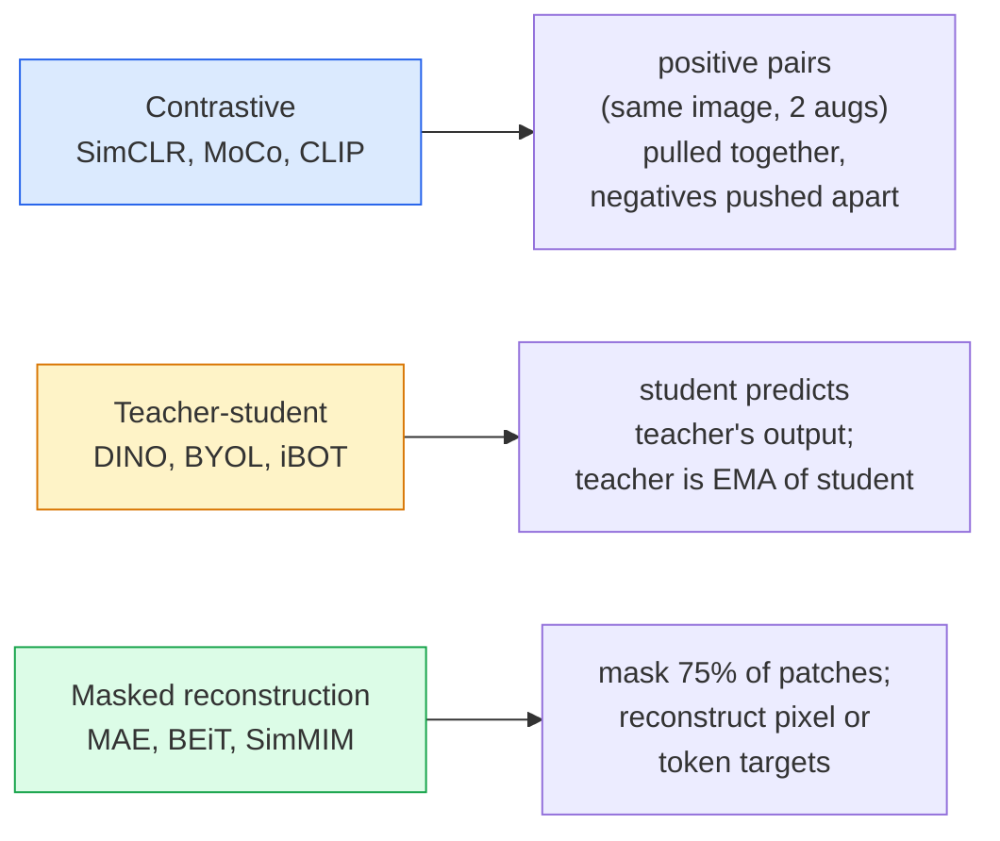

# Visi Self-Supervised — SimCLR, DINO, MAE

> Label adalah bottleneck dari visi ber-supervisi. Pre-training self-supervised menghapusnya: pelajari fitur visual dari 100M gambar tanpa label, fine-tune pada 10k yang berlabel.

**Type:** Learn + Build
**Languages:** Python
**Prerequisites:** Phase 4 Lesson 04 (Image Classification), Phase 4 Lesson 14 (ViT)
**Time:** ~75 minutes

## Tujuan Pembelajaran

- Menelusuri tiga keluarga self-supervised utama — kontrasif (**SimCLR**), guru-murid (**DINO**), rekonstruksi ter-mask (**MAE**) — dan menyatakan apa yang dioptimalkan masing-masing
- Mengimplementasikan sebuah loss InfoNCE dari nol dan menjelaskan mengapa batch berisi 512 berhasil tetapi batch berisi 32 gagal
- Menjelaskan mengapa rasio masking 75% pada MAE bukan sewenang-wenang dan bagaimana ia berbeda dari 15% BERT untuk teks
- Memakai checkpoint DINOv2 atau MAE ImageNet untuk linear probing dan retrieval zero-shot

## Masalahnya

ImageNet ber-supervisi punya 1,3M gambar berlabel, yang biaya penandaannya diperkirakan $10 juta. Dataset medis dan industri lebih kecil dan lebih mahal lagi untuk dilabeli. Setiap tim visi bertanya: bisakah kita pre-train pada data murah tanpa label — frame YouTube, hasil web crawl, rekaman webcam, pindahan satelit — lalu fine-tune pada set berlabel kecil?

Pembelajaran self-supervised adalah jawabannya. Sebuah ViT self-supervised modern yang dilatih pada LAION atau JFT mencapai atau mengalahkan akurasi ImageNet ber-supervisi saat di-fine-tune. Ia juga mentransfer lebih baik ke tugas hulu (deteksi, segmentasi, depth) daripada pre-training ber-supervisi. **DINOv2** (Meta, 2023) dan **MAE** (Meta, 2022) adalah default produksi saat ini untuk fitur visi yang bisa ditransfer.

Pergeseran konseptualnya adalah bahwa pretext task — hal yang dilatihkan model untuk dilakukan — tidak harus berupa tugas hulunya. Yang penting adalah bahwa itu memaksa model mempelajari fitur yang berguna. Memprediksi warna gambar grayscale, memutar gambar dan meminta model mengklasifikasikan rotasinya, mem-mask patch dan merekonstruksinya — semuanya pernah bekerja. Tiga pendekatan yang berskala adalah pembelajaran kontrasif, distilasi guru-murid, dan rekonstruksi ter-mask.

## Konsepnya

### Tiga keluarga



### Pembelajaran kontrasif (SimCLR)

Ambil satu gambar, terapkan dua augmentasi acak, dapatkan dua tampilan (view). Berikan keduanya melalui encoder yang sama plus projection head. Minimalkan loss yang berkata "dua embedding ini harusnya dekat" dan "embedding ini harusnya jauh dari embedding gambar lain mana pun dalam batch."

```
Loss for positive pair (z_i, z_j) among 2N views per batch:

   L_ij = -log( exp(sim(z_i, z_j) / tau) / sum_k in batch \ {i} exp(sim(z_i, z_k) / tau) )

sim = cosine similarity
tau = temperature (0.1 standard)
```

Inilah loss InfoNCE. Ia membutuhkan banyak negatif per positif, sehingga ukuran batch itu penting — SimCLR butuh 512-8192. **MoCo** memperkenalkan momentum queue berisi batch lama untuk memisahkan jumlah negatif dari ukuran batch.

### Guru-murid (DINO)

Dua jaringan dengan arsitektur sama: student dan teacher. Teacher adalah exponential moving average (EMA) dari bobot student. Keduanya melihat tampilan gambar yang di-augmentasi. Output student dilatih agar cocok dengan output teacher — tanpa negatif eksplisit.

```
loss = CE( student_output(view_1),  teacher_output(view_2) )
     + CE( student_output(view_2),  teacher_output(view_1) )

teacher_weights = m * teacher_weights + (1 - m) * student_weights   (m ≈ 0.996)
```

Mengapa ia tidak runtuh menjadi "memprediksi konstanta": output teacher di-center (kurangi mean per dimensi) dan di-sharpen (bagi dengan temperature kecil). Centering mencegah satu dimensi mendominasi; sharpening mencegah output runtuh menjadi seragam.

DINO adalah yang di-scale-up oleh DINOv2, pada 142M gambar terkurasi. Fitur hasilnya adalah SOTA saat ini untuk retrieval visual zero-shot dan prediksi padat.

### Rekonstruksi ter-mask (MAE)

Mask 75% patch dari input ViT. Berikan hanya 25% yang terlihat melalui encoder. Sebuah decoder kecil menerima output encoder plus mask token di posisi yang di-mask, dan dilatih untuk merekonstruksi piksel dari patch yang di-mask.

```
Encoder:  visible 25% of patches -> features
Decoder:  features + mask tokens at masked positions -> reconstructed pixels
Loss:     MSE between reconstructed and original pixels on masked patches only
```

Pilihan desain kunci yang membuat MAE bekerja:

- **Rasio mask 75%** — tinggi. Memaksa encoder mempelajari fitur semantik; merekonstruksi 25% akan nyaris trivial (piksel tetangga berkorelasi begitu erat sehingga CNN bisa menyelesaikannya).
- **Encoder/decoder asimetris** — encoder ViT besar hanya melihat patch yang terlihat; decoder kecil (8 layer, dimensi 512) menangani rekonstruksi. Pre-training 3x lebih cepat daripada BEiT yang naif.
- **Target rekonstruksi ruang-piksel** — lebih sederhana daripada target ter-tokenisasi milik BEiT dan bekerja lebih baik pada ViT.

Setelah pre-training, buang decoder-nya. Encoder-nya adalah feature extractor-nya.

### Mengapa 75% dan bukan 15%

**BERT** mem-mask 15% token. MAE mem-mask 75%. Perbedaannya adalah kepadatan informasi.

- Bahasa alami punya entropi tinggi per token. Memprediksi 15% token masih sulit karena setiap posisi yang di-mask punya banyak kelanjutan yang masuk akal.
- Patch gambar punya entropi rendah — lingkungan yang tidak di-mask sering menentukan piksel patch yang di-mask hampir persis. Untuk membuat prediksi menuntut pemahaman semantik, kamu harus mask secara agresif.

75% cukup tinggi sehingga ekstrapolasi spasial sederhana tidak bisa menyelesaikan tugasnya; encoder harus merepresentasikan konten gambar.

### Evaluasi linear-probe

Setelah pre-training self-supervised, evaluasi standarnya adalah **linear probe**: bekukan encoder, latih satu classifier linier di atasnya pada label ImageNet. Melaporkan akurasi top-1.

- SimCLR ResNet-50: ~71% (2020)
- DINO ViT-S/16: ~77% (2021)
- MAE ViT-L/16: ~76% (2022)
- DINOv2 ViT-g/14: ~86% (2023)

Linear probe adalah ukuran murni dari kualitas fitur; fine-tuning biasanya menambah 2-5 poin tetapi juga mencampurkan efek training ulang head.

```figure
data-augmentation
```

## Bangun Sendiri

### Langkah 1: Pipeline augmentasi dua-tampilan

```python
import torch
import torchvision.transforms as T

two_view_train = lambda: T.Compose([
    T.RandomResizedCrop(96, scale=(0.2, 1.0)),
    T.RandomHorizontalFlip(),
    T.ColorJitter(0.4, 0.4, 0.4, 0.1),
    T.RandomGrayscale(p=0.2),
    T.ToTensor(),
])


class TwoViewDataset(torch.utils.data.Dataset):
    def __init__(self, base):
        self.base = base
        self.aug = two_view_train()

    def __len__(self):
        return len(self.base)

    def __getitem__(self, i):
        img, _ = self.base[i]
        v1 = self.aug(img)
        v2 = self.aug(img)
        return v1, v2
```

Setiap `__getitem__` mengembalikan dua tampilan yang di-augmentasi dari gambar yang sama; label tidak diperlukan.

### Langkah 2: Loss InfoNCE

```python
import torch.nn.functional as F

def info_nce(z1, z2, tau=0.1):
    """
    z1, z2: (N, D) L2-normalised embeddings of paired views
    """
    N, D = z1.shape
    z = torch.cat([z1, z2], dim=0)  # (2N, D)
    sim = z @ z.T / tau              # (2N, 2N)

    mask = torch.eye(2 * N, dtype=torch.bool, device=z.device)
    sim = sim.masked_fill(mask, float("-inf"))

    targets = torch.cat([torch.arange(N, 2 * N), torch.arange(0, N)]).to(z.device)
    return F.cross_entropy(sim, targets)
```

Normalisasi L2 embedding sebelum memanggilnya. `tau=0.1` adalah default SimCLR; nilai lebih rendah membuat loss lebih tajam dan membutuhkan lebih banyak negatif.

### Langkah 3: Uji kewarasan InfoNCE

```python
z1 = F.normalize(torch.randn(16, 32), dim=-1)
z2 = z1.clone()
loss_same = info_nce(z1, z2, tau=0.1).item()
z2_random = F.normalize(torch.randn(16, 32), dim=-1)
loss_random = info_nce(z1, z2_random, tau=0.1).item()
print(f"InfoNCE with identical pairs:  {loss_same:.3f}")
print(f"InfoNCE with random pairs:     {loss_random:.3f}")
```

Pasangan identik seharusnya memberi loss rendah (mendekati 0 untuk batch besar dan temperature rendah). Pasangan acak seharusnya memberi log(2N-1) = ~log(31) = ~3,4 dengan batch 16 pasang.

### Langkah 4: Masking bergaya MAE

```python
def random_mask_indices(num_patches, mask_ratio=0.75, seed=0):
    g = torch.Generator().manual_seed(seed)
    n_keep = int(num_patches * (1 - mask_ratio))
    perm = torch.randperm(num_patches, generator=g)
    visible = perm[:n_keep]
    masked = perm[n_keep:]
    return visible.sort().values, masked.sort().values


num_patches = 196
visible, masked = random_mask_indices(num_patches, mask_ratio=0.75)
print(f"visible: {len(visible)} / {num_patches}")
print(f"masked:  {len(masked)} / {num_patches}")
```

Sederhana, cepat, dan deterministik untuk seed tertentu. Implementasi MAE yang nyata meng-batch ini dan menyimpan mask per sampel.

## Gunakan

**DINOv2** adalah standar produksi pada 2026:

```python
import torch
from transformers import AutoImageProcessor, AutoModel

processor = AutoImageProcessor.from_pretrained("facebook/dinov2-base")
model = AutoModel.from_pretrained("facebook/dinov2-base")
model.eval()

# Per-image embeddings for zero-shot retrieval
with torch.no_grad():
    inputs = processor(images=[pil_image], return_tensors="pt")
    outputs = model(**inputs)
    embedding = outputs.last_hidden_state[:, 0]  # CLS token
```

Embedding dimensi 768 hasilnya adalah tulang punggung retrieval gambar modern, korespondensi padat, dan pipeline transfer zero-shot. Fine-tune pada tugas hulu jarang membutuhkan lebih dari sebuah head linier.

Untuk embedding gambar-teks, SigLIP atau OpenCLIP adalah padanannya; untuk fine-tuning bergaya MAE, repo `timm` menghadirkan setiap checkpoint MAE.

## Rilis

Pelajaran ini menghasilkan:

- `outputs/prompt-ssl-pretraining-picker.md` — prompt yang memilih SimCLR / MAE / DINOv2 diberikan ukuran dataset, komputasi, dan tugas hulu.
- `outputs/skill-linear-probe-runner.md` — skill yang menulis evaluasi linear-probe untuk encoder beku apa pun + dataset berlabel.

## Latihan

1. **(Mudah)** Verifikasi bahwa loss InfoNCE turun saat kamu menurunkan temperature untuk embedding yang sudah selaras dan naik saat kamu menurunkan temperature untuk embedding acak. Hasilkan plot `tau in [0.05, 0.1, 0.2, 0.5]` vs loss.
2. **(Sedang)** Implementasikan sebuah centre buffer bergaya DINO. Tunjukkan bahwa tanpa centering, student runtuh menjadi vektor konstanta dalam beberapa epoch.
3. **(Sulit)** Latih MAE pada CIFAR-100 memakai TinyUNet dari Pelajaran 10 sebagai backbone-nya. Laporkan akurasi linear-probe pada 10, 50, dan 200 epoch. Tunjukkan bahwa linear probe hasil pre-training MAE mengalahkan linear probe ber-supervisi dari nol pada subset 1.000 gambar yang sama.

## Istilah Kunci

| Term | What people say | What it actually means |
|------|----------------|----------------------|
| Self-supervised | "Label-free" | A pretext task that produces useful representations from unlabelled data |
| Pretext task | "The fake task" | The objective used during SSL (reconstruct patches, match views); discarded after pretraining |
| Linear probe | "Frozen encoder + linear head" | Standard SSL evaluation: train only a linear classifier on top of frozen features |
| InfoNCE | "Contrastive loss" | softmax over cosine similarities; positive pair is the target class, all others are negatives |
| EMA teacher | "Moving-average teacher" | Teacher whose weights are an exponential moving average of the student's; used by BYOL, MoCo, DINO |
| Mask ratio | "% of patches hidden" | Fraction of patches masked during MAE; 75% for vision, 15% for text |
| Representation collapse | "Constant output" | SSL failure where the encoder outputs a constant vector for all inputs; prevented by centring, sharpening, or negatives |
| DINOv2 | "Production SSL backbone" | Meta's 2023 self-supervised ViT; strongest general-purpose image features in 2026 |

## Bacaan Lanjutan

- [SimCLR (Chen et al., 2020)](https://arxiv.org/abs/2002.05709) — contrastive learning reference
- [DINO (Caron et al., 2021)](https://arxiv.org/abs/2104.14294) — teacher-student with momentum, centring, sharpening
- [MAE (He et al., 2022)](https://arxiv.org/abs/2111.06377) — masked autoencoder pretraining for ViT
- [DINOv2 (Oquab et al., 2023)](https://arxiv.org/abs/2304.07193) — scaling self-supervised ViT to production features
