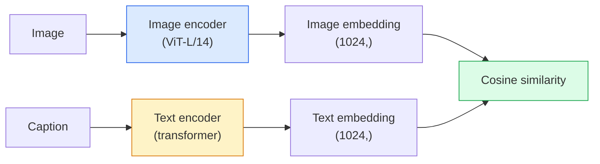

# Visi Open-Vocabulary — CLIP

> Latih sebuah image encoder dan sebuah text encoder bersama-sama supaya pasangan (gambar, caption) yang cocok mendarat di titik yang sama dalam ruang bersama. Itulah seluruh triknya.

**Type:** Build + Use
**Languages:** Python
**Prerequisites:** Phase 4 Lesson 14 (ViT), Phase 4 Lesson 17 (Self-Supervised)
**Time:** ~45 minutes

## Tujuan Pembelajaran

- Menjelaskan arsitektur dua-menara **CLIP** dan objective training kontrasifnya
- Memakai CLIP (atau SigLIP) pre-trained untuk klasifikasi zero-shot tanpa training khusus-tugas apa pun
- Mengimplementasikan klasifikasi zero-shot dari nol: enkode prompt kelas, hitung cosine similarity, ambil argmax
- Membedakan CLIP, SigLIP, OpenCLIP, dan model LLaVA/LLaMA-vision — apa gunanya masing-masing pada 2026

## Masalahnya

Classifier tradisional bersifat closed-vocabulary: sebuah model ImageNet 1000 kelas hanya bisa memprediksi 1000 label. Setiap kategori baru menuntut data berlabel dan sebuah head yang dilatih ulang.

**CLIP** (Radford et al., OpenAI 2021) menunjukkan bahwa training pada 400M pasangan (gambar, caption) yang di-scrape dari web menghasilkan model yang bisa mengklasifikasikan ke himpunan kategori mana pun saat inference, yang dijelaskan sepenuhnya dalam bahasa alami. Kamu memberinya kelas baru dengan menulis sebuah kalimat.

Kemampuan itu — transfer zero-shot — adalah alasan setiap sistem visi modern diawali dengan sebuah checkpoint keluarga CLIP. Deteksi (**Grounding DINO**, **OWL-ViT**), segmentasi (**CLIPSeg**, **SAM**), retrieval, moderasi konten, VLM, dan generasi text-to-image semuanya dibangun di atas embedding bersama bergaya CLIP.

## Konsepnya

### Dua menara



Kedua encoder berakhir dengan proyeksi linier ke dimensi embedding yang sama (512 untuk CLIP-B/32, 1024 untuk CLIP-L/14). Lakukan normalisasi L2 dan hitung cosine similarity.

### Objective-nya

Diberikan sebuah batch N pasangan (gambar, caption), bangun matriks kemiripan berukuran NxN. Latih kedua encoder supaya diagonal (pasangan yang cocok) punya kemiripan tinggi dan off-diagonal (yang tidak cocok) punya kemiripan rendah.

```
sim_matrix = image_embeddings @ text_embeddings.T / tau

loss_i2t = cross_entropy(sim_matrix,       targets=arange(N))
loss_t2i = cross_entropy(sim_matrix.T,     targets=arange(N))
loss = (loss_i2t + loss_t2i) / 2
```

Simetris karena retrieval image-to-text dan text-to-image sama-sama seharusnya berfungsi. `tau` (temperature) biasanya dipelajari sebagai parameter skalar, diinisialisasi ke 0,07.

### SigLIP: sebuah loss yang lebih baik

SigLIP (Zhai et al., 2023) mengganti softmax dengan sigmoid per pasangan:

```
loss = mean over pairs of log(1 + exp(-y_ij * sim_ij))
y_ij = +1 if matching, -1 otherwise
```

Loss per pasangan menghilangkan normalisasi level-batch yang dituntut CLIP. SigLIP training lebih baik pada ukuran batch kecil dan menyamai atau melampaui CLIP dengan data yang setara.

### Klasifikasi zero-shot

Diberikan sebuah CLIP yang sudah dilatih:

1. Untuk setiap kelas, susun sebuah prompt: "a photo of a {class}".
2. Enkode semua prompt kelas dengan text encoder -> `T` berbentuk (C, d).
3. Enkode gambar uji -> `I` berbentuk (1, d).
4. Kemiripan = `I @ T.T` berbentuk (1, C).
5. Argmax -> kelas terprediksi.

Prompt engineering itu penting. OpenAI menerbitkan 80 templat prompt untuk ImageNet ("a photo of a {}", "a blurry photo of a {}", "a sketch of a {}", ...). Rata-ratakan embedding semua templat per kelas untuk tambahan akurasi top-1 1-3%.

### Di mana model bergaya CLIP dipakai pada 2026

- **Klasifikasi zero-shot** — penggunaan langsung.
- **Retrieval gambar** — enkode semua gambar sekali, embed query saat inference.
- **Deteksi bersyarat-teks** — Grounding DINO, OWL-ViT membungkus menara teks CLIP di sekeliling sebuah detektor.
- **Segmentasi bersyarat-teks** — CLIPSeg; SAM memakai input prompt teks lewat CLIP.
- **VLM** — LLaVA, Qwen-VL, InternVL menyambungkan sebuah vision encoder keluarga CLIP ke dalam sebuah LLM.
- **Generasi text-to-image** — Stable Diffusion, DALL-E 3 di-condition pada embedding teks CLIP.

Sekali kamu punya ruang embedding bersama, setiap tugas visi+bahasa menjadi sebuah komputasi jarak.

```figure
clip-contrastive
```

## Bangun Sendiri

### Langkah 1: Sebuah model dua-menara mini

CLIP yang nyata adalah ViT + transformer. Untuk pelajaran ini menaranya adalah MLP kecil di atas fitur yang sudah diekstrak sebelumnya sehingga sinyal training-nya terlihat di CPU.

```python
import torch
import torch.nn as nn
import torch.nn.functional as F


class TwoTower(nn.Module):
    def __init__(self, img_in=128, txt_in=64, emb=64):
        super().__init__()
        self.image_proj = nn.Sequential(nn.Linear(img_in, 128), nn.ReLU(), nn.Linear(128, emb))
        self.text_proj = nn.Sequential(nn.Linear(txt_in, 128), nn.ReLU(), nn.Linear(128, emb))
        self.logit_scale = nn.Parameter(torch.ones([]) * 2.6592)  # ln(1/0.07)

    def forward(self, img_feats, txt_feats):
        i = F.normalize(self.image_proj(img_feats), dim=-1)
        t = F.normalize(self.text_proj(txt_feats), dim=-1)
        return i, t, self.logit_scale.exp()
```

Dua proyeksi, output dim-bersama, temperature yang dipelajari. Bentuk yang sama dengan API CLIP yang sebenarnya.

### Langkah 2: Loss kontrasif

```python
def clip_loss(image_emb, text_emb, logit_scale):
    N = image_emb.size(0)
    sim = logit_scale * image_emb @ text_emb.T
    targets = torch.arange(N, device=sim.device)
    l_i = F.cross_entropy(sim, targets)
    l_t = F.cross_entropy(sim.T, targets)
    return (l_i + l_t) / 2
```

Simetris. logit_scale lebih tinggi = softmax lebih tajam = lebih percaya diri tetapi berisiko tidak stabil.

### Langkah 3: Classifier zero-shot

```python
@torch.no_grad()
def zero_shot_classify(model, image_feats, class_text_feats, class_names):
    """
    image_feats:      (N, img_in)
    class_text_feats: (C, txt_in)   one averaged embedding per class
    """
    i = F.normalize(model.image_proj(image_feats), dim=-1)
    t = F.normalize(model.text_proj(class_text_feats), dim=-1)
    sim = i @ t.T
    pred = sim.argmax(dim=-1)
    return [class_names[p] for p in pred.tolist()]
```

Satu baris per langkah. Inilah prosedur zero-shot persis yang dipakai dengan sebuah checkpoint CLIP produksi.

### Langkah 4: Uji kewarasan

```python
torch.manual_seed(0)
model = TwoTower()

img = torch.randn(8, 128)
txt = torch.randn(8, 64)
i, t, scale = model(img, txt)
loss = clip_loss(i, t, scale)
print(f"batch size: {i.size(0)}   loss: {loss.item():.3f}")
```

Loss seharusnya mendekati `log(N) = log(8) = 2,08` untuk sebuah model yang diinisialisasi acak — target cross-entropy simetris ketika belum ada struktur yang dipelajari.

## Gunakan

**OpenCLIP** adalah default komunitas pada 2026:

```python
import open_clip
import torch
from PIL import Image

model, _, preprocess = open_clip.create_model_and_transforms("ViT-B-32", pretrained="laion2b_s34b_b79k")
tokenizer = open_clip.get_tokenizer("ViT-B-32")

image = preprocess(Image.open("dog.jpg")).unsqueeze(0)
text = tokenizer(["a photo of a dog", "a photo of a cat", "a photo of a car"])

with torch.no_grad():
    image_features = model.encode_image(image)
    text_features = model.encode_text(text)
    image_features = image_features / image_features.norm(dim=-1, keepdim=True)
    text_features = text_features / text_features.norm(dim=-1, keepdim=True)
    probs = (100.0 * image_features @ text_features.T).softmax(dim=-1)

print(probs)
```

SigLIP lebih baru, training lebih baik pada skala kecil, dan lebih disukai untuk pekerjaan baru: `google/siglip-base-patch16-224`. Hugging Face menghadirkan keduanya.

## Rilis

Pelajaran ini menghasilkan:

- `outputs/prompt-zero-shot-class-picker.md` — prompt yang merancang templat kelas untuk CLIP zero-shot diberikan daftar kelas dan sebuah domain.
- `outputs/skill-image-text-retriever.md` — skill yang membangun indeks embedding gambar dengan checkpoint CLIP apa pun, mendukung query-by-text dan query-by-image.

## Latihan

1. **(Mudah)** Pakai OpenCLIP ViT-B/32 pre-trained dan lakukan klasifikasi zero-shot pada CIFAR-10 dengan set prompt 80 templat. Laporkan akurasi top-1; kira-kira harus di kisaran 85-90%.
2. **(Sedang)** Bandingkan satu templat ("a photo of a {}") vs embedding rata-rata 80 templat pada tugas CIFAR-10 yang sama. Kuantifikasikan gap-nya dan jelaskan mengapa templat membantu.
3. **(Sulit)** Bangun sebuah indeks retrieval gambar zero-shot: embed 1.000 gambar dengan CLIP, bangun sebuah indeks FAISS, query dengan deskripsi bahasa alami. Laporkan recall@5 retrieval untuk 20 query held-out yang kamu tulis tangan.

## Istilah Kunci

| Term | What people say | What it actually means |
|------|----------------|----------------------|
| Two-tower | "Dual encoder" | Separate image and text encoders ending in a shared-dim projection head |
| Zero-shot | "No task-specific training" | Classify into classes described only by text at inference; no labels touched |
| Temperature / logit_scale | "tau" | Learned scalar that scales the similarity matrix before softmax |
| Prompt template | "A photo of a {}" | Natural-language wrapper around class names; averaging many templates boosts zero-shot accuracy |
| CLIP | "Image+text model" | The 2021 OpenAI model; vocabulary of the field in 2026 |
| SigLIP | "Sigmoid CLIP" | Swaps softmax for per-pair sigmoid; trains better at small batches |
| OpenCLIP | "Open reproduction" | Community-trained CLIP variants on LAION; production default for open-source pipelines |
| VLM | "Vision-language model" | A CLIP-family encoder plus an LLM, trained to answer questions about images |

## Bacaan Lanjutan

- [CLIP: Learning Transferable Visual Models from Natural Language Supervision (Radford et al., 2021)](https://arxiv.org/abs/2103.00020)
- [SigLIP: Sigmoid Loss for Language-Image Pre-Training (Zhai et al., 2023)](https://arxiv.org/abs/2303.15343)
- [OpenCLIP](https://github.com/mlfoundations/open_clip) — the community codebase
- [Oquab et al. (2023). DINOv2: Learning Robust Visual Features without Supervision](https://arxiv.org/abs/2304.07193) — the paper, with feature benchmarks against CLIP-style and MAE-style models
