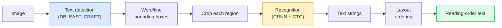

# OCR & Pemahaman Dokumen

> OCR adalah pipeline tiga tahap — deteksi box teks, pengenalan karakter, lalu penataan letak. Setiap sistem OCR modern menyusun ulang tahap-tahap itu atau menggabungkannya.

**Type:** Learn + Use
**Languages:** Python
**Prerequisites:** Phase 4 Lesson 06 (Detection), Phase 7 Lesson 02 (Self-Attention)
**Time:** ~45 minutes

## Tujuan Pembelajaran

- Menelusuri pipeline OCR klasik (deteksi -> pengenalan -> layout) dan alternatif end-to-end modern (**Donut**, Qwen-VL-OCR)
- Mengimplementasikan loss CTC (Connectionist Temporal Classification) untuk training OCR sequence-to-sequence
- Memakai PaddleOCR atau EasyOCR untuk parsing dokumen produksi tanpa training
- Membedakan OCR, parsing layout, dan pemahaman dokumen — serta memilih alat yang tepat per tugas

## Masalahnya

Gambar penuh teks ada di mana-mana: struk, faktur, identitas, buku hasil pindai, formulir, papan tulis, tanda, tangkapan layar. Mengekstrak data terstruktur dari mereka — bukan hanya karakternya, tetapi "ini adalah jumlah total" — adalah salah satu masalah visi-terapan bernilai tertinggi.

Bidang ini terbagi menjadi tiga lapisan keterampilan:

1. **OCR itu sendiri**: mengubah piksel menjadi teks.
2. **Parsing layout**: mengelompokkan output OCR menjadi region (judul, isi, tabel, header).
3. **Pemahaman dokumen**: mengekstrak field terstruktur ("invoice_total = $42.50") dari layout.

Setiap lapisan punya pendekatan klasik dan modern, dan jarak antara "saya ingin teks dari sebuah gambar" dan "saya butuh jumlah total dari struk ini" lebih besar daripada yang disadari sebagian besar tim.

## Konsepnya

### Pipeline klasik



- **Deteksi teks** menghasilkan kuadrilat per baris atau per kata.
- **Pengenalan** memotong setiap region ke tinggi tetap, menjalankan CNN + BiLSTM + CTC untuk menghasilkan urutan karakter.
- **Layout** membangun kembali urutan baca (atas-ke-bawah, kiri-ke-kanan untuk Latin; berbeda untuk Arab, Jepang).

### CTC dalam satu paragraf

Pengenalan OCR menghasilkan urutan panjang-variabel dari feature map panjang-tetap. CTC (Graves et al., 2006) memungkinkanmu melatih ini tanpa alignment level-karakter. Model mengeluarkan distribusi di atas (vokabular + blank) pada setiap langkah waktu; loss CTC melakukan marginalisasi di atas semua alignment yang menyusut ke teks target setelah menggabungkan pengulangan (merge repeats) dan menghapus blank.

```
raw output: "h h h _ _ e e l l _ l l o _ _"
after merge repeats and remove blanks: "hello"
```

CTC adalah alasan CRNN bekerja pada 2015 dan masih melatih sebagian besar model OCR produksi pada 2026.

### Model end-to-end modern

- **Donut** (Kim et al., 2022) — sebuah encoder ViT + decoder teks; membaca gambar dan mengeluarkan JSON secara langsung. Tanpa detektor teks, tanpa modul layout.
- **TrOCR** — ViT + transformer decoder untuk OCR level-baris.
- **Qwen-VL-OCR / InternVL** — model vision-language penuh yang di-fine-tune untuk tugas OCR; akurasi terbaik pada 2026 pada dokumen kompleks.
- **PaddleOCR** — pipeline klasik DB + CRNN dalam paket produksi yang matang; masih menjadi kuda penja produksi open-source.

Model end-to-end membutuhkan data dan komputasi lebih banyak tetapi melewatkan akumulasi error dari pipeline multi-tahap.

### Parsing layout

Untuk dokumen terstruktur, jalankan sebuah detektor layout (LayoutLMv3, DocLayNet) yang melabeli setiap region: Title, Paragraph, Figure, Table, Footnote. Urutan baca lalu menjadi "iterasi melalui region menurut urutan layout, konkatenasikan."

Untuk formulir, pakai model **Key-Value extraction** (Donut untuk dokumen kaya-visual, LayoutLMv3 untuk pindaian polos). Mereka mengambil gambar + teks terdeteksi + posisi dan memprediksi pasangan key-value terstruktur.

### Metrik evaluasi

- **Character Error Rate (CER)** — jarak Levenshtein / panjang referensi. Lebih rendah lebih baik. Target produksi: < 2% pada pindaian bersih.
- **Word Error Rate (WER)** — hal yang sama pada tingkat kata.
- **F1 pada field terstruktur** — untuk tugas key-value; mengukur apakah `{invoice_total: 42.50}` muncul dengan benar.
- **Jarak edit pada JSON** — untuk parsing dokumen end-to-end; paper Donut memperkenalkan tree edit distance ternormalisasi.

```figure
cv3-ctc-collapse
```

## Bangun Sendiri

### Langkah 1: Loss CTC + decoder greedy

```python
import torch
import torch.nn as nn
import torch.nn.functional as F


def ctc_loss(log_probs, targets, input_lengths, target_lengths, blank=0):
    """
    log_probs:      (T, N, C) log-softmax over vocab including blank at index 0
    targets:        (N, S) int targets (no blanks)
    input_lengths:  (N,) per-sample time steps used
    target_lengths: (N,) per-sample target length
    """
    return F.ctc_loss(log_probs, targets, input_lengths, target_lengths,
                      blank=blank, reduction="mean", zero_infinity=True)


def greedy_ctc_decode(log_probs, blank=0):
    """
    log_probs: (T, N, C) log-softmax
    returns: list of index sequences (blanks removed, repeats merged)
    """
    preds = log_probs.argmax(dim=-1).transpose(0, 1).cpu().tolist()
    out = []
    for seq in preds:
        decoded = []
        prev = None
        for idx in seq:
            if idx != prev and idx != blank:
                decoded.append(idx)
            prev = idx
        out.append(decoded)
    return out
```

`F.ctc_loss` memakai implementasi CuDNN yang efisien bila tersedia. Decoder greedy lebih sederhana daripada beam search dan biasanya berada dalam jarak 1% CER darinya.

### Langkah 2: Pengenali CRNN mini

CNN + BiLSTM minimal untuk OCR baris.

```python
class TinyCRNN(nn.Module):
    def __init__(self, vocab_size=40, hidden=128, feat=32):
        super().__init__()
        self.cnn = nn.Sequential(
            nn.Conv2d(1, feat, 3, 1, 1), nn.BatchNorm2d(feat), nn.ReLU(inplace=True),
            nn.MaxPool2d(2),
            nn.Conv2d(feat, feat * 2, 3, 1, 1), nn.BatchNorm2d(feat * 2), nn.ReLU(inplace=True),
            nn.MaxPool2d(2),
            nn.Conv2d(feat * 2, feat * 4, 3, 1, 1), nn.BatchNorm2d(feat * 4), nn.ReLU(inplace=True),
            nn.MaxPool2d((2, 1)),
            nn.Conv2d(feat * 4, feat * 4, 3, 1, 1), nn.BatchNorm2d(feat * 4), nn.ReLU(inplace=True),
            nn.MaxPool2d((2, 1)),
        )
        self.rnn = nn.LSTM(feat * 4, hidden, bidirectional=True, batch_first=True)
        self.head = nn.Linear(hidden * 2, vocab_size)

    def forward(self, x):
        # x: (N, 1, H, W)
        f = self.cnn(x)                # (N, C, H', W')
        f = f.mean(dim=2).transpose(1, 2)  # (N, W', C)
        h, _ = self.rnn(f)
        return F.log_softmax(self.head(h).transpose(0, 1), dim=-1)  # (W', N, vocab)
```

Input tinggi-tetap (CNN melakukan max-pool tinggi menjadi 1). Lebar adalah dimensi waktu bagi CTC.

### Langkah 3: OCR sintetis

Hasilkan string digit hitam-di-putih untuk uji smoke end-to-end.

```python
import numpy as np

def synthetic_line(text, height=32, char_width=16):
    W = char_width * len(text)
    img = np.ones((height, W), dtype=np.float32)
    for i, c in enumerate(text):
        x = i * char_width
        shade = 0.0 if c.isalnum() else 0.5
        img[6:height - 6, x + 2:x + char_width - 2] = shade
    return img


def build_batch(strings, vocab):
    H = 32
    W = 16 * max(len(s) for s in strings)
    imgs = np.ones((len(strings), 1, H, W), dtype=np.float32)
    target_lengths = []
    targets = []
    for i, s in enumerate(strings):
        imgs[i, 0, :, :16 * len(s)] = synthetic_line(s)
        ids = [vocab.index(c) for c in s]
        targets.extend(ids)
        target_lengths.append(len(ids))
    return torch.from_numpy(imgs), torch.tensor(targets), torch.tensor(target_lengths)


vocab = ["_"] + list("0123456789abcdefghijklmnopqrstuvwxyz")
imgs, targets, lengths = build_batch(["hello", "world"], vocab)
print(f"images: {imgs.shape}   targets: {targets.shape}   lengths: {lengths.tolist()}")
```

Sebuah dataset OCR nyata menambahkan font, noise, rotasi, blur, dan warna. Pipeline di atas tetap identik.

### Langkah 4: Sketsa training

```python
model = TinyCRNN(vocab_size=len(vocab))
opt = torch.optim.Adam(model.parameters(), lr=1e-3)

for step in range(200):
    strings = ["abc" + str(step % 10)] * 4 + ["xyz" + str((step + 1) % 10)] * 4
    imgs, targets, target_lens = build_batch(strings, vocab)
    log_probs = model(imgs)  # (W', 8, vocab)
    input_lens = torch.full((8,), log_probs.size(0), dtype=torch.long)
    loss = ctc_loss(log_probs, targets, input_lens, target_lens, blank=0)
    opt.zero_grad(); loss.backward(); opt.step()
```

Loss seharusnya turun dari ~3 ke ~0,2 selama 200 langkah pada data sintetis trivial ini.

## Gunakan

Tiga jalur produksi:

- **PaddleOCR** — matang, cepat, multibahasa. Pemakaian satu baris: `paddleocr.PaddleOCR(lang="en").ocr(image_path)`.
- **EasyOCR** — native Python, multibahasa, backbone PyTorch.
- **Tesseract** — klasik; masih berguna untuk dokumen pindaian lama saat model kesulitan.

Untuk parsing dokumen end-to-end, pakai **Donut** atau sebuah VLM:

```python
from transformers import DonutProcessor, VisionEncoderDecoderModel

processor = DonutProcessor.from_pretrained("naver-clova-ix/donut-base-finetuned-cord-v2")
model = VisionEncoderDecoderModel.from_pretrained("naver-clova-ix/donut-base-finetuned-cord-v2")
```

Untuk struk, faktur, dan formulir dengan struktur berulang, fine-tune Donut. Untuk dokumen sembarang atau OCR dengan penalaran, VLM seperti Qwen-VL-OCR adalah default saat ini.

## Rilis

Pelajaran ini menghasilkan:

- `outputs/prompt-ocr-stack-picker.md` — prompt yang memilih Tesseract / PaddleOCR / Donut / VLM-OCR diberikan jenis dokumen, bahasa, dan struktur.
- `outputs/skill-ctc-decoder.md` — skill yang menulis decoder CTC greedy dan beam-search dari nol, termasuk normalisasi panjang.

## Latihan

1. **(Mudah)** Latih TinyCRNN pada string numerik acak 5-digit selama 500 langkah. Laporkan CER pada set held-out.
2. **(Sedang)** Ganti decoding greedy dengan beam search (beam_width=5). Laporkan delta CER. Pada input mana beam search menang?
3. **(Sulit)** Pakai PaddleOCR pada set 20 struk, ekstrak line item, dan hitung F1 terhadap ground truth berlabel-tangan untuk pasangan {item_name, price}.

## Istilah Kunci

| Term | What people say | What it actually means |
|------|----------------|----------------------|
| OCR | "Text from pixels" | Turning image regions into character sequences |
| CTC | "Alignment-free loss" | Loss that trains a sequence model without per-timestep labels; marginalises over alignments |
| CRNN | "Classic OCR model" | Conv feature extractor + BiLSTM + CTC; the 2015 baseline still used in production |
| Donut | "End-to-end OCR" | ViT encoder + text decoder; emits JSON directly from image |
| Layout parsing | "Find regions" | Detect and label Title/Table/Figure/Paragraph regions in a document |
| Reading order | "Text sequence" | Ordering of recognised regions into a sentence; trivial for Latin, non-trivial for mixed layouts |
| CER / WER | "Error rates" | Levenshtein distance / reference length at character or word granularity |
| VLM-OCR | "LLM that reads" | A vision-language model trained or prompted for OCR tasks; current SOTA on complex documents |

## Bacaan Lanjutan

- [CRNN (Shi et al., 2015)](https://arxiv.org/abs/1507.05717) — the original CNN+RNN+CTC architecture
- [CTC (Graves et al., 2006)](https://www.cs.toronto.edu/~graves/icml_2006.pdf) — the original CTC paper; densely packed with the algorithmic ideas
- [Donut (Kim et al., 2022)](https://arxiv.org/abs/2111.15664) — OCR-free document understanding transformer
- [PaddleOCR](https://github.com/PaddlePaddle/PaddleOCR) — the open-source production OCR stack
