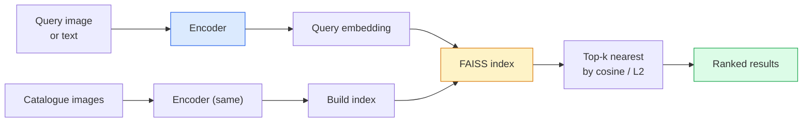

# Retrieval Gambar & Metric Learning

> Sebuah sistem retrieval meranking kandidat berdasarkan jarak dalam ruang embedding. Metric learning adalah disiplin membentuk ruang itu supaya jarak-jaraknya berarti apa yang kamu inginkan.

**Type:** Build
**Languages:** Python
**Prerequisites:** Phase 4 Lesson 14 (ViT), Phase 4 Lesson 18 (CLIP)
**Time:** ~45 minutes

## Tujuan Pembelajaran

- Menjelaskan loss metric learning triplet, kontrasif, dan berbasis-proxy serta memilih yang tepat untuk sebuah dataset tertentu
- Mengimplementasikan normalisasi L2 dan cosine similarity dengan benar serta mengaudit perbedaan retrieval "item yang sama" vs "kelas yang sama"
- Membangun sebuah indeks FAISS, query dengan teks dan dengan gambar, dan melaporkan recall@K untuk set query held-out
- Memakai DINOv2, CLIP, dan SigLIP sebagai backbone embedding siap-pakai dan mengetahui kapan masing-masing menang

## Masalahnya

Retrieval ada di mana-mana dalam visi produksi: deteksi duplikat, pencarian gambar terbalik, pencarian visual ("cari produk serupa"), re-identifikasi wajah, person re-ID untuk pengawasan, pemetaan level-instance untuk e-commerce. Pertanyaan produk selalu sama: "diberikan gambar query ini, ranking katalog saya."

Dua keputusan desain membentuk seluruh sistem. Embedding — model mana yang menghasilkan vektor. Indeks — cara menemukan tetangga terdekat dalam skala. Keduanya adalah komoditas pada 2026 (DINOv2 untuk embedding, FAISS untuk indeks), yang menaikkan ambangnya: bagian sulitnya adalah mendefinisikan *apa yang dihitung serupa* untuk aplikasimu, lalu membentuk ruang embedding supaya jarak-jaraknya cocok.

Pembentukan itu adalah metric learning. Sebuah disiplin kecil tetapi berdaya ungkit tinggi.

## Konsepnya

### Retrieval sekilas



### Empat keluarga loss

| Loss | Requires | Pros | Cons |
|------|----------|------|------|
| **Contrastive** | (anchor, positive) + negatives | Simple, works with any pair label | Slow to converge without many negatives |
| **Triplet** | (anchor, positive, negative) | Intuitive; direct margin control | Hard-triplet mining is expensive |
| **NT-Xent / InfoNCE** | Pairs + batch-mined negatives | Scales to large batches | Needs big batch or momentum queue |
| **Proxy-based (ProxyNCA)** | Class labels only | Fast, stable, no mining | Can overfit to proxies on small datasets |

Untuk sebagian besar use case produksi, mulai dengan sebuah backbone pre-trained dan hanya tambahkan sebuah fine-tune metric-learning jika embedding siap-pakai underperform pada set ujimu.

### Triplet loss secara formal

```
L = max(0, ||f(a) - f(p)||^2 - ||f(a) - f(n)||^2 + margin)
```

Tarik anchor `a` mendekati positive `p`, dorong menjauh dari negative `n`, dengan sebuah `margin` yang memastikan adanya gap. Struktur tiga-gambar ini digeneralisasikan ke urutan-kesamaan mana pun.

Mining itu penting: triplet easy (`n` sudah jauh dari `a`) menyumbang loss nol; hanya triplet hard yang mengajari jaringan. Semi-hard mining (`n` lebih jauh daripada `p` tetapi masih dalam margin) adalah resep FaceNet 2016 dan masih mendominasi.

### Cosine similarity vs L2

Dua metrik, dua konvensi:

- **Cosine**: sudut antara vektor. Membutuhkan embedding ternormalisasi-L2.
- **L2**: jarak Euclidean. Berfungsi pada embedding mentah atau ternormalisasi, tetapi biasanya dipasangkan dengan L2-ternormalisasi + L2 berkuadrat.

Untuk sebagian besar net modern keduanya ekuivalen: `||a - b||^2 = 2 - 2 cos(a, b)` ketika `||a|| = ||b|| = 1`. Pilih konvensi yang cocok dengan training embedding-mu; mencampurnya diam-diameter mengubah arti dari "terdekat".

### Recall@K

Metrik retrieval standar:

```
recall@K = fraction of queries where at least one correct match is in the top K results
```

Laporkan recall@1, @5, @10 berdampingan. recall@10 di atas 0,95 dengan recall@1 di bawah 0,5 berarti ruang embedding-nya punya struktur yang tepat tetapi ranking-nya bising — coba fine-tune lebih panjang atau sebuah langkah re-ranking.

Untuk deteksi duplikat, precision@K lebih penting karena setiap false positive adalah kesalahan yang terlihat pengguna. Untuk pencarian visual, recall@K adalah sinyal produknya.

### FAISS dalam satu paragraf

Facebook AI Similarity Search. Library de-facto untuk pencarian nearest-neighbour. Tiga pilihan indeks:

- `IndexFlatIP` / `IndexFlatL2` — brute force, eksak, tanpa training. Pakai hingga ~1M vektor.
- `IndexIVFFlat` — partisi ke K sel, cari hanya beberapa sel terdekat. Aproksimatif, cepat, membutuhkan data training.
- `IndexHNSW` — berbasis graf, tercepat untuk banyak query, ukuran indeks besar.

Untuk 100k vektor kamu mungkin menginginkan `IndexFlatIP` pada cosine similarity. Untuk 10M kamu menginginkan `IndexIVFFlat`. Untuk 100M+ dikombinasikan dengan product quantisation (`IndexIVFPQ`).

### Retrieval level-instance vs level-kategori

Dua masalah yang sangat berbeda dengan nama yang sama:

- **Level-kategori** — "cari kucing di katalog saya." Kesamaan bersyarat-kelas; embedding CLIP / DINOv2 siap-pakai bekerja baik.
- **Level-instance** — "cari *produk persis ini* di katalog saya." Membutuhkan diskriminasi halus antara objek visual serupa dari kelas yang sama; embedding siap-pakai under-perform; fine-tune dengan metric learning itu penting.

Selalu tanyakan mana yang sedang kamu pecahkan sebelum memilih sebuah model.

```figure
metric-embedding
```

## Bangun Sendiri

### Langkah 1: Triplet loss

```python
import torch
import torch.nn.functional as F

def triplet_loss(anchor, positive, negative, margin=0.2):
    d_ap = F.pairwise_distance(anchor, positive, p=2)
    d_an = F.pairwise_distance(anchor, negative, p=2)
    return F.relu(d_ap - d_an + margin).mean()
```

Satu baris. Berfungsi pada embedding ternormalisasi-L2 atau mentah.

### Langkah 2: Semi-hard mining

Diberikan sebuah batch embedding dan label, temukan negative semi-hard tersulit untuk setiap anchor.

```python
def semi_hard_negatives(emb, labels, margin=0.2):
    dist = torch.cdist(emb, emb)
    same_class = labels[:, None] == labels[None, :]
    diff_class = ~same_class
    N = emb.size(0)

    positives = dist.clone()
    positives[~same_class] = float("-inf")
    positives.fill_diagonal_(float("-inf"))
    pos_idx = positives.argmax(dim=1)

    semi_hard = dist.clone()
    semi_hard[same_class] = float("inf")
    d_ap = dist[torch.arange(N), pos_idx].unsqueeze(1)
    semi_hard[dist <= d_ap] = float("inf")
    neg_idx = semi_hard.argmin(dim=1)

    fallback_mask = semi_hard[torch.arange(N), neg_idx] == float("inf")
    if fallback_mask.any():
        hardest = dist.clone()
        hardest[same_class] = float("inf")
        neg_idx = torch.where(fallback_mask, hardest.argmin(dim=1), neg_idx)
    return pos_idx, neg_idx
```

Setiap anchor mendapat positive tersulit dalam kelasnya dan sebuah negative semi-hard yang lebih jauh daripada positive tetapi masih dalam margin.

### Langkah 3: Recall@K

```python
def recall_at_k(query_emb, gallery_emb, query_labels, gallery_labels, k=1):
    sim = query_emb @ gallery_emb.T
    _, top_k = sim.topk(k, dim=-1)
    matches = (gallery_labels[top_k] == query_labels[:, None]).any(dim=-1)
    return matches.float().mean().item()
```

Top-k oleh produk dalam di atas embedding ternormalisasi-L2 sama dengan top-k oleh cosine. Laporkan proporsi rata-rata query yang punya setidaknya satu tetangga yang benar.

### Langkah 4: Merangkainya

```python
import torch
import torch.nn as nn
from torch.optim import Adam

class Encoder(nn.Module):
    def __init__(self, in_dim=128, emb_dim=64):
        super().__init__()
        self.net = nn.Sequential(
            nn.Linear(in_dim, 128), nn.ReLU(),
            nn.Linear(128, emb_dim),
        )

    def forward(self, x):
        return F.normalize(self.net(x), dim=-1)

torch.manual_seed(0)
num_classes = 6
protos = F.normalize(torch.randn(num_classes, 128), dim=-1)

def sample_batch(bs=32):
    labels = torch.randint(0, num_classes, (bs,))
    x = protos[labels] + 0.15 * torch.randn(bs, 128)
    return x, labels

enc = Encoder()
opt = Adam(enc.parameters(), lr=3e-3)

for step in range(200):
    x, y = sample_batch(32)
    emb = enc(x)
    pos_idx, neg_idx = semi_hard_negatives(emb, y)
    loss = triplet_loss(emb, emb[pos_idx], emb[neg_idx])
    opt.zero_grad(); loss.backward(); opt.step()
```

Setelah beberapa ratus langkah klaster embedding membentuk satu klaster per kelas.

## Gunakan

Stack produksi pada 2026:

- **DINOv2 + FAISS** — retrieval visual serba-guna. Berfungsi siap-pakai.
- **CLIP + FAISS** — ketika query-nya teks.
- **DINOv2 yang di-fine-tune + FAISS** — retrieval level-instance, face re-ID, fashion, e-commerce.
- **Milvus / Weaviate / Qdrant** — pembungkus vector DB terkelola di sekeliling FAISS atau HNSW.

Untuk instance retrieval SOTA, resepnya adalah: backbone DINOv2, tambahkan sebuah head embedding, fine-tune dengan loss triplet atau InfoNCE pada pasangan berlabel-instance, indeks di FAISS.

## Rilis

Pelajaran ini menghasilkan:

- `outputs/prompt-retrieval-loss-picker.md` — prompt yang memilih triplet / InfoNCE / ProxyNCA untuk masalah retrieval tertentu.
- `outputs/skill-recall-at-k-runner.md` — skill yang menulis sebuah harness evaluasi bersih untuk recall@K dengan split train/val/gallery dan kontrak data yang tepat.

## Latihan

1. **(Mudah)** Jalankan contoh mainan di atas. Plot embedding dengan PCA sebelum dan sesudah training untuk melihat enam klaster terbentuk.
2. **(Sedang)** Tambahkan implementasi loss ProxyNCA: satu "proxy" yang dipelajari per kelas, cross-entropy standar pada cosine similarity. Bandingkan kecepatan konvergensi vs triplet loss pada data mainan.
3. **(Sulit)** Ambil 1.000 gambar validasi ImageNet, embed dengan DINOv2 lewat HuggingFace, bangun sebuah indeks FAISS flat, dan laporkan recall@{1, 5, 10} terhadap gambar yang sama sebagai query (seharusnya 1,0) dan terhadap sebuah split held-out dengan label ImageNet sebagai ground truth.

## Istilah Kunci

| Term | What people say | What it actually means |
|------|----------------|----------------------|
| Metric learning | "Shape the space" | Training an encoder so distances in its output space reflect a target similarity |
| Triplet loss | "Pull and push" | L = max(0, d(a, p) - d(a, n) + margin); the canonical metric-learning loss |
| Semi-hard mining | "Useful negatives" | Negatives further from the anchor than the positive but within margin; empirically the most informative |
| Proxy-based loss | "Class prototypes" | One learned proxy per class; cross-entropy over similarity-to-proxies; no pair mining |
| Recall@K | "Top-K hit rate" | Fraction of queries with at least one correct result in the top K |
| Instance retrieval | "Find this exact thing" | Fine-grained matching; off-the-shelf features usually underperform |
| FAISS | "The NN library" | Facebook's nearest-neighbour library; supports exact and approximate indexes |
| HNSW | "Graph index" | Hierarchical navigable small world; fast approximate NN with small memory overhead |

## Bacaan Lanjutan

- [FaceNet: A Unified Embedding for Face Recognition (Schroff et al., 2015)](https://arxiv.org/abs/1503.03832) — the triplet loss / semi-hard mining paper
- [In Defense of the Triplet Loss for Person Re-Identification (Hermans et al., 2017)](https://arxiv.org/abs/1703.07737) — practical guide to triplet fine-tuning
- [FAISS documentation](https://github.com/facebookresearch/faiss/wiki) — every index, every trade-off
- [SMoT: Metric Learning Taxonomy (Kim et al., 2021)](https://arxiv.org/abs/2010.06927) — survey of modern losses and their connections
