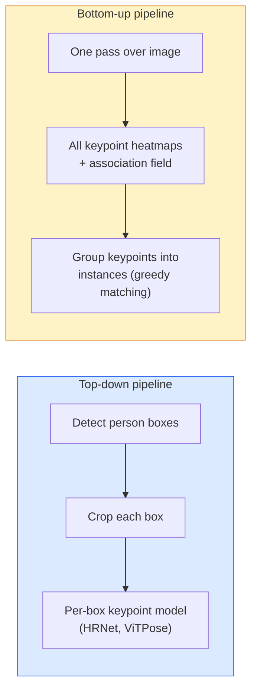

# Deteksi Keypoint & Pose Estimation

> Sebuah pose adalah himpunan keypoint terurut. Sebuah detektor keypoint adalah regressor heatmap. Sisanya adalah pembukuan.

**Type:** Build
**Languages:** Python
**Prerequisites:** Phase 4 Lesson 06 (Detection), Phase 4 Lesson 07 (U-Net)
**Time:** ~45 minutes

## Tujuan Pembelajaran

- Membedakan pose estimation top-down dan bottom-up serta menyatakan kapan masing-masing dipakai
- Meregresi heatmap untuk K keypoint dengan target Gaussian-per-keypoint dan mengekstrak koordinat keypoint saat inference
- Menjelaskan Part Affinity Fields (PAF) dan bagaimana pipeline bottom-up mengasosiasikan keypoint menjadi instance
- Memakai MediaPipe Pose atau MMPose untuk estimasi keypoint produksi dan memahami format output mereka

## Masalahnya

Tugas-tugas keypoint bersembunyi di balik banyak nama: pose manusia (17 sendi tubuh), face landmarks (68 atau 478 titik), tangan (21 titik), pose hewan, pose objek robotik, landmark anatomi medis. Semuanya berbagi struktur yang sama: mendeteksi K titik diskrit pada sebuah objek dan mengeluarkan koordinat (x, y) mereka.

Pose estimation adalah fondasi dari motion capture, aplikasi fitness, analitik olahraga, kontrol gestur, animasi, AR try-on, dan robotic grasping. Kasus 2D sudah matang; pose 3D (mengestimasi posisi sendi dalam koordinat dunia dari satu kamera) adalah frontier penelitian saat ini.

Pertanyaan engineering-nya adalah skala. Pose satu-gambar, satu-orang adalah masalah 20ms. Pose multi-orang dalam kerumunan pada 30 fps adalah masalah berbeda dengan arsitektur berbeda.

## Konsepnya

### Top-down vs bottom-up



- **Top-down** — deteksi orang lebih dulu, lalu jalankan sebuah model keypoint per-orang pada setiap crop. Akurasi tertinggi; skala linear dengan jumlah orang.
- **Bottom-up** — satu forward pass memprediksi semua keypoint ditambah sebuah field asosiasi; kelompokkan. Waktu konstan terlepas dari ukuran kerumunan.

Top-down (HRNet, ViTPose) adalah pemimpin akurasi; bottom-up (OpenPose, HigherHRNet) adalah pemimpin throughput untuk adegan ramai.

### Regresi heatmap

Alih-alih meregresi `(x, y)` secara langsung, prediksi sebuah heatmap `H x W` per keypoint dengan blob Gaussian yang terpusat di lokasi yang benar.

```
target[k, y, x] = exp(-((x - cx_k)^2 + (y - cy_k)^2) / (2 sigma^2))
```

Saat inference, argmax dari setiap heatmap adalah lokasi keypoint terprediksi.

Mengapa heatmap bekerja lebih baik daripada regresi langsung: struktur spasial jaringan (feature map conv) selaras secara alami dengan output spasial. Target Gaussian juga melakukan regularisasi — sebuah error lokalisasi kecil menghasilkan loss kecil, bukan nol.

### Lokalisasi sub-pixel

Argmax memberikan koordinat bilangan bulat. Untuk presisi sub-pixel, perbaiki dengan memasang sebuah parabola pada argmax dan tetangganya, atau pakai offset yang dikenal luas `(dx, dy) = 0,25 * (heatmap[y, x+1] - heatmap[y, x-1], ...)` arahnya.

### Part Affinity Fields (PAF)

Trik OpenPose untuk asosiasi bottom-up. Untuk setiap pasangan keypoint yang terhubung (misalnya bahu kiri ke siku kiri), prediksi sebuah field 2-kanal yang mengkode vektor unit yang menunjuk dari satu ke yang lain. Untuk mengasosiasikan sebuah bahu dengan sikunya, integrasikan PAF sepanjang garis yang menghubungkan pasangan kandidat; pasangan dengan integral tertinggi di-matching.

```
For each connection (limb):
  PAF channels: 2 (unit vector x, y)
  Line integral: sum over sample points of (PAF . line_direction)
  Higher integral = stronger match
```

Elegan dan berskala ke ukuran kerumunan mana pun tanpa crop per-orang.

### Keypoint COCO

Dataset pose-tubuh standar: 17 keypoint per orang, PCK (Percentage of Correct Keypoints) dan OKS (Object Keypoint Similarity) sebagai metrik. OKS adalah analog IoU bagi keypoint dan adalah apa yang dilaporkan COCO mAP@OKS.

### 2D vs 3D

- **Pose 2D** — koordinat gambar; sudah diselesaikan dengan kualitas produksi (MediaPipe, HRNet, ViTPose).
- **Pose 3D** — koordinat dunia / kamera; masih penelitian aktif. Pendekatan umum:
  - Lift prediksi 2D ke 3D dengan sebuah MLP kecil (VideoPose3D).
  - Regresi 3D langsung dari gambar (PyMAF, MHFormer).
  - Setup multi-view (CMU Panoptic) untuk ground truth.

```figure
cv3-pose-heatmap
```

## Bangun Sendiri

### Langkah 1: Target heatmap Gaussian

```python
import numpy as np
import torch

def gaussian_heatmap(size, cx, cy, sigma=2.0):
    yy, xx = np.meshgrid(np.arange(size), np.arange(size), indexing="ij")
    return np.exp(-((xx - cx) ** 2 + (yy - cy) ** 2) / (2 * sigma ** 2)).astype(np.float32)

hm = gaussian_heatmap(64, 32, 32, sigma=2.0)
print(f"peak: {hm.max():.3f} at ({hm.argmax() % 64}, {hm.argmax() // 64})")
```

Heatmap per-keypoint yang ditumpuk di sepanjang sumbu kanal memberikan tensor target lengkap.

### Langkah 2: Head keypoint mini

Sebuah model bergaya U-Net yang mengeluarkan K kanal heatmap.

```python
import torch.nn as nn
import torch.nn.functional as F

class TinyKeypointNet(nn.Module):
    def __init__(self, num_keypoints=4, base=16):
        super().__init__()
        self.down1 = nn.Sequential(nn.Conv2d(3, base, 3, 2, 1), nn.ReLU(inplace=True))
        self.down2 = nn.Sequential(nn.Conv2d(base, base * 2, 3, 2, 1), nn.ReLU(inplace=True))
        self.mid = nn.Sequential(nn.Conv2d(base * 2, base * 2, 3, 1, 1), nn.ReLU(inplace=True))
        self.up1 = nn.ConvTranspose2d(base * 2, base, 2, 2)
        self.up2 = nn.ConvTranspose2d(base, num_keypoints, 2, 2)

    def forward(self, x):
        h1 = self.down1(x)
        h2 = self.down2(h1)
        h3 = self.mid(h2)
        u1 = self.up1(h3)
        return self.up2(u1)
```

Input `(N, 3, H, W)`, output `(N, K, H, W)`. Loss adalah MSE per-piksel terhadap target Gaussian.

### Langkah 3: Inference — ekstrak koordinat keypoint

```python
def heatmap_to_coords(heatmaps):
    """
    heatmaps: (N, K, H, W)
    returns:  (N, K, 2) float coordinates in image pixels
    """
    N, K, H, W = heatmaps.shape
    hm = heatmaps.reshape(N, K, -1)
    idx = hm.argmax(dim=-1)
    ys = (idx // W).float()
    xs = (idx % W).float()
    return torch.stack([xs, ys], dim=-1)

coords = heatmap_to_coords(torch.randn(2, 4, 32, 32))
print(f"coords: {coords.shape}")  # (2, 4, 2)
```

Satu baris saat inference. Untuk penyempurnaan sub-pixel, interpolasi di sekitar argmax.

### Langkah 4: Dataset keypoint sintetis

Sederhana: gambar empat titik di atas kanvas putih dan belajar memprediksinya.

```python
def make_synthetic_sample(size=64):
    img = np.ones((3, size, size), dtype=np.float32)
    rng = np.random.default_rng()
    kps = rng.integers(8, size - 8, size=(4, 2))
    for cx, cy in kps:
        img[:, cy - 2:cy + 2, cx - 2:cx + 2] = 0.0
    hms = np.stack([gaussian_heatmap(size, cx, cy) for cx, cy in kps])
    return img, hms, kps
```

Cukup mudah bagi sebuah model mini untuk mempelajarinya dalam satu menit.

### Langkah 5: Training

```python
model = TinyKeypointNet(num_keypoints=4)
opt = torch.optim.Adam(model.parameters(), lr=3e-3)

for step in range(200):
    batch = [make_synthetic_sample() for _ in range(16)]
    imgs = torch.from_numpy(np.stack([b[0] for b in batch]))
    hms = torch.from_numpy(np.stack([b[1] for b in batch]))
    pred = model(imgs)
    # Upsample pred to full resolution
    pred = F.interpolate(pred, size=hms.shape[-2:], mode="bilinear", align_corners=False)
    loss = F.mse_loss(pred, hms)
    opt.zero_grad(); loss.backward(); opt.step()
```

## Gunakan

- **MediaPipe Pose** — estimator pose produksi Google; menghadirkan runtime WebGL + mobile dengan latensi di bawah 10ms.
- **MMPose** (OpenMMLab) — codebase penelitian lengkap; setiap arsitektur SOTA dengan bobot pre-trained.
- **YOLOv8-pose** — pose multi-orang real-time tercepat dengan satu forward pass.
- **transformers HumanDPT / PoseAnything** — pendekatan vision-language lebih baru untuk pose open-vocabulary (objek mana pun, himpunan keypoint mana pun).

## Rilis

Pelajaran ini menghasilkan:

- `outputs/prompt-pose-stack-picker.md` — prompt yang memilih MediaPipe / YOLOv8-pose / HRNet / ViTPose diberikan latensi, ukuran kerumunan, dan kebutuhan 2D vs 3D.
- `outputs/skill-heatmap-to-coords.md` — skill yang menulis rutinitas sub-pixel heatmap-ke-koordinat yang dipakai setiap model pose produksi.

## Latihan

1. **(Mudah)** Latih model keypoint mini pada dataset sintetis 4-titik. Laporkan error L2 rata-rata antara keypoint terprediksi dan yang benar setelah 200 langkah.
2. **(Sedang)** Tambahkan penyempurnaan sub-pixel: diberikan posisi argmax, pasang sebuah parabola 1D di sepanjang x dan y dari piksel tetangga. Laporkan peningkatan akurasi vs argmax bilangan bulat.
3. **(Sulit)** Bangun sebuah dataset sintetis 2-orang di mana setiap gambar menampilkan dua instance dari pola 4-keypoint. Latih sebuah pipeline bottom-up dengan PAF yang memprediksi keypoint mana milik instance mana, dan evaluasi OKS.

## Istilah Kunci

| Term | What people say | What it actually means |
|------|----------------|----------------------|
| Keypoint | "A landmark" | A specific ordered point on an object (joint, corner, feature) |
| Pose | "The skeleton" | An ordered set of keypoints belonging to one instance |
| Top-down | "Detect then pose" | Two-stage pipeline: person detector + per-crop keypoint model; highest accuracy |
| Bottom-up | "Pose first, group later" | Single-pass all-keypoint prediction + grouping; constant time in crowd size |
| Heatmap | "Gaussian target" | H x W tensor per keypoint with peak at the true location; the preferred regression target |
| PAF | "Part Affinity Field" | 2-channel unit vector field encoding limb directions; used to group keypoints into instances |
| OKS | "Keypoint IoU" | Object Keypoint Similarity; the COCO metric for pose |
| HRNet | "High-Resolution Net" | The dominant top-down keypoint architecture; preserves high-res features throughout |

## Bacaan Lanjutan

- [OpenPose (Cao et al., 2017)](https://arxiv.org/abs/1812.08008) — bottom-up with PAFs; still the best writeup of the approach
- [HRNet (Sun et al., 2019)](https://arxiv.org/abs/1902.09212) — the top-down reference architecture
- [ViTPose (Xu et al., 2022)](https://arxiv.org/abs/2204.12484) — plain ViT as a pose backbone; current SOTA on many benchmarks
- [MediaPipe Pose](https://developers.google.com/mediapipe/solutions/vision/pose_landmarker) — production real-time pose; the fastest deployed stack in 2026
