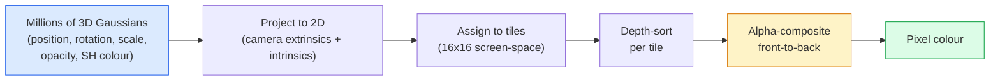

# 3D Gaussian Splatting dari Nol

> Sebuah adegan adalah awan jutaan Gaussian 3D. Masing-masing punya posisi, orientasi, skala, opacity, dan warna yang bergantung pada arah pandang. Rasterisasi mereka, backprop melalui rasterisasi, selesai.

**Type:** Build
**Languages:** Python
**Prerequisites:** Phase 4 Lesson 13 (3D Vision & NeRF), Phase 1 Lesson 12 (Tensor Operations), Phase 4 Lesson 10 (Diffusion basics optional)
**Time:** ~90 minutes

## Tujuan Pembelajaran

- Menjelaskan mengapa 3D Gaussian Splatting menggantikan NeRF sebagai default produksi untuk rekonstruksi 3D fotorealistis pada 2026
- Menyatakan enam parameter per-Gaussian (posisi, kuarternion rotasi, skala, opacity, warna spherical harmonics, fitur opsional) dan berapa float yang disumbangkan masing-masing
- Mengimplementasikan sebuah rasterizer splatting Gaussian 2D dari nol memakai compositing `alpha`, lalu menunjukkan bagaimana kasus 3D memproyeksikan ke loop yang sama
- Memakai `nerfstudio`, `gsplat`, atau `SuperSplat` untuk merekonstruksi sebuah adegan dari 20-50 foto dan mengekspor ke ekstensi glTF `KHR_gaussian_splatting` atau skema OpenUSD 26.03 `UsdVolParticleField3DGaussianSplat`

## Masalahnya

Sebuah NeRF menyimpan sebuah adegan sebagai bobot sebuah MLP. Setiap piksel yang di-render adalah ratusan query MLP di sepanjang sebuah ray. Training memakan jam, rendering memakan detik, dan bobotnya tidak bisa diedit — jika kamu ingin memindahkan sebuah kursi di dalam sebuah adegan, kamu harus melatih ulang.

3D Gaussian Splatting (Kerbl, Kopanas, Leimkühler, Drettakis, SIGGRAPH 2023) menggantikan semuanya itu. Sebuah adegan adalah himpunan eksplisit Gaussian 3D. Rendering adalah rasterisasi GPU pada 100+ fps. Training memakan menit. Editing langsung: translasikan sebagian Gaussian dan kamu telah memindahkan kursinya. Pada 2026 Khronos Group telah meratifikasi sebuah ekstensi glTF untuk Gaussian splat, OpenUSD 26.03 menghadirkan skema Gaussian splat, Zillow dan Apartments.com me-render properti dengan mereka, dan sebagian besar paper penelitian baru tentang rekonstruksi 3D adalah varian dari ide inti 3DGS.

Model mentalnya sederhana, matematikanya punya cukup banyak komponen bergerak sehingga sebagian besar pengantar dimulai di rasterisasi dan melewati proyeksi serta spherical harmonics. Pelajaran ini membangun seluruhnya — versi 2D lebih dulu, lalu ekstensi 3D-nya.

## Konsepnya

### Apa yang dibawa sebuah Gaussian

Satu Gaussian 3D adalah sebuah blob parametrik di ruang dengan atribut-atribut ini:

```
position         mu         (3,)    centre in world coordinates
rotation         q          (4,)    unit quaternion encoding orientation
scale            s          (3,)    log-scales per axis (exponentiated at render time)
opacity          alpha      (1,)    post-sigmoid opacity [0, 1]
SH coefficients  c_lm       (3 * (L+1)^2,)   view-dependent colour
```

Rotasi + skala membangun sebuah kovarians 3x3: `Sigma = R S S^T R^T`. Itulah bentuk Gaussian dalam 3D. Spherical harmonics memungkinkan warna berubah mengikuti arah pandang — highlight specular, sheen halus, glow yang bergantung-tampilan — tanpa menyimpan tekstur per-tampilan. Dengan SH degree 3 kamu mendapat 16 koefisien per kanal warna, 48 float per Gaussian untuk warna saja.

Sebuah adegan biasanya punya 1-5 juta Gaussian. Masing-masing menyimpan kira-kira 60 float (3 + 4 + 3 + 1 + 48 + misc). Itu 240 MB untuk adegan lima-juta-Gaussian — jauh lebih kecil daripada awan titik ekuivalen dengan tekstur per-titik, dan satu order of magnitude lebih kecil daripada bobot MLP NeRF yang di-render-ulang pada resolusi tinggi.

### Rasterisasi, bukan ray marching



Lima langkah, semuanya ramah-GPU. Tanpa query MLP per piksel. Sebuah RTX 3080 Ti tunggal me-render 6 juta splat pada 147 fps.

### Langkah proyeksi

Gaussian 3D pada posisi dunia `mu` dengan kovarians 3D `Sigma` memproyeksikan ke sebuah Gaussian 2D pada posisi layar `mu'` dengan kovarians 2D `Sigma'`:

```
mu' = project(mu)
Sigma' = J W Sigma W^T J^T          (2 x 2)

W = viewing transform (rotation + translation of camera)
J = Jacobian of the perspective projection at mu'
```

Jejak kaki Gaussian 2D adalah sebuah elips yang sumbunya adalah eigenvector dari `Sigma'`. Setiap piksel di dalam elips itu menerima kontribusi Gaussian, di-berat oleh `exp(-0.5 * (p - mu')^T Sigma'^-1 (p - mu'))`.

### Aturan alpha-compositing

Untuk satu piksel, Gaussian yang menutupinya di-sort dari-belakang-ke-depan (atau ekuivalen dari-depan-ke-belakang dengan formula terbalik). Warna di-composite dengan persamaan yang sama seperti setiap rasteriser semi-transparan sejak 1980-an:

```
C_pixel = sum_i alpha_i * T_i * c_i

T_i = prod_{j < i} (1 - alpha_j)       transmittance up to i
alpha_i = opacity_i * exp(-0.5 * d^T Sigma'^-1 d)   local contribution
c_i = eval_SH(SH_i, view_direction)    view-dependent colour
```

Ini adalah **persamaan yang sama dengan volumetric render NeRF**, hanya di atas sebuah himpunan Gaussian eksplisit yang jarang alih-alih sampel padat di sepanjang sebuah ray. Identitas itulah alasan kualitas render menyamai NeRF — keduanya mengintegrasikan persamaan radiance-field yang sama.

### Mengapa ini bisa di-differentiate

Setiap langkah — proyeksi, penugasan tile, compositing alpha, evaluasi SH — dapat di-differentiate terhadap parameter-parameter Gaussian. Diberikan sebuah gambar ground truth, hitung loss piksel yang di-render, backprop melalui rasteriser, perbarui semua `(mu, q, s, alpha, c_lm)` oleh gradient descent. Selama ~30.000 iterasi Gaussian menemukan posisi, skala, dan warna yang tepat.

### Densifikasi dan pruning

Himpunan Gaussian tetap tidak bisa menutupi adegan yang kompleks. Training mencakup dua mekanisme adaptif:

- **Clone** sebuah Gaussian pada posisinya saat ini ketika magnitude gradiennya tinggi tetapi skalanya kecil — rekonstruksi membutuhkan lebih banyak detail di sini.
- **Split** sebuah Gaussian berskala-besar menjadi dua yang lebih kecil ketika gradiennya tinggi — satu Gaussian besar terlalu halus untuk menyesuaikan region itu.
- **Prune** Gaussian yang opacity-nya turun di bawah sebuah ambang — mereka tidak menyumbang.

Densifikasi berjalan setiap N iterasi. Sebuah adegan biasanya tumbuh dari ~100k Gaussian awal (di-seed dari titik SfM) menjadi 1-5M di akhir training.

### Spherical harmonics dalam satu paragraf

Warna yang bergantung-tampilan adalah sebuah fungsi `c(direction)` di atas bola satuan. Spherical harmonics adalah basis Fourier bola itu. Pangkas pada degree `L` dan kamu mendapat `(L+1)^2` fungsi basis per kanal. Mengevaluasi warna untuk tampilan baru adalah sebuah dot product antara koefisien SH yang dipelajari dan basis yang dievaluasi di arah pandang. Degree 0 = satu koefisien = warna konstan. Degree 3 = 16 koefisien = cukup untuk menangkap shading Lambertian, specular, dan refleksi ringan. Paper 3D Gaussian Splatting SD memakai degree 3 secara default.

### Stack produksi 2026

```
1. Capture         smartphone / DJI drone / handheld scanner
2. SfM / MVS       COLMAP or GLOMAP derives camera poses + sparse points
3. Train 3DGS      nerfstudio / gsplat / inria official / PostShot (~10-30 min on RTX 4090)
4. Edit            SuperSplat / SplatForge (clean floaters, segment)
5. Export          .ply -> glTF KHR_gaussian_splatting or .usd (OpenUSD 26.03)
6. View            Cesium / Unreal / Babylon.js / Three.js / Vision Pro
```

### Varian 4D dan generatif

- **4D Gaussian Splatting** — Gaussian adalah fungsi waktu; dipakai untuk video volumetrik (Superman 2026, "Helicopter" A$AP Rocky).
- **Splat generatif** — model text-to-splat (Marble oleh World Labs) yang berhalusinasi seluruh adegan.
- **3D Gaussian Unscented Transform** — varian NVIDIA NuRec untuk simulasi otonom.

```figure
cv3-gaussian-splat
```

## Bangun Sendiri

### Langkah 1: Sebuah Gaussian 2D

Kita pertama membangun sebuah rasteriser 2D. Kasus 3D menyusut kepadanya setelah proyeksi.

```python
import torch
import torch.nn as nn
import torch.nn.functional as F


def eval_2d_gaussian(means, covs, points):
    """
    means:  (G, 2)      centres
    covs:   (G, 2, 2)   covariance matrices
    points: (H, W, 2)   pixel coordinates
    returns: (G, H, W)  density at every pixel for every Gaussian
    """
    G = means.size(0)
    H, W, _ = points.shape
    flat = points.view(-1, 2)
    inv = torch.linalg.inv(covs)
    diff = flat[None, :, :] - means[:, None, :]
    d = torch.einsum("gpi,gij,gpj->gp", diff, inv, diff)
    density = torch.exp(-0.5 * d)
    return density.view(G, H, W)
```

`einsum` melakukan bentuk kuadratik `diff^T Sigma^-1 diff` untuk setiap pasangan (Gaussian, piksel).

### Langkah 2: Rasteriser splatting 2D

Alpha-compositing dari-depan-ke-belakang. Kedalaman dalam 2D tidak bermakna, jadi kita memakai skalar per-Gaussian yang dipelajari untuk pengurutan.

```python
def rasterise_2d(means, covs, colours, opacities, depths, image_size):
    """
    means:     (G, 2)
    covs:      (G, 2, 2)
    colours:   (G, 3)
    opacities: (G,)     in [0, 1]
    depths:    (G,)     per-Gaussian scalar used for ordering
    image_size: (H, W)
    returns:   (H, W, 3) rendered image
    """
    H, W = image_size
    yy, xx = torch.meshgrid(
        torch.arange(H, dtype=torch.float32, device=means.device),
        torch.arange(W, dtype=torch.float32, device=means.device),
        indexing="ij",
    )
    points = torch.stack([xx, yy], dim=-1)

    densities = eval_2d_gaussian(means, covs, points)
    alphas = opacities[:, None, None] * densities
    alphas = alphas.clamp(0.0, 0.99)

    order = torch.argsort(depths)
    alphas = alphas[order]
    colours_sorted = colours[order]

    T = torch.ones(H, W, device=means.device)
    out = torch.zeros(H, W, 3, device=means.device)
    for i in range(means.size(0)):
        a = alphas[i]
        out += (T * a)[..., None] * colours_sorted[i][None, None, :]
        T = T * (1.0 - a)
    return out
```

Tidak cepat — implementasi nyata memakai kernel CUDA berbasis-tile — tetapi matematikanya tepat sekali dan sepenuhnya dapat di-differentiate.

### Langkah 3: Sebuah adegan splat 2D yang bisa dilatih

```python
class Splats2D(nn.Module):
    def __init__(self, num_splats=128, image_size=64, seed=0):
        super().__init__()
        g = torch.Generator().manual_seed(seed)
        H, W = image_size, image_size
        self.means = nn.Parameter(torch.rand(num_splats, 2, generator=g) * torch.tensor([W, H]))
        self.log_scale = nn.Parameter(torch.ones(num_splats, 2) * math.log(2.0))
        self.rot = nn.Parameter(torch.zeros(num_splats))  # single angle in 2D
        self.colour_logits = nn.Parameter(torch.randn(num_splats, 3, generator=g) * 0.5)
        self.opacity_logit = nn.Parameter(torch.zeros(num_splats))
        self.depth = nn.Parameter(torch.rand(num_splats, generator=g))

    def covs(self):
        s = torch.exp(self.log_scale)
        c, si = torch.cos(self.rot), torch.sin(self.rot)
        R = torch.stack([
            torch.stack([c, -si], dim=-1),
            torch.stack([si, c], dim=-1),
        ], dim=-2)
        S = torch.diag_embed(s ** 2)
        return R @ S @ R.transpose(-1, -2)

    def forward(self, image_size):
        covs = self.covs()
        colours = torch.sigmoid(self.colour_logits)
        opacities = torch.sigmoid(self.opacity_logit)
        return rasterise_2d(self.means, covs, colours, opacities, self.depth, image_size)
```

`log_scale`, `opacity_logit`, dan `colour_logits` semuanya parameter tanpa-batas yang dipetakan melalui aktivasi yang tepat saat render. Ini adalah pola standar untuk setiap implementasi 3DGS.

### Langkah 4: Menyesuaikan Gaussian 2D ke gambar target

```python
import math
import numpy as np

def make_target(size=64):
    yy, xx = np.meshgrid(np.arange(size), np.arange(size), indexing="ij")
    img = np.zeros((size, size, 3), dtype=np.float32)
    # Red circle
    mask = (xx - 20) ** 2 + (yy - 20) ** 2 < 10 ** 2
    img[mask] = [1.0, 0.2, 0.2]
    # Blue square
    mask = (np.abs(xx - 45) < 8) & (np.abs(yy - 40) < 8)
    img[mask] = [0.2, 0.3, 1.0]
    return torch.from_numpy(img)


target = make_target(64)
model = Splats2D(num_splats=64, image_size=64)
opt = torch.optim.Adam(model.parameters(), lr=0.05)

for step in range(200):
    pred = model((64, 64))
    loss = F.mse_loss(pred, target)
    opt.zero_grad(); loss.backward(); opt.step()
    if step % 40 == 0:
        print(f"step {step:3d}  mse {loss.item():.4f}")
```

Selama 200 langkah 64 Gaussian menetap ke dua bentuk itu. Itulah seluruh idenya — gradient descent di atas primitif geometris eksplisit.

### Langkah 5: Dari 2D ke 3D

Ekstensi 3D mempertahankan loop yang sama. Penambahannya:

1. Rotasi per-Gaussian adalah sebuah kuarternion alih-alih satu sudut.
2. Kovarians adalah `R S S^T R^T` dengan `R` dibangun dari kuarternion dan `S = diag(exp(log_scale))`.
3. Proyeksi `(mu, Sigma) -> (mu', Sigma')` memakai ekstrinsik kamera dan Jacobian dari proyeksi perspektif di `mu`.
4. Warna menjadi sebuah ekspansi spherical-harmonics; evaluasi di arah pandang.
5. Depth-sort dari z ruang-kamera yang sebenarnya alih-alih skalar yang dipelajari.

Setiap implementasi produksi (`gsplat`, `inria/gaussian-splatting`, `nerfstudio`) melakukan persis ini di GPU dengan kernel CUDA berbasis-tile.

### Langkah 6: Evaluasi spherical harmonics

Basis SH hingga degree 3 punya 16 suku per kanal. Evaluasi:

```python
def eval_sh_degree_3(sh_coeffs, dirs):
    """
    sh_coeffs: (..., 16, 3)   last dim is RGB channels
    dirs:      (..., 3)       unit vectors
    returns:   (..., 3)
    """
    C0 = 0.282094791773878
    C1 = 0.488602511902920
    C2 = [1.092548430592079, 1.092548430592079,
          0.315391565252520, 1.092548430592079,
          0.546274215296039]
    x, y, z = dirs[..., 0], dirs[..., 1], dirs[..., 2]
    x2, y2, z2 = x * x, y * y, z * z
    xy, yz, xz = x * y, y * z, x * z

    result = C0 * sh_coeffs[..., 0, :]
    result = result - C1 * y[..., None] * sh_coeffs[..., 1, :]
    result = result + C1 * z[..., None] * sh_coeffs[..., 2, :]
    result = result - C1 * x[..., None] * sh_coeffs[..., 3, :]

    result = result + C2[0] * xy[..., None] * sh_coeffs[..., 4, :]
    result = result + C2[1] * yz[..., None] * sh_coeffs[..., 5, :]
    result = result + C2[2] * (2.0 * z2 - x2 - y2)[..., None] * sh_coeffs[..., 6, :]
    result = result + C2[3] * xz[..., None] * sh_coeffs[..., 7, :]
    result = result + C2[4] * (x2 - y2)[..., None] * sh_coeffs[..., 8, :]

    # degree 3 terms omitted here for brevity; full 16-coefficient version in the code file
    return result
```

`sh_coeffs` yang dipelajari menyimpan "warna di setiap arah" bagi Gaussian itu. Saat render kamu mengevaluasi terhadap arah pandang saat ini dan mendapat sebuah vektor-3 RGB.

## Gunakan

Untuk pekerjaan 3DGS nyata, pakai `gsplat` (Meta) atau `nerfstudio`:

```bash
pip install nerfstudio gsplat
ns-download-data example
ns-train splatfacto --data path/to/data
```

`splatfacto` adalah trainer 3DGS milik nerfstudio. Run-nya memakan 10-30 menit di RTX 4090 untuk sebuah adegan tipikal.

Opsi ekspor yang penting pada 2026:

- `.ply` — awan Gaussian mentah (portabel, file terbesar).
- `.splat` — format terquantisasi PlayCanvas / SuperSplat.
- glTF `KHR_gaussian_splatting` — standar Khronos, portabel di seluruh viewer (RC Feb 2026).
- OpenUSD `UsdVolParticleField3DGaussianSplat` — USD-native, untuk pipeline NVIDIA Omniverse dan Vision Pro.

Untuk adegan 4D / dinamis, `4DGS` dan `Deformable-3DGS` memperluas mesin yang sama dengan mean dan opacity yang bervariasi-waktu.

## Rilis

Pelajaran ini menghasilkan:

- `outputs/prompt-3dgs-capture-planner.md` — prompt yang merencanakan sebuah sesi capture (jumlah foto, jalur kamera, pencahayaan) untuk jenis adegan tertentu.
- `outputs/skill-3dgs-export-router.md` — skill yang memilih format ekspor yang tepat (`.ply` / `.splat` / glTF / USD) diberikan viewer atau engine downstream.

## Latihan

1. **(Mudah)** Jalankan trainer splat 2D di atas pada gambar sintetis yang berbeda. Variasikan `num_splats` di `[16, 64, 256]` dan plot MSE vs langkah untuk masing-masing. Identifikasi titik diminishing returns-nya.
2. **(Sedang)** Perluas rasteriser 2D untuk mendukung warna RGB per-Gaussian yang bergantung pada sebuah skalar "sudut pandang" melalui sebuah harmonik degree-2. Latih pada sepasang gambar target dan verifikasi model merekonstruksi keduanya.
3. **(Sulit)** Clone `nerfstudio` dan latih `splatfacto` pada capture 20-foto dari adegan apa pun yang kamu punya (meja, tanaman, wajah, ruangan). Ekspor ke glTF `KHR_gaussian_splatting` dan buka di sebuah viewer (Three.js `GaussianSplats3D`, SuperSplat, Babylon.js V9). Laporkan waktu training, jumlah Gaussian, dan fps render.

## Istilah Kunci

| Term | What people say | What it actually means |
|------|----------------|----------------------|
| 3DGS | "Gaussian splats" | Explicit scene representation as millions of 3D Gaussians with per-Gaussian position, rotation, scale, opacity, SH colour |
| Covariance | "Shape of the Gaussian" | `Sigma = R S S^T R^T`; orientation and anisotropic scale of one Gaussian |
| Alpha compositing | "Back-to-front blend" | Same equation as NeRF's volumetric render, now over an explicit sparse set |
| Densification | "Clone and split" | Adaptive addition of new Gaussians where reconstruction is under-fit |
| Pruning | "Delete low-opacity" | Remove Gaussians that have collapsed to near-zero opacity during training |
| Spherical harmonics | "View-dependent colour" | Fourier basis on the sphere; stores colour as a function of viewing direction |
| Splatfacto | "nerfstudio's 3DGS" | The easiest path to training 3DGS in 2026 |
| `KHR_gaussian_splatting` | "glTF standard" | Khronos 2026 extension that makes 3DGS portable across viewers and engines |

## Bacaan Lanjutan

- [3D Gaussian Splatting for Real-Time Radiance Field Rendering (Kerbl et al., SIGGRAPH 2023)](https://repo-sam.inria.fr/fungraph/3d-gaussian-splatting/) — the original paper
- [gsplat (Meta/nerfstudio)](https://github.com/nerfstudio-project/gsplat) — production-quality CUDA rasteriser
- [nerfstudio Splatfacto](https://docs.nerf.studio/nerfology/methods/splat.html) — reference training recipe
- [Khronos KHR_gaussian_splatting extension](https://github.com/KhronosGroup/glTF/blob/main/extensions/2.0/Khronos/KHR_gaussian_splatting/README.md) — the 2026 portable format
- [OpenUSD 26.03 release notes](https://openusd.org/release/) — `UsdVolParticleField3DGaussianSplat` schema
- [THE FUTURE 3D State of Gaussian Splatting 2026](https://www.thefuture3d.com/blog-0/2026/4/4/state-of-gaussian-splatting-2026) — industry overview
