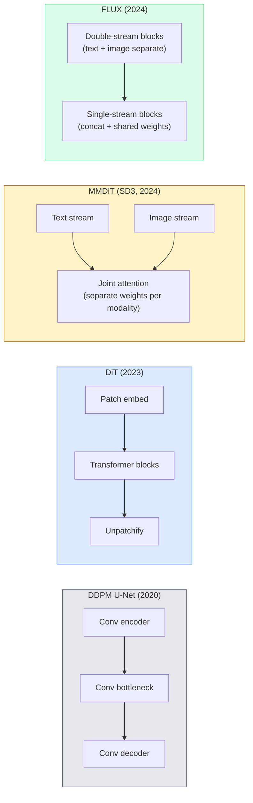

# Diffusion Transformer & Rectified Flow

> U-Net bukanlah rahasia dari diffusion. Ganti dengan sebuah transformer, tukar noise schedule dengan sebuah aliran garis-lurus, dan tiba-tiba kamu punya SD3, FLUX, dan setiap model text-to-image 2026.

**Type:** Learn + Build
**Languages:** Python
**Prerequisites:** Phase 4 Lesson 10 (Diffusion DDPM), Phase 4 Lesson 14 (ViT), Phase 7 Lesson 02 (Self-Attention)
**Time:** ~75 minutes

## Tujuan Pembelajaran

- Menelusuri evolusi dari U-Net DDPM (Pelajaran 10) ke Diffusion Transformer (DiT), MMDiT (SD3), dan DiT single+double-stream (FLUX)
- Menjelaskan rectified flow: mengapa sebuah trajektori garis-lurus antara noise dan data memungkinkan model melakukan sampling dalam 20 langkah alih-alih 1000
- Mengimplementasikan sebuah blok DiT mini dan sebuah loop training rectified-flow, keduanya di bawah 100 baris
- Membedakan varian model (SD3, FLUX.1-dev, FLUX.1-schnell, Z-Image, Qwen-Image) berdasarkan arsitektur, jumlah parameter, dan lisensi

## Masalahnya

Pelajaran 10 membangun sebuah DDPM dengan denoiser U-Net. Resep itu mendominasi 2020-2023: U-Net + beta schedule + loss prediksi-noise. Resep itu menghasilkan Stable Diffusion 1.5 dan 2.1 serta DALL-E 2.

Setiap model text-to-image state-of-the-art 2026 telah melampaui itu. Stable Diffusion 3, FLUX, SD4, Z-Image, Qwen-Image, Hunyuan-Image — tidak ada yang memakai U-Net. Mereka memakai Diffusion Transformer (DiT). SD3 dan FLUX juga menukar noise schedule DDPM dengan rectified flow, yang meluruskan jalur dari noise ke data dan memungkinkan inference 1-4 langkah dengan varian consistency atau distilled.

Pergeseran itu penting karena itulah alasan generasi gambar berbasis diffusion menjadi dapat dikontrol, akurat-prompt (SD3/SD4 menyelesaikan rendering teks), dan cepat-produksi. Memahami DiT + rectified flow adalah memahami stack generatif-gambar 2026.

## Konsepnya

### Dari U-Net ke transformer



- **DiT** (Peebles & Xie, 2023) — mengganti U-Net dengan sebuah transformer bergaya ViT di atas patch latent. Conditioning lewat adaptive layer norm (AdaLN).
- **MMDiT** (SD3, Esser et al., 2024) — dua stream dengan bobot terpisah untuk token teks dan gambar yang berbagi sebuah attention bersama.
- **FLUX** (Black Forest Labs, 2024) — N blok pertama double-stream seperti SD3, blok-blok kemudian mengkonkatenasi dan berbagi bobot (single-stream) untuk efisiensi pada kedalaman lebih tinggi.
- **Z-Image** (2025) — sebuah DiT single-stream yang efisien pada 6B parameter yang menantang "scale dengan segala cara".

### Rectified flow dalam satu paragraf

DDPM mendefinisikan proses depan sebagai sebuah SDE berbise di mana `x_t` semakin terkorupsi. Reverse yang dipelajari adalah SDE kedua, diselesaikan oleh 1000 langkah kecil.

Rectified flow mendefinisikan sebuah interpolasi **garis-lurus** antara data bersih dan noise murni:

```
x_t = (1 - t) * x_0 + t * epsilon,     t in [0, 1]
```

Latih sebuah jaringan untuk memprediksi velocity `v_theta(x_t, t) = epsilon - x_0` — arah depan di sepanjang jalur garis-lurus dari data bersih ke noise (`dx_t/dt`). Selama sampling, kamu mengintegrasikan velocity ini mundur untuk melangkah dari noise menuju data. ODE yang dihasilkan jauh lebih mendekati sebuah garis lurus, jadi jauh lebih sedikit langkah integrasi yang dibutuhkan untuk sampling.

SD3 menyebut ini **Rectified Flow Matching**. FLUX, Z-Image, dan sebagian besar model 2026 memakai objective yang sama. Inference tipikal: 20-30 langkah Euler (deterministik) vs 50+ langkah DDIM pada rejim DDPM lama. Varian distilled / turbo / schnell / LCM menurunkannya menjadi 1-4 langkah.

### Conditioning AdaLN

DiT melakukan conditioning pada timestep dan kelas/teks via **adaptive layer norm**: prediksi `scale` dan `shift` dari vektor conditioning dan terapkan setelah LayerNorm. Jauh lebih bersih daripada modulasi bergaya FiLM di U-Net dan default di setiap DiT modern.

```
cond -> MLP -> (scale, shift, gate)
norm(x) * (1 + scale) + shift, then residual add * gate
```

### Text encoder di SD3 dan FLUX

- **SD3** memakai tiga text encoder: dua model CLIP + T5-XXL. Embedding dikonkatenasi dan diberikan ke stream gambar sebagai conditioning teks.
- **FLUX** memakai satu CLIP-L + T5-XXL.
- Varian **Qwen-Image / Z-Image** memakai text encoder in-house mereka sendiri yang di-align dengan LLM dasar mereka.

Text encoder adalah bagian besar dari alasan SD3/FLUX menalar prompt jauh lebih baik daripada SD1.5. T5-XXL saja adalah 4,7B parameter.

### Classifier-free guidance masih berlaku

Rectified flow mengubah sampler, bukan conditioning. Classifier-free guidance (jatuhkan teks dengan probabilitas 10% selama training, campur prediksi bersyarat dan tanpa-syarat saat inference) bekerja identik dengan rectified flow. Sebagian besar model 2026 memakai guidance scale 3,5-5 — lebih rendah daripada 7,5 milik SD1.5 karena model rectified-flow mengikuti prompt lebih ketat secara default.

### Consistency, Turbo, Schnell, LCM

Empat nama untuk ide yang sama: menyuling sebuah model lambat-banyak-langkah menjadi sebuah model cepat-sedikit-langkah.

- **LCM (Latent Consistency Model)** — latih sebuah student yang memprediksi `x_0` akhir dari `x_t` antara mana pun dalam satu langkah.
- **SDXL Turbo / FLUX schnell** — model 1-4 langkah yang dilatih dengan adversarial diffusion distillation.
- **SD Turbo** — Consistency Models bergaya OpenAI yang diadaptasi ke diffusion latent.

Serving produksi dari model baru mana pun menghadirkan sebuah checkpoint "kualitas penuh" dan sebuah varian "turbo / schnell". Schnell ("cepat" dalam bahasa Jerman, konvensi Black Forest Labs) berjalan dalam 1-4 langkah dan muat di pipeline real-time.

### Lanskap model pada 2026

| Model | Size | Architecture | License |
|-------|------|--------------|---------|
| Stable Diffusion 3 Medium | 2B | MMDiT | SAI Community |
| Stable Diffusion 3.5 Large | 8B | MMDiT | SAI Community |
| FLUX.1-dev | 12B | Double + Single Stream DiT | non-commercial |
| FLUX.1-schnell | 12B | same, distilled | Apache 2.0 |
| FLUX.2 | — | iterated FLUX.1 | mixed |
| Z-Image | 6B | S3-DiT (Scalable Single-Stream) | permissive |
| Qwen-Image | ~20B | DiT + Qwen text tower | Apache 2.0 |
| Hunyuan-Image-3.0 | ~80B | DiT | research |
| SD4 Turbo | 3B | DiT + distillation | SAI Commercial |

FLUX.1-schnell adalah default open-source 2026. Z-Image adalah pemimpin efisiensi. FLUX.2 dan SD4 adalah ujung kualitas saat ini.

### Mengapa pergeseran fase ini penting

DDPM + U-Net bekerja. DiT + rectified flow bekerja **lebih baik, lebih cepat, dan scale lebih bersih**. Transisinya paralel dengan transisi dari RNN ke transformer di NLP: kedua arsitektur menyelesaikan masalah yang sama, tetapi transformer scale dan sekarang mendominasi. Setiap paper 2026 tentang generasi gambar, video, atau 3D memakai sebuah denoiser berbentuk DiT dan biasanya objective rectified flow. U-Net DDPM sekarang terutama bersifat pedagogis (Pelajaran 10).

```figure
cv3-rectified-flow
```

## Bangun Sendiri

### Langkah 1: Sebuah blok DiT dengan AdaLN

```python
import torch
import torch.nn as nn


class AdaLNZero(nn.Module):
    """
    Adaptive LayerNorm with a gate. Predicts (scale, shift, gate) from the conditioning.
    Init such that the whole block starts as identity ("zero init").
    """

    def __init__(self, dim, cond_dim):
        super().__init__()
        self.norm = nn.LayerNorm(dim, elementwise_affine=False)
        self.mlp = nn.Linear(cond_dim, dim * 3)
        nn.init.zeros_(self.mlp.weight)
        nn.init.zeros_(self.mlp.bias)

    def forward(self, x, cond):
        scale, shift, gate = self.mlp(cond).chunk(3, dim=-1)
        h = self.norm(x) * (1 + scale.unsqueeze(1)) + shift.unsqueeze(1)
        return h, gate.unsqueeze(1)


class DiTBlock(nn.Module):
    def __init__(self, dim=192, heads=3, mlp_ratio=4, cond_dim=192):
        super().__init__()
        self.adaln1 = AdaLNZero(dim, cond_dim)
        self.attn = nn.MultiheadAttention(dim, heads, batch_first=True)
        self.adaln2 = AdaLNZero(dim, cond_dim)
        self.mlp = nn.Sequential(
            nn.Linear(dim, dim * mlp_ratio),
            nn.GELU(),
            nn.Linear(dim * mlp_ratio, dim),
        )

    def forward(self, x, cond):
        h, gate1 = self.adaln1(x, cond)
        a, _ = self.attn(h, h, h, need_weights=False)
        x = x + gate1 * a
        h, gate2 = self.adaln2(x, cond)
        x = x + gate2 * self.mlp(h)
        return x
```

`AdaLNZero` dimulai sebagai sebuah pemetaan identitas karena bobot MLP-nya diinisialisasi ke nol. Training menggeser blok menjauh dari identitas; ini menstabilkan model transformer diffusion yang dalam secara dramatis.

### Langkah 2: Sebuah DiT mini

```python
def timestep_embedding(t, dim):
    import math
    half = dim // 2
    freqs = torch.exp(-math.log(10000) * torch.arange(half, device=t.device) / half)
    args = t[:, None].float() * freqs[None]
    return torch.cat([args.sin(), args.cos()], dim=-1)


class TinyDiT(nn.Module):
    def __init__(self, image_size=16, patch_size=2, in_channels=3, dim=96, depth=4, heads=3):
        super().__init__()
        self.patch_size = patch_size
        self.num_patches = (image_size // patch_size) ** 2
        self.patch = nn.Conv2d(in_channels, dim, kernel_size=patch_size, stride=patch_size)
        self.pos = nn.Parameter(torch.zeros(1, self.num_patches, dim))
        self.time_mlp = nn.Sequential(
            nn.Linear(dim, dim * 2),
            nn.SiLU(),
            nn.Linear(dim * 2, dim),
        )
        self.blocks = nn.ModuleList([DiTBlock(dim, heads, cond_dim=dim) for _ in range(depth)])
        self.norm_out = nn.LayerNorm(dim, elementwise_affine=False)
        self.head = nn.Linear(dim, patch_size * patch_size * in_channels)

    def forward(self, x, t):
        n = x.size(0)
        x = self.patch(x)
        x = x.flatten(2).transpose(1, 2) + self.pos
        t_emb = self.time_mlp(timestep_embedding(t, self.pos.size(-1)))
        for blk in self.blocks:
            x = blk(x, t_emb)
        x = self.norm_out(x)
        x = self.head(x)
        return self._unpatchify(x, n)

    def _unpatchify(self, x, n):
        p = self.patch_size
        h = w = int(self.num_patches ** 0.5)
        x = x.view(n, h, w, p, p, -1).permute(0, 5, 1, 3, 2, 4).reshape(n, -1, h * p, w * p)
        return x
```

### Langkah 3: Training rectified flow

```python
import torch.nn.functional as F

def rectified_flow_train_step(model, x0, optimizer, device):
    model.train()
    x0 = x0.to(device)
    n = x0.size(0)
    t = torch.rand(n, device=device)
    epsilon = torch.randn_like(x0)
    x_t = (1 - t[:, None, None, None]) * x0 + t[:, None, None, None] * epsilon

    target_velocity = epsilon - x0
    pred_velocity = model(x_t, t)

    loss = F.mse_loss(pred_velocity, target_velocity)
    optimizer.zero_grad()
    loss.backward()
    optimizer.step()
    return loss.item()
```

Bandingkan dengan loss prediksi-noise DDPM (Pelajaran 10): struktur yang sama, target berbeda. Alih-alih memprediksi noise `epsilon`, kita memprediksi **velocity** `epsilon - x_0`, yang menunjuk dari data ke noise di sepanjang interpolasi garis-lurus.

### Langkah 4: Sampler Euler

Rectified flow adalah sebuah ODE. Metode Euler adalah yang paling sederhana dan, untuk sebuah model rectified-flow yang terlatih dengan baik, hampir seakurat solver orde-lebih-tinggi pada 20+ langkah.

```python
@torch.no_grad()
def rectified_flow_sample(model, shape, steps=20, device="cpu"):
    model.eval()
    x = torch.randn(shape, device=device)
    dt = 1.0 / steps
    t = torch.ones(shape[0], device=device)
    for _ in range(steps):
        v = model(x, t)
        x = x - dt * v
        t = t - dt
    return x
```

20 langkah. Pada sebuah model terlatih ini menghasilkan sampel yang sebanding dengan DDPM 1000-langkah.

### Langkah 5: Uji smoke end-to-end

```python
import numpy as np

def synthetic_blobs(num=200, size=16, seed=0):
    rng = np.random.default_rng(seed)
    out = np.zeros((num, 3, size, size), dtype=np.float32)
    yy, xx = np.meshgrid(np.arange(size), np.arange(size), indexing="ij")
    for i in range(num):
        cx, cy = rng.uniform(4, size - 4, size=2)
        r = rng.uniform(2, 4)
        mask = (xx - cx) ** 2 + (yy - cy) ** 2 < r ** 2
        colour = rng.uniform(-1, 1, size=3)
        for c in range(3):
            out[i, c][mask] = colour[c]
    return torch.from_numpy(out)
```

Latih sebuah `TinyDiT` di atas ini dengan rectified flow. Setelah 500 langkah, output yang di-sample seharusnya terlihat seperti blob warna samar.

## Gunakan

Untuk generasi gambar nyata dengan FLUX / SD3 / Z-Image, `diffusers` menghadirkan semuanya dengan API terpadu:

```python
from diffusers import FluxPipeline, StableDiffusion3Pipeline
import torch

pipe = FluxPipeline.from_pretrained(
    "black-forest-labs/FLUX.1-schnell",
    torch_dtype=torch.bfloat16,
).to("cuda")

out = pipe(
    prompt="a golden retriever surfing a tsunami, hyperrealistic, studio lighting",
    guidance_scale=0.0,           # schnell was trained without CFG
    num_inference_steps=4,
    max_sequence_length=256,
).images[0]
out.save("surf.png")
```

Tiga baris. `FLUX.1-schnell` dalam empat langkah. Tukar id model dengan `black-forest-labs/FLUX.1-dev` untuk kualitas lebih tinggi pada 20-30 langkah dengan CFG.

Untuk SD3:

```python
pipe = StableDiffusion3Pipeline.from_pretrained(
    "stabilityai/stable-diffusion-3.5-large",
    torch_dtype=torch.bfloat16,
).to("cuda")
out = pipe(prompt, guidance_scale=3.5, num_inference_steps=28).images[0]
```

## Rilis

Pelajaran ini menghasilkan:

- `outputs/prompt-dit-model-picker.md` — memilih antara SD3, FLUX.1-dev, FLUX.1-schnell, Z-Image, SD4 Turbo diberikan kendala kualitas, latensi, dan lisensi.
- `outputs/skill-rectified-flow-trainer.md` — menulis sebuah loop training lengkap untuk rectified flow dengan AdaLN DiT dan sampling Euler.

## Latihan

1. **(Mudah)** Latih TinyDiT di atas pada dataset blob sintetis selama 500 langkah. Bandingkan sampel yang dihasilkan dengan 10, 20, dan 50 langkah Euler.
2. **(Sedang)** Tambahkan conditioning teks dengan mengkonkatenasi sebuah embedding kelas yang dipelajari ke embedding waktu (10 "kelas" blob berdasarkan warna). Sample dengan kelas 0, 5, dan 9 dan verifikasi warnanya cocok.
3. **(Sulit)** Hitung jarak Fréchet (proxy FID) antara sampel yang dihasilkan dari versi rectified-flow dan DDPM dari jaringan berukuran sama yang dilatih pada data yang sama selama jumlah langkah yang sama. Laporkan mana yang konvergen lebih cepat.

## Istilah Kunci

| Term | What people say | What it actually means |
|------|----------------|----------------------|
| DiT | "Diffusion transformer" | Transformer that replaces the U-Net as the diffusion denoiser; operates on patchified latents |
| AdaLN | "Adaptive layer norm" | Timestep/text conditioning via learned scale, shift, gate applied after LayerNorm; standard in every modern DiT |
| MMDiT | "Multi-modal DiT (SD3)" | Separate weight streams for text and image tokens that share a joint self-attention |
| Single-stream / double-stream | "FLUX trick" | First N blocks double-stream (separate weights per modality), later blocks single-stream (concat + shared weights) for efficiency |
| Rectified flow | "Straight-line noise-to-data" | Linear interpolation between data and noise; network predicts velocity; fewer ODE steps needed at inference |
| Velocity target | "epsilon - x_0" | The regression target in rectified flow; points from clean data to noise |
| CFG guidance | "classifier-free guidance" | Mix conditional and unconditional predictions; still used in rectified-flow models |
| Schnell / turbo / LCM | "1-4 step distillation" | Small-step variants distilled from full-quality models; production real-time |

## Bacaan Lanjutan

- [Scalable Diffusion Models with Transformers (Peebles & Xie, 2023)](https://arxiv.org/abs/2212.09748) — the DiT paper
- [Scaling Rectified Flow Transformers (Esser et al., SD3 paper)](https://arxiv.org/abs/2403.03206) — MMDiT and rectified-flow at scale
- [FLUX.1 model card and technical report (Black Forest Labs)](https://huggingface.co/black-forest-labs/FLUX.1-dev) — double + single-stream details
- [Z-Image: Efficient Image Generation Foundation Model (2025)](https://arxiv.org/html/2511.22699v1) — single-stream DiT at 6B
- [Elucidating the Design Space of Diffusion (Karras et al., 2022)](https://arxiv.org/abs/2206.00364) — the reference for every diffusion design trade-off
- [Latent Consistency Models (Luo et al., 2023)](https://arxiv.org/abs/2310.04378) — how LCM-LoRA gives you 4-step inference
