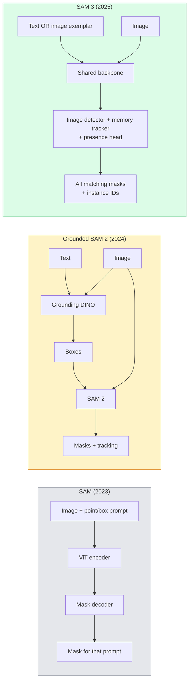

# SAM 3 & Segmentasi Open-Vocabulary

> Berikan sebuah model sebuah prompt teks dan sebuah gambar dan dapatkan mask untuk setiap objek yang cocok. SAM 3 menjadikan itu satu forward pass.

**Type:** Use + Build
**Languages:** Python
**Prerequisites:** Phase 4 Lesson 07 (U-Net), Phase 4 Lesson 08 (Mask R-CNN), Phase 4 Lesson 18 (CLIP)
**Time:** ~60 minutes

## Tujuan Pembelajaran

- Membedakan SAM (hanya prompt visual), Grounded SAM / SAM 2 (detektor + SAM), dan SAM 3 (prompt teks native via Promptable Concept Segmentation)
- Menjelaskan arsitektur SAM 3: backbone bersama + detektor gambar + pelacak video berbasis-memory + presence head + desain detektor-pelacak yang terdekolasi
- Memakai integrasi SAM 3 `transformers` Hugging Face untuk deteksi, segmentasi, dan pelacakan video bersyarat-teks
- Memilih antara SAM 3, Grounded SAM 2, YOLO-World, dan SAM-MI berdasarkan latensi, kompleksitas konsep, dan target deployment

## Masalahnya

SAM 2023 adalah sebuah model yang hanya-bisa-diberi-prompt-visual: kamu mengklik sebuah titik atau menggambar sebuah box dan ia mengembalikan sebuah mask. Untuk "berikan saya semua jeruk dalam foto ini" kamu membutuhkan sebuah detektor (Grounding DINO) untuk menghasilkan box, lalu SAM untuk me-segmentasi masing-masing. Grounded SAM menjadikan ini sebuah pipeline, tetapi itu adalah kaskade dua model beku dengan akumulasi error yang tak terhindarkan.

SAM 3 (Meta, Nov 2025, ICLR 2026) meruntuhkan kaskade itu. Ia menerima sebuah noun phrase pendek atau sebuah exemplar gambar sebagai prompt dan mengembalikan semua mask yang cocok dan ID instance dalam satu forward pass. Itulah **Promptable Concept Segmentation (PCS)**. Dikombinasikan dengan update Object Multiplex Maret 2026 (SAM 3.1), ia melacak beberapa instance dari konsep yang sama melalui video dengan efisien.

Pelajaran ini tentang pergeseran struktural yang diwakili ini. Segmentasi 2D, deteksi, dan grounding teks-gambar telah menyatu dalam satu model. Pertanyaan produksinya bukan lagi "pipeline mana yang saya rangkai" tetapi "model promptable mana yang menangani use case saya end-to-end."

## Konsepnya

### Tiga generasi



### Promptable Concept Segmentation

Sebuah "concept prompt" adalah sebuah noun phrase pendek (`"yellow school bus"`, `"striped red umbrella"`, `"hand holding a mug"`) atau sebuah exemplar gambar. Model mengembalikan mask segmentasi untuk setiap instance dalam gambar yang cocok dengan konsep itu, ditambah sebuah ID instance unik per kecocokan.

Ini berbeda dari SAM visual-prompt klasik dengan tiga cara:

1. Tanpa prompting per-instance — satu prompt teks mengembalikan semua kecocokan.
2. Open-vocabulary — konsepnya bisa apa pun yang dapat dijelaskan dalam bahasa alami.
3. Mengembalikan beberapa instance sekaligus alih-alih satu mask per prompt.

### Bagian arsitektur kunci

- **Backbone bersama** — sebuah ViT tunggal memproses gambar. Baik head detektor maupun pelacak berbasis-memory membaca darinya.
- **Presence head** — memprediksi apakah konsepnya ada dalam gambar sama sekali. Mendekolasi "apakah ini di sini?" dari "di mana letaknya?". Mengurangi false positive pada konsep yang absen.
- **Detektor-pelacak yang terdekolasi** — deteksi level-gambar dan pelacakan level-video punya head terpisah sehingga mereka tidak saling mengganggu.
- **Memory bank** — menyimpan fitur per-instance di antara frame untuk pelacakan video (mekanisme yang sama dengan yang dipakai SAM 2).

### Training dalam skala

SAM 3 dilatih pada **4 juta konsep unik** yang dihasilkan oleh sebuah data engine yang secara iteratif meng-annotasi dan mengoreksi memakai AI + review manusia. Benchmark baru **SA-CO** berisi 270K konsep unik, 50x lebih besar dari benchmark sebelumnya. SAM 3 mencapai 75-80% performa manusia di SA-CO dan menggandakan sistem yang ada pada PCS gambar + video.

### SAM 3.1 Object Multiplex

Update Maret 2026: **Object Multiplex** memperkenalkan sebuah mekanisme shared-memory untuk pelacakan bersama banyak instance dari konsep yang sama sekaligus. Sebelumnya, melacak N instance berarti N memory bank terpisah. Multiplex meruntuhkan itu menjadi satu memory bersama dengan query per-instance. Hasilnya: pelacakan multi-orang/objek yang jauh lebih cepat tanpa mengorbankan akurasi.

### Di mana Grounded SAM masih penting pada 2026

- Ketika kamu membutuhkan sebuah detektor open-vocabulary tertentu yang di-swap (DINO-X, Florence-2).
- Ketika lisensi SAM 3 (gated di HF) menjadi penghalang.
- Ketika kamu membutuhkan kontrol lebih besar atas ambang detektor daripada yang diekspos SAM 3.
- Untuk penelitian / pekerjaan ablation pada komponen detektor.

Pipeline modular masih punya tempat. Untuk sebagian besar pekerjaan produksi, SAM 3 adalah jawaban yang lebih sederhana.

### YOLO-World vs SAM 3

- **YOLO-World** — hanya detektor open-vocabulary (tanpa mask). Real-time. Terbaik ketika kamu membutuhkan box pada fps tinggi.
- **SAM 3** — segmentasi penuh + pelacakan. Lebih lambat tetapi output lebih kaya.

Pembagian produksi: YOLO-World untuk pipeline cepat hanya-deteksi (navigasi robotik, dashboard cepat), SAM 3 untuk apa pun yang membutuhkan mask atau pelacakan.

### Efisiensi SAM-MI

SAM-MI (2025-2026) mengatasi bottleneck decoder SAM. Ide-ide kunci:

- **Sparse point prompting** — memakai beberapa titik yang dipilih dengan baik alih-alih prompt padat; mengurangi panggilan decoder sebesar 96%.
- **Shallow mask aggregation** — menggabungkan prediksi mask kasar menjadi satu mask yang lebih tajam.
- **Decoupled mask injection** — decoder menerima fitur mask yang sudah dihitung sebelumnya alih-alih menjalankan ulang.

Hasilnya: speedup ~1,6x di atas Grounded-SAM pada benchmark open-vocabulary.

### Format output untuk tiga model

Ketiganya mengembalikan struktur umum yang sama (box + label + score + mask + ID), yang membantu — pipeline downstream-mu tidak harus bercabang pada model mana yang berjalan.

```figure
cv3-open-vocab
```

## Bangun Sendiri

### Langkah 1: Konstruksi prompt

Bangun sebuah helper yang mengubah kalimat pengguna menjadi daftar concept prompt SAM 3. Inilah batas di mana "apa yang diketik pengguna" bertemu "apa yang dikonsumsi model".

```python
def split_concepts(sentence):
    """
    Heuristic splitter for multi-concept prompts.
    Returns list of short noun phrases.
    """
    for sep in [",", ";", "and", "or", "&"]:
        if sep in sentence:
            parts = [p.strip() for p in sentence.replace("and ", ",").split(",")]
            return [p for p in parts if p]
    return [sentence.strip()]

print(split_concepts("cats, dogs and balloons"))
```

SAM 3 menerima satu konsep per forward pass; untuk query multi-konsep, loop atau batch mereka.

### Langkah 2: Helper pasca-processing

Ubah output mentah SAM 3 menjadi daftar deteksi bersih yang cocok dengan kontrak pipeline Pelajaran 16 Fase 4 kita.

```python
from dataclasses import dataclass
from typing import List

@dataclass
class ConceptDetection:
    concept: str
    instance_id: int
    box: tuple          # (x1, y1, x2, y2)
    score: float
    mask_rle: str       # run-length encoded


def rle_encode(binary_mask):
    flat = binary_mask.flatten().astype("uint8")
    runs = []
    prev, count = flat[0], 0
    for v in flat:
        if v == prev:
            count += 1
        else:
            runs.append((int(prev), count))
            prev, count = v, 1
    runs.append((int(prev), count))
    return ";".join(f"{v}x{c}" for v, c in runs)
```

RLE menjaga payload respons tetap kecil bahkan untuk banyak mask resolusi-tinggi. Format yang sama bekerja di seluruh SAM 2, SAM 3, Grounded SAM 2.

### Langkah 3: Sebuah antarmuka segmentasi open-vocab terpadu

Bungkus backend apa pun yang kamu punya (SAM 3, Grounded SAM 2, YOLO-World + SAM 2) di balik sebuah method tunggal. Kode downstream-mu tidak berubah ketika backend-nya berubah.

```python
from abc import ABC, abstractmethod
import numpy as np

class OpenVocabSeg(ABC):
    @abstractmethod
    def detect(self, image: np.ndarray, concept: str) -> List[ConceptDetection]:
        ...


class StubOpenVocabSeg(OpenVocabSeg):
    """
    Deterministic stub used for pipeline testing when real models are not loaded.
    """
    def detect(self, image, concept):
        h, w = image.shape[:2]
        return [
            ConceptDetection(
                concept=concept,
                instance_id=0,
                box=(w * 0.2, h * 0.3, w * 0.5, h * 0.8),
                score=0.89,
                mask_rle="0x100;1x50;0x200",
            ),
            ConceptDetection(
                concept=concept,
                instance_id=1,
                box=(w * 0.55, h * 0.25, w * 0.85, h * 0.75),
                score=0.74,
                mask_rle="0x80;1x40;0x220",
            ),
        ]
```

Subclass `SAM3OpenVocabSeg` yang sebenarnya akan membungkus `Sam3Model` dan `Sam3Processor` milik `transformers`.

### Langkah 4: Pemakaian SAM 3 Hugging Face (referensi)

Untuk model yang sebenarnya, integrasi `transformers`:

```python
from transformers import Sam3Processor, Sam3Model
import torch

processor = Sam3Processor.from_pretrained("facebook/sam3")
model = Sam3Model.from_pretrained("facebook/sam3").eval()

inputs = processor(images=pil_image, return_tensors="pt")
inputs = processor.set_text_prompt(inputs, "yellow school bus")

with torch.no_grad():
    outputs = model(**inputs)

masks = processor.post_process_masks(
    outputs.masks, inputs.original_sizes, inputs.reshaped_input_sizes
)
boxes = outputs.boxes
scores = outputs.scores
```

Satu prompt, semua kecocokan dikembalikan dalam satu panggilan.

### Langkah 5: Ukur apa yang Grounded SAM 2 berikan gratis

Sebuah benchmark jujur: apa yang terjadi ketika kamu mengganti Grounded SAM 2 dengan SAM 3 dalam pipeline nyata?

- Latensi: SAM 3 menghemat satu forward pass (tanpa detektor terpisah) tetapi modelnya sendiri lebih berat; biasanya netral atau speedup kecil.
- Akurasi: SAM 3 jauh lebih baik pada konsep jarang atau komposisional ("striped red umbrella"). Serupa pada konsep satu-kata yang umum.
- Fleksibilitas: Grounded SAM 2 memungkinkanmu menukar detektor (DINO-X, Florence-2, Grounding DINO 1.5); SAM 3 bersifat monolitik.

Kesimpulan: SAM 3 adalah default untuk open-vocab seg 2026. Grounded SAM 2 masih jawaban yang tepat ketika kamu membutuhkan fleksibilitas detektor atau ketentuan lisensi berbeda.

## Gunakan

Pola deployment produksi:

- **Annotasi real-time** — SAM 3 + fitur label-as-text-prompt CVAT. Annotator memilih sebuah nama label; SAM 3 memberi-label-pre setiap instance yang cocok. Review dan koreksi.
- **Analyitik video** — SAM 3.1 Object Multiplex untuk pelacakan multi-objek; berikan frame ke pelacak berbasis-memory.
- **Robotik** — SAM 3 untuk manipulasi open-vocab ("pick up the red cup"); berjalan sebagai sebuah primitif perencanaan.
- **Imaging medis** — SAM 3 yang di-fine-tune pada konsep medis; membutuhkan permintaan akses di HF.

Ultralytics membungkus SAM 3 dalam paket Python-nya:

```python
from ultralytics import SAM

model = SAM("sam3.pt")
results = model(image_path, prompts="yellow school bus")
```

Antarmuka yang sama dengan YOLO dan SAM 2.

## Rilis

Pelajaran ini menghasilkan:

- `outputs/prompt-open-vocab-stack-picker.md` — prompt yang memilih SAM 3 / Grounded SAM 2 / YOLO-World / SAM-MI berdasarkan latensi, kompleksitas konsep, dan lisensi.
- `outputs/skill-concept-prompt-designer.md` — skill yang mengubah ucapan pengguna menjadi concept prompt SAM 3 yang terbentuk-baik (pemisahan, disambiguasi, fallback).

## Latihan

1. **(Mudah)** Jalankan SAM 3 pada 10 gambar dengan concept prompt pilihanmu. Bandingkan dengan SAM 2 + Grounding DINO 1.5 pada gambar yang sama. Laporkan konsep mana yang terlewat oleh masing-masing model.
2. **(Sedang)** Bangun sebuah UI "click-to-include / click-to-exclude" di atas SAM 3: sebuah prompt teks mengembalikan instance kandidat; pengguna mengklik mana yang dihitung positif. Keluarkan himpunan konsep akhir sebagai JSON.
3. **(Sulit)** Fine-tune SAM 3 pada himpunan konsep kustom (mis. 5 jenis komponen elektronik) dengan 20 gambar berlabel masing-masing. Bandingkan dengan SAM 3 zero-shot pada set uji yang sama; ukur peningkatan IoU mask.

## Istilah Kunci

| Term | What people say | What it actually means |
|------|----------------|----------------------|
| Open-vocabulary segmentation | "Segment by text" | Produce masks for objects described in natural language, not a fixed label set |
| PCS | "Promptable Concept Segmentation" | SAM 3's core task — given a noun-phrase or image exemplar, segment all matching instances |
| Concept prompt | "The text input" | Short noun phrase or image exemplar; not a full sentence |
| Presence head | "Is it here?" | SAM 3 module that decides whether the concept exists in the image before localisation |
| SA-CO | "SAM 3 benchmark" | 270K-concept open-vocabulary segmentation benchmark; 50x larger than prior open-vocab benchmarks |
| Object Multiplex | "SAM 3.1 update" | Shared-memory multi-object tracking; fast joint tracking of many instances |
| Grounded SAM 2 | "Modular pipeline" | Detector + SAM 2 cascade; still relevant when detector swap matters |
| SAM-MI | "Efficient SAM variant" | Mask Injection for 1.6x speedup over Grounded-SAM |

## Bacaan Lanjutan

- [SAM 3: Segment Anything with Concepts (arXiv 2511.16719)](https://arxiv.org/abs/2511.16719)
- [SAM 3.1 Object Multiplex (Meta AI, March 2026)](https://ai.meta.com/blog/segment-anything-model-3/)
- [SAM 3 model page on Hugging Face](https://huggingface.co/facebook/sam3)
- [Grounded SAM 2 tutorial (PyImageSearch)](https://pyimagesearch.com/2026/01/19/grounded-sam-2-from-open-set-detection-to-segmentation-and-tracking/)
- [Ultralytics SAM 3 docs](https://docs.ultralytics.com/models/sam-3/)
- [SAM3-I: Instruction-aware SAM (arXiv 2512.04585)](https://arxiv.org/abs/2512.04585)
