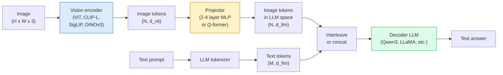

# Vision-Language Model — Pola ViT-MLP-LLM

> Sebuah vision encoder mengubah sebuah gambar menjadi token. Sebuah projector MLP memetakan token-token itu ke ruang embedding LLM. Sebuah model bahasa mengerjakan sisanya. Pola itu — ViT-MLP-LLM — adalah setiap VLM produksi pada 2026.

**Type:** Learn + Use
**Languages:** Python
**Prerequisites:** Phase 4 Lesson 14 (ViT), Phase 4 Lesson 18 (CLIP), Phase 7 Lesson 02 (Self-Attention)
**Time:** ~75 minutes

## Tujuan Pembelajaran

- Menyatakan arsitektur ViT-MLP-LLM dan menjelaskan apa yang disumbangkan masing-masing dari tiga komponen
- Membandingkan Qwen3-VL, InternVL3.5, LLaVA-Next, dan GLM-4.6V pada jumlah parameter, panjang konteks, dan performa benchmark
- Menjelaskan DeepStack: mengapa fitur ViT multi-level memperketat alignment visi-bahasa lebih baik daripada fitur lapisan-terakhir tunggal
- Mengukur halusinasi VLM dalam produksi dengan Cross-Modal Error Rate (CMER) dan bertindak atas sinyal itu

## Masalahnya

CLIP (Pelajaran 18 Fase 4) memberimu ruang embedding bersama untuk gambar dan teks, yang cukup untuk klasifikasi dan retrieval zero-shot. Ia tidak bisa menjawab "berapa banyak mobil merah dalam gambar ini?" karena CLIP tidak menghasilkan teks — ia hanya memberi skor kemiripan.

Vision-Language Model (VLM) — Qwen3-VL, InternVL3.5, LLaVA-Next, GLM-4.6V — menyambungkan sebuah image encoder keluarga CLIP ke sebuah model bahasa penuh. Model melihat sebuah gambar ditambah sebuah pertanyaan dan menghasilkan sebuah jawaban. Pada 2026 VLM open-source menyamai atau mengalahkan GPT-5 dan Gemini-2.5-Pro pada benchmark multimodal (MMMU, MMBench, DocVQA, ChartQA, MathVista, OSWorld).

Trio komponen (ViT, projector, LLM) adalah standarnya. Perbedaan antar model ada di ViT mana, projector mana, LLM mana, data training, dan resep alignment-nya. Sekali kamu memahami polanya, menukar komponen mana pun bersifat mekanis.

## Konsepnya

### Arsitektur ViT-MLP-LLM



1. **Vision encoder** — sebuah ViT pre-trained (CLIP-L/14, SigLIP, DINOv3, atau sebuah varian yang di-fine-tune). Menghasilkan patch token.
2. **Projector** — sebuah modul kecil (MLP 2-4 lapisan, atau sebuah Q-former) yang memetakan token visi ke dimensi embedding LLM. Di sinilah sebagian besar fine-tuning terjadi.
3. **LLM** — sebuah model bahasa decoder-saja (Qwen3, Llama, Mistral, GLM, InternLM). Membaca token visi + teks secara berurutan, menghasilkan teks.

Ketiga komponen pada prinsipnya dapat dilatih. Dalam praktiknya, vision encoder dan LLM sebagian besar tetap beku sementara projector melatih — beberapa miliar parameter sinyal dengan murah.

### DeepStack

Proyeksi vanilla hanya memakai lapisan ViT terakhir. DeepStack (Qwen3-VL) mensampel fitur dari beberapa kedalaman ViT dan menumpuknya. Lapisan-lapisan lebih dalam membawa semantik tingkat-atas; lapisan-lapisan lebih dangkal membawa informasi spasial dan tekstural halus. Memberikan keduanya ke LLM menutup jarak antara "apa isi gambar" (semantik) dan "di mana persisnya" (grounding spasial).

### Tiga tahap training

VLM modern melatih secara berjenjang:

1. **Alignment** — bekukan ViT dan LLM. Latih hanya projector pada pasangan gambar-caption. Mengajari projector memetakan ruang visi ke ruang bahasa.
2. **Pre-training** — lepas semua. Latih pada data gambar-teks interleave skala-besar (500M+ pasangan). Membangun pengetahuan visual model.
3. **Instruction tuning** — fine-tune pada triple (gambar, pertanyaan, jawaban) yang dikurasi. Mengajari perilaku percakapan dan format tugas. Inilah yang mengubah sebuah "LM sadar-visi" menjadi sebuah asisten yang bisa dipakai.

Sebagian besar fine-tune LoRA menargetkan tahap 3 dengan dataset berlabel kecil.

### Perbandingan keluarga model (awal 2026)

| Model | Params | Vision encoder | LLM | Context | Strengths |
|-------|--------|----------------|-----|---------|-----------|
| Qwen3-VL-235B-A22B (MoE) | 235B (22B active) | custom ViT + DeepStack | Qwen3 | 256K | General SOTA, GUI agent |
| Qwen3-VL-30B-A3B (MoE) | 30B (3B active) | custom ViT + DeepStack | Qwen3 | 256K | Smaller MoE alternative |
| Qwen3-VL-8B (dense) | 8B | custom ViT | Qwen3 | 128K | Production dense default |
| InternVL3.5-38B | 38B | InternViT-6B | Qwen3 + GPT-OSS | 128K | Strong MMBench / MMVet |
| InternVL3.5-241B-A28B | 241B (28B active) | InternViT-6B | Qwen3 | 128K | Competitive with GPT-4o |
| LLaVA-Next 72B | 72B | SigLIP | Llama-3 | 32K | Open, easy to fine-tune |
| GLM-4.6V | ~70B | custom | GLM | 64K | Open-source, strong OCR |
| MiniCPM-V-2.6 | 8B | SigLIP | MiniCPM | 32K | Edge-friendly |

### Agen visual

Qwen3-VL-235B mencapai performa global teratas di OSWorld — sebuah benchmark untuk **agen visual** yang mengoperasikan GUI (desktop, mobile, web). Model melihat sebuah tangkapan layar, memahami UI-nya, dan mengeluarkan aksi (klik, ketik, gulir). Dikombinasikan dengan alat, ia menutup loop pada tugas-tugas desktop umum. Inilah yang dijalankan sebagian besar demo "AI PC" 2026 di balik layar.

### Kemampuan agentic + varian RoPE

VLM perlu mengetahui **kapan** sebuah frame berada dalam sebuah video. Qwen3-VL berevolusi dari T-RoPE (temporal rotary position embeddings) ke **text-based time alignment** — token timestamp teks eksplisit yang di-interleave dengan frame video. Model melihat "`<timestamp 00:32>` frame, prompt" dan bisa menalar tentang hubungan temporal.

### Masalah alignment

12% pasangan gambar-teks dalam sebuah dataset hasil-crawl berisi deskripsi yang tidak sepenuhnya grounded dalam gambar. Sebuah VLM yang dilatih di atas ini diam-diameter belajar berhalusinasi — memanufaktur objek, salah-membaca angka, mengarang hubungan. Dalam produksi ini adalah mode kegagalan yang dominan.

Skywork.ai memperkenalkan **Cross-Modal Error Rate (CMER)** untuk melacaknya:

```
CMER = fraction of outputs where the text confidence is high but the image-text similarity (via a CLIP-family checker) is low
```

CMER tinggi berarti model sedang mengatakan hal-hal dengan percaya diri yang tidak grounded dalam gambar. Memantau CMER dan memperlakukannya sebagai KPI produksi memangkas laju halusinasi sebesar ~35% dalam deployment mereka. Triknya bukan "perbaiki model" tetapi "rutekan output CMER-tinggi ke review manusia."

### Fine-tuning dengan LoRA / QLoRA

Fine-tuning penuh dari sebuah VLM 70B di luar jangkauan sebagian besar tim. LoRA (rank 16-64) pada layer attention + projector, atau QLoRA dengan bobot dasar 4-bit, muat di satu A100 / H100. Biaya: 5.000-50.000 contoh, $100-$5.000 komputasi, 2-10 jam training.

### Penalaran spasial masih lemah

VLM saat ini mendapat skor 50-60% pada benchmark penalaran spasial (atas-bawah, kiri-kanan, menghitung, jarak). Jika use case-mu bergantung pada "objek mana di atas objek mana," validasi dengan berat — performa VLM generik di bawah manusia. Alternatif lebih-baik-dari-VLM untuk tugas spasial murni: sebuah estimator keypoint / pose terspesialisasi, sebuah model kedalaman, atau sebuah model deteksi dengan geometri box yang dipasca-proses.

```figure
v4-vlm-projector
```

## Bangun Sendiri

### Langkah 1: Projector

Bagian yang akan kamu latih paling sering. MLP 2-4 lapisan dengan GELU.

```python
import torch
import torch.nn as nn


class Projector(nn.Module):
    def __init__(self, vit_dim=768, llm_dim=4096, hidden=4096):
        super().__init__()
        self.net = nn.Sequential(
            nn.Linear(vit_dim, hidden),
            nn.GELU(),
            nn.Linear(hidden, llm_dim),
        )

    def forward(self, x):
        return self.net(x)
```

Input adalah sebuah tensor token `(N_patches, d_vit)`. Output adalah `(N_patches, d_llm)`. LLM memperlakukan setiap baris output sebagai token biasa lainnya.

### Langkah 2: Merangkai ViT-MLP-LLM end-to-end

Kerangka forward pass untuk sebuah VLM minimal. Kode nyata memakai `transformers`; ini adalah tata letak konseptual.

```python
class MinimalVLM(nn.Module):
    def __init__(self, vit, projector, llm, image_token_id):
        super().__init__()
        self.vit = vit
        self.projector = projector
        self.llm = llm
        self.image_token_id = image_token_id  # placeholder token in text prompt

    def forward(self, image, input_ids, attention_mask):
        # 1. vision features
        vision_tokens = self.vit(image)                     # (B, N_patches, d_vit)
        vision_embeds = self.projector(vision_tokens)       # (B, N_patches, d_llm)

        # 2. text embeddings
        text_embeds = self.llm.get_input_embeddings()(input_ids)  # (B, M, d_llm)

        # 3. replace image placeholder tokens with vision embeds
        merged = self._merge(text_embeds, vision_embeds, input_ids)

        # 4. run LLM
        return self.llm(inputs_embeds=merged, attention_mask=attention_mask)

    def _merge(self, text_embeds, vision_embeds, input_ids):
        out = text_embeds.clone()
        expected = vision_embeds.size(1)
        for b in range(input_ids.size(0)):
            positions = (input_ids[b] == self.image_token_id).nonzero(as_tuple=True)[0]
            if len(positions) != expected:
                raise ValueError(
                    f"batch item {b} has {len(positions)} image tokens but vision_embeds has {expected} patches."
                    " Every sample in the batch must be pre-padded to the same number of image placeholder tokens.")
            out[b, positions] = vision_embeds[b]
        return out
```

Token placeholder `<image>` dalam teks diganti dengan embedding gambar yang sebenarnya — pola yang sama dengan yang dipakai LLaVA, Qwen-VL, dan InternVL.

### Langkah 3: Komputasi CMER

Sebuah pemeriksaan runtime ringan.

```python
import torch.nn.functional as F


def cross_modal_error_rate(image_emb, text_emb, text_confidence, sim_threshold=0.25, conf_threshold=0.8):
    """
    image_emb, text_emb: embeddings of image and generated text (normalised internally)
    text_confidence:     mean per-token probability in [0, 1]
    Returns:             fraction of high-confidence outputs with low image-text alignment
    """
    image_emb = F.normalize(image_emb, dim=-1)
    text_emb = F.normalize(text_emb, dim=-1)
    sim = (image_emb * text_emb).sum(dim=-1)        # cosine similarity
    high_conf_low_sim = (text_confidence > conf_threshold) & (sim < sim_threshold)
    return high_conf_low_sim.float().mean().item()
```

Perlakukan CMER sebagai sebuah KPI produksi. Pantau per endpoint, per jenis prompt, per pelanggan. CMER yang naik menandakan model mulai berhalusinasi pada beberapa distribusi input.

### Langkah 4: Classifier VLM mainan (bisa dijalankan)

Demonstrasikan projector melatih. Fitur "ViT" palsu masuk; sebuah token gaya-LLM mini memprediksi sebuah kelas.

```python
class ToyVLM(nn.Module):
    def __init__(self, vit_dim=32, llm_dim=64, num_classes=5):
        super().__init__()
        self.projector = Projector(vit_dim, llm_dim, hidden=64)
        self.head = nn.Linear(llm_dim, num_classes)

    def forward(self, vision_tokens):
        projected = self.projector(vision_tokens)
        pooled = projected.mean(dim=1)
        return self.head(pooled)
```

Ini bisa disesuaikan pada pasangan (fitur, kelas) sintetis dalam kurang dari 200 langkah — cukup untuk menunjukkan pola projector bekerja.

## Gunakan

Tiga cara tim produksi memakai VLM pada 2026:

- **API ter-host** — OpenAI Vision, Anthropic Claude Vision, Google Gemini Vision. Tanpa infra, risiko vendor.
- **Self-host open-source** — Qwen3-VL atau InternVL3.5 via `transformers` dan `vllm`. Kontrol penuh, usaha awal lebih besar.
- **Fine-tune pada domain** — muat Qwen2.5-VL-7B atau LLaVA-1.6-7B, LoRA pada 5k-50k contoh kustom, serve dengan `vllm` atau `TGI`.

```python
from transformers import AutoProcessor, AutoModelForVision2Seq
import torch
from PIL import Image

model_id = "Qwen/Qwen3-VL-8B-Instruct"
processor = AutoProcessor.from_pretrained(model_id)
model = AutoModelForVision2Seq.from_pretrained(model_id, torch_dtype=torch.bfloat16, device_map="auto")

messages = [{
    "role": "user",
    "content": [
        {"type": "image", "image": Image.open("plot.png")},
        {"type": "text", "text": "What does this chart show?"},
    ],
}]
inputs = processor.apply_chat_template(messages, add_generation_prompt=True, tokenize=True, return_dict=True, return_tensors="pt").to("cuda")
generated = model.generate(**inputs, max_new_tokens=256)
answer = processor.decode(generated[0][inputs["input_ids"].shape[1]:], skip_special_tokens=True)
```

`apply_chat_template` menyembunyikan tokenisasi placeholder `<image>`; model menangani merge secara internal.

## Rilis

Pelajaran ini menghasilkan:

- `outputs/prompt-vlm-selector.md` — memilih Qwen3-VL / InternVL3.5 / LLaVA-Next / API diberikan akurasi, latensi, panjang konteks, dan anggaran.
- `outputs/skill-cmer-monitor.md` — mengeluarkan kode untuk menginstrumentasi sebuah endpoint VLM produksi dengan cross-modal error rate, dashboard per-endpoint, dan ambang peringatan.

## Latihan

1. **(Mudah)** Jalankan tiga prompt ("what is this?", "count the objects", "describe the scene") melalui VLM open mana pun pada lima gambar. Beri skor setiap jawaban sebagai benar / sebagian benar / berhalusinasi secara manual. Hitung laju mirip-CMER awal.
2. **(Sedang)** Fine-tune Qwen2.5-VL-3B atau LLaVA-1.6-7B dengan LoRA (rank 16) pada 500 gambar domain target dengan caption. Bandingkan akurasi zero-shot vs fine-tune bergaya-MMBench.
3. **(Sulit)** Ganti image encoder VLM dengan DINOv3 alih-alih SigLIP/CLIP default-nya. Latih ulang hanya projector (LLM beku + DINOv3 beku). Ukur apakah tugas prediksi-padat (menghitung, penalaran spasial) membaik.

## Istilah Kunci

| Term | What people say | What it actually means |
|------|----------------|----------------------|
| ViT-MLP-LLM | "The VLM pattern" | Vision encoder + projector + language model; every 2026 VLM |
| Projector | "The bridge" | 2-4 layer MLP (or Q-former) that maps vision tokens into LLM embedding space |
| DeepStack | "Qwen3-VL feature trick" | Multi-level ViT features stacked rather than last-layer only |
| Image token | "<image> placeholder" | Special token in the text stream replaced by projected vision embeddings |
| CMER | "Hallucination KPI" | Cross-Modal Error Rate; high when text confidence is high but image-text similarity is low |
| Visual agent | "VLM that clicks" | VLM operating GUIs (OSWorld, mobile, web) with tool calls |
| Q-former | "Fixed-count token bridge" | BLIP-2 style projector producing a fixed number of visual query tokens |
| Alignment / pre-training / instruction tuning | "Three stages" | Standard VLM training pipeline |

## Bacaan Lanjutan

- [Qwen3-VL Technical Report (arXiv 2511.21631)](https://arxiv.org/abs/2511.21631)
- [InternVL3.5 Advancing Open-Source Multimodal Models (arXiv 2508.18265)](https://arxiv.org/html/2508.18265v1)
- [LLaVA-Next series](https://llava-vl.github.io/blog/2024-05-10-llava-next-stronger-llms/)
- [BentoML: Best Open-Source VLMs 2026](https://www.bentoml.com/blog/multimodal-ai-a-guide-to-open-source-vision-language-models)
- [MMMU: Multi-discipline Multimodal Understanding benchmark](https://mmmu-benchmark.github.io/)
- [VLMs in manufacturing (Robotics Tomorrow, March 2026)](https://www.roboticstomorrow.com/story/2026/03/when-machines-learn-to-see-like-experts-the-rise-of-vision-language-models-in-manufacturing/26335/)
