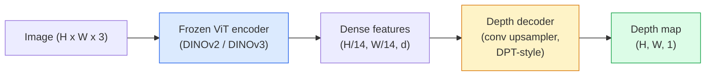

# Kedalaman Monokular & Estimasi Geometri

> Sebuah depth map adalah sebuah gambar kanal-tunggal di mana setiap piksel adalah jarak dari kamera. Memprediksinya dari satu frame RGB dulu tidak mungkin tanpa stereo atau LiDAR. Pada 2026 sebuah encoder ViT beku ditambah head ringan mencapai beberapa persen dari ground truth.

**Type:** Build + Use
**Languages:** Python
**Prerequisites:** Phase 4 Lesson 14 (ViT), Phase 4 Lesson 17 (Self-Supervised Vision), Phase 4 Lesson 07 (U-Net)
**Time:** ~60 minutes

## Tujuan Pembelajaran

- Membedakan kedalaman relatif dan metrik serta menyatakan mana yang diselesaikan oleh setiap model produksi (MiDaS, Marigold, Depth Anything V3, ZoeDepth)
- Memakai Depth Anything V3 (backbone DINOv2) untuk memprediksi kedalaman untuk gambar tunggal sembarang tanpa kalibrasi
- Menjelaskan mengapa kedalaman monokular bekerja sama sekali dari satu gambar (petunjuk perspektif, gradien tekstur, prior yang dipelajari) dan apa yang tidak bisa dipulihkannya (skala absolut, geometri teroklusi)
- Melift deteksi 2D ke titik 3D menggunakan sebuah depth map dan intrinsik kamera lubang-jarum

## Masalahnya

Kedalaman adalah sumbu yang hilang dalam visi komputer 2D. Diberikan RGB, kamu tahu di mana benda-benda muncul di bidang gambar; kamu tidak tahu seberapa jauh mereka. Sensor kedalaman (rig stereo, LiDAR, time-of-flight) menyelesaikan ini secara langsung tetapi mahal, rapuh, dan terbatas dalam jangkauan.

Estimasi kedalaman monokular — memprediksi kedalaman dari satu frame RGB — dulu menghasilkan output buram dan tidak andal. Pada 2026 encoder pre-trained besar mengubah itu: Depth Anything V3 memakai sebuah backbone DINOv2 beku dan menghasilkan depth map yang mengeneralisasi di seluruh domain indoor, outdoor, medis, dan satelit. Marigold membingkai ulang kedalaman sebagai sebuah masalah diffusion bersyarat. ZoeDepth meregresi jarak metrik yang sebenarnya.

Kedalaman juga adalah jembatan antara deteksi 2D dan pemahaman 3D: kalikan piksel sebuah box terdeteksi dengan kedalaman dan kamu melift objek 2D menjadi sebuah awan titik 3D. Itulah inti dari setiap sistem oklusi AR, setiap pipeline penghindaran-rintangan, dan setiap robot "pick up the cup".

## Konsepnya

### Kedalaman relatif vs metrik

- **Kedalaman relatif** — nilai `z` terurut tanpa satuan dunia-nyata. "Piksel A lebih dekat daripada piksel B, tetapi rasio jarak tidak di-anchor ke meter."
- **Kedalaman metrik** — jarak absolut dalam meter dari kamera. Membutuhkan model untuk telah mempelajari hubungan statistik antara petunjuk gambar dan jarak nyata.

MiDaS dan Depth Anything V3 menghasilkan kedalaman relatif. Marigold menghasilkan kedalaman relatif. ZoeDepth, UniDepth, dan Metric3D menghasilkan kedalaman metrik. Model metrik sensitif terhadap intrinsik kamera; model relatif tidak.

### Pola encoder-decoder



Depth Anything V3 membekukan encoder dan melatih hanya decoder bergaya-DPT. Encoder menyediakan fitur yang kaya; decoder menginterpolasi mereka kembali ke resolusi gambar dan meregresi kedalaman.

### Mengapa satu gambar menghasilkan kedalaman sama sekali

Sebuah gambar 2D berisi banyak petunjuk monokular yang berkorelasi dengan kedalaman:

- **Perspektif** — garis paralel dalam 3D menyempit dalam 2D.
- **Gradien tekstur** — permukaan yang jauh memiliki tekstur lebih kecil dan lebih padat.
- **Urutan oklusi** — objek yang lebih dekat mengoklusi yang lebih jauh.
- **Konstansi ukuran** — objek yang dikenal (mobil, manusia) memberikan skala perkiraan.
- **Perspektif atmosferik** — objek yang jauh tampak lebih kabur dan lebih biru dalam adegan outdoor.

Sebuah ViT yang dilatih pada miliaran gambar menginternalisasi petunjuk-petunjuk ini. Dengan data yang cukup dan backbone yang kuat, kedalaman monokular mencapai akurasi yang wajar tanpa supervisi 3D eksplisit apa pun.

### Apa yang tidak bisa dilakukan kedalaman monokular

- **Skala metrik absolut** tanpa intrinsik atau objek yang diketahui dalam adegan. Jaringan bisa memprediksi "cangkir itu dua kali lebih jauh daripada sendok" tanpa mengetahui apakah cangkirnya berjarak 1 m atau 10 m.
- **Geometri teroklusi** — bagian belakang sebuah kursi tidak terlihat dan tidak bisa disimpulkan secara andal.
- **Permukaan yang benar-benar tanpa-tekstur / reflektif** — cermin, kaca, dinding seragam. Jaringan melaporkan kedalaman yang masuk akal tetapi salah.

### Depth Anything V3 pada 2026

- DINOv2 ViT-L/14 vanilla sebagai encoder (beku).
- Decoder DPT.
- Dilatih pada pasangan gambar berpose dari beragam sumber (tanpa supervisi kedalaman eksplisit di luar konsistensi fotometrik).
- Memprediksi geometri yang konsisten secara spasial dari **jumlah input visual sembarang, dengan atau tanpa pose kamera yang diketahui**.
- SOTA di seluruh kedalaman monokular, geometri any-view, rendering visual, estimasi pose kamera.

Inilah model drop-in yang dipanggil ketika kamu membutuhkan kedalaman pada 2026.

### Marigold — diffusion untuk kedalaman

Marigold (Ke et al., CVPR 2024) membingkai ulang estimasi kedalaman sebagai diffusion gambar-ke-gambar bersyarat. Conditioning: RGB. Target: depth map. Memakai U-Net Stable Diffusion 2 pre-trained sebagai backbone. Depth map output sangat tajam di batas objek. Trade-off: inference lebih lambat daripada model feed-forward (10-50 langkah denoising).

### Intrinsik dan kamera lubang-jarum

Untuk melift sebuah piksel `(u, v)` dengan kedalaman `d` ke sebuah titik 3D `(X, Y, Z)` dalam koordinat kamera:

```
fx, fy, cx, cy = camera intrinsics
X = (u - cx) * d / fx
Y = (v - cy) * d / fy
Z = d
```

Intrinsik datang dari metadata EXIF, sebuah pola kalibrasi, atau sebuah estimator intrinsik monokular (Perspective Fields, UniDepth). Tanpa intrinsik, kamu tetap bisa me-render sebuah awan titik dengan mengasumsikan FOV 60-70° dan prinsip resolusi-sedang — bisa dipakai untuk visualisasi, bukan untuk pengukuran.

### Evaluasi

Dua metrik standar:

- **AbsRel** (error relatif absolut): `mean(|d_pred - d_gt| / d_gt)`. Lebih rendah lebih baik. 0,05-0,1 untuk model produksi.
- **delta < 1,25** (akurasi ambang): fraksi piksel di mana `max(d_pred/d_gt, d_gt/d_pred) < 1,25`. Lebih tinggi lebih baik. 0,9+ untuk SOTA.

Untuk kedalaman relatif (Depth Anything V3, MiDaS), evaluasi memakai versi kedua metrik yang invarian terhadap skala dan shift.

```figure
depth-sweep
```

## Bangun Sendiri

### Langkah 1: Metrik kedalaman

```python
import torch

def abs_rel_error(pred, target, mask=None):
    if mask is not None:
        pred = pred[mask]
        target = target[mask]
    return (torch.abs(pred - target) / target.clamp(min=1e-6)).mean().item()


def delta_accuracy(pred, target, threshold=1.25, mask=None):
    if mask is not None:
        pred = pred[mask]
        target = target[mask]
    ratio = torch.maximum(pred / target.clamp(min=1e-6), target / pred.clamp(min=1e-6))
    return (ratio < threshold).float().mean().item()
```

Selalu mask piksel kedalaman yang tidak valid (nol, NaN, saturasi) sebelum evaluasi.

### Langkah 2: Alignment skala dan shift

Untuk model kedalaman-relatif, align prediksi ke ground truth sebelum menghitung metrik. Paling-kecil-kuadrat dari `a * pred + b = target`:

```python
def align_scale_shift(pred, target, mask=None):
    if mask is not None:
        p = pred[mask]
        t = target[mask]
    else:
        p = pred.flatten()
        t = target.flatten()
    A = torch.stack([p, torch.ones_like(p)], dim=1)
    coeffs, *_ = torch.linalg.lstsq(A, t.unsqueeze(-1))
    a, b = coeffs[:2, 0]
    return a * pred + b
```

Jalankan `align_scale_shift` sebelum `abs_rel_error` saat mengevaluasi MiDaS / Depth Anything.

### Langkah 3: Melift kedalaman ke sebuah awan titik

```python
import numpy as np

def depth_to_point_cloud(depth, intrinsics):
    H, W = depth.shape
    fx, fy, cx, cy = intrinsics
    v, u = np.meshgrid(np.arange(H), np.arange(W), indexing="ij")
    z = depth
    x = (u - cx) * z / fx
    y = (v - cy) * z / fy
    return np.stack([x, y, z], axis=-1)


depth = np.random.uniform(0.5, 4.0, (240, 320))
intr = (320.0, 320.0, 160.0, 120.0)
pc = depth_to_point_cloud(depth, intr)
print(f"point cloud shape: {pc.shape}  (H, W, 3)")
```

Satu fungsi, setiap aplikasi yang di-lift-3D. Ekspor awan titik ke `.ply` dan buka di MeshLab atau CloudCompare.

### Langkah 4: Uji smoke dengan adegan kedalaman sintetis

```python
def synthetic_depth(size=96):
    yy, xx = np.meshgrid(np.arange(size), np.arange(size), indexing="ij")
    # Floor: linear gradient from near (top) to far (bottom)
    depth = 1.0 + (yy / size) * 4.0
    # Box in the middle: closer
    mask = (np.abs(xx - size / 2) < size / 6) & (np.abs(yy - size * 0.6) < size / 6)
    depth[mask] = 2.0
    return depth.astype(np.float32)


gt = torch.from_numpy(synthetic_depth(96))
pred = gt + 0.3 * torch.randn_like(gt)  # simulated prediction
aligned = align_scale_shift(pred, gt)
print(f"before align  absRel = {abs_rel_error(pred, gt):.3f}")
print(f"after align   absRel = {abs_rel_error(aligned, gt):.3f}")
```

### Langkah 5: Pemakaian Depth Anything V2 (referensi)

```python
import numpy as np
from transformers import pipeline
from PIL import Image

pipe = pipeline(task="depth-estimation", model="depth-anything/Depth-Anything-V2-Large-hf")

image = Image.open("street.jpg").convert("RGB")
out = pipe(image)
depth_np = np.array(out["depth"])
```

Tiga baris. `out["depth"]` adalah sebuah PIL grayscale; konversi ke numpy untuk matematika. Depth Anything 3 (November 2025) tidak dimuat melalui pipeline ini. Ia menghadirkan paket `depth_anything_3` miliknya sendiri: `DepthAnything3.from_pretrained("depth-anything/DA3MONO-LARGE")` memuat model monokular relatif, dan `model.inference(images).depth` mengembalikan sebuah array kedalaman `[N, H, W]`.

## Gunakan

- **Depth Anything V3** (Meta AI / ByteDance, 2024-2026) — default untuk kedalaman relatif. Model berbackbone-ViT-large tercepat dalam produksi.
- **Marigold** (ETH, 2024) — kualitas visual tertinggi, inference lambat.
- **UniDepth** (ETH, 2024) — kedalaman metrik dengan estimasi intrinsik kamera.
- **ZoeDepth** (Intel, 2023) — kedalaman metrik; lebih tua, masih andal.
- **MiDaS v3.1** — warisan tetapi stabil; baseline yang baik untuk perbandingan.

Pola integrasi tipikal:

1. Frame RGB tiba.
2. Model kedalaman menghasilkan depth map.
3. Detektor menghasilkan box.
4. Lift centroid box melalui kedalaman ke 3D; merge dengan awan titik bila tersedia.
5. Downstream: oklusi AR, perencanaan jalur, estimasi ukuran-objek, pengganti stereo.

Untuk pemakaian real-time, Depth Anything V2 Small (terquantisasi INT8) mencapai ~30 fps pada GPU konsumen pada 518x518.

## Rilis

Pelajaran ini menghasilkan:

- `outputs/prompt-depth-model-picker.md` — memilih antara Depth Anything V3, Marigold, UniDepth, MiDaS diberikan latensi, kebutuhan metrik-vs-relatif, dan jenis adegan.
- `outputs/skill-depth-to-pointcloud.md` — skill yang membangun awan titik dari depth map dengan penanganan intrinsik yang benar dan ekspor ke `.ply`.

## Latihan

1. **(Mudah)** Jalankan Depth Anything V2 pada 10 gambar meja-mu apa pun. Simpan kedalaman sebagai PNG grayscale dan periksa. Identifikasi satu objek yang kedalaman terprediksinya tampak salah dan jelaskan mengapa petunjuk monokular gagal.
2. **(Sedang)** Diberikan RGB + kedalaman dari Depth Anything V2, lift ke sebuah awan titik dan render dengan `open3d`. Bandingkan dua adegan (indoor / outdoor) dan catat mana yang tampak lebih meyakinkan.
3. **(Sulit)** Ambil lima pasang gambar yang hanya berbeda pada posisi objek yang diketahui (misalnya botol digeser 30 cm lebih dekat). Pakai UniDepth untuk memprediksi kedalaman metrik di keduanya. Laporkan delta jarak terprediksi vs 30 cm yang sebenarnya.

## Istilah Kunci

| Term | What people say | What it actually means |
|------|----------------|----------------------|
| Monocular depth | "Single-image depth" | Depth estimation from one RGB frame, no stereo or LiDAR |
| Relative depth | "Ordered depth" | Ordered z-values without real-world units |
| Metric depth | "Absolute distance" | Depth in metres; requires calibration or a model trained with metric supervision |
| AbsRel | "Absolute relative error" | Mean of |d_pred - d_gt| / d_gt; standard depth metric |
| Delta accuracy | "delta < 1.25" | Fraction of pixels with prediction within 25% of ground truth |
| Pinhole camera | "fx, fy, cx, cy" | The camera model used to lift (u, v, d) to (X, Y, Z) |
| DPT | "Dense Prediction Transformer" | The conv-based decoder used on top of frozen ViT encoders for depth |
| DINOv2 backbone | "The reason it works" | Self-supervised features that generalise across domains without depth labels |

## Bacaan Lanjutan

- [Depth Anything V3 paper page](https://depth-anything.github.io/) — SOTA monocular depth with DINOv2 encoder
- [Marigold (Ke et al., CVPR 2024)](https://marigoldmonodepth.github.io/) — diffusion-based depth estimation
- [UniDepth (Piccinelli et al., 2024)](https://arxiv.org/abs/2403.18913) — metric depth with intrinsics
- [MiDaS v3.1 (Intel ISL)](https://github.com/isl-org/MiDaS) — the canonical relative-depth baseline
- [DINOv3 blog post (Meta)](https://ai.meta.com/blog/dinov3-self-supervised-vision-model/) — the encoder family that lifts depth accuracy
