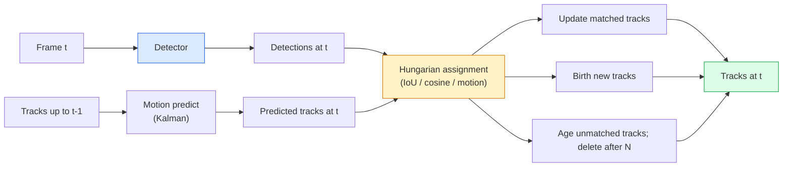

# Multi-Object Tracking & Memory Video

> Tracking adalah deteksi ditambah asosiasi. Deteksi setiap frame. Match deteksi frame ini ke track frame sebelumnya berdasarkan ID.

**Type:** Build
**Languages:** Python
**Prerequisites:** Phase 4 Lesson 06 (YOLO Detection), Phase 4 Lesson 08 (Mask R-CNN), Phase 4 Lesson 24 (SAM 3)
**Time:** ~60 minutes

## Tujuan Pembelajaran

- Membedakan tracking-by-detection dari tracking berbasis-query dan menyebut keluarga algoritmanya (SORT, DeepSORT, ByteTrack, BoT-SORT, pelacak memory SAM 2, SAM 3.1 Object Multiplex)
- Mengimplementasikan IoU + penugasan Hungarian dari nol untuk tracking-by-detection klasik
- Menjelaskan memory bank SAM 2 dan mengapa ia menangani oklusi lebih baik daripada asosiasi berbasis-IoU
- Membaca tiga metrik tracking (MOTA, IDF1, HOTA) dan memilih mana yang penting untuk use case tertentu

## Masalahnya

Sebuah detektor memberitahumu di mana objek-objek berada dalam satu frame. Sebuah pelacak memberitahumu deteksi mana di frame `t` yang merupakan objek yang sama dengan sebuah deteksi di frame `t-1`. Tanpa itu, kamu tidak bisa menghitung objek yang melewati sebuah garis, mengikuti sebuah bola melalui oklusi, atau mengetahui "mobil #4 sudah berada di lajur selama 8 detik."

Tracking adalah esensial untuk setiap produk berorientasi-video: analitik olahraga, pengawasan, mengemudi otonom, analisis video medis, pemantauan satwa liar, penghitungan wordmark. Blok bangun inti dibagikan: sebuah detektor per-frame, sebuah model gerakan (filter Kalman atau sesuatu yang lebih kaya), sebuah langkah asosiasi (algoritma Hungarian di atas IoU / cosine / fitur yang dipelajari), dan sebuah siklus hidup track (lahir, perbarui, mati).

2026 membawa dua pola baru: **pelacakan berbasis-memory SAM 2** (memory-fitur alih-alih asosiasi model-gerakan) dan **SAM 3.1 Object Multiplex** (memory bersama untuk banyak instance dari konsep yang sama). Pelajaran ini menelusuri stack klasik lebih dulu, lalu pendekatan berbasis-memory.

## Konsepnya

### Tracking-by-detection



Setiap pelacak yang akan kamu temui pada 2026 adalah sebuah variasi dari loop ini. Perbedaannya:

- **SORT** (2016): filter Kalman + IoU Hungarian. Sederhana, cepat, tanpa model penampilan.
- **DeepSORT** (2017): SORT + sebuah fitur penampilan berbasis-CNN per track (embedding ReID). Menangani penyeberangan lebih baik.
- **ByteTrack** (2021): mengasosiasikan deteksi keyakinan-rendah sebagai tahap kedua; tanpa fitur penampilan tetapi performer teratas di MOT17.
- **BoT-SORT** (2022): Byte + kompensasi gerakan kamera + ReID.
- **StrongSORT / OC-SORT** — keturunan ByteTrack dengan gerakan dan penampilan lebih baik.

### Filter Kalman dalam satu paragraf

Sebuah filter Kalman mempertahankan sebuah state per-track `(x, y, w, h, dx, dy, dw, dh)` dengan sebuah kovarians. Pada setiap frame, **prediksi** state-nya memakai sebuah model kecepatan-konstan, lalu **perbarui** dengan deteksi yang di-match. Update mempercayai deteksi lebih ketika ketidakpastian prediksinya tinggi. Ini memberikan trajektori yang halus dan kemampuan melanjutkan sebuah track melalui oklusi pendek (1-5 frame).

Setiap pelacak klasik memakai sebuah filter Kalman dalam langkah prediksi-gerakannya.

### Algoritma Hungarian

Diberikan sebuah matriks biaya `M x N` (track x deteksi), temukan penugasan satu-ke-satu yang meminimalkan biaya total. Biaya biasanya `1 - IoU(track_bbox, detection_bbox)` atau cosine similarity negatif dari fitur penampilan. Runtime adalah O((M+N)^3); untuk M, N hingga ~1000 cukup cepat di Python via `scipy.optimize.linear_sum_assignment`.

### Ide kunci ByteTrack

Pelacak standar menjatuhkan deteksi keyakinan-rendah (< 0,5). ByteTrack menyimpan mereka sebagai **kandidat tahap-kedua**: setelah mencocokkan track ke deteksi keyakinan-tinggi, track yang tidak cocok mencoba mencocokkan deteksi keyakinan-rendah dengan ambang IoU sedikit lebih longgar. Memulihkan oklusi pendek, pergantian ID di dekat kerumunan.

### Pelacakan berbasis-memory SAM 2

SAM 2 menangani video dengan mempertahankan sebuah **memory bank** fitur spasio-temporal per-instance. Diberikan sebuah prompt (klik, box, teks) pada satu frame, ia men-enkode instance ke dalam memory. Pada frame-frame berikutnya, memory di-cross-attend terhadap fitur frame baru, dan decoder menghasilkan sebuah mask untuk instance yang sama di frame baru.

Tanpa filter Kalman, tanpa penugasan Hungarian. Asosiasinya implisit dalam operasi memory-attention.

Pro:
- Robust terhadap oklusi besar (memory membawa identitas instance di banyak frame).
- Open-vocabulary ketika dikombinasikan dengan prompt teks SAM 3.
- Berfungsi tanpa model gerakan terpisah.

Kontra:
- Lebih lambat daripada ByteTrack untuk pelacakan banyak-objek.
- Memory bank membesar; membatasi jendela konteks.

### SAM 3.1 Object Multiplex

Pelacakan SAM 2 / SAM 3 sebelumnya mempertahankan sebuah memory bank terpisah per instance. Untuk 50 objek, 50 memory bank. Object Multiplex (Maret 2026) meruntuhkannya menjadi satu memory bersama dengan **token query per-instance**. Biaya berskala sub-linear dalam jumlah instance.

Multiplex adalah default baru untuk pelacakan kerumunan pada 2026: kerumunan konser, pekerja gudang, persimpangan lalu lintas.

### Tiga metrik yang perlu diketahui

- **MOTA (Multi-Object Tracking Accuracy)** — 1 - (FN + FP + ID switches) / GT. Di-berat berdasarkan jenis error; satu metrik yang menggabungkan kegagalan deteksi dan asosiasi.
- **IDF1 (ID F1)** — rata-rata harmonis dari presisi dan recall ID. Fokus khusus pada seberapa baik setiap track ground-truth mempertahankan ID-nya seiring waktu. Lebih baik daripada MOTA untuk tugas yang sensitif-terhadap-pergantian-ID.
- **HOTA (Higher Order Tracking Accuracy)** — mendekomposisi menjadi akurasi deteksi (DetA) dan akurasi asosiasi (AssA). Standar komunitas sejak 2020; paling komprehensif.

Untuk pengawasan (siapa siapa): IDF1 adalah yang kamu laporkan. Untuk analitik olahraga (menghitung operan): HOTA. Untuk perbandingan akademik umum: HOTA.

```figure
cv3-track-assoc
```

## Bangun Sendiri

### Langkah 1: Matriks biaya berbasis-IoU

```python
import numpy as np


def bbox_iou(a, b):
    """
    a, b: (N, 4) arrays of [x1, y1, x2, y2].
    Returns (N_a, N_b) IoU matrix.
    """
    ax1, ay1, ax2, ay2 = a[:, 0], a[:, 1], a[:, 2], a[:, 3]
    bx1, by1, bx2, by2 = b[:, 0], b[:, 1], b[:, 2], b[:, 3]
    inter_x1 = np.maximum(ax1[:, None], bx1[None, :])
    inter_y1 = np.maximum(ay1[:, None], by1[None, :])
    inter_x2 = np.minimum(ax2[:, None], bx2[None, :])
    inter_y2 = np.minimum(ay2[:, None], by2[None, :])
    inter = np.clip(inter_x2 - inter_x1, 0, None) * np.clip(inter_y2 - inter_y1, 0, None)
    area_a = (ax2 - ax1) * (ay2 - ay1)
    area_b = (bx2 - bx1) * (by2 - by1)
    union = area_a[:, None] + area_b[None, :] - inter
    return inter / np.clip(union, 1e-8, None)
```

### Langkah 2: Pelacak bergaya-SORT minimal

Kalman kecepatan-konstan tetap di-singkat demi kepadatan — kita memakai sebuah asosiasi IoU sederhana di sini; dalam produksi prediksi Kalman itu esensial. Paket Python `sort` menyediakan versi lengkapnya.

```python
from scipy.optimize import linear_sum_assignment


class Track:
    def __init__(self, tid, bbox, frame):
        self.id = tid
        self.bbox = bbox
        self.last_frame = frame
        self.hits = 1

    def update(self, bbox, frame):
        self.bbox = bbox
        self.last_frame = frame
        self.hits += 1


class SimpleTracker:
    def __init__(self, iou_threshold=0.3, max_age=5):
        self.tracks = []
        self.next_id = 1
        self.iou_threshold = iou_threshold
        self.max_age = max_age

    def step(self, detections, frame):
        if not self.tracks:
            for d in detections:
                self.tracks.append(Track(self.next_id, d, frame))
                self.next_id += 1
            return [(t.id, t.bbox) for t in self.tracks]

        track_boxes = np.array([t.bbox for t in self.tracks])
        det_boxes = np.array(detections) if len(detections) else np.empty((0, 4))

        iou = bbox_iou(track_boxes, det_boxes) if len(det_boxes) else np.zeros((len(track_boxes), 0))
        cost = 1 - iou
        cost[iou < self.iou_threshold] = 1e6

        matched_track = set()
        matched_det = set()
        if cost.size > 0:
            row, col = linear_sum_assignment(cost)
            for r, c in zip(row, col):
                if cost[r, c] < 1.0:
                    self.tracks[r].update(det_boxes[c], frame)
                    matched_track.add(r); matched_det.add(c)

        for i, d in enumerate(det_boxes):
            if i not in matched_det:
                self.tracks.append(Track(self.next_id, d, frame))
                self.next_id += 1

        self.tracks = [t for t in self.tracks if frame - t.last_frame <= self.max_age]
        return [(t.id, t.bbox) for t in self.tracks]
```

60 baris. Mengambil deteksi per-frame, mengembalikan ID track per-frame. Sistem nyata menambahkan prediksi Kalman, re-match tahap-kedua ByteTrack, dan fitur penampilan.

### Langkah 3: Uji trajektori sintetis

```python
def synthetic_frames(num_frames=20, num_objects=3, H=240, W=320, seed=0):
    rng = np.random.default_rng(seed)
    starts = rng.uniform(20, 200, size=(num_objects, 2))
    velocities = rng.uniform(-5, 5, size=(num_objects, 2))
    frames = []
    for f in range(num_frames):
        dets = []
        for i in range(num_objects):
            cx, cy = starts[i] + f * velocities[i]
            dets.append([cx - 10, cy - 10, cx + 10, cy + 10])
        frames.append(dets)
    return frames


tracker = SimpleTracker()
for f, dets in enumerate(synthetic_frames()):
    tracks = tracker.step(dets, f)
```

Tiga objek yang bergerak dalam garis lurus seharusnya mempertahankan ID mereka di seluruh 20 frame.

### Langkah 4: Metrik pergantian-ID

```python
def count_id_switches(tracks_per_frame, gt_per_frame):
    """
    tracks_per_frame:  list of list of (track_id, bbox)
    gt_per_frame:      list of list of (gt_id, bbox)
    Returns number of ID switches.
    """
    prev_assignment = {}
    switches = 0
    for tracks, gts in zip(tracks_per_frame, gt_per_frame):
        if not tracks or not gts:
            continue
        t_boxes = np.array([b for _, b in tracks])
        g_boxes = np.array([b for _, b in gts])
        iou = bbox_iou(g_boxes, t_boxes)
        for g_idx, (gt_id, _) in enumerate(gts):
            j = iou[g_idx].argmax()
            if iou[g_idx, j] > 0.5:
                t_id = tracks[j][0]
                if gt_id in prev_assignment and prev_assignment[gt_id] != t_id:
                    switches += 1
                prev_assignment[gt_id] = t_id
    return switches
```

Ini adalah sebuah metrik yang menyederhanakan IDF1: menghitung berapa kali sebuah objek ground-truth mengubah ID track terprediksi yang ditugasinya. Tooling MOTA / IDF1 / HOTA yang sebenarnya ada di `py-motmetrics` dan `TrackEval`.

## Gunakan

Pelacak produksi pada 2026:

- `ultralytics` — YOLOv8 + ByteTrack / BoT-SORT bawaan. `results = model.track(source, tracker="bytetrack.yaml")`. Yang default.
- `supervision` (Roboflow) — pembungkus ByteTrack ditambah utilitas annotasi.
- SAM 2 / SAM 3.1 — pelacakan berbasis-memory via `processor.track()`.
- Stack kustom: detektor (YOLOv8 / RT-DETR) + `sort-tracker` / `OC-SORT` / `StrongSORT`.

Pemilihan:

- Pejalan kaki / mobil / box pada 30+ fps: **ByteTrack dengan ultralytics**.
- Banyak instance satu kelas dalam kerumunan: **SAM 3.1 Object Multiplex**.
- Oklusi berat dengan penampilan yang dapat diidentifikasi: **DeepSORT / StrongSORT** (fitur ReID).
- Olahraga / interaksi kompleks: **BoT-SORT** atau pelacak yang dipelajari (MOTRv3).

## Rilis

Pelajaran ini menghasilkan:

- `outputs/prompt-tracker-picker.md` — memilih SORT / ByteTrack / BoT-SORT / SAM 2 / SAM 3.1 diberikan jenis adegan, pola oklusi, dan anggaran latensi.
- `outputs/skill-mot-evaluator.md` — menulis sebuah harness evaluasi lengkap untuk MOTA / IDF1 / HOTA terhadap track ground-truth.

## Latihan

1. **(Mudah)** Jalankan pelacak sintetis di atas dengan 3, 10, dan 30 objek. Laporkan jumlah pergantian-ID pada masing-masing kasus. Identifikasi di mana asosiasi sederhana hanya-IoU mulai gagal.
2. **(Sedang)** Tambahkan sebuah langkah prediksi Kalman kecepatan-konstan sebelum asosiasi. Tunjukkan bahwa oklusi pendek (2-3 frame) tidak lagi menyebabkan pergantian ID.
3. **(Sulit)** Integrasikan pelacak berbasis-memory SAM 2 (via `transformers`) sebagai backend pelacak alternatif. Jalankan SimpleTracker dan SAM 2 pada klip 30 detik dari sebuah kerumunan dan bandingkan jumlah pergantian-ID, melabeli ID ground-truth secara manual untuk 5 orang menonjol.

## Istilah Kunci

| Term | What people say | What it actually means |
|------|----------------|----------------------|
| Tracking-by-detection | "Detect then associate" | Per-frame detector + Hungarian assignment on IoU / appearance |
| Kalman filter | "Motion predict" | Linear dynamics + covariance for smooth track predictions and occlusion handling |
| Hungarian algorithm | "Optimal assignment" | Solves the minimum-cost bipartite matching problem; `scipy.optimize.linear_sum_assignment` |
| ByteTrack | "Low-confidence second pass" | Re-match unmatched tracks to low-confidence detections to recover short occlusions |
| DeepSORT | "SORT + appearance" | Adds a ReID feature for cross-frame matching; better for ID preservation |
| Memory bank | "SAM 2 trick" | Per-instance spatio-temporal features stored across frames; cross-attention replaces explicit association |
| Object Multiplex | "SAM 3.1 shared memory" | Single shared memory with per-instance queries for fast many-object tracking |
| HOTA | "Modern tracking metric" | Decomposes into detection and association accuracy; community standard |

## Bacaan Lanjutan

- [SORT (Bewley et al., 2016)](https://arxiv.org/abs/1602.00763) — the minimal tracking-by-detection paper
- [DeepSORT (Wojke et al., 2017)](https://arxiv.org/abs/1703.07402) — adds appearance feature
- [ByteTrack (Zhang et al., 2022)](https://arxiv.org/abs/2110.06864) — low-confidence second pass
- [BoT-SORT (Aharon et al., 2022)](https://arxiv.org/abs/2206.14651) — camera motion compensation
- [HOTA (Luiten et al., 2020)](https://arxiv.org/abs/2009.07736) — decomposed tracking metric
- [SAM 2 video segmentation (Meta, 2024)](https://ai.meta.com/sam2/) — memory-based tracker
- [SAM 3.1 Object Multiplex (Meta, March 2026)](https://ai.meta.com/blog/segment-anything-model-3/)
