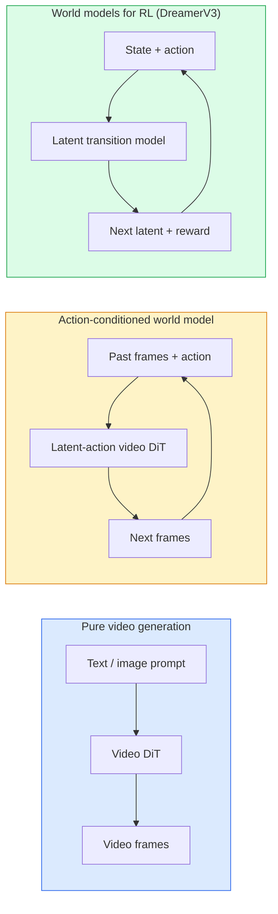

# World Model & Video Diffusion

> Sebuah model video yang memprediksi detik-detik berikutnya dari sebuah adegan adalah sebuah simulator dunia. Condition prediksi itu pada aksi dan kamu mendapat sebuah game engine yang dipelajari.

**Type:** Learn + Build
**Languages:** Python
**Prerequisites:** Phase 4 Lesson 10 (Diffusion), Phase 4 Lesson 12 (Video Understanding), Phase 4 Lesson 23 (DiT + Rectified Flow)
**Time:** ~75 minutes

## Tujuan Pembelajaran

- Menjelaskan perbedaan antara sebuah model generasi video murni (Sora 2) dan sebuah world model bersyarat-aksi (Genie 3, DreamerV3)
- Mendeskripsikan sebuah video DiT: patch spasio-temporal, encoding posisi 3D, attention bersama di seluruh token (T, H, W)
- Menelusuri bagaimana sebuah world model mencolok ke robotik: VLM merencanakan -> model video mensimulasikan -> inverse dynamics mengeluarkan aksi
- Memilih antara Sora 2, Genie 3, Runway GWM-1 Worlds, Wan-Video, dan HunyuanVideo untuk use case tertentu (video kreatif, sim interaktif, sintesis mengemudi-otonom)

## Masalahnya

Generasi video dan pemodelan dunia menyatu pada 2026. Sebuah model yang bisa menghasilkan satu menit video yang koheren telah, dalam beberapa arti, mempelajari bagaimana dunia bergerak: objek permanen, gravitasi, kausalitas, gaya. Jika kamu mem-condition prediksi itu pada aksi (jalan ke kiri, buka pintu), model video menjadi sebuah simulator yang bisa dipelajari yang bisa menggantikan sebuah game engine, sebuah simulator mengemudi, atau sebuah lingkungan robotik.

Taruuhannya konkret. Genie 3 menghasilkan lingkungan yang bisa dimainkan dari satu gambar. Runway GWM-1 Worlds mensintesis adegan eksplor tak-hingga. Sora 2 menghasilkan video berdurasi-menit dengan audio tersinkron dan fisika yang dimodelkan. NVIDIA Cosmos-Drive, Wayve Gaia-2, dan Tesla DrivingWorld menghasilkan video mengemudi realistis untuk data training kendaraan-otonom. Paradigma world-model diam-diameter mengambil alih sim-to-real untuk robotik.

Pelajaran ini adalah pelajaran "gambaran besar" untuk Fase 4. Ia menghubungkan generasi gambar, pemahaman video, dan penalaran agentic ke dalam pola arsitektur yang sedang dituju penelitian dominan.

## Konsepnya

### Tiga keluarga pemodelan dunia



- **Sora 2** adalah generasi video murni yang di-condition pada prompt. Tanpa antarmuka aksi. Kamu tidak bisa "mengemudikan" di tengah rollout.
- **Genie 3**, **GWM-1 Worlds**, **Mirage / Magica** adalah world model bersyarat-aksi. Menyimpulkan aksi latent dari video yang diamati, lalu mem-condition prediksi frame masa depan pada aksi. Interaktif — kamu menekan tombol atau menggerakkan kamera dan adegannya merespons.
- **DreamerV3** dan keluarga world model RL klasik memprediksi dalam sebuah ruang latent dengan conditioning aksi eksplisit, dilatih pada sebuah sinyal reward. Kurang visual; lebih berguna untuk RL yang hemat-sampel.

### Arsitektur video DiT

```
Video latent:          (C, T, H, W)
Patchify (spatial):    grid of P_h x P_w patches per frame
Patchify (temporal):   group P_t frames into a temporal patch
Resulting tokens:      (T / P_t) * (H / P_h) * (W / P_w) tokens
```

Positional encoding bersifat 3D: sebuah rotary atau embedding yang dipelajari per koordinat (t, h, w). Attention bisa:

- **Full joint** — semua token attend ke semua token. O(N^2) dengan N token. Tidak terjangkau untuk video panjang.
- **Divided** — berselang-seling attention temporal (posisi spasial sama, di seluruh waktu: `(H*W) * T^2`) dan attention spasial (timestep sama, di seluruh ruang: `T * (H*W)^2`). Dipakai oleh TimeSformer dan sebagian besar video DiT.
- **Window** — jendela lokal di (t, h, w). Dipakai oleh Video Swin.

Setiap model video diffusion 2026 memakai salah satu dari tiga pola ini ditambah conditioning AdaLN (Pelajaran 23) dan rectified flow.

### Conditioning pada aksi: model aksi-latent

Genie mempelajari sebuah **aksi latent** per frame dengan secara diskriminatif memprediksi aksi di antara sepasang frame berurutan. Decoder model lalu melakukan conditioning pada aksi latent yang disimpulkan — bukan pada tombol keyboard eksplisit. Saat inference, seorang pengguna bisa menentukan sebuah aksi latent (atau menyampel satu dari prior yang baru) dan model menghasilkan frame berikutnya yang konsisten dengan aksi itu.

Sora melewatkan antarmuka aksi sama sekali. Decoder-nya memprediksi token spacetime berikutnya dari token spacetime masa lalu. Prompt mem-condition awalnya; tidak ada yang mengemudikannya di tengah generasi.

### Kepantasan fisik

Rilis Sora 2 pada 2026 secara eksplisit mengiklankan **kepatuhan fisik**: berat, keseimbangan, objek permanen, sebab-akibat. Diukur oleh tim melalui skor patuhan yang dinilai-tangan; model secara nyata membaik pada objek yang dijatuhkan, karakter yang bertabrakan, dan kegagalan-sengaja (sebuah lompatan yang terlewat) dibandingkan Sora 1.

Kepantasan tetap menjadi mode kegagalan yang dominan. Video 2024-2025 tentang orang makan spaghetti atau minum dari gelas mengungkapkan ketiadaan representasi objek persisten pada model. Model 2026 (Sora 2, Runway Gen-5, HunyuanVideo) mengurangi tetapi tidak menghilangkan ini.

### World model mengemudi-otonom

World model mengemudi menghasilkan adegan jalan realistis yang di-condition pada trajektori, bounding box, atau peta navigasi. Pemakaian:

- **Cosmos-Drive-Dreams** (NVIDIA) — menghasilkan menit video mengemudi untuk training RL.
- **Gaia-2** (Wayve) — sintesis adegan bersyarat-trajektori untuk evaluasi kebijakan.
- **DrivingWorld** (Tesla) — mensimulasikan cuaca beragam, waktu-hari, kondisi lalu lintas.
- **Vista** (ByteDance) — sintesis adegan mengemudi reaktif.

Mereka menggantikan pengumpulan data dunia-nyata yang mahal untuk corner case — pejalan kaki menyeberang liar di malam hari, persimpangan ber es, jenis kendaraan tidak lazim — yang sebaliknya akan membutuhkan jutaan mil mengemudi.

### Stack robotik: VLM + model video + inverse dynamics

Loop robotik tiga-komponen yang muncul:

1. **VLM** mengurai tujuannya ("pick up the red cup"), merencanakan sebuah urutan aksi tingkat-atas.
2. **Model generasi video** mensimulasikan seperti apa mengeksekusi setiap aksi akan terlihat — memprediksi observasi N frame ke depan.
3. **Model inverse dynamics** mengekstrak perintah motor konkret yang akan menghasilkan observasi-observasi itu.

Ini menggantikan reward shaping dan RL yang berat-sampel. World model melakukan imajinasi; inverse dynamics menutup loop pada aktuasi. Genie Envisioner adalah satu instansiasi; banyak kelompok penelitian menyatu ke struktur ini.

### Evaluasi

- **Kualitas visual** — FVD (Fréchet Video Distance), studi pengguna.
- **Keselarasan prompt** — CLIPScore per frame, evaluasi bergaya-VQA.
- **Kepantasan fisik** — dinilai-tangan pada sebuah suite benchmark (benchmark internal Sora 2, VBench).
- **Kontrolabilitas** (untuk world model interaktif) — konsistensi aksi → observasi; bisakah kamu kembali ke sebuah state sebelumnya?

### Lanskap model pada 2026

| Model | Use | Parameters | Output | License |
|-------|-----|------------|--------|---------|
| Sora 2 | text-to-video, audio | — | 1-min 1080p + audio | API only |
| Runway Gen-5 | text/image-to-video | — | 10s clips | API |
| Runway GWM-1 Worlds | interactive world | — | infinite 3D rollout | API |
| Genie 3 | interactive world from image | 11B+ | playable frames | research preview |
| Wan-Video 2.1 | open text-to-video | 14B | high-quality clips | non-commercial |
| HunyuanVideo | open text-to-video | 13B | 10s clips | permissive |
| Cosmos / Cosmos-Drive | autonomous driving sim | 7-14B | driving scenes | NVIDIA open |
| Magica / Mirage 2 | AI-native game engine | — | modifiable worlds | product |

```figure
v4-world-rollout
```

## Bangun Sendiri

### Langkah 1: Patchify 3D untuk video

```python
import torch
import torch.nn as nn


class VideoPatch3D(nn.Module):
    def __init__(self, in_channels=4, dim=64, patch_t=2, patch_h=2, patch_w=2):
        super().__init__()
        self.proj = nn.Conv3d(
            in_channels, dim,
            kernel_size=(patch_t, patch_h, patch_w),
            stride=(patch_t, patch_h, patch_w),
        )
        self.patch_t = patch_t
        self.patch_h = patch_h
        self.patch_w = patch_w

    def forward(self, x):
        # x: (N, C, T, H, W)
        x = self.proj(x)
        n, c, t, h, w = x.shape
        tokens = x.reshape(n, c, t * h * w).transpose(1, 2)
        return tokens, (t, h, w)
```

Sebuah conv 3D dengan stride sama dengan kernel berperan sebagai patchifier spasio-temporal. Grid token `(T, H, W) -> (T/2, H/2, W/2)`.

### Langkah 2: Encoding posisi rotary 3D

Rotary Position Embeddings (RoPE) diterapkan terpisah di sepanjang sumbu `t`, `h`, `w`:

```python
def rope_3d(tokens, t_dim, h_dim, w_dim, grid):
    """
    tokens: (N, T*H*W, D)
    grid: (T, H, W) sizes
    t_dim + h_dim + w_dim == D
    """
    T, H, W = grid
    n, seq, d = tokens.shape
    if t_dim + h_dim + w_dim != d:
        raise ValueError(f"t_dim+h_dim+w_dim ({t_dim}+{h_dim}+{w_dim}) must equal D={d}")
    assert seq == T * H * W
    t_idx = torch.arange(T, device=tokens.device).repeat_interleave(H * W)
    h_idx = torch.arange(H, device=tokens.device).repeat_interleave(W).repeat(T)
    w_idx = torch.arange(W, device=tokens.device).repeat(T * H)
    # Simplified: just scale channels by frequencies. Real RoPE rotates pairs.
    freqs_t = torch.exp(-torch.log(torch.tensor(10000.0)) * torch.arange(t_dim // 2, device=tokens.device) / (t_dim // 2))
    freqs_h = torch.exp(-torch.log(torch.tensor(10000.0)) * torch.arange(h_dim // 2, device=tokens.device) / (h_dim // 2))
    freqs_w = torch.exp(-torch.log(torch.tensor(10000.0)) * torch.arange(w_dim // 2, device=tokens.device) / (w_dim // 2))
    emb_t = torch.cat([torch.sin(t_idx[:, None] * freqs_t), torch.cos(t_idx[:, None] * freqs_t)], dim=-1)
    emb_h = torch.cat([torch.sin(h_idx[:, None] * freqs_h), torch.cos(h_idx[:, None] * freqs_h)], dim=-1)
    emb_w = torch.cat([torch.sin(w_idx[:, None] * freqs_w), torch.cos(w_idx[:, None] * freqs_w)], dim=-1)
    return tokens + torch.cat([emb_t, emb_h, emb_w], dim=-1)
```

Bentuk aditif yang disederhanakan. RoPE yang sebenarnya memutar kanal berpasangan pada frekuensi; informasi posisinya sama.

### Langkah 3: Blok attention terbagi

```python
class DividedAttentionBlock(nn.Module):
    def __init__(self, dim=64, heads=2):
        super().__init__()
        self.time_attn = nn.MultiheadAttention(dim, heads, batch_first=True)
        self.space_attn = nn.MultiheadAttention(dim, heads, batch_first=True)
        self.ln1 = nn.LayerNorm(dim)
        self.ln2 = nn.LayerNorm(dim)
        self.ln3 = nn.LayerNorm(dim)
        self.mlp = nn.Sequential(nn.Linear(dim, 4 * dim), nn.GELU(), nn.Linear(4 * dim, dim))

    def forward(self, x, grid):
        T, H, W = grid
        n, seq, d = x.shape
        # time attention: same (h, w), across t
        xt = x.view(n, T, H * W, d).permute(0, 2, 1, 3).reshape(n * H * W, T, d)
        a, _ = self.time_attn(self.ln1(xt), self.ln1(xt), self.ln1(xt), need_weights=False)
        xt = (xt + a).reshape(n, H * W, T, d).permute(0, 2, 1, 3).reshape(n, seq, d)
        # space attention: same t, across (h, w)
        xs = xt.view(n, T, H * W, d).reshape(n * T, H * W, d)
        a, _ = self.space_attn(self.ln2(xs), self.ln2(xs), self.ln2(xs), need_weights=False)
        xs = (xs + a).reshape(n, T, H * W, d).reshape(n, seq, d)
        xs = xs + self.mlp(self.ln3(xs))
        return xs
```

Attention waktu attend di dalam setiap posisi spasial di seluruh waktu; attention ruang attend di dalam setiap frame di seluruh posisi. Dua operasi O(T^2 + (HW)^2) alih-alih satu O((THW)^2). Inilah inti dari TimeSformer dan setiap video DiT modern.

### Langkah 4: Merangkai sebuah video DiT mini

```python
class TinyVideoDiT(nn.Module):
    def __init__(self, in_channels=4, dim=64, depth=2, heads=2):
        super().__init__()
        self.patch = VideoPatch3D(in_channels=in_channels, dim=dim, patch_t=2, patch_h=2, patch_w=2)
        self.blocks = nn.ModuleList([DividedAttentionBlock(dim, heads) for _ in range(depth)])
        self.out = nn.Linear(dim, in_channels * 2 * 2 * 2)

    def forward(self, x):
        tokens, grid = self.patch(x)
        for blk in self.blocks:
            tokens = blk(tokens, grid)
        return self.out(tokens), grid
```

Bukan sebuah generator video yang berfungsi; sebuah demo struktural bahwa setiap bagian membentuk dengan benar.

### Langkah 5: Periksa bentuk

```python
vid = torch.randn(1, 4, 8, 16, 16)  # (N, C, T, H, W)
model = TinyVideoDiT()
out, grid = model(vid)
print(f"input  {tuple(vid.shape)}")
print(f"tokens grid {grid}")
print(f"output {tuple(out.shape)}")
```

Harapkan `grid = (4, 8, 8)` dan `out = (1, 256, 32)` setelah patching; head lalu memproyeksikan ke patch spasio-temporal per-token, siap untuk di-un-patchify kembali menjadi sebuah video.

## Gunakan

Pola akses produksi untuk 2026:

- **API Sora 2** (OpenAI) — text-to-video, audio tersinkron. Harga premium.
- **Runway Gen-5 / GWM-1** (Runway) — image-to-video, dunia interaktif.
- **Wan-Video 2.1 / HunyuanVideo** — self-host open-source.
- **Cosmos / Cosmos-Drive** (NVIDIA) — bobot terbuka simulasi mengemudi.
- **Genie 3** — pratinjau penelitian, minta akses.

Untuk membangun sebuah demo world-model interaktif: mulai dengan Wan-Video untuk kualitas, tambahkan lapisan adapter aksi-latent untuk interaktivitas. Untuk simulasi mengemudi-otonom: Cosmos-Drive adalah referensi terbuka 2026.

Untuk robotik, stack yang beredar:

1. Tujuan bahasa -> VLM (Qwen3-VL) -> rencana tingkat-atas.
2. Rencana -> model video bersyarat-aksi-latent -> rollout yang dibayangkan.
3. Rollout -> model inverse dynamics -> aksi tingkat-rendah.
4. Aksi dieksekusi -> observasi diumpan-balikkan ke langkah 1.

## Rilis

Pelajaran ini menghasilkan:

- `outputs/prompt-video-model-picker.md` — memilih antara Sora 2 / Runway / Wan / HunyuanVideo / Cosmos diberikan tugas, lisensi, dan latensi.
- `outputs/skill-physical-plausibility-checks.md` — skill yang mendefinisikan pemeriksaan otomatis (objek permanen, gravitasi, kontinuitas) untuk dijalankan pada video yang dihasilkan mana pun sebelum dirilis.

## Latihan

1. **(Mudah)** Hitung jumlah token untuk sebuah video 360p 5 detik pada patch-t=2, patch-h=8, patch-w=8. Reason tentang memori untuk attention pada ukuran ini.
2. **(Sedang)** Tukar blok attention terbagi di atas dengan sebuah blok attention joint penuh dan ukur bentuk serta jumlah parameter. Jelaskan mengapa attention terbagi diperlukan untuk model video nyata.
3. **(Sulit)** Bangun sebuah model video bersyarat-aksi-latent minimal: ambil sebuah dataset triple (frame_t, action_t, frame_{t+1}) (game 2D sederhana apa pun), latih sebuah video DiT mini yang di-condition pada embedding aksi, dan tunjukkan bahwa aksi yang berbeda menghasilkan frame berikutnya yang berbeda.

## Istilah Kunci

| Term | What people say | What it actually means |
|------|----------------|----------------------|
| World model | "Learned simulator" | A model that predicts future observations given state and action |
| Video DiT | "Spacetime transformer" | Diffusion transformer with 3D patchification and divided attention |
| Latent action | "Inferred control" | Discrete or continuous action latent inferred from frame pairs; used to condition next-frame generation |
| Divided attention | "Time then space" | Two attention operations per block — across time then across space — to keep O(N^2) manageable |
| Object permanence | "Things stay real" | Scene property that video models must learn; classic failure mode on food, glassware |
| FVD | "Fréchet Video Distance" | Video equivalent of FID; primary visual quality metric |
| Inverse dynamics model | "Observations to actions" | Given (state, next state), output the action that connects them; closes robotics loop |
| Cosmos-Drive | "NVIDIA driving sim" | Open-weights autonomous-driving world model for RL and evaluation |

## Bacaan Lanjutan

- [Sora technical report (OpenAI)](https://openai.com/index/video-generation-models-as-world-simulators/)
- [Genie: Generative Interactive Environments (Bruce et al., 2024)](https://arxiv.org/abs/2402.15391) — latent action world models
- [TimeSformer (Bertasius et al., 2021)](https://arxiv.org/abs/2102.05095) — divided attention for video transformers
- [DreamerV3 (Hafner et al., 2023)](https://arxiv.org/abs/2301.04104) — world models for RL
- [Cosmos-Drive-Dreams (NVIDIA, 2025)](https://research.nvidia.com/labs/toronto-ai/cosmos-drive-dreams/) — driving world model
- [Top 10 Video Generation Models 2026 (DataCamp)](https://www.datacamp.com/blog/top-video-generation-models)
- [From Video Generation to World Model — survey repo](https://github.com/ziqihuangg/Awesome-From-Video-Generation-to-World-Model/)
