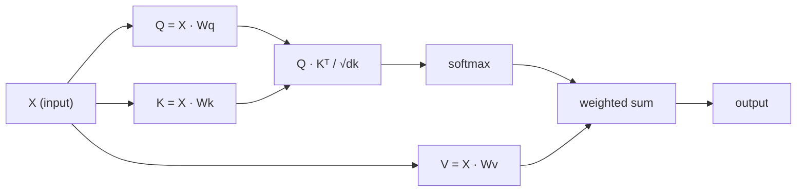

# Self-Attention dari Nol

> Attention adalah lookup table tempat setiap kata bertanya "siapa yang penting bagiku?" - dan mempelajari jawabannya.

**Type:** Build
**Languages:** Python
**Prerequisites:** Phase 3 (Deep Learning Core), Phase 5 Lesson 10 (Sequence-to-Sequence)
**Time:** ~90 minutes

## Tujuan Pembelajaran

- Implementasikan scaled dot-product self-attention dari nol hanya memakai NumPy, termasuk proyeksi query/key/value dan jumlah berbobot softmax
- Bangun lapisan multi-head attention yang membagi head, menghitung attention paralel, dan menggabungkan hasilnya
- Telusuri bagaimana matriks attention menangkap relasi token dan jelaskan mengapa scaling dengan sqrt(d_k) mencegah saturasi softmax
- Terapkan causal masking untuk mengubah attention dua arah menjadi attention autoregresif (ala decoder)

## Masalahnya

RNN memproses sequence satu token per langkah. Saat kamu mencapai token ke-50, informasi dari token pertama sudah diperas melalui 50 langkah kompresi. Dependensi jarak jauh hancur menjadi hidden state berukuran tetap - bottleneck yang tidak sepenuhnya teratasi oleh gating LSTM sebanyak apa pun.

Makalah attention Bahdanau 2014 menunjukkan solusinya: biarkan decoder melihat kembali ke setiap posisi encoder dan memutuskan mana yang penting untuk langkah saat ini. Tapi itu masih ditempelkan pada RNN. Makalah 2017 "Attention Is All You Need" mengajukan pertanyaan yang lebih tajam: bagaimana kalau attention adalah *satu-satunya* mekanisme? Tanpa recurrence. Tanpa convolution. Hanya attention.

Self-attention membiarkan setiap posisi dalam sequence attend ke setiap posisi lain dalam satu langkah paralel. Itulah yang membuat transformer cepat, scalable, dan dominan.

## Konsepnya

### Analogi Lookup Database

Anggap attention sebagai lookup database yang lembut:

```
Traditional database:
  Query: "capital of France"  -->  exact match  -->  "Paris"

Attention:
  Query: "capital of France"  -->  similarity to ALL keys  -->  weighted blend of ALL values
```

Setiap token menghasilkan tiga vektor:
- **Query (Q)**: "Apa yang sedang kucari?"
- **Key (K)**: "Apa yang kukandung?"
- **Value (V)**: "Informasi apa yang kuberikan kalau terpilih?"

Dot product antara sebuah query dan semua key menghasilkan skor attention. Skor tinggi berarti "key ini cocok dengan query-ku." Skor itu membobot value. Output-nya adalah jumlah berbobot dari value.

### Komputasi Q, K, V

Setiap embedding token diproyeksikan melalui tiga matriks bobot terpelajari:

```
Input embeddings (sequence of n tokens, each d-dimensional):

  X = [x1, x2, x3, ..., xn]       shape: (n, d)

Three weight matrices:

  Wq  shape: (d, dk)
  Wk  shape: (d, dk)
  Wv  shape: (d, dv)

Projections:

  Q = X @ Wq    shape: (n, dk)      each token's query
  K = X @ Wk    shape: (n, dk)      each token's key
  V = X @ Wv    shape: (n, dv)      each token's value
```

Secara visual, untuk satu token:

```
             Wq
  x_i ------[*]------> q_i    "What am I looking for?"
       |
       |     Wk
       +----[*]------> k_i    "What do I contain?"
       |
       |     Wv
       +----[*]------> v_i    "What do I offer?"
```

### Matriks Attention

Begitu kamu punya Q, K, V untuk semua token, skor attention membentuk matriks:

```
Scores = Q @ K^T    shape: (n, n)

              k1    k2    k3    k4    k5
        +-----+-----+-----+-----+-----+
   q1   | 2.1 | 0.3 | 0.1 | 0.8 | 0.2 |   <- how much q1 attends to each key
        +-----+-----+-----+-----+-----+
   q2   | 0.4 | 1.9 | 0.7 | 0.1 | 0.3 |
        +-----+-----+-----+-----+-----+
   q3   | 0.2 | 0.6 | 2.3 | 0.5 | 0.1 |
        +-----+-----+-----+-----+-----+
   q4   | 0.9 | 0.1 | 0.4 | 1.7 | 0.6 |
        +-----+-----+-----+-----+-----+
   q5   | 0.1 | 0.3 | 0.2 | 0.5 | 2.0 |
        +-----+-----+-----+-----+-----+

Each row: one token's attention over the entire sequence
```

Perhatikan satu query pada satu waktu menyapu key: setiap baris memberi skor pada setiap token, softmax mengubah skor menjadi bobot, dan vektor konteks adalah campuran berbobot dari value.

```figure
attention-matrix
```

### Mengapa Perlu Scaling?

Dot product tumbuh seiring dimensi dk. Kalau dk = 64, dot product bisa berada di kisaran puluhan, mendorong softmax ke wilayah tempat gradien menghilang. Solusinya: bagi dengan sqrt(dk).

```
Scaled scores = (Q @ K^T) / sqrt(dk)
```

Ini menjaga nilai dalam kisaran tempat softmax menghasilkan gradien yang berguna.

### Softmax Mengubah Skor Menjadi Bobot

Softmax mengubah skor mentah menjadi distribusi probabilitas di setiap baris:

```
Raw scores for q1:   [2.1, 0.3, 0.1, 0.8, 0.2]
                            |
                         softmax
                            |
Attention weights:   [0.52, 0.09, 0.07, 0.14, 0.08]   (sums to ~1.0)
```

Kini setiap token punya seperangkat bobot yang menyatakan seberapa besar ia attend ke setiap token lain.

### Jumlah Berbobot dari Value

Output akhir untuk setiap token adalah jumlah berbobot dari semua vektor value:

```
output_i = sum( attention_weight[i][j] * v_j  for all j )

For token 1:
  output_1 = 0.52 * v1 + 0.09 * v2 + 0.07 * v3 + 0.14 * v4 + 0.08 * v5
```

### Pipeline Penuh



Rumusnya dalam satu baris:

```
Attention(Q, K, V) = softmax( Q @ K^T / sqrt(dk) ) @ V
```

```figure
softmax-attention-scaling
```

## Bangun Sendiri

### Langkah 1: Softmax dari nol

Softmax mengubah logit mentah menjadi probabilitas. Kurangi dengan nilai maks untuk stabilitas numerik.

```python
import numpy as np

def softmax(x):
    shifted = x - np.max(x, axis=-1, keepdims=True)
    exp_x = np.exp(shifted)
    return exp_x / np.sum(exp_x, axis=-1, keepdims=True)

logits = np.array([2.0, 1.0, 0.1])
print(f"logits:  {logits}")
print(f"softmax: {softmax(logits)}")
print(f"sum:     {softmax(logits).sum():.4f}")
```

### Langkah 2: Scaled dot-product attention

Fungsi intinya. Menerima matriks Q, K, V dan mengembalikan output attention plus matriks bobotnya.

```python
def scaled_dot_product_attention(Q, K, V):
    dk = Q.shape[-1]
    scores = Q @ K.T / np.sqrt(dk)
    weights = softmax(scores)
    output = weights @ V
    return output, weights
```

### Langkah 3: Kelas self-attention dengan proyeksi terpelajari

Modul self-attention penuh dengan matriks bobot Wq, Wk, Wv yang diinisialisasi dengan scaling ala Xavier.

```python
class SelfAttention:
    def __init__(self, d_model, dk, dv, seed=42):
        rng = np.random.default_rng(seed)
        scale = np.sqrt(2.0 / (d_model + dk))
        self.Wq = rng.normal(0, scale, (d_model, dk))
        self.Wk = rng.normal(0, scale, (d_model, dk))
        scale_v = np.sqrt(2.0 / (d_model + dv))
        self.Wv = rng.normal(0, scale_v, (d_model, dv))
        self.dk = dk

    def forward(self, X):
        Q = X @ self.Wq
        K = X @ self.Wk
        V = X @ self.Wv
        output, weights = scaled_dot_product_attention(Q, K, V)
        return output, weights
```

### Langkah 4: Jalankan pada sebuah kalimat

Buat embedding palsu untuk sebuah kalimat dan perhatikan bobot attention-nya.

```python
sentence = ["The", "cat", "sat", "on", "the", "mat"]
n_tokens = len(sentence)
d_model = 8
dk = 4
dv = 4

rng = np.random.default_rng(42)
X = rng.normal(0, 1, (n_tokens, d_model))

attn = SelfAttention(d_model, dk, dv, seed=42)
output, weights = attn.forward(X)

print("Attention weights (each row: where that token looks):\n")
print(f"{'':>6}", end="")
for token in sentence:
    print(f"{token:>6}", end="")
print()

for i, token in enumerate(sentence):
    print(f"{token:>6}", end="")
    for j in range(n_tokens):
        w = weights[i][j]
        print(f"{w:6.3f}", end="")
    print()
```

### Langkah 5: Visualisasikan attention dengan heatmap ASCII

Petakan bobot attention ke karakter untuk visual cepat.

```python
def ascii_heatmap(weights, tokens, chars=" ░▒▓█"):
    n = len(tokens)
    print(f"\n{'':>6}", end="")
    for t in tokens:
        print(f"{t:>6}", end="")
    print()

    for i in range(n):
        print(f"{tokens[i]:>6}", end="")
        for j in range(n):
            level = int(weights[i][j] * (len(chars) - 1) / weights.max())
            level = min(level, len(chars) - 1)
            print(f"{'  ' + chars[level] + '   '}", end="")
        print()

ascii_heatmap(weights, sentence)
```

## Gunakan

`nn.MultiheadAttention` milik PyTorch melakukan tepat apa yang kita bangun, plus pemisahan multi-head dan proyeksi output:

```python
import torch
import torch.nn as nn

d_model = 8
n_heads = 2
seq_len = 6

mha = nn.MultiheadAttention(embed_dim=d_model, num_heads=n_heads, batch_first=True)

X_torch = torch.randn(1, seq_len, d_model)

output, attn_weights = mha(X_torch, X_torch, X_torch)

print(f"Input shape:            {X_torch.shape}")
print(f"Output shape:           {output.shape}")
print(f"Attention weight shape: {attn_weights.shape}")
print(f"\nAttn weights (averaged over heads):")
print(attn_weights[0].detach().numpy().round(3))
```

Perbedaan kuncinya: multi-head attention menjalankan banyak fungsi attention secara paralel, masing-masing dengan proyeksi Q, K, V sendiri berukuran dk = d_model / n_heads, lalu menggabungkan hasilnya. Ini membiarkan model attend ke berbagai tipe relasi secara simultan.

## Rilis

Pelajaran ini menghasilkan:
- `outputs/prompt-attention-explainer.md` - sebuah prompt untuk menjelaskan attention lewat analogi lookup database

## Latihan

1. Modifikasi `scaled_dot_product_attention` agar menerima matriks mask opsional yang mengatur posisi tertentu menjadi negative infinity sebelum softmax (begini cara kerja causal/decoder masking)
2. Implementasikan multi-head attention dari nol: bagi Q, K, V menjadi `n_heads` potongan, jalankan attention pada masing-masing, gabungkan, dan proyeksikan melalui matriks bobot final Wo
3. Ambil dua kalimat berbeda dengan panjang yang sama, umpankan melalui instance SelfAttention yang sama, dan bandingkan pola attention-nya. Apa yang berubah? Apa yang tetap sama?

## Istilah Kunci

| Term | What people say | What it actually means |
|------|----------------|----------------------|
| Query (Q) | "The question vector" | A learned projection of the input that represents what information this token is looking for |
| Key (K) | "The label vector" | A learned projection that represents what information this token contains, matched against queries |
| Value (V) | "The content vector" | A learned projection carrying the actual information that gets aggregated based on attention scores |
| Scaled dot-product attention | "The attention formula" | softmax(QK^T / sqrt(dk)) @ V - scaling prevents softmax saturation in high dimensions |
| Self-attention | "The token looks at itself and others" | Attention where Q, K, V all come from the same sequence, letting every position attend to every other position |
| Attention weights | "How much focus" | A probability distribution over positions, produced by softmax over scaled dot products |
| Multi-head attention | "Parallel attention" | Running multiple attention functions with different projections, then concatenating results for richer representations |

## Bacaan Lanjutan

- [Attention Is All You Need (Vaswani et al., 2017)](https://arxiv.org/abs/1706.03762) - makalah transformer orisinal
- [The Illustrated Transformer (Jay Alammar)](https://jalammar.github.io/illustrated-transformer/) - panduan visual terbaik untuk arsitektur penuhnya
- [The Annotated Transformer (Harvard NLP)](https://nlp.seas.harvard.edu/annotated-transformer/) - implementasi PyTorch baris per baris disertai penjelasan
