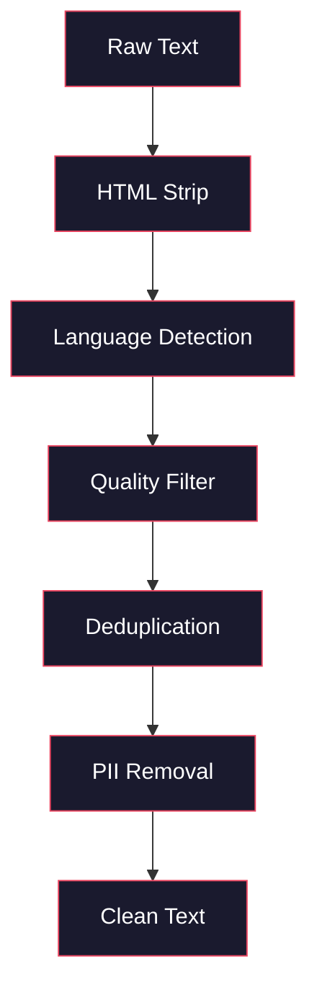
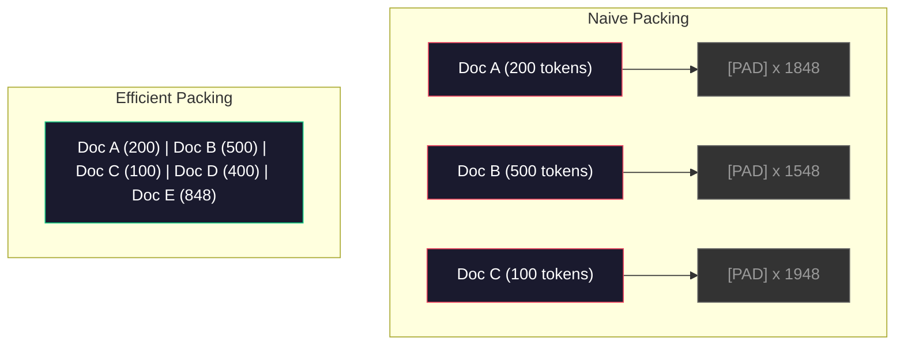

# Saluran Data untuk Pra-Pelatihan

> Modelnya adalah cermin. Ini mencerminkan data apa pun yang kamu masukkan. Beri makan sampah, itu mencerminkan sampah dengan kelancaran sempurna.

**Type:** Build
**Languages:** Python
**Prerequisites:** Phase 10, Lessons 01-02 (Tokenizers, Building a Tokenizer)
**Time:** ~90 minutes

## Tujuan Pembelajaran

- Bangun saluran data streaming yang memberi token, potongan, pengacakan, dan kumpulan teks berukuran terabyte tanpa memuat semuanya ke dalam memori
- Menerapkan filter kualitas data (deduplikasi, deteksi bahasa, pemfilteran konten) yang digunakan dalam alur pra-pelatihan nyata
- Buat urutan pelatihan dengan panjang tetap dengan masker perhatian yang tepat dan penanganan batas dokumen
- Throughput alur profil untuk memastikan pemuat data tetap mengikuti perkembangannyaGPUkecepatan pelatihan

## Masalahnya

kamu memiliki tokenizer. Sekarang kamu membutuhkan data.

Bukan kumpulan data. Bukan sebuahCSVmengajukan. Terabyte teks -- dibersihkan, dihapus duplikatnya, difilter untuk kualitas, diberi token ke dalam urutan dengan panjang tetap, dan disajikan dalam kelompok acak dengan cukup cepat sehingga 8-GPUcluster tidak pernah menunggu batch berikutnya.

Kebanyakan orang berpikir pelatihan adalah sebuahLLMadalah tentang arsitektur model. Tidak. Llama 3 menggunakan 15,6 triliun token.GPT-3 menggunakan 300 miliar. DeepSeek-V2 menggunakan 8,1 triliun. Arsitektur ketiganya kira-kira sama: blok transformator bertumpuk dengan lapisan perhatian dan umpan maju. Perbedaan kualitas keluaran sebagian besar berasal dari data.

Makalah Chinchilla dari DeepMind membuat hal ini menjadi tepat. Untuk anggaran komputasi tertentu, terdapat rasio optimal parameter model terhadap token pelatihan. Chinchilla menunjukkan bahwa sebagian besar model pada tahun 2022 kurang terlatih -- mereka memiliki terlalu banyak parameter untuk jumlah data yang mereka lihat. Model parameter 70 miliar yang dilatih pada 1,4 triliun token (optimal Chinchilla) mengungguli model 280 miliar yang dilatih pada 300 miliar token (Gopher).

Pipeline data kamu menentukan apakah model kamu mempelajari bahasa atau mempelajari noise.

## Konsepnya

### Dari Mana Data Berasal

Setiap model bahasa besar dilatih pada berbagai sumber. Komposisi pastinya merupakan rahasia yang dijaga ketat di sebagian besar laboratorium, namun kami cukup mengetahui untuk memahami kategorinya.

| Source | Size | Quality | Used By |
|--------|------|---------|---------|
| Common Crawl | ~250 TB raw | Low (needs heavy filtering) | GPT-3, Llama, most open models |
| Wikipedia | ~20 GB | High | Every major LLM |
| GitHub code | ~1 TB+ | Medium (lots of duplicates, dead code) | StarCoder, CodeLlama, DeepSeek-Coder |
| Books (BookCorpus, Pile) | ~100 GB | High | GPT-2, GPT-3, early models |
| Academic papers (arXiv, S2ORC) | ~100 GB | High for STEM | Llama, Galactica |
| StackOverflow, Reddit | ~100 GB | Medium | Llama, Falcon |
| Curated web (C4, RefinedWeb) | ~5 TB | Medium-High (pre-filtered) | T5, Falcon |

Llama 3 mengungkapkan campuran datanya: sekitar 50% data web, 25% kode, 13% buku dan makalah akademis, 8% data matematika, dan 4% data web multibahasa. Totalnya adalah 15,6 triliun token dari sumber yang melebihi 5 TB teks mentah.

Rasio sama pentingnya dengan ukuran total. Terlalu banyak data web dan modelnya menjadi burung beo Reddit. Kode terlalu sedikit dan tidak dapat diprogram. Terlalu sedikit matematika dan gagal dalam penalaran. Melakukan perpaduan ini dengan benar adalah salah satu bagian tersulit dalam pelatihan danLLM, dan tidak ada rumusnya -- hal ini memerlukan eksperimen dan evaluasi.

### Pembersihan Data

Data web mentah itu kotor. Dump Perayapan Umum yang khas berisi:

- HTMLtag dan JavaScript
- Header, footer, menu navigasi boilerplate
- Halaman duplikat (sama persis dan hampir duplikat)
- Spam yang dihasilkan mesin
- Informasi identitas pribadi (PII)
- Teks berkualitas rendah (daftar kata kunci,SEOspam)
- Konten non-teks dikodekan sebagai teks

Membersihkan ini bukanlah suatu pilihan. Ini adalah perbedaan antara model yang menghasilkan paragraf yang koheren dan model yang menghasilkan outputHTMLtag dicampur dengan daftar produk.



Setiap langkah menghilangkan kategori kebisingan:

**HTMLpengupasan:** Hapus semua markup. Simpan hanya konten teks yang terlihat. Perpustakaan seperti`trafilatura`atau`readability`mengekstrak konten artikel sambil membuang navigasi, iklan, dan boilerplate.

**Deteksi bahasa:** Gunakan model identifikasi bahasa fastText (lid.176.bin) untuk mengklasifikasikan setiap dokumen. Filter ke bahasa target kamu. Sebuah dokumen yang diklasifikasikan sebagai bahasa Inggris dengan tingkat kepercayaan kurang dari 0,8 mungkin bukan bahasa Inggris yang bersih.

**Pemfilteran kualitas:** Di sinilah hal yang menarik. RefinedWeb (kumpulan data di belakang Falcon) menggunakan filter berbasis kebingungan: latih model bahasa kecil di Wikipedia, lalu beri skor pada setiap dokumen. Kebingungan yang tinggi berarti dokumen tersebut tidak seperti Wikipedia -- kemungkinan besar merupakan spam, daftar kata kunci, atau konten buatan mesin. Dokumen dengan tingkat kebingungan di atas ambang batas akan dihapus.

**Deduplikasi:** Satu-satunya langkah pembersihan yang paling berdampak. Perayapan Umum berisi sejumlah besar halaman duplikat -- penafian hukum, pemberitahuan cookie, persyaratan layanan. Pelatihan tentang duplikat menyia-nyiakan komputasi dan dapat menyebabkan model menghafal dan memuntahkan bagian tertentu kata demi kata.

**PIIpenghapusan:** Nama, alamat email, nomor telepon, nomor jaminan sosial. Deteksi berbasis regex untuk terstrukturPII,NERmodel untuk nama dalam konteks.

### Deduplikasi dengan MinHash

Deduplikasi yang tepat itu mudah: hash setiap dokumen, hapus duplikat. Namun masalah sebenarnya adalah duplikat yang hampir sama. Dua salinan artikel berita yang sama dengan iklan yang sedikit berbeda hampir merupakan duplikat. Kontennya 95% identik, tetapi tiap byte berbeda.

MinHash + Hashing Sensitif Lokalitas (LSH) menyelesaikan ini secara efisien.


Idenya:

1. **Shingling:** Mengonversi setiap dokumen menjadi kumpulan n-gram (misalnya, 5 gram kata atau karakter). "rubah coklat cepat" dengan sirap 3 kata menjadi {"si coklat cepat", "rubah coklat cepat"}.

2. **MinHash:** Untuk setiap kumpulan sirap dokumen, hitung k nilai hash. Setiap nilai hash adalah hash minimum di semua sirap di bawah fungsi hash yang berbeda. Ini menciptakan "tanda tangan" berukuran tetap yang mendekati kesamaan Jaccard antara dua dokumen mana pun.

3. **LSH:** Kelompokkan dokumen ke dalam keranjang berdasarkan pita tanda tangan MinHashnya. Dokumen dalam wadah yang sama merupakan kandidat yang hampir duplikat. Hal ini untuk menghindari membandingkan setiap pasangan -- kamu hanya membandingkan kandidat.

4. **Verifikasi:** Untuk setiap pasangan kandidat, hitung kesamaan Jaccard yang tepat. Hapus satu salinan jika kesamaan melebihi ambang batas (biasanya 0,8).

Tim Llama melaporkan menghapus sekitar 38% data web mereka melalui deduplikasi. Itu bukanlah angka yang kecil. Lebih dari sepertiga Perayapan Umum adalah konten duplikat atau hampir duplikat.

### Urutan Pengepakan

Model kamu mengharapkan urutan masukan dengan panjang tetap. Panjang dokumen kamu bervariasi. Ada yang 50 token. Ada yang 50.000 token.

Pendekatan naif: padukan setiap dokumen ke panjang urutan maksimum. Hal ini membuang-buang komputasi besar-besaran pada padding token yang tidak memberikan kontribusi apa pun pada pembelajaran.

Pendekatan yang lebih baik: kemas beberapa dokumen ke dalam satu urutan, dipisahkan dengan token akhir urutan. Urutan token 2048 mungkin berisi tiga dokumen pendek yang digabungkan dengan [EOS] token di antara mereka.



Masker perhatian harus dipasang dengan benar. Token dari Dokumen A tidak boleh menggantikan token dari Dokumen B dalam urutan pengemasan yang sama. Ini memerlukan masker perhatian blok-diagonal.

Dokumen panjang terpotong atau dipecah menjadi beberapa bagian pada batas urutan. Titik pisah itu penting: pemisahan di tengah kalimat memaksa model melihat pemikiran yang tidak lengkap. Beberapa alur menyelaraskan pemisahan ke batas paragraf atau kalimat jika memungkinkan.

### Hukum Skala Chinchilla

Untuk anggaran komputasi tetap C (diukur dalam FLOP), ukuran model optimal N dan ukuran kumpulan data D adalah sebagai berikut:

```
N_opt ~ C^0.5
D_opt ~ C^0.5
```

Dalam praktiknya, ini berarti kamu harus menskalakan ukuran model dan ukuran kumpulan data secara kira-kira sama. Model dengan parameter 10x lebih banyak memerlukan token pelatihan sekitar 10x lebih banyak untuk mencapai kerugian yang sama.

| Model | Parameters | Training Tokens | Chinchilla-Optimal? |
|-------|-----------|----------------|-------------------|
| GPT-3 | 175B | 300B | No (undertrained 3-4x) |
| Chinchilla | 70B | 1.4T | Yes (by design) |
| Llama 2 | 70B | 2T | Overtrained (intentionally) |
| Llama 3 | 70B | 15T | Heavily overtrained |

Llama 3 sengaja melanggar hukum Chinchilla. Meta menemukan bahwa pelatihan berlebihan pada lebih banyak data -- jauh melampaui rasio komputasi optimal -- menghasilkan model inferensi yang lebih baik. Biaya pelatihan tambahan dibayarkan satu kali, namun model yang lebih kecil lebih murah untuk digunakan selamanya. Hal ini terkadang disebut pendekatan penskalaan "inferensi-optimal", dan telah menjadi standar industri sejak tahun 2024.

```figure
l5-data-pipeline
```

## Bangun Sendiri

### Langkah 1: Pembersihan Teks

MengupasHTML, normalkan spasi, hapus konten non-teks. Kami akan menggunakan teks domain publik (Proyek Gutenberg) sebagai korpus kecil kami.

```python
import re

def clean_text(text):
    text = re.sub(r"<[^>]+>", "", text)
    text = re.sub(r"http\S+", "", text)
    text = re.sub(r"[^\x20-\x7E\n]", "", text)
    text = re.sub(r"\n{3,}", "\n\n", text)
    text = re.sub(r" {2,}", " ", text)
    return text.strip()

def quality_filter(text, min_words=50, max_ratio_caps=0.3, max_ratio_special=0.1):
    words = text.split()
    if len(words) < min_words:
        return False
    caps_ratio = sum(1 for w in words if w.isupper()) / len(words)
    if caps_ratio > max_ratio_caps:
        return False
    special_chars = sum(1 for c in text if not c.isalnum() and not c.isspace())
    if special_chars / max(len(text), 1) > max_ratio_special:
        return False
    return True
```

Filter kualitas menangkapSEOspam (ALL CAPS), kebisingan yang dihasilkan mesin (rasio karakter khusus yang tinggi), dan halaman rintisan (terlalu pendek). Ketiga pemeriksaan ini saja sudah menghilangkan sejumlah besar sampah dari perayapan web.

### Langkah 2: Deduplikasi MinHash

Terapkan MinHash dari awal. Tidak diperlukan perpustakaan eksternal -- cukup`hashlib`.

```python
import hashlib
from collections import defaultdict

def get_shingles(text, k=5):
    words = text.lower().split()
    if len(words) < k:
        return set()
    return {" ".join(words[i:i+k]) for i in range(len(words) - k + 1)}

def minhash_signature(shingles, num_hashes=128):
    signature = []
    for i in range(num_hashes):
        min_hash = float("inf")
        for shingle in shingles:
            h = int(hashlib.sha256(f"{i}:{shingle}".encode()).hexdigest(), 16)
            min_hash = min(min_hash, h)
        signature.append(min_hash)
    return signature

def lsh_buckets(signature, bands=16):
    rows_per_band = len(signature) // bands
    buckets = []
    for b in range(bands):
        start = b * rows_per_band
        band_data = tuple(signature[start:start + rows_per_band])
        bucket_hash = hashlib.md5(str(band_data).encode()).hexdigest()
        buckets.append((b, bucket_hash))
    return buckets

def deduplicate(documents, threshold=0.8, num_hashes=128, bands=16):
    signatures = []
    shingle_sets = []
    for doc in documents:
        shingles = get_shingles(doc)
        shingle_sets.append(shingles)
        signatures.append(minhash_signature(shingles, num_hashes))

    bucket_map = defaultdict(list)
    for doc_idx, sig in enumerate(signatures):
        for band_id, bucket_hash in lsh_buckets(sig, bands):
            bucket_map[(band_id, bucket_hash)].append(doc_idx)

    duplicate_pairs = set()
    for bucket_docs in bucket_map.values():
        if len(bucket_docs) < 2:
            continue
        for i in range(len(bucket_docs)):
            for j in range(i + 1, len(bucket_docs)):
                duplicate_pairs.add((bucket_docs[i], bucket_docs[j]))

    removed = set()
    for i, j in duplicate_pairs:
        if i in removed or j in removed:
            continue
        s1, s2 = shingle_sets[i], shingle_sets[j]
        if not s1 or not s2:
            continue
        jaccard = len(s1 & s2) / len(s1 | s2)
        if jaccard >= threshold:
            removed.add(j)

    return [doc for idx, doc in enumerate(documents) if idx not in removed], len(removed)
```

Itu`num_hashes=128`dan`bands=16`parameter mengontrol tradeoff penarikan presisi. Lebih banyak hash memberikan perkiraan kesamaan yang lebih akurat. Lebih banyak pita meningkatkan perolehan (menangkap lebih banyak duplikat) dengan mengorbankan lebih banyak kesalahan positif. Nilai-nilai ini berfungsi dengan baik untuk teks web biasa.

### Langkah 3: Tokenisasi dan Urutan Paket

Ambil teks yang bersih dan tidak terduplikasi, buat tokenisasi, dan kemas ke dalam urutan dengan panjang tetap untuk pelatihan.

```python
def tokenize_corpus(documents, tokenizer):
    all_tokens = []
    for doc in documents:
        tokens = tokenizer.encode(doc)
        all_tokens.extend(tokens)
        all_tokens.append(tokenizer.eos_id)
    return all_tokens

def pack_sequences(token_ids, seq_length, pad_id=0):
    sequences = []
    attention_masks = []
    for i in range(0, len(token_ids), seq_length):
        seq = token_ids[i:i + seq_length]
        mask = [1] * len(seq)
        if len(seq) < seq_length:
            pad_count = seq_length - len(seq)
            seq = seq + [pad_id] * pad_count
            mask = mask + [0] * pad_count
        sequences.append(seq)
        attention_masks.append(mask)
    return sequences, attention_masks
```

### Langkah 4: DataLoader untuk Pelatihan

Menghasilkan kumpulan urutan yang dikemas secara acak. Inilah yang digunakan oleh loop pelatihan.

```python
import random

class PreTrainingDataLoader:
    def __init__(self, sequences, attention_masks, batch_size, shuffle=True):
        self.sequences = sequences
        self.attention_masks = attention_masks
        self.batch_size = batch_size
        self.shuffle = shuffle

    def __len__(self):
        return (len(self.sequences) + self.batch_size - 1) // self.batch_size

    def __iter__(self):
        indices = list(range(len(self.sequences)))
        if self.shuffle:
            random.shuffle(indices)
        for start in range(0, len(indices), self.batch_size):
            batch_idx = indices[start:start + self.batch_size]
            batch_seqs = [self.sequences[i] for i in batch_idx]
            batch_masks = [self.attention_masks[i] for i in batch_idx]
            yield batch_seqs, batch_masks
```

### Langkah 5: Statistik Kumpulan Data

Hitung angka-angka yang penting: total token, token unik, rasio kompresi, distribusi panjang dokumen.

```python
from collections import Counter

def compute_statistics(documents, token_ids, sequences, tokenizer_vocab_size):
    total_chars = sum(len(d) for d in documents)
    total_tokens = len(token_ids)
    unique_tokens = len(set(token_ids))
    compression_ratio = total_chars / total_tokens

    doc_lengths = [len(d.split()) for d in documents]
    avg_doc_length = sum(doc_lengths) / max(len(doc_lengths), 1)
    max_doc_length = max(doc_lengths) if doc_lengths else 0
    min_doc_length = min(doc_lengths) if doc_lengths else 0

    token_counts = Counter(token_ids)
    top_tokens = token_counts.most_common(10)

    non_pad_tokens = sum(sum(1 for t in seq if t != 0) for seq in sequences)
    total_positions = sum(len(seq) for seq in sequences)
    utilization = non_pad_tokens / max(total_positions, 1)

    stats = {
        "total_documents": len(documents),
        "total_characters": total_chars,
        "total_tokens": total_tokens,
        "unique_tokens": unique_tokens,
        "vocab_utilization": unique_tokens / tokenizer_vocab_size,
        "compression_ratio": compression_ratio,
        "avg_doc_length_words": avg_doc_length,
        "max_doc_length_words": max_doc_length,
        "min_doc_length_words": min_doc_length,
        "num_sequences": len(sequences),
        "sequence_utilization": utilization,
        "top_10_tokens": top_tokens,
    }
    return stats
```

Rasio kompresi memberi tahu kamu seberapa efisien tokenizer pada korpus ini. Teks bahasa Inggris biasanya dikompres menjadi sekitar 3-4 karakter per token. Jika kamu melihat 1,5 karakter per token, tokenizer kamu terpecah terlalu agresif. Jika kamu melihat 8+, berarti ia telah mempelajari penggabungan yang sangat spesifik untuk domain.

Pemanfaatan urutan memberi tahu kamu seberapa banyak urutan yang dikemas merupakan data nyata versus padding. Di bawah 90% berarti pengepakan kamu tidak efisien -- kamu membuang-buang komputasi pada token padding.

## Gunakan

### Bandingkan Dengan Kumpulan Data HuggingFace

Muat korpus yang sama melalui pustaka kumpulan data HuggingFace dan bandingkan kecepatan saluran.

```python
from datasets import load_dataset
from transformers import AutoTokenizer

ds = load_dataset("wikitext", "wikitext-2-raw-v1", split="train")
tokenizer = AutoTokenizer.from_pretrained("meta-llama/Meta-Llama-3-8B")

import time

start = time.time()
tokenized = ds.map(
    lambda x: tokenizer(x["text"], truncation=True, max_length=2048),
    batched=True,
    num_proc=4,
)
hf_time = time.time() - start
total_tokens = sum(len(t) for t in tokenized["input_ids"])
print(f"HuggingFace: {total_tokens:,} tokens in {hf_time:.2f}s ({total_tokens/hf_time:,.0f} tokens/sec)")
```

Pipeline HuggingFace menggunakan tokenizer Rust dan pemrosesan paralel di 4 inti. Pipeline Python murni kamu akan menjadi 10-50x lebih lambat. Kesenjangan itulah yang menjadi alasan tim produksi menggunakan tokenizer yang dikompilasi. Algoritmanya sama. Bahasa implementasinya adalah perbedaannya.

## Rilis

Pelajaran ini menghasilkan prompt untuk memvalidasi dan men-debug kualitas dataLLMsaluran pelatihan. Lihat`outputs/prompt-data-quality-checker.md`.

## Latihan

1. **Mudah:** Tambahkan deteksi bahasa ke saluran pembersihan menggunakan heuristik sederhana (analisis rangkaian karakter). Filter ke hanya dokumen berbahasa Inggris dan ukur berapa banyak dokumen yang dihapus.
2. **Medium:** Menerapkan deduplikasi yang tepat menggunakanSHA-256 hash di samping deduplikasi MinHash yang hampir terjadi. Bandingkan jumlah duplikat yang ditangkap oleh masing-masing metode pada korpus yang tergores web.
3. **Sulit:** Buat filter kualitas berbasis kebingungan. Latih model bahasa bigram kecil pada teks Wikipedia, beri skor pada setiap dokumen berdasarkan tingkat kerumitannya, dan hapus 20% terbawah. Bandingkan kualitas keluaran model saat melatih data yang difilter dan tidak difilter.

## Istilah-Istilah Utama

| Term | What people say | What it actually means |
|------|----------------|----------------------|
| Common Crawl | "The internet" | A non-profit that crawls the web monthly -- ~250TB raw, the starting point for most LLM training data |
| MinHash | "Some hashing trick" | A technique to estimate Jaccard similarity between sets using fixed-size signatures -- enables near-duplicate detection at scale |
| LSH | "Locality-Sensitive Hashing" | A method to group similar items into the same bucket -- reduces pairwise comparisons from O(n^2) to near-linear |
| Sequence packing | "Concatenating documents" | Fitting multiple documents into fixed-length sequences with proper attention masks -- eliminates padding waste |
| Chinchilla scaling | "Train on more data" | For a fixed compute budget, optimal performance requires scaling model size and training tokens roughly equally |
| Fertility | "Tokens per word" | Average number of tokens per word -- 1.3 for English in GPT-4, higher for non-Latin scripts |
| Data mixing | "Choosing training data" | The ratio of code vs text vs math vs multilingual data -- no formula, requires experimentation |
| Perplexity filter | "Quality scoring" | Use a small language model to score documents -- high perplexity means the text is unlike clean reference data |
| Deduplication | "Removing copies" | Eliminating exact and near-duplicate documents -- typically removes 30-40% of raw web data |
| Attention mask | "Which tokens to look at" | A binary mask that prevents attention across document boundaries in packed sequences |

## Bacaan Lebih Lanjut

- [Hoffmann dkk., 2022 -- Pelatihan Model Bahasa Besar Optimal Komputasi (Chinchilla)](https://arxiv.org/abs/2203.15556) -- makalah yang mengubah cara kita berpikir tentang skala data
- [Penedo dkk., 2023 -- Kumpulan Data RefinedWeb untuk FalconLLM](https://arxiv.org/abs/2306.01116) -- cara memfilter Perayapan Umum ke kualitas tinggi
- [Touvron dkk., 2023 -- Llama 2: Open Foundation dan Model Obrolan yang Disempurnakan](https://arxiv.org/abs/2307.09288) -- detail saluran data untuk Llama 2
- [Lee dkk., 2022 -- Menghapus Duplikasi Data Pelatihan Membuat Model Bahasa Lebih Baik](https://arxiv.org/abs/2107.06499) -- mengapa deduplikasi lebih penting dari yang kamu kira
- [Broder, 1997 -- Tentang Kemiripan dan Penahanan Dokumen](https://ieeexplore.ieee.org/document/666900) -- kertas MinHash asli
- [Meta, 2024 -- Laporan Teknis Llama 3](https://arxiv.org/abs/2407.21783) -- 15,6T token, rasio pencampuran data, saluran penyaringan
