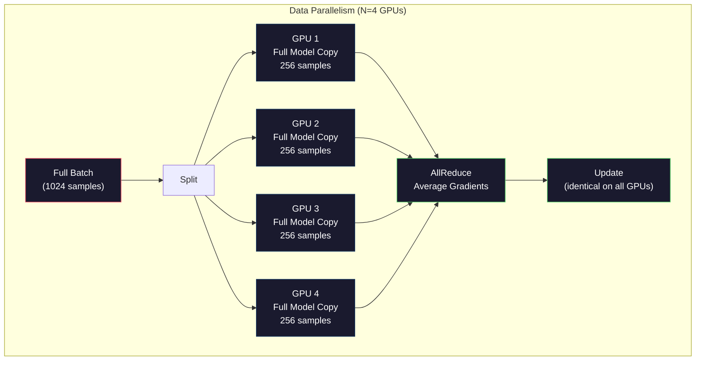
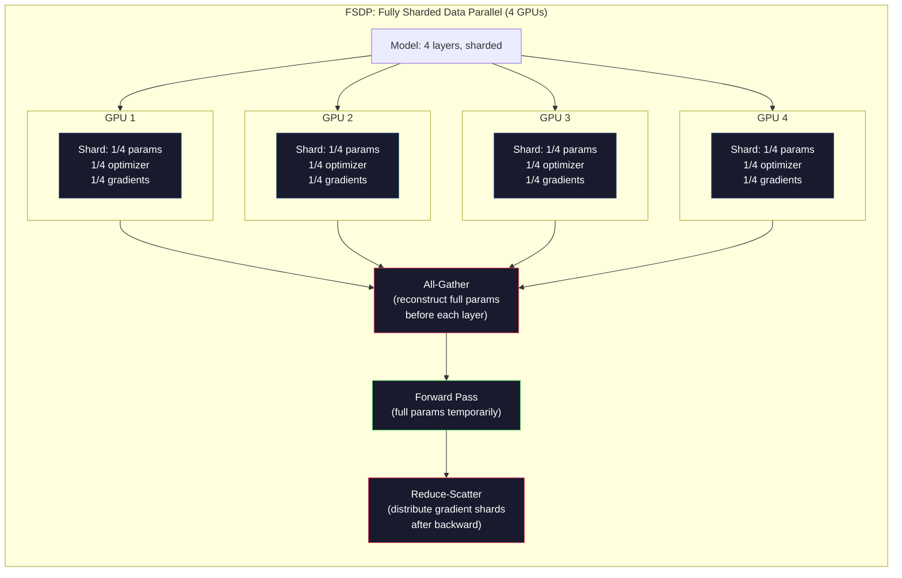
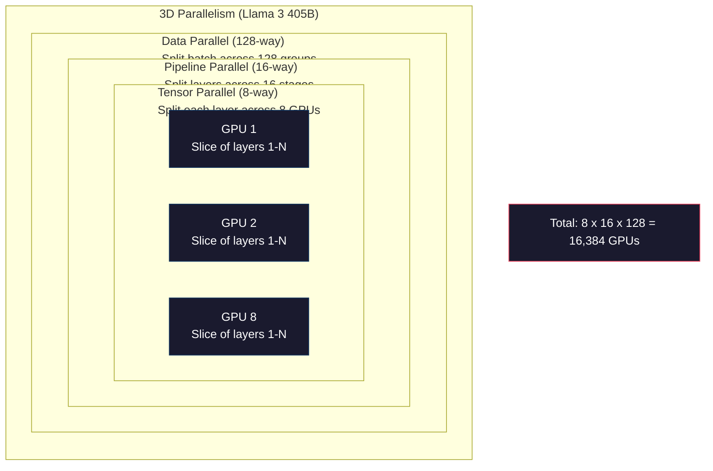

# Penskalaan: Pelatihan Terdistribusi,FSDP, Kecepatan Dalam

> Model 124M kamu dilatih pada salah satunyaGPU. Sekarang coba 7 miliar parameter. Modelnya tidak muat di memori. Datanya membutuhkan waktu berminggu-minggu di satu mesin. Pelatihan terdistribusi bukanlah suatu pilihan dalam skala besar. Itu satu-satunya jalan ke depan.

**Type:** Build
**Languages:** Python
**Prerequisites:** Phase 10, Lesson 04 (Pre-Training a Mini GPT)
**Time:** ~120 minutes

## Tujuan Pembelajaran

- Jelaskan tiga jenis paralelisme (data, tensor, pipeline) dan kapan masing-masing diperlukan berdasarkan model dan ukuran cluster
- Menerapkan pelatihan paralel data menggunakan PyTorchDDPdengan sinkronisasi gradien di beberapa GPU
- Hitung anggaran memori untuk ukuran model tertentu (bobot + status pengoptimal + gradien + aktivasi) untuk menentukan perangkat keras minimum
- KonfigurasikanFSDPatau tahapan DeepSpeed ZeRO untuk membagi status model di seluruh GPU dan menyesuaikan model yang melebihi single-GPUmemori

## Masalahnya

Model parameter 7B diFP16membutuhkan 14GB hanya untuk bobotnya. Pengoptimal Adam menyimpan dua salinan tambahan dari setiap parameter (perkiraan momen pertama dan kedua). Itu 28GB lagi. Gradien selama propagasi mundur menambah 14 GB lebih banyak. kamu berada di 56GB sebelum satu aktivasi disimpan.

SebuahNVIDIA A100memiliki memori 80GB.

56GB dari 80GB yang dikonsumsi. Ini menyisakan 24 GB untuk aktivasi -- nilai antara yang dihitung selama forward pass yang harus tetap aktif untuk propagasi mundur. Untuk rangkaian token 2048 dengan model dimensi 4096, aktivasi satu lapisan menggunakan sekitar 64MB. Dengan 32 lapisan, kamu memerlukan 2 GB per sampel. Ukuran batch 8 memerlukan 16 GB. kamu memiliki 24GB. Ukuran batch 12 meledak.

Sekarang coba parameter 70B. Bobotnya saja: 140GB masukFP16. Tidak cocok pada satuGPU. kamu memerlukan setidaknya 2 A100 (2 x 80GB = 160GB) hanya untuk menahan beban. Tambahkan status pengoptimal dan gradien dan kamu memerlukan lebih banyak lagi: minimum 3+ GPU, dan secara realistis 8-16 tergantung pada strategi sharding.

Llama 3 405B dilatih pada 16.384NVIDIA H100GPU. Biaya pelatihan diperkirakan$100 million in compute. DeepSeek V3 trained a comparable model for roughly $5,6 juta dengan menjadi pintar tentang arsitektur (Campuran Pakar berarti hanya sebagian kecil dari parameter yang diaktifkan per token) dan efisiensi pelatihan.

Pelajaran ini mencakup empat strategi yang memungkinkan pelatihan skala besar: paralelisme data, paralelisme tensor, paralelisme pipeline, dan paralelisme data sharded penuh. kamu akan mensimulasikan masing-masing dengan Python murni untuk memahami mekanismenya sebelum menyentuh kerangka pelatihan terdistribusi.

## Konsepnya

### Mengapa Distribusi Diperlukan

Berikut adalah matematika memori untuk model nyata. Setiap angka dihitung, bukan diperkirakan.

| Model | Params | Weights (FP16) | Adam States | Gradients (FP16) | Total (no activations) |
|-------|--------|----------------|-------------|------------------|----------------------|
| GPT-2 Small | 124M | 248 MB | 992 MB | 248 MB | 1.5 GB |
| Llama 3 8B | 8B | 16 GB | 64 GB | 16 GB | 96 GB |
| Llama 3 70B | 70B | 140 GB | 560 GB | 140 GB | 840 GB |
| Llama 3 405B | 405B | 810 GB | 3,240 GB | 810 GB | 4,860 GB |

Kolom "Adam States" adalah pembunuhnya. Adam menyimpan rata-rata berjalan (m) dan varians berjalan (v) untuk setiap parameter, keduanya dalamFP32. Untuk model 70B, yaitu 70B x 4 byte x 2 = 560GB. Pengoptimalnya sendiri membutuhkan tujuh A100.

SatuH100memiliki 80GB. Llama 3 405B memerlukan setidaknya 61 H100 untuk menampung bobot, pengoptimal, dan gradien. Tambahkan aktivasi dan jumlahnya akan bertambah. Meta menggunakan 16.384 GPU bukan karena mereka ingin -- karena terpaksa.

### Paralelisme Data

Strategi terdistribusi paling sederhana. Salin seluruh model ke N GPU. Bagi setiap kelompok pelatihan menjadi N bagian yang sama. Masing-masingGPUmenjalankan penerusan maju dan mundur pada pecahan datanya. Setelah melakukan backward pass, rata-ratakan gradien di semua GPU. SetiapGPUmemperbarui salinan bobotnya dengan gradien rata-rata yang sama, menjaga semua salinan tetap sinkron.

**Kelebihannya:** Penskalaan throughput linier. N GPU memproses data N kali lebih banyak per langkah. Komunikasi terbatas pada rata-rata gradien, yang tumpang tindih dengan komputasi.

**Yang buruk:** SetiapGPUmenyimpan salinan lengkap model, status pengoptimal, dan gradien. Untuk model 70B, masing-masingGPUmembutuhkan 840GB. Paralelisme data tidak mengurangi biaya apa pun.GPUmemori. Itu hanya mengurangi waktu pelatihan.

**Perhitungan:** Ukuran batch efektif = per_gpu_batch_size x N. Untuk N=64 GPU dengan per-GPUbatch 16, batch efektif adalah 1.024. Llama 3 menggunakan ukuran batch efektif 16 juta token per langkah.



### Paralelisme Tensor

Pisahkan lapisan individual di seluruh GPU. Perkalian matriks tunggal dibagi di antara GPU, masing-masing menghitung bagian hasilnya.

Pertimbangkan bentuk matriks bobot (8192, 8192) di lapisan umpan maju. Dengan paralelisme tensor 4 arah, masing-masingGPUmemegang pecahan (8192, 2048). Masing-masingGPUmengalikan input dengan pecahannya, menghasilkan hasil parsial. Hasil parsial digabungkan (melalui all-reduce atau all-gather) untuk menghasilkan output penuh.

**Kebaikannya:** Mengurangi per-GPUmemori untuk bobot model. Model 70B yang dibagi menjadi 8 GPU berarti masing-masingGPUmenampung bobot senilai ~8,75 miliar parameter.

**Keburukannya:** Membutuhkan inter-GPUkomunikasi setelah setiap lapisan. Pengurangan semua setelah setiap matmul menambah latensi. Ini bekerja dengan baik dengan NVLink (900GB/santara GPU pada node yang sama) tetapi buruk pada node yang terhubung oleh InfiniBand (400Gb/s, sekitar 50GB/s). Paralelisme tensor hampir selalu terbatas pada satu node (8 GPU).

**Penggunaan nyata:** Megatron-LM memelopori paralelisme tensor. Llama 3 405B menggunakan paralelisme tensor 8 arah dalam setiap node.

### Paralelisme Saluran Pipa

Pisahkan model menjadi beberapa lapisan.GPU1 menjalankan lapisan 1-8.GPU2 menjalankan lapisan 9-16.GPU3 menjalankan lapisan 17-24.GPU4 berjalan lapisan 25-32. Data mengalir melalui pipa:GPU1 menghitung lapisannya dan mengirimkan aktivasi keGPU2, yang menghitung lapisannya dan mengirimkan keGPU3, dan seterusnya.

**Kelebihannya:** Komunikasi minimal antar GPU -- hanya aktivasi pada batas lapisan, yang kecil dibandingkan dengan gradien atau bobot. Bekerja lintas node karena kebutuhan bandwidth rendah.

**Yang buruk:** Gelembung saluran pipa. KapanGPU4 sedang menghitung forward pass pada mikro-batch 1, GPU 1, 2, dan 3 menganggur (mereka sudah meneruskan porsinya). Selama passing mundur, polanya terbalik. Dengan pipeline yang naif,GPUpemanfaatannya saja1/Nuntuk N tahap pipa.

**GPipe dan PipeDream** memecahkan masalah gelembung dengan membagi batch menjadi batch mikro.GPU1 dimulai pada mikro-batch 2 segera setelah selesai meneruskan mikro-batch 1. Hal ini tumpang tindih dengan komputasi di seluruh tahapan pipeline. Dengan M mikro-batch dan N tahapan, fraksi gelembung turun menjadi (N-1)/M. Gunakan M=16 mikro-batch dengan N=4 tahapan dan gelembungnya adalah3/16= 18,75% waktu menganggur.

### FSDP: Data Terpecah Sepenuhnya Paralel

FSDPmenggabungkan skalabilitas paralelisme data dengan efisiensi memori sharding. Alih-alih masing-masingGPUmemegang salinan lengkap modelnya, masing-masingGPUhanya berlaku1/Nparameter, gradien, dan status pengoptimal.

Sebelum lapisan diteruskan ke depan,FSDPmenjalankan **all-gather** untuk mengumpulkan parameter lengkap dari semua GPU ke masing-masing GPUGPUingatannya. Setelah umpan ke depan, masing-masingGPUmembuang parameter non-lokal. Selama proses mundur, all-gather dijalankan kembali untuk merekonstruksi parameter untuk komputasi gradien. Setelah backward pass, **reduce-scatter** mendistribusikan pecahan gradien ke masing-masingnyaGPUhanya toko1/Ndari gradien.

**Perhitungan untuk model 70B pada 8 GPU:**

| Component | Without FSDP | With FSDP |
|-----------|-------------|-----------|
| Weights (FP16) | 140 GB per GPU | 17.5 GB per GPU |
| Adam States (FP32) | 560 GB per GPU | 70 GB per GPU |
| Gradients (FP16) | 140 GB per GPU | 17.5 GB per GPU |
| **Total** | **840 GB per GPU** | **105 GB per GPU** |

TanpaFSDP, kamu tidak dapat memuat model 70B pada satu 80GBGPU. DenganFSDPpada 8 GPU, masing-masingGPUmenggunakan 105GB -- tunggu, itu masih belum pas. kamu memerlukan setidaknya 16 GPU untuk mendapatkan di bawah 80 GB perGPU, atau kamu menggabungkannyaFSDPdengan pos pemeriksaan aktivasi (menghitung ulang aktivasi selama mundur alih-alih menyimpannya).

Biaya komunikasi lebih tinggi dibandingkan paralelisme data vanilla karena pengumpulan semua sebelum setiap lapisan. Namun penghematan memori membuat pelatihan yang sebelumnya mustahil dapat dijalankan menjadi mungkin.



### Kecepatan Dalam ZeRO

ZeRO (Zero Redundancy Optimizer) DeepSpeed secara konseptual identik denganFSDPtetapi dikembangkan secara independen oleh Microsoft. Ini mendefinisikan tiga tahap, masing-masing sharding lebih agresif:

| Stage | Shards | Memory Savings | Communication |
|-------|--------|---------------|---------------|
| ZeRO-1 | Optimizer states only | ~4x reduction | Same as data parallel |
| ZeRO-2 | + Gradients | ~8x reduction | Slightly more |
| ZeRO-3 | + Parameters | ~Nx reduction (N GPUs) | All-gather per layer |

ZeRO-3 setara denganFSDP. Beda penamaannya, mekanismenya sama. PyTorch menambahkanFSDPsebagai implementasi asli setelah DeepSpeed membuktikan konsepnya.

DeepSpeed juga memperkenalkan ZeRO-Offload (status pengoptimal offload keCPU RAM, yang lebih murah dan lebih besar) dan ZeRO-Infinity (membongkar ke SSD NVMe). Ini memperdagangkan kecepatan komputasi untuk kapasitas memori -- operasi yang diturunkan bebannya lebih lambat tetapi lebih bebasGPUmemori.

### Pelatihan Presisi Campuran

Pelatihan modern menggunakan beberapa format floating-point secara bersamaan:

- **Umpan ke depan**:FP16atauBF16(16-bit). Setengah dari memoriFP32. Matmuls berjalan 2x lebih cepat pada inti tensor.
- **Bobot utama**:FP32(32-bit). Dipertahankan oleh pengoptimal untuk presisi numerik selama pembaruan bobot.
- **Penskalaan kerugian**: Kalikan kerugian dengan konstanta besar sebelum meneruskan ke belakang untuk mencegahnyaFP16gradien dari aliran bawah ke nol. Bagilah dengan konstanta yang sama sebelum langkah pengoptimal.

BF16(Brain Float 16) memiliki rentang eksponen yang sama denganFP32(8 bit eksponen) tetapi presisi berkurang (7 bit mantissa vsFP32's 23). Jarang memerlukan penskalaan kerugian karena dapat mewakili rentang nilai yang sama.FP16memiliki 5 bit eksponen dan 10 bit mantissa -- ini dapat mewakili nilai yang sangat detail tetapioverflows/underflowspada besaran yang ekstrim.

Penggunaan TPU GoogleBF16secara asli.NVIDIAituA100danH100mendukung keduanyaFP16danBF16. Industri ini sebagian besar telah berpindah keBF16karena menghilangkan sakit kepala penskalaan kerugian.

**Perbandingan memori untuk model 7B:**

| Precision | Weights | Optimizer | Gradients | Total |
|-----------|---------|-----------|-----------|-------|
| FP32 everywhere | 28 GB | 56 GB | 28 GB | 112 GB |
| Mixed (BF16 + FP32 master) | 14 GB | 56 GB | 14 GB | 84 GB |

Presisi campuran menghemat 28GB pada model ini. Status pengoptimal tetap adaFP32bagaimanapun juga -- di sinilah sebagian besar memori disimpan.

### Megatron-LM dan Paralelisme 3D

Pelatihan skala besar yang nyata menggabungkan ketiga paralelisme:

- **Paralelisme data** di seluruh grup node (ukuran batch skala)
- **Paralelisme tensor** dalam satu node (memisahkan lapisan pada 8 GPU)
- **Paralelisme pipeline** di seluruh node (membagi grup lapisan di seluruh mesin)

Llama 3 405B pada 16.384 H100:
- Paralelisme tensor 8 arah dalam setiap node (8 GPU per node)
- Paralelisme saluran pipa 16 arah di seluruh node (16 tahap saluran pipa)
- Paralelisme data 128 arah melintasi dimensi yang tersisa (16.384/8/16 = 128)

Dekomposisi 3D ini (8 x 16 x 128 = 16.384) adalah cara kamu menskalakan hingga ribuan GPU. Masing-masingGPUmelihat pecahan data yang berbeda (data paralel), menampung satu irisan dari setiap lapisan (tensor paralel), dan menghitung kumpulan lapisan yang berbeda (pipeline parallel).

DeepSeek V3 mengambil pendekatan yang berbeda. Arsitektur Mixture of Experts mereka hanya mengaktifkan 37 miliar dari 671 miliar parameter per token. Artinya masing-masingGPUhanya perlu menghitung (dan menyimpan aktivasi untuk) parameter aktif. Mereka berlatih pada 2.048H800GPU -- kurang dari1/8dari MetaGPUmenghitung -- untuk$5.6M vs Meta's estimated $100M.



```figure
paged-kv-cache
```

## Bangun Sendiri

### Langkah 1: Simulasikan Paralelisme Data

Pisahkan batch di seluruh GPU yang disimulasikan. Masing-masingGPUmenghitung penerusan ke depan pada pecahannya. Rata-ratakan "gradien" (kami menyimulasikannya sebagai nilai kerugian).

```python
import numpy as np

def simulate_data_parallelism(data, num_gpus, model_fn):
    batch_size = len(data)
    shard_size = batch_size // num_gpus
    remainder = batch_size % num_gpus

    gpu_losses = []
    gpu_gradients = []

    offset = 0
    for gpu_id in range(num_gpus):
        extra = 1 if gpu_id < remainder else 0
        shard = data[offset:offset + shard_size + extra]
        offset += shard_size + extra

        loss, grad = model_fn(shard)
        gpu_losses.append(loss)
        gpu_gradients.append(grad)

    avg_loss = np.mean(gpu_losses)
    avg_gradient = np.mean(gpu_gradients, axis=0)

    return avg_loss, avg_gradient
```

Operasi pengurangan semua (rata-rata gradien) adalah satu-satunya komunikasi dalam paralelisme data. Dalam praktiknya, ini menggunakanNCCLperpustakaan aktifNVIDIAGPU, yang mengimplementasikan ring all-reduce: masing-masingGPUmengirimkan1/Ngradiennya ke tetangganya, menerima1/Ndari tetangga yang lain, dan setelah N-1 langkah masing-masingGPUmemiliki rata-rata lengkap. Total volume komunikasi: 2 x ukuran_gradien x (N-1)/N, mendekati 2x ukuran gradien untuk N besar.

### Langkah 2: Simulasikan Paralelisme Tensor

Pisahkan matriks bobot di seluruh GPU. Masing-masingGPUmenghitung perkalian matriks parsial. Gabungkan hasilnya.

```python
def simulate_tensor_parallelism(input_data, weight_matrix, num_gpus):
    d_in, d_out = weight_matrix.shape
    assert d_out % num_gpus == 0, f"d_out {d_out} not divisible by num_gpus {num_gpus}"
    shard_size = d_out // num_gpus

    partial_results = []
    for gpu_id in range(num_gpus):
        start = gpu_id * shard_size
        end = start + shard_size
        weight_shard = weight_matrix[:, start:end]

        partial = input_data @ weight_shard
        partial_results.append(partial)

    full_output = np.concatenate(partial_results, axis=-1)

    direct_output = input_data @ weight_matrix
    error = np.abs(full_output - direct_output).max()

    return full_output, error
```

Kesalahannya harus tepat nol (atau mesin epsilon). Paralelisme tensor tepat secara matematis -- menghasilkan hasil yang sama seperti menghitung matmul penuh pada satu matmulGPU. Pembagiannya sepanjang dimensi keluaran, jadi masing-masingGPUmenghasilkan potongan kolom yang berbeda, dan penggabungan merekonstruksi hasil penuh.

Untuk lapisan linier paralel kolom (memisahkan dimensi keluaran), kamu menggabungkan. Untuk baris-paralel (membagi dimensi input), kamu menjumlahkannya. Dalam sebuah transformatorFFN, linier pertama (perluas) menggunakan paralel kolom dan linier kedua (kontrak) menggunakan paralel baris. Hal ini untuk menghindari pengurangan semua di antara kedua lapisan.

### Langkah 3: Simulasikan Paralelisme Saluran Pipa

Pisahkan lapisan model di seluruh GPU virtual. Tunjukkan masalah gelembung di mana tahapan awal tidak digunakan sementara tahapan selanjutnya dihitung.

```python
def simulate_pipeline_parallelism(num_layers, num_stages, num_microbatches):
    layers_per_stage = num_layers // num_stages

    timeline = {}
    clock = 0

    for mb in range(num_microbatches):
        for stage in range(num_stages):
            start_time = max(
                timeline.get((stage, mb - 1, "fwd"), (0, 0))[1] if mb > 0 else 0,
                timeline.get((stage - 1, mb, "fwd"), (0, 0))[1] if stage > 0 else 0,
            )
            end_time = start_time + layers_per_stage
            timeline[(stage, mb, "fwd")] = (start_time, end_time)

    last_fwd_end = max(v[1] for v in timeline.values())

    for mb in range(num_microbatches - 1, -1, -1):
        for stage in range(num_stages - 1, -1, -1):
            deps = [last_fwd_end]
            if mb < num_microbatches - 1 and (stage, mb + 1, "bwd") in timeline:
                deps.append(timeline[(stage, mb + 1, "bwd")][1])
            if stage < num_stages - 1 and (stage + 1, mb, "bwd") in timeline:
                deps.append(timeline[(stage + 1, mb, "bwd")][1])
            start_time = max(deps)
            end_time = start_time + layers_per_stage
            timeline[(stage, mb, "bwd")] = (start_time, end_time)

    total_time = max(v[1] for v in timeline.values())
    compute_time = num_microbatches * num_stages * layers_per_stage * 2
    bubble_fraction = 1.0 - compute_time / (total_time * num_stages)

    return timeline, total_time, bubble_fraction
```

Dengan 4 tahap dan 1 mikro-batch, fraksi gelembungnya adalah 75% -- tiga dari empat GPU menganggur kapan saja. Dengan 16 mikro-batch, jumlahnya turun menjadi sekitar 19%. Biaya menghilangkan gelembung adalah memori: kamu harus menyimpan aktivasi untuk semua batch mikro dalam penerbangan secara bersamaan.

### Langkah 4: Kalkulator Memori

Hitung kebutuhan memori yang tepat untuk melatih ukuran model apa pun.

```python
def memory_calculator(
    params_billions,
    precision_bytes=2,
    optimizer="adam",
    num_gpus=1,
    sharding="none",
    sequence_length=2048,
    batch_size_per_gpu=1,
    hidden_dim=None,
    num_layers=None,
):
    params = params_billions * 1e9

    weight_memory = params * precision_bytes

    if optimizer == "adam":
        optimizer_memory = params * 4 * 2
    elif optimizer == "sgd":
        optimizer_memory = params * 4
    else:
        optimizer_memory = 0

    gradient_memory = params * precision_bytes

    total_no_activation = weight_memory + optimizer_memory + gradient_memory

    if hidden_dim and num_layers:
        activation_per_layer = (
            sequence_length * batch_size_per_gpu * hidden_dim * precision_bytes * 4
        )
        activation_memory = activation_per_layer * num_layers
    else:
        activation_memory = params * precision_bytes * 0.5

    if sharding == "fsdp" or sharding == "zero3":
        weight_memory /= num_gpus
        optimizer_memory /= num_gpus
        gradient_memory /= num_gpus
    elif sharding == "zero2":
        optimizer_memory /= num_gpus
        gradient_memory /= num_gpus
    elif sharding == "zero1":
        optimizer_memory /= num_gpus

    per_gpu_total = weight_memory + optimizer_memory + gradient_memory + activation_memory

    return {
        "params_billions": params_billions,
        "weights_gb": weight_memory / 1e9,
        "optimizer_gb": optimizer_memory / 1e9,
        "gradients_gb": gradient_memory / 1e9,
        "activations_gb": activation_memory / 1e9,
        "per_gpu_total_gb": per_gpu_total / 1e9,
        "total_across_gpus_gb": per_gpu_total * num_gpus / 1e9,
        "fits_on_80gb": per_gpu_total / 1e9 <= 80,
        "num_gpus": num_gpus,
        "sharding": sharding,
    }
```

Kalkulator ini menjawab pertanyaan yang ditanyakan setiap teknisi ML: "Berapa banyak GPU yang saya perlukan?" Beri makan ukuran model dan lihat apakah cocok. Sesuaikan strategi sharding hingga per-GPUtotal turun di bawah 80GB.

### Langkah 5: Simulasi Presisi Campuran

Bandingkan penggunaan memori antaraFP32,FP16, dan pelatihan presisi campuran.

```python
def mixed_precision_comparison(params_billions):
    params = params_billions * 1e9

    fp32_weights = params * 4
    fp32_optimizer = params * 4 * 2
    fp32_gradients = params * 4
    fp32_total = fp32_weights + fp32_optimizer + fp32_gradients

    fp16_weights = params * 2
    fp16_master = params * 4
    fp16_optimizer = params * 4 * 2
    fp16_gradients = params * 2
    fp16_total = fp16_weights + fp16_master + fp16_optimizer + fp16_gradients

    mixed_weights = params * 2
    mixed_optimizer = params * 4 * 2
    mixed_gradients = params * 2
    mixed_total = mixed_weights + mixed_optimizer + mixed_gradients

    return {
        "fp32_total_gb": fp32_total / 1e9,
        "fp16_with_master_gb": fp16_total / 1e9,
        "mixed_bf16_gb": mixed_total / 1e9,
        "savings_vs_fp32": 1 - mixed_total / fp32_total,
    }
```

Kejutan terbesar bagi kebanyakan orang: presisi campuran tidak mengurangi separuh memori. Status pengoptimal (m dan v Adam) tetap adaFP32terlepas dari presisi. Untuk model 7B,FP32pelatihan menggunakan 112GB. Presisi campuran menggunakan 84GB. Itu adalah pengurangan 25%, bukan 50%. Pengoptimal mendominasi.

## Gunakan

### Jalankan Semua Simulasi

```python
def run_all_demos():
    print("=" * 70)
    print("DATA PARALLELISM SIMULATION")
    print("=" * 70)

    np.random.seed(42)
    data = np.random.randn(64, 32)
    weight = np.random.randn(32, 16)

    def model_fn(batch):
        output = batch @ weight
        loss = np.mean(output ** 2)
        grad = 2 * batch.T @ (batch @ weight) / len(batch)
        return loss, grad

    for n_gpus in [1, 2, 4, 8]:
        loss, grad = simulate_data_parallelism(data, n_gpus, model_fn)
        print(f"  {n_gpus} GPUs: loss={loss:.4f}, grad_norm={np.linalg.norm(grad):.4f}")

    print()
    print("=" * 70)
    print("TENSOR PARALLELISM SIMULATION")
    print("=" * 70)

    x = np.random.randn(4, 8192)
    W = np.random.randn(8192, 8192)

    for n_gpus in [1, 2, 4, 8]:
        output, error = simulate_tensor_parallelism(x, W, n_gpus)
        print(f"  {n_gpus} GPUs: output_shape={output.shape}, max_error={error:.2e}")

    print()
    print("=" * 70)
    print("PIPELINE PARALLELISM SIMULATION")
    print("=" * 70)

    for n_mb in [1, 4, 8, 16, 32]:
        _, total_t, bubble = simulate_pipeline_parallelism(32, 4, n_mb)
        print(f"  {n_mb:2d} micro-batches: total_time={total_t:4d}, bubble={bubble:.1%}")

    print()
    print("=" * 70)
    print("MEMORY CALCULATOR")
    print("=" * 70)

    configs = [
        (7, "none", 1),
        (7, "fsdp", 8),
        (70, "none", 1),
        (70, "fsdp", 8),
        (70, "fsdp", 16),
        (405, "fsdp", 64),
        (405, "fsdp", 128),
    ]

    print(f"  {'Model':>8} {'Sharding':>8} {'GPUs':>5} {'Per-GPU':>10} {'Fits 80GB':>10}")
    print("  " + "-" * 50)
    for params, shard, gpus in configs:
        result = memory_calculator(params, num_gpus=gpus, sharding=shard)
        fits = "Yes" if result["fits_on_80gb"] else "No"
        print(f"  {params:>6}B {shard:>8} {gpus:>5} {result['per_gpu_total_gb']:>8.1f}GB {fits:>10}")

    print()
    print("=" * 70)
    print("MIXED PRECISION COMPARISON")
    print("=" * 70)

    for params_b in [7, 13, 70, 405]:
        result = mixed_precision_comparison(params_b)
        print(f"  {params_b}B: FP32={result['fp32_total_gb']:.0f}GB, "
              f"Mixed BF16={result['mixed_bf16_gb']:.0f}GB, "
              f"Savings={result['savings_vs_fp32']:.0%}")
```

## Rilis

Pelajaran ini menghasilkan`outputs/prompt-distributed-training-planner.md`-- sebuah prompt yang mengambil ukuran model dan perangkat keras yang tersedia, kemudian menghasilkan rencana pelatihan terdistribusi yang lengkap: strategi paralelisme, anggaran memori, overhead komunikasi, dan throughput yang diharapkan.

## Latihan

1. Ubah kalkulator memori untuk menyertakan pos pemeriksaan aktivasi. Dengan pos pemeriksaan, hanya simpan aktivasi di setiap lapisan ke-K (umumnya K=1, artinya menghitung ulang semua). Tunjukkan tradeoff komputasi memori: berapa banyak memori yang dihemat oleh pos pemeriksaan, dan seberapa lambat hal ini memperlambat pelatihan (kira-kira 33% lebih banyak komputasi untuk pos pemeriksaan penuh)?

2. Perluas simulasi paralelisme jalur pipa untuk mengimplementasikan jadwal 1F1B (satu maju, satu mundur) yang digunakan oleh PipeDream. Bandingkan pecahan gelembung dengan jadwal naif untuk 4 tahap dan 8 batch mikro. Jadwal 1F1B harus memiliki memori puncak yang lebih kecil karena jadwal tersebut memulai proses backward pass lebih awal.

3. Menerapkan simulator akumulasi gradien. Daripada melakukan pengurangan semua setelah setiap batch mikro, kumpulkan gradien secara lokal untuk langkah K, lalu pengurangan semuanya. Tunjukkan bagaimana hal ini mengurangi komunikasi sebanyak K kali tetapi menghasilkan gradien akhir yang identik (dan dengan demikian pelatihan yang identik).

4. Buat penaksir biaya. Mengingat ukuran model, jumlah token target,GPUmengetik (A100di$2/hr, H100 at $3.50/hr), dan strategi paralelisme, memperkirakan total biaya pelatihan dalam dolar. Validasi terhadap biaya yang diketahui: Llama 3 405B dilaporkan berharga ~$100M, DeepSeek V3 cost ~$5,6 juta.

5. Tambahkan ZeRO-Offload ke kalkulator memori. AsumsikanCPU RAMadalah 512GB per node dan NVMe adalah 2TB. Tunjukkan bagaimana status pengoptimal pembongkaranCPUmemungkinkan model 70B berlatih dengan 4 GPU, bukan 16, dengan mengorbankan langkah pengoptimal 30-50% lebih lambat.

## Istilah-Istilah Utama

| Term | What people say | What it actually means |
|------|----------------|----------------------|
| Data parallelism | "Copy the model to every GPU" | Each GPU processes a different data shard; gradients are averaged via all-reduce after each step |
| Tensor parallelism | "Split a layer across GPUs" | Partition weight matrices so each GPU computes part of the matmul; requires fast NVLink interconnect |
| Pipeline parallelism | "Split layers across GPUs" | Each GPU runs a different group of layers; data flows through the pipeline with micro-batches to reduce bubbles |
| FSDP | "Shard everything" | Fully Sharded Data Parallel -- each GPU holds 1/N of weights, gradients, and optimizer states; all-gather before compute |
| ZeRO | "DeepSpeed's version of FSDP" | Zero Redundancy Optimizer with 3 stages: shard optimizer (Stage 1), + gradients (Stage 2), + parameters (Stage 3) |
| All-reduce | "Average across GPUs" | Collective operation where every GPU ends with the sum (or average) of all GPUs' inputs -- typically implemented as ring all-reduce |
| All-gather | "Collect from all GPUs" | Collective operation where every GPU ends with the concatenation of all GPUs' data -- used in FSDP to reconstruct full parameters |
| Reduce-scatter | "Sum and distribute" | Collective operation that reduces (sums) data and scatters different chunks to different GPUs -- used in FSDP for gradient sharding |
| Mixed precision | "Train in half precision" | Use FP16/BF16 for forward/backward and FP32 for optimizer states -- saves ~25% memory, not 50%, because the optimizer dominates |
| Pipeline bubble | "Idle time in the pipeline" | Fraction of time GPUs sit idle waiting for data from the previous stage -- reduced by using more micro-batches |

## Bacaan Lebih Lanjut

- [Rajbhandari dkk., 2020 -- "ZeRO: Optimasi Memori Menuju Pelatihan Triliun Model Parameter"](https://arxiv.org/abs/1910.02054) -- makalah DeepSpeed ZeRO yang mendefinisikan tiga tahap sharding
- [Shoeybi dkk., 2020 -- "Megatron-LM: Melatih Model Bahasa Multi-Miliar Parameter Menggunakan Paralelisme Model"](https://arxiv.org/abs/1909.08053) --NVIDIAparalelisme tensor untuk transformator
- [Narayanan et al., 2021 -- "Pelatihan Model Bahasa Skala Besar yang Efisien tentangGPUCluster Menggunakan Megatron-LM"](https://arxiv.org/abs/2104.04473) -- Paralelisme 3D yang menggabungkan data, tensor, dan pipeline
- [Zhao dkk., 2023 -- "PyTorchFSDP: Pengalaman dalam Menskalakan Data yang Dipecah Sepenuhnya Paralel"](https://arxiv.org/abs/2304.11277) -- penduduk asli PyTorchFSDPimplementasi
- [Laporan Teknis Llama 3](https://arxiv.org/abs/2407.21783) -- 16.384GPUpelatihan dengan detail paralelisme 3D
- [Laporan Teknis DeepSeek-V3](https://arxiv.org/abs/2412.19437) -- bagaimana arsitektur Kementerian Lingkungan Hidup mengurangi biaya pelatihan berdasarkan urutan besarnya
