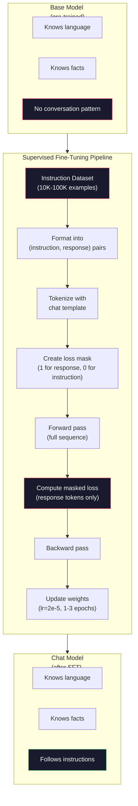

# Penyetelan Instruksi (SFT)

> Model dasar memprediksi token berikutnya. Itu saja. Itu tidak mengikuti instruksi, menjawab pertanyaan, atau menolak permintaan berbahaya.SFTadalah jembatan antara prediktor token dan asisten yang berguna. Setiap model yang pernah kamu ajak bicara -- Claude,GPT, Obrolan Llama -- melalui langkah ini.

**Type:** Build
**Languages:** Python (with numpy)
**Prerequisites:** Phase 10, Lesson 04 (Pre-Training a Mini GPT)
**Time:** ~90 minutes

## Tujuan Pembelajaran

- Menerapkan penyempurnaan yang diawasi (SFT) yang mengubah model bahasa dasar menjadi asisten yang mengikuti instruksi
- Format data pelatihan menggunakan templat obrolan dengan peran sistem, pengguna, dan asisten, dan menutupi kehilangan pada token non-asisten
- Jelaskan alasannyaSFTdiperlukan: model dasar melanjutkan teks daripada menjawab pertanyaan
- EvaluasiSFTkualitas dengan membandingkan respons model dasar vs model yang disesuaikan pada set instruksi yang disediakan

## Masalahnya

kamu melatih sebuah model di Pelajaran 04. Model tersebut dapat memprediksi token berikutnya berdasarkan urutan. Beri makan "Arsitektur transformator" dan mungkin akan dilanjutkan dengan "telah merevolusi pemrosesan bahasa alami." Itu mengesankan untuk prediktor token berikutnya.

Sekarang coba ini: beri makan "Apa ibu kota Perancis?" Model dasar tidak menjawab "Paris". Ini melanjutkan polanya. Ini mungkin menghasilkan "Apa ibu kota Jerman? Apa ibu kota Spanyol?" karena belajar dari dokumen yang berisi daftar pertanyaan. Atau mungkin menghasilkan "pertanyaan yang ditanyakan banyak orang" karena itu merupakan kelanjutan token berikutnya yang masuk akal. Model tidak memiliki konsep *menjawab*. Ia hanya tahu *lanjutan*.

Inilah kesenjangan antara keduanyaGPT-3 (model dasar, dirilis Juni 2020) dan ChatGPT (disesuaikan dengan instruksi, dirilis November 2022). Arsitektur yang sama. Pra-pelatihan yang sama. Perbedaannya adalah 20.000 hingga 100.000 pasangan (instruksi, respons) yang dibuat dengan cermat yang mengajarkan model untuk mengikuti pola percakapan.

Stanford Alpaca membuktikan kamu tidak memerlukan jutaan contoh. Pada bulan Maret 2023, mereka menyempurnakan Llama 7B hanya pada 52.000 pasangan instruksi-respons yang dihasilkan olehGPT-3.5. Jumlah biaya:$600. The result was a chatbot that could follow instructions, answer questions, and hold conversations. Not as good as ChatGPT, but shockingly close for $600 dan beberapa jam pelatihan.

Obrolan Llama 2 Meta hanya menggunakan ~27.000 contoh berkualitas tinggi untuk awalnyaSFTpanggung. Wawasan utamanya: kualitas lebih penting daripada kuantitas. 27.000 contoh yang ditulis oleh anotator terampil mengalahkan 1 juta contoh berisik yang diambil dari internet.

## Konsepnya

### ApaSFTSebenarnya Apakah

Penyempurnaan yang Diawasi melanjutkan loop pelatihan yang sama dari pra-pelatihan -- meneruskan, menghitung kerugian, meneruskan ke belakang, memperbarui bobot -- tetapi pada jenis data yang berbeda. Alih-alih teks mentah, kamu berlatih percakapan terstruktur:

```json
{
  "system": "You are a helpful assistant.",
  "user": "What is the capital of France?",
  "assistant": "The capital of France is Paris."
}
```

Model tersebut sudah mengetahui bahwa Paris adalah ibu kota Perancis. Ia mempelajari hal ini selama pra-pelatihan di Wikipedia, buku teks, dan halaman web.SFTtidak mengajarkan model fakta baru. Ini mengajarkan model *perilaku* baru: ketika kamu melihat pertanyaan, hasilkan jawabannya. Saat kamu melihat instruksi, lakukan penyelesaian. Saat kamu melihat permintaan yang merugikan, lakukan penolakan.

Pikirkan seperti ini. Pra-pelatihan memberikan pengetahuan model.SFTmemberikan model sopan santun.

### Format Data

Tiga format mendominasi industri ini. Masing-masing mengkodekan informasi yang sama -- siapa mengatakan apa -- dengan pembatas yang berbeda.

**Format Alpaca** (Stanford, Maret 2023):

```json
{
  "instruction": "Summarize the following article in 3 sentences.",
  "input": "The European Central Bank raised interest rates...",
  "output": "The ECB increased rates by 25 basis points..."
}
```

Sederhana dan banyak digunakan. Itu`input`bidang bersifat opsional -- banyak instruksi tidak memerlukan konteks tambahan. Stanford merilis 52.000 contoh dalam format ini, yang dihasilkan olehGPT-3,5 seharga $600. Ini mengawali gerakan penyetelan instruksi sumber terbuka.

**Format ShareGPT** (komunitas, 2023):

```json
{
  "conversations": [
    {"from": "system", "value": "You are a helpful assistant."},
    {"from": "human", "value": "What causes tides?"},
    {"from": "gpt", "value": "Tides are caused by the gravitational pull of the Moon..."},
    {"from": "human", "value": "How often do they occur?"},
    {"from": "gpt", "value": "Most coastal areas experience two high tides and two low tides per day..."}
  ]
}
```

Mendukung percakapan multi-turn. Bidang "dari" menggunakan "manusia" dan "gpt" berdasarkan konvensi, apa pun model sebenarnya. Vicuna dilatih tentang 70.000 percakapan ShareGPT yang diambil dari transkrip ChatGPT yang dibagikan pengguna.

**Format ChatML** (OpenAI, digunakan oleh banyak model sumber terbuka):

```
<|im_start|>system
You are a helpful assistant.<|im_end|>
<|im_start|>user
What is the capital of France?<|im_end|>
<|im_start|>assistant
The capital of France is Paris.<|im_end|>
```

Menggunakan token khusus (`<|im_start|>`,`<|im_end|>`) untuk membatasi peran. Token ini ditambahkan ke kosakata tokenizer selama penyesuaian. Qwen, Yi, dan banyak model lainnya menggunakan ChatML.

Ketiga format tersebut mencapai hal yang sama: mereka memberi tahu model "ini instruksinya, ini responsnya, pelajari pola ini."

### Mengapa Ini Berhasil

Model sudah mengetahui bahasa sejak pra-pelatihan. Ini telah melihat miliaran contoh pertanyaan yang diikuti dengan jawaban, instruksi yang diikuti dengan penyelesaian, dan percakapan antar orang. Polanya sudah dikodekan dalam bobot.

SFTmemusatkan kemampuan terpendam ini. Daripada model perlu mencari tahu dari konteks apakah model harus menjawab pertanyaan atau melanjutkan dokumen,SFTsecara eksplisit melatih pola percakapan. Setelah beberapa ribu contoh, model belajar: saat kamu melihat penanda peran asisten, hasilkan respons yang bermanfaat.

Inilah sebabnya mengapa 27.000 contoh sudah cukup. kamu tidak mengajarkan model bahasa Inggris. kamu tidak mengajarkan fakta tentang dunia. kamu mengajarkannya satu perilaku sederhana: merespons instruksi. Pengetahuannya sudah ada.

### Kerugian Terselubung

Ini adalah detail teknis terpenting dalamSFT, dan sebagian besar tutorial melewatkannya.

Selama pra-pelatihan, kamu menghitung kerugian pada setiap token. Model tersebut belajar memprediksi setiap token berikutnya dalam urutan. SelamaSFT, kamu hanya menghitung kerugian pada token *respons*. Token instruksi ada untuk konteksnya, tetapi model tidak dikenakan sanksi karena "memprediksi" mereka secara salah.

Mengapa? Karena kamu tidak ingin model belajar *menghasilkan* instruksi. kamu ingin ia belajar *menanggapi* instruksi. Jika kamu menghitung kerugian pada token instruksi, kamu melatih model untuk memprediksi "Apa ibu kota Perancis?" seolah-olah dialah yang mengajukan pertanyaan. Hal ini membuang sinyal gradien dan dapat membingungkan model tentang perannya.

Dalam praktiknya, kamu membuat masker kerugian: 1 untuk token respons, 0 untuk token instruksi. Lipat gandakan kerugian per token dengan topeng ini sebelum membuat rata-rata.

```
Tokens:    [SYS] You are helpful [USER] What is the capital? [ASST] Paris is the capital [EOS]
Loss mask:   0    0    0     0      0     0   0  0     0       1     1    1   1     1      1
```

Hanya token setelahnya`[ASST]`berkontribusi terhadap kerugian tersebut. Model melihat percakapan penuh selama forward pass (model memerlukan instruksi untuk menghasilkan respons yang tepat) namun hanya memperbarui bobotnya berdasarkan seberapa baik model memprediksi respons.

### Pelatihan Hyperparameter

SFTmenggunakan hyperparameter yang sangat berbeda dari pra-pelatihan. kamu tidak berlatih dari awal. kamu sedang menyesuaikan model yang sudah berfungsi.

| Parameter | Pre-Training (Llama 2 7B) | SFT (Llama 2 Chat) |
|-----------|---------------------------|---------------------|
| Learning rate | 3e-4 (peak) | 2e-5 |
| Epochs | 1 (single pass over data) | 2 |
| Batch size | 4M tokens | 64 examples |
| Warmup steps | 2,000 | 0-100 |
| Weight decay | 0.1 | 0.0-0.1 |
| Data size | 2T tokens | 27,000 examples |

Kecepatan pemelajarannya 15x lebih rendahSFT. Ini sangat penting. Kecepatan pembelajaran yang tinggi selama penyesuaian akan menghancurkan pengetahuan yang telah dilatih sebelumnya. Model "lupa" apa yang dipelajarinya dan menyesuaikan diri dengan kumpulan data kecil yang telah disesuaikan. Ini adalah sebuah bencana melupakan.

Dua periode berarti model melihat setiap contoh pelatihan dua kali. Lebih dari 3 periode pada kumpulan data kecil mengarah pada penghafalan -- model mulai mereproduksi contoh pelatihan secara verbatim, bukan menggeneralisasi.

### Lupa yang Bencana

Penyempurnaan dapat merusak kemampuan umum. Berlatih terlalu lama pada data yang mengikuti instruksi akan menyebabkan model kehilangan kemampuannya untuk menulis kode, mengerjakan matematika, atau menghasilkan teks kreatif. Ia menjadi sangat baik dalam format spesifik data pelatihannya dan buruk dalam segala hal lainnya.

Tiga mitigasi:

1. **Kecepatan pemelajaran rendah.** 1e-5 hingga 5e-5. Pembaruan yang lebih kecil berarti lebih sedikit kerusakan pada fitur yang telah dilatih sebelumnya.

2. **Pelatihan singkat.** 1-3 periode. Berhentilah sebelum model mengenakan pakaian luar.

3. **Gabungkan data pra-pelatihan.** Obrolan Llama 2 menggabungkan sebagian kecil (2-5%) data mentah pra-pelatihan ke dalamSFTkumpulan data. Ini "mengingatkan" model akan kemampuan umumnya sambil mempelajari perilaku mengikuti instruksi yang baru.

### Bilangan Nyata

Menyempurnakan model 7B pada 10.000 pasangan instruksi berkualitas tinggi membutuhkan waktu sekitar 1 jam dalam sekaliNVIDIA A10080GBGPU. Berikut perhitungannya:

- 10.000 contoh x rata-rata 512 token = 5,12 juta token
- 2 epoch = total 10,24 juta token
- A100throughput untuk penyempurnaan model 7B: ~3.000tokens/second
- 10,24M / 3.000 = ~3.400 detik = ~57 menit

Untuk mini kamiGPT(4 lapisan, 128 redup), pelatihan hampir instan. Intinya adalah memahami mekanismenya, bukan skalanya.



```figure
loss-masking
```

## Bangun Sendiri

### Langkah 1: Kumpulan Data Instruksi

Buat kumpulan data instruksi sintetis. Dalam produksi, perusahaan seperti Scale AI dan Anthropic mempekerjakan anotator manusia untuk menulisnya. Kami akan membuatnya secara terprogram untuk mendemonstrasikan formatnya.

```python
import numpy as np

INSTRUCTION_DATA = [
    {
        "instruction": "What is the capital of France?",
        "response": "The capital of France is Paris."
    },
    {
        "instruction": "Explain gravity in one sentence.",
        "response": "Gravity is the force that attracts objects with mass toward each other."
    },
    {
        "instruction": "Write a haiku about the ocean.",
        "response": "Waves crash on the shore, salt and foam beneath the sun, endless blue expanse."
    },
    {
        "instruction": "What is 15 multiplied by 7?",
        "response": "15 multiplied by 7 is 105."
    },
    {
        "instruction": "Name three programming languages.",
        "response": "Three programming languages are Python, Rust, and TypeScript."
    },
    {
        "instruction": "Summarize photosynthesis.",
        "response": "Photosynthesis converts sunlight, water, and carbon dioxide into glucose and oxygen."
    },
    {
        "instruction": "What year did World War II end?",
        "response": "World War II ended in 1945."
    },
    {
        "instruction": "Define machine learning.",
        "response": "Machine learning is a field where algorithms learn patterns from data to make predictions."
    },
]
```

Delapan contoh sangatlah kecil. Stanford Alpaca menggunakan 52.000. Namun mekanismenya tetap sama baik kamu memiliki 8 atau 52.000: tokenisasi, mask, hitung kerugian hanya pada respons.

### Langkah 2: Tokenisasi dengan Templat Obrolan

Ubah pasangan instruksi-respons menjadi rangkaian token dengan penanda peran khusus. Penanda tersebut memberi tahu model di mana instruksi berakhir dan di mana respons dimulai.

```python
SPECIAL_TOKENS = {
    "INST_START": 253,
    "INST_END": 254,
    "RESP_START": 255,
}


def tokenize_instruction_pair(instruction, response, vocab_size=256):
    inst_tokens = list(instruction.encode("utf-8"))
    resp_tokens = list(response.encode("utf-8"))

    inst_tokens = [min(t, vocab_size - 4) for t in inst_tokens]
    resp_tokens = [min(t, vocab_size - 4) for t in resp_tokens]

    tokens = (
        [SPECIAL_TOKENS["INST_START"]]
        + inst_tokens
        + [SPECIAL_TOKENS["INST_END"]]
        + [SPECIAL_TOKENS["RESP_START"]]
        + resp_tokens
    )

    return tokens


def create_loss_mask(tokens):
    mask = np.zeros(len(tokens), dtype=np.float32)
    in_response = False

    for i, token in enumerate(tokens):
        if token == SPECIAL_TOKENS["RESP_START"]:
            in_response = True
            continue
        if in_response:
            mask[i] = 1.0

    return mask
```

Masker kerugian semuanya nol untuk token instruksi dan semuanya untuk token respons. Itu`RESP_START`token itu sendiri mendapat topeng 0 karena merupakan pembatas, bukan bagian dari konten respons.

### Langkah 3: Kerugian Lintas Entropi Terselubung

Entropi silang standar, tetapi dikalikan dengan topeng kerugian. Hanya token respons yang berkontribusi terhadap gradien.

```python
def masked_cross_entropy_loss(logits, targets, loss_mask):
    batch, seq_len, vocab_size = logits.shape
    logits_flat = logits.reshape(-1, vocab_size)
    targets_flat = targets.reshape(-1)
    mask_flat = loss_mask.reshape(-1)

    max_logits = logits_flat.max(axis=-1, keepdims=True)
    log_softmax = logits_flat - max_logits - np.log(
        np.exp(logits_flat - max_logits).sum(axis=-1, keepdims=True)
    )

    per_token_loss = -log_softmax[np.arange(len(targets_flat)), targets_flat]

    masked_loss = per_token_loss * mask_flat
    num_response_tokens = mask_flat.sum()
    if num_response_tokens == 0:
        return 0.0
    loss = masked_loss.sum() / num_response_tokens

    return loss
```

Penyebutnya adalah`num_response_tokens`, tidak`seq_len`. Jika kamu membaginya dengan total panjang urutan, instruksi yang lebih panjang akan melemahkan sinyal gradien. Membagi berdasarkan jumlah token respons memastikan bobot yang sama per token respons, berapa pun panjang instruksinya.

### Langkah 4: SFTLingkaran Pelatihan

Gunakan kembali MiniGPT dari Pelajaran 04. Loop pelatihan terlihat hampir sama dengan pra-pelatihan, tetapi dengan format instruksi dan kerugian yang terselubung.

```python
import sys
import os
sys.path.insert(0, os.path.join(os.path.dirname(__file__), "..", "..", "04-pre-training-mini-gpt", "code"))
from main import MiniGPT, LayerNorm, FeedForward, MultiHeadAttention, TransformerBlock, Embedding


def sft_train(model, dataset, num_epochs=2, lr=2e-5, seq_len=64):
    formatted_data = []
    for example in dataset:
        tokens = tokenize_instruction_pair(example["instruction"], example["response"])
        mask = create_loss_mask(tokens)
        formatted_data.append((tokens, mask))

    print(f"SFT Training: {len(formatted_data)} examples, {num_epochs} epochs, lr={lr}")
    print(f"Total tokens: {sum(len(t) for t, _ in formatted_data):,}")
    print()

    losses = []

    for epoch in range(num_epochs):
        epoch_loss = 0.0
        num_batches = 0

        indices = np.random.permutation(len(formatted_data))

        for idx in indices:
            tokens, mask = formatted_data[idx]

            if len(tokens) < 3:
                continue
            if len(tokens) > seq_len:
                tokens = tokens[:seq_len]
                mask = mask[:seq_len]

            input_ids = np.array(tokens[:-1]).reshape(1, -1)
            target_ids = np.array(tokens[1:]).reshape(1, -1)
            loss_mask = np.array(mask[1:]).reshape(1, -1)

            logits = model.forward(input_ids)
            loss = masked_cross_entropy_loss(logits, target_ids, loss_mask)

            batch_size, s_len, v_size = logits.shape
            probs = np.exp(logits - logits.max(axis=-1, keepdims=True))
            probs = probs / probs.sum(axis=-1, keepdims=True)
            dlogits = probs.copy()
            dlogits[np.arange(batch_size)[:, None], np.arange(s_len), target_ids] -= 1.0

            mask_expanded = loss_mask[:, :, np.newaxis]
            num_resp = loss_mask.sum()
            if num_resp > 0:
                dlogits = dlogits * mask_expanded / num_resp

            for block in model.blocks:
                block.ffn.W1 -= lr * np.random.randn(*block.ffn.W1.shape) * 0.01
                block.ffn.W2 -= lr * np.random.randn(*block.ffn.W2.shape) * 0.01
                block.ffn.b1 -= lr * np.random.randn(*block.ffn.b1.shape) * 0.01
                block.ffn.b2 -= lr * np.random.randn(*block.ffn.b2.shape) * 0.01

            epoch_loss += loss
            num_batches += 1
            losses.append(loss)

        avg_loss = epoch_loss / max(num_batches, 1)
        print(f"Epoch {epoch + 1}/{num_epochs} | Avg Loss: {avg_loss:.4f}")

    return model, losses
```

Kecepatan pembelajarannya adalah 2e-5, cocok dengan Obrolan Llama 2. Bandingkan ini dengan 3e-4 yang digunakan dalam pra-pelatihan -- 15x lebih kecil. Gradiennya ditutupi: token instruksi menghasilkan gradien nol. Hanya token respons yang mendorong beban.

### Langkah 5: Bandingkan Basis vsSFTModel

Inti dariSFTadalah perubahan perilaku. Mari kita ukur dengan memeriksa bagaimana model merespons masukan berformat instruksi versus kelanjutan teks mentah.

```python
def generate_response(model, prompt_tokens, max_new_tokens=50, temperature=0.8):
    tokens = list(prompt_tokens)
    seq_len = model.embedding.pos_embed.shape[0]

    for _ in range(max_new_tokens):
        context = np.array(tokens[-seq_len:]).reshape(1, -1)
        logits = model.forward(context)
        next_logits = logits[0, -1, :]

        next_logits = next_logits / max(temperature, 1e-8)
        probs = np.exp(next_logits - next_logits.max())
        probs = probs / probs.sum()
        probs = np.clip(probs, 1e-10, 1.0)
        probs = probs / probs.sum()

        next_token = np.random.choice(len(probs), p=probs)
        tokens.append(int(next_token))

    return tokens


def evaluate_instruction_following(model, instructions):
    print("Evaluating instruction following:")
    print("-" * 50)

    for instruction in instructions:
        tokens = (
            [SPECIAL_TOKENS["INST_START"]]
            + [min(t, 252) for t in list(instruction.encode("utf-8"))]
            + [SPECIAL_TOKENS["INST_END"]]
            + [SPECIAL_TOKENS["RESP_START"]]
        )

        output = generate_response(model, tokens, max_new_tokens=30, temperature=0.6)
        response_start = len(tokens)
        response_tokens = output[response_start:]
        response_bytes = bytes([t for t in response_tokens if t < 128])
        response_text = response_bytes.decode("utf-8", errors="replace")

        print(f"  Q: {instruction}")
        print(f"  A: {response_text[:80]}")
        print()
```

Pada model kecil dengan 8 contoh, tanggapannya tidak akan berarti. Itu diharapkan. Yang penting adalah *struktur*: model belajar menghasilkan keluaran setelah penanda respons alih-alih terus menghasilkan lebih banyak instruksi.

### Langkah 6: Mengukur Kelupaan yang Menyebabkan Bencana

Bandingkan kemampuan prediksi token berikutnya model sebelum dan sesudahnyaSFT. JikaSFTmerusak kemampuan umum, kerugian pada teks mentah akan meningkat.

```python
def measure_forgetting(model, test_text, seq_len=64):
    tokens = np.array(list(test_text.encode("utf-8")[:512]))

    total_loss = 0.0
    num_windows = 0

    for start in range(0, len(tokens) - seq_len - 1, seq_len):
        input_ids = tokens[start:start + seq_len].reshape(1, -1)
        target_ids = tokens[start + 1:start + seq_len + 1].reshape(1, -1)

        logits = model.forward(input_ids)

        batch, s_len, vocab_size = logits.shape
        logits_flat = logits.reshape(-1, vocab_size)
        targets_flat = target_ids.reshape(-1)

        max_logits = logits_flat.max(axis=-1, keepdims=True)
        log_softmax = logits_flat - max_logits - np.log(
            np.exp(logits_flat - max_logits).sum(axis=-1, keepdims=True)
        )

        loss = -log_softmax[np.arange(len(targets_flat)), targets_flat].mean()
        total_loss += loss
        num_windows += 1

    return total_loss / max(num_windows, 1)
```

Dalam penyesuaian nyata, kamu akan melacak metrik ini selama pelatihan. Jika kehilangan teks mentah meningkat lebih dari 10-15%, file kamuSFTterlalu agresif. Turunkan kecepatan pembelajaran atau kurangi jumlah zaman.

## Gunakan

### PenuhSFTDemo Saluran Pipa

```python
if __name__ == "__main__":
    np.random.seed(42)

    test_text = """The transformer architecture processes sequences through self-attention.
Each layer applies multi-head attention followed by a feedforward network.
Residual connections and layer normalization stabilize deep networks.
The model learns to predict the next token given all previous tokens."""

    print("=" * 70)
    print("INSTRUCTION TUNING (SFT) DEMO")
    print("=" * 70)
    print()

    model = MiniGPT(
        vocab_size=256, embed_dim=128, num_heads=4,
        num_layers=4, max_seq_len=128, ff_dim=512
    )
    print(f"Model: {model.count_parameters():,} parameters")
    print(f"Config: 4 layers, 4 heads, 128 dims (mini GPT from Lesson 04)")
    print()

    print("PRE-SFT: Measuring base model loss on raw text")
    base_loss = measure_forgetting(model, test_text)
    print(f"  Base model loss: {base_loss:.4f}")
    print()

    print("=" * 70)
    print("SFT TRAINING")
    print("=" * 70)

    model, losses = sft_train(
        model, INSTRUCTION_DATA, num_epochs=3, lr=2e-5, seq_len=128
    )

    print()
    print("POST-SFT: Measuring fine-tuned model loss on raw text")
    sft_loss = measure_forgetting(model, test_text)
    print(f"  SFT model loss: {sft_loss:.4f}")
    print(f"  Change: {((sft_loss - base_loss) / base_loss * 100):+.1f}%")
    if abs(sft_loss - base_loss) / base_loss < 0.15:
        print("  Minimal forgetting (< 15% change)")
    else:
        print("  Significant forgetting detected")
    print()

    print("=" * 70)
    print("INSTRUCTION FOLLOWING EVALUATION")
    print("=" * 70)
    print()

    test_instructions = [
        "What is the capital of France?",
        "Name a programming language.",
        "Define gravity.",
    ]
    evaluate_instruction_following(model, test_instructions)

    print("=" * 70)
    print("DATA FORMAT EXAMPLES")
    print("=" * 70)
    print()

    for i, example in enumerate(INSTRUCTION_DATA[:3]):
        tokens = tokenize_instruction_pair(example["instruction"], example["response"])
        mask = create_loss_mask(tokens)
        resp_count = int(mask.sum())
        total_count = len(tokens)
        print(f"  Example {i + 1}: {total_count} tokens, {resp_count} response tokens ({resp_count/total_count:.0%} of sequence)")
        print(f"    Instruction: {example['instruction']}")
        print(f"    Response: {example['response']}")
        print()

    print("=" * 70)
    print("TRAINING LOSS CURVE")
    print("=" * 70)
    print()

    if losses:
        window = max(1, len(losses) // 5)
        for i in range(0, len(losses), window):
            chunk = losses[i:i + window]
            avg = sum(chunk) / len(chunk)
            print(f"  Steps {i:3d}-{i + len(chunk) - 1:3d}: avg loss = {avg:.4f}")
```

## Rilis

Pelajaran ini menghasilkan`outputs/prompt-sft-data-curator.md`-- perintah yang membantu kamu merancang dan menyusun kumpulan data instruksiSFT. Mengingat kemampuan target (pembuatan kode, matematika, percakapan), ini menghasilkan rencana pengumpulan data dengan spesifikasi format, kriteria kualitas, dan persyaratan keragaman.

## Latihan

1. Tambahkan dukungan cepat sistem. Memodifikasi`tokenize_instruction_pair`untuk menerima pesan sistem dan menambahkannya sebelum instruksi. Buat 5 contoh dengan perintah sistem yang berbeda ("kamu adalah seorang penyair", "kamu adalah seorang tutor matematika") dan verifikasi bahwa model melihat perintah sistem yang berbeda selama pelatihan.

2. Menerapkan pencampuran data. Buat fungsi yang membutuhkanSFTdataset dan korpus teks mentah, kemudian menghasilkan batch pelatihan di mana 5% contohnya adalah teks mentah (tanpa masking) dan 95% adalah pasangan instruksi (masked). Jalankan 3 epoch dan bandingkan metrik lupa dengan murniSFTpelatihan.

3. Bangun pencetak skor kualitas data. Untuk setiap pasangan instruksi-respons, hitung: (a) panjang respons dalam token, (b) rasio instruksi-respons, (c) keragaman kosakata (token unik / total token). Filter contoh dengan panjang respons <10 token atau keragaman <0,3. Tunjukkan bagaimana pemfilteran mempengaruhi kerugian akhir.

4. Terapkan pelatihan percakapan multi-giliran. Perluas tokenisasi untuk menangani percakapan 3 putaran (asisten-pengguna-asisten-pengguna-asisten-pengguna). Topeng kerugian harus menutupi ketiga putaran asisten. Verifikasikan masker sudah benar dengan mencetak perataan token-mask sebagai salah satu contohnya.

5. Bandingkan kecepatan pembelajaran. Latih model yang sama tiga kali dengan lr=1e-4, lr=2e-5, dan lr=1e-6. Gambarkan kurva kerugiannya. Lari 1e-4 harus menunjukkan penurunan awal yang cepat tetapi kerugian akhir yang lebih tinggi (overfitting). Lari 1e-6 seharusnya hampir tidak bergerak. Lari 2e-5 seharusnya menjadi titik terbaik.

## Istilah-Istilah Utama

| Term | What people say | What it actually means |
|------|----------------|----------------------|
| SFT | "Fine-tuning on conversations" | Supervised Fine-Tuning: continuing training on (instruction, response) pairs with loss computed only on response tokens |
| Instruction tuning | "Teaching the model to follow instructions" | Training on explicit instruction-response pairs so the base model learns the conversation pattern, not new knowledge |
| Loss masking | "Ignoring the prompt" | Setting loss to zero for instruction tokens so gradients only flow from response token predictions |
| ChatML | "Chat Markup Language" | A token format using `<\|im_start\|>` and `<\|im_end\|>` delimiters to mark speaker roles in conversation data |
| Alpaca format | "Stanford's format" | A JSON format with instruction/input/output fields, used for 52K GPT-3.5-generated examples that cost $600 |
| Catastrophic forgetting | "The model gets dumber" | Fine-tuning destroys pre-trained capabilities because gradient updates overwrite general knowledge with task-specific patterns |
| Weight tying | "Shared embeddings" | Using the same matrix for input token embeddings and output prediction head, saving parameters and improving coherence |
| Chat template | "How you format the prompt" | The specific token sequence (role markers, delimiters) that structures a conversation for the model |

## Bacaan Lebih Lanjut

- [Ouyang et al., 2022 -- "Melatih model bahasa untuk mengikuti instruksi dengan umpan balik manusia" (InstructGPT)](https://arxiv.org/abs/2203.02155) -- makalah yang memperkenalkan penyetelan instruksi +RLHFdi OpenAI
- [Taori dkk., 2023 -- "Stanford Alpaca: Model LLaMA yang Mengikuti Instruksi"](https://github.com/tatsu-lab/stanford_alpaca) -- 52 ribu contoh instruksi seharga $600, terbuktiSFTbekerja pada kumpulan data kecil
- [Touvron et al., 2023 -- "Llama 2: Open Foundation dan Model Obrolan yang Diselaraskan"](https://arxiv.org/abs/2307.09288) -- MetaSFT+RLHFpipa dengan 27 ribu contoh berkualitas tinggi
- [Chiang dkk., 2023 -- "Vicuna: Chatbot Sumber Terbuka yang MengesankanGPT-4"](https://lmsys.org/blog/2023-03-30-vicuna/) -- pelatihan 70 ribu percakapan ShareGPT
- [Zhou dkk., 2023 -- "LIMA: Lebih Sedikit Lebih Baik untuk Penyelarasan"](https://arxiv.org/abs/2305.11206) -- membuktikan bahwa 1.000 contoh yang dikurasi dengan cermat dapat menyamainyaSFTpada kumpulan data yang jauh lebih besar
