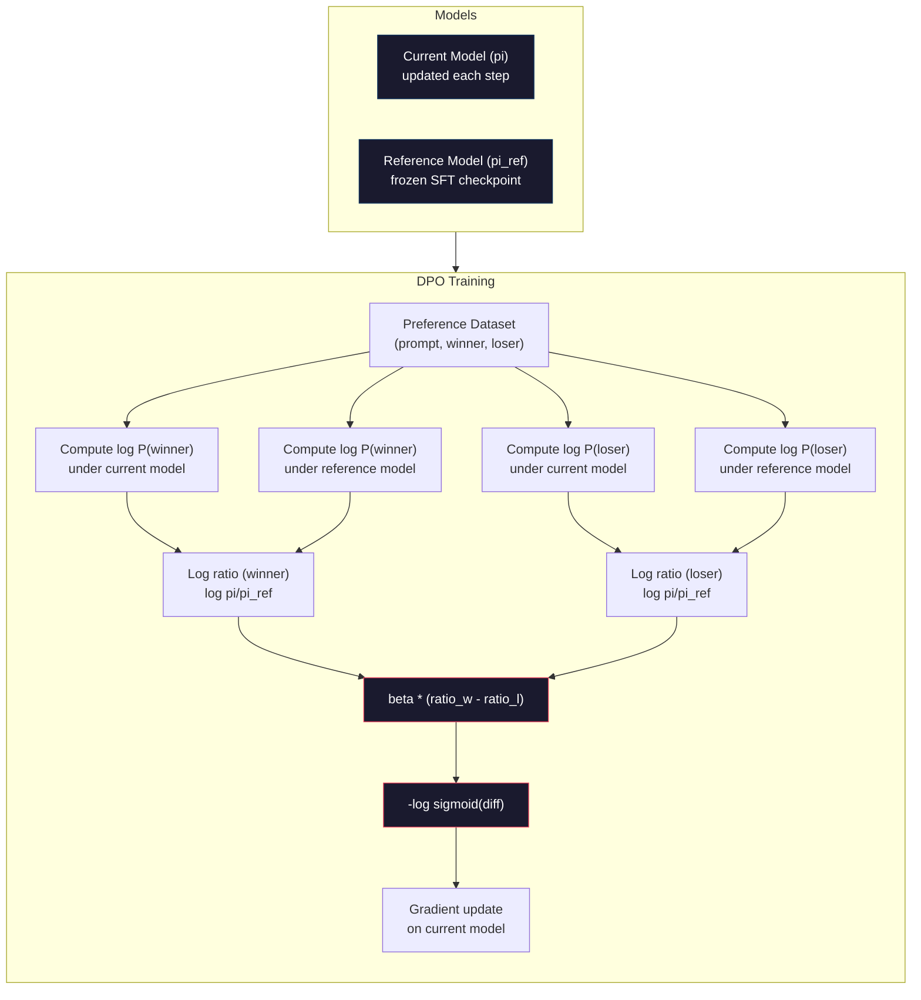

# DPO: Optimasi Preferensi Langsung

> RLHFbekerja. Ini juga memerlukan pelatihan tiga model (SFT, model penghargaan, kebijakan), pengelolaanPPOketidakstabilan, dan menyetel penalti KL.DPObertanya: bagaimana jika kamu bisa melewatkan semua itu?DPOsecara langsung mengoptimalkan model bahasa pada pasangan preferensi. Tidak ada model penghargaan. TidakPPO. Satu putaran pelatihan. Hasil yang sama.

**Type:** Build
**Languages:** Python (with numpy)
**Prerequisites:** Phase 10, Lesson 07 (RLHF)
**Time:** ~90 minutes

## Tujuan Pembelajaran

- MenerapkanDPOpelatihan yang secara langsung mengoptimalkan model bahasa pada pasangan preferensi tanpa model penghargaan terpisah
- TurunkanDPOfungsi kerugian dan jelaskan bagaimana fungsi tersebut secara implisit merepresentasikan model imbalan melalui probabilitas log kebijakan
- BandingkanDPOvsRLHFdalam hal stabilitas pelatihan, biaya komputasi, dan jumlah model yang diperlukan
- Sesuaikan parameter beta untuk mengontrol seberapa jauh kebijakan yang dilatih menyimpang dari model referensi

## Masalahnya

kamu membangun sebuahRLHFpipeline dalam Pelajaran 07. Tiga tahap. Tiga model. ItuSFTmodel, model penghargaan, dan model kebijakan yang dioptimalkanPPO. Model penghargaan saja memerlukan ribuan pasangan preferensi manusia dan putaran pelatihan terpisah.PPOdiperlukan penyesuaian yang cermat terhadap koefisien KL, kecepatan pembelajaran, rasio klip, dan jumlah zaman.

Dalam praktiknya,PPOpelatihan terkenal tidak stabil. Perubahan hyperparameter kecil menyebabkan pelatihan berbeda. Model penghargaan tidak mewakili preferensi manusia, dan kebijakan ini selalu mencari cara untuk mengeksploitasi kelemahannya. Hukuman KL membantu tetapi memerlukan penyesuaiannya sendiri -- terlalu rendah dan kamu mendapat imbalan peretasan, terlalu tinggi dan model hampir tidak belajar.

Kompleksitas inilah yang menyebabkan sebagian besar model sumber terbuka kesulitan mengatasinyaRLHFselama bertahun-tahun setelah InstructGPT diterbitkan. Pipa tiga tahap ini rapuh. Setiap tahap memiliki mode kegagalannya sendiri, dan kesalahan bertambah.

Pada Mei 2023, Rafael Rafailov, Archit Sharma, dan rekannya di Stanford menerbitkan "Pengoptimalan Preferensi Langsung: Model Bahasa kamu Secara Rahasia adalah Model Hadiah". Wawasan utamanya: kamu tidak memerlukan model penghargaan terpisah. Fungsi imbalan yang optimal ditentukan secara matematis oleh probabilitas token model bahasa itu sendiri. kamu dapat melewati model reward sepenuhnya dan mengoptimalkan model bahasa langsung pada pasangan preferensi.

DPOmengurangiRLHFke satu langkah pembelajaran yang diawasi. Satu model. Satu fungsi kerugian. Satu putaran pelatihan. Tidak ada pembelajaran penguatan. Zephyr-7B, salah satu model pertama yang digunakanDPOdalam skala besar, model yang cocok atau mengalahkan yang dilatih dengan penuhRLHFpada beberapa benchmark. Meta digunakanDPOsebagai bagian dari jalur penyelarasan Llama 3. Antropik telah mengutipDPOmetode -style dalam penelitian penyelarasan mereka.

## Konsepnya

### Wawasan Utama

RLHFmengoptimalkan tujuan ini:

```
maximize: E[R(x, y)] - beta * KL(pi || pi_ref)
```

dimana R adalah model reward, pi adalah kebijakan, pi_ref adalah model referensi, dan beta adalah koefisien KL.

ItuDPOmakalah menunjukkan bahwa tujuan ini memiliki solusi optimal bentuk tertutup. Untuk setiap fungsi imbalan R, kebijakan optimalnya adalah:

```
pi*(y | x) = pi_ref(y | x) * exp(R(x, y) / beta) / Z(x)
```

dimana Z(x) adalah konstanta normalisasi. Menata ulang:

```
R(x, y) = beta * log(pi*(y | x) / pi_ref(y | x)) + beta * log Z(x)
```

Inilah terobosannya. Imbalannya dinyatakan sepenuhnya dalam bentuk probabilitas model kebijakan dan probabilitas model referensi. kamu tidak perlu melatih model penghargaan terpisah. Imbalannya *implisit* dalam rasio probabilitas.

Mengganti ini ke dalam model preferensi Bradley-Terry:

```
P(y_w > y_l | x) = sigmoid(R(x, y_w) - R(x, y_l))
                  = sigmoid(beta * (log pi(y_w|x)/pi_ref(y_w|x) - log pi(y_l|x)/pi_ref(y_l|x)))
```

Syarat Z(x) dibatalkan karena kedua respon mengkondisikan pada prompt x yang sama. Yang tersisa hanyalah fungsi dari probabilitas log model kebijakan dan probabilitas log model referensi pada respons yang dipilih dan ditolak.

### ItuDPOKerugian

```
L_DPO = -log(sigmoid(beta * (log pi(y_w|x)/pi_ref(y_w|x) - log pi(y_l|x)/pi_ref(y_l|x))))
```

Mari kita bongkar setiap bagiannya:

- **y_w** = respons pilihan (yang menang).
- **y_l** = respon ditolak (kalah).
- **x** = perintah
- **pi** = model saat ini (sedang dilatih)
- **pi_ref** = model referensi (dibekukanSFTpos pemeriksaan)
- **beta** = parameter suhu yang mengontrol penyimpangan dari referensi (biasanya 0,1 hingga 0,5)

Rasio`log pi(y|x) / pi_ref(y|x)`adalah rasio log-probabilitas. Ketika rasio ini positif, model saat ini memberikan probabilitas yang lebih tinggi terhadap respons y dibandingkan model referensi. Jika negatif, model saat ini memberikan probabilitas yang lebih rendah.

ItuDPOkerugian mendorong model untuk meningkatkan rasio log-probabilitas untuk respons yang disukai dan menurunkannya untuk respons yang ditolak. Parameter beta mengontrol seberapa agresif model dapat menyimpang dari referensi -- beta kecil berarti penyimpangan besar diperbolehkan, beta besar menjaga model tetap dekat dengan referensi.



### MengapaDPOlebih sederhana

| Aspect | RLHF (PPO) | DPO |
|--------|-----------|-----|
| Models to train | 3 (SFT + reward + policy) | 1 (policy only) |
| Training loops | 3 (SFT, RM training, PPO) | 2 (SFT, DPO) |
| Hyperparameters | lr, KL coeff, clip ratio, RM lr, epochs x3 | lr, beta, epochs |
| Reward model | Required (separate training) | Implicit in model probabilities |
| RL algorithm | PPO (complex, unstable) | Supervised learning (stable) |
| GPU memory | 3-4 models in memory during PPO | 2 models (current + reference) |
| Training stability | Sensitive to hyperparameters | Robust, similar to SFT |

DPOmembutuhkan dua model dalam memori selama pelatihan -- model saat ini dan referensi yang dibekukan.RLHFmembutuhkan tiga atau empat: kebijakan, referensi, model penghargaan, dan opsional garis dasar fungsi nilai. Untuk model 70B, setiap salinan membutuhkan 140 GBFP16. Penghematan memori dari penghapusan model penghargaan sangat besar.

### KapanDPOmengalahkanRLHF

**Kumpulan data kecil.** Dengan 5.000-20.000 pasangan preferensi,DPOsering kali cocok atau melebihiRLHF. Model penghargaan diRLHFmembutuhkan data yang cukup untuk digeneralisasi -- dengan data yang terbatas, data tersebut berlebihan dan menghasilkan sinyal imbalan yang tidak dapat diandalkan.DPOmelewati masalah ini dengan tidak memerlukan model penghargaan sama sekali.

**Komputasi terbatas.**DPOmembutuhkan sekitar sepertiga komputasi penuhRLHF(satu putaran pelatihan, bukan tiga). Untuk tim tanpa besarGPUcluster, ini adalah pilihan praktis.

**Iterasi cepat.** Ingin mencoba 10 set data preferensi berbeda untuk melihat mana yang menghasilkan model terbaik?DPOmemungkinkan kamu menjalankan setiap eksperimen dalam hitungan jam.RLHFmemerlukan pelatihan ulang model penghargaan untuk setiap kumpulan data.

### KapanRLHFmengalahkanDPO

**Pelatihan berskala besar.** Dalam skalaGPT-4 atau Claude,RLHFModel penghargaan terpisah dapat menangkap sinyal preferensi yang lebih bernuansa. Model penghargaan bertindak sebagai fungsi kerugian yang dipelajari yang beradaptasi dengan kriteria kualitas yang kompleks.

**Sinyal imbalan yang kompleks.** Jika "lebih baik" melibatkan berbagai dimensi (kebergunaan, tidak menyakiti, kejujuran), model imbalan dapat mempelajari trade-off multi-tujuan ini.DPOmemperlakukan setiap pasangan preferensi sebagai sinyal biner -- yang satu lebih baik, yang satu lebih buruk -- tanpa memodelkan alasannya.

**Penyelarasan berulang.**RLHFsaluran pipa dapat menghasilkan respons baru dengan kebijakan yang ada, meminta manusia menilai respons tersebut, dan melatih kembali model penghargaan dalam putaran online.DPObekerja pada kumpulan data tetap dari pasangan preferensi. AI Konstitusional (pendekatan Anthropic) menggunakan properti berulang iniRLHFsecara luas.

### Di luar ituDPO:KTO,ORPO, SimPO

DPOmenginspirasi keluarga metode penyelarasan yang disederhanakan.

**KTO(Optimasi Kahneman-Tversky, 2024):** kamu bahkan tidak memerlukan pasangan.KTObekerja dengan umpan balik yang tidak berpasangan -- cukup beri label pada setiap tanggapan sebagai "baik" atau "buruk" tanpa membandingkannya dengan alternatif lain. Hal ini sangat menyederhanakan pengumpulan data. Daripada menunjukkan dua tanggapan kepada anotator dan menanyakan "mana yang lebih baik?", kamu menunjukkan satu tanggapan dan bertanya "apakah ini bagus?" Fungsi kerugian menerapkan keengganan terhadap kerugian dari teori prospek: tanggapan yang buruk akan mendapat hukuman lebih banyak daripada tanggapan yang baik akan diberi imbalan.

**ORPO(Optimasi Preferensi Rasio Odds, 2024):** KombinasiSFTdan penyelarasan dalam satu langkah pelatihan. Daripada melakukan terlebih dahuluSFTlaluDPO,ORPOmemodifikasiSFTkerugian untuk memasukkan sinyal preferensi. Kerugian tersebut memiliki dua istilah: kerugian prediksi token berikutnya standar pada respons yang disukai, ditambah istilah rasio odds yang meningkatkan kesenjangan antara probabilitas respons yang disukai dan ditolak. Satu putaran pelatihan, bukan dua.

**SimPO (Simple Preference Optimization, 2024):** Menghilangkan model referensi sepenuhnya. Alih-alih menghitung rasio probabilitas log terhadap referensi yang dibekukan, SimPO menggunakan probabilitas log rata-rata dari respons (dinormalisasi berdasarkan panjangnya) sebagai imbalan implisit. Ini menghemat memori (tidak diperlukan model referensi) dan menyederhanakan pelatihan. Normalisasi panjang mencegah model memilih respons yang lebih pendek.

| Method | Year | Models in Memory | Needs Pairs? | Needs Reference? | Training Loops |
|--------|------|-----------------|-------------|-----------------|----------------|
| RLHF | 2022 | 3-4 | Yes (for RM) | Yes | 3 |
| DPO | 2023 | 2 | Yes | Yes | 2 |
| KTO | 2024 | 2 | No (unpaired) | Yes | 2 |
| ORPO | 2024 | 1 | Yes | No | 1 |
| SimPO | 2024 | 1 | Yes | No | 1 |

Trennya jelas: setiap metode menghilangkan satu kerumitan lagi.RLHFmembutuhkan model penghargaan danPPO.DPOmenghilangkan keduanya.KTOmenghilangkan data berpasangan.ORPOmenghilangkan yang terpisahSFTpanggung. SimPO menghilangkan model referensi. Pajak penyelarasan -- biaya komputasi dan kompleksitas untuk beralih dari model dasar ke model yang selaras -- terus menurun.

### NyataDPOPenerapan

**Zephyr-7B (HuggingFace, Oktober 2023):** Pangkalan Mistral 7B,SFTdi UltraChat (200 ribu contoh), laluDPOdi UltraFeedback (60 ribu pasangan preferensi). Mendapat skor 6,47 di MT-Bench -- model 7B tertinggi pada saat itu. Sebagai perbandingan, Llama 2 Chat 70B mendapat skor 6,86, yang berarti Zephyr berada dalam jarak 6% dari model yang berukuran 10x lipat hanya dengan menggunakanDPOkeselarasan.

**Llama 3 (Meta, April 2024):** DigunakanDPOsetelah inisialRLHFtahapan. Kombinasi tersebut menunjukkan hal ituDPOdanRLHFbisa saling melengkapi --RLHFuntuk penyelarasan luas,DPOuntuk penyempurnaan yang ditargetkan.

**Sihir Neural / nm-chat (2024):** DiterapkanDPOke beberapa model sumber terbuka, secara konsisten menunjukkan peningkatan 5-15% pada tolok ukur penyelarasanSFT-hanya garis dasar.

```figure
dpo-loss
```

## Bangun Sendiri

### Langkah 1: Kumpulan Data Preferensi

Formatnya sama sepertiRLHF-- (prompt, disukai, ditolak) tiga kali lipat.DPOmenggunakan data ini secara langsung tanpa model imbalan perantara.

```python
import numpy as np
import sys
import os
sys.path.insert(0, os.path.join(os.path.dirname(__file__), "..", "..", "04-pre-training-mini-gpt", "code"))
from main import MiniGPT, LayerNorm, Embedding, TransformerBlock

PREFERENCE_DATA = [
    {
        "prompt": "What is the capital of France?",
        "preferred": "The capital of France is Paris.",
        "rejected": "France is a country in Europe. It has many cities. The capital is Paris. Paris is known for the Eiffel Tower.",
    },
    {
        "prompt": "Explain gravity in one sentence.",
        "preferred": "Gravity is the force that attracts objects with mass toward each other.",
        "rejected": "Gravity is something that makes things fall down when you drop them.",
    },
    {
        "prompt": "What is 15 times 7?",
        "preferred": "15 times 7 is 105.",
        "rejected": "Let me think about this. 15 times 7. Well, 10 times 7 is 70, and 5 times 7 is 35, so the answer might be around 105.",
    },
    {
        "prompt": "Name three programming languages.",
        "preferred": "Python, Rust, and TypeScript.",
        "rejected": "There are many programming languages. Some popular ones include various languages like Python and others.",
    },
    {
        "prompt": "What year did World War II end?",
        "preferred": "World War II ended in 1945.",
        "rejected": "World War II was a major global conflict. It involved many countries. The war ended in the mid-1940s, specifically in 1945.",
    },
    {
        "prompt": "Define machine learning.",
        "preferred": "Machine learning is a field where algorithms learn patterns from data to make predictions without being explicitly programmed.",
        "rejected": "Machine learning is a type of AI. AI stands for artificial intelligence. Machine learning uses data to learn.",
    },
]
```

### Langkah 2: Probabilitas Log Urutan

ItuDPOkerugian memerlukan penghitungan total probabilitas log dari respons yang diberikan prompt. Ini berarti menjalankan model secara penuh (prompt + respon) dan menjumlahkan probabilitas log dari setiap token respons.

```python
def tokenize_sequence(text, vocab_size=256):
    return [min(t, vocab_size - 1) for t in list(text.encode("utf-8"))]


def compute_sequence_log_prob(model, prompt_tokens, response_tokens, max_seq_len=128):
    full_sequence = prompt_tokens + response_tokens
    if len(full_sequence) > max_seq_len:
        full_sequence = full_sequence[:max_seq_len]

    if len(full_sequence) < 2:
        return 0.0

    input_ids = np.array(full_sequence[:-1]).reshape(1, -1)
    target_ids = np.array(full_sequence[1:])

    logits = model.forward(input_ids)
    logits = logits[0]

    max_logits = logits.max(axis=-1, keepdims=True)
    log_probs = logits - max_logits - np.log(
        np.exp(logits - max_logits).sum(axis=-1, keepdims=True)
    )

    prompt_len = len(prompt_tokens)
    response_start = max(0, prompt_len - 1)
    response_end = len(target_ids)

    if response_start >= response_end:
        return 0.0

    response_log_probs = log_probs[response_start:response_end, :]
    response_targets = target_ids[response_start:response_end]

    total_log_prob = 0.0
    for i, target in enumerate(response_targets):
        total_log_prob += response_log_probs[i, target]

    return total_log_prob
```

Fungsi ini adalah pekerja kerasnyaDPO. Untuk setiap pasangan preferensi, ini berjalan empat kali: model pada respons yang disukai, model pada respons yang ditolak, referensi pada respons yang disukai, referensi pada respons yang ditolak. Itu berarti 4 operan ke depan per contoh pelatihan versusRLHFgenerasi + penilaian hadiah + estimasi nilai +PPOmemperbarui. Lebih sederhana, lebih cepat, lebih stabil.

### Langkah 3: ItuDPOKerugian

Inti dari makalah dalam kode. Satu fungsi. Satu kerugian. Tidak ada model penghargaan.

```python
def sigmoid(x):
    return np.where(
        x >= 0,
        1.0 / (1.0 + np.exp(-x)),
        np.exp(x) / (1.0 + np.exp(x))
    )


def dpo_loss(policy_logprob_preferred, policy_logprob_rejected,
             ref_logprob_preferred, ref_logprob_rejected, beta=0.1):
    preferred_ratio = policy_logprob_preferred - ref_logprob_preferred
    rejected_ratio = policy_logprob_rejected - ref_logprob_rejected

    logit = beta * (preferred_ratio - rejected_ratio)

    loss = -np.log(sigmoid(logit) + 1e-8)

    preferred_reward = beta * preferred_ratio
    rejected_reward = beta * rejected_ratio

    return loss, {
        "preferred_ratio": float(preferred_ratio),
        "rejected_ratio": float(rejected_ratio),
        "logit": float(logit),
        "implicit_preferred_reward": float(preferred_reward),
        "implicit_rejected_reward": float(rejected_reward),
        "reward_margin": float(preferred_reward - rejected_reward),
    }
```

Itu`preferred_ratio`dan`rejected_ratio`adalah rasio log-probabilitas dariDPOderivasi. Ketika model saat ini memberikan probabilitas yang lebih tinggi pada respons yang disukai (relatif terhadap referensi) dan probabilitas yang lebih rendah pada respons yang ditolak, maka logitnya positif dan kerugiannya rendah. Sinyal pelatihan mendorong model ke arah ini.

Itu`implicit_preferred_reward`dan`implicit_rejected_reward`adalah imbalan yangDPOkerugian secara implisit menugaskan. kamu dapat mengekstraknya untuk memverifikasi bahwa pelatihan berhasil -- selisih antara imbalan yang dipilih dan ditolak akan meningkat seiring dengan pelatihan.

### Langkah 4: DPOLingkaran Pelatihan

Lingkaran pelatihan standar yang diawasi. TIDAKPPO. Tidak ada model penghargaan. Teruskan saja dan pembaruan gradien.

```python
def copy_model_weights(source, target):
    target.embedding.token_embed = source.embedding.token_embed.copy()
    target.embedding.pos_embed = source.embedding.pos_embed.copy()
    target.ln_f.gamma = source.ln_f.gamma.copy()
    target.ln_f.beta = source.ln_f.beta.copy()
    for s_block, t_block in zip(source.blocks, target.blocks):
        t_block.attn.W_q = s_block.attn.W_q.copy()
        t_block.attn.W_k = s_block.attn.W_k.copy()
        t_block.attn.W_v = s_block.attn.W_v.copy()
        t_block.attn.W_out = s_block.attn.W_out.copy()
        t_block.ffn.W1 = s_block.ffn.W1.copy()
        t_block.ffn.W2 = s_block.ffn.W2.copy()
        t_block.ffn.b1 = s_block.ffn.b1.copy()
        t_block.ffn.b2 = s_block.ffn.b2.copy()
        t_block.ln1.gamma = s_block.ln1.gamma.copy()
        t_block.ln1.beta = s_block.ln1.beta.copy()
        t_block.ln2.gamma = s_block.ln2.gamma.copy()
        t_block.ln2.beta = s_block.ln2.beta.copy()


def dpo_train(policy_model, reference_model, preference_data,
              num_epochs=5, lr=5e-6, beta=0.1, max_seq_len=128):
    print(f"DPO Training: {len(preference_data)} pairs, {num_epochs} epochs, "
          f"lr={lr}, beta={beta}")
    print()

    losses = []
    margins = []

    for epoch in range(num_epochs):
        epoch_loss = 0.0
        epoch_margin = 0.0
        num_examples = 0

        indices = np.random.permutation(len(preference_data))

        for idx in indices:
            pair = preference_data[idx]

            prompt_tokens = tokenize_sequence(pair["prompt"])
            preferred_tokens = tokenize_sequence(pair["preferred"])
            rejected_tokens = tokenize_sequence(pair["rejected"])

            pi_logprob_w = compute_sequence_log_prob(
                policy_model, prompt_tokens, preferred_tokens, max_seq_len
            )
            pi_logprob_l = compute_sequence_log_prob(
                policy_model, prompt_tokens, rejected_tokens, max_seq_len
            )
            ref_logprob_w = compute_sequence_log_prob(
                reference_model, prompt_tokens, preferred_tokens, max_seq_len
            )
            ref_logprob_l = compute_sequence_log_prob(
                reference_model, prompt_tokens, rejected_tokens, max_seq_len
            )

            loss, metrics = dpo_loss(
                pi_logprob_w, pi_logprob_l,
                ref_logprob_w, ref_logprob_l, beta
            )

            update_direction = 1.0 if metrics["logit"] < 0 else -0.1
            for block in policy_model.blocks:
                block.ffn.W1 += lr * update_direction * np.random.randn(*block.ffn.W1.shape) * 0.01
                block.ffn.W2 += lr * update_direction * np.random.randn(*block.ffn.W2.shape) * 0.01

            epoch_loss += loss
            epoch_margin += metrics["reward_margin"]
            num_examples += 1
            losses.append(float(loss))
            margins.append(metrics["reward_margin"])

        avg_loss = epoch_loss / max(num_examples, 1)
        avg_margin = epoch_margin / max(num_examples, 1)

        print(f"  Epoch {epoch + 1}/{num_epochs} | Loss: {avg_loss:.4f} | "
              f"Avg Margin: {avg_margin:.4f}")

    return policy_model, losses, margins
```

Lingkaran pelatihan sangat sederhana dibandingkan denganRLHF. Untuk setiap pasangan preferensi: hitung empat probabilitas log (dua model, dua respons), masukkan ke dalamDPOkerugian, hitung gradien, perbarui kebijakan. Tidak ada langkah generasi. Tidak ada inferensi model penghargaan. Tidak ada estimasi keuntungan. Tidak ada kliping.

### Langkah 5: BandingkanDPOvsRLHF

Ukur margin imbalan implisit dan pergeseran probabilitas log untuk dibandingkanDPOmelawanRLHFmodel dari Pelajaran 07.

```python
def evaluate_preference_accuracy(model, reference_model, preference_data, beta=0.1, max_seq_len=128):
    correct = 0
    total = 0

    for pair in preference_data:
        prompt_tokens = tokenize_sequence(pair["prompt"])
        preferred_tokens = tokenize_sequence(pair["preferred"])
        rejected_tokens = tokenize_sequence(pair["rejected"])

        pi_w = compute_sequence_log_prob(model, prompt_tokens, preferred_tokens, max_seq_len)
        pi_l = compute_sequence_log_prob(model, prompt_tokens, rejected_tokens, max_seq_len)
        ref_w = compute_sequence_log_prob(reference_model, prompt_tokens, preferred_tokens, max_seq_len)
        ref_l = compute_sequence_log_prob(reference_model, prompt_tokens, rejected_tokens, max_seq_len)

        preferred_reward = beta * (pi_w - ref_w)
        rejected_reward = beta * (pi_l - ref_l)

        if preferred_reward > rejected_reward:
            correct += 1
        total += 1

    return correct / max(total, 1)


def analyze_implicit_rewards(model, reference_model, preference_data, beta=0.1, max_seq_len=128):
    print("Implicit Reward Analysis:")
    print("-" * 65)
    print(f"  {'Prompt':<30} {'Pref Reward':>12} {'Rej Reward':>12} {'Margin':>10}")
    print("  " + "-" * 60)

    for pair in preference_data:
        prompt_tokens = tokenize_sequence(pair["prompt"])
        preferred_tokens = tokenize_sequence(pair["preferred"])
        rejected_tokens = tokenize_sequence(pair["rejected"])

        pi_w = compute_sequence_log_prob(model, prompt_tokens, preferred_tokens, max_seq_len)
        pi_l = compute_sequence_log_prob(model, prompt_tokens, rejected_tokens, max_seq_len)
        ref_w = compute_sequence_log_prob(reference_model, prompt_tokens, preferred_tokens, max_seq_len)
        ref_l = compute_sequence_log_prob(reference_model, prompt_tokens, rejected_tokens, max_seq_len)

        pref_reward = beta * (pi_w - ref_w)
        rej_reward = beta * (pi_l - ref_l)
        margin = pref_reward - rej_reward

        truncated = pair["prompt"][:28] + ".." if len(pair["prompt"]) > 30 else pair["prompt"]
        print(f"  {truncated:<30} {pref_reward:>12.4f} {rej_reward:>12.4f} {margin:>10.4f}")

    print()
```

### Langkah 6: Analisis Sensitivitas Beta

Parameter beta adalahDPOsetara dengan koefisien KL diRLHF. Ini mengontrol seberapa besar model dapat menyimpang dari referensi. Eksperimen ini menunjukkan efeknya.

```python
def beta_sensitivity_analysis(sft_model, preference_data, betas, max_seq_len=128):
    print("Beta Sensitivity Analysis")
    print("-" * 60)
    print(f"  {'Beta':>8} {'Final Loss':>12} {'Final Margin':>14} {'Accuracy':>10}")
    print("  " + "-" * 55)

    results = []

    for beta in betas:
        policy = MiniGPT(
            vocab_size=256, embed_dim=128, num_heads=4,
            num_layers=4, max_seq_len=max_seq_len, ff_dim=512
        )
        reference = MiniGPT(
            vocab_size=256, embed_dim=128, num_heads=4,
            num_layers=4, max_seq_len=max_seq_len, ff_dim=512
        )
        copy_model_weights(sft_model, policy)
        copy_model_weights(sft_model, reference)

        policy, losses, margins_list = dpo_train(
            policy, reference, preference_data,
            num_epochs=3, lr=5e-6, beta=beta, max_seq_len=max_seq_len
        )

        accuracy = evaluate_preference_accuracy(
            policy, reference, preference_data, beta, max_seq_len
        )

        final_loss = losses[-1] if losses else 0
        final_margin = margins_list[-1] if margins_list else 0

        print(f"  {beta:>8.3f} {final_loss:>12.4f} {final_margin:>14.4f} {accuracy:>10.1%}")
        results.append({
            "beta": beta,
            "final_loss": final_loss,
            "final_margin": final_margin,
            "accuracy": accuracy,
        })

        print()

    return results
```

Beta kecil (0,01) memungkinkan model menyimpang secara bebas dari referensi -- pembelajaran cepat namun berisiko menghasilkan solusi yang buruk. Beta besar (1.0) menjaga model tetap dekat dengan referensi -- pembelajaran yang stabil namun lambat. Sweet spot untuk sebagian besar aplikasi adalah 0,1 hingga 0,3.

## Gunakan

### PenuhDPODemo Saluran Pipa

```python
if __name__ == "__main__":
    np.random.seed(42)

    print("=" * 70)
    print("DPO: DIRECT PREFERENCE OPTIMIZATION")
    print("=" * 70)
    print()

    print("STEP 1: Initialize SFT Model (from Lesson 06)")
    print("-" * 50)
    sft_model = MiniGPT(
        vocab_size=256, embed_dim=128, num_heads=4,
        num_layers=4, max_seq_len=128, ff_dim=512
    )
    print(f"  Parameters: {sft_model.count_parameters():,}")
    print()

    print("STEP 2: DPO Training")
    print("-" * 50)

    policy_model = MiniGPT(
        vocab_size=256, embed_dim=128, num_heads=4,
        num_layers=4, max_seq_len=128, ff_dim=512
    )
    reference_model = MiniGPT(
        vocab_size=256, embed_dim=128, num_heads=4,
        num_layers=4, max_seq_len=128, ff_dim=512
    )
    copy_model_weights(sft_model, policy_model)
    copy_model_weights(sft_model, reference_model)

    policy_model, losses, margins = dpo_train(
        policy_model, reference_model, PREFERENCE_DATA,
        num_epochs=5, lr=5e-6, beta=0.1
    )
    print()

    print("=" * 70)
    print("STEP 3: Evaluate")
    print("=" * 70)
    print()

    pre_accuracy = evaluate_preference_accuracy(
        sft_model, reference_model, PREFERENCE_DATA, beta=0.1
    )
    post_accuracy = evaluate_preference_accuracy(
        policy_model, reference_model, PREFERENCE_DATA, beta=0.1
    )

    print(f"  Preference accuracy (pre-DPO):  {pre_accuracy:.1%}")
    print(f"  Preference accuracy (post-DPO): {post_accuracy:.1%}")
    print()

    analyze_implicit_rewards(policy_model, reference_model, PREFERENCE_DATA, beta=0.1)

    print("=" * 70)
    print("STEP 4: Training Dynamics")
    print("=" * 70)
    print()

    if losses:
        print("  Loss curve:")
        window = max(1, len(losses) // 5)
        for i in range(0, len(losses), window):
            chunk = losses[i:i + window]
            avg = sum(chunk) / len(chunk)
            print(f"    Steps {i:3d}-{i + len(chunk) - 1:3d}: loss = {avg:.4f}")
        print()

    if margins:
        print("  Reward margin curve:")
        window = max(1, len(margins) // 5)
        for i in range(0, len(margins), window):
            chunk = margins[i:i + window]
            avg = sum(chunk) / len(chunk)
            print(f"    Steps {i:3d}-{i + len(chunk) - 1:3d}: margin = {avg:.4f}")
        print()

    print("=" * 70)
    print("STEP 5: Beta Sensitivity")
    print("=" * 70)
    print()

    beta_results = beta_sensitivity_analysis(
        sft_model, PREFERENCE_DATA, betas=[0.01, 0.1, 0.3, 1.0]
    )

    print("=" * 70)
    print("DPO vs RLHF COMPARISON")
    print("=" * 70)
    print()
    print("  DPO advantages:")
    print("    - 1 training loop (vs 3 for RLHF)")
    print("    - 2 models in memory (vs 3-4 for RLHF)")
    print("    - Supervised learning (vs RL, more stable)")
    print("    - No reward model to train or maintain")
    print()
    print("  RLHF advantages:")
    print("    - Separate reward model captures complex preferences")
    print("    - Online learning: generate, rate, retrain")
    print("    - Better for multi-objective alignment")
    print("    - Proven at largest scales (GPT-4, Claude)")
    print()
    print("  Practical guidance:")
    print("    - Start with DPO. It's simpler and often sufficient.")
    print("    - Switch to RLHF if DPO plateaus on your eval metrics.")
    print("    - Many production systems use both: RLHF first, DPO to refine.")
```

## Rilis

Pelajaran ini menghasilkan`outputs/prompt-alignment-method-selector.md`-- perintah yang membantu kamu memilih metode penyelarasan yang tepat (SFT,RLHF,DPO,KTO,ORPO, SimPO) untuk kasus penggunaan kamu. Mengingat ketersediaan data, anggaran komputasi, dan sasaran penyelarasan kamu, ini merekomendasikan metode dan rencana pelatihan.

## Latihan

1. MenerapkanKTO(Optimasi Kahneman-Tversky).KTOtidak perlu berpasangan -- cukup beri label pada setiap tanggapan sebagai "baik" atau "buruk". Kerugian untuk respon yang baik adalah`-log(sigmoid(beta * log_ratio))`dan untuk respon yang buruk adalah`-log(1 - sigmoid(beta * log_ratio))`dengan pengganda keengganan kerugian (biasanya 1,5x) pada kehilangan respons buruk. Latih data yang sama (perlakukan lebih disukai sebagai "baik" dan ditolak sebagai "buruk" secara independen) dan bandingkan akurasinyaDPO.

2. Terapkan normalisasi panjangDPO. Daripada menggunakan probabilitas log mentah, bagilah dengan jumlah token respons:`normalized_logprob = total_logprob / num_tokens`. Hal ini mencegah model untuk memilih respons yang lebih pendek (yang memiliki total log-prob lebih tinggi). Bandingkan margin imbalan implisit dengan dan tanpa normalisasi.

3. Membangun sebuahORPO-kerugian gabungan gaya. Tambahkan kerugian prediksi token berikutnya standar pada respons pilihan keDPOkehilangan:`L = L_sft(preferred) + alpha * L_dpo`. Coba nilai alfa 0,1, 0,5, dan 1,0. Kerugian gabungan harus menghasilkan model yang mengikuti instruksi (dariSFTistilah) dan lebih memilih tanggapan yang lebih baik (dariDPOistilah), menghilangkan kebutuhan akan yang terpisahSFTpanggung.

4. Terapkan berulangDPO. JalankanDPOselama 3 periode, lalu buat respons baru dari model yang dilatih, pasangkan respons tersebut dengan respons pilihan awal sebagai pasangan preferensi baru, dan jalankanDPOlagi. Dua putaran proses "bermain mandiri" ini. Bandingkan akurasi preferensi setelah putaran 1 dan putaran 2 untuk melihat apakah penyempurnaan berulang membantu.

5. BandingkanDPOdengan model referensi yang berbeda. Daripada menggunakanSFTpos pemeriksaan sebagai referensi, cobalah: (a) model dasar (sebelumnyaSFT), (b) pos pemeriksaan dari zaman 1DPO, (c) rata-rata pergerakan eksponensial dari model kebijakan. Laporkan referensi mana yang menghasilkan akurasi preferensi tertinggi dan kurva pelatihan paling stabil.

## Istilah-Istilah Utama

| Term | What people say | What it actually means |
|------|----------------|----------------------|
| DPO | "RLHF without RL" | Direct Preference Optimization: a supervised learning algorithm that optimizes the language model directly on preference pairs, bypassing the reward model and PPO |
| Implicit reward | "The reward is in the model" | The reward function is determined by the log-probability ratio between the policy and reference models -- no separate reward model needed |
| Beta (DPO) | "The temperature" | Controls how far the policy can deviate from the reference model -- small beta allows large deviations, large beta keeps the model close |
| Log-probability ratio | "How much the model changed" | log pi(y\|x) - log pi_ref(y\|x) -- positive means the current model assigns higher probability than the reference |
| Reference model | "The frozen checkpoint" | A copy of the SFT model whose weights never change -- serves as the anchor for computing probability ratios |
| KTO | "DPO without pairs" | Kahneman-Tversky Optimization: works with unpaired "good" or "bad" labels instead of requiring preference pairs |
| ORPO | "One-step alignment" | Odds Ratio Preference Optimization: combines SFT and alignment into a single training loop by adding a preference term to the SFT loss |
| SimPO | "No reference needed" | Simple Preference Optimization: eliminates the reference model by using length-normalized average log-probability as the implicit reward |
| Alignment tax | "The cost of making models safe" | The additional compute, data, and complexity required to go from a base model to an aligned model -- DPO reduces this significantly |

## Bacaan Lebih Lanjut

- [Rafailov et al., 2023 -- "Optimasi Preferensi Langsung: Model Bahasa kamu Diam-diam adalah Model Hadiah"](https://arxiv.org/abs/2305.18290) -- ituDPOkertas yang menyederhanakan penyelarasanRLHFuntuk pembelajaran yang diawasi
- [Tunstall et al., 2023 -- "Zephyr: Distilasi Langsung Penyelarasan LM"](https://arxiv.org/abs/2310.16944) -- Zephyr-7B, ditampilkanDPOpada pertandingan UltraFeedbackRLHFpada tolok ukur
- [Ethayarajh dkk., 2024 -- "KTO: Penyelarasan Model sebagai Optimasi Teori Prospek"](https://arxiv.org/abs/2402.01306) -- menghilangkan kebutuhan akan preferensi berpasangan
- [Hong dkk., 2024 -- "ORPO: Optimasi Preferensi Monolitik tanpa Model Referensi"](https://arxiv.org/abs/2403.07691) -- menggabungkanSFTdan penyelarasan dalam satu langkah
- [Meng et al., 2024 -- "SimPO: Optimasi Preferensi Sederhana dengan Hadiah Bebas Referensi"](https://arxiv.org/abs/2405.14734) -- menghilangkan model referensi sepenuhnya
- [Laporan Teknis Llama 3](https://arxiv.org/abs/2407.21783) -- penggabungan jalur penyelarasan MetaRLHFdanDPO
