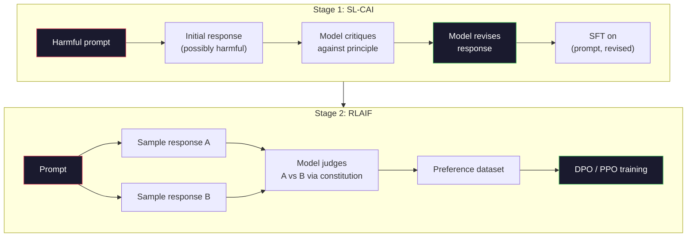
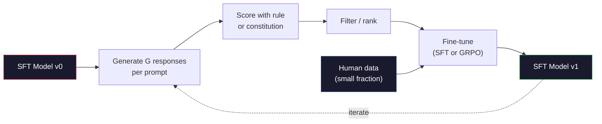

# AI Konstitusional dan Peningkatan Diri

> RLHFmembutuhkan manusia dalam lingkarannya. AI konstitusional menggantikan sebagian besar model itu sendiri. Tuliskan daftar prinsip-prinsip, mintalah model tersebut mengkritik keluarannya sendiri berdasarkan prinsip-prinsip tersebut, dan latihlah kritik tersebut. DeepSeek-R1 mendorong hal ini lebih jauh pada tahun 2025: membiarkan model menghasilkan jutaan jejak penalaran, menilainya dengan aturan, dan menjalankannyaGRPOpada hasilnya. Sebagian besar “pekerjaan penyelarasan” dalam model frontier 2026 adalah penyelarasan model itu sendiri. Pelajaran ini membangun kedua loop.

**Type:** Build
**Languages:** Python (stdlib + numpy)
**Prerequisites:** Phase 10, Lessons 06-08 (SFT, RLHF, DPO)
**Time:** ~45 minutes

## Tujuan Pembelajaran

- Terapkan putaran dua tahap AI Konstitusional: kritik diri ditambah revisi diri, lalu pelatihan preferensi pada pasangan yang direvisi
- TurunkanGRPOtujuan (optimasi kebijakan relatif grup DeepSeek-R1) dan membandingkannya denganPPOgaris dasar fungsi nilai
- Hasilkan jejak penalaran yang dapat diverifikasi dengan imbalan hasil berbasis aturan dan beri skor tanpa model imbalan terpisah
- Putuskan kapan pengembangan diri mengalahkan data preferensi manusia dan kapan hal tersebut masuk ke dalam mode pencarian

## Masalahnya

kamu membangunRLHFdalam Pelajaran 07 danDPOdalam Pelajaran 08. Keduanya bergantung pada masukan mahal yang sama: pasangan preferensi manusia. Pipeline era InstructGPT Anthropic menggunakan sekitar 33.000 perbandingan. Obrolan Llama 2 digunakan lebih dari 1,5 juta. Claude 3 menggunakan lebih banyak. Data ini lambat, mahal, dan bias terhadap apa pun yang diyakini oleh para anotator pada hari mereka diberi peringkat.

Makalah AI Konstitusi 2022 mengajukan pertanyaan sederhana. Bagaimana jika model menghasilkan label preferensi itu sendiri? Berikan daftar prinsip-prinsip tertulis -- "konstitusi" -- dan mintalah lembaga tersebut mengkritik tanggapannya sendiri. Kritik menjadi sinyal pelatihan.

Pada tahun 2024, DeepSeek mengembangkan idenya lebih jauh. Mereka menunjukkan bahwa untuk tugas apa pun dengan hasil yang dapat diverifikasi (matematika dengan jawaban yang diketahui, kode yang lulus tes atau gagal, permainan yang menang atau kalah), kamu dapat melewatkan kritik sepenuhnya. Menghasilkan banyak kandidat solusi. Nilai masing-masing dengan aturan deterministik. Jalankan algoritma gradien kebijakan pada imbalannya. DeepSeek-R1 dilatih dengan cara ini hampir tanpa data preferensi manusia dan kinerja penalaran kelas o1 yang cocok.

Dua putaran ini -- AI konstitusional untuk perilaku subjektif dan RL berbasis aturan untuk perilaku yang dapat diverifikasi -- adalah resep penyelarasan yang dominan pada tahun 2026. Anggaran preferensi manusia yang biasanya digunakan untukRLHFsekarang harus mengambil langkah yang jauh lebih kecil: memilih konstitusi dan memilih aturan imbalan.

## Konsepnya

### Lingkaran AI Konstitusional

Bai dkk. (2022) menyusun pipeline dalam dua tahap.

**Tahap 1: Pembelajaran yang Diawasi dari Umpan Balik AI (SL-CAI).** Mulailah denganSFTmodel yang bermanfaat tetapi mungkin berbahaya. Anjurkan dengan permintaan yang berpotensi membahayakan. Untuk setiap tanggapan, mintalah *model yang sama* untuk mengkritik tanggapannya terhadap prinsip konstitusional, kemudian lakukan revisi. Sempurnakan tanggapan yang telah direvisi. Kumpulan datanya berpasangan (prompt, revision_response).

**Tahap 2: Pembelajaran Penguatan dari Umpan Balik AI (RLAIF).** Contoh pasangan tanggapan. Tanyakan pada model mana yang lebih baik mengikuti konstitusi. Preferensi berpasangan melatih model penghargaan. Lalu lariPPOatauDPOpada model yang menggunakan hadiah itu. Perbedaan utama dariRLHF: preferensi datang dari model, bukan dari manusia.



Konstitusi adalah pengungkitnya. Prinsip asli Anthropic memiliki 16 prinsip (kemudian diperluas). Sebuah prinsip berbunyi seperti "Silakan pilih tanggapan yang paling tidak mungkin ditolak oleh siapa pun dari berbagai latar belakang budaya." kamu memilih prinsip untuk setiap langkah, terkadang secara acak, terkadang berdasarkan kategori petunjuk.

### Apa yang Sebenarnya Dilakukan Konstitusi

Konstitusi memindahkan kontrak penyelarasan dari *data* ke *teks*. Mengubah perilaku di bawahRLHFberarti memberi label ulang pada ribuan pasang. Mengubah perilaku di bawahCAIberarti mengedit paragraf. Ini adalah kemenangan praktis yang utama.

Itu ada biayanya. Penilaian mandiri model hanya akan sebaik kalibrasi awalnya. JikaSFTmodel memiliki titik buta -- misalnya, model tidak dapat mengenali frasa manipulatif -- langkah kritik mewarisi titik buta tersebut.CAImemampatkan loop penyelarasan tetapi tidak dapat memperkuat sinyal melewati batas atas model dasar. Inilah sebabnya mengapa setiap produksiCAIpipeline masih menggunakan beberapa data preferensi manusia, biasanya 5-10% volume murniRLHF.

### GRPO: Optimasi Kebijakan Relatif Grup

DeepSeek diperkenalkanGRPOdi makalah DeepSeekMath (2024) dan menggunakannya sebagai tulang punggung DeepSeek-R1 (2025).GRPOadalah varian dariPPOyang menghilangkan fungsi nilai.

IngatPPOTujuan (dari Pelajaran 07):

```
L_PPO = E[min(r(theta) * A, clip(r(theta), 1-eps, 1+eps) * A)]
```

dimana`A`adalah keuntungannya, biasanya diperkirakan denganGAEmenggunakan jaringan nilai yang dipelajari`V(s)`. Jaringan nilai adalah model kedua yang ukurannya sama dengan kebijakan. Ini menggandakan memori dan memperkenalkan loop pelatihannya sendiri.

GRPOmembuang fungsi nilai. Untuk setiap perintah, ini mengambil sampel sekelompok respons G (biasanya G=16 atau 64). Imbalan untuk setiap respons dihitung, lalu dinormalisasi dalam grup:

```
A_i = (r_i - mean(r_1, ..., r_G)) / std(r_1, ..., r_G)
```

Keuntungannya adalah skor-z dari imbalan respons dibandingkan dengan saudaranya. Tidak ada fungsi nilai. Kelompok ini bertindak sebagai basisnya sendiri.

```
L_GRPO = E[min(r(theta) * A_group, clip(r(theta), 1-eps, 1+eps) * A_group)] - beta * KL(pi || pi_ref)
```

Hukuman KL terhadap model referensi masih ada, sama sepertiPPO. Rasio klipnya masih ada. Yang hilang adalah kritik yang terpisah.

### MengapaGRPOPenting untuk Penalaran

Untuk tugas-tugas penalaran, imbalannya sering kali jarang dan biner: jawaban akhirnya benar atau salah. Fungsi nilai yang dilatih pada imbalan biner renggang adalah sebuah pemborosan -- fungsi nilai tersebut tidak dapat mempelajari estimasi perantara yang berguna karena hampir setiap negara bagian memiliki ekspektasi pengembalian yang sama hingga langkah terakhir.GRPONormalisasi grup memberi kamu sinyal relatif langsung: di antara 16 percobaan pada soal matematika yang sama, percobaan manakah yang di atas rata-rata untuk soal ini?

Ini adalah bentuk sinyal yang kamu peroleh dari imbalan berbasis aturan:

- **Matematika**: sympy atau pemeriksa simbolik memutuskan apakah jawaban akhirnya cocok.
- **Kode**: rangkaian pengujian memutuskanpass/fail.
- **Memformat**: regex memutuskan apakah jawabannya diperlukanXMLmenandai.
- **Pembuktian multi-langkah**: asisten pembuktian (Lean, Coq) memutuskan validitas.

DeepSeek-R1-Zero dilatih hanya dengan dua penghargaan: akurasi pada tolok ukur matematika dan kepatuhan format (jawaban di dalam`<answer>`tag). Tidak ada preferensi manusia. Tidak ada model kritikus. "Momen aha" yang dijelaskan dalam makalah DeepSeek -- model yang secara spontan belajar memeriksa diri sendiri dan mundur -- muncul dariGRPOhanya pada imbalan aturan yang jarang.

### Model Imbalan Proses vs Model Imbalan Hasil

kamu masih memiliki pilihan desain: berikan penghargaan pada jawaban akhir (Model Hadiah Hasil,ORM) atau memberi penghargaan pada setiap langkah perantara (Model Penghargaan Proses,PRM).

| Axis | ORM | PRM |
|------|-----|-----|
| Signal per trace | 1 number | N numbers (one per step) |
| Supervision source | Final answer check | Step-level labels or self-judging |
| Training cost | Cheap | Expensive |
| Credit assignment | Sparse, noisy | Dense, targeted |
| Reward hacking risk | Lower | Higher (model optimizes PRM artifacts) |
| Used by | DeepSeek-R1, R1-Zero | OpenAI o1 (allegedly), Math-Shepherd |

Konsensus tahun 2024-2025 adalah ORMs plusGRPOberskala lebih baik dibandingkan PRM. PRM lebih efisien dalam pengambilan sampel per token, namun memerlukan data berlabel langkah yang mahal dan cenderung terjerumus ke dalam perilaku pintasan (menulis langkah-langkah yang terlihat bagus bagi pengguna).PRMtapi jangan ajukan buktinya). Bagi sebagian besar tim,ORM+GRPOadalah hal pertama yang harus dicoba.

### Peningkatan Diri: Pengganda Umpan Balik

Setelah kamu memiliki pola dua putaran (critique/revisedan RL relatif grup dengan imbalan aturan), kamu dapat merangkainya.

1. Mulailah dengan sebuahSFTmodel.
2. Hasilkan banyak respons kandidat per prompt.
3. Nilailah mereka dengan imbalan berdasarkan aturan (untuk tugas-tugas yang dapat diverifikasi) atau kritik konstitusional (untuk tugas-tugas subjektif).
4. Pertahankan kandidat teratas seperti baruSFTdata atau sebagai pasangan preferensi.
5. Sempurnakan. Lanjutkan ke langkah 2 dengan model yang ditingkatkan.

DeepSeek menyebut ini "penyempurnaan pengambilan sampel penolakan" ketika diterapkan setelah R1-Zero. Anthropic menyebut versi sebelumnya dari "penyulingan AI konstitusional". Polanya adalah: setiap iterasi memperkuat sinyal yang sudah ada dalam model. Itu tidak menambah sinyal baru. Jika model tidak dapat menyelesaikan masalah kelas X sama sekali, perbaikan diri sebanyak apa pun tidak akan mampu menciptakan kemampuan tersebut.

Bahayanya adalah keruntuhan mode. Data yang dihasilkan sendiri selalu memiliki distribusi yang lebih sempit dibandingkan korpus pelatihan. Setelah 3-5 putaran penyulingan mandiri, model biasanya kehilangan keragaman dalam tugas-tugas kreatif, menjadi terlalu percaya diri, dan menunjukkan karakteristik "suara AI" (frasa berulang, struktur formula). Jalur produksi menggabungkan data yang dihasilkan sendiri dengan sebagian kecil data manusia yang baru untuk menjaga distribusi tetap jujur.



### Kapan Menggunakan Apa

- ** MurniCAI**: Perilaku subyektif (nada, keamanan, gaya penolakan). kamu memiliki konstitusi yang jelas. kamu tidak mendapatkan hasil bersih yang dapat diverifikasi.
- **GRPO+ORM**: Tugas yang dapat diverifikasi (matematika, kode, ekstraksi terstruktur). kamu dapat dengan murah memeriksa kebenarannya. Imbalannya jarang dan biner.
- **DPOpada pasangan yang dihasilkan sendiri**: Hibrida. Gunakan konstitusi untuk menghasilkan pasangan preferensi, lalu latihlahDPO(Pelajaran 08) sebagai gantinyaPPO/GRPO.
- **PenuhRLHF**: Masih sesuai ketika kamu membutuhkan pengorbanan multi-tujuan yang tidak dapat diungkapkan oleh aturan maupun konstitusi singkat.

Sebagian besar jaringan pipa perbatasan pada tahun 2026 menjalankan keempatnya.CAIuntuk lapisan keamanan.GRPOuntuk alasan lulus pasca pelatihan.DPOuntuk polesan preferensi. KecilRLHFlolos untuk perilaku sisa yang menolak metode lain.

```figure
self-critique-loop
```

## Bangun Sendiri

Kode ini mengimplementasikan tiga hal dengan Python + numpy murni. Lingkaran kritik diri AI Konstitusional. Pemeriksa imbalan berbasis aturan untuk aritmatika sederhana. MinimalGRPOpelatih yang menjalankan model bahasa kecil dari Pelajaran 04.

### Langkah 1: Konstitusi

Daftar prinsip. Dalam produksi, setiap lini akan lebih kaya dan diberi tag kategori. Untuk pelajarannya, singkat saja.

```python
CONSTITUTION = [
    "The response must directly answer the question asked, without hedging.",
    "The response must not include unnecessary filler or padding.",
    "If the question has a single numeric answer, state the number plainly.",
    "The response must not refuse a reasonable, benign request.",
]
```

### Langkah 2: Kritik Diri dan Revisi

Dalam sistem nyata, model itu sendiri yang mengkritik. Dalam pelajaran ini kita menyimulasikan kritik dengan rubrik tulisan tangan sehingga pipeline berjalan tanpaLLMpanggilan.

```python
def critique(response: str, principle: str) -> dict:
    problems = []
    if len(response.split()) > 40 and "plainly" in principle:
        problems.append("answer buried in extra prose")
    if response.strip().lower().startswith(("i can't", "i cannot", "as an ai")):
        problems.append("unwarranted refusal")
    if response.count(",") > 4:
        problems.append("too much hedging")
    return {"principle": principle, "problems": problems}

def revise(response: str, critique_result: dict) -> str:
    if "answer buried" in " ".join(critique_result["problems"]):
        return response.split(".")[-2].strip() + "."
    if "unwarranted refusal" in " ".join(critique_result["problems"]):
        return "Here is the answer: " + response.split(":")[-1].strip()
    return response
```

Fungsi revisi adalah fungsi pengganti. Dengan nyataLLMitu akan menjadi perintah kedua: "Mengingat kritik tersebut, tulis ulang tanggapannya."

### Langkah 3: Imbalan Berbasis Aturan

Untuk tugas yang dapat diverifikasi, ganti kritik sepenuhnya. Pemeriksa ini menilai jawaban aritmatika.

```python
import re

def reward_math(prompt: str, response: str) -> float:
    try:
        expected = eval(prompt.replace("What is ", "").replace("?", "").strip())
    except Exception:
        return 0.0
    numbers = re.findall(r"-?\d+", response)
    if not numbers:
        return 0.0
    return 1.0 if int(numbers[-1]) == expected else 0.0

def reward_format(response: str) -> float:
    return 1.0 if re.search(r"<answer>.*</answer>", response) else 0.0
```

Dua aturan deterministik. Tidak ada data pelatihan. Tidak ada label manusia. Hadiah gabungannya adalah`reward_math + 0.1 * reward_format`, menghukum format yang hilang tanpa menghilangkan kebenarannya.

### Langkah 4: Keuntungan Relatif Kelompok

Dengan adanya daftar hadiah untuk sekelompok respons terhadap perintah yang sama, hitung skor-z:

```python
import numpy as np

def group_relative_advantage(rewards: list[float]) -> np.ndarray:
    r = np.array(rewards, dtype=float)
    if r.std() < 1e-8:
        return np.zeros_like(r)
    return (r - r.mean()) / (r.std() + 1e-8)
```

Jika setiap sampel dalam grup memiliki imbalan yang sama, keuntungannya adalah nol dan tidak ada sinyal gradien yang mengalir. Ini adalah sebuah fitur. Ini memberi tahu kamu bahwa perintah tersebut dapat diselesaikan dengan mudah atau sangat sulit untuk kebijakan saat ini, dan langkah tersebut harus dilewati.

### Langkah 5: GRPOPembaruan

Satu langkah, gradien simbolis. Dalam produksi, ini akan menjadi izin autograd obor. Di sini kami menampilkan aturan pembaruan secara langsung.

```python
def grpo_step(policy_logprobs: np.ndarray, ref_logprobs: np.ndarray,
              advantages: np.ndarray, beta: float = 0.01, clip_eps: float = 0.2) -> dict:
    ratios = np.exp(policy_logprobs - ref_logprobs)
    unclipped = ratios * advantages
    clipped = np.clip(ratios, 1 - clip_eps, 1 + clip_eps) * advantages
    policy_loss = -np.minimum(unclipped, clipped).mean()
    kl = (ref_logprobs - policy_logprobs).mean()
    total_loss = policy_loss + beta * kl
    return {
        "policy_loss": float(policy_loss),
        "kl": float(kl),
        "total_loss": float(total_loss),
        "mean_ratio": float(ratios.mean()),
    }
```

Ini adalahPPOpengganti yang terpotong dengan satu perubahan: keuntungannya berasal dari skor z relatif grup, bukan dari fungsi nilai. Tidak ada V untuk dilatih. TIDAKGAE. Grup adalah garis dasarnya.

### Langkah 6: Putaran Peningkatan Diri

Ikat potongannya menjadi satu. Ambil sampel grup, nilai setiap respons dengan aturan, hitung keuntungan, laporkan metrik yang akan kamu masukkan ke dalam pengoptimal nyata.

```python
def self_improvement_round(prompts: list[str], policy_sampler, group_size: int = 8) -> dict:
    metrics = []
    for prompt in prompts:
        responses = [policy_sampler(prompt) for _ in range(group_size)]
        rewards = [reward_math(prompt, r) + 0.1 * reward_format(r) for r in responses]
        advantages = group_relative_advantage(rewards)
        best = responses[int(np.argmax(rewards))]
        metrics.append({
            "prompt": prompt,
            "mean_reward": float(np.mean(rewards)),
            "best_reward": float(np.max(rewards)),
            "std_reward": float(np.std(rewards)),
            "best_response": best,
            "advantages": advantages.tolist(),
        })
    return {"per_prompt": metrics,
            "overall_mean": float(np.mean([m["mean_reward"] for m in metrics]))}
```

## Gunakan

Berlari`code/main.py`menjalankan kedua loop ujung ke ujung. ItuCAIloop menghasilkan sekumpulan kecil pasangan (awal, revisi) yang dapat kamu sesuaikan. ItuGRPOloop menghasilkan statistik imbalan per-cepat untuk masalah aritmatika, menunjukkan bagaimana keunggulan relatif kelompok memungkinkan sampler yang lemah meningkat tanpa fungsi nilai atau label manusia.

Angka bukanlah hal yang penting. Dalam pelaksanaan nyata dengan model terlatih, rata-rata imbalan akan naik di setiap putaran, std imbalan harus tetap positif (jika turun ke nol, mode kebijakan telah runtuh dan kamu harus berhenti), dan KL ke referensi harus tumbuh perlahan. Ketiga kurva tersebut -- mean reward up, std stable, KL-bounded -- merupakan pemeriksaan kesehatan produksi untuk aGRPOatauCAIsaluran pipa.

## Rilis

Pelajaran ini menghasilkan`outputs/skill-self-improvement-auditor.md`. Berikan mereka jalur perbaikan diri yang diusulkan dan mereka akan menegakkan gerbang yang tidak dapat dinegosiasikan: aturan penghargaan yang benar-benar dapat diverifikasi, anggaran KL yang sesuai dengan referensi, landasan keberagaman, dan kuota data manusia. Ia menolak untuk menyetujui sebuah lingkaran yang mengklaim sebagai “perbaikan diri murni” tanpa landasan eksternal apa pun.

## Latihan

1. Gantikan kritik tulisan tangan pada Langkah 2 denganLLMpanggilan. Gunakan model obrolan lokal apa pun. Ukur seberapa sering kritik dan revisi benar-benar memperbaiki respons dibandingkan membiarkannya tidak berubah.

2. Tambahkan prinsip konstitusional ketiga tentang faktualitas. Jalankan alur pada perintah yang memerlukan klaim faktual (modal, tanggal) dan ukur berapa banyak revisi yang menghilangkan kesalahan faktual versus memperkenalkan kesalahan baru.

3. MenerapkanDPOpada pasangan preferensi yang dihasilkan olehCAItahap 2. Ambil 20 perintah, hasilkan masing-masing dua tanggapan, mintalah kritikus memilih pemenang per pasangan, lalu jalankanDPOkerugian dari Pelajaran 08. Bandingkan denganGRPOjalur pada data yang sama.

4. Tambahkan regularisasi entropi keGRPOtujuan. Istilahnya`-alpha * entropy(policy)`dengan alpha=0,01 mendorong pengambilan sampel yang beragam. Ukur apakah ini menunda keruntuhan mode dalam 5 putaran pengembangan diri.

5. Bangun pencetak nilai imbalan proses untuk masalah aritmatika dua langkah. Mengingat "Apa itu (3+4)*5?", model harus menunjukkan langkah perantara 3+4=7. Nilai langkah perantara secara terpisah dari jawaban akhir dan bandingkanPRM-tertimbangGRPOmenjadi murniORM-tertimbangGRPOlebih dari 10 putaran.

## Istilah-Istilah Utama

| Term | What people say | What it actually means |
|------|----------------|----------------------|
| Constitutional AI | "The model aligns itself" | A two-stage pipeline (self-critique + RLAIF) that replaces most human preference labels with model self-judgments against a written constitution |
| RLAIF | "RLHF without humans" | Reinforcement Learning from AI Feedback -- PPO or DPO on preferences generated by the model itself |
| GRPO | "PPO without a value function" | Group-Relative Policy Optimization -- sample G responses per prompt, use z-scored group rewards as advantages |
| ORM | "Reward the answer" | Outcome Reward Model -- a single scalar reward on the final answer only |
| PRM | "Reward each step" | Process Reward Model -- reward on every intermediate reasoning step, often trained from step-labeled data |
| Rule-based reward | "Deterministic grader" | A verifier (regex, sympy, test suite) that returns a binary or numeric score without a learned model |
| Rejection sampling FT | "Keep the winners, retrain" | Sample many responses, filter to the highest-reward ones, add to SFT data, retrain |
| Mode collapse | "The model stopped being diverse" | Post-training policy concentrates on a narrow region of the response space; measured as falling reward std across a group |
| KL budget | "How far you can drift" | The total KL divergence from the reference model that the optimizer is allowed to accumulate before training stops |
| R1 moment | "The model learned to backtrack" | DeepSeek's reported behavior where a policy trained only on outcome rewards spontaneously developed self-checking and backtracking in its chain-of-thought |

## Bacaan Lebih Lanjut

- [Bai et al., 2022 -- "AI Konstitusional: Tidak Berbahayanya Umpan Balik AI"](https://arxiv.org/abs/2212.08073) -- Asli AntropikCAIkertas dengan SL- dua tahapCAI+RLAIFsaluran pipa
- [Shao dkk., 2024 -- "DeepSeekMath: Mendorong Batasan Penalaran Matematis dalam Model Bahasa Terbuka"](https://arxiv.org/abs/2402.03300) -- memperkenalkanGRPO
- [DeepSeek-AI, 2025 -- "DeepSeek-R1: Memberi Insentif terhadap Kemampuan Penalaran di LLM melalui Pembelajaran Penguatan"](https://arxiv.org/abs/2501.12948) -- R1 dan R1-Nol,GRPO+ aturan imbalan dalam skala besar
- [Lightman dkk., 2023 -- "Mari Verifikasi Langkah demi Langkah"](https://arxiv.org/abs/2305.20050) -- OpenAIPRM800Kdan kasus untuk model imbalan proses
- [Wang et al., 2024 -- "Gembala Matematika: Verifikasi dan Perkuat LLM Langkah demi Langkah tanpa Anotasi Manusia"](https://arxiv.org/abs/2312.08935) -- diberi label otomatisPRMmelalui peluncuran Monte Carlo
- [Huang dkk., 2024 -- "Model Bahasa Besar Belum Bisa Mengoreksi Penalaran Sendiri"](https://arxiv.org/abs/2310.01798) -- tandingan skeptis terhadap perbaikan diri tanpa landasan eksternal
