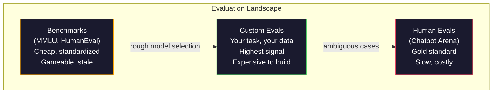
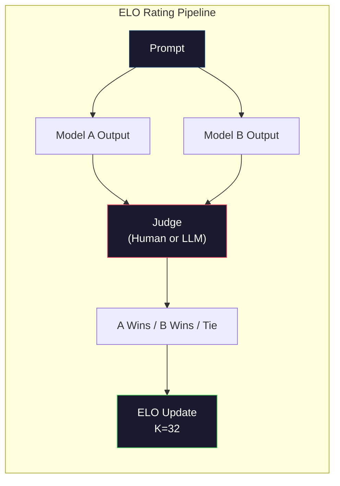

# Evaluasi: Tolok Ukur, Evaluasi, LM Harness

> Hukum Goodhart: ketika suatu ukuran menjadi target, maka ukuran tersebut tidak lagi menjadi ukuran yang baik. Setiap tolok ukur permainan lab perbatasan.MMLUskor meningkat sementara model masih tidak dapat menghitung jumlah R di "strawberry". Satu-satunya evaluasi yang penting adalahYOUReval -- aktifYOURtugas, denganYOURdata.

**Type:** Build
**Languages:** Python
**Prerequisites:** Phase 10, Lessons 01-05 (LLMs from Scratch)
**Time:** ~90 minutes

## Tujuan Pembelajaran

- Bangun pemanfaatan evaluasi khusus yang menjalankan tolok ukur pilihan ganda dan terbuka terhadap model bahasa
- Jelaskan mengapa tolok ukur standar (MMLU, HumanEval) jenuh dan gagal membedakan model perbatasan
- Terapkan evaluasi khusus tugas dengan metrik yang tepat: pencocokan tepat, F1,BLEU, danLLM-sebagai juri penilaian
- Rancang rangkaian evaluasi khusus yang menargetkan kasus penggunaan spesifik kamu daripada hanya mengandalkan papan peringkat publik

## Masalahnya

MMLUditerbitkan pada tahun 2020 dengan 15.908 pertanyaan di 57 mata pelajaran. Dalam waktu tiga tahun, model-model frontier memenuhinya.GPT-4 mencetak 86,4%. Claude 3 Opus mencetak 86,8%. Llama 3 405B mencetak 88,6%. Papan peringkat dikompresi menjadi rentang 3 poin di mana perbedaannya hanyalah gangguan statistik, bukan kesenjangan kemampuan yang sebenarnya.

Sementara itu, model yang sama gagal dalam tugas-tugas yang ditangani anak berusia 10 tahun tanpa berpikir panjang. Claude 3.5 Soneta, dengan skor 88,7%.MMLU, awalnya tidak dapat menghitung huruf dalam "strawberry" -- tugas yang tidak memerlukan pengetahuan dunia dan penalaran nol, hanya iterasi tingkat karakter. HumanEval menguji pembuatan kode dengan 164 masalah. Model mendapat skor 90%+ sambil tetap menghasilkan kode yang mogok pada kasus-kasus edge yang dapat ditangkap oleh pengembang junior mana pun.

Kesenjangan antara kinerja benchmark dan keandalan di dunia nyata adalah masalah utamaLLMevaluasi. Tolok ukur memberi tahu kamu bagaimana kinerja suatu model pada tolok ukur. Mereka hampir tidak memberi tahu kamu apa pun tentang bagaimana model tersebut akan bekerja pada tugas spesifik kamu, dengan data spesifik kamu, dalam mode kegagalan spesifik kamu. Jika kamu membuat bot dukungan pelanggan,MMLUtidak relevan. Jika kamu membuat asisten kode, HumanEval hanya mencakup pembuatan tingkat fungsi -- ia tidak menjelaskan apa pun tentang proses debug, pemfaktoran ulang, atau penjelasan kode di seluruh file.

kamu memerlukan evaluasi khusus. Bukan karena tolok ukur tidak berguna -- tolok ukur berguna untuk pemilihan model secara kasar -- namun karena evaluasi akhir harus sama persis dengan kondisi penerapan kamu.

## Konsepnya

### Pemandangan Evaluasi

Ada tiga kategori evaluasi, masing-masing dengan biaya dan kualitas sinyal berbeda.

**Tolok ukur** adalah rangkaian pengujian terstandar.MMLU, Evaluasi Manusia,SWE-bangku,MATH,ARC, HellaSwag. kamu menjalankan model berdasarkan tolok ukur dan mendapatkan skor. Keuntungannya: setiap orang menggunakan pengujian yang sama, sehingga kamu dapat membandingkan model. Kerugiannya: model dan data pelatihan semakin mencemari tolok ukur ini. Lab melatih data yang mencakup pertanyaan tolok ukur. Skor meningkat. Kemampuan mungkin tidak.

**Eval kustom** adalah rangkaian pengujian yang kamu buat untuk kasus penggunaan spesifik kamu. kamu menentukan masukan, keluaran yang diharapkan, dan fungsi penilaian. Peringkasan dokumen hukum dievaluasi berdasarkan dokumen hukum. SEBUAHSQLgenerator dievaluasi pada skema database kamu. Pembuatannya mahal, tetapi ini adalah satu-satunya evaluasi yang memprediksi kinerja produksi.

**Evaluasi manusia** menggunakan anotator berbayar untuk menilai keluaran model berdasarkan kriteria seperti kegunaan, kebenaran, kelancaran, dan keamanan. Standar emas untuk tugas terbuka di mana penilaian otomatis gagal. Chatbot Arena telah mengumpulkan lebih dari 2 juta suara preferensi manusia di 100+ model. Sisi negatifnya: biaya ($0.10-$2,00 per penilaian) dan kecepatan (jam hingga hari).



### Mengapa Tolok Ukur Rusak

Ada tiga mekanisme yang menyebabkan skor benchmark tidak lagi mencerminkan kemampuan sebenarnya.

**Kontaminasi data.** Korpora pelatihan mengikis internet. Pertanyaan benchmark langsung di internet. Model melihat jawabannya selama pelatihan. Hal ini bukanlah sebuah kecurangan dalam pengertian tradisional -- laboratorium tidak dengan sengaja menyertakan data benchmark. Namun pengikisan skala web membuatnya hampir mustahil untuk dikecualikan.

**Mengajar sambil menguji.** Lab mengoptimalkan campuran pelatihan untuk kinerja tolok ukur. Jika 5% dari campuran pelatihan adalahMMLU-gaya pilihan ganda, model mempelajari format dan distribusi jawaban.MMLUadalah pilihan ganda 4 arah. Model mempelajari bahwa distribusi jawaban kira-kira seragamA/B/C/D, yang membantu meskipun model tidak mengetahui jawabannya.

**Saturasi.** Ketika setiap model frontier mendapat skor 85-90% pada suatu tolok ukur, tolok ukur tersebut berhenti melakukan diskriminasi. 10-15% pertanyaan sisanya mungkin bersifat ambigu, diberi label yang salah, atau memerlukan pengetahuan domain yang tidak jelas. Meningkat dari 87% menjadi 89%.MMLUmungkin berarti model tersebut mengingat dua pertanyaan yang tidak jelas, bukan berarti model tersebut menjadi lebih pintar.

### Kebingungan: Pemeriksaan Kesehatan Cepat

Kebingungan mengukur seberapa terkejutnya suatu model dengan serangkaian token. Secara formal, ini adalah kemungkinan log negatif rata-rata yang dieksponen:

```
PPL = exp(-1/N * sum(log P(token_i | context)))
```

Kebingungan 10 berarti model tersebut, rata-rata, sama tidak pastinya dengan memilih secara seragam di antara 10 opsi pada setiap posisi token. Lebih rendah lebih baik.GPT-2 mendapat kebingungan ~30 di WikiText-103.GPT-3 mendapat ~20. Llama 3 8B mendapat ~7.

Kebingungan berguna untuk membandingkan model pada set pengujian yang sama, namun memiliki titik buta. Sebuah model dapat memiliki tingkat kebingungan yang rendah karena pandai memprediksi pola-pola umum, namun buruk dalam memprediksi pola-pola yang jarang namun penting. Ia juga tidak mengatakan apa pun tentang mengikuti instruksi, penalaran, atau keakuratan faktual. Gunakan ini sebagai pemeriksaan kewarasan, bukan keputusan akhir.

### LLM-sebagai-Hakim

Gunakan model yang kuat untuk mengevaluasi keluaran model yang lebih lemah. Idenya sederhana: bertanyaGPT-4o atau Claude Sonnet untuk menilai respons pada skala 1-5 untuk kebenaran, kegunaan, dan keamanan. Biayanya sekitar $0,01 per penilaian denganGPT-4o-mini dan berkorelasi sangat baik dengan penilaian manusia -- sekitar 80% setuju pada sebagian besar tugas.

Perintah pemberian skor lebih penting daripada model. Perintah yang tidak jelas ("Beri nilai respons ini") menghasilkan skor yang berisik. Prompt terstruktur dengan rubrik ("Skor 5 jika jawabannya benar secara faktual dan mengutip sumber, 4 jika benar tetapi tidak bersumber, 3 jika benar sebagian...") menghasilkan skor yang konsisten dan dapat direproduksi.

Mode kegagalan: model juri menunjukkan bias posisi (lebih memilih respons pertama dalam perbandingan berpasangan), bias verbositas (lebih memilih respons yang lebih lama), dan preferensi diri (GPT-4 tarifGPT-4 keluaran lebih tinggi dari keluaran Claude yang setara). Mitigasi: mengacak urutan, menormalkan panjangnya, menggunakan juri yang berbeda dari model yang sedang dievaluasi.

### ELOPeringkat dari Perbandingan Berpasangan

Pendekatan Chatbot Arena. Tampilkan dua tanggapan terhadap perintah yang sama dari model yang berbeda. Manusia (atauLLMhakim) memilih yang lebih baik. Dari ribuan perbandingan ini, hitunglahELOperingkat untuk setiap model -- sistem yang sama yang digunakan dalam catur.

ELOkeuntungan: pemeringkatan relatif lebih dapat diandalkan dibandingkan penilaian absolut, menangani hubungan dengan baik, dan menyatu dengan perbandingan yang lebih sedikit dibandingkan menilai setiap output secara independen. Pada awal tahun 2026, peringkat Chatbot Arena terlihatGPT-4o, Claude 3.5 Soneta, dan Gemini 1.5 Pro dalam waktu 20ELOpoin satu sama lain di atas.



### Kerangka Evaluasi

**lm-evaluation-harness** (EleutherAI): kerangka kerja evaluasi sumber terbuka standar. Mendukung 200+ tolok ukur. Jalankan lawan model Hugging Face apa punMMLU, HellaSwag,ARC, dll. dengan satu perintah. Digunakan oleh TerbukaLLMPapan peringkat.

**RAGAS**: kerangka evaluasi khusus untukRAGsaluran pipa. Mengukur kesetiaan (apakah jawaban sesuai dengan konteks yang diambil?), relevansi (apakah konteks yang diambil relevan dengan pertanyaan?), dan kebenaran jawaban.

**promptfoo**: evaluasi berbasis konfigurasi untuk rekayasa cepat. Tentukan kasus uji diYAML, jalankan melawan beberapa model, dapatkan apass/faillaporan. Berguna untuk perintah pengujian regresi -- pastikan perubahan cepat tidak merusak kasus pengujian yang ada.

### Membangun Evaluasi Kustom

Satu-satunya evaluasi yang penting untuk produksi. Prosesnya:

1. **Tentukan tugasnya.** Apa sebenarnya yang harus dilakukan model? Tepatnya. "Jawab pertanyaan" terlalu kabur. "Dengan adanya email keluhan pelanggan, mengekstrak nama produk, kategori masalah, dan sentimen" adalah tugas yang dapat kamu evaluasi.

2. **Buat kasus uji.** Minimum 50 untuk evaluasi prototipe, 200+ untuk produksi. Setiap kasus uji adalah pasangan (input, ekspektasi_output). Sertakan kasus tepi: masukan kosong, masukan permusuhan, masukan ambigu, masukan dalam bahasa lain.

3. **Tentukan penilaian.** Pencocokan persis untuk keluaran terstruktur.BLEU/ROUGEuntuk kesamaan teks.LLM-sebagai juri untuk kualitas terbuka. F1 untuk tugas ekstraksi. Gabungkan beberapa metrik dengan bobot.

4. **Otomatiskan.** Setiap eval dijalankan dengan satu perintah. Tidak ada langkah manual. Simpan hasil dalam format yang memungkinkan perbandingan dari waktu ke waktu.

5. **Lacak seiring waktu.** Skor eval tidak ada artinya jika berdiri sendiri. kamu membutuhkan garis tren. Apakah skornya meningkat setelah perubahan cepat terakhir? Apakah mengalami kemunduran setelah berpindah model? Versi eval kamu bersama dengan perintah kamu.

| Eval Type | Cost per judgment | Agreement with humans | Best for |
|-----------|------------------|----------------------|----------|
| Exact match | ~$0 | 100% (when applicable) | Structured output, classification |
| BLEU/ROUGE | ~$0 | ~60% | Translation, summarization |
| LLM-as-judge | ~$0.01 | ~80% | Open-ended generation |
| Human eval | $0.10-$2.00 | N/A (is the ground truth) | Ambiguous, high-stakes tasks |

```figure
perplexity-loss
```

## Bangun Sendiri

### Langkah 1: Kerangka Evaluasi Minimal

Tentukan abstraksi inti. Kasus eval memiliki masukan, keluaran yang diharapkan, dan dikte metadata opsional. Pencetak gol mengambil prediksi dan referensi dan mengembalikan skor antara 0 dan 1.

```python
import json
from collections import Counter

class EvalCase:
    def __init__(self, input_text, expected, metadata=None):
        self.input_text = input_text
        self.expected = expected
        self.metadata = metadata or {}

class EvalSuite:
    def __init__(self, name, cases, scorers):
        self.name = name
        self.cases = cases
        self.scorers = scorers

    def run(self, model_fn):
        results = []
        for case in self.cases:
            prediction = model_fn(case.input_text)
            scores = {}
            for scorer_name, scorer_fn in self.scorers.items():
                scores[scorer_name] = scorer_fn(prediction, case.expected)
            results.append({
                "input": case.input_text,
                "expected": case.expected,
                "prediction": prediction,
                "scores": scores,
            })
        return results
```

### Langkah 2: Fungsi Penilaian

Buat pencocokan tepat, token F1, dan simulasiLLM-sebagai pencetak gol juri.

```python
def exact_match(prediction, expected):
    return 1.0 if prediction.strip().lower() == expected.strip().lower() else 0.0

def token_f1(prediction, expected):
    pred_tokens = set(prediction.lower().split())
    exp_tokens = set(expected.lower().split())
    if not pred_tokens or not exp_tokens:
        return 0.0
    common = pred_tokens & exp_tokens
    precision = len(common) / len(pred_tokens)
    recall = len(common) / len(exp_tokens)
    if precision + recall == 0:
        return 0.0
    return 2 * (precision * recall) / (precision + recall)

def llm_judge_simulated(prediction, expected):
    pred_words = set(prediction.lower().split())
    exp_words = set(expected.lower().split())
    if not exp_words:
        return 0.0
    overlap = len(pred_words & exp_words) / len(exp_words)
    length_penalty = min(1.0, len(prediction) / max(len(expected), 1))
    return round(overlap * 0.7 + length_penalty * 0.3, 3)
```

### Langkah 3: ELOSistem Pemeringkatan

Menerapkan perbandingan berpasangan denganELOpembaruan. Inilah sistem yang digunakan Chatbot Arena untuk menentukan peringkat model.

```python
class ELOTracker:
    def __init__(self, k=32, initial_rating=1500):
        self.ratings = {}
        self.k = k
        self.initial_rating = initial_rating
        self.history = []

    def _ensure_player(self, name):
        if name not in self.ratings:
            self.ratings[name] = self.initial_rating

    def expected_score(self, rating_a, rating_b):
        return 1 / (1 + 10 ** ((rating_b - rating_a) / 400))

    def record_match(self, player_a, player_b, outcome):
        self._ensure_player(player_a)
        self._ensure_player(player_b)

        ea = self.expected_score(self.ratings[player_a], self.ratings[player_b])
        eb = 1 - ea

        if outcome == "a":
            sa, sb = 1.0, 0.0
        elif outcome == "b":
            sa, sb = 0.0, 1.0
        else:
            sa, sb = 0.5, 0.5

        self.ratings[player_a] += self.k * (sa - ea)
        self.ratings[player_b] += self.k * (sb - eb)

        self.history.append({
            "a": player_a, "b": player_b,
            "outcome": outcome,
            "rating_a": round(self.ratings[player_a], 1),
            "rating_b": round(self.ratings[player_b], 1),
        })

    def leaderboard(self):
        return sorted(self.ratings.items(), key=lambda x: -x[1])
```

### Langkah 4: Perhitungan Kebingungan

Hitung kebingungan menggunakan probabilitas token. Dalam praktiknya, kamu akan mendapatkannya dari log model. Di sini kami melakukan simulasi dengan distribusi probabilitas.

```python
import numpy as np

def perplexity(log_probs):
    if not log_probs:
        return float("inf")
    avg_neg_log_prob = -np.mean(log_probs)
    return float(np.exp(avg_neg_log_prob))

def token_log_probs_simulated(text, model_quality=0.8):
    np.random.seed(hash(text) % 2**31)
    tokens = text.split()
    log_probs = []
    for i, token in enumerate(tokens):
        base_prob = model_quality
        if len(token) > 8:
            base_prob *= 0.6
        if i == 0:
            base_prob *= 0.7
        prob = np.clip(base_prob + np.random.normal(0, 0.1), 0.01, 0.99)
        log_probs.append(float(np.log(prob)))
    return log_probs
```

### Langkah 5: Hasil Agregat

Hitung statistik ringkasan seluruh proses evaluasi: rata-rata, median, tingkat kelulusan pada ambang batas, dan pengelompokan per metrik.

```python
def summarize_results(results, threshold=0.8):
    all_scores = {}
    for r in results:
        for metric, score in r["scores"].items():
            all_scores.setdefault(metric, []).append(score)

    summary = {}
    for metric, scores in all_scores.items():
        arr = np.array(scores)
        summary[metric] = {
            "mean": round(float(np.mean(arr)), 3),
            "median": round(float(np.median(arr)), 3),
            "std": round(float(np.std(arr)), 3),
            "min": round(float(np.min(arr)), 3),
            "max": round(float(np.max(arr)), 3),
            "pass_rate": round(float(np.mean(arr >= threshold)), 3),
            "n": len(scores),
        }
    return summary

def print_summary(summary, suite_name="Eval"):
    print(f"\n{'=' * 60}")
    print(f"  {suite_name} Summary")
    print(f"{'=' * 60}")
    for metric, stats in summary.items():
        print(f"\n  {metric}:")
        print(f"    Mean:      {stats['mean']:.3f}")
        print(f"    Median:    {stats['median']:.3f}")
        print(f"    Std:       {stats['std']:.3f}")
        print(f"    Range:     [{stats['min']:.3f}, {stats['max']:.3f}]")
        print(f"    Pass rate: {stats['pass_rate']:.1%} (threshold >= 0.8)")
        print(f"    N:         {stats['n']}")
```

### Langkah 6: Jalankan Alur Penuh

Hubungkan semuanya menjadi satu. Tentukan tugas, buat kasus uji, simulasikan dua model, jalankan eval, hitungELOdari perbandingan berpasangan, dan cetak papan peringkat.

```python
def demo_model_good(prompt):
    responses = {
        "What is the capital of France?": "Paris",
        "What is 2 + 2?": "4",
        "Who wrote Hamlet?": "William Shakespeare",
        "What language is PyTorch written in?": "Python and C++",
        "What is the boiling point of water?": "100 degrees Celsius",
    }
    return responses.get(prompt, "I don't know")

def demo_model_bad(prompt):
    responses = {
        "What is the capital of France?": "Paris is the capital city of France",
        "What is 2 + 2?": "The answer is four",
        "Who wrote Hamlet?": "Shakespeare",
        "What language is PyTorch written in?": "Python",
        "What is the boiling point of water?": "212 Fahrenheit",
    }
    return responses.get(prompt, "Unknown")

cases = [
    EvalCase("What is the capital of France?", "Paris"),
    EvalCase("What is 2 + 2?", "4"),
    EvalCase("Who wrote Hamlet?", "William Shakespeare"),
    EvalCase("What language is PyTorch written in?", "Python and C++"),
    EvalCase("What is the boiling point of water?", "100 degrees Celsius"),
]

suite = EvalSuite(
    name="General Knowledge",
    cases=cases,
    scorers={
        "exact_match": exact_match,
        "token_f1": token_f1,
        "llm_judge": llm_judge_simulated,
    },
)

results_good = suite.run(demo_model_good)
results_bad = suite.run(demo_model_bad)

print_summary(summarize_results(results_good), "Model A (concise)")
print_summary(summarize_results(results_bad), "Model B (verbose)")
```

Model yang "baik" memberikan jawaban yang tepat. Model yang "buruk" memberikan parafrase yang panjang lebar. Pencocokan tepat akan menghukum model verbose dengan berat. Token F1 danLLM-sebagai hakim lebih pemaaf. Hal ini menggambarkan mengapa pilihan metrik penting: model yang sama terlihat bagus atau jelek bergantung pada cara kamu menilainya.

### Langkah 7: ELOTurnamen

Jalankan perbandingan berpasangan antar model dalam beberapa putaran.

```python
elo = ELOTracker(k=32)

for case in cases:
    pred_a = demo_model_good(case.input_text)
    pred_b = demo_model_bad(case.input_text)

    score_a = token_f1(pred_a, case.expected)
    score_b = token_f1(pred_b, case.expected)

    if score_a > score_b:
        outcome = "a"
    elif score_b > score_a:
        outcome = "b"
    else:
        outcome = "tie"

    elo.record_match("model_a_concise", "model_b_verbose", outcome)

print("\nELO Leaderboard:")
for name, rating in elo.leaderboard():
    print(f"  {name}: {rating:.0f}")
```

### Langkah 8: Perbandingan Kebingungan

Bandingkan kebingungan antar "model" dengan tingkat kualitas yang berbeda.

```python
test_text = "The quick brown fox jumps over the lazy dog in the garden"

for quality, label in [(0.9, "Strong model"), (0.7, "Medium model"), (0.4, "Weak model")]:
    log_probs = token_log_probs_simulated(test_text, model_quality=quality)
    ppl = perplexity(log_probs)
    print(f"  {label} (quality={quality}): perplexity = {ppl:.2f}")
```

## Gunakan

### lm-evaluasi-harness (EleutherAI)

Alat standar untuk menjalankan benchmark pada model apa pun.

```python
# pip install lm-eval
# Command line:
# lm_eval --model hf --model_args pretrained=meta-llama/Llama-3.1-8B --tasks mmlu --batch_size 8

# Python API:
# import lm_eval
# results = lm_eval.simple_evaluate(
#     model="hf",
#     model_args="pretrained=meta-llama/Llama-3.1-8B",
#     tasks=["mmlu", "hellaswag", "arc_easy"],
#     batch_size=8,
# )
# print(results["results"])
```

### promptfoo

Evaluasi berbasis konfigurasi untuk rekayasa cepat. Definisikan tes diYAMLdan melawan banyak penyedia.

```yaml
# promptfoo.yaml
providers:
  - openai:gpt-4o-mini
  - anthropic:claude-3-haiku

prompts:
  - "Answer in one word: {{question}}"

tests:
  - vars:
      question: "What is the capital of France?"
    assert:
      - type: contains
        value: "Paris"
  - vars:
      question: "What is 2 + 2?"
    assert:
      - type: equals
        value: "4"
```

### RAGASuntukRAGevaluasi

```python
# pip install ragas
# from ragas import evaluate
# from ragas.metrics import faithfulness, answer_relevancy, context_precision
#
# result = evaluate(
#     dataset,
#     metrics=[faithfulness, answer_relevancy, context_precision],
# )
# print(result)
```

RAGASmengukur apa yang terlewatkan oleh evaluasi umum: apakah jawaban model didasarkan pada konteks yang diambil, bukan hanya apakah jawabannya "benar" secara abstrak.

## Rilis

Pelajaran ini menghasilkan`outputs/prompt-eval-designer.md`-- prompt yang dapat digunakan kembali yang mendesain rangkaian eval khusus untuk tugas apa pun. Berikan deskripsi tugas dan itu akan menghasilkan kasus uji, fungsi penilaian, dan apass/failrekomendasi ambang batas.

Itu juga menghasilkan`outputs/skill-llm-evaluation.md`-- kerangka keputusan untuk memilih strategi evaluasi yang tepat berdasarkan jenis tugas, anggaran, dan persyaratan latensi kamu.

## Latihan

1. Tambahkan pencetak skor "konsistensi" yang menjalankan masukan yang sama melalui model sebanyak 5 kali dan mengukur seberapa sering keluarannya cocok. Jawaban yang tidak konsisten pada masukan deterministik menunjukkan perintah yang rapuh atau pengaturan suhu tinggi.

2. PerpanjangELOpelacak untuk mendukung berbagai fungsi juri (pencocokan tepat, F1,LLM-sebagai juri) dan menimbangnya. Bandingkan bagaimana papan peringkat berubah saat kamu sangat menimbang pencocokan tepat versus F1.

3. Bangun rangkaian evaluasi untuk tugas tertentu: klasifikasi email ke dalam 5 kategori. Buat 100 kasus uji dengan beragam contoh termasuk kasus tepi (email yang dapat masuk dalam beberapa kategori, email kosong, email dalam bahasa lain). Ukur seberapa berbedanya "model" (berbasis aturan, pencocokan kata kunci, simulasiLLM) tampil.

4. Menerapkan deteksi kontaminasi: dengan serangkaian pertanyaan evaluasi dan korpus pelatihan, periksa berapa persentase pertanyaan evaluasi (atau parafrase yang mirip) yang muncul dalam data pelatihan. Beginilah cara peneliti mengaudit validitas benchmark.

5. Buat alat "model diff". Berdasarkan hasil evaluasi dari dua versi model, soroti kasus uji spesifik mana yang mengalami peningkatan, mana yang mengalami kemunduran, dan mana yang tetap sama. Ini setara dengan perbedaan kode -- penting untuk memahami apakah suatu perubahan membantu atau merugikan.

## Istilah-Istilah Utama

| Term | What people say | What it actually means |
|------|----------------|----------------------|
| MMLU | "The benchmark" | Massive Multitask Language Understanding -- 15,908 multiple choice questions across 57 subjects, saturated above 88% by 2025 |
| HumanEval | "Code eval" | 164 Python function-completion problems from OpenAI, tests only isolated function generation |
| SWE-bench | "Real coding eval" | 2,294 GitHub issues from 12 Python repos, measures end-to-end bug fixing including test generation |
| Perplexity | "How confused the model is" | exp(-avg(log P(token_i given context))) -- lower means the model assigns higher probability to the actual tokens |
| ELO rating | "Chess ranking for models" | A relative skill rating computed from pairwise win/loss records, used by Chatbot Arena to rank 100+ models |
| LLM-as-judge | "Using AI to grade AI" | A strong model scores a weaker model's outputs against a rubric, ~80% agreement with human judges at ~$0.01/judgment |
| Data contamination | "The model saw the test" | Training data includes benchmark questions, inflating scores without improving real capability |
| Eval suite | "A bunch of tests" | A versioned collection of (input, expected_output, scorer) triples that measure a specific capability |
| Pass rate | "What percentage it gets right" | Fraction of eval cases scoring above a threshold -- more actionable than mean score because it measures reliability |
| Chatbot Arena | "Model ranking website" | LMSYS platform with 2M+ human preference votes, producing the most trusted LLM leaderboard via ELO ratings |

## Bacaan Lebih Lanjut

- [Hendrycks dkk., 2021 -- "Mengukur Pemahaman Bahasa Multitugas Secara Masif"](https://arxiv.org/abs/2009.03300) -- ituMMLUmakalah, masih yang paling banyak dikutipLLMpatokan meskipun jenuh
- [Chen et al., 2021 -- "Mengevaluasi Model Bahasa Besar yang Dilatih tentang Kode"](https://arxiv.org/abs/2107.03374) -- makalah HumanEval dari OpenAI, menetapkan metodologi evaluasi pembuatan kode
- [Zheng dkk., 2023 -- "PenilaianLLM-sebagai-Hakim"](https://arxiv.org/abs/2306.05685) -- analisis sistematis penggunaan LLM untuk mengevaluasi LLM, termasuk temuan bias posisi dan bias verbositas
- [Arena (sebelumnyaLMSYSArena Bot Obrolan)](https://arena.ai/leaderboard) -- platform perbandingan model crowdsourced dengan lebih dari 2 juta suara, paling tepercaya di dunia nyataLLMperingkat
