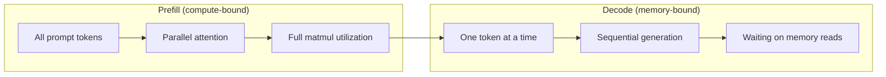
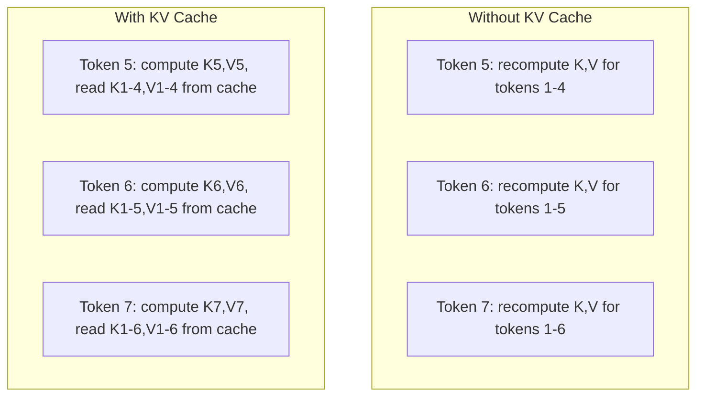
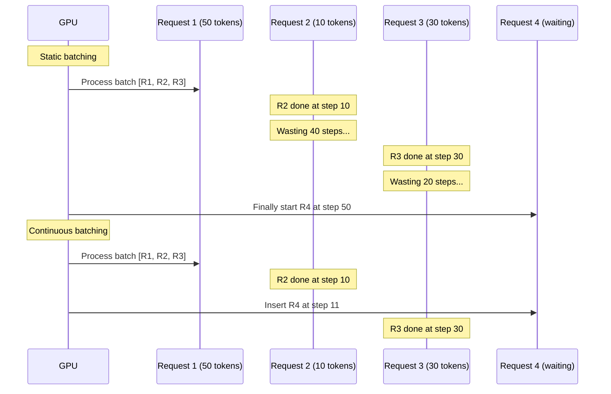
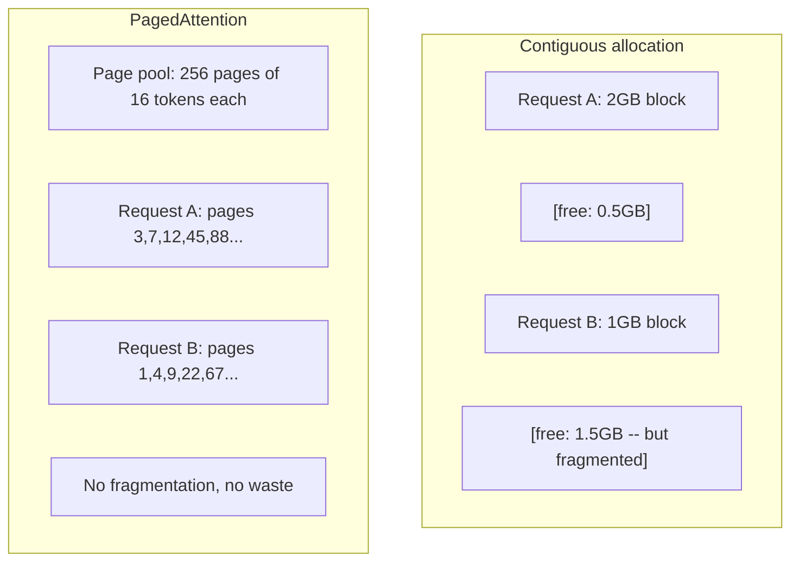
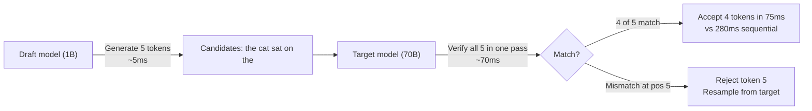

# Optimasi Inferensi

> Dua fase mendefinisikanLLMkesimpulan. Pra-pengisian memproses permintaan kamu secara paralel -- terikat dengan komputasi. Dekode menghasilkan token satu per satu -- terikat memori. Setiap pengoptimalan menargetkan satu atau keduanya.

**Type:** Build
**Languages:** Python
**Prerequisites:** Phase 10, Lessons 01-08 (Transformer architecture, attention)
**Time:** ~120 minutes

## Tujuan Pembelajaran

- Menerapkan KV-cache untuk menghilangkan komputasi berlebihan selama pembuatan token autoregresif
- Jelaskan fase prefill vs decode dariLLMinferensi dan mengapa masing-masing memiliki hambatan yang berbeda (terikat komputasi vs terikat memori)
- Terapkan konsep batching berkelanjutan dan PagedAttention untuk memaksimalkanGPUpemanfaatan di bawah permintaan bersamaan
- Bandingkan teknik optimasi inferensi (KV-cache, decoding spekulatif, perhatian flash) dan tekniknyathroughput/latencypengorbanan

## Masalahnya

kamu menerapkan Llama 3 70B pada GPU 4xA100. Satu pengguna mendapat ~50 token per detik. Terasa cepat. Kemudian 100 pengguna mencapai titik akhir secara bersamaan. Throughput turun menjadi 3tokens/second/user.$25 kamu,000/month GPUbill memberikan respons lebih lambat dibandingkan tipe manusia.

Modelnya sendiri tidak berubah antara 1 pengguna hingga 100 pengguna. Bobot yang sama, arsitektur yang sama, matematika yang sama. Yang berubah adalah cara kamu menjadwalkan pekerjaan. Inferensi naif menyia-nyiakan 90%+ dari yang tersediaGPUmenghitung. Pengguna yang menunggu token 47 membuka seluruh slot batch sementaraGPUbus memori tidak digunakan di antara matmul. Sementara itu, permintaan 2.000 token pengguna baru dapat mengisi waktu mati tersebut dengan komputasi yang berguna.

Ini bukan masalah skala. Ini adalah masalah penjadwalan. Teknik-teknik dalam pelajaran ini -- KV caching, continuous batching, PagedAttention, speculative decoding, prefix caching -- adalah hal-hal yang membedakan sebuah$25k/month inference bill from a $5k/monthsatu melayani lalu lintas yang sama.

vLLM yang menyajikan Llama 3 70B pada 4xA100-80GB mencapai ~50tokens/second/userpada konkurensi rendah, dan bertahan 15-25TPS/userpada 100 permintaan bersamaan melalui pengelompokan berkelanjutan dan PagedAttention. Tanpa optimasi ini, perangkat keras yang sama akan berfungsi 5TPS/userpada konkurensi itu. GPU yang sama, model yang sama, throughput 4x.

## Konsepnya

### Pra-isi vs Dekode

SetiapLLMpermintaan inferensi memiliki dua fase berbeda.

**Isi awal** memproses seluruh perintah masukan. Semua token diketahui, sehingga perhatian dapat dihitung secara paralel di seluruh rangkaian. Ini adalah perkalian matriks besar --GPUinti tetap sibuk. Hambatannya adalah menghitung: berapa banyakFLOPSperangkat keras kamu dapat mengirimkannya per detik. SebuahA100melakukan 312TFLOPS(BF16). Pengisian awal untuk prompt 4.096 token pada model 70B membutuhkan waktu ~400 md dalam satu kaliA100.

**Decode** menghasilkan token keluaran satu per satu. Setiap token baru menangani semua token sebelumnya, tetapi hanya satu token yang dihasilkan per penerusan. Matriks bobot memiliki ukuran yang sama seperti saat pengisian awal, namun kamu mengalikannya dengan satu vektor, bukan matriks. ItuGPUinti selesai dalam mikrodetik, lalu tunggu hingga kumpulan bobot berikutnya tiba dari memori. Hambatannya adalah bandwidth memori: seberapa cepat kamu dapat melakukan streaming bobot modelHBMke unit komputasi. SebuahA100memiliki 2TB/slebar pita. Model 70B diFP16adalah 140 GB. Membaca model lengkap sekali membutuhkan waktu 70 md -- itulah dasar kamu untuk satu langkah dekode.



**rasio ops:byte** (juga disebut intensitas aritmatika) menangkap trade-off ini. Ini mengukur berapa banyak operasi yang kamu lakukan per byte yang dimuat dari memori.

```
ops:byte ratio = FLOPs per token / bytes read from memory
```

Selama pengisian awal dengan kumpulan 4.096 token, kamu melakukan ~4.096 operasi akumulasi perkalian per bobot yang dimuat. Rasionya tinggi -- kamu terikat pada komputasi. Selama dekode dengan ukuran batch 1, kamu melakukan ~1 operasi per beban yang dimuat. Rasionya rendah -- ingatan kamu terbatas.

Wawasan mendasar: *dekode terikat pada memori karena kamu membaca keseluruhan model untuk menghasilkan satu token*. Setiap pengoptimalan di bawah ini mengurangi apa yang kamu baca, meningkatkan kumpulan token yang diproses per pembacaan, atau menghindari pembacaan seluruhnya.

### Tembolok KV

Selama perhatian, setiap kueri token memperhatikan vektor kunci dan nilai setiap token sebelumnya. Tanpa caching, menghasilkan token N memerlukan penghitungan ulang proyeksi kunci dan nilai untuk semua N-1 token sebelumnya. Token 1 diproyeksikan ketika membuat token 2, lalu lagi untuk token 3, lalu lagi untuk token 4. Dengan token 1.000, kamu telah memproyeksikan token 1 sebanyak 999 kali.

Cache KV menyimpan proyeksi kunci dan nilai dari semua token sebelumnya. Saat membuat token N, kamu hanya menghitung kunci dan nilai untuk token N, lalu menggabungkannya dengan cacheK/Vdari token 1 sampai N-1.



**Rumus memori untuk cache KV:**

```
KV cache size = 2 * num_layers * num_kv_heads * head_dim * seq_len * bytes_per_param
```

Untuk Llama 3 70B (80 lapisan, 8 kepala KV denganGQA, kepala_redup=128,BF16):

```
per token: 2 * 80 * 8 * 128 * 2 bytes = 327,680 bytes = 320 KB
at 4,096 tokens: 320 KB * 4,096 = 1.28 GB
at 128K tokens: 320 KB * 131,072 = 40 GB
```

Percakapan konteks 128K untuk Llama 3 70B menghabiskan 40 GB cache KV -- setengahnyaA100ingatannya. Dengan 100 pengguna bersamaan dengan masing-masing token 4K, cache KV saja memerlukan 128 GB. Inilah sebabnya mengapa manajemen cache KV merupakan tantangan utama dalam optimasi inferensi.

### Pengelompokan Berkelanjutan

Pengelompokan statis menunggu hingga kumpulan N permintaan tiba, memprosesnya bersama-sama, dan menunggu hingga *semua* selesai sebelum menerima permintaan baru. Jika satu permintaan memerlukan 500 token dan permintaan lainnya membutuhkan 10 token, permintaan singkat tersebut akan menganggur selama 490 langkah dekode setelah selesai.

Pengelompokan berkelanjutan (juga disebut pengelompokan tingkat iterasi) memasukkan permintaan baru ke dalam kumpulan segera setelah permintaan selesai. Batch tersebut dievaluasi ulang pada setiap langkah dekode. Permintaan yang selesai setelah 10 token segera digantikan dengan permintaan menunggu.



Peningkatan throughput bergantung pada seberapa besar variasi panjang output. Dengan panjang yang seragam, pengelompokan berkelanjutan cocok dengan pengelompokan statis. Dengan panjang yang bervariasi (kasus umum), pengelompokan berkelanjutan dapat menghasilkan throughput 2-5x lebih tinggi karenaGPUslot tidak pernah kosong.

### PagedPerhatian

Cache KV untuk setiap permintaan adalah blok memori yang berdekatan. Saat permintaan datang dan pergi, fragmen memori -- persis seperti ituRAMfragmentasi dalam sistem operasi. Permintaan token 4K memerlukan 1,28 GB yang bersebelahan. Meskipun kamu memiliki total 2 GB gratis, kamu mungkin tidak memiliki 1,28 GB *berdekatan*. kamu membuang-buang memori atau menolak permintaan tersebut.

PagedAttention (dari vLLM) menerapkan memori virtual bergaya OS ke cache KV. Alih-alih mengalokasikan satu blok yang berdekatan per permintaan, ia mengalokasikan "halaman" berukuran tetap (biasanya masing-masing 16 token). Halaman bisa berada di mana saja secara fisikGPUmemori. Tabel halaman memetakan posisi urutan logis setiap permintaan ke lokasi halaman fisik.



PagedAttention juga mengaktifkan **copy-on-write** untuk awalan bersama. Jika 50 permintaan berbagi prompt sistem yang sama, halaman cache KV untuk prompt sistem tersebut disimpan satu kali dan direferensikan oleh seluruh 50 permintaan. Hanya ketika permintaan berbeda (pesan pengguna berbeda) barulah permintaan tersebut mendapatkan halamannya sendiri. Ini memotong penggunaan memori secara drastis untuk aplikasi dengan perintah sistem bersama.

vLLM melaporkan pemborosan memori hampir nol (~4% vs ~60-80% dalam alokasi naif) melalui PagedAttention.

### Penguraian Kode Spekulatif

Dekode lambat karena berurutan -- kamu menghasilkan satu token, mengumpankannya kembali, menghasilkan token berikutnya. Namun bagaimana jika kamu bisa menebak 5 token berikutnya dengan murah, lalu memverifikasi semuanya sekaligus?

Penguraian kode spekulatif menggunakan **model draf** yang kecil dan cepat untuk menghasilkan K kandidat token. **model target** yang besar kemudian memproses semua kandidat K dalam satu forward pass (yang terlihat seperti prefill -- paralel, terikat komputasi, efisien). Jika model target setuju dengan prediksi rancangan model, kamu menerima semua token K dalam satu forward pass target. Jika tidak sesuai pada posisi j, kamu menerima token 1 hingga j-1 dan membuang sisanya.



Kecepatannya bergantung pada **tingkat penerimaan** -- seberapa sering prediksi rancangan model sesuai dengan target. Untuk penyusunan Llama 3 8B untuk Llama 3 70B, tingkat penerimaan 70-85% adalah tipikal bahasa alami. Ini berarti kecepatan dekode 2-3x.

Tiga pendekatan untuk decoding spekulatif:

| Method | Draft source | Acceptance rate | Overhead |
|--------|-------------|-----------------|----------|
| Draft-target (Leviathan et al.) | Separate small model | 70-85% | Draft model memory |
| EAGLE (Li et al.) | Lightweight head on target | 75-90% | ~1% extra parameters |
| N-gram lookup | Token n-gram table | 40-60% | Negligible |

**EAGLE** melatih kepala autoregresif kecil di atas status tersembunyi model target. Ini memprediksi penyematan token berikutnya menggunakan fitur lapisan kedua hingga terakhir model target. Karena beroperasi pada representasi model target sendiri (bukan model terpisah), maka mencapai tingkat penerimaan yang lebih tinggi dengan memori ekstra minimal.EAGLE-2 menambahkan pohon draf dinamis yang menyesuaikan jumlah kandidat berdasarkan konteks.

**Decoding spekulatif N-gram** menyimpan tabel kelanjutan n-gram dari konteks saat ini atau korpus bawaan. Jika draf cocok dengan apa yang muncul sebelumnya dalam percakapan yang sama (pola berulang, kode, keluaran terstruktur), draf tersebut akan diaktifkan tanpa overhead jaringan neural. Tingkat penerimaan rata-rata lebih rendah tetapi biaya per spekulasi pada dasarnya gratis.

Penguraian kode spekulatif *tepat secara matematis* -- distribusi keluaran identik dengan distribusi model target. Ini bukan perkiraan. Langkah verifikasi memastikan bahwa setiap token yang diterima memiliki probabilitas yang sama persis dengan yang ditetapkan oleh model target.

### Caching Awalan

Banyak permintaan memiliki awalan yang sama. Perintah sistem chatbot. SEBUAHRAGblok konteks. Kumpulan contoh beberapa contoh. Tanpa cache awalan, setiap permintaan menghitung ulang cache KV untuk token bersama ini dari awal.

Caching awalan menyimpan cache KV untuk awalan umum dan menggunakannya kembali di seluruh permintaan. Ketika permintaan baru datang dengan awalan yang diketahui, sistem akan menyalin (atau mereferensikan) entri KV yang di-cache dan hanya menghitung KV untuk akhiran unik.

Untuk perintah sistem 2.000 token yang dibagikan ke semua permintaan, cache awalan menghilangkan ~400 md pra-pengisian per permintaan. Pada usia 100requests/second, itu menghemat 40 detikGPUmenghitung per detik -- lebih dari satuGPUbernilai pekerjaan.

RadixAttention SGLang mengimplementasikan cache prefiks dengan pohon radix (trie) yang mengindeks prefiks berdasarkan konten tokennya. Setiap permintaan yang cocok dengan awalan yang disimpan akan mendapatkan cache KV-nya secara gratis. Pohon ini mengaktifkan pencocokan awalan sebagian -- jika kamu berbagi 1.500 dari 2.000 token awalan dengan entri cache, kamu menggunakan kembali 1.500 tersebut dan menghitung ulang hanya 500.

### Mesin Inferensi

Tiga mesin mendominasi produksiLLMmelayani:

| Engine | Key innovation | Best for |
|--------|---------------|----------|
| vLLM | PagedAttention, continuous batching | General-purpose serving, highest compatibility |
| SGLang | RadixAttention (prefix caching), structured generation | Multi-turn chatbots, constrained decoding |
| TensorRT-LLM | NVIDIA kernel fusion, FP8 quantization | Maximum single-GPU throughput on NVIDIA hardware |

**vLLM** adalah titik awal default. Ini mendukung berbagai model terluas, dapat dijalankan pada model apa punGPUpenjual (NVIDIA,AMD, Intel), dan mencapai throughput yang kuat melalui PagedAttention + pengelompokan berkelanjutan. Kompatibel dengan OpenAIAPIberarti kamu dapat menggunakannya sebagai pengganti OpenAI apa punAPIpanggilan.

**SGLang** dibangun dengan fondasi yang sama seperti vLLM tetapi menambahkan RadixAttention untuk cache awalan dan bahasa khusus domain untuk cache terstruktur.LLMprogram. Jika beban kerja kamu melibatkan percakapan multi-turn, penggunaan alat, atau decoding terbatas (JSONkeluaran, generasi yang dipandu regex), SGLang sering kali mengungguli vLLM sebanyak 2-5x melalui penggunaan kembali awalan.

**TensorRT-LLM** mengkompilasi model menjadi dioptimalkanNVIDIA GPUkernel. Ini menggabungkan operasi (perhatian + linier + aktivasi dalam satu kernel), menggunakanFP8padaH100GPU, dan terintegrasi denganNVIDIAServer Inferensi Triton untuk penerapan produksi. Ini mencapai single- tertinggiGPUthroughput aktifNVIDIAperangkat keras tetapi memerlukan lebih banyak pengaturan dan hanya berfungsiNVIDIAGPU.

Nomor dunia nyata untuk Llama 3 70B (4xA100-80GB,BF16):

| Metric | vLLM | SGLang | TensorRT-LLM |
|--------|------|--------|---------------|
| Throughput (1 user) | ~50 TPS | ~55 TPS | ~65 TPS |
| Throughput (100 users) | ~2,500 total TPS | ~3,200 total TPS | ~3,000 total TPS |
| Time to first token | ~400ms | ~300ms (prefix hit) | ~350ms |
| Max context | 128K | 128K | 128K |

### Kerangka Kerja Ops:Byte

kamu tidak dapat mengoptimalkan apa yang tidak kamu ukur. Rasio ops:byte memberi tahu kamu apakah kamu terikat komputasi atau terikat memori, yang menentukan pengoptimalan mana yang penting.

```
Compute roof: peak FLOPS of the GPU
Memory roof:  peak bandwidth * ops:byte ratio
```

Ketika ops:byte rendah (decode, batch kecil), kamu mencapai batas bandwidth memori. Menambahkan lebih banyak komputasi (clock lebih tinggi, lebih banyak core) tidak membantu. kamu perlu mengurangi pembacaan memori (kuantisasi, kompresi cache KV) atau meningkatkan ukuran batch untuk mengamortisasi pembacaan pada pekerjaan yang lebih bermanfaat.

Ketika ops:byte tinggi (pengisian awal, batch besar), kamu mencapai puncak komputasi. Optimalisasi bandwidth memori tidak membantu. kamu memerlukan GPU yang lebih cepat, fusi kernel, atau presisi yang lebih rendah untuk mendapatkan lebih banyak manfaatFLOPS.

| Scenario | ops:byte | Bound | Optimize with |
|----------|----------|-------|---------------|
| Prefill, batch=1 | ~4,096 | Compute | Kernel fusion, FP8 |
| Decode, batch=1 | ~1 | Memory | Quantization, KV compression |
| Decode, batch=32 | ~32 | Memory | Larger batch, continuous batching |
| Decode, batch=256 | ~256 | Transitioning | Both matter |
| Decode, batch=1024 | ~1,024 | Compute | Kernel fusion, tensor parallelism |

Titik persilangan aktifA100ada di sekitar ops:byte = 156 (312TFLOPS/ 2TB/s). Di bawah 156, kamu terikat memori. Di atas 156, kamu terikat dengan komputasi. Pengelompokan berkelanjutan mendorong dekode menuju persilangan ini dengan mengemas lebih banyak token per iterasi.

```figure
context-window-slide
```

## Bangun Sendiri

### Langkah 1: KV Cache dari Awal

Kami membangun cache KV multi-head yang menyimpan proyeksi kunci dan nilai per lapisan, per head, dan menunjukkan pola pertumbuhan memori.

```python
import numpy as np

class KVCache:
    def __init__(self, num_layers, num_heads, head_dim, max_seq_len, dtype=np.float16):
        self.num_layers = num_layers
        self.num_heads = num_heads
        self.head_dim = head_dim
        self.max_seq_len = max_seq_len
        self.dtype = dtype

        self.k_cache = np.zeros(
            (num_layers, num_heads, max_seq_len, head_dim), dtype=dtype
        )
        self.v_cache = np.zeros(
            (num_layers, num_heads, max_seq_len, head_dim), dtype=dtype
        )
        self.seq_len = 0

    def update(self, layer_idx, new_keys, new_values):
        num_new = new_keys.shape[1]
        end = self.seq_len + num_new
        self.k_cache[layer_idx, :, self.seq_len:end, :] = new_keys
        self.v_cache[layer_idx, :, self.seq_len:end, :] = new_values
        return (
            self.k_cache[layer_idx, :, :end, :],
            self.v_cache[layer_idx, :, :end, :]
        )

    def advance(self, num_tokens):
        self.seq_len += num_tokens

    def memory_bytes(self):
        return self.k_cache.nbytes + self.v_cache.nbytes

    def used_bytes(self):
        per_token = 2 * self.num_layers * self.num_heads * self.head_dim * np.dtype(self.dtype).itemsize
        return per_token * self.seq_len
```

### Langkah 2: Perhatian dengan KV Cache

Perhatian multi-head yang disederhanakan yang menggunakan cache KV untuk langkah-langkah dekode.

```python
def scaled_dot_product_attention(query, keys, values):
    head_dim = query.shape[-1]
    scores = np.matmul(query, keys.transpose(0, 1, 3, 2)) / np.sqrt(head_dim)
    seq_len_q = scores.shape[-2]
    seq_len_k = scores.shape[-1]
    if seq_len_q > 1:
        mask = np.triu(np.ones((seq_len_q, seq_len_k), dtype=np.float32), k=seq_len_k - seq_len_q + 1)
        scores = scores + mask * (-1e9)
    max_scores = np.max(scores, axis=-1, keepdims=True)
    exp_scores = np.exp(scores - max_scores)
    attn_weights = exp_scores / np.sum(exp_scores, axis=-1, keepdims=True)
    return np.matmul(attn_weights, values)


class MultiHeadAttention:
    def __init__(self, d_model, num_heads):
        self.num_heads = num_heads
        self.head_dim = d_model // num_heads
        scale = np.sqrt(2.0 / d_model)
        self.W_q = np.random.randn(d_model, d_model).astype(np.float32) * scale
        self.W_k = np.random.randn(d_model, d_model).astype(np.float32) * scale
        self.W_v = np.random.randn(d_model, d_model).astype(np.float32) * scale
        self.W_o = np.random.randn(d_model, d_model).astype(np.float32) * scale

    def forward(self, x, kv_cache=None, layer_idx=0):
        batch, seq_len, d_model = x.shape
        Q = np.matmul(x, self.W_q).reshape(batch, seq_len, self.num_heads, self.head_dim).transpose(0, 2, 1, 3)
        K = np.matmul(x, self.W_k).reshape(batch, seq_len, self.num_heads, self.head_dim).transpose(0, 2, 1, 3)
        V = np.matmul(x, self.W_v).reshape(batch, seq_len, self.num_heads, self.head_dim).transpose(0, 2, 1, 3)

        if kv_cache is not None:
            K_full, V_full = kv_cache.update(layer_idx, K[0], V[0])
            K = K_full[np.newaxis, :, :, :]
            V = V_full[np.newaxis, :, :, :]
            if seq_len == 1:
                kv_cache.advance(1)

        attn_out = scaled_dot_product_attention(Q, K, V)
        attn_out = attn_out.transpose(0, 2, 1, 3).reshape(batch, -1, d_model)
        return np.matmul(attn_out, self.W_o)
```

### Langkah 3: Simulator Pengelompokan Berkelanjutan

Ini mensimulasikan perbedaan penjadwalan antara pengelompokan statis dan berkelanjutan.

```python
import heapq

class Request:
    def __init__(self, request_id, prompt_tokens, output_tokens, arrival_step):
        self.request_id = request_id
        self.prompt_tokens = prompt_tokens
        self.output_tokens = output_tokens
        self.arrival_step = arrival_step
        self.tokens_generated = 0
        self.start_step = None
        self.end_step = None

    def is_done(self):
        return self.tokens_generated >= self.output_tokens


def simulate_static_batching(requests, batch_size):
    step = 0
    completed = []
    queue = list(requests)
    queue.sort(key=lambda r: r.arrival_step)

    while queue:
        batch = []
        while queue and len(batch) < batch_size:
            r = queue.pop(0)
            r.start_step = max(step, r.arrival_step)
            batch.append(r)

        if batch:
            step = max(step, max(r.start_step for r in batch))
            max_output = max(r.output_tokens for r in batch)
            for r in batch:
                r.tokens_generated = r.output_tokens
                r.end_step = step + max_output
            step += max_output
            completed.extend(batch)

    return completed


def simulate_continuous_batching(requests, batch_size):
    step = 0
    completed = []
    queue = sorted(requests, key=lambda r: r.arrival_step)
    queue_idx = 0
    active = []
    waiting = []

    while queue_idx < len(queue) or active or waiting:
        while queue_idx < len(queue) and queue[queue_idx].arrival_step <= step:
            waiting.append(queue[queue_idx])
            queue_idx += 1

        while waiting and len(active) < batch_size:
            r = waiting.pop(0)
            r.start_step = step
            active.append(r)

        if not active:
            if waiting:
                step += 1
                continue
            elif queue_idx < len(queue):
                step = queue[queue_idx].arrival_step
                continue
            else:
                break

        for r in active:
            r.tokens_generated += 1

        done = [r for r in active if r.is_done()]
        for r in done:
            r.end_step = step + 1
            completed.append(r)
        active = [r for r in active if not r.is_done()]

        step += 1

    return completed


def batching_stats(completed):
    latencies = [r.end_step - r.arrival_step for r in completed]
    total_time = max(r.end_step for r in completed) - min(r.arrival_step for r in completed)
    total_tokens = sum(r.output_tokens for r in completed)
    return {
        "avg_latency": np.mean(latencies),
        "p50_latency": np.median(latencies),
        "p99_latency": np.percentile(latencies, 99),
        "total_time": total_time,
        "throughput": total_tokens / total_time if total_time > 0 else 0,
    }
```

### Langkah 4: Cache Awalan

Cache awalan berbasis trie yang menyimpan entri KV untuk awalan bersama.

```python
class TrieNode:
    def __init__(self):
        self.children = {}
        self.kv_data = None
        self.hit_count = 0


class PrefixCache:
    def __init__(self, max_entries=1000):
        self.root = TrieNode()
        self.max_entries = max_entries
        self.total_entries = 0
        self.hits = 0
        self.misses = 0

    def _walk(self, token_ids):
        node = self.root
        depth = 0
        for tid in token_ids:
            if tid not in node.children:
                break
            node = node.children[tid]
            depth += 1
        return node, depth

    def lookup(self, token_ids):
        node, depth = self._walk(token_ids)
        if depth > 0:
            self.hits += 1
            current = self.root
            for tid in token_ids[:depth]:
                current = current.children[tid]
                current.hit_count += 1
            kv_entries = []
            current = self.root
            for tid in token_ids[:depth]:
                current = current.children[tid]
                if current.kv_data is not None:
                    kv_entries.append(current.kv_data)
            return depth, kv_entries
        self.misses += 1
        return 0, []

    def insert(self, token_ids, kv_per_token):
        node = self.root
        for i, tid in enumerate(token_ids):
            if tid not in node.children:
                if self.total_entries >= self.max_entries:
                    return i
                node.children[tid] = TrieNode()
                self.total_entries += 1
            node = node.children[tid]
            if i < len(kv_per_token):
                node.kv_data = kv_per_token[i]
        return len(token_ids)

    def hit_rate(self):
        total = self.hits + self.misses
        return self.hits / total if total > 0 else 0.0
```

### Langkah 5: Simulator Decoding Spekulatif

Kami mensimulasikan decoding spekulatif target draf dengan tingkat penerimaan yang dapat dikonfigurasi.

```python
class DraftModel:
    def __init__(self, vocab_size, acceptance_rate=0.8):
        self.vocab_size = vocab_size
        self.acceptance_rate = acceptance_rate

    def generate(self, context, num_tokens):
        tokens = np.random.randint(0, self.vocab_size, size=num_tokens)
        return tokens

    def get_probs(self, context, token):
        probs = np.random.dirichlet(np.ones(self.vocab_size))
        return probs


class TargetModel:
    def __init__(self, vocab_size):
        self.vocab_size = vocab_size

    def get_probs(self, context, tokens=None):
        if tokens is not None:
            return [np.random.dirichlet(np.ones(self.vocab_size)) for _ in tokens]
        return np.random.dirichlet(np.ones(self.vocab_size))


def speculative_decode(draft_model, target_model, context, num_speculative=5,
                       draft_cost=1.0, target_cost=10.0, verify_cost=12.0):
    total_tokens = 0
    total_cost = 0.0
    accepted_counts = []
    context = list(context)

    max_tokens = 100

    while total_tokens < max_tokens:
        draft_tokens = draft_model.generate(context, num_speculative)
        total_cost += draft_cost * num_speculative

        target_probs = target_model.get_probs(context, draft_tokens)
        total_cost += verify_cost

        accepted = 0
        for i, token in enumerate(draft_tokens):
            draft_p = draft_model.get_probs(context + list(draft_tokens[:i]), token)
            target_p = target_probs[i]

            r = np.random.random()
            acceptance_prob = min(1.0, target_p[token] / (draft_p[token] + 1e-10))

            if r < draft_model.acceptance_rate:
                accepted += 1
                context.append(token)
                total_tokens += 1
            else:
                new_token = np.random.choice(draft_model.vocab_size, p=target_p)
                context.append(new_token)
                total_tokens += 1
                break

        accepted_counts.append(accepted)

        if accepted == num_speculative:
            bonus_probs = target_model.get_probs(context)
            bonus_token = np.random.choice(draft_model.vocab_size, p=bonus_probs)
            context.append(bonus_token)
            total_tokens += 1

    sequential_cost = total_tokens * target_cost
    return {
        "total_tokens": total_tokens,
        "speculative_cost": total_cost,
        "sequential_cost": sequential_cost,
        "speedup": sequential_cost / total_cost if total_cost > 0 else 1.0,
        "avg_accepted": np.mean(accepted_counts),
        "acceptance_rate": np.mean(accepted_counts) / num_speculative,
    }


def compare_speculation_strategies(vocab_size=1000, num_trials=20):
    results = {}

    for name, acceptance_rate, spec_tokens in [
        ("Draft-target (8B->70B)", 0.78, 5),
        ("EAGLE", 0.85, 6),
        ("N-gram", 0.50, 4),
        ("No speculation", 0.0, 0),
    ]:
        if spec_tokens == 0:
            results[name] = {
                "speedup": 1.0,
                "acceptance_rate": 0.0,
                "avg_accepted": 0.0,
            }
            continue

        trial_results = []
        for _ in range(num_trials):
            draft = DraftModel(vocab_size, acceptance_rate=acceptance_rate)
            target = TargetModel(vocab_size)
            context = list(np.random.randint(0, vocab_size, size=10))
            result = speculative_decode(draft, target, context, num_speculative=spec_tokens)
            trial_results.append(result)

        results[name] = {
            "speedup": np.mean([r["speedup"] for r in trial_results]),
            "acceptance_rate": np.mean([r["acceptance_rate"] for r in trial_results]),
            "avg_accepted": np.mean([r["avg_accepted"] for r in trial_results]),
        }

    return results
```

### Langkah 6: Profiler Memori Cache KV

Hitung kebutuhan memori cache KV untuk konfigurasi model nyata.

```python
MODEL_CONFIGS = {
    "Llama-3-8B": {
        "num_layers": 32, "num_kv_heads": 8, "head_dim": 128,
        "model_params_b": 8, "gqa": True,
    },
    "Llama-3-70B": {
        "num_layers": 80, "num_kv_heads": 8, "head_dim": 128,
        "model_params_b": 70, "gqa": True,
    },
    "Llama-3-405B": {
        "num_layers": 126, "num_kv_heads": 8, "head_dim": 128,
        "model_params_b": 405, "gqa": True,
    },
    "Mistral-7B": {
        "num_layers": 32, "num_kv_heads": 8, "head_dim": 128,
        "model_params_b": 7, "gqa": True,
    },
    "GPT-4-est": {
        "num_layers": 120, "num_kv_heads": 96, "head_dim": 128,
        "model_params_b": 1800, "gqa": False,
    },
}


def kv_cache_memory(config, seq_len, dtype_bytes=2):
    per_token = 2 * config["num_layers"] * config["num_kv_heads"] * config["head_dim"] * dtype_bytes
    total = per_token * seq_len
    return {
        "per_token_bytes": per_token,
        "per_token_kb": per_token / 1024,
        "total_bytes": total,
        "total_mb": total / (1024 ** 2),
        "total_gb": total / (1024 ** 3),
    }


def memory_budget(config, gpu_memory_gb, model_dtype_bytes=2, kv_dtype_bytes=2):
    model_memory_gb = config["model_params_b"] * 1e9 * model_dtype_bytes / (1024 ** 3)
    overhead_gb = gpu_memory_gb * 0.1
    available_for_kv = gpu_memory_gb - model_memory_gb - overhead_gb

    if available_for_kv <= 0:
        return {"error": "Model does not fit in GPU memory", "model_memory_gb": model_memory_gb}

    per_token = 2 * config["num_layers"] * config["num_kv_heads"] * config["head_dim"] * kv_dtype_bytes
    max_tokens = int(available_for_kv * (1024 ** 3) / per_token)

    return {
        "gpu_memory_gb": gpu_memory_gb,
        "model_memory_gb": round(model_memory_gb, 1),
        "overhead_gb": round(overhead_gb, 1),
        "available_for_kv_gb": round(available_for_kv, 1),
        "max_total_tokens": max_tokens,
        "max_users_at_2k": max_tokens // 2048,
        "max_users_at_4k": max_tokens // 4096,
        "max_users_at_32k": max_tokens // 32768,
    }
```

## Gunakan

Dengan vLLM:

```python
from vllm import LLM, SamplingParams

llm = LLM(
    model="meta-llama/Meta-Llama-3-70B-Instruct",
    tensor_parallel_size=4,
    enable_prefix_caching=True,
    max_model_len=8192,
    gpu_memory_utilization=0.9,
)

params = SamplingParams(temperature=0.7, max_tokens=256)
outputs = llm.generate(["Explain inference optimization in one paragraph."], params)
```

Dengan SGLang untuk caching awalan + keluaran terstruktur:

```python
import sglang as sgl

@sgl.function
def classify(s, text):
    s += sgl.system("You are a classifier. Output JSON only.")
    s += sgl.user(f"Classify this text: {text}")
    s += sgl.assistant(sgl.gen("result", regex=r'\{"label": "(positive|negative|neutral)"\}'))

runtime = sgl.Runtime(model_path="meta-llama/Meta-Llama-3-70B-Instruct", tp_size=4)
sgl.set_default_backend(runtime)

results = classify.run_batch([
    {"text": "This product is amazing!"},
    {"text": "Terrible experience."},
    {"text": "It was okay I guess."},
])
```

Dengan TensorRT-LLM:

```python
import tensorrt_llm
from tensorrt_llm.runtime import ModelRunner

runner = ModelRunner.from_dir("./llama-70b-trt-engine/", rank=0)

outputs = runner.generate(
    batch_input_ids=[tokenizer.encode("Explain KV caching.")],
    max_new_tokens=256,
    temperature=0.7,
)
```

## Rilis

Pelajaran ini menghasilkan:
- `outputs/skill-inference-optimization.md`-- keterampilan untuk mendiagnosis dan mengoptimalkanLLMpenyajian inferensi

## Latihan

1. Ubah profiler cache KV untuk membandingkanFP16vsFP8vsINT4Kuantisasi cache KV. Untuk Llama 3 70B dalam konteks 4K, hitung maksimum pengguna bersamaan untuk masing-masing 4xA100-80GB. Kuantisasi KV keINT4harus kira-kira 4x kapasitas pengguna.

2. Perluas simulator pengelompokan berkelanjutan untuk dilacakGPUpemanfaatan (sebagian kecil slot batch terisi per langkah). Pemanfaatan plot dari waktu ke waktu untuk pengelompokan statis dan berkelanjutan dengan 50 permintaan yang panjang keluarannya mengikuti distribusi Pareto (bentuk=1,5, skala=20). Pengelompokan berkelanjutan harus mempertahankan pemanfaatan >80%.

3. Menerapkan perhatian kueri yang dikelompokkan (GQA) versi cache KV di mana`num_kv_heads < num_query_heads`. Llama 3 70B menggunakan 64 kepala kueri tetapi hanya 8 kepala KV. Hitung penghematan memori vs perhatian multi-head penuh (pengurangan 8x ukuran cache KV).

4. Bangun cache awalan yang menggunakanLRUpenggusuran. Setel max_entries ke 500 dan hasilkan 1.000 permintaan dengan 60% berbagi salah satu dari 5 awalan umum. Ukur tingkat hit dan bandingkan dengan cache tanpa batas. Dengan penggusuran yang baik, hit rate akan tetap di atas 55%.

5. Perluas simulator decoding spekulatif untuk mengimplementasikan spekulasi berbasis pohon (EAGLE-2 gaya). Alih-alih menggunakan satu rantai token K draft, buatlah satu pohon kandidat (misalnya, 2 cabang pada masing-masing 3 level = 8 kandidat daun). Bandingkan total token yang diterima per putaran verifikasi vs spekulasi linier.

## Istilah-Istilah Utama

| Term | What people say | What it actually means |
|------|----------------|----------------------|
| Prefill | "Processing the prompt" | Computing attention over all input tokens in parallel -- compute-bound because the full matrix multiplication keeps GPU cores busy |
| Decode | "Generating tokens" | Producing one token per forward pass, reading the full model weights each time -- memory-bound because compute finishes before the next weights arrive |
| KV cache | "Caching attention states" | Storing the key and value projections for all previous tokens so they are not recomputed at each decode step -- trades memory for compute |
| Continuous batching | "Dynamic batching" | Inserting new requests into the running batch as soon as any request finishes, evaluated at every decode iteration rather than waiting for the whole batch |
| PagedAttention | "Virtual memory for KV cache" | Allocating KV cache in fixed-size pages instead of contiguous blocks, eliminating memory fragmentation and enabling copy-on-write for shared prefixes |
| Speculative decoding | "Draft and verify" | Using a fast draft model to propose multiple tokens, then verifying them all in one target model forward pass -- mathematically exact, 2-3x speedup |
| EAGLE | "Self-speculative decoding" | A speculative decoding variant that trains a lightweight head on the target model's own hidden states, achieving higher acceptance rates than a separate draft model |
| Prefix caching | "Reusing system prompt KV" | Storing computed KV cache entries for common prefixes (system prompts, few-shot examples) and reusing them across requests to skip redundant prefill |
| Ops:byte ratio | "Arithmetic intensity" | The ratio of compute operations to memory bytes read -- determines whether a workload is compute-bound (high ratio) or memory-bound (low ratio) |
| Time to first token | "TTFT" | Latency from receiving a request to producing the first output token -- dominated by prefill time for long prompts |

## Bacaan Lebih Lanjut

- Kwon dkk., "Manajemen Memori yang Efisien untuk Penyajian Model Bahasa Besar dengan PagedAttention" (2023) -- makalah vLLM yang memperkenalkan manajemen cache KV berhalaman, yang kini menjadi standar industri untuk penyajian inferensi
- Leviathan et al., "Fast Inference from Transformers via Speculative Decoding" (2023) -- makalah dasar yang membuktikan bahwa spekulasi verifikasi draf menghasilkan distribusi model target yang tepat sekaligus mencapai percepatan 2-3x
- Li dkk., "EAGLE: Pengambilan Sampel Spekulatif Memerlukan Pemikiran Ulang Ketidakpastian Fitur" (2024) -- mencapai tingkat penerimaan yang lebih tinggi dengan melatih fitur-fitur model target sendiri daripada menggunakan draf model terpisah
- Zheng dkk., "SGLang: Eksekusi Efisien dari Program Model Bahasa Terstruktur" (2024) -- memperkenalkan RadixAttention untuk cache awalan dan model pemrograman untuk multi-panggilanLLMprogram
- Williams dkk., "Roofline: An Insightful Visual Performance Model for Multicore Architectures" (2009) -- makalah garis atap asli yang meresmikan kerangka kerja ops:byte untuk mempertimbangkan hambatan komputasi vs memori
