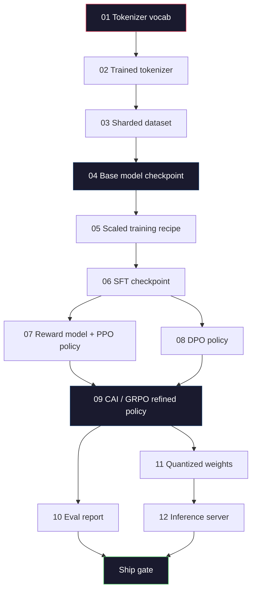
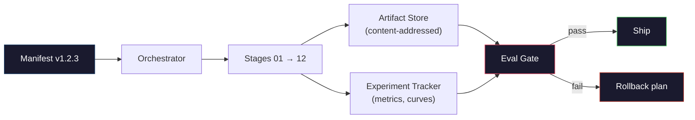

# Membangun yang LengkapLLMSaluran pipa

> Segala sesuatu mulai dari Pelajaran 01 hingga 12 adalah satu tahap dari satu saluran. Pelajaran ini adalah perancah yang mengubah tahapan tersebut menjadi satu proses end-to-end: tokenize, pra-pelatihan, penskalaan,SFT, menyelaraskan, mengevaluasi, mengukur, melayani. kamu tidak akan melatih model 70B di laptop. kamu akan membuat lapisan orkestrasi, manifes, gerbang evaluasi, dan rencana rollback yang digunakan tim perbatasan tahun 2026 untuk memutuskan apa yang akan dikirimkan. Ini adalah batu penjuru.

**Type:** Build
**Languages:** Python (stdlib)
**Prerequisites:** All Phase 10 lessons 01-12
**Time:** ~120 minutes

## Tujuan Pembelajaran

- Susun sebelas pelajaran sebelumnya (tokenizer, data, pra-pelatihan, penskalaan,SFT,RLHF,DPO,CAI, eval, kuantisasi, inferensi) ke dalam satu spesifikasi pipeline yang dapat direproduksi
- Tentukan kontrak artefak antar tahapan: apa yang dikonsumsi setiap tahapan, apa yang dihasilkan, dan bagaimana tahapan selanjutnya memverifikasi masukan
- Bangun orkestrator yang melacak eksperimen, hashing artefak, dan gerbang mengirimkan keputusan pada ambang batas eval
- Rancang rencana pengembalian: artefak mana yang murah untuk dijalankan kembali, mana yang mahal, dan berapa biaya pos pemeriksaan yang rusak

## Masalahnya

Pelajaran sebelumnya masing-masing berhasil. Tokenizer dilatih. KecilGPTterlatih sebelumnya.SFTkumpulan data dikumpulkan. Model penghargaan dilatih.DPOberlari. Evaluasi diukur. Anak timbangan terkuantisasi diekspor. Server inferensi berputar. Masing-masing adalah buku catatan. Masing-masing mempunyai konvensinya sendiri, jalur keluarannya sendiri, benihnya sendiri.

Latihan di garis depan bukanlah sebuah buku catatan. Llama 3 405B butuh 30 jutaH100jam selama sekitar 54 hari. DeepSeek-V3 digunakan sekitar 2,8 jutaH800jam. Selama waktu tersebut, satu pos pemeriksaan yang rusak, satu kontaminasi data, satu regresi evaluasi dapat membuat tim kehilangan waktu seminggu dan satu bulan kerja.GPUanggaran. Cara tim bertahan dalam hal ini adalah melalui kebersihan jalur pipa: setiap tahapan memiliki masukan deterministik, keluaran deterministik, manifes, hash, dan gerbang.

Ini adalah batu penjuru. kamu tidak akan menjalankan pipeline secara end-to-end di laptop. kamu akan menulis orkestrator yang mengkoordinasikan tahapan, manifes yang menjelaskan proses, verifikator yang mengirimkan keputusan, dan rencana pemutaran ulang yang memungkinkan pihak ketiga menjalankan kembali pekerjaan kamu dari satu file. Kodenya kecil; disiplinnya besar.

Skala pola dari parameter 100M hingga 1T tidak berubah. Empat komponen yang sama -- manifes, orkestrator, gerbang eval, penyimpanan artefak -- menjalankan Llama 3 dan juga menjalankan hobi kamuGPT. Perbedaannya terletak pada ukuran angka-angka di dalam konfigurasi setiap tahapan, bukan bentuk alurnya.

## Konsepnya

### Dua Belas Tahapan

Setiap pelajaran Tahap 10 adalah sebuah tahapan. Berikut adalah grafik ketergantungan selengkapnya.



Tahapan 07 dan 08 dapat berjalan secara paralel. Yang lainnya adalah ketergantungan yang sulit. Perubahan pada tahap 02 (tokenizer) membuat setiap artefak hilir menjadi tidak valid. Perubahan pada tahap 10 (eval) hanya membatalkan keputusan kapal.

### Manifes

Manifes adalah file tunggal yang menjelaskan proses yang dijalankan dengan cukup lengkap sehingga dapat diputar ulang. Tidak ada yang dihasilkan oleh pipeline yang bergantung pada status yang tidak ada dalam manifes. Bidangnya membosankan dan wajib.

```
pipeline_version: 1.2.3
seed: 42
git_commit: a1b2c3d4
stages:
  01_tokenizer:
    recipe: bpe_32k
    input_hash: sha256:...
    output_hash: sha256:...
    wall_clock_sec: 3600
    cost_usd: 12
```

Hash keluaran tahap N adalah hash masukan tahap N+1. Setiap penyimpangan maka pipa akan terhenti. Inilah cara kamu mengetahui kerusakan data sejak dini. Ini juga merupakan cara rekan satu tim di benua berbeda memverifikasi bahwa tayangan ulang mereka menghasilkan artefak yang sama seperti milik kamu.

Dalam latihan tim menggunakan yang kecilYAMLskema ditambah pemeriksa manifes yang berbeda dengan eksekusi sukses sebelumnya. Delta apa pun di luar bidang yang diharapkan (biaya, jam dinding) adalah tanda bahaya.

### Pengetikan Artefak

Keluaran setiap tahap adalah artefak yang diketik. Bukan gumpalan direktori, bukan acar, tapi tipe bernama dengan skema yang dikenal.

| Stage | Artifact Type | Key Fields |
|-------|--------------|-----------|
| 01-02 | Tokenizer | vocab.json, merges.txt, config.json, hash |
| 03 | Dataset | shards[], row count, token count, dedup stats |
| 04-05 | Checkpoint | weights.safetensors, config.json, optimizer state, step count |
| 06 | SFT Model | checkpoint + SFT recipe + data mix |
| 07 | Reward Model | RM checkpoint + preference data hash |
| 08-09 | Policy | checkpoint + reference hash + beta + KL budget consumed |
| 10 | Eval Report | benchmark scores + regression diffs + eval data hash |
| 11 | Quantized Model | quantized weights + calibration data + accuracy delta vs FP16 |
| 12 | Server Spec | endpoint + model hash + config + observability hooks |

Pengetikan mencegah mode kegagalan yang paling umum: menggunakan keluaran tahap 08 sebagai masukan tahap 06, mengirimkan aDPO-model terlatih melaluiSFTjalan. Artefak yang diketik dan tanda tangan tahapan yang diketik membuat kesalahan ini menjadi kegagalan pada waktu kompilasi, bukan kegagalan hari kelima.

### Gerbang Evaluasi

Pengiriman bukanlah "pelatihan selesai". Pengiriman adalah "pelatihan selesai dan gerbang evaluasi berlalu." Gerbang ditentukan sebelum proses dimulai.

```
gates:
  mmlu:      >= baseline + 0.5   # no regression
  humaneval: >= baseline + 1.0
  truthfulqa: >= baseline         # no drop
  safety_refusal_rate: <= 0.05
  kl_from_reference: <= 25.0
  cost_total_usd: <= 50000
```

Setiap gerbang adalah ambang batas numerik. Tidak ada gerbang yang "terlihat bagus". Tidak ada tanda subjektif. Jika setiap gerbang dilewati, artefak tersebut ditandai dapat dikirim. Jika ada gerbang yang gagal, proses akan ditunda sambil menunggu override eksplisit oleh reviewer bernama, yang akan dicatat dalam manifes.

Dua gerbang menampung sebagian besar bencana. Gerbang *regresi* (model baru harus setidaknya sama bagusnya dengan model sebelumnya pada tolok ukur inti) mendeteksi bug pelatihan. Gerbang *anggaran KL* (kebijakan yang selaras tidak boleh menyimpang lebih jauh dari X dari referensinya) menyebabkan penyelarasan terlalu matang. Setiap jalur produksi memiliki keduanya.

### Orkestrator

Sepotong kecil kode yang membaca manifes, mengirimkan tahapan, melacak artefak, dan menghentikan pelanggaran kontrak apa pun. Ini bukan Aliran Udara. Ini bukan Kubeflow. Untuk kebersihan saluran pipa, kamu menginginkan sesuatu yang membosankan yang kamu tulis.

Pekerjaan orkestrator itu sempit:

1. SelesaikanDAGdari manifes.
2. Untuk setiap tahap, periksa apakah keluaran yang diharapkan sudah ada pada hash yang benar (lewati jika demikian).
3. Jalankan panggung, tangkapstdout/stderr, mengukur jam dinding dan biaya.
4. Verifikasi hash keluaran terhadap hash masukan yang diharapkan pada tahap hilir.
5. Jika gagal, tulis sebagian manifes dengan tahap kegagalan yang tepat dan keluar dari nol.

Itu adalah 200 baris Python. Ini akan terlihat seperti file`code/main.py`dalam pelajaran ini. Di bawah tenda, penggunaan pipa sebenarnya`torchrun`atau`ray`untuk menjalankan tahapan individu dalam kelompok, namun orkestratornya sendiri berjalan pada satu kotak.

### Pelacakan Eksperimen dan Penyimpanan Artefak

Dua sistem eksternal menjangkarkan pipa.

**Pelacak eksperimen (wandb, neptun, mlflow).** Mencatat kurva kerugian, metrik eval, telemetri sistem per tahap. Pelacak adalah tempat yang kamu tuju saat kamu perlu membandingkan proses A dengan proses B tiga minggu kemudian. Tim hampir selalu menggunakan pelacak yang dihosting untuk ini -- menulis sendiri kehilangan waktu yang seharusnya digunakan untuk pelatihan.

**Penyimpanan artefak (S3, R2,GCS).** Penyimpanan objek yang tidak dapat diubah untuk pos pemeriksaan, kumpulan data, tokenizer, laporan evaluasi. Artefak ditangani dengan hash, bukan dengan nama file. Nama file seperti`latest.pt`adalah senjata kaki;`ckpt-7b-step-20000-sha256:abc123.safetensors`adalah sebuah kontrak.

Orkestra menulis kepada keduanya. Pelacak ini untuk manusia yang melihat grafik. Penyimpanan artefak adalah tahap selanjutnya untuk mencari masukan.

### Biaya

Frontier run memiliki nomor dolar yang terlampir. Disiplin anggaran terjadi di dua tempat.

**Perkiraan pra-jalankan.** Dari manifes, hitung FLOP yang diharapkan (untuk pra-pelatihan: 6 x param x token), yang diharapkanGPUjam (FLOP / throughput puncak / pemanfaatan), dan biaya dolar pada tarif sewa saat ini. Jika perkiraan melebihi gerbang anggaran, saluran pipa akan menolak untuk dimulai.

**Pelacakan yang sedang berjalan.** Jam dinding dan biaya tahap demi tahap dicatat ke manifes. Setelah setiap tahap, sisa anggaran diperiksa. Jika suatu tahapan terlewati, maka gerbang tahapan selanjutnya dievaluasi dengan sisa anggaran yang baru. kamu tidak mengetahui bahwa kamu kehabisan uang ketika VC menelepon.

Biaya yang dilaporkan Llama 3 adalah$61M. DeepSeek-V3 reported $5,6M untuk lari pra-pelatihan utama. Rasionya sebagian besar adalah efisiensi perangkat keras ditambah gabungan pakar -- namun biaya spesifiknya terlihat karena kedua tim melacaknya per tahap, bukan per proses.

### Reproduksibilitas vs determinisme

Ini tidak sama. *Dapat direproduksi* berarti manifes yang sama ditambah kode yang sama ditambah infrastruktur yang sama menghasilkan pos pemeriksaan dengan metrik hilir yang setara. *Deterministik* berarti keluaran yang sedikit identik.

ModernLLMpelatihan dapat direproduksi tetapi tidak deterministik. Urutan pengurangan pelatihan terdistribusi,GPUnon-determinisme kernel (cuBLAS, flash-attn), dan pembulatan presisi campuran digabungkan untuk menghasilkan pelampung yang berbeda pada tingkat 1e-5 antar proses. Ini bagus untuk metrik akhir, yang tidak bergerak. Ini berakibat fatal jika kamu mencoba melakukan debug dengan perbedaan tingkat bit. Solusinya adalah dengan mencatat hash masukan, hash keluaran, dan metrik judul setiap tahapan -- jika keduanya cocok, proses akan "direproduksi" meskipun bobotnya tidak sedikit identik.



### Rencana Kembalikan

Sebelum proses dimulai, tuliskan apa yang terjadi jika setiap tahap gagal. Tiga kategori.

- **Murah untuk dijalankan kembali** (jam): tokenizer, eval, kuantisasi, server inferensi. Jalankan kembali.
- **Sedang** (hari):SFT,DPO,CAI. Pertahankan model dasar; jalankan kembali hanya tahapan penyelarasan.
- **Mahal** (berminggu-minggu dan jutaan dolar): pra-pelatihan. Rencana rollback di sini bukanlah "dijalankan kembali". Hal ini adalah “menggunakan pos pemeriksaan terakhir yang baik dan menjalankan kembali tahap-tahap hilir yang lebih murah dengan data yang telah direvisi.”

Karena dependensi tahapan diketik dan di-hash, orkestrator dapat menghitung set rollback secara otomatis: membatalkan validasi tahapan yang gagal ditambah setiap turunannya. Kegagalan pada tahap 06 (SFT) membatalkan 06, 07, 08, 09, 10, 11, 12. Kegagalan pada tahap 11 (kuantisasi) hanya membatalkan 11 dan 12. Memberi nama ini di awal akan menghindari improvisasi saat tim kelelahan pada jam 4 pagi.

### Resep Produksi Diamati pada tahun 2026

Sebagian besar tim perbatasan berkumpul pada kerangka yang sama.

- Tokenizer: 128kBPEdengan penggantian byte. Dilatih dalam porsi kecil multibahasa yang seimbang.
- Pra-pelatihan: 10-20T token, sebagian besar web plus kode plus sintetis. Pengoptimal Muon atau AdamW.FSDP2atau DeepSpeed ​​ZeRO-3. Pos pemeriksaan gradien.BF16beban,FP32menguasai.
- SFT: Pasangan instruksi 500k-2M, campuran manusia dan sintetis, dengan pengurangan ketat terhadap set eval.
- Penyelarasan:DPOatauCAI+GRPO.RLHFhanya jika sinyal preferensi terlalu multidimensiDPO.
- Evaluasi:MMLU-Pro,MATH, ManusiaEval+,GPQA,SWE-Bench Terverifikasi, LiveBench, ditambah set pribadi yang tidak pernah dilihat publik.
- Kuantisasi: 4-bitGPTQatauAWQuntuk penyajian, 8-bit untuk evaluasi keamanan yang mengutamakan delta akurasi.
- Melayani: vLLM, TensorRT-LLM, atau di dalam rumah. Pengelompokan terus menerus. Penguraian kode spekulatif. Pengusiran cache KV.

Jumlahnya berubah setiap enam bulan. Kerangkanya tidak.

```figure
beam-search
```

## Bangun Sendiri

Kode pelajaran adalah orkestrator dan pemeriksa manifes, bukan dua belas skrip pelatihan. Setiap tahapan disimulasikan dengan placeholder yang menghasilkan artefak keluaran dengan bentuk dan hash yang benar. Menjalankan orkestrator dari ujung ke ujung membuktikan bahwa saluran pipa berfungsi baik sebelum kamu terbakarGPUuang pada tahap nyata.

Lihat`code/main.py`untuk implementasi penuh. Bagian-bagian penting:

- `Manifest`kelas data: versi pipa, seed, git commit, tahapan, gerbang.
- `Stage`dataclass: nama, tipe, input (hash), output (hash), jam dinding, biaya.
- `Orchestrator.run()`: teratasiDAG, mengirimkan tahapan, memverifikasi hash, memperbarui manifes.
- `EvalGate.check()`: membaca ambang batas, membandingkan dengan laporan evaluasi terbaru, mengembalikanpass/fail.
- `ArtifactStore`(rintisan dalam memori):put/getdengan hash, mensimulasikan S3.
- `CostTracker`: per tahap dan kumulatif, berhenti ketika batas terlampaui.

Pipa masuk`main.py`menjalankan dua belas tahapan placeholder, menghasilkan manifes, dan menjalankan gerbang evaluasi yang gagal untuk menunjukkan seperti apa proses yang ditahan. Tukar setiap placeholder dengan skrip pelatihan sebenarnya dari pelajaran terkait dan kamu akan mendapatkan kerangka yang digunakan pipeline frontier nyata.

## Gunakan

Alur kerja kanonik memiliki tiga perintah.

```
python code/main.py plan    # validate manifest, compute cost estimate, print DAG
python code/main.py run     # execute stages, writing to manifest.out.yaml
python code/main.py gate    # read manifest.out.yaml, apply eval gates, ship-or-hold
```

Jalankan`plan`pertama setiap saat. Sebagian besar bug saluran pipa muncul pada waktu rencana -- ambang batas gerbang yang hilang, hash yang basi, pembengkakan anggaran. Berlari`plan`gratis. Berlari`run`mahal. Menghemat uang dengan menangkap serangga dengan harga murah.

Keluaran dari`gate`adalah salah satunya`SHIP`atau`HOLD: <reason>`. Lari yang ditahan bukanlah sebuah kegagalan; itu adalah titik keputusan. Peninjau yang bernama akan melakukan override (dan override tersebut dicatat), atau mereka menyetujui rollback.

## Rilis

Pelajaran ini menghasilkan`outputs/skill-llm-pipeline-reviewer.md`. Berikan manifes alur pipa yang diusulkan dan ia akan memeriksa semua kontrak: pengetikan tahap, rantai hash, gerbang, rencana rollback, perkiraan biaya. Ia menolak untuk menyetujui manifes dengan gerbang evaluasi yang hilang, anggaran KL yang tidak terbatas, atau proses yang menggabungkan data evaluasi dan pelatihan.

## Latihan

1. Perluas orkestrator untuk mendukung eksekusi paralel tahapan 07 dan 08. Gunakan stdlib`concurrent.futures`modul. Konfirmasikan bahwa manifes akhir mencatat keluaran kedua tahap dan hash masukan tahap 09 adalah kombinasi deterministik dari keduanya.

2. Tambahkan gerbang "pemeriksaan kontaminasi". Mengingat hash set data eval dan pecahan set data pelatihan, hitung tumpang tindihnya (pencocokan string persis atau pencocokan 13 gram). Gerbang gagal jika tumpang tindih melebihi 0,1%. Beri dia set pelatihan yang terkontaminasi dan pastikan gerbangnya dapat berlari.

3. Menerapkan penaksir biaya dari prinsip pertama. Untuk tahap 04 (pra-pelatihan), perkirakan FLOP sebagai 6 x params x token, asumsikan 40%MFU(pemanfaatan model FLOPs) aktifH100di 989 TFLOPBF16, seharga $2.50/GPU-hour.Laporkan perkiraan model 7B yang dilatih pada token 2T. Bandingkan dengan nomor Llama 2 yang diterbitkan.

4. Bangun rollback sebagian. Simulasikan kegagalan pada tahap 09 (CAI), lalu jalankan kembali tahap 09 hingga 12 sambil membiarkan 01-08 disimpan dalam cache. Orkestra harus mendeteksi artefak yang di-cache dengan hash dan melewatinya. Ukur penghematan jam dinding versus pengoperasian ulang penuh.

5. Tambahkan kemampuan observasi. Memancarkan rentang OpenTelemetry untuk setiap tahap, dengan atribut untuk parameter, token yang terlihat, kerugian, dan biaya. Pipa bentang ke kolektor lokal. Intinya bukanlah dashboard; intinya kesehatan setiap tahapan dapat dilacak dari satu ID jejak.

## Istilah-Istilah Utama

| Term | What people say | What it actually means |
|------|----------------|----------------------|
| Manifest | "The recipe file" | YAML or JSON describing pipeline version, seed, per-stage config, and gate thresholds — sufficient to replay a run |
| Content-addressed | "By hash not name" | Artifacts stored by SHA-256 of their contents, so you can never confuse version A with version B |
| Eval gate | "The ship criteria" | Numeric thresholds on benchmark metrics and safety scores that must pass before an artifact is marked shippable |
| KL budget | "How far alignment drifted" | A cap on cumulative KL(policy || reference) across alignment stages, enforced as a gate |
| MFU | "How much of the GPU you used" | Model FLOPs Utilization — achieved FLOPs divided by theoretical peak. 40% is typical at 70B scale, 55% at 7B |
| Rollback plan | "What we do when it breaks" | Pre-written set of actions per stage on failure: re-run, fall back, retrain with revised inputs |
| Orchestrator | "The conductor" | The process that reads the manifest, dispatches stages, verifies hashes, halts on any contract violation |
| Artifact store | "Versioned S3 for weights" | Immutable content-addressed object store — single source of truth for checkpoints, datasets, eval reports |
| Reproducible | "Same metrics on replay" | Different bit-level weights but equivalent downstream metrics — the realistic target for distributed LLM training |
| Cost gate | "You cannot exceed X" | Pre-run cost estimate plus in-run tracker — the pipeline refuses to start if the estimate exceeds budget |

## Bacaan Lebih Lanjut

- [Dubey et al., 2024 -- "Kawanan Model Llama 3"](https://arxiv.org/abs/2407.21783) -- deskripsi publik paling detail tentang jalur pipa perbatasan termasuk data, pelatihan, penyelarasan, evaluasi
- [DeepSeek-AI, 2024 -- "Laporan Teknis DeepSeek-V3"](https://arxiv.org/abs/2412.19437) -- jalur pipa yang mengutamakan efisiensi secara kasar1/10thbiaya pelatihan kelas Llama 3
- [Kaplan dkk., 2020 -- "Hukum Penskalaan untuk Model Bahasa Neural"](https://arxiv.org/abs/2001.08361) -- hubungan penskalaan parameter komputasi-data-asli
- [Hoffmann dkk., 2022 -- "Pelatihan Model Bahasa Besar Optimal Komputasi (Chinchilla)"](https://arxiv.org/abs/2203.15556) -- koreksi terhadap Kaplan yang mengkalibrasi ulang anggaran data modern
- [PyTorchFSDP2dokumentasi](https://pytorch.org/docs/stable/fsdp.html) -- penggantian primitif pelatihan terdistribusiFSDP1di PyTorch 2.4+
- [Bobot & BiasLLMLaporan](https://wandb.ai/site/solutions/llms/) -- manifes nyata dan keluaran pelacak eksperimen untuk sumber terbukaLLMberjalan, berguna sebagai templat yang dapat dijiplak
