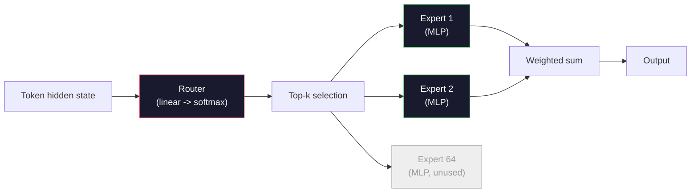

# Model Terbuka: Panduan Arsitektur

> kamu membangun sebuahGPT-2 Kecil dari awal di Pelajaran 04. Model Frontier Open pada tahun 2026 adalah keluarga yang sama dengan lima atau enam perubahan nyata. RMSNorm, bukan LayerNorm. SwiGLU sebagai gantinyaGELU. RoPE alih-alih posisi yang dipelajari.GQAatauMLAbukannya penuhMHA. Campuran Pakar dalam skala besar. Matematika yang sudah kamu ketahui mencakup 95% darinya. Pelajaran ini membaca Llama 3, DeepSeek-V3, Mixtral, Qwen, dan Gemma secara berdampingan dan menyebutkan garis persis di mana setiap arsitektur berbeda.

**Type:** Learn
**Languages:** Python (stdlib)
**Prerequisites:** Phase 10, Lessons 04, 05, 12 (Pre-training, Scaling, Inference)
**Time:** ~45 minutes

## Tujuan Pembelajaran

- Baca config.json dari Llama 3, Mistral, Mixtral, Gemma 2, Qwen 2.5, dan DeepSeek-V3 dan jelaskan setiap bidang
- Sebutkan perubahan arsitektur spesifik yang dibuat setiap modelGPT-2 Kecil dan membenarkannya dari prinsip pertama
- Hitung jumlah parameter, ukuran cache KV, dan memori aktivasi untuk model terbuka apa pun hanya dari konfigurasinya
- Pilih model terbuka yang tepat untuk target penerapan dengan mempertimbangkan batasan latensi, memori, dan kemampuan

## Masalahnya

Dalam Pelajaran 04 kamu menulis 350 baris numpy dan memiliki aGPTModel berbentuk -2. Llama 3 405B memiliki laporan teknis setebal 200 halaman. Naluri kamu adalah bahwa ini adalah binatang yang berbeda. Sebenarnya tidak. 200 halaman tersebut menjelaskan objek yang sama dengan lima atau enam modifikasi yang bermotivasi baik, ditambah seribu detail implementasi tentang penskalaan. Kerangka -- penyematan, blok transformator, perhatian,MLP, norma, kepala -- tidak berubah.

Pelajaran ini berbeda. Untuk setiap keluarga model terbuka utama, kami mencantumkan dengan tepat apa yang berubahGPT-2, mengapa, dan berapa biayanya. Setelah selesai, kamu dapat membaca kartu model baru dan menerjemahkannya kembali ke dalam pikiranGPT-2 garis dasar.

Imbalan praktisnya adalah ketika Meta merilis Llama 5 atau DeepSeek merilis V4, kamu tidak memerlukan model mental baru. kamu akan melihat konfigurasinya, melihat kenop mana yang bergerak, dan mengetahui implikasi hilirnya. Arsitektur tahun 2026 adalah kotak peralatan yang terbatas. Setiap model baru memilih subset yang berbeda.

## Konsepnya

### Inti Invarian

Semua model terbuka autoregresif berbagi:

- Matriks penyematan token (vocab_size x Hidden_dim).
- Tumpukan N blok dekoder: norma, perhatian diri, sisa, norma,MLP, sisa.
- Norma akhir dan head linier yang diproyeksikan ke vocab_size (seringkali terikat dengan bobot dengan embeddings).
- Topeng sebab akibat, hilangnya entropi silang token berikutnya.

Itulah bentuknya. Sisanya adalah tombol-tombol.

### Enam Kenop Yang Sebenarnya Bergerak

Di setiap model frontier open 2024-2026, enam pilihan desain yang sama selalu dipilih:

1. **Normalisasi.** LayerNorm -> RMSNorm.
2. **Pengkodean posisi.** Absolut yang dipelajari -> RoPE (plus varian: YaRN,NTK).
3. **Aktivasi.**GELU-> SwiGLU (atau GeGLU).
4. **Berbagi perhatian kepala.**MHA->GQA->MQA->MLA.
5. **Padat vs jarangMLP.** Padat -> Campuran Pakar.
6. **Penempatan pra-norma.** Masa inap pra-norma. Pasca-norma telah hilang.

Segala sesuatu yang lain (jadwal kecepatan pembelajaran, campuran data, ukuran batch, panjang konteks) ada dalam konfigurasi pelatihan, bukan arsitektur. Enam tombol.

### Tombol 1: RMSNorm

LayerNorm mengurangi mean, membagi dengan std, skala, dan shift. RMSNorm hanya menyimpan skala:

```
RMSNorm(x) = x / sqrt(mean(x^2) + eps) * gamma
```

Tidak ada pengurangan berarti. Tidak ada bias. Satu matmul lebih sedikit per token. Zhang dan Sennrich (2019) berpendapat bahwa ini cocok dengan LayerNorm pada terjemahan mesin dan 10% lebih cepat. Setiap model terbuka modern menjalankannya.

Biaya: tidak ada. Manfaat: kemenangan throughput kecil, kode lebih sederhana.

### Kenop 2: Tali

Penyematan posisi yang dipelajari adalah tabel pencarian 1024 slotGPT-2. Konteks 1025 berada di luar jangkauan tabel. Model tidak dapat melakukan ekstrapolasi melebihi durasi pelatihannya.

Rotary Position Embedding (RoPE, Su et al. 2021) memasukkan posisi dengan memutar setiap vektor Q dan K secara berpasangan sebelum perkalian titik perhatian. Sudut rotasi adalah fungsi deterministik dari posisi, jadi tidak ada yang dipelajari dan tidak ada yang kehabisan. Dengan trik penskalaan (NTK-aware interpolation, YaRN), model yang dilatih pada konteks 8k dapat diperluas hingga 128k pada inferensi dengan sedikit kehilangan akurasi.

```
q_rotated = rotate(q, angle(pos))
k_rotated = rotate(k, angle(pos))
score = q_rotated . k_rotated
```

Setiap Llama, Mistral, Qwen, DeepSeek, dan Gemma menggunakan RoPE. Gemma 2 menggunakan hibrida (RoPE pada sebagian besar lapisan, perhatian jendela geser lokal pada lapisan lainnya).

### Tombol 3: SwiGLU

GPT-2MLPadalah`x -> gelu(xW1 + b1) -> (...)W2 + b2`. SwiGLU (Shazeer 2020) menggantikan aktivasi dengan produk yang terjaga keamanannya:

```
SwiGLU(x) = (xW1) * sigmoid(xW1) * xV
```

Dua proyeksi secara paralel, bukan satu, dilindungi oleh aktivasi Swish. Secara empiris lebih kuat pada kebingungan per parameter. Llama 2 mengadopsinya, semua orang mengikutinya. ItuMLPUkuran tersembunyi biasanya diatur sehingga jumlah parameter total sesuai dengan kepadatan aslinyaMLP: jikaGPT-2 digunakan`ff_dim = 4 * hidden`, SwiGLU menggunakan`ff_dim = (2/3) * 4 * hidden = 8/3 * hidden`.

### Kenop 4: Berbagi Kepala Perhatian

GPT-2 digunakan **Perhatian Multi-Kepala (MHA)**: setiap kepala memiliki proyeksi Q, K, V sendiri.

**Perhatian Multi-Kueri (MQA, Shazeer 2019)** berbagi satu K dan satu V di semua kepala. Memotong cache KV sebanyak num_heads, yang merupakan pengurangan 12x hingga 32x pada model biasa. Akurasi sedikit turun pada tolok ukur yang sulit.

**Perhatian Kueri yang Dikelompokkan (GQA, Ainslie dkk. 2023)** adalah jalan tengah: G kelompok kepala Q berbagi satu K dan satu V. Llama 3 8B menggunakanGQAdengan 32 kepala Q dan 8 kepala KV (G=8), sehingga cache KV menyusut 4x dibandingkan penuhMHA.

**Perhatian Laten Multi-Kepala (MLA, DeepSeek 2024)** mengompresi K dan V menjadi laten peringkat rendah bersama, memproyeksikannya kembali ke atas per kepala. Lebih lanjut mengurangi cache KV sambil mempertahankan ekspresi per kepala. DeepSeek-V2 dan V3 mengandalkan ini untuk kinerja konteks panjangnya.

| Scheme | KV Heads | KV Cache | Accuracy |
|--------|----------|----------|----------|
| MHA    | num_heads | full | best |
| GQA    | num_groups (G < num_heads) | num_heads / G reduction | near-MHA |
| MQA    | 1 | num_heads reduction | small hit |
| MLA    | latent, per-head decompression | smaller than MQA | near-MHA |

Untuk model apa pun dengan parameter di atas ~13B,GQAatauMLAsecara efektif wajib. PenuhMHAdalam skala besar adalah bencana cache KV.

### Tombol 5: Campuran Para Ahli

PadatMLPmengaktifkan semua parameternya untuk setiap token. Sebuah MoEMLPmemiliki K pakar per blok dan sebuah router yang memilih k pakar teratas per token (biasanya 2 teratas). Hanya bobot para ahli yang melihat peluang maju untuk token itu.

```
router_logits = xW_r
indices, weights = top_k(router_logits, k=2)
output = sum_i weights[i] * expert[indices[i]](x)
```

Daya tariknya: kamu dapat memiliki 64 pakar dengan ukuran masing-masing 7B (jadi jumlah total param sangat besar) sambil hanya menjalankan 2 pakar per token (sehingga komputasi per token cocok dengan model 7B yang padat). Mixtral 8x7B memiliki total 47B parameter tetapi hanya mengaktifkan 13B per token. DeepSeek-V3 memiliki total 671 miliar parameter tetapi hanya mengaktifkan 37 miliar per token.



Kelebihan: komputasi yang sama, lebih banyak parameter, kapasitas lebih baik. Kekurangan: memori ahli masih harus berada di suatu tempat (jadi penyajiannya membutuhkan lebih banyakVRAMdaripada yang setara padat), penyeimbangan beban router itu sulit, dan menyempurnakan router selama penyelarasan adalah bidang penelitiannya sendiri.

### Kenop 6: Masa inap pra-normal

Trafo asli menerapkan norma lapisan setelah setiap sublapisan. Setiap model terbuka sejak ituGPT-2 meletakkannya *sebelum* setiap sublapisan. Pra-norma lebih mudah untuk dilatih secara mendalam. Tidak ada yang perlu diperdebatkan.

### Perbedaan Model demi Model

Inilah tabel yang membuat semua ini menjadi nyata.

| Model | Year | Total Params | Active Params | Norm | Activation | Position | Attention | MoE | Context |
|-------|------|-------------|---------------|------|-----------|----------|-----------|-----|---------|
| GPT-2 Small | 2019 | 124M | 124M | LayerNorm | GELU | Learned | MHA (12 heads) | no | 1k |
| Llama 3 8B | 2024 | 8B | 8B | RMSNorm | SwiGLU | RoPE | GQA (32/8) | no | 128k |
| Llama 3 70B | 2024 | 70B | 70B | RMSNorm | SwiGLU | RoPE | GQA (64/8) | no | 128k |
| Llama 3 405B | 2024 | 405B | 405B | RMSNorm | SwiGLU | RoPE | GQA (128/16) | no | 128k |
| Mistral 7B | 2023 | 7.2B | 7.2B | RMSNorm | SwiGLU | RoPE | GQA | no | 32k |
| Mixtral 8x7B | 2023 | 47B | 13B | RMSNorm | SwiGLU | RoPE | GQA | yes (8 experts, top-2) | 32k |
| Gemma 2 9B | 2024 | 9B | 9B | RMSNorm (pre+post) | GeGLU | RoPE + sliding | GQA | no | 8k |
| Qwen 2.5 72B | 2024 | 72B | 72B | RMSNorm | SwiGLU | RoPE (YaRN) | GQA (64/8) | no | 128k |
| DeepSeek V2 236B | 2024 | 236B | 21B | RMSNorm | SwiGLU | RoPE | MLA | yes (160 experts, top-6) | 128k |
| DeepSeek V3 | 2024 | 671B | 37B | RMSNorm | SwiGLU | RoPE | MLA | yes (256 experts, top-8) | 128k |

Pindai kolomnya. RMSNorm bersifat universal. SwiGLU atau sepupunya GeGLU bersifat universal. Tali PE bersifat universal.GQAbersifat universal di atas 7B kecuali bila digantikan olehMLA. MoE adalah pembeda di ujung atas.

### Membaca config.json

Konfigurasi Llama 3 8B:

```
{
  "hidden_size": 4096,
  "intermediate_size": 14336,
  "num_hidden_layers": 32,
  "num_attention_heads": 32,
  "num_key_value_heads": 8,
  "max_position_embeddings": 131072,
  "rope_theta": 500000.0,
  "rms_norm_eps": 1e-5,
  "vocab_size": 128256
}
```

Setiap bidang berhubungan dengan sesuatu yang telah kamu terapkan.

- `hidden_size`: menyematkan dimensi.
- `intermediate_size`:MLPukuran tersembunyi (3,5x tersembunyi -- matematika SwiGLU).
- `num_hidden_layers`: kedalaman tumpukan.
- `num_attention_heads`: Q kepala.
- `num_key_value_heads`: Kepala KV (GQA).
- `max_position_embeddings`: panjang konteks pelatihan.
- `rope_theta`: Frekuensi dasar Tali. Meta menskalakannya dari default 10k menjadi 500k untuk ekstrapolasi konteks panjang.
- `rms_norm_eps`: stabilitas numerik.
- `vocab_size`: token.

Dari sini saja kamu menghitung parameter total, cache KV, dan memori aktivasi puncak. Lihat`code/main.py`untuk rumus pastinya.

### Anggaran memori aktivasi

Aktivasi mendominasi memori pelatihan di atas beberapa miliar parameter. Aturan praktis untuk pra-pelatihan (dengan pos pemeriksaan gradien):

```
activation_mem ~ batch_size * seq_len * hidden_size * num_layers * bytes_per_element
```

Untuk Llama 3 8B pada batch 1, seq 8192,BF16, 32 lapisan, tersembunyi 4096: kira-kira 8 GB hanya untuk aktivasi dengan pos pemeriksaan, 40 GB tanpa. Inilah sebabnya mengapa flash-attention dan ring-attention penting -- keduanya menulis ulang perhitungan perhatian sehingga aktivasi sesuai.

### Anggaran KV Cache

Untuk inferensi pada konteks maksimal:

```
kv_cache = 2 * num_layers * num_kv_heads * head_dim * max_seq_len * bytes_per_element
```

Llama 3 8B pada konteks 128k,BF16, head_dim = tersembunyi / num_heads = 128:
`2 * 32 * 8 * 128 * 131072 * 2 = 17.2 GB`per urutan.

Bobot 8B berukuran 16 GBBF16. Cache KV untuk satu urutan 128k lebih besar daripada bobotnya. Inilah yang mendorong tekanan memoriGQA,MLA, dan penelitian kuantisasi cache KV.

### Saat Setiap Model Menang

- **Tunggal 80GBGPU, tanpa MoE**: Llama 3 8B, Mistral 7B, Gemma 2 9B. Mudah disajikan, perkakas lebar.
- **Node tunggal (8x80GB), kapasitas besar**: Llama 3 70B, Qwen 2.5 72B. Kemampuan terbuka padat tertinggi.
- **Kemampuan terbuka terbesar, menerima kompleksitas MoE**: DeepSeek V3, Mixtral 8x22B. Kemampuan terbaik per aktifFLOP.
- **Kebutuhan konteks panjang**: Llama 3 (128k dengan penskalaan RoPE), DeepSeek (MLAkeuntungan).
- **Penyajian latensi rendah**: Gemma 2 9B (jendela geser memotong komputasi konteks panjang).

```figure
rmsnorm-vs-layernorm
```

## Bangun Sendiri

Kode pelajarannya adalah kalkulator. Mengingat config.json apa pun, ia mencetak jumlah parameter berdasarkan komponen, cache KV pada konteks maksimal, SwiGLUMLPrasio, dan penilaian singkat tentang arsitektur (padat /GQA/MLA/ MoE).

```python
config = {
    "hidden_size": 4096, "intermediate_size": 14336,
    "num_hidden_layers": 32, "num_attention_heads": 32,
    "num_key_value_heads": 8, "vocab_size": 128256,
    "max_position_embeddings": 131072,
}
```

Skrip menelusuri arsitektur bidang demi bidang, menghitung jumlah parameter untuk penyematan, perhatian (denganGQApengurangan),MLP(dengan ekspansi SwiGLU), norma lapisan, dan kepala. Ia kemudian menghitung cache KV pada panjang konteks yang dinyatakan dan mencetak ringkasan.

Lihat`code/main.py`untuk implementasinya.

## Gunakan

Jalankan kalkulator pada konfigurasi Llama 3 8B, Mistral 7B, Mixtral 8x7B, dan DeepSeek V3 yang disertakan dalam skrip. Bandingkan rincian parameter. Perhatikan bahwa model MoE memiliki jumlah parameter total yang jauh lebih kecil daripada model padat, namun jumlah parameter aktif seringkali lebih kecil. Perhatikan bahwa cache KV DeepSeek V3 lebih kecil daripada Llama 3 405B meskipun memiliki lebih banyak parameter total -- yaituMLAsedang beraksi.

Kemudian masukkan konfigurasi untuk model apa pun yang kamu miliki secara lokal, baca ringkasannya, dan putuskan apakah cocok untuk kamuGPU.

## Rilis

Pelajaran ini menghasilkan`outputs/skill-open-model-picker.md`. Mengingat target penerapan (GPUmengetik,VRAM, panjang konteks, anggaran latensi) dan profil tugas (obrolan, kode, penalaran, konteks panjang), ini merekomendasikan model terbuka, skema kuantisasi dari Pelajaran 11, dan tumpukan inferensi dari Pelajaran 12, dengan alasan eksplisit tentang enam tombol arsitektur.

## Latihan

1. Baca konfigurasi Qwen 2.5 72B dari HuggingFace. Hitung parameter total dari awal. Bandingkan dengan nilai yang dilaporkan HF dan identifikasi dari mana delta berasal (pembulatan head dim, faktor pembagian KV, dll.).

2. DeepSeek V3 menggunakan 256 pakar dengan routing top-8. Hitung rasio pakar yang diaktifkan dengan total pakar dan bandingkan dengan 2 teratas Mixtral 8x7B sebesar 8. Apa arti peralihan dari jarang (25%) ke lebih padat jarang (3%) terhadap kapasitas perFLOP?

3. Hitung cache KV untuk Llama 3 405B pada konteks 128kFP8danBF16. DiFP8itu setengahnyaBF16nomor. Berapa banyak urutan paralel yang dapat kamu layani pada satu node 8xH100 (masing-masing 80 GB = total 640 GB, dikurangi memori berat)?

4. Gemma 2 mengganti lapisan perhatian penuh dan jendela geser. Tulis perhitungan untuk cache KV ketika separuh lapisan menggunakan jendela geser token 4096, bukan konteks penuh. Berapa banyak memori yang dihemat pada konteks total 8k?

5. Temukan model frontier open terbaru yang dirilis setelah pelajaran ini ditulis. Identifikasi yang mana dari enam kenop yang dipilihnya dan apakah ia memperkenalkan kenop ketujuh. Kurikulum akan terasa ketinggalan zaman saat arsitektur baru dikirimkan -- tujuannya adalah memperbarui tabel kamu tanpa membangun kembali model mental kamu.

## Istilah-Istilah Utama

| Term | What people say | What it actually means |
|------|----------------|----------------------|
| RMSNorm | "LayerNorm without the mean" | Normalize by root mean square only, with a learned scale — cheaper and comparable to LayerNorm |
| RoPE | "Rotary positions" | Rotate each Q and K vector in 2D pairs by an angle that depends on position — extrapolates beyond training length with scaling tricks |
| SwiGLU | "The new MLP activation" | Gated linear unit with Swish: `(xW1) * sigmoid(xW1) * xV` — standard in every 2024+ open model |
| GQA | "Middle ground attention" | Grouped-Query Attention: G groups of Q heads share one K and one V head — shrinks KV cache without MQA's accuracy hit |
| MLA | "DeepSeek's attention" | Multi-Head Latent Attention: compress K/V into a shared low-rank latent, decompress per head — smallest KV cache for large models |
| MoE | "Sparse experts" | Mixture of Experts: N MLPs per block, router picks top-k per token — huge total params, small active params |
| Top-k routing | "Pick k experts per token" | The router computes a score per expert and activates the k highest — typical k is 2 (Mixtral) to 8 (DeepSeek) |
| YaRN | "Stretch RoPE" | Yet another RoPE extension — interpolates rotary angles to extend context from 8k to 128k+ at inference time |
| Sliding-window attention | "Don't attend to everything" | Each token attends only to the last W tokens — caps attention cost at O(W) per token, used in Gemma 2 and early Mistral |
| Active params | "What runs per token" | For MoE models, the parameter count that sees a forward pass per token (much smaller than total params) — governs per-token FLOPs |

## Bacaan Lebih Lanjut

- [Dubey et al., 2024 -- "Kawanan Model Llama 3"](https://arxiv.org/abs/2407.21783) -- referensi arsitektur dan pelatihan untuk keluarga Llama 3 yang padat
- [DeepSeek-AI, 2024 -- "Laporan Teknis DeepSeek-V3"](https://arxiv.org/abs/2412.19437) --MLAditambah penyeimbangan beban bebas kerugian tambahan ditambah 671B MoE
- [Jiang dkk., 2024 -- "Campuran Pakar"](https://arxiv.org/abs/2401.04088) -- makalah model terbuka MoE kanonik
- [Su dkk., 2021 -- "RoFormer: Transformator yang Ditingkatkan dengan Penyematan Posisi Putar"](https://arxiv.org/abs/2104.09864) -- kertas Tali
- [Shazeer, 2020 -- "GLUVarian Meningkatkan Transformer"](https://arxiv.org/abs/2002.05202) -- SwiGLU, GeGLU, dan teman-teman
- [Ainslie dkk., 2023 -- "GQA: Melatih Model Transformator Multikueri Umum"](https://arxiv.org/abs/2305.13245) -- ituGQAkertas
- [Tim Gemma 2, 2024 -- "Gemma 2: Meningkatkan Model Bahasa Terbuka pada Ukuran Praktis"](https://arxiv.org/abs/2408.00118) -- hybrid penuh+perhatian geser, sebelum+pasca-norma
- [Tim Qwen, 2024 -- "Laporan Teknis Qwen 2.5"](https://arxiv.org/abs/2412.15115) -- Ekstensi konteks YaRN dan resep pelatihan konteks panjang
