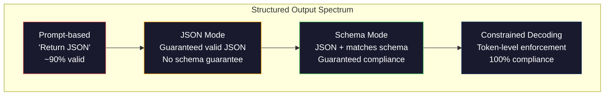
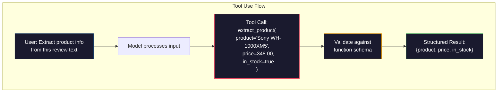

# Keluaran Terstruktur:JSON, Validasi Skema, Decoding Terbatas

> kamuLLMmengembalikan sebuah string. Kebutuhan aplikasi kamuJSON. Kesenjangan ini telah menghancurkan lebih banyak sistem produksi dibandingkan model halusinasi apa pun. Keluaran terstruktur adalah jembatan antara bahasa alami dan data yang diketik. Lakukan dengan benar dan milik kamuLLMmenjadi dapat diandalkanAPI. Lakukan kesalahan dan kamu menguraikan teks bebas dengan regex pada jam 3 pagi.

**Type:** Build
**Languages:** Python
**Prerequisites:** Phase 10, Lessons 01-05 (LLMs from Scratch)
**Time:** ~90 minutes
**Terkait:** Fase 5 · 20 (Output Terstruktur & Penguraian Kode Terbatas) mencakup teori tingkat dekoder (FSM/CFGprosesor logit, Garis Besar, XGrammar). Pelajaran ini berfokus pada produksiSDKpermukaan (OpenAI`response_format`, Penggunaan alat antropik, Instruktur) — baca Fase 5 · 20 terlebih dahulu jika kamu ingin memahami apa yang terjadi di bawahAPI.

## Tujuan Pembelajaran

- MenerapkanJSON-mode dan keluaran dengan skema terbatas menggunakan OpenAI dan AnthropicAPIparameter
- Bangun lapisan validasi Pydantic yang menolak format yang salahLLMkeluaran dan percobaan ulang dengan umpan balik kesalahan
- Jelaskan bagaimana kekuatan decoding yang dibatasi validJSONpada tingkat token tanpa pasca-pemrosesan
- Rancang perintah ekstraksi tangguh yang secara andal mengubah teks tidak terstruktur menjadi struktur data yang diketik

## Masalahnya

kamu bertanyaLLM: "Ekstrak nama produk, harga, dan ketersediaan dari teks ini." Ini merespons:

```
The product is the Sony WH-1000XM5 headphones, which cost $348.00 and are currently in stock.
```

Itu adalah jawaban yang sangat tepat. Itu juga sama sekali tidak berguna untuk aplikasi kamu. Kebutuhan sistem inventaris kamu`{"product": "Sony WH-1000XM5", "price": 348.00, "in_stock": true}`. kamu membutuhkan sebuahJSONobjek dengan kunci tertentu, tipe tertentu, dan batasan nilai tertentu. kamu tidak membutuhkan sebuah kalimat.

Solusi naif: tambahkan "Respon masukJSON" sesuai permintaan kamu. Ini berhasil 90% dari waktu. 10% lainnya model membungkusnyaJSONdi pagar kode penurunan harga, atau menambahkan pembukaan seperti "Ini diaJSON:", atau menghasilkan tidak valid secara sintaksisJSONkarena menutup braket lebih awal. kamuJSONpengurai mogok. Saluran pipa kamu rusak. kamu menambahkantry/exceptdan loop coba lagi. Percobaan ulang terkadang menghasilkan data yang berbeda. Sekarang kamu memiliki masalah konsistensi selain masalah penguraian.

Ini bukan masalah rekayasa yang cepat. Ini adalah masalah penguraian kode. Model ini menghasilkan token dari kiri ke kanan. Di setiap posisi, ia mengambil token berikutnya yang paling mungkin dari kosakata 100 ribu+ opsi. Sebagian besar opsi tersebut akan menghasilkan tidak validJSONpada posisi tertentu. Jika modelnya baru saja dipancarkan`{"price":`, token berikutnya harus berupa angka, kutipan (untuk string),`null`,`true`,`false`, atau tanda negatif. Hal lain menghasilkan tidak validJSON. Tanpa batasan, model mungkin memilih kata bahasa Inggris yang masuk akal namun secara sintaksis salah.

## Konsepnya

### Spektrum Keluaran Terstruktur

Ada empat tingkat pengendalian keluaran terstruktur, masing-masing lebih dapat diandalkan dibandingkan yang terakhir.



**Berbasis prompt** ("Respon validJSON"): tidak ada penegakan hukum. Model biasanya mematuhi namun terkadang tidak. Keandalan: ~90%. Mode kegagalan: pagar penurunan harga, teks pembukaan, keluaran terpotong, struktur salah.

**JSONmodus**: ituAPImenjamin outputnya validJSON. OpenAI`response_format: { type: "json_object" }`memungkinkan ini. Outputnya akan diurai tanpa kesalahan. Namun skema tersebut mungkin tidak sesuai dengan skema yang kamu harapkan -- kunci tambahan, jenis yang salah, bidang yang hilang.

**Mode skema**: ituAPImengambil aJSONSkema dan jaminan keluaran sesuai. Pada tahun 2026, setiap penyedia besar mendukung hal ini: OpenAI`response_format: { type: "json_schema", json_schema: {...} }`(juga sebagai`tool_choice="required"`), penggunaan alat Anthropic dengan`input_schema`, dan Gemini`response_schema`+`response_mime_type: "application/json"`. Outputnya memiliki kunci, tipe, dan batasan persis seperti yang kamu tentukan.

**Penguraian kode yang dibatasi**: pada setiap posisi token selama pembuatan, dekoder menutupi semua token yang akan menghasilkan keluaran yang tidak valid. Jika skema memerlukan angka dan model akan mengeluarkan huruf, token tersebut disetel ke probabilitas nol. Model hanya dapat menghasilkan token yang menghasilkan keluaran yang valid. Inilah yang diterapkan oleh mode keluaran terstruktur OpenAI dan pustaka seperti Garis Besar dan Panduan.

### JSONSkema: Bahasa Kontrak

JSONSkema adalah cara kamu memberi tahu model (atau lapisan validasi) bentuk keluaran yang harus dimiliki. Setiap sistem keluaran terstruktur utama menggunakannya.

```json
{
  "type": "object",
  "properties": {
    "product": { "type": "string" },
    "price": { "type": "number", "minimum": 0 },
    "in_stock": { "type": "boolean" },
    "categories": {
      "type": "array",
      "items": { "type": "string" }
    }
  },
  "required": ["product", "price", "in_stock"]
}
```

Skema ini mengatakan: output harus berupa objek dengan string`product`, bilangan non-negatif`price`, sebuah boolean`in_stock`, dan array string opsional`categories`. Output apa pun yang tidak cocok akan ditolak.

Skema menangani kasus-kasus sulit: objek bersarang, array dengan item yang diketik, enum (membatasi string ke nilai tertentu), pencocokan pola (regex pada string), dan kombinator (oneOf, anyOf, allOf untuk keluaran polimorfik).

### Pola Pydantic

Dengan Python, kamu tidak menulisJSONSkema dengan tangan. kamu mendefinisikan model Pydantic dan itu menghasilkan skema untuk kamu.

```python
from pydantic import BaseModel

class Product(BaseModel):
    product: str
    price: float
    in_stock: bool
    categories: list[str] = []
```

Ini menghasilkan hal yang samaJSONSkema seperti di atas. Perpustakaan Instruktur (dan OpenAISDK) menerima model Pydantic secara langsung: meneruskan kelas model, mendapatkan kembali instance yang divalidasi. JikaLLMoutput tidak cocok, Instruktur mencoba ulang secara otomatis.

### Pemanggilan Fungsi / Penggunaan Alat

Antarmuka alternatif untuk masalah yang sama. Daripada meminta model untuk memproduksiJSONsecara langsung, kamu mendefinisikan "alat" (fungsi) dengan parameter yang diketik. Model mengeluarkan pemanggilan fungsi dengan argumen terstruktur. OpenAI menyebutnya sebagai "panggilan fungsi". Anthropic menyebutnya "penggunaan alat". Hasilnya sama: data terstruktur.



Penggunaan alat lebih disukai ketika model perlu memilih fungsi mana yang akan dipanggil, bukan hanya mengisi parameter. Jika kamu memiliki 10 skema ekstraksi berbeda dan model harus memilih skema yang tepat berdasarkan masukan, penggunaan alat memberi kamu pilihan skema dan keluaran terstruktur.

### Mode Kegagalan Umum

Bahkan dengan penerapan skema, keluaran terstruktur bisa gagal secara halus.

**Nilai halusinasi**: output cocok dengan skema tetapi berisi data penemuan. Model menghasilkan`{"price": 299.99}`ketika teks mengatakan $348. Validasi skema tidak dapat menangkap ini -- tipenya benar, nilainya salah.

**Enum kebingungan**: kamu membatasi suatu bidang`["in_stock", "out_of_stock", "preorder"]`. Keluaran model`"available"`-- benar secara semantik, tetapi tidak dalam set yang diizinkan. Penguraian kode terbatas yang baik mencegah hal ini. Pendekatan berbasis cepat tidak bisa melakukan hal tersebut.

**Kedalaman objek bertumpuk**: skema bertumpuk dalam (tingkat 4+) menghasilkan lebih banyak kesalahan. Setiap tingkat sarang adalah tempat lain di mana model dapat kehilangan jejak strukturnya.

**Panjang array**: model mungkin menghasilkan terlalu banyak atau terlalu sedikit item dalam array. Dukungan skema`minItems`dan`maxItems`tetapi tidak semua penyedia menerapkannya pada tingkat decoding.

**Penghilangan kolom opsional**: model menghilangkan kolom yang secara teknis opsional namun penting secara semantik untuk kasus penggunaan kamu. Tetapkan sesuai kebutuhan dalam skema meskipun data terkadang hilang -- paksa model untuk memproduksi`null`secara eksplisit.

```figure
mx-schema-funnel
```

## Bangun Sendiri

### Langkah 1: JSONValidator Skema

Bangun validator dari awal yang memeriksa apakah objek Python cocok dengan aJSONSkema. Inilah yang berjalan di sisi keluaran untuk memverifikasi kepatuhan.

```python
import json

def validate_schema(data, schema):
    errors = []
    _validate(data, schema, "", errors)
    return errors

def _validate(data, schema, path, errors):
    schema_type = schema.get("type")

    if schema_type == "object":
        if not isinstance(data, dict):
            errors.append(f"{path}: expected object, got {type(data).__name__}")
            return
        for key in schema.get("required", []):
            if key not in data:
                errors.append(f"{path}.{key}: required field missing")
        properties = schema.get("properties", {})
        for key, value in data.items():
            if key in properties:
                _validate(value, properties[key], f"{path}.{key}", errors)

    elif schema_type == "array":
        if not isinstance(data, list):
            errors.append(f"{path}: expected array, got {type(data).__name__}")
            return
        min_items = schema.get("minItems", 0)
        max_items = schema.get("maxItems", float("inf"))
        if len(data) < min_items:
            errors.append(f"{path}: array has {len(data)} items, minimum is {min_items}")
        if len(data) > max_items:
            errors.append(f"{path}: array has {len(data)} items, maximum is {max_items}")
        items_schema = schema.get("items", {})
        for i, item in enumerate(data):
            _validate(item, items_schema, f"{path}[{i}]", errors)

    elif schema_type == "string":
        if not isinstance(data, str):
            errors.append(f"{path}: expected string, got {type(data).__name__}")
            return
        enum_values = schema.get("enum")
        if enum_values and data not in enum_values:
            errors.append(f"{path}: '{data}' not in allowed values {enum_values}")

    elif schema_type == "number":
        if not isinstance(data, (int, float)):
            errors.append(f"{path}: expected number, got {type(data).__name__}")
            return
        minimum = schema.get("minimum")
        maximum = schema.get("maximum")
        if minimum is not None and data < minimum:
            errors.append(f"{path}: {data} is less than minimum {minimum}")
        if maximum is not None and data > maximum:
            errors.append(f"{path}: {data} is greater than maximum {maximum}")

    elif schema_type == "boolean":
        if not isinstance(data, bool):
            errors.append(f"{path}: expected boolean, got {type(data).__name__}")

    elif schema_type == "integer":
        if not isinstance(data, int) or isinstance(data, bool):
            errors.append(f"{path}: expected integer, got {type(data).__name__}")
```

### Langkah 2: Model Gaya Pydantic ke Skema

Bangun konverter kelas-ke-skema minimal. Tentukan kelas Python dan buat kelasnyaJSONSkema secara otomatis.

```python
class SchemaField:
    def __init__(self, field_type, required=True, default=None, enum=None, minimum=None, maximum=None):
        self.field_type = field_type
        self.required = required
        self.default = default
        self.enum = enum
        self.minimum = minimum
        self.maximum = maximum

def python_type_to_schema(field):
    type_map = {
        str: "string",
        int: "integer",
        float: "number",
        bool: "boolean",
    }

    schema = {}

    if field.field_type in type_map:
        schema["type"] = type_map[field.field_type]
    elif field.field_type == list:
        schema["type"] = "array"
        schema["items"] = {"type": "string"}
    elif isinstance(field.field_type, dict):
        schema = field.field_type

    if field.enum:
        schema["enum"] = field.enum
    if field.minimum is not None:
        schema["minimum"] = field.minimum
    if field.maximum is not None:
        schema["maximum"] = field.maximum

    return schema

def model_to_schema(name, fields):
    properties = {}
    required = []

    for field_name, field in fields.items():
        properties[field_name] = python_type_to_schema(field)
        if field.required:
            required.append(field_name)

    return {
        "type": "object",
        "properties": properties,
        "required": required,
    }
```

### Langkah 3: Filter Token Terbatas

Simulasikan decoding terbatas. Diberikan sebagianJSONstring dan skema, tentukan kategori token mana yang valid pada posisi saat ini.

```python
def next_valid_tokens(partial_json, schema):
    stripped = partial_json.strip()

    if not stripped:
        return ["{"]

    try:
        json.loads(stripped)
        return ["<EOS>"]
    except json.JSONDecodeError:
        pass

    last_char = stripped[-1] if stripped else ""

    if last_char == "{":
        return ['"', "}"]
    elif last_char == '"':
        if stripped.endswith('":'):
            return ['"', "0-9", "true", "false", "null", "[", "{"]
        return ["a-z", '"']
    elif last_char == ":":
        return [" ", '"', "0-9", "true", "false", "null", "[", "{"]
    elif last_char == ",":
        return [" ", '"', "{", "["]
    elif last_char in "0123456789":
        return ["0-9", ".", ",", "}", "]"]
    elif last_char == "}":
        return [",", "}", "]", "<EOS>"]
    elif last_char == "]":
        return [",", "}", "<EOS>"]
    elif last_char == "[":
        return ['"', "0-9", "true", "false", "null", "{", "[", "]"]
    else:
        return ["any"]

def demonstrate_constrained_decoding():
    partial_states = [
        '',
        '{',
        '{"product"',
        '{"product":',
        '{"product": "Sony"',
        '{"product": "Sony",',
        '{"product": "Sony", "price":',
        '{"product": "Sony", "price": 348',
        '{"product": "Sony", "price": 348}',
    ]

    print(f"{'Partial JSON':<45} {'Valid Next Tokens'}")
    print("-" * 80)
    for state in partial_states:
        valid = next_valid_tokens(state, {})
        display = state if state else "(empty)"
        print(f"{display:<45} {valid}")
```

### Langkah 4: Pipa Ekstraksi

Gabungkan semuanya ke dalam jalur ekstraksi: tentukan skema, simulasikanLLMmenghasilkan keluaran terstruktur, memvalidasi keluaran, dan menangani percobaan ulang.

```python
def simulate_llm_extraction(text, schema, attempt=0):
    if "headphones" in text.lower() or "sony" in text.lower():
        if attempt == 0:
            return '{"product": "Sony WH-1000XM5", "price": 348.00, "in_stock": true, "categories": ["audio", "headphones"]}'
        return '{"product": "Sony WH-1000XM5", "price": 348.00, "in_stock": true}'

    if "laptop" in text.lower():
        return '{"product": "MacBook Pro 16", "price": 2499.00, "in_stock": false, "categories": ["computers"]}'

    return '{"product": "Unknown", "price": 0, "in_stock": false}'

def extract_with_retry(text, schema, max_retries=3):
    for attempt in range(max_retries):
        raw = simulate_llm_extraction(text, schema, attempt)

        try:
            data = json.loads(raw)
        except json.JSONDecodeError as e:
            print(f"  Attempt {attempt + 1}: JSON parse error -- {e}")
            continue

        errors = validate_schema(data, schema)
        if not errors:
            return data

        print(f"  Attempt {attempt + 1}: Schema validation errors -- {errors}")

    return None

product_schema = {
    "type": "object",
    "properties": {
        "product": {"type": "string"},
        "price": {"type": "number", "minimum": 0},
        "in_stock": {"type": "boolean"},
        "categories": {"type": "array", "items": {"type": "string"}},
    },
    "required": ["product", "price", "in_stock"],
}
```

### Langkah 5: Jalankan Alur Penuh

```python
def run_demo():
    print("=" * 60)
    print("  Structured Output Pipeline Demo")
    print("=" * 60)

    print("\n--- Schema Definition ---")
    product_fields = {
        "product": SchemaField(str),
        "price": SchemaField(float, minimum=0),
        "in_stock": SchemaField(bool),
        "categories": SchemaField(list, required=False),
    }
    generated_schema = model_to_schema("Product", product_fields)
    print(json.dumps(generated_schema, indent=2))

    print("\n--- Schema Validation ---")
    test_cases = [
        ({"product": "Test", "price": 10.0, "in_stock": True}, "Valid object"),
        ({"product": "Test", "price": -5.0, "in_stock": True}, "Negative price"),
        ({"product": "Test", "in_stock": True}, "Missing price"),
        ({"product": "Test", "price": "ten", "in_stock": True}, "String as price"),
        ("not an object", "String instead of object"),
    ]

    for data, label in test_cases:
        errors = validate_schema(data, product_schema)
        status = "PASS" if not errors else f"FAIL: {errors}"
        print(f"  {label}: {status}")

    print("\n--- Constrained Decoding Simulation ---")
    demonstrate_constrained_decoding()

    print("\n--- Extraction Pipeline ---")
    texts = [
        "The Sony WH-1000XM5 headphones are priced at $348 and currently available.",
        "The new MacBook Pro 16-inch laptop costs $2499 but is sold out.",
        "This is a random sentence with no product info.",
    ]

    for text in texts:
        print(f"\n  Input: {text[:60]}...")
        result = extract_with_retry(text, product_schema)
        if result:
            print(f"  Output: {json.dumps(result)}")
        else:
            print(f"  Output: FAILED after retries")
```

## Gunakan

### Keluaran Terstruktur OpenAI

```python
# from openai import OpenAI
# from pydantic import BaseModel
#
# client = OpenAI()
#
# class Product(BaseModel):
#     product: str
#     price: float
#     in_stock: bool
#
# response = client.beta.chat.completions.parse(
#     model="gpt-5-mini",
#     messages=[
#         {"role": "system", "content": "Extract product information."},
#         {"role": "user", "content": "Sony WH-1000XM5, $348, in stock"},
#     ],
#     response_format=Product,
# )
#
# product = response.choices[0].message.parsed
# print(product.product, product.price, product.in_stock)
```

Mode keluaran terstruktur OpenAI menggunakan decoding terbatas secara internal. Setiap token yang dihasilkan model dijamin menghasilkan keluaran yang cocok dengan skema Pydantic. Tidak perlu mencoba lagi. Tidak diperlukan validasi. Batasan tersebut dimasukkan ke dalam proses decoding.

### Penggunaan Alat Antropik

```python
# import anthropic
#
# client = anthropic.Anthropic()
#
# response = client.messages.create(
#     model="claude-opus-4-7",
#     max_tokens=1024,
#     tools=[{
#         "name": "extract_product",
#         "description": "Extract product information from text",
#         "input_schema": {
#             "type": "object",
#             "properties": {
#                 "product": {"type": "string"},
#                 "price": {"type": "number"},
#                 "in_stock": {"type": "boolean"},
#             },
#             "required": ["product", "price", "in_stock"],
#         },
#     }],
#     messages=[{"role": "user", "content": "Extract: Sony WH-1000XM5, $348, in stock"}],
# )
```

Anthropic mencapai keluaran terstruktur melalui penggunaan alat. Model mengeluarkan panggilan alat dengan argumen terstruktur yang cocok dengan input_schema. Hasilnya sama, berbedaAPIpermukaan.

### Perpustakaan Instruktur

```python
# pip install instructor
# import instructor
# from openai import OpenAI
# from pydantic import BaseModel
#
# client = instructor.from_openai(OpenAI())
#
# class Product(BaseModel):
#     product: str
#     price: float
#     in_stock: bool
#
# product = client.chat.completions.create(
#     model="gpt-5-mini",
#     response_model=Product,
#     messages=[{"role": "user", "content": "Sony WH-1000XM5, $348, in stock"}],
# )
```

Instruktur membungkus apa sajaLLMklien dan menambahkan percobaan ulang otomatis dengan validasi. Jika upaya pertama gagal validasi, kesalahan akan dikirim kembali ke model sebagai konteks dan memintanya untuk memperbaiki hasilnya. Ini berfungsi dengan penyedia mana pun, bukan hanya OpenAI.

## Rilis

Pelajaran ini menghasilkan`outputs/prompt-structured-extractor.md`-- template prompt yang dapat digunakan kembali yang mengekstrak data terstruktur dari teks apa pun yang diberi definisi skema. Beri makan aJSONSkema dan teks tidak terstruktur, dan kembali divalidasiJSON.

Itu juga menghasilkan`outputs/skill-structured-outputs.md`-- kerangka keputusan untuk memilih strategi keluaran terstruktur yang tepat berdasarkan penyedia kamu, persyaratan keandalan, dan kompleksitas skema.

## Latihan

1. Perluas validator skema ke dukungan`oneOf`(data harus sama persis dengan salah satu dari beberapa skema). Ini menangani keluaran polimorfik -- misalnya, bidang yang dapat berupa a`Product`atau a`Service`benda dengan bentuk yang berbeda-beda.

2. Buat alat "perbedaan skema" yang membandingkan dua skema dan mengidentifikasi perubahan yang dapat mengganggu (bidang wajib yang dihapus, jenis yang diubah) versus perubahan yang tidak dapat mengganggu (menambahkan bidang opsional, batasan yang lebih longgar). Ini penting untuk membuat versi skema ekstraksi kamu dalam produksi.

3. Menerapkan simulator decoding terbatas yang lebih realistis. Diberikan aJSONSkema dan kosakata 100 token (huruf, angka, tanda baca, kata kunci), melalui pembuatan langkah demi langkah, menutupi token yang tidak valid di setiap posisi. Ukur berapa persentase kosakata yang valid pada setiap langkah.

4. Bangun rangkaian evaluasi ekstraksi. Buat 50 deskripsi produk dengan label tanganJSONkeluaran. Jalankan alur ekstraksi kamu pada semua 50 dan ukur pencocokan tepat, akurasi tingkat lapangan, dan kepatuhan jenis. Identifikasi bidang mana yang paling sulit diekstraksi dengan benar.

5. Tambahkan "skor kepercayaan" ke jalur ekstraksi kamu. Untuk setiap kolom yang diekstraksi, perkirakan seberapa yakin model tersebut (berdasarkan probabilitas token, atau dengan menjalankan ekstraksi 3 kali dan mengukur konsistensi). Tandai kolom dengan tingkat keyakinan rendah untuk ditinjau oleh manusia.

## Istilah-Istilah Utama

| Term | What people say | What it actually means |
|------|----------------|----------------------|
| JSON mode | "Returns JSON" | API flag that guarantees syntactically valid JSON output, but does not enforce any particular schema |
| Structured output | "Typed JSON" | Output that matches a specific JSON Schema with correct keys, types, and constraints |
| Constrained decoding | "Guided generation" | At each token position, mask out tokens that would produce invalid output -- guarantees 100% schema compliance |
| JSON Schema | "A JSON template" | A declarative language for describing the structure, types, and constraints of JSON data (used by OpenAPI, JSON Forms, etc.) |
| Pydantic | "Python dataclasses+" | Python library that defines data models with type validation, used by FastAPI and Instructor to generate JSON Schemas |
| Function calling | "Tool use" | LLM outputs a structured function invocation (name + typed arguments) instead of free text -- OpenAI and Anthropic both support this |
| Instructor | "Pydantic for LLMs" | Python library that wraps LLM clients to return validated Pydantic instances, with automatic retry on validation failure |
| Token masking | "Filtering the vocabulary" | Setting specific token probabilities to zero during generation so the model cannot produce them |
| Schema compliance | "Matches the shape" | The output has every required field, correct types, values within constraints, and no extra disallowed fields |
| Retry loop | "Try again until it works" | Send validation errors back to the model and ask it to fix the output -- Instructor does this automatically, up to a configurable max |

## Bacaan Lebih Lanjut

- [Panduan Output Terstruktur OpenAI](https://platform.openai.com/docs/guides/structured-outputs) -- dokumentasi resmi untukJSONDekode terbatas berbasis skema di OpenAIAPI
- [Willard & Louf, 2023 -- "Generasi Terpandu yang Efisien untuk Model Bahasa Besar"](https://arxiv.org/abs/2307.09702) -- makalah Garis Besar, menjelaskan cara menyusunJSONSkema menjadi mesin negara terbatas untuk batasan tingkat token
- [Dokumentasi instruktur](https://python.useinstructor.com/) -- perpustakaan standar untuk mendapatkan keluaran terstruktur dari mana punLLMdengan validasi dan percobaan ulang Pydantic
- [Panduan Penggunaan Alat Antropik](https://docs.anthropic.com/en/docs/tool-use) -- bagaimana Claude mengimplementasikan keluaran terstruktur melalui penggunaan alatJSONSkema input_skema
- [JSONSpesifikasi skema](https://json-schema.org/) -- spesifikasi lengkap untuk bahasa skema yang digunakan oleh setiap sistem keluaran terstruktur utama
- [Garis Besar Perpustakaan](https://github.com/outlines-dev/outlines) -- pembangkitan terbatas sumber terbuka menggunakan regex danJSONSkema dikompilasi ke mesin negara terbatas
- [Dong dkk., "XGrammar: Mesin Pembuatan Terstruktur yang Fleksibel dan Efisien untuk Model Bahasa Besar" (MLSys 2025)](https://arxiv.org/abs/2411.15100) -- mesin tata bahasa tercanggih saat ini; kompilasi pushdown-automaton yang menutupi token pada ~100 ns / token.
- [Beurer-Kellner dkk., "Prompting Is Programming: Bahasa Kueri untuk Model Bahasa Besar" (LMQL)](https://arxiv.org/abs/2212.06094) -- ituLMQLframing kertas dibatasi decoding sebagai bahasa kueri dengan batasan jenis dan nilai.
- [Panduan Microsoft (dokumen kerangka kerja)](https://github.com/guidance-ai/guidance) -- pembuatan terbatas berdasarkan templat; pelengkap vendor-agnostik untuk Outlines dan XGrammar.
