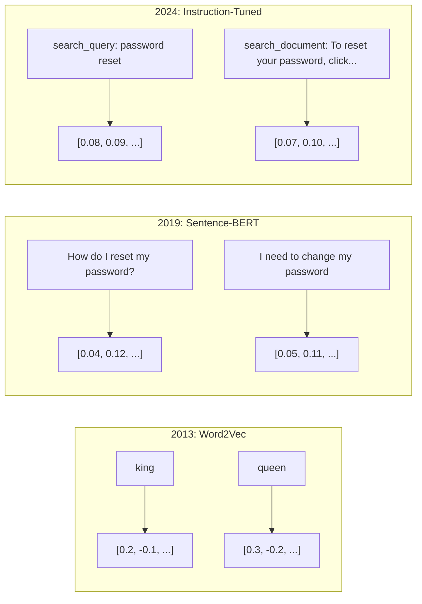
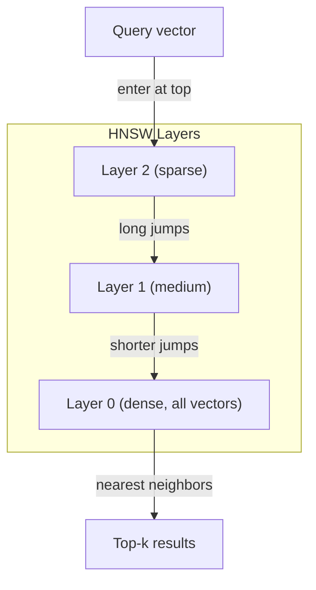
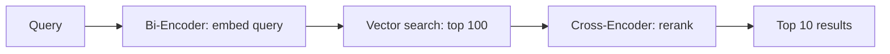

# Penyematan & Representasi Vektor

> Teks bersifat diskrit. Matematika itu berkelanjutan. Setiap kali kamu bertanyaLLMuntuk menemukan dokumen yang "serupa", membandingkan makna, atau menelusuri lebih dari sekadar kata kunci, kamu mengandalkan jembatan antara dua dunia ini. Jembatan itu adalah sebuah embedding. Jika kamu tidak memahami penyematan, kamu tidak memahami AI modern. kamu cukup menggunakannya.

**Type:** Build
**Languages:** Python
**Prerequisites:** Phase 11, Lesson 01 (Prompt Engineering)
**Time:** ~75 minutes
**Terkait:** Fase 5 · 22 (Penyelaman Model Penyematan Mendalam) mencakup padat vs jarang vs multi-vektor, pemotongan Matryoshka, dan pemilihan model per sumbu. Pelajaran ini berfokus pada jalur produksi (DB vektor,HNSW, matematika kesamaan). Baca Tahap 5 · 22 sebelum memilih model.

## Tujuan Pembelajaran

- Hasilkan penyematan teks menggunakanAPIpenyedia dan model sumber terbuka, dan menghitung kesamaan kosinus di antara keduanya
- Jelaskan mengapa penyematan memecahkan masalah ketidakcocokan kosakata yang tidak dapat ditangani oleh pencarian kata kunci
- Bangun indeks pencarian semantik yang mengambil dokumen berdasarkan makna, bukan pencocokan kata kunci yang tepat
- Evaluasi kualitas penyematan menggunakan tolok ukur pengambilan (precision@k, recall) dan pilih model penyematan yang tepat untuk tugas kamu

## Masalahnya

kamu memiliki 10.000 tiket dukungan. Seorang pelanggan menulis "pembayaran saya tidak berhasil". kamu perlu menemukan tiket serupa sebelumnya. Pencarian kata kunci menemukan tiket yang berisi "pembayaran" dan "tidak berhasil". Tidak ada "transaksi gagal", "tagihan ditolak", dan "kesalahan penagihan". Tiket ini menggambarkan masalah yang sama dengan kata-kata yang sangat berbeda.

Ini adalah masalah ketidakcocokan kosakata. Bahasa manusia memiliki banyak cara untuk mengatakan hal yang sama. Pencarian kata kunci memperlakukan setiap kata sebagai simbol independen yang tidak memiliki arti. Tidak dapat diketahui bahwa “ditolak” dan “tidak lolos” mengacu pada konsep yang sama.

kamu memerlukan representasi teks yang maknanya, bukan ejaannya, yang menentukan kesamaan. kamu memerlukan cara untuk menempatkan "pembayaran saya tidak berhasil" dan "transaksi ditolak" berdekatan dalam ruang matematika, sambil menjauhkan "pembayaran saya tiba tepat waktu" meskipun berbagi kata "pembayaran".

Representasi itu adalah sebuah penyematan.

## Konsepnya

### Apa itu Penyematan?

Penyematan adalah vektor padat angka floating-point yang mewakili makna teks. Kata "padat" penting -- setiap dimensi membawa informasi, tidak seperti representasi yang jarang (sekantong kata, TF-IDF) di mana sebagian besar dimensi adalah nol.

"Kucing itu duduk di atas matras" menjadi seperti itu`[0.023, -0.041, 0.087, ..., 0.012]`-- daftar nomor 768 hingga 3072 tergantung modelnya. Angka-angka ini menyandikan makna. kamu tidak pernah memeriksanya secara langsung. kamu membandingkannya.

### Terobosan Word2Vec

Pada tahun 2013, Tomas Mikolov dan rekannya di Google menerbitkan Word2Vec. Wawasan inti: melatih jaringan saraf untuk memprediksi sebuah kata dari tetangganya (atau tetangga dari sebuah kata), dan bobot lapisan tersembunyi menjadi representasi vektor yang bermakna.

Hasil yang terkenal:

```
king - man + woman = queen
```

Aritmatika vektor pada penyematan kata menangkap hubungan semantik. Arah dari "pria" ke "wanita" kira-kira sama dengan arah dari "raja" ke "ratu". Inilah saatnya bidang ini menyadari bahwa geometri dapat menyandikan makna.

Word2Vec menghasilkan vektor 300 dimensi. Setiap kata mendapat satu vektor terlepas dari konteksnya. "Bank" di "tepi sungai" dan "rekening bank" memiliki penyematan yang sama. Keterbatasan ini mendorong penelitian pada dekade berikutnya.

### Dari Kata ke Kalimat

Penyematan kata mewakili token tunggal. Sistem produksi perlu menyematkan seluruh kalimat, paragraf, atau dokumen. Empat pendekatan muncul:

**Averaging**: mengambil mean dari semua vektor kata dalam kalimat. Murah, lossy, ternyata lumayan untuk teks pendek. Kehilangan urutan kata seluruhnya -- "dog bites man" dan "man bites dog" memiliki embeddings yang identik.

**CLStoken**: model transformator (BERT, 2018) mengeluarkan [ khususCLS] penyematan token yang mewakili seluruh masukan. Lebih baik daripada rata-rata tetapi [CLS] token dilatih untuk prediksi kalimat berikutnya, bukan kesamaan.

**Pembelajaran kontrastif**: melatih model secara eksplisit untuk menyatukan pasangan serupa dan memisahkan pasangan berbeda. Kalimat-BERT(Reimers & Gurevych, 2019) menggunakan pendekatan ini dan menjadi dasar model penyematan modern. Mengingat "Bagaimana cara mereset kata sandi saya?" dan "Saya perlu mengubah kata sandi", model mengetahui bahwa kata sandi tersebut seharusnya memiliki vektor yang hampir sama.

**Penyematan yang disesuaikan dengan instruksi**: pendekatan terbaru. Model seperti E5 danGTEmenerima awalan tugas ("search_query:", "search_document:") yang memberi tahu model jenis penyematan apa yang akan dihasilkan. Hal ini memungkinkan satu model melayani banyak tugas.



### Model Penyematan Modern

Pasar telah memilih beberapa opsi tingkat produksi (MTEBskor pada awal tahun 2026,MTEBv2):

| Model | Provider | Dimensions | MTEB | Context | Cost / 1M tokens |
|-------|----------|-----------|------|---------|------------------|
| Gemini Embedding 2 | Google | 3072 (Matryoshka) | 67.7 (retrieval) | 8192 | $0.15 |
| embed-v4 | Cohere | 1024 (Matryoshka) | 65.2 | 128K | $0.12 |
| voyage-4 | Voyage AI | 1024/2048 (Matryoshka) | 66.8 | 32K | $0.12 |
| text-embedding-3-large | OpenAI | 3072 (Matryoshka) | 64.6 | 8192 | $0.13 |
| text-embedding-3-small | OpenAI | 1536 (Matryoshka) | 62.3 | 8192 | $0.02 |
| BGE-M3 | BAAI | 1024 (dense+sparse+ColBERT) | 63.0 multilingual | 8192 | Open-weight |
| Qwen3-Embedding | Alibaba | 4096 (Matryoshka) | 66.9 | 32K | Open-weight |
| Nomic-embed-v2 | Nomic | 768 (Matryoshka) | 63.1 | 8192 | Open-weight |

MTEB(Tolok Ukur Penyematan Teks Besar-besaran) v2 mencakup 100+ tugas dalam pengambilan, klasifikasi, pengelompokan, pemeringkatan ulang, dan ringkasan. Lebih tinggi lebih baik. Pada tahun 2026, model bobot terbuka (Qwen3-Embedding,BGE-M3) mencocokkan atau mengalahkan model yang dihosting tertutup di sebagian besar sumbu. Gemini Embedding 2 memimpin pengambilan murni;Voyage/Coherememimpin domain tertentu (keuangan, hukum, kode). Selalu lakukan tolok ukur pada pertanyaan kamu sendiri sebelum melakukan.

### Metrik Kesamaan

Diberikan dua vektor penyematan, tiga cara untuk mengukur seberapa mirip keduanya:

**Kesamaan kosinus**: kosinus sudut antara dua vektor. Berkisar dari -1 (berlawanan) hingga 1 (arah identik). Mengabaikan besaran -- kalimat 10 kata dan dokumen 500 kata dapat mendapat skor 1,0 jika mengarah ke arah yang sama. Ini adalah default untuk 90% kasus penggunaan.

```
cosine_sim(a, b) = dot(a, b) / (||a|| * ||b||)
```

**Perkalian titik**: hasil kali dalam mentah dari dua vektor. Identik dengan kesamaan kosinus ketika vektor dinormalisasi (satuan panjang). Lebih cepat untuk menghitung. Penyematan OpenAI dinormalisasi, jadi perkalian titik dan kosinus memberikan peringkat yang sama.

```
dot(a, b) = sum(a_i * b_i)
```

**Jarak Euclidean (L2)**: jarak garis lurus dalam ruang vektor. Lebih kecil = lebih mirip. Sensitif terhadap perbedaan besarnya. Gunakan ketika posisi absolut dalam ruang penting, bukan hanya arahnya.

```
L2(a, b) = sqrt(sum((a_i - b_i)^2))
```

Kapan menggunakan yang mana:

| Metric | Use when | Avoid when |
|--------|----------|------------|
| Cosine similarity | Comparing texts of different lengths; most retrieval tasks | Magnitude carries information |
| Dot product | Embeddings are already normalized; maximum speed | Vectors have varying magnitudes |
| Euclidean distance | Clustering; spatial nearest-neighbor problems | Comparing documents of wildly different lengths |

### Database Vektor danHNSW

Pencarian kesamaan brute force membandingkan kueri dengan setiap vektor yang disimpan. Dengan 1 juta vektor dengan 1536 dimensi, itu berarti 1,5 miliar operasi perkalian per kueri. Terlalu lambat.

Basis data vektor menyelesaikan masalah ini dengan Approximate Nearest Neighbor (ANN) algoritma. Algoritma yang dominan adalahHNSW(Dunia Kecil yang Dapat Dinavigasi secara Hierarki):

1. Buatlah grafik vektor berlapis-lapis
2. Lapisan atas jarang -- koneksi jarak jauh antar cluster yang jauh
3. Lapisan bawahnya padat -- koneksi berbutir halus antara vektor-vektor di dekatnya
4. Pencarian dimulai dari lapisan atas, dengan rakus turun untuk menyaring
5. Mengembalikan perkiraan hasil k teratas dalam waktu O(log n) dan bukan O(n)

HNSWmenukar sedikit kehilangan akurasi (biasanya 95-99% recall) dengan peningkatan kecepatan yang sangat besar. Pada 10 juta vektor, kekerasan membutuhkan waktu beberapa detik.HNSWmembutuhkan waktu milidetik.



Pilihan produksi:

| Database | Type | Best for | Max scale |
|----------|------|----------|-----------|
| Pinecone | Managed SaaS | Zero-ops production | Billions |
| Weaviate | Open source | Self-hosted, hybrid search | 100M+ |
| Qdrant | Open source | High performance, filtering | 100M+ |
| ChromaDB | Embedded | Prototyping, local dev | 1M |
| pgvector | Postgres extension | Already using Postgres | 10M |
| FAISS | Library | In-process, research | 1B+ |

### Strategi Pemotongan

Dokumen terlalu panjang untuk disematkan sebagai vektor tunggal. 50 halamanPDFmencakup lusinan topik -- penyematannya menjadi rata-rata dari segalanya, hampir tidak ada yang spesifik. kamu membagi dokumen menjadi beberapa bagian dan menyematkannya masing-masing.

**Pembagian ukuran tetap**: membagi setiap N token dengan M-token yang tumpang tindih. Sederhana dan dapat diprediksi. Berfungsi dengan baik ketika dokumen tidak memiliki struktur yang jelas. Potongan 512 token dengan 50 token tumpang tindih: potongan 1 adalah token 0-511, potongan 2 adalah token 462-973.

**Pengelompokan berdasarkan kalimat**: membagi pada batas kalimat, mengelompokkan kalimat hingga mencapai batas token. Setiap bagian setidaknya terdiri dari satu kalimat lengkap. Lebih baik daripada ukuran tetap karena kamu tidak pernah memotong pikiran menjadi dua.

**Pembagian rekursif**: coba pisahkan pada batas terbesar terlebih dahulu (header bagian). Jika masih terlalu besar, coba batas paragraf. Lalu batasan kalimat. Lalu batasan karakter. Ini milik LangChain`RecursiveCharacterTextSplitter`dan ini berfungsi dengan baik untuk corpora format campuran.

**Pembagian semantik**: menyematkan setiap kalimat, lalu mengelompokkan kalimat berurutan yang penyematannya serupa. Ketika kesamaan penyematan turun di bawah ambang batas, mulailah potongan baru. Mahal (memerlukan penyematan setiap kalimat satu per satu) tetapi menghasilkan potongan yang paling koheren.

| Strategy | Complexity | Quality | Best for |
|----------|-----------|---------|----------|
| Fixed-size | Low | Decent | Unstructured text, logs |
| Sentence-based | Low | Good | Articles, emails |
| Recursive | Medium | Good | Markdown, HTML, mixed docs |
| Semantic | High | Best | Critical retrieval quality |

Titik terbaik untuk sebagian besar sistem: 256-512 potongan token dengan 50 token yang tumpang tindih.

### Bi-Encoder vs Cross-Encoder

Bi-encoder menyematkan kueri dan dokumen secara independen, lalu membandingkan vektor. Cepat -- kamu menyematkan kueri satu kali dan membandingkannya dengan penyematan dokumen yang telah dihitung sebelumnya. Inilah yang kamu gunakan untuk pengambilan.

Pembuat enkode silang mengambil kueri dan dokumen sebagai masukan tunggal dan menghasilkan skor relevansi. Lambat -- ini memproses setiap pasangan dokumen kueri melalui model lengkap. Namun jauh lebih akurat karena dapat menangani seluruh token kueri dan dokumen secara bersamaan.

Pola produksi: bi-encoder mengambil 100 kandidat teratas, cross-encoder memeringkatnya menjadi 10 teratas. Ini adalah jalur pengambilan lalu peringkat ulang.



Model pemeringkatan ulang: Cohere Rerank 3,5 ($2 per 1000 kueri),BGE-reranker-v2 (gratis, sumber terbuka), Jina Reranker v2 (gratis, sumber terbuka).

### Penyematan Matryoshka

Penyematan tradisional adalah segalanya atau tidak sama sekali. Vektor berdimensi 1536 menggunakan 1536 pelampung. kamu tidak dapat memotong ke 256 dimensi tanpa pelatihan ulang.

Pembelajaran Representasi Matryoshka (Kusupati et al., 2022) memperbaikinya. Model dilatih sedemikian rupa sehingga dimensi N pertama menangkap informasi paling penting, seperti boneka bersarang Rusia. Memotong penyematan Matryoshka 1536-d ke 256 dimensi kehilangan beberapa akurasi tetapi tetap berfungsi.

Text-embedding-3-small dan text-embedding-3-large OpenAI mendukung pemotongan Matryoshka melalui`dimensions`parameter. Meminta 256 dimensi, bukan 1536, memotong penyimpanan sebesar 6x dengan kehilangan akurasi sekitar 3-5%MTEBtolok ukur.

### Kuantisasi Biner

Penyematan 1536 dimensi yang disimpan sebagai float32 menggunakan 6.144 byte. Kalikan dengan 10 juta dokumen: 61 GB hanya untuk vektor.

Kuantisasi biner mengubah setiap float menjadi satu bit: nilai positif menjadi 1, nilai negatif menjadi 0. Penyimpanan turun dari 6.144 byte menjadi 192 byte -- pengurangan sebesar 32x. Kesamaan dihitung menggunakan jarak Hamming (menghitung bit yang berbeda), yang dapat dilakukan CPU dalam satu instruksi.

Akurasi yang dicapai sekitar 5-10% pada penarikan kembali. Pola umumnya: kuantisasi biner untuk penelusuran first-pass pada jutaan vektor, lalu menilai ulang 1000 teratas dengan vektor presisi penuh. Ini memberi kamu akurasi presisi penuh 95%+ dengan memori 32x lebih sedikit.

```figure
cosine-similarity
```

## Bangun Sendiri

Kami membangun mesin pencari semantik dari awal. Tidak ada basis data vektor. Tidak ada penyematan eksternalAPI. Python murni dengan numpy untuk perhitungannya.

### Langkah 1: Pemotongan Teks

```python
def chunk_text(text, chunk_size=200, overlap=50):
    words = text.split()
    chunks = []
    start = 0
    while start < len(words):
        end = start + chunk_size
        chunk = " ".join(words[start:end])
        chunks.append(chunk)
        start += chunk_size - overlap
    return chunks


def chunk_by_sentences(text, max_chunk_tokens=200):
    sentences = text.replace("\n", " ").split(".")
    sentences = [s.strip() + "." for s in sentences if s.strip()]
    chunks = []
    current_chunk = []
    current_length = 0
    for sentence in sentences:
        sentence_length = len(sentence.split())
        if current_length + sentence_length > max_chunk_tokens and current_chunk:
            chunks.append(" ".join(current_chunk))
            current_chunk = []
            current_length = 0
        current_chunk.append(sentence)
        current_length += sentence_length
    if current_chunk:
        chunks.append(" ".join(current_chunk))
    return chunks
```

### Langkah 2: Membangun Embeddings dari Awal

Kami menerapkan penyematan padat sederhana menggunakan TF-IDFdengan normalisasi L2. Ini bukan penyematan saraf, tetapi mengikuti kontrak yang sama: teks masuk, vektor berukuran tetap keluar, teks serupa menghasilkan vektor serupa.

```python
import math
import numpy as np
from collections import Counter

class SimpleEmbedder:
    def __init__(self):
        self.vocab = []
        self.idf = []
        self.word_to_idx = {}

    def fit(self, documents):
        vocab_set = set()
        for doc in documents:
            vocab_set.update(doc.lower().split())
        self.vocab = sorted(vocab_set)
        self.word_to_idx = {w: i for i, w in enumerate(self.vocab)}
        n = len(documents)
        self.idf = np.zeros(len(self.vocab))
        for i, word in enumerate(self.vocab):
            doc_count = sum(1 for doc in documents if word in doc.lower().split())
            self.idf[i] = math.log((n + 1) / (doc_count + 1)) + 1

    def embed(self, text):
        words = text.lower().split()
        count = Counter(words)
        total = len(words) if words else 1
        vec = np.zeros(len(self.vocab))
        for word, freq in count.items():
            if word in self.word_to_idx:
                tf = freq / total
                vec[self.word_to_idx[word]] = tf * self.idf[self.word_to_idx[word]]
        norm = np.linalg.norm(vec)
        if norm > 0:
            vec = vec / norm
        return vec
```

### Langkah 3: Fungsi Kemiripan

```python
def cosine_similarity(a, b):
    dot = np.dot(a, b)
    norm_a = np.linalg.norm(a)
    norm_b = np.linalg.norm(b)
    if norm_a == 0 or norm_b == 0:
        return 0.0
    return float(dot / (norm_a * norm_b))


def dot_product(a, b):
    return float(np.dot(a, b))


def euclidean_distance(a, b):
    return float(np.linalg.norm(a - b))
```

### Langkah 4: Indeks Vektor dengan Pencarian Brute-Force

```python
class VectorIndex:
    def __init__(self):
        self.vectors = []
        self.texts = []
        self.metadata = []

    def add(self, vector, text, meta=None):
        self.vectors.append(vector)
        self.texts.append(text)
        self.metadata.append(meta or {})

    def search(self, query_vector, top_k=5, metric="cosine"):
        scores = []
        for i, vec in enumerate(self.vectors):
            if metric == "cosine":
                score = cosine_similarity(query_vector, vec)
            elif metric == "dot":
                score = dot_product(query_vector, vec)
            elif metric == "euclidean":
                score = -euclidean_distance(query_vector, vec)
            else:
                raise ValueError(f"Unknown metric: {metric}")
            scores.append((i, score))
        scores.sort(key=lambda x: x[1], reverse=True)
        results = []
        for idx, score in scores[:top_k]:
            results.append({
                "text": self.texts[idx],
                "score": score,
                "metadata": self.metadata[idx],
                "index": idx
            })
        return results

    def size(self):
        return len(self.vectors)
```

### Langkah 5: Mesin Pencari Semantik

```python
class SemanticSearchEngine:
    def __init__(self, chunk_size=200, overlap=50):
        self.embedder = SimpleEmbedder()
        self.index = VectorIndex()
        self.chunk_size = chunk_size
        self.overlap = overlap

    def index_documents(self, documents, source_names=None):
        all_chunks = []
        all_sources = []
        for i, doc in enumerate(documents):
            chunks = chunk_text(doc, self.chunk_size, self.overlap)
            all_chunks.extend(chunks)
            name = source_names[i] if source_names else f"doc_{i}"
            all_sources.extend([name] * len(chunks))
        self.embedder.fit(all_chunks)
        for chunk, source in zip(all_chunks, all_sources):
            vec = self.embedder.embed(chunk)
            self.index.add(vec, chunk, {"source": source})
        return len(all_chunks)

    def search(self, query, top_k=5, metric="cosine"):
        query_vec = self.embedder.embed(query)
        return self.index.search(query_vec, top_k, metric)

    def search_with_scores(self, query, top_k=5):
        results = self.search(query, top_k)
        return [
            {
                "text": r["text"][:200],
                "source": r["metadata"].get("source", "unknown"),
                "score": round(r["score"], 4)
            }
            for r in results
        ]
```

### Langkah 6: Membandingkan Metrik Kesamaan

```python
def compare_metrics(engine, query, top_k=3):
    results = {}
    for metric in ["cosine", "dot", "euclidean"]:
        hits = engine.search(query, top_k=top_k, metric=metric)
        results[metric] = [
            {"score": round(h["score"], 4), "preview": h["text"][:80]}
            for h in hits
        ]
    return results
```

## Gunakan

Dengan penyematan produksiAPI, arsitekturnya tetap identik. Hanya penyematnya yang berubah:

```python
from openai import OpenAI

client = OpenAI()

def openai_embed(texts, model="text-embedding-3-small", dimensions=None):
    kwargs = {"model": model, "input": texts}
    if dimensions:
        kwargs["dimensions"] = dimensions
    response = client.embeddings.create(**kwargs)
    return [item.embedding for item in response.data]
```

Pemotongan Matryoshka dengan OpenAI -- model yang sama, dimensi lebih sedikit, penyimpanan lebih rendah:

```python
full = openai_embed(["semantic search query"], dimensions=1536)
compact = openai_embed(["semantic search query"], dimensions=256)
```

Vektor 256-d menggunakan penyimpanan 6x lebih sedikit. Untuk 10 juta dokumen, itu berarti 10 GB vs 61 GB. Hilangnya akurasi sekitar 3-5% pada benchmark standar.

Untuk pemeringkatan ulang dengan Cohere:

```python
import cohere

co = cohere.ClientV2()

results = co.rerank(
    model="rerank-v3.5",
    query="What is the refund policy?",
    documents=["Full refund within 30 days...", "No refunds after 90 days..."],
    top_n=3
)
```

Untuk penyematan lokal dengan noAPIketergantungan:

```python
from sentence_transformers import SentenceTransformer

model = SentenceTransformer("BAAI/bge-small-en-v1.5")
embeddings = model.encode(["semantic search query", "another document"])
```

Kelas VectorIndex dari build kami berfungsi dengan semua ini. Tukar fungsi penyematan, pertahankan logika pencarian.

## Rilis

Pelajaran ini menghasilkan:
- `outputs/prompt-embedding-advisor.md`-- perintah untuk memilih model dan strategi penyematan untuk kasus penggunaan tertentu
- `outputs/skill-embedding-patterns.md`-- keterampilan yang mengajarkan agen cara menggunakan embeddings secara efektif dalam produksi

## Latihan

1. **Perbandingan metrik**: menjalankan 5 kueri yang sama terhadap dokumen sampel menggunakan kesamaan kosinus, perkalian titik, dan jarak euclidean. Catat hasil 3 teratas untuk masing-masingnya. Pertanyaan mana yang tidak disetujui oleh metrik? Mengapa?

2. **Eksperimen ukuran potongan**: mengindeks dokumen sampel dengan ukuran potongan 50, 100, 200, dan 500 kata. Untuk masing-masing kueri, jalankan 5 kueri dan catat 1 skor kesamaan teratas. Plot hubungan antara ukuran potongan dan kualitas pengambilan. Temukan titik di mana bongkahan yang lebih besar mulai terasa sakit.

3. **Simulasi Matryoshka**: membuat SimpleEmbedder yang menghasilkan vektor 500 hari. Pangkas menjadi 50, 100, 200, dan 500 dimensi. Ukur bagaimana penurunan penarikan kembali pada setiap pemotongan. Ini mensimulasikan perilaku Matryoshka tanpa memerlukan trik pelatihan yang sebenarnya.

4. **Kuantisasi biner**: ambil penyematan dari mesin telusur, konversikan ke biner (1 jika positif, 0 jika negatif), dan terapkan penelusuran jarak Hamming. Bandingkan hasil 10 teratas dengan kesamaan kosinus presisi penuh. Ukur persentase tumpang tindih.

5. **Pengelompokan berdasarkan kalimat**: ganti pengelompokan ukuran tetap dengan`chunk_by_sentences`. Jalankan kueri yang sama dan bandingkan skor pengambilan. Apakah menghormati batasan kalimat meningkatkan hasil?

## Istilah-Istilah Utama

| Term | What people say | What it actually means |
|------|----------------|----------------------|
| Embedding | "Text to numbers" | A dense vector where geometric proximity encodes semantic similarity |
| Word2Vec | "The OG embedding" | 2013 model that learned word vectors by predicting context words; proved vector arithmetic encodes meaning |
| Cosine similarity | "How similar are two vectors" | Cosine of the angle between vectors; 1 = identical direction, 0 = orthogonal, -1 = opposite |
| HNSW | "Fast vector search" | Hierarchical Navigable Small World graph -- multi-layer structure enabling O(log n) approximate nearest neighbor search |
| Bi-encoder | "Embed separately, compare fast" | Encodes query and document independently into vectors; enables pre-computation and fast retrieval |
| Cross-encoder | "Slow but accurate reranker" | Processes query-document pair jointly through the full model; higher accuracy, no pre-computation |
| Matryoshka embeddings | "Truncatable vectors" | Embeddings trained so the first N dimensions capture the most important information, enabling variable-size storage |
| Binary quantization | "1-bit embeddings" | Converting float vectors to binary (sign bit only) for 32x storage reduction with Hamming distance search |
| Chunking | "Split docs for embedding" | Breaking documents into 256-512 token segments so each can be independently embedded and retrieved |
| Vector database | "Search engine for embeddings" | Data store optimized for storing vectors and performing approximate nearest neighbor search at scale |
| Contrastive learning | "Train by comparison" | Training approach that pushes similar pair embeddings together and dissimilar pair embeddings apart |
| MTEB | "The embedding benchmark" | Massive Text Embedding Benchmark -- 56 datasets across 8 tasks; standard for comparing embedding models |

## Bacaan Lebih Lanjut

- Mikolov dkk., "Estimasi Representasi Kata yang Efisien dalam Ruang Vektor" (2013) -- makalah Word2Vec yang memulai revolusi penyematan dengan analogi raja-ratu
- Reimers & Gurevych, "Kalimat-BERT: Penyematan Kalimat menggunakan bahasa SiamBERT-Networks" (2019) -- cara melatih bi-encoder untuk kesamaan tingkat kalimat, dasar model penyematan modern
- Kusupati dkk., "Pembelajaran Representasi Matryoshka" (2022) -- teknik di balik penyematan dimensi variabel yang diadopsi OpenAI untuk penyematan teks-3
- Malkov & Yashunin, "Perkiraan Tetangga Terdekat yang Efisien dan Kuat menggunakan Grafik Dunia Kecil yang Dapat Dinavigasi Hierarki" (2018) -- theHNSWkertas, algoritma di balik sebagian besar pencarian vektor produksi
- Panduan Penyematan OpenAI (platform.openai.com/docs/guides/embeddings) -- referensi praktis untuk model penyematan teks-3 termasuk reduksi dimensi Matryoshka
- MTEBPapan peringkat (huggingface.co/spaces/mteb/leaderboard) -- tolok ukur langsung yang membandingkan semua model penyematan di seluruh tugas dan bahasa
- [Muennighoff dkk., "MTEB: Tolok Ukur Penyematan Teks Masif" (EACL2023)](https://arxiv.org/abs/2210.07316) -- tolok ukur yang mendefinisikan 8 kategori tugas (klasifikasi, pengelompokan, klasifikasi pasangan, pemeringkatan ulang, pengambilan,STS, ringkasan, penambangan bittext) yang dilaporkan di papan peringkat; baca sebelum mempercayai siapa punMTEBskor.
- [Dokumentasi Kalimat Transformers](https://www.sbert.net/) -- referensi kanonik untuk bi-encoder vs cross-encoder, strategi pengumpulan, dan ingest-split-embed-storeRAGmenyalurkan pelajaran ini mengimplementasikan.
