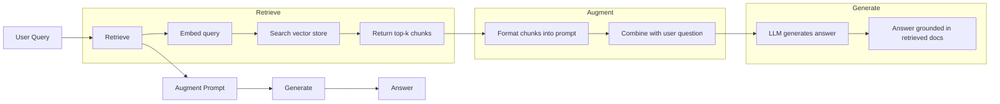
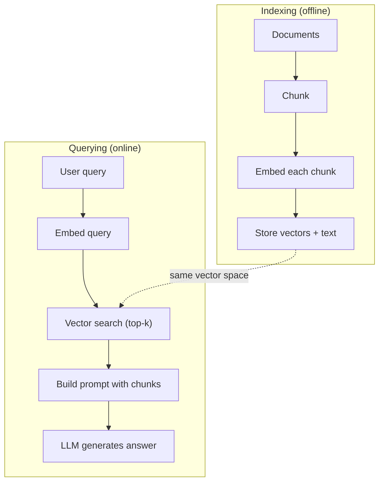

# RAG(Generasi Pengambilan-Augmented)

> kamuLLMmengetahui segalanya hingga batas pelatihannya. Ia tidak mengetahui apa pun tentang dokumen perusahaan kamu, basis kode kamu, atau catatan rapat minggu lalu.RAGmemecahkan masalah ini dengan mengambil dokumen yang relevan dan memasukkannya ke dalam prompt. Ini adalah pola yang paling banyak diterapkan dalam AI produksi. Jika kamu membangun satu hal dari kursus ini, bangunlah aRAGsaluran pipa.

**Type:** Build
**Languages:** Python
**Prerequisites:** Phase 10 (LLMs from Scratch), Phase 11 Lessons 01-05
**Time:** ~90 minutes
**Terkait:** Fase 5 · 23 (Strategi Chunking untukRAG) untuk enam algoritma chunking dan kapan masing-masing algoritma menang. Fase 5 · 22 (Penyelaman Mendalam Model Penyematan) untuk memilih penyemat. Fase 11 · 07 (LanjutanRAG) untuk penelusuran hibrid, pemeringkatan ulang, dan transformasi kueri.

## Tujuan Pembelajaran

- Membangun yang lengkapRAGpipeline: pemuatan dokumen, pemotongan, penyematan, penyimpanan vektor, pengambilan, dan pembuatan
- Menerapkan pencarian semantik menggunakan database vektor (ChromaDB,FAISS, atau Pinecone) dengan pengindeksan yang tepat
- Jelaskan alasannyaRAGlebih disukai daripada menyempurnakan aplikasi berbasis pengetahuan (biaya, kesegaran, atribusi)
- EvaluasiRAGkualitas menggunakan metrik pengambilan (presisi, perolehan) dan metrik generasi (kesetiaan, relevansi)

## Masalahnya

kamu membangun chatbot untuk perusahaan kamu. Seorang pelanggan bertanya, "Apa kebijakan pengembalian dana untuk paket perusahaan?" ItuLLMmerespons dengan jawaban umum tentang kebijakan pengembalian dana SaaS pada umumnya. Kebijakan sebenarnya, yang tertanam dalam wiki internal setebal 200 halaman, mengatakan bahwa pelanggan perusahaan mendapatkan jangka waktu 60 hari dengan pengembalian dana pro-rata. ItuLLMbelum pernah melihat dokumen ini. Ia tidak dapat mengetahui apa yang tidak dilatihnya.

Penyempurnaan adalah salah satu solusinya. AmbilLLM, latih di dokumen internal kamu, dan terapkan model yang diperbarui. Ini berhasil tetapi memiliki masalah serius. Penyempurnaan membutuhkan biaya komputasi ribuan dolar. Model menjadi basi saat dokumen berubah. kamu tidak dapat mengetahui dari sumber mana model tersebut diambil. Dan jika perusahaan mengakuisisi lini produk lain bulan depan, kamu akan menyempurnakannya lagi.

RAGadalah solusi lainnya. Biarkan modelnya tidak tersentuh. Saat ada pertanyaan masuk, cari bagian yang relevan di penyimpanan dokumen kamu, tempelkan ke dalam prompt sebelum pertanyaan, dan biarkan model menjawab menggunakan bagian tersebut sebagai konteks. Penyimpanan dokumen dapat diperbarui dalam hitungan menit. kamu dapat melihat dengan tepat dokumen mana yang diambil. Modelnya sendiri tidak pernah berubah. Inilah alasannyaRAGadalah pola dominan dalam produksi: lebih murah, lebih segar, lebih mudah diaudit, dan dapat digunakan dengan siapa sajaLLM.

## Konsepnya

### ItuRAGPola

Seluruh pola cocok dalam empat langkah:



Kueri -> Ambil -> Tingkatkan prompt -> Hasilkan. SetiapRAGsistem mengikuti pola ini. Perbedaan antara produksiRAGsistem ada dalam rincian setiap langkah: cara kamu mengelompokkan, cara kamu menyematkan, cara kamu menelusuri, dan cara kamu membuat prompt.

### MengapaRAGMengalahkan Penyempurnaan

| Concern | Fine-tuning | RAG |
|---------|------------|-----|
| Cost | $1,000-$100,000+ per training run | $0.01-$0.10 per query (embedding + LLM) |
| Freshness | Stale until retrained | Updated in minutes by re-indexing docs |
| Auditability | Cannot trace answer to source | Can show exact retrieved passages |
| Hallucination | Still hallucinates freely | Grounded in retrieved documents |
| Data privacy | Training data baked into weights | Documents stay in your vector store |

Penyempurnaan mengubah bobot model secara permanen.RAGmengubah konteks model untuk sementara. Untuk sebagian besar aplikasi, konteks sementara adalah yang kamu inginkan.

Satu-satunya kasus di mana penyesuaian lebih unggul: ketika kamu memerlukan model untuk mengadopsi gaya, nada, atau pola penalaran tertentu yang tidak dapat dicapai melalui dorongan saja. Untuk pengambilan pengetahuan faktual,RAGmenang setiap saat.

### Menanamkan Model

Model penyematan mengubah teks menjadi vektor padat. Teks serupa menghasilkan vektor yang berdekatan dalam ruang berdimensi tinggi ini. "Bagaimana cara mereset kata sandi saya?" dan "Saya perlu mengubah kata sandi" menghasilkan vektor yang hampir sama meskipun hanya berbagi sedikit kata. "Kucing itu duduk di atas matras" menghasilkan vektor yang sangat berbeda.

Model penyematan umum (Jajaran produk tahun 2026 — lihat Fase 5 · 22 untuk analisis selengkapnya):

| Model | Dimensions | Provider | Notes |
|-------|-----------|----------|-------|
| text-embedding-3-small | 1536 (Matryoshka) | OpenAI | Best price/performance for most use cases |
| text-embedding-3-large | 3072 (Matryoshka) | OpenAI | Higher accuracy, truncatable to 256/512/1024 |
| Gemini Embedding 2 | 3072 (Matryoshka) | Google | Top MTEB retrieval; 8K context |
| voyage-4 | 1024/2048 (Matryoshka) | Voyage AI | Domain variants (code, finance, law) |
| Cohere embed-v4 | 1024 (Matryoshka) | Cohere | Strong multilingual, 128K context |
| BGE-M3 | 1024 (dense + sparse + ColBERT) | BAAI (open-weight) | Three views from one model |
| Qwen3-Embedding | 4096 (Matryoshka) | Alibaba (open-weight) | Top open-weight retrieval score |
| all-MiniLM-L6-v2 | 384 | Open-weight (Sentence Transformers) | Prototyping baseline |

Untuk pelajaran ini, kita membuat penyematan sederhana kita sendiri menggunakan TF-IDF. Bukan karena TF-IDFadalah apa yang digunakan sistem produksi, tetapi karena ini membuat konsepnya menjadi konkret: teks masuk, vektor keluar, teks serupa menghasilkan vektor serupa.

### Kesamaan Vektor

Diberikan dua vektor, bagaimana kamu mengukur kesamaan? Tiga pilihan:

**Kesamaan kosinus**: kosinus sudut antara dua vektor. Berkisar dari -1 (berlawanan) hingga 1 (identik). Mengabaikan besarnya, hanya peduli pada arah. Ini adalah default untukRAG.

```
cosine_sim(a, b) = dot(a, b) / (||a|| * ||b||)
```

**Produk titik**: produk dalam mentah. Vektor yang lebih besar mendapatkan skor yang lebih tinggi. Berguna ketika besarnya informasi membawa informasi (dokumen yang lebih panjang mungkin lebih relevan).

```
dot(a, b) = sum(a_i * b_i)
```

**Jarak L2 (Euclidean)**: jarak garis lurus dalam ruang vektor. Jarak lebih kecil = lebih mirip. Sensitif terhadap perbedaan besarnya.

```
L2(a, b) = sqrt(sum((a_i - b_i)^2))
```

Kesamaan kosinus adalah standarnya. Ini menangani dokumen dengan panjang berbeda dengan baik karena dinormalisasi berdasarkan besarnya. Ketika seseorang mengatakan "pencarian vektor", yang mereka maksud hampir selalu adalah kesamaan kosinus.

### Strategi Pemotongan

Dokumen terlalu panjang untuk disematkan sebagai vektor tunggal. 50 halamanPDFmungkin menghasilkan penyematan yang buruk karena berisi lusinan topik. Sebagai gantinya, kamu membagi dokumen menjadi beberapa bagian dan menyematkan setiap bagian secara terpisah.

**Pembagian ukuran tetap**: membagi setiap N token. Sederhana dan dapat diprediksi. Potongan 512 token dengan 50 token tumpang tindih berarti potongan 1 adalah token 0-511, potongan 2 adalah token 462-973, dan seterusnya. Tumpang tindih memastikan kamu tidak membagi kalimat pada batas yang tidak menguntungkan.

**Pembagian semantik**: terbagi pada batas alami. Paragraf, bagian, atau header penurunan harga. Setiap bagian merupakan unit makna yang koheren. Lebih kompleks untuk diterapkan tetapi menghasilkan pengambilan yang lebih baik.

**Pembagian rekursif**: coba pisahkan pada batas terbesar terlebih dahulu (header bagian). Jika suatu bagian masih terlalu besar, pisahkan pada batas paragraf. Jika paragraf masih terlalu besar, pisahkan pada batas kalimat. Ini adalah pendekatan LangChain RecursiveCharacterTextSplitter dan berfungsi dengan baik dalam praktiknya.

Ukuran potongan lebih penting daripada yang dipikirkan orang:

- Terlalu kecil (64-128 token): setiap bagian tidak memiliki konteks. "Ini meningkat 15% pada kuartal terakhir" tidak berarti apa-apa tanpa mengetahui apa yang dimaksud dengan "itu".
- Terlalu besar (2048+ token): setiap bagian mencakup banyak topik, sehingga mengurangi relevansi. Saat kamu menelusuri data pendapatan, kamu mendapatkan potongan 10% tentang pendapatan dan 90% tentang jumlah karyawan.
- Sweet spot (256-512 token): cukup konteks untuk mandiri, cukup fokus agar relevan.

Produksi terbanyakRAGsistem menggunakan 256-512 potongan token dengan 50 token yang tumpang tindih. AntropisRAGpedoman merekomendasikan kisaran ini.

### Basis Data Vektor

Setelah kamu memiliki embeddings, kamu memerlukan tempat untuk menyimpan dan mencarinya. Pilihan:

| Database | Type | Best for |
|----------|------|----------|
| FAISS | Library (in-process) | Prototyping, small to medium datasets |
| Chroma | Lightweight DB | Local development, small deployments |
| Pinecone | Managed service | Production without ops overhead |
| Weaviate | Open source DB | Self-hosted production |
| pgvector | Postgres extension | Already using Postgres |
| Qdrant | Open source DB | High-performance self-hosted |

Untuk pelajaran ini, kita membangun penyimpanan vektor sederhana dalam memori. Ia menyimpan vektor dalam daftar dan melakukan pencarian kesamaan kosinus secara brute force. Ini setara denganFAISSdengan indeks datar. Skalanya mungkin mencapai 100.000 vektor sebelum menjadi lambat. Sistem produksi menggunakan perkiraan tetangga terdekat (ANN) algoritma sepertiHNSWuntuk mencari jutaan vektor dalam milidetik.

### Saluran Pipa Penuh



Fase pengindeksan berjalan satu kali per dokumen (atau saat dokumen diperbarui). Fase kueri berjalan pada setiap permintaan pengguna. Dalam produksi, pengindeksan mungkin memproses jutaan dokumen selama berjam-jam. Kueri harus merespons dalam waktu kurang dari satu detik.

### Bilangan Nyata

Produksi terbanyakRAGsistem menggunakan parameter berikut:

- **k = 5 hingga 10** potongan yang diambil per kueri
- **Ukuran potongan = 256 hingga 512 token** dengan 50 token tumpang tindih
- **Anggaran konteks**: 2.500-5.000 token konten yang diambil per kueri
- **Total perintah**: ~8.000-16.000 token (perintah sistem + potongan yang diambil + riwayat percakapan + kueri pengguna)
- **Dimensi penyematan**: 384-3072 tergantung model
- **Throughput pengindeksan**: 100-1.000 dokumen per detik denganAPIpenyematan
- **Latensi kueri**: 50-200 md untuk pengambilan, 500-3000 md untuk pembuatan

```figure
rag-chunking
```

## Bangun Sendiri

### Langkah 1: Pemotongan Dokumen

```python
def chunk_text(text, chunk_size=200, overlap=50):
    words = text.split()
    chunks = []
    start = 0
    while start < len(words):
        end = start + chunk_size
        chunk = " ".join(words[start:end])
        chunks.append(chunk)
        start += chunk_size - overlap
    return chunks
```

### Langkah 2: TF-IDFPenyematan

Kami membangun fungsi penyematan sederhana. TF-IDF(Term Frekuensi-Invers Dokumen Frekuensi) bukanlah penyematan saraf, namun mengubah teks menjadi vektor dengan cara yang menangkap pentingnya kata. Kata-kata yang sering muncul dalam dokumen mendapatkan TF lebih tinggi. Kata-kata langka di seluruh korpus menjadi lebih tinggiIDF. Hasil perkaliannya memberikan sebuah vektor yang berisi kata-kata penting dan khas yang memiliki nilai tinggi.

```python
import math
from collections import Counter

def build_vocabulary(documents):
    vocab = set()
    for doc in documents:
        vocab.update(doc.lower().split())
    return sorted(vocab)

def compute_tf(text, vocab):
    words = text.lower().split()
    count = Counter(words)
    total = len(words)
    return [count.get(word, 0) / total for word in vocab]

def compute_idf(documents, vocab):
    n = len(documents)
    idf = []
    for word in vocab:
        doc_count = sum(1 for doc in documents if word in doc.lower().split())
        idf.append(math.log((n + 1) / (doc_count + 1)) + 1)
    return idf

def tfidf_embed(text, vocab, idf):
    tf = compute_tf(text, vocab)
    return [t * i for t, i in zip(tf, idf)]
```

### Langkah 3: Pencarian Kesamaan Kosinus

```python
def cosine_similarity(a, b):
    dot = sum(x * y for x, y in zip(a, b))
    norm_a = math.sqrt(sum(x * x for x in a))
    norm_b = math.sqrt(sum(x * x for x in b))
    if norm_a == 0 or norm_b == 0:
        return 0.0
    return dot / (norm_a * norm_b)

def search(query_embedding, stored_embeddings, top_k=5):
    scores = []
    for i, emb in enumerate(stored_embeddings):
        sim = cosine_similarity(query_embedding, emb)
        scores.append((i, sim))
    scores.sort(key=lambda x: x[1], reverse=True)
    return scores[:top_k]
```

### Langkah 4: Konstruksi Segera

Di sinilah "augmented" masukRAGterjadi. Ambil potongan yang diambil, format menjadi prompt, dan tanyakanLLMuntuk menjawab berdasarkan konteks yang disediakan.

```python
def build_rag_prompt(query, retrieved_chunks):
    context = "\n\n---\n\n".join(
        f"[Source {i+1}]\n{chunk}"
        for i, chunk in enumerate(retrieved_chunks)
    )
    return f"""Answer the question based ONLY on the following context.
If the context doesn't contain enough information, say "I don't have enough information to answer that."

Context:
{context}

Question: {query}

Answer:"""
```

### Langkah 5: Yang LengkapRAGSaluran pipa

```python
class RAGPipeline:
    def __init__(self):
        self.chunks = []
        self.embeddings = []
        self.vocab = []
        self.idf = []

    def index(self, documents):
        all_chunks = []
        for doc in documents:
            all_chunks.extend(chunk_text(doc))
        self.chunks = all_chunks
        self.vocab = build_vocabulary(all_chunks)
        self.idf = compute_idf(all_chunks, self.vocab)
        self.embeddings = [
            tfidf_embed(chunk, self.vocab, self.idf)
            for chunk in all_chunks
        ]

    def query(self, question, top_k=5):
        query_emb = tfidf_embed(question, self.vocab, self.idf)
        results = search(query_emb, self.embeddings, top_k)
        retrieved = [(self.chunks[i], score) for i, score in results]
        prompt = build_rag_prompt(
            question, [chunk for chunk, _ in retrieved]
        )
        return prompt, retrieved
```

### Langkah 6: Generasi (simulasi)

Dalam produksi, ini adalah tempat kamu memanggilLLM API. Untuk pelajaran ini, kami melakukan simulasi pembangkitan dengan mengekstraksi kalimat paling relevan dari konteks yang diambil.

```python
def simple_generate(prompt, retrieved_chunks):
    query_words = set(prompt.lower().split("question:")[-1].split())
    best_sentence = ""
    best_score = 0
    for chunk in retrieved_chunks:
        for sentence in chunk.split("."):
            sentence = sentence.strip()
            if not sentence:
                continue
            words = set(sentence.lower().split())
            overlap = len(query_words & words)
            if overlap > best_score:
                best_score = overlap
                best_sentence = sentence
    return best_sentence if best_sentence else "I don't have enough information."
```

## Gunakan

Dengan model penyematan nyata danLLM, kodenya hampir tidak berubah:

```python
from openai import OpenAI

client = OpenAI()

def embed(text):
    response = client.embeddings.create(
        model="text-embedding-3-small",
        input=text
    )
    return response.data[0].embedding

def generate(prompt):
    response = client.chat.completions.create(
        model="gpt-4o-mini",
        messages=[{"role": "user", "content": prompt}],
        temperature=0
    )
    return response.choices[0].message.content
```

Atau dengan Antropik:

```python
import anthropic

client = anthropic.Anthropic()

def generate(prompt):
    response = client.messages.create(
        model="claude-sonnet-5",
        max_tokens=1024,
        messages=[{"role": "user", "content": prompt}]
    )
    return response.content[0].text
```

Saluran pipanya sama. Tukar fungsi penyematan. Tukar fungsi pembangkitan. Logika pengambilan, pemotongan, konstruksi cepat -- semuanya identik, apa pun model yang kamu gunakan.

Untuk penyimpanan vektor dalam skala besar, ganti pencarian brute force dengan database vektor yang tepat:

```python
import chromadb

client = chromadb.Client()
collection = client.create_collection("my_docs")

collection.add(
    documents=chunks,
    ids=[f"chunk_{i}" for i in range(len(chunks))]
)

results = collection.query(
    query_texts=["What is the refund policy?"],
    n_results=5
)
```

Chroma menangani penyematan secara internal (menggunakan all-MiniLM-L6-v2 secara default) dan menyimpan vektor dalam database lokal. Polanya sama, pipanya berbeda.

## Rilis

Pelajaran ini menghasilkan:
- `outputs/prompt-rag-architect.md`-- perintah untuk mendesainRAGsistem untuk kasus penggunaan tertentu
- `outputs/skill-rag-pipeline.md`-- keterampilan yang mengajarkan agen cara membangun dan melakukan debugRAGsaluran pipa

## Latihan

1. Ganti TF-IDFpenyematan dengan pendekatan kumpulan kata sederhana (biner: 1 jika ada kata, 0 jika tidak). Bandingkan kualitas pengambilan pada dokumen sampel. TF-IDFharus mengungguli karena bobot kata-kata langka lebih tinggi.

2. Bereksperimenlah dengan ukuran potongan: coba 50, 100, 200, dan 500 kata pada kumpulan dokumen yang sama. Untuk setiap ukuran, jalankan 5 kueri yang sama dan hitung berapa banyak yang mengembalikan potongan relevan di 3 teratas. Temukan titik terbaik di mana kualitas pengambilan mencapai puncaknya.

3. Tambahkan metadata ke setiap potongan (nama dokumen sumber, posisi potongan). Ubah template prompt untuk menyertakan atribusi sumber sehinggaLLMmengutip sumbernya.

4. Terapkan evaluasi sederhana: berikan 10 pasangan pertanyaan-jawaban, jalankan setiap pertanyaan melaluiRAGpipeline, dan ukur berapa persentase potongan yang diambil yang berisi jawabannya. Ini adalah penarikan kembali di k.

5. Bangun percakapan yang sadarRAGpipeline: simpan riwayat 3 pertukaran terakhir dan sertakan dalam prompt di samping potongan yang diambil. Uji dengan pertanyaan lanjutan seperti "Bagaimana dengan perusahaan?" setelah bertanya tentang harga.

## Istilah-Istilah Utama

| Term | What people say | What it actually means |
|------|----------------|----------------------|
| RAG | "AI that reads your docs" | Retrieve relevant documents, paste them into the prompt, and generate an answer grounded in those documents |
| Embedding | "Convert text to numbers" | A dense vector representation of text where similar meanings produce similar vectors |
| Vector database | "Search engine for AI" | A data store optimized for storing vectors and finding the nearest neighbors by similarity |
| Chunking | "Split docs into pieces" | Breaking documents into smaller segments (typically 256-512 tokens) so each can be embedded and retrieved independently |
| Cosine similarity | "How similar are two vectors" | The cosine of the angle between two vectors; 1 = identical direction, 0 = orthogonal, -1 = opposite |
| Top-k retrieval | "Get the k best matches" | Return the k most similar chunks to the query from the vector store |
| Context window | "How much text the LLM can see" | The maximum number of tokens the LLM can process in a single request; retrieved chunks must fit within this |
| Augmented generation | "Answer using given context" | Generating a response using retrieved documents as context rather than relying solely on trained knowledge |
| TF-IDF | "Word importance scoring" | Term Frequency times Inverse Document Frequency; weights words by how distinctive they are within a corpus |
| Indexing | "Preparing docs for search" | The offline process of chunking, embedding, and storing documents so they can be searched at query time |

## Bacaan Lebih Lanjut

- Lewis et al., "Retrieval-Augmented Generation untuk Pengetahuan-IntensifNLPTasks" (2020) -- yang asliRAGmakalah dari Facebook AI Research yang memformalkan pola ambil-lalu-hasilkan
- AntropisRAGdokumentasi (docs.anthropic.com) -- pedoman praktis untuk ukuran bongkahan, konstruksi cepat, dan evaluasi
- Pusat Pembelajaran Biji Pinus, "Apa ituRAG?" - penjelasan visual yang jelas tentangRAGpipa dengan pertimbangan produksi
- Kalimat-BERT: Reimers & Gurevych (2019) -- makalah di balik model penyematan MiniLM, menunjukkan cara melatih bi-encoder untuk kesamaan semantik
- [Karpukhin dkk., "Pengambilan Bagian Padat untuk Menjawab Pertanyaan Domain Terbuka" (EMNLP2020)](https://arxiv.org/abs/2004.04906) -- ituDPRkertas yang membuktikan pengambilan bi-encoder yang padatBM25pada QA domain terbuka dan atur polanya menjadi modernRAGretriever.
- [Konsep Tingkat Tinggi LlamaIndex](https://docs.llamaindex.ai/en/stable/getting_started/concepts.html) -- konsep utama yang perlu diketahui saat membangunRAGpipeline: pemuat data, pengurai simpul, indeks, pengambil, penyintesis respons.
- [Rantai LangRAGtutorial](https://python.langchain.com/docs/tutorials/rag/) -- orkestrator dengan rasa yang berlawanan; tampilan chain-of-runnables dari pola ambil-lalu-hasilkan yang sama.
