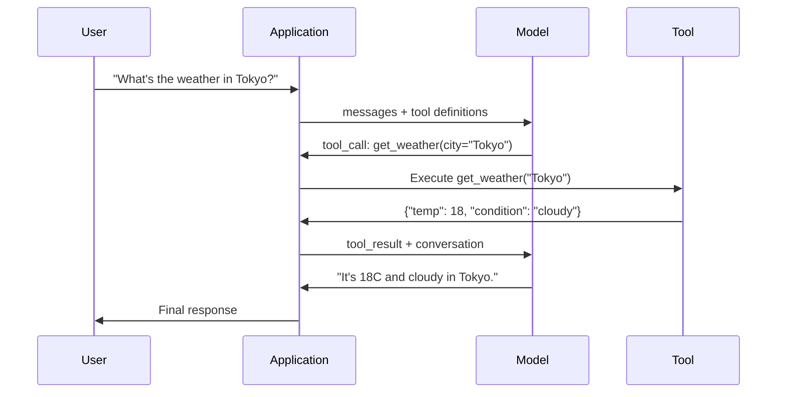

# Pemanggilan Fungsi & Penggunaan Alat

> LLM tidak bisa berbuat apa-apa. Mereka menghasilkan teks. Itu adalah keseluruhan kemampuan. Mereka tidak dapat memeriksa cuaca, menanyakan database, mengirim email, menjalankan kode, atau membaca file. Setiap "agen AI" yang pernah kamu lihat adalahLLMmenghasilkanJSONyang menyatakan fungsi mana yang harus dipanggil -- dan kemudian kode kamu benar-benar memanggilnya. Modelnya adalah otak. Alat adalah tangan. Pemanggil fungsi adalah sistem saraf yang menghubungkannya.

**Type:** Build
**Languages:** Python
**Prerequisites:** Phase 11 Lesson 03 (Structured Outputs)
**Time:** ~75 minutes
**Terkait:** Fase 11 · 14 (Protokol Konteks Model) — ketika alat dibagikan ke seluruh host, beralih dari pemanggilan fungsi sebaris keMCPserver. Pelajaran ini mencakup kasus inline;MCPmencakup kasus protokol.

## Tujuan Pembelajaran

- Terapkan loop pemanggilan fungsi: tentukan skema alat, parsing pemanggilan alat modelJSON, menjalankan fungsi, dan mengembalikan hasil
- Rancang skema alat dengan deskripsi yang jelas dan parameter yang diketik sehingga model dapat dipanggil dengan andal
- Bangun loop agen multi-putaran yang merangkai beberapa panggilan fungsi untuk menjawab pertanyaan kompleks
- Menangani kasus tepi pemanggilan fungsi: pemanggilan pahat paralel, propagasi kesalahan, dan mencegah perulangan pahat tanpa batas

## Masalahnya

kamu membuat chatbot. Seorang pengguna bertanya: "Bagaimana cuaca di Tokyo saat ini?"

Model tersebut menjawab: "Saya tidak memiliki akses ke data cuaca real-time, namun berdasarkan musim, suhu di Tokyo kemungkinan berkisar 15 derajat Celsius..."

Itu adalah halusinasi yang disclaimer. Modelnya tidak mengetahui cuaca. Itu tidak akan pernah terjadi. Cuaca berubah setiap jam. Data pelatihan model berumur beberapa bulan.

Jawaban yang benar memerlukan pemanggilan OpenWeatherMapAPI, mendapatkan suhu saat ini, dan mengembalikan bilangan sebenarnya. Model tidak dapat memanggil API. Kode kamu bisa. Bagian yang hilang: protokol terstruktur yang memungkinkan model mengatakan "Saya perlu mengetahui cuacaAPIdengan argumen ini" dan biarkan kode kamu mengeksekusinya dan memberikan hasilnya kembali.

Ini adalah pemanggilan fungsi. Keluaran model terstrukturJSONmenjelaskan fungsi mana yang akan dipanggil dengan argumen apa. Aplikasi kamu menjalankan fungsinya. Hasilnya kembali ke percakapan. Model menggunakan hasilnya untuk menghasilkan jawaban akhirnya.

Tanpa pemanggilan fungsi, LLM adalah ensiklopedia. Dengan itu, mereka menjadi agen.

## Konsepnya

### Loop Pemanggilan Fungsi

Setiap interaksi penggunaan alat mengikuti putaran 5 langkah yang sama.



Langkah 1: pengguna mengirim pesan. Langkah 2: model menerima pesan beserta definisi alat (JSONSkema yang menjelaskan fungsi yang tersedia). Langkah 3: alih-alih merespons dengan teks, model mengeluarkan panggilan alat -- panggilan terstrukturJSONobjek dengan nama fungsi dan argumen. Langkah 4: kode kamu menjalankan fungsi dan menangkap hasilnya. Langkah 5: hasilnya kembali ke model, yang kini memiliki data nyata untuk menghasilkan jawaban akhirnya.

Model tidak pernah mengeksekusi apa pun. Ia hanya memutuskan apa yang harus dipanggil dan dengan argumen apa. Kode kamu adalah pelaksananya.

### Definisi Alat: TheJSONKontrak Skema

Setiap alat ditentukan oleh aJSONSkema yang memberi tahu model tentang fungsi yang dilakukan, argumen apa yang dibutuhkan, dan tipe argumen apa yang harus digunakan.

```json
{
  "type": "function",
  "function": {
    "name": "get_weather",
    "description": "Get current weather for a city. Returns temperature in Celsius and conditions.",
    "parameters": {
      "type": "object",
      "properties": {
        "city": {
          "type": "string",
          "description": "City name, e.g. 'Tokyo' or 'San Francisco'"
        },
        "units": {
          "type": "string",
          "enum": ["celsius", "fahrenheit"],
          "description": "Temperature units"
        }
      },
      "required": ["city"]
    }
  }
}
```

Itu`description`bidang sangat penting. Model membacanya untuk memutuskan kapan dan bagaimana menggunakan alat tersebut. Deskripsi yang tidak jelas seperti "mendapatkan cuaca" menghasilkan pemilihan alat yang lebih buruk daripada "Mendapatkan cuaca terkini untuk suatu kota. Mengembalikan suhu dalam Celsius dan kondisinya." Deskripsinya adalah petunjuk untuk pemilihan alat.

### Perbandingan Penyedia

Setiap penyedia besar mendukung pemanggilan fungsi, tetapiAPIpermukaannya berbeda.

| Provider | API Parameter | Tool Call Format | Parallel Calls | Forced Calling |
|----------|--------------|-----------------|---------------|----------------|
| OpenAI (GPT-5, o4) | `tools` | `tool_calls[].function` | Yes (multiple per turn) | `tool_choice="required"` |
| Anthropic (Claude 4.6/4.7) | `tools` | `content[].type="tool_use"` | Yes (multiple blocks) | `tool_choice={"type":"any"}` |
| Google (Gemini 3) | `function_declarations` | `functionCall` | Yes | `function_calling_config` |
| Open-weight (Llama 4, Qwen3, DeepSeek-V3) | Native `tools` on Llama 4; Hermes or ChatML on others | Mixed | Model-dependent | Prompt-based or `tool_choice` if supported |

Pada tahun 2026, ketiga penyedia layanan tertutup tersebut telah berkumpul dan hampir identikJSON-Format berbasis skema. Llama 4 dikirim dengan penduduk asli`tools`bidang yang cocok dengan bentuk OpenAI. Penyempurnaan bobot terbuka masih bervariasi — format Hermes (NousResearch) adalah yang paling umum untuk penyempurnaan pihak ketiga. Untuk alat bersama di seluruh host, lebih disukaiMCP(Fase 11 · 14) melalui pemanggilan fungsi inline — servernya sama untuk semuanya.

### Pilihan Alat: Otomatis, Wajib, Spesifik

kamu mengontrol kapan model menggunakan alat.

**Otomatis** (default): model memutuskan apakah akan memanggil alat atau merespons secara langsung. "Apa itu 2+2?" -- merespons secara langsung. "Bagaimana cuacanya?" -- memanggil alat tersebut.

**Wajib**: model harus memanggil setidaknya satu alat. Gunakan ini ketika kamu mengetahui maksud pengguna memerlukan alat. Mencegah model menebak-nebak alih-alih mencari data sebenarnya.

**Fungsi spesifik**: memaksa model memanggil fungsi tertentu.`tool_choice={"type":"function", "function": {"name": "get_weather"}}`menjamin alat cuaca dipanggil, apa pun permintaannya. Gunakan ini untuk perutean -- ketika logika upstream sudah menentukan alat mana yang diperlukan.

### Pemanggilan Fungsi Paralel

GPT-4o dan Claude dapat memanggil banyak fungsi dalam satu giliran. Seorang pengguna bertanya: "Bagaimana cuaca di Tokyo dan New York?" Model ini mengeluarkan dua panggilan alat secara bersamaan:

```json
[
  {"name": "get_weather", "arguments": {"city": "Tokyo"}},
  {"name": "get_weather", "arguments": {"city": "New York"}}
]
```

Kode kamu mengeksekusi keduanya (idealnya secara bersamaan), mengembalikan kedua hasil, dan model mensintesis satu respons. Hal ini memotong perjalanan bolak-balik dari 2 menjadi 1. Untuk agen dengan 5-10 panggilan alat per kueri, panggilan paralel mengurangi latensi sebesar 60-80%.

### Output Terstruktur vs Pemanggilan Fungsi

Pelajaran 03 mencakup keluaran terstruktur. Pemanggilan fungsi menggunakan hal yang samaJSONMesin skema, tetapi untuk tujuan yang berbeda.

**Output terstruktur**: memaksa model untuk menghasilkan data dalam bentuk tertentu. Outputnya adalah produk akhir. Contoh: ekstrak info produk dari teks sebagai`{name, price, in_stock}`.

**Pemanggilan fungsi**: model mendeklarasikan niat untuk menjalankan suatu tindakan. Outputnya adalah langkah perantara. Contoh:`get_weather(city="Tokyo")`-- model meminta suatu tindakan, bukan menghasilkan jawaban akhir.

Gunakan keluaran terstruktur saat kamu ingin ekstraksi data. Gunakan pemanggilan fungsi saat kamu ingin model berinteraksi dengan sistem eksternal.

### Keamanan: Aturan yang Tidak Dapat Dinegosiasikan

Pemanggilan fungsi adalah kemampuan paling berbahaya yang dapat kamu berikanLLM. Model memilih apa yang akan dieksekusi. Jika rangkaian alat kamu menyertakan kueri database, model akan membuat kueri tersebut. Jika itu mencakup perintah shell, model akan menulisnya.

**Aturan 1: Jangan pernah melewatkan model yang dihasilkanSQLlangsung ke database.** Model dapat dan akan dihasilkanDROP TABLE,UNIONsuntikan, atau kueri yang mengembalikan setiap baris. Selalu membuat parameter. Selalu validasi. Selalu gunakan daftar operasi yang diizinkan.

**Aturan 2: Daftarkan fungsi yang diizinkan.** Model hanya dapat memanggil fungsi yang kamu tetapkan secara eksplisit. Jangan pernah membuat alat umum "jalankan fungsi apa pun berdasarkan nama". Jika kamu memiliki 50 fungsi internal, tampilkan hanya 5 fungsi yang dibutuhkan pengguna.

**Aturan 3: Validasi argumen.** Model mungkin meneruskan nama kota`"; DROP TABLE users; --"`. Validasi setiap argumen terhadap tipe, rentang, dan format yang diharapkan sebelum dieksekusi.

**Aturan 4: Sanitasi hasil alat.** Jika alat mengembalikan data sensitif (APIkunci,PII, kesalahan internal), filter sebelum mengirimkannya kembali ke model. Model ini akan menyertakan hasil alat dalam tanggapannya kata demi kata.

**Aturan 5: Pemanggilan alat dengan batas kecepatan.** Model dalam satu loop dapat memanggil alat ratusan kali. Tetapkan jumlah maksimum (10-20 panggilan per percakapan masuk akal). Hancurkan loop tak terbatas.

### Penanganan Kesalahan

Alat gagal. Waktu tunggu API habis. Basis data turun. File tidak ada. Model perlu mengetahui kapan suatu alat gagal dan alasannya.

Kembalikan kesalahan sebagai hasil alat terstruktur, bukan pengecualian:

```json
{
  "error": true,
  "message": "City 'Toky' not found. Did you mean 'Tokyo'?",
  "code": "CITY_NOT_FOUND"
}
```

Model membaca ini, menyesuaikan argumennya, dan mencoba lagi. Model pandai mengoreksi diri dari pesan kesalahan terstruktur. Mereka buruk dalam memulihkan tanggapan kosong atau kesalahan umum "ada yang tidak beres".

### MCP: Protokol Konteks Model

MCPadalah standar terbuka Anthropic untuk interoperabilitas alat. Daripada setiap aplikasi mendefinisikan alatnya sendiri,MCPmenyediakan protokol universal: alat dilayani olehMCPserver, dikonsumsi olehMCPklien (seperti Claude Code, Cursor, atau aplikasi kamu).

SatuMCPserver dapat mengekspos alat ke klien mana pun yang kompatibel. Sebuah PostgresMCPserver memberikan apa punMCP-akses database agen yang kompatibel. Sebuah GitHubMCPserver memberikan akses repositori agen apa pun. Alat-alat tersebut ditentukan sekali, digunakan di mana saja.

MCPadalah berfungsi memanggil apaHTTPadalah untuk berjejaring. Ini menstandarkan lapisan transport sehingga alat menjadi portabel.

```figure
mx-tool-call-loop
```

## Bangun Sendiri

### Langkah 1: Tentukan Registri Alat

Bangun registri yang menyimpan definisi alat dan implementasinya. Setiap alat mempunyai aJSONDefinisi skema (apa yang dilihat model) dan fungsi Python (apa yang dijalankan kode kamu).

```python
import ast
import json
import math
import time
import hashlib


TOOL_REGISTRY = {}


def register_tool(name, description, parameters, function):
    TOOL_REGISTRY[name] = {
        "definition": {
            "type": "function",
            "function": {
                "name": name,
                "description": description,
                "parameters": parameters,
            },
        },
        "function": function,
    }
```

### Langkah 2: Menerapkan 5 Alat

Buat kalkulator, pencarian cuaca, simulator pencarian web, pembaca file, dan pelari kode.

```python
def calculator(expression, precision=2):
    allowed = set("0123456789+-*/.() ")
    if not all(c in allowed for c in expression):
        return {"error": True, "message": f"Invalid characters in expression: {expression}"}
    try:
        result = eval(expression, {"__builtins__": {}}, {"math": math})
        return {"result": round(float(result), precision), "expression": expression}
    except Exception as e:
        return {"error": True, "message": str(e)}


WEATHER_DB = {
    "tokyo": {"temp_c": 18, "condition": "cloudy", "humidity": 72, "wind_kph": 14},
    "new york": {"temp_c": 22, "condition": "sunny", "humidity": 45, "wind_kph": 8},
    "london": {"temp_c": 12, "condition": "rainy", "humidity": 88, "wind_kph": 22},
    "san francisco": {"temp_c": 16, "condition": "foggy", "humidity": 80, "wind_kph": 18},
    "sydney": {"temp_c": 25, "condition": "sunny", "humidity": 55, "wind_kph": 10},
}


def get_weather(city, units="celsius"):
    key = city.lower().strip()
    if key not in WEATHER_DB:
        suggestions = [c for c in WEATHER_DB if c.startswith(key[:3])]
        return {
            "error": True,
            "message": f"City '{city}' not found.",
            "suggestions": suggestions,
            "code": "CITY_NOT_FOUND",
        }
    data = WEATHER_DB[key].copy()
    if units == "fahrenheit":
        data["temp_f"] = round(data["temp_c"] * 9 / 5 + 32, 1)
        del data["temp_c"]
    data["city"] = city
    return data


SEARCH_DB = {
    "python function calling": [
        {"title": "OpenAI Function Calling Guide", "url": "https://platform.openai.com/docs/guides/function-calling", "snippet": "Learn how to connect LLMs to external tools."},
        {"title": "Anthropic Tool Use", "url": "https://docs.anthropic.com/en/docs/tool-use", "snippet": "Claude can interact with external tools and APIs."},
    ],
    "MCP protocol": [
        {"title": "Model Context Protocol", "url": "https://modelcontextprotocol.io", "snippet": "An open standard for connecting AI models to data sources."},
    ],
    "weather API": [
        {"title": "OpenWeatherMap API", "url": "https://openweathermap.org/api", "snippet": "Free weather API with current, forecast, and historical data."},
    ],
}


def web_search(query, max_results=3):
    key = query.lower().strip()
    for db_key, results in SEARCH_DB.items():
        if db_key in key or key in db_key:
            return {"query": query, "results": results[:max_results], "total": len(results)}
    return {"query": query, "results": [], "total": 0}


FILE_SYSTEM = {
    "data/config.json": '{"model": "gpt-4o", "temperature": 0.7, "max_tokens": 4096}',
    "data/users.csv": "name,email,role\nAlice,alice@example.com,admin\nBob,bob@example.com,user",
    "README.md": "# My Project\nA tool-use agent built from scratch.",
}


def read_file(path):
    if ".." in path or path.startswith("/"):
        return {"error": True, "message": "Path traversal not allowed.", "code": "FORBIDDEN"}
    if path not in FILE_SYSTEM:
        available = list(FILE_SYSTEM.keys())
        return {"error": True, "message": f"File '{path}' not found.", "available_files": available, "code": "NOT_FOUND"}
    content = FILE_SYSTEM[path]
    return {"path": path, "content": content, "size_bytes": len(content), "lines": content.count("\n") + 1}


def run_code(code, language="python"):
    if language != "python":
        return {"error": True, "message": f"Language '{language}' not supported. Only 'python' is available."}
    try:
        tree = ast.parse(code)
    except SyntaxError as e:
        return {"error": True, "message": f"SyntaxError: {e}", "code": "SYNTAX_ERROR"}
    unsafe_names = {"exec", "eval", "compile", "__import__", "open", "globals", "locals", "vars", "getattr", "setattr", "delattr"}
    for node in ast.walk(tree):
        if isinstance(node, (ast.Import, ast.ImportFrom)):
            return {"error": True, "message": "Forbidden operation: import is not allowed", "code": "SECURITY_VIOLATION"}
        if isinstance(node, ast.Attribute) and node.attr.startswith("__") and node.attr.endswith("__"):
            return {"error": True, "message": "Forbidden operation: dunder attribute access is not allowed", "code": "SECURITY_VIOLATION"}
        if isinstance(node, ast.Name) and node.id in unsafe_names:
            return {"error": True, "message": f"Forbidden operation: {node.id} is not allowed", "code": "SECURITY_VIOLATION"}
    try:
        local_vars = {}
        exec(code, {"__builtins__": {"print": print, "range": range, "len": len, "str": str, "int": int, "float": float, "list": list, "dict": dict, "sum": sum, "min": min, "max": max, "abs": abs, "round": round, "sorted": sorted, "enumerate": enumerate, "zip": zip, "map": map, "filter": filter, "math": math}}, local_vars)
        result = local_vars.get("result", None)
        return {"success": True, "result": result, "variables": {k: str(v) for k, v in local_vars.items() if not k.startswith("_")}}
    except Exception as e:
        return {"error": True, "message": f"{type(e).__name__}: {e}"}
```

Daftar blokir substring membaca kode sebagai teks, sehingga melewatkan apa pun yang tidak dieja secara harfiah oleh pencocokan string. Mengurai kode ke dalam pohon sintaksis dan menjalankannya memungkinkan penjaga menolak`import`pernyataan, akses atribut dunder (the`__class__`dan`__globals__`rantai yang menjangkau kembali ke penerjemah sebenarnya), dan nama bawaan yang tidak aman berdasarkan struktur, bukan ejaan. Meski begitu, perlakukan ini sebagai filter pengajaran, bukan batasan nyata. Setiap penjaga yang sedang dalam proses membagikan penerjemah dengan kode yang dijalankannya, dan penelepon yang gigih masih dapat menemukan objek yang dapat dijangkau. Sistem produksi menjalankan kode yang tidak tepercaya dalam proses atau wadah terpisah (subproses dengan hak istimewa yang dihilangkan, gVisor, Firecracker, atau pelari kode yang dihosting), yang mana pelarian akan menempatkan penyerang di kotak sekali pakai, bukan di layanan kamu.

### Langkah 3: Daftarkan Semua Alat

```python
def register_all_tools():
    register_tool(
        "calculator", "Evaluate a mathematical expression. Supports +, -, *, /, parentheses, and decimals. Returns the numeric result.",
        {"type": "object", "properties": {"expression": {"type": "string", "description": "Math expression, e.g. '(10 + 5) * 3'"}, "precision": {"type": "integer", "description": "Decimal places in result", "default": 2}}, "required": ["expression"]},
        calculator,
    )
    register_tool(
        "get_weather", "Get current weather for a city. Returns temperature, condition, humidity, and wind speed.",
        {"type": "object", "properties": {"city": {"type": "string", "description": "City name, e.g. 'Tokyo' or 'San Francisco'"}, "units": {"type": "string", "enum": ["celsius", "fahrenheit"], "description": "Temperature units, defaults to celsius"}}, "required": ["city"]},
        get_weather,
    )
    register_tool(
        "web_search", "Search the web for information. Returns a list of results with title, URL, and snippet.",
        {"type": "object", "properties": {"query": {"type": "string", "description": "Search query"}, "max_results": {"type": "integer", "description": "Maximum results to return", "default": 3}}, "required": ["query"]},
        web_search,
    )
    register_tool(
        "read_file", "Read the contents of a file. Returns the file content, size, and line count.",
        {"type": "object", "properties": {"path": {"type": "string", "description": "Relative file path, e.g. 'data/config.json'"}}, "required": ["path"]},
        read_file,
    )
    register_tool(
        "run_code", "Run a small Python snippet behind a static-analysis guard and a restricted interpreter. This is a teaching filter, not real isolation. Set a 'result' variable to return output.",
        {"type": "object", "properties": {"code": {"type": "string", "description": "Python code to execute"}, "language": {"type": "string", "enum": ["python"], "description": "Programming language"}}, "required": ["code"]},
        run_code,
    )
```

### Langkah 4: Bangun Loop Pemanggilan Fungsi

Ini adalah mesin inti. Ini mensimulasikan model yang memutuskan alat mana yang akan dipanggil, mengeksekusi alat tersebut, dan memberikan hasil kembali.

```python
def simulate_model_decision(user_message, tools, conversation_history):
    msg = user_message.lower()

    if any(word in msg for word in ["weather", "temperature", "forecast"]):
        cities = []
        for city in WEATHER_DB:
            if city in msg:
                cities.append(city)
        if not cities:
            for word in msg.split():
                if word.capitalize() in [c.title() for c in WEATHER_DB]:
                    cities.append(word)
        if not cities:
            cities = ["tokyo"]
        calls = []
        for city in cities:
            calls.append({"name": "get_weather", "arguments": {"city": city.title()}})
        return calls

    if any(word in msg for word in ["calculate", "compute", "math", "what is", "how much"]):
        for token in msg.split():
            if any(c in token for c in "+-*/"):
                return [{"name": "calculator", "arguments": {"expression": token}}]
        if "+" in msg or "-" in msg or "*" in msg or "/" in msg:
            expr = "".join(c for c in msg if c in "0123456789+-*/.() ")
            if expr.strip():
                return [{"name": "calculator", "arguments": {"expression": expr.strip()}}]
        return [{"name": "calculator", "arguments": {"expression": "0"}}]

    if any(word in msg for word in ["search", "find", "look up", "google"]):
        query = msg.replace("search for", "").replace("look up", "").replace("find", "").strip()
        return [{"name": "web_search", "arguments": {"query": query}}]

    if any(word in msg for word in ["read", "file", "open", "cat", "show"]):
        for path in FILE_SYSTEM:
            if path.split("/")[-1].split(".")[0] in msg:
                return [{"name": "read_file", "arguments": {"path": path}}]
        return [{"name": "read_file", "arguments": {"path": "README.md"}}]

    if any(word in msg for word in ["run", "execute", "code", "python"]):
        return [{"name": "run_code", "arguments": {"code": "result = 'Hello from the sandbox!'", "language": "python"}}]

    return []


def execute_tool_call(tool_call):
    name = tool_call["name"]
    args = tool_call["arguments"]

    if name not in TOOL_REGISTRY:
        return {"error": True, "message": f"Unknown tool: {name}", "code": "UNKNOWN_TOOL"}

    tool = TOOL_REGISTRY[name]
    func = tool["function"]
    start = time.time()

    try:
        result = func(**args)
    except TypeError as e:
        result = {"error": True, "message": f"Invalid arguments: {e}"}

    elapsed_ms = round((time.time() - start) * 1000, 2)
    return {"tool": name, "result": result, "execution_time_ms": elapsed_ms}


def run_function_calling_loop(user_message, max_iterations=5):
    conversation = [{"role": "user", "content": user_message}]
    tool_definitions = [t["definition"] for t in TOOL_REGISTRY.values()]
    all_tool_results = []

    for iteration in range(max_iterations):
        tool_calls = simulate_model_decision(user_message, tool_definitions, conversation)

        if not tool_calls:
            break

        results = []
        for call in tool_calls:
            result = execute_tool_call(call)
            results.append(result)

        conversation.append({"role": "assistant", "content": None, "tool_calls": tool_calls})

        for result in results:
            conversation.append({"role": "tool", "content": json.dumps(result["result"]), "tool_name": result["tool"]})

        all_tool_results.extend(results)
        break

    return {"conversation": conversation, "tool_results": all_tool_results, "iterations": iteration + 1 if tool_calls else 0}
```

### Langkah 5: Validasi Argumen

Bangun validator yang memeriksa argumen pemanggilan alat terhadapJSONSkema sebelum eksekusi.

```python
def validate_tool_arguments(tool_name, arguments):
    if tool_name not in TOOL_REGISTRY:
        return [f"Unknown tool: {tool_name}"]

    schema = TOOL_REGISTRY[tool_name]["definition"]["function"]["parameters"]
    errors = []

    if not isinstance(arguments, dict):
        return [f"Arguments must be an object, got {type(arguments).__name__}"]

    for required_field in schema.get("required", []):
        if required_field not in arguments:
            errors.append(f"Missing required argument: {required_field}")

    properties = schema.get("properties", {})
    for arg_name, arg_value in arguments.items():
        if arg_name not in properties:
            errors.append(f"Unknown argument: {arg_name}")
            continue

        prop_schema = properties[arg_name]
        expected_type = prop_schema.get("type")

        type_checks = {"string": str, "integer": int, "number": (int, float), "boolean": bool, "array": list, "object": dict}
        if expected_type in type_checks:
            if not isinstance(arg_value, type_checks[expected_type]):
                errors.append(f"Argument '{arg_name}': expected {expected_type}, got {type(arg_value).__name__}")

        if "enum" in prop_schema and arg_value not in prop_schema["enum"]:
            errors.append(f"Argument '{arg_name}': '{arg_value}' not in {prop_schema['enum']}")

    return errors
```

### Langkah 6: Jalankan Demonya

```python
def run_demo():
    register_all_tools()

    print("=" * 60)
    print("  Function Calling & Tool Use Demo")
    print("=" * 60)

    print("\n--- Registered Tools ---")
    for name, tool in TOOL_REGISTRY.items():
        desc = tool["definition"]["function"]["description"][:60]
        params = list(tool["definition"]["function"]["parameters"].get("properties", {}).keys())
        print(f"  {name}: {desc}...")
        print(f"    params: {params}")

    print(f"\n--- Argument Validation ---")
    validation_tests = [
        ("get_weather", {"city": "Tokyo"}, "Valid call"),
        ("get_weather", {}, "Missing required arg"),
        ("get_weather", {"city": "Tokyo", "units": "kelvin"}, "Invalid enum value"),
        ("calculator", {"expression": 123}, "Wrong type (int for string)"),
        ("unknown_tool", {"x": 1}, "Unknown tool"),
    ]
    for tool_name, args, label in validation_tests:
        errors = validate_tool_arguments(tool_name, args)
        status = "VALID" if not errors else f"ERRORS: {errors}"
        print(f"  {label}: {status}")

    print(f"\n--- Tool Execution ---")
    direct_tests = [
        {"name": "calculator", "arguments": {"expression": "(10 + 5) * 3 / 2"}},
        {"name": "get_weather", "arguments": {"city": "Tokyo"}},
        {"name": "get_weather", "arguments": {"city": "Mars"}},
        {"name": "web_search", "arguments": {"query": "python function calling"}},
        {"name": "read_file", "arguments": {"path": "data/config.json"}},
        {"name": "read_file", "arguments": {"path": "../etc/passwd"}},
        {"name": "run_code", "arguments": {"code": "result = sum(range(1, 101))"}},
        {"name": "run_code", "arguments": {"code": "import os; os.system('rm -rf /')"}},
    ]
    for call in direct_tests:
        result = execute_tool_call(call)
        print(f"\n  {call['name']}({json.dumps(call['arguments'])})")
        print(f"    -> {json.dumps(result['result'], indent=None)[:100]}")
        print(f"    time: {result['execution_time_ms']}ms")

    print(f"\n--- Full Function Calling Loop ---")
    test_queries = [
        "What's the weather in Tokyo?",
        "Calculate (100 + 250) * 0.15",
        "Search for MCP protocol",
        "Read the config file",
        "Run some Python code",
        "Tell me a joke",
    ]
    for query in test_queries:
        print(f"\n  User: {query}")
        result = run_function_calling_loop(query)
        if result["tool_results"]:
            for tr in result["tool_results"]:
                print(f"    Tool: {tr['tool']} ({tr['execution_time_ms']}ms)")
                print(f"    Result: {json.dumps(tr['result'], indent=None)[:90]}")
        else:
            print(f"    [No tool called -- direct response]")
        print(f"    Iterations: {result['iterations']}")

    print(f"\n--- Parallel Tool Calls ---")
    multi_city_query = "What's the weather in tokyo and london?"
    print(f"  User: {multi_city_query}")
    result = run_function_calling_loop(multi_city_query)
    print(f"  Tool calls made: {len(result['tool_results'])}")
    for tr in result["tool_results"]:
        city = tr["result"].get("city", "unknown")
        temp = tr["result"].get("temp_c", "N/A")
        print(f"    {city}: {temp}C, {tr['result'].get('condition', 'N/A')}")

    print(f"\n--- Security Checks ---")
    security_tests = [
        ("read_file", {"path": "../../etc/passwd"}),
        ("run_code", {"code": "import subprocess; subprocess.run(['ls'])"}),
        ("calculator", {"expression": "__import__('os').system('ls')"}),
    ]
    for tool_name, args in security_tests:
        result = execute_tool_call({"name": tool_name, "arguments": args})
        blocked = result["result"].get("error", False)
        print(f"  {tool_name}({list(args.values())[0][:40]}): {'BLOCKED' if blocked else 'ALLOWED'}")
```

## Gunakan

### Panggilan Fungsi OpenAI

```python
# from openai import OpenAI
#
# client = OpenAI()
#
# tools = [{
#     "type": "function",
#     "function": {
#         "name": "get_weather",
#         "description": "Get current weather for a city",
#         "parameters": {
#             "type": "object",
#             "properties": {
#                 "city": {"type": "string"},
#                 "units": {"type": "string", "enum": ["celsius", "fahrenheit"]}
#             },
#             "required": ["city"]
#         }
#     }
# }]
#
# response = client.chat.completions.create(
#     model="gpt-4o",
#     messages=[{"role": "user", "content": "Weather in Tokyo?"}],
#     tools=tools,
#     tool_choice="auto",
# )
#
# tool_call = response.choices[0].message.tool_calls[0]
# args = json.loads(tool_call.function.arguments)
# result = get_weather(**args)
#
# final = client.chat.completions.create(
#     model="gpt-4o",
#     messages=[
#         {"role": "user", "content": "Weather in Tokyo?"},
#         response.choices[0].message,
#         {"role": "tool", "tool_call_id": tool_call.id, "content": json.dumps(result)},
#     ],
# )
# print(final.choices[0].message.content)
```

OpenAI mengembalikan panggilan alat sebagai`response.choices[0].message.tool_calls`. Setiap panggilan memiliki`id`kamu harus menyertakannya saat mengembalikan hasilnya. Model menggunakan ID ini untuk mencocokkan hasil dengan panggilan.GPT-4o dapat mengembalikan beberapa panggilan alat dalam satu respons -- ulangi dan jalankan semuanya.

### Penggunaan Alat Antropik

```python
# import anthropic
#
# client = anthropic.Anthropic()
#
# response = client.messages.create(
#     model="claude-sonnet-5",
#     max_tokens=1024,
#     tools=[{
#         "name": "get_weather",
#         "description": "Get current weather for a city",
#         "input_schema": {
#             "type": "object",
#             "properties": {
#                 "city": {"type": "string"},
#                 "units": {"type": "string", "enum": ["celsius", "fahrenheit"]}
#             },
#             "required": ["city"]
#         }
#     }],
#     messages=[{"role": "user", "content": "Weather in Tokyo?"}],
# )
#
# tool_block = next(b for b in response.content if b.type == "tool_use")
# result = get_weather(**tool_block.input)
#
# final = client.messages.create(
#     model="claude-sonnet-5",
#     max_tokens=1024,
#     tools=[...],
#     messages=[
#         {"role": "user", "content": "Weather in Tokyo?"},
#         {"role": "assistant", "content": response.content},
#         {"role": "user", "content": [{"type": "tool_result", "tool_use_id": tool_block.id, "content": json.dumps(result)}]},
#     ],
# )
```

Panggilan alat pengembalian antropik sebagai blok konten`type: "tool_use"`. Hasil alat masuk ke pesan pengguna`type: "tool_result"`. Perhatikan perbedaan utamanya: Penggunaan antropis`input_schema`untuk definisi parameter alat, sementara OpenAI menggunakan`parameters`.

### MCPIntegrasi

```python
# MCP servers expose tools over a standardized protocol.
# Any MCP-compatible client can discover and call these tools.
#
# Example: connecting to a Postgres MCP server
#
# from mcp import ClientSession, StdioServerParameters
# from mcp.client.stdio import stdio_client
#
# server_params = StdioServerParameters(
#     command="npx",
#     args=["-y", "@modelcontextprotocol/server-postgres", "postgresql://localhost/mydb"],
# )
#
# async with stdio_client(server_params) as (read, write):
#     async with ClientSession(read, write) as session:
#         await session.initialize()
#         tools = await session.list_tools()
#         result = await session.call_tool("query", {"sql": "SELECT count(*) FROM users"})
```

MCPmemisahkan implementasi alat dari konsumsi alat. Server Postgres tahuSQL. Server GitHub mengetahui hal tersebutAPI. Agen kamu hanya menemukan dan memanggil alat -- tidak memerlukan kode khusus penyedia untuk setiap integrasi.

## Rilis

Pelajaran ini menghasilkan`outputs/prompt-tool-designer.md`-- templat cepat yang dapat digunakan kembali untuk merancang definisi alat. Berikan deskripsi tentang apa yang kamu ingin alat lakukan, dan alat tersebut akan menghasilkan yang lengkapJSONDefinisi skema dengan deskripsi, tipe, dan batasan.

Itu juga menghasilkan`outputs/skill-function-calling-patterns.md`-- kerangka keputusan untuk mengimplementasikan pemanggilan fungsi dalam produksi, yang mencakup desain alat, penanganan kesalahan, keamanan, dan pola khusus penyedia.

## Latihan

1. **Tambahkan alat ke-6: kueri basis data.** Mengimplementasikan simulasiSQLalat dengan tabel dalam memori. Alat ini menerima nama tabel dan kondisi filter (tidak mentahSQL). Validasi apakah nama tabel ada dalam daftar yang diizinkan dan operator filter dibatasi`=`,`>`,`<`,`>=`,`<=`. Kembalikan baris yang cocok sebagaiJSON.

2. **Terapkan percobaan ulang dengan umpan balik kesalahan.** Saat pemanggilan alat gagal (misalnya, kota tidak ditemukan), masukkan pesan kesalahan kembali ke fungsi keputusan model dan biarkan fungsi tersebut mengoreksi argumennya. Lacak berapa banyak percobaan ulang yang dilakukan setiap panggilan. Tetapkan maksimal 3 percobaan ulang per panggilan alat.

3. **Bangun agen multi-langkah.** Beberapa kueri memerlukan panggilan alat rangkaian: "Baca file konfigurasi dan beri tahu saya model apa yang dikonfigurasi, lalu telusuri web untuk mengetahui harga model tersebut." Terapkan perulangan yang berjalan hingga model memutuskan tidak diperlukan lagi alat, dan meneruskan hasil akumulasi ke dalam setiap langkah pengambilan keputusan. Batasi hingga 10 iterasi untuk mencegah loop tak terbatas.

4. **Ukur keakuratan pemilihan alat.** Buat 30 kueri pengujian dengan nama alat yang diharapkan. Jalankan fungsi keputusan kamu pada semua 30 dan ukur berapa persentase waktu yang digunakan untuk memilih alat yang tepat. Identifikasi kueri mana yang paling menyebabkan kebingungan antar alat.

5. **Menerapkan cache panggilan alat.** Jika alat yang sama dipanggil dengan argumen yang sama dalam waktu 60 detik, kembalikan hasil cache alih-alih mengeksekusinya kembali. Gunakan kamus yang dikunci oleh`(tool_name, frozenset(args.items()))`. Ukur tingkat cache hit di seluruh percakapan dengan 20 kueri.

## Istilah-Istilah Utama

| Term | What people say | What it actually means |
|------|----------------|----------------------|
| Function calling | "Tool use" | The model outputs structured JSON describing a function to invoke with specific arguments -- your code executes it, not the model |
| Tool definition | "Function schema" | A JSON Schema object describing a tool's name, purpose, parameters, and types -- the model reads this to decide when and how to use the tool |
| Tool choice | "Calling mode" | Controls whether the model must call a tool (required), may call a tool (auto), or must call a specific tool (named) |
| Parallel calling | "Multi-tool" | The model outputs multiple tool calls in a single turn, reducing round trips -- GPT-4o and Claude both support this |
| Tool result | "Function output" | The return value from executing a tool, sent back to the model as a message so it can use real data in its response |
| Argument validation | "Input checking" | Verifying that model-generated arguments match the expected types, ranges, and constraints before executing the tool |
| MCP | "Tool protocol" | Model Context Protocol -- Anthropic's open standard for exposing tools via servers that any compatible client can discover and call |
| Agent loop | "ReAct loop" | The iterative cycle of model-decides-tool, code-executes-tool, result-feeds-back until the model has enough information to respond |
| Tool poisoning | "Prompt injection via tools" | An attack where tool results contain instructions that manipulate the model's behavior -- sanitize all tool outputs |
| Rate limiting | "Call budget" | Setting a maximum number of tool calls per conversation to prevent infinite loops and runaway API costs |

## Bacaan Lebih Lanjut

- [Panduan Memanggil Fungsi OpenAI](https://platform.openai.com/docs/guides/function-calling) -- referensi pasti untuk penggunaan alat denganGPT-4o, termasuk panggilan paralel, panggilan paksa, dan argumen terstruktur
- [Panduan Penggunaan Alat Antropik](https://docs.anthropic.com/en/docs/tool-use) - Implementasi penggunaan alat Claude dengan input_schema, respons multi-alat, dan konfigurasi tool_choice
- [Spesifikasi Protokol Konteks Model](https://modelcontextprotocol.io) -- standar terbuka untuk interoperabilitas alat di seluruh aplikasi AI, denganserver/clientarsitektur
- [Schick dkk., 2023 -- "Pembentuk Alat: Model Bahasa Dapat Belajar Sendiri Menggunakan Alat"](https://arxiv.org/abs/2302.04761) -- makalah dasar tentang pelatihan LLM untuk memutuskan kapan dan bagaimana menggunakan alat eksternal
- [Patil dkk., 2023 -- "Gorila: Model Bahasa Besar yang Terhubung dengan API Masif"](https://arxiv.org/abs/2305.15334) -- menyempurnakan LLM agar akuratAPIpanggilan di 1.645 API dengan pengurangan halusinasi
- [Papan Peringkat Panggilan Fungsi Berkeley](https://gorilla.cs.berkeley.edu/leaderboard.html) -- tolok ukur real-time yang membandingkan keakuratan pemanggilan fungsiGPT-4o, Claude, Gemini, dan model terbuka
- [Yao et al., "ReAct: Mensinergikan Penalaran dan Tindakan dalam Model Bahasa" (ICLR2023)](https://arxiv.org/abs/2210.03629) -- perulangan Pemikiran-Tindakan-Pengamatan yang merupakan perulangan agen luar di sekitar setiap pemanggilan alat; di mana pelajaran ini berakhir, Fase 14 dimulai.
- [Antropik — Membangun agen yang efektif (Des 2024)](https://www.anthropic.com/research/building-effective-agents) -- lima pola yang dapat dikomposisi (rangkaian cepat, perutean, paralelisasi, pekerja orkestra, pengoptimal-evaluator) yang dibuat dari primitif penggunaan alat tunggal.
