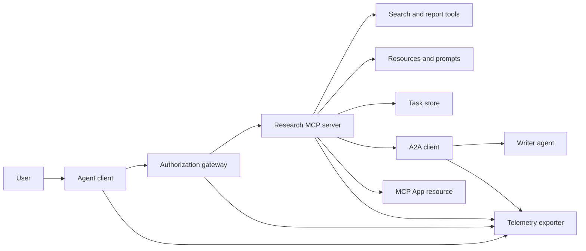
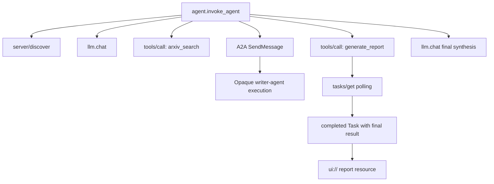
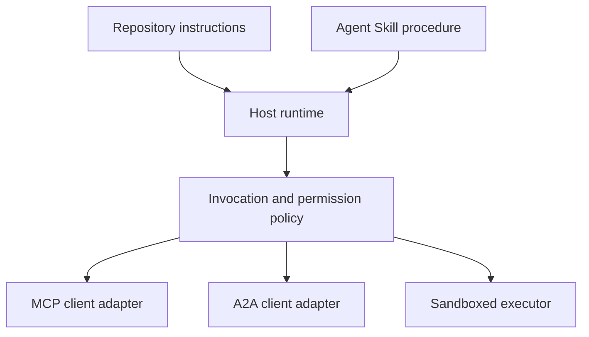

# Capstone: Ekosistem Tool Stateless

> Sebuah sistem agent production adalah himpunan batas, bukan tumpukan fitur. Capstone ini memisahkan simulasi in-process yang terbaca dari klien protokol, server otorisasi, sandbox, dan telemetry exporter yang masih dibutuhkan deployment nyata.

**Type:** Build
**Languages:** Python (stdlib, in-process simulation)
**Prerequisites:** Phase 13 · 01 through 22, using MCP revision `2026-07-28`
**Time:** ~120 minutes

## Tujuan Pembelajaran

- Menyusun panggilan tool, hasil berbentuk-tugas, pekerjaan yang didelegasikan, resource UI, kebijakan otorisasi, dan catatan trace menjadi satu alur.
- Membawa versi protokol, identitas klien, dan kapabilitas pada setiap permintaan MCP alih-alih bergantung pada sesi koneksi.
- Menemukan sebuah server sebelum dipakai dan menjalankan pekerjaan panjang melalui ekstensi Tasks resmi.
- Membedakan simulasi berbentuk-protokol dari implementasi MCP, A2A, OAuth, atau OpenTelemetry.
- Memetakan setiap batas yang disimulasikan ke komponen production yang harus menggantikannya.
- Menjaga `AGENTS.md`, sebuah Agent Skill, adapter runtime, tool, dan kebijakan keamanan pada peran masing-masing.
- Menjelaskan klaim mana yang bisa diverifikasi dari output lokal dan klaim mana yang membutuhkan tes integrasi langsung.

## Masalahnya

Rancang sebuah sistem riset-dan-laporan. Sebuah pengguna meminta makalah tentang protokol agent. Sistem mencari katalog makalah, mendelegasikan perangkuman, menghasilkan laporan, mengembalikan resource UI, dan merekam jalurnya melalui sistem.

Kalimat itu menyembunyikan beberapa kontrak yang independen:

- sebuah skema tool yang menghadap model;
- sebuah envelope permintaan stateless dan kontrak discovery server;
- sebuah keputusan gateway untuk identitas aktor, scope, dan tool;
- sebuah kontrak operasi jangka panjang;
- sebuah protokol delegasi;
- sebuah jembatan host-ke-app;
- propagasi dan ekspor trace;
- sebuah prosedur operasional yang bisa dipakai ulang.

`code/main.py` menjaga batas-batas itu tetap terlihat dengan fungsi Python dan dictionary biasa. Ia tidak membuka transport, menghubungi arXiv, melakukan OAuth, memanggil server A2A, merender MCP App, atau mengekspor telemetri. Ini membuat control flow mudah diperiksa tanpa menyajikan simulasi sebagai layanan yang patuh.

## Konsepnya

### Arsitektur target



Arsitektur ini adalah komposisi konseptual dari pola protokol publik. Ia bukan klaim tentang internal privat produk mana pun.

### Trace target



Pada implementasi nyata, setiap hop mempropagasikan konteks trace. Nama dan atribut span harus mengikuti semantic convention OpenTelemetry yang didukung oleh versi instrumentasi yang dipilih. Pengenal trace yang dibagikan saja tidak membuktikan parentage, ekspor, atau ingestions backend yang benar.

### Permukaan protokol saat ini

Gunakan nama metode yang didefinisikan oleh protokol saat ini, bukan nama yang diingat dari draf lama:

| Boundary | Current surface | What the capstone simulates |
|---|---|---|
| MCP discovery | Mandatory `server/discover` | A direct function returning versions, capabilities, and server identity |
| MCP request context | Version, capabilities, and client identity in every `params._meta` | Fresh request metadata passed to every simulated call |
| MCP tool call | `tools/call` | Direct Python function dispatch |
| MCP task polling | `io.modelcontextprotocol/tasks` with `tasks/get` | A working handle followed by a completed task carrying its final result |
| A2A delegation | `SendMessage` in gRPC and JSON-RPC; `POST /message:send` in HTTP+JSON | One nested span with no remote call or artificial delay |
| MCP App calling a server tool | `app.callServerTool({ name, arguments })` | An HTML string with no live bridge |
| OAuth authorization | Authorization server, protected-resource metadata, audience and scope validation | Static token lookup and scope membership |
| OpenTelemetry | SDK, propagator, exporter, and collector or backend | In-memory span dictionaries |

Nama protokol hanyalah lapisan pertama. Tes production harus menguji serialisasi, kegagalan autentikasi, pembatalan, timeout, retry, dan kompatibilitas versi di atas wire yang sebenarnya.

### MCP stateless mengubah batas integrasi

Revisi `2026-07-28` menghapus sesi protokol dan handshake `initialize` / `notifications/initialized`. Ia juga menghapus `Mcp-Session-Id`. Setiap permintaan membawa field `_meta` bernamespace ini:

```json
{
  "io.modelcontextprotocol/protocolVersion": "2026-07-28",
  "io.modelcontextprotocol/clientCapabilities": {
    "extensions": {
      "io.modelcontextprotocol/tasks": {}
    }
  },
  "io.modelcontextprotocol/clientInfo": {
    "name": "capstone-client",
    "version": "1.0.0"
  }
}
```

Server harus mengimplementasikan `server/discover`. Hasil biasa memakai `resultType: "complete"`; sebuah handle tugas memakai `resultType: "task"`. Setiap hasil seharusnya mengidentifikasi server di `_meta.io.modelcontextprotocol/serverInfo`.

Ekstensi tugas punya `tasks/get`, `tasks/update`, dan `tasks/cancel`. Sebuah tool boleh lebih dulu mengembalikan `resultType: "task"`; `tasks/get` sendiri mengembalikan `resultType: "complete"`, dan `Task` yang selesai memuat hasil akhir. Metode `tasks/result` dan `tasks/list` lama bukan bagian dari ekstensi saat ini. Sebuah klien harus mengiklankan `io.modelcontextprotocol/tasks` di permintaan yang sama yang mungkin menerima handle tugas. Jika tidak, server mengembalikan `-32021` dengan `requiredCapabilities` berbentuk objek kapabilitas-klien yang hilang, termasuk `extensions.io.modelcontextprotocol/tasks`.

### Postur keamanan

Deployment yang dimaksud memakai pertahanan berlapis:

- otorisasi OAuth dengan PKCE di mana tipe klien mensyaratkannya;
- pengikatan sumber daya dan audience untuk access token yang diterbitkan;
- RBAC gateway yang memeriksa tool dan scope yang diminta;
- kredensial hulu yang disimpan di luar konteks yang terlihat model;
- manifes deskripsi tool yang ter-pin atau sudah ditinjau;
- review Rule of Two untuk input tak terpercaya, data sensitif, dan aksi berdampak;
- sebuah sandbox eksekusi yang filesystem, proses, jaringan, kredensial, dan batas sumber dayanya ditegakkan di luar skill.

Demo hanya mengimplementasikan token statis, pemeriksaan scope, dan hash deskripsi. Ia berguna untuk alur kebijakan, bukan untuk validasi keamanan.

### Skill adalah prosedur, bukan transport

Sebuah Agent Skill dapat memberi tahu runtime bagaimana menjalankan alur kerja riset, kontrak tool mana yang diharapkan, bukti apa yang harus disimpan, dan kapan harus berhenti. Ia tidak dapat membuat server MCP ada, menegakkan kompatibilitas A2A, memberikan scope, atau menciptakan sandbox.



Kirim direktori skill yang lengkap ketika prosedurnya mereferensikan file pendamping. Artefak datar di capstone lama ini adalah blueprint kursus, bukan bukti bahwa sebuah host mempertahankan bundle yang portabel. Pelajaran 24 sampai 27 membangun dan menguji seluruh lifecycle bundle.

### Metadata artefak kursus adalah adapter lokal

Katalog dan installer kursus mengenali file datar bernama `skill-*.md`, tetapi itu adalah konvensi repository, bukan kontrak paket Agent Skills yang portabel. Parser frontmatter minimal mereka hanya membaca kunci top-level. Karena itu pelajaran ini menempatkan field identitas portabel dan field katalog kursus di level yang sama:

```yaml
---
name: ecosystem-blueprint
description: Produce a full Phase 13 ecosystem architecture for a product need.
version: "1.0.0"
phase: "13"
lesson: "23"
tags: [mcp, capstone, ecosystem, architecture, a2a, otel]
---
```

`name` dan `description` adalah field identitas portabel. `version`, `phase`, `lesson`, dan `tags` adalah ekstensi katalog spesifik-kursus. Parser kursus mensyaratkan `tags` sebagai list inline sehingga `--tag capstone` bisa mencocokkannya.

Sebuah skill direktori portabel dapat memakai map `metadata` opsional untuk data ekstensi bernilai-string. Itu tidak membuat `metadata` dapat dipertukarkan dengan skema katalog repository ini. Jika file datar ini menyarangkan `version` atau `tags` di bawah `metadata`, parser minimal melewati kunci-kunci berindentasi itu, katalog mencatat versi kosong, dan filter tag tidak dapat menemukan artefaknya. Host production seharusnya memakai parser YAML yang aman dan memvalidasi skema terdokumentasi mereka sendiri.

### Simulasi versus production

| Layer | `code/main.py` | Production replacement | Required evidence |
|---|---|---|---|
| Discovery | `server_discover()` plus static `TOOLS` | `server/discover` followed by cache-aware `tools/list` | Wire transcript, deterministic order, and schema validation |
| Authentication | Token-keyed dictionary | OAuth authorization and resource server validation | Issuer, audience, scope, expiry, and failure tests |
| Authorization | Scope membership | Gateway policy bound to actor, tool, target, and tenant | Allow and deny audit cases |
| Search | Static paper fixtures | Search API or MCP server | Source provenance, ranking, and error tests |
| Tasks | Local handle plus immediate `tasks/get` | Durable `io.modelcontextprotocol/tasks` store with `tasks/get`, `tasks/update`, `tasks/cancel`, and TTL | State-transition, input, cancellation, and recovery tests |
| Delegation | Sleep plus nested span | A2A client and remote Agent Card | Contract, timeout, retry, and opacity tests |
| App | HTML string and URI | MCP Apps resource and `App` bridge | CSP, permissions, tool-call, and browser tests |
| Telemetry | In-memory list | OTel SDK and exporter | Collector receipt and trace-parent assertions |
| Sandbox | None | Host-enforced isolated executor | Escape, egress, secret, and resource-limit tests |

Tabel ini adalah batas serah-terima. Jalur lokal yang hijau hanya memvalidasi simulasinya.

### Peta Phase 13

| Lessons | Contribution |
|---|---|
| 01-05 | Tool interfaces, calls, schemas, structured results, and deterministic validation |
| 06-14 | Stateless MCP request envelopes, discovery, transports, resources, prompts, extensions, and Apps |
| 15-18 | Poisoning defenses, OAuth, gateways, registries, and production authentication |
| 19 | A2A message and task delegation |
| 20 | OpenTelemetry GenAI trace design |
| 21 | Model-provider routing |
| 22 | Portable skill contract and runtime boundary |

```figure
t3-capstone-chain
```

## Bangun Sendiri

Jalankan harness in-process-nya:

```bash
cd phases/13-tools-and-protocols/23-capstone-tool-ecosystem
python3 code/main.py
```

Periksa lima hal:

1. `server/discover` mengiklankan revisi `2026-07-28` dan ekstensi Tasks.
2. Alice dapat membaca dan menghasilkan laporan, sementara panggilan Bob yang ber-scope write ditolak.
3. Setiap span lokal dalam satu run orkestrator berbagi satu pengenal trace dan merekam identifier span induknya.
4. Laporan dimulai sebagai handle tugas. `tasks/get` mengembalikan tugas yang selesai yang hasil akhirnya memuat teks dan referensi `ui://`.
5. Penulis yang didelegasikan tetap opaque karena orkestrator hanya merekam span batasnya.
6. Tidak ada output yang mengklaim ada koneksi jaringan, pertukaran OAuth, ekspor collector, render browser, atau eksekusi sandbox.

Skrip berjalan dua kali, sehingga ia menghasilkan dua root trace. Entri audit bersifat lokal-proses dan direset pada run berikutnya.

## Gunakan

Naikkan satu lapisan dalam satu waktu:

1. Gantikan `server_discover()` dan daftar tool statis dengan panggilan `server/discover` dan `tools/list` yang nyata. Kirim versi, identitas, dan kapabilitas di setiap permintaan.
2. Gantikan token statis dengan server-otorisasi dan validasi resource terproteksi.
3. Implementasikan ekstensi `io.modelcontextprotocol/tasks` dan uji `tasks/get`, `tasks/update`, `tasks/cancel`, timeout, TTL, dan pemulihan setelah restart. Jangan menambahkan `tasks/result` atau `tasks/list`.
4. Gantikan stub delegasi dengan klien A2A yang me-resolve sebuah Agent Card dan mengirim pesan.
5. Bangun App dengan SDK resmi dan panggil tool server melalui `app.callServerTool`.
6. Ekspor span ke collector pengujian dan assert parentage di penerima.
7. Jalankan eksekusi tool dan script di dalam kontrak sandbox dari Pelajaran 26.
8. Kemas prosedurnya sebagai bundle direktori lengkap dan lalui gerbang rilis Pelajaran 27.

Setiap kenaikan membutuhkan tes integrasi yang melewati batas yang baru. Jangan menghapus tes kebijakan tingkat lebih rendah ketika wire menjadi nyata.

## Rilis

Pelajaran ini menghasilkan `outputs/skill-ecosystem-blueprint.md`, sebuah artefak kursus satu-file lama. Ia meminta arsitektur satu halaman yang mencakup primitive, keamanan, delegasi, telemetri, packaging, dan risiko operasional tersulit. Field katalog top-level-nya diuji oleh parser katalog dan installer repository yang nyata.

Karena ini bukan bundle direktori, ia tidak dapat membawa referensi, script, asset, atau fixture eval. Gunakan format paket dari Pelajaran 22 dan 24 sampai 27 ketika menerbitkan sebuah skill yang bisa dipakai ulang di luar kursus ini.

## Latihan

1. Jalankan `code/main.py`. Pisahkan fakta yang dibuktikan oleh output dari klaim production yang masih membutuhkan bukti integrasi.
2. Tambahkan backend statis kedua dan definisikan aturan tabrakan untuk dua tool dengan nama yang sama. Lalu gantikan kedua daftar itu dengan panggilan `tools/list` yang nyata.
3. Gantikan stub penulis dengan server tes A2A. Rekam Agent Card, permintaan pesan, jalur timeout, dan artefak yang dikembalikan.
4. Tambahkan store tugas yang bertahan melewati restart proses. Buktikan bahwa sebuah klien bisa melanjutkan dengan `tasks/get`, menghormati `pollIntervalMs`, dan membaca hasil akhir tugas yang selesai tanpa `tasks/result`.
5. Bangun sebuah MCP App minimal dan verifikasi `app.callServerTool` di browser dengan CSP yang restriktif dan izin yang eksplisit.
6. Ekspor span yang disimulasikan melalui sebuah OTel SDK ke collector lokal. Assert penerimaan, pengenal trace, parentage, dan status error.
7. Tulis `AGENTS.md` untuk aturan perawatan seluruh repository dan bundle skill terpisah untuk prosedur riset yang bisa dipakai ulang. Jelaskan mengapa tidak ada file yang memberikan kewenangan tool.

## Istilah Kunci

| Term | What people say | What it actually means |
|---|---|---|
| Capstone | "Everything wired together" | A staged integration whose simulated and live boundaries remain explicit |
| Protocol-shaped simulation | "It is basically MCP" | Local data and calls that resemble a protocol without implementing its wire contract |
| Tasks extension | "Long tool call" | An optional `io.modelcontextprotocol/tasks` lifecycle with durable identity, polling, client input, final result, and cancellation semantics |
| Opacity boundary | "The other agent handles it" | The caller sees the declared interface and artifacts, not private reasoning or internal state |
| Runtime adapter | "Skill integration" | Host code that maps portable procedure to discovery, invocation, tools, policy, and context |
| Integration evidence | "It passed" | A transcript, artifact, or receiver-side observation proving the real boundary was crossed |

## Bacaan Lanjutan

- [MCP specification 2026-07-28](https://modelcontextprotocol.io/specification/2026-07-28) untuk permintaan stateless, discovery, tool, otorisasi, dan perilaku transport.
- [MCP 2026-07-28 key changes](https://modelcontextprotocol.io/specification/2026-07-28/changelog) untuk penghapusan sesi, metadata per-permintaan, MRTR, ekstensi, dan deprecation.
- [MCP Tasks extension](https://tasks.extensions.modelcontextprotocol.io/specification/draft/tasks) untuk `tasks/get`, `tasks/update`, `tasks/cancel`, dan hasil akhir yang dibawa oleh tugas terminal.
- [MCP Apps SDK](https://github.com/modelcontextprotocol/ext-apps/blob/main/docs/overview.md) untuk `App` dan `app.callServerTool`.
- [A2A protocol](https://a2a-protocol.org/latest/) untuk Agent Card, pengiriman pesan, tugas, artefak, dan binding transport.
- [OpenTelemetry GenAI semantic conventions](https://opentelemetry.io/docs/specs/semconv/gen-ai/) untuk konvensi trace dan atribut.
- [Agent Skills specification](https://agentskills.io/specification) untuk kontrak paket portabel yang dipakai lapisan prosedural.
