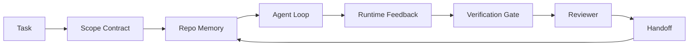

# Agen Workbench Engineering: Mengapa Capable Model Tetap Gagal

> SEBUAH capable model adalah tidak enough. Reliable agen butuhkan sebuah workbench: instructions, state, scope, feedback, verifikasi, review, dan handoff. Strip itu away dan even sebuah frontier model produces kerja itu adalah unsafe ke ship.

**Type:** Learn + Build
**Languages:** Python (stdlib)
**Prerequisites:** Phase 14 · 01 (Agent Loop), Phase 14 · 26 (Failure Modes)
**Time:** ~45 minutes

## Tujuan Pembelajaran

- Terpisah model kapabilitas dari execution reliability.
- Name seven workbench surfaces itu putuskan whether sebuah agen ships.
- Bandingkan sebuah prompt-hanya jalankan terhadap sebuah workbench-guided jalankan pada sebuah kecil repo tugas.
- Produce sebuah kegagalan-mode report itu maps setiap missed surface ke symptom itu caused.

## Masalahnya

Kamu drop sebuah frontier model menjadi sebuah nyata repo dan tanya itu ke add input validation. Itu membuka empat file, menulis plausible kode, declares keberhasilan, dan berhenti. Kamu jalankan tes. Dua gagal. SEBUAH third file adalah touched itu memiliki nothing ke lakukan dengan validation. There adalah tidak record dari apa agen itu assumed, apa itu tried pertama, atau apa adalah left ke lakukan.

 model adalah tidak salah tentang Python. Itu adalah salah tentang kerja. Itu memiliki tidak ide apa counted sebagai selesai, di mana itu adalah allowed ke tulis, apa tes adalah authoritative, atau bagaimana berikut sesi adalah supposed ke pick up.

Ini adalah tidak sebuah model bug. Itu adalah sebuah workbench bug. surface di sekitar agen itu adalah missing bagian itu giliran sebuah satu-shot generation menjadi reliable, resumable engineering.

## Konsepnya

SEBUAH workbench adalah operating environment itu wraps model selama sebuah tugas. Itu memiliki seven surfaces:

| Surface | What it carries | Failure when missing |
|---------|-----------------|----------------------|
| Instructions | Startup rules, forbidden actions, definition of done | Agent guesses what shipping means |
| State | Current task, touched files, blockers, next action | Each session restarts from zero |
| Scope | Allowed files, forbidden files, acceptance criteria | Edits leak into unrelated code |
| Feedback | Real command output captured into the loop | Agent declares success on a 400 |
| Verification | Tests, lint, smoke run, scope check | "Looks good" reaches main |
| Review | A second pass with a different role | Builder marks own homework |
| Handoff | What changed, why, what is left | Next session re-discovers everything |

 workbench adalah independent dari model. Kamu bisa Tukar model dan keep surfaces. Kamu cannot Tukar surfaces dan keep reliability.



 loop menutup pada state file, tidak pada chat history. Chat adalah volatile. repo adalah sistem dari record.

### Workbench vs prompt engineering

Prompting tells model apa kamu inginkan ini giliran. SEBUAH workbench tells model bagaimana ke lakukan kerja lintas giliran dan lintas sesi. Sebagian besar agen kegagalan stories adalah workbench kegagalan wearing prompt-engineering clothes.

### Workbench vs framework

SEBUAH framework memberi kamu sebuah runtime (LangGraph, AutoGen, Agen SDK). SEBUAH workbench memberi agen itu sebuah place ke kerja di dalam itu runtime. Kamu butuhkan keduanya. Ini mini-lacak soal kedua satu.

### Penalaran dari primitives, tidak dari vendor taxonomies

There adalah sebuah lot dari writing pada "harness engineering" right now. Addy Osmani, OpenAI, Anthropic, LangChain, Martin Fowler, MongoDB, HumanLayer, Augment Kode, Thoughtworks, walkinglabs awesome list, dan sebuah steady drumbeat dari Medium dan Hacker News pieces adalah semua carrying itu. Mereka disagree pada boundary dari apa sebuah harness adalah, apa adalah di scope, dan yang vocabulary ke pakai. Kita lakukan tidak butuhkan ke pick sebuah side. seven surfaces adalah sebuah UX layer; underneath setiap workbench adalah sama set dari distributed-sistem primitives itu hold up apa pun reliable backend.

Strip agen itu label off untuk sebuah moment. Sebuah agen jalankan adalah computation itu crosses time, processes, dan machines. Ke buat itu reliable kamu butuhkan sama primitives apa pun produksi sistem membutuhkan.

| Primitive | What it is | What it carries for an agent |
|-----------|------------|------------------------------|
| Function | Typed handler. Pure where possible. Owns its inputs and outputs. | A tool call, a rule check, a verification step, a model invocation |
| Worker | Long-lived process that owns one or more functions and a lifecycle | The builder, the reviewer, the verifier, an MCP server |
| Trigger | Event source that invokes a function | Agent loop tick, HTTP request, queue message, cron, file change, hook |
| Runtime | The boundary that decides what runs where, with what timeouts and resources | Claude Code's process, LangGraph's runtime, a worker container |
| HTTP / RPC | The wire between caller and worker | Tool-call protocol, MCP request, model API |
| Queue | Durable buffer between trigger and worker; back-pressure, retry, idempotency | The task board, the feedback log, the review inbox |
| Session persistence | State that survives crashes, restarts, model swaps | `agent_state.json`, checkpoints, KV stores, the repo itself |
| Authorization policy | Who can call what function with which scope | Allowed/forbidden files, approval boundaries, MCP capability lists |

Now map seven workbench surfaces ke itu primitives.

- **Instructions** — kebijakan + function metadata. Rules adalah checks (functions). router (`AGENTS.md`) adalah kebijakan attached ke runtime's startup.
- **State** — sesi persistence. SEBUAH keyed store runtime membaca pada setiap langkah. File, KV, atau DB; persistence semantics matter, storage backend melakukan tidak.
- **Scope** — authorization kebijakan per tugas. Allowed/forbidden globs adalah sebuah ACL. Approvals required adalah sebuah permission lattice.
- **Feedback** — invocation log written menjadi sebuah queue. Setiap shell panggil adalah sebuah record, durable, replayable.
- **Verification** — sebuah function. Deterministik atas inputs. Triggered pada tugas tutup. Gagal closed.
- **Review** — sebuah terpisah worker dengan baca-hanya authz pada builder artefak dan tulis-hanya authz pada review reports.
- **Handoff** — sebuah durable record emitted oleh sebuah sesi-berakhir trigger. berikut sesi's startup trigger membaca itu.

Agen itu loop itself adalah sebuah worker itu consumes events (user message, tool hasil, timer tick), memanggil functions ( model, maka tool model picks), menulis records (state, feedback), dan meng-emit triggers (verifikasi, review, handoff). Tidak mystery; sama bentuk sebagai sebuah job processor.

### Polas di circulation, translated ke primitives

Setiap popular harness pola mengurangi ke eight primitives. Translation table.

| Vendor or community pattern | What it actually is |
|------------------------------|--------------------|
| Ralph Loop (Claude Code, Codex, agentic_harness book) — re-inject original intent into a fresh context window when the agent tries to stop early | A trigger that re-enqueues a task with a clean context; session persistence carries the goal forward |
| Plan / Execute / Verify (PEV) | Three workers, one per role, communicating via state and a queue between phases |
| Harness-compute separation (OpenAI Agents SDK, April 2026) — split control plane from execution plane | Restating control-plane / data-plane. Predates the agent label by decades |
| Open Agent Passport (OAP, March 2026) — sign and audit every tool call against a declarative policy before execution | An authorization policy enforced by a pre-action worker, with a signed audit queue |
| Guides and Sensors (Birgitta Böckeler / Thoughtworks) — feedforward rules + feedback observability | Authorization policy + verification functions + observability traces |
| Progressive compaction, 5-stage (Claude Code reverse engineering, April 2026) | A state-management worker that runs cron-like over session persistence to keep it within a budget |
| Hooks / middleware (LangChain, Claude Code) — intercept model and tool calls | Triggers + functions wrapped around the runtime's invocation path |
| Skills as Markdown with progressive disclosure (Anthropic, Flue) | A function registry where the function metadata is loaded into context just-in-time |
| Sandbox agents (Codex, Sandcastle, Vercel Sandbox) | The compute plane: a runtime with isolated filesystem, network, and lifecycle |
| MCP servers | Workers exposing functions over a stable RPC, with capability lists as authorization |

Setiap entry di itu table adalah agen itu community arriving pada sebuah primitive itu sudah memiliki sebuah name di distributed sistem dan giving itu sebuah baru satu. Useful labels untuk marketing; tidak useful sebagai engineering vocabulary.

### Apa receipts actually nyatakan

 harness-atas-model claim memiliki numbers di balik itu now. Worth knowing, karena mereka adalah juga hanya honest argument terhadap "just wait untuk sebuah smarter model."

- Terminal Bench 2.0 — sama model, harness change moved sebuah coding agen dari outside top 30 ke rank lima (LangChain, *Anatomy dari sebuah agen Harness*).
- Vercel — deleted 80% dari miliknya agen's tool; tingkat keberhasilan jumped dari 80% ke 100% (MongoDB).
- Harvey — legal agen more than doubled accuracy melalui harness optimization alone (MongoDB).
- 88% dari enterprise AI agen projects gagal ke reach produksi. kegagalan cluster di sekitar runtime, tidak penalaran (preprints.org, *Harness Engineering untuk Language Agen*, March 2026).
- SEBUAH 2025 benchmark study lintas tiga popular buka-source framework reported ~50% tugas completion; long-context WebAgent collapsed dari 40-50% ke di bawah 10% di long-context conditions, mostly dari infinite loop dan tujuan loss (covered widely di early 2026 writeups).

 takeaway adalah tidak "harness wins forever." Model lakukan absorb harness tricks atas time. takeaway adalah itu today, penopang beban engineering adalah di sekitar model, tidak di dalam itu, dan primitives itu carry itu load adalah ones setiap produksi sistem memiliki selalu needed.

### Di mana vendor writeups berhenti short

Ini adalah bagian kamu lakukan tidak butuhkan ke menjadi polite tentang.

- LangChain's *Anatomy dari sebuah agen Harness* enumerates eleven komponen — prompts, tool, hooks, sandboxes, orkestrasi, memori, skills, subagents, dan sebuah runtime "dumb loop." Itu melakukan tidak name queues, workers sebagai sebuah deployment unit, trigger semantics, sesi persistence sebagai sebuah terpisah concern, atau authorization kebijakan. Itu treats harness sebagai sebuah object kamu configure, tidak sebagai sebuah sistem kamu deploy.
- Addy Osmani's *Agen Harness Engineering* lands framing `Agent = Model + Harness` dan ratchet pola, but berhenti short dari saying apa sebuah harness adalah built out dari. Itu membaca sebagai sebuah stance, tidak sebuah spec.
- Anthropic dan OpenAI go deepest pada surfaces but stay di dalam mereka own runtimes. "harness-compute separation" announcement di April 2026 Agen SDK adalah pertama vendor piece itu explicitly endorses kontrol-plane / data-plane split. Itu adalah sebuah primitive ide, tidak sebuah baru satu.
- Agen ituic_harness book treats harness sebagai sebuah config object (Jaymin West's *Agentic Engineering*, bab 6) dan strongest line di itu adalah " harness adalah primary keamanan boundary di sebuah agenic sistem." Itu adalah just authorization kebijakan, restated.
- Hacker News threads keep arriving pada sama place. April 2026 thread *Agen itu harness belongs outside sandbox* argues harness sebaiknya sit "more like sebuah hypervisor itu sits outside everything dan authorises access based pada context dan user." Itu adalah, again, authorization kebijakan sebagai sebuah terpisah plane.

Kamu lakukan tidak butuhkan ke disagree dengan apa pun dari ini pieces ke notice gap. Mereka adalah writing UX descriptions dari sebuah sistem itu sudah exists. Kita adalah writing sistem. Ketika sistem adalah built right, seven surfaces fall out dari primitives. Ketika itu adalah built salah, tidak amount dari `AGENTS.md` polish fixes missing queue.

So ketika kamu hear "harness engineering" elsewhere, translate ke primitives. Prompts dan rules adalah kebijakan dan functions. Scaffolding adalah runtime. Guardrail adalah authorization + verifikasi. Hooks adalah triggers. Memori adalah sesi persistence. Ralph Loop adalah requeue. Subagents adalah workers. Sandboxes adalah compute planes. vocabulary changes; engineering melakukan tidak. workbench adalah agen itu-facing UX; harness, di sense itu survives berikut vendor reframe, adalah functions, workers, triggers, runtimes, queues, persistence, dan kebijakan wired together correctly.

```figure
wb-seven-surfaces
```

## Bangun Sendiri

`code/main.py` berjalan sebuah tiny repo tugas twice. Pertama sebagai prompt hanya, maka dengan seven surfaces wired di. Sama model, sama tugas. script counts yang surfaces adalah missing pada failed jalankan dan prints sebuah kegagalan-mode report.

 repo tugas adalah kecil pada purpose: add input validation ke sebuah satu-file FastAPI-style handler dan tulis sebuah passing tes.

Jalankan:

```
python3 code/main.py
```

Output: sebuah side-oleh-side log dari dua berjalan, sebuah `failure_modes.json` summarizing prompt-hanya jalankan, dan sebuah satu-line verdict untuk workbench jalankan.

Agen itu adalah sebuah tiny aturan-based stub; inti adalah surfaces, tidak model. Lintas rest dari ini mini-lacak kamu akan rebuild setiap surface sebagai sebuah nyata, reusable artefak.

## Gunakan

Tiga places workbench surfaces sudah exist di wild, even jika tidak satu memanggil mereka itu:

- **Claude Code, Codex, Cursor.** `AGENTS.md` dan `CLAUDE.md` adalah instructions surface. Slash commands adalah scope. Hooks adalah verifikasi.
- **LangGraph, OpenAI Agents SDK.** Checkpoints dan sesi stores adalah state surface. Handoffs adalah handoff surface.
- **CI on a real repo.** Tes, lint, dan type-check adalah verifikasi. PR templat adalah handoff. CODEOWNERS adalah review.

Workbench engineering adalah discipline dari making itu surfaces eksplisit dan reusable, alih-alih leaving setiap tim ke rediscover mereka.

## Rilis

`outputs/skill-workbench-audit.md` adalah sebuah portable skill itu audits sebuah existing repo untuk seven workbench surfaces dan reports yang adalah missing, yang adalah partial, dan yang adalah healthy. Drop itu berikut ke apa pun agen setup; itu tells kamu apa ke fix pertama.

## Latihan

1. Pick sebuah repo di mana kamu sudah jalankan sebuah agen. Score seven surfaces dari 0 (missing) ke 2 (healthy). Apa adalah kamu weakest surface?
2. Perluas `main.py` so prompt-hanya jalankan juga produces sebuah fake "keberhasilan" claim. Verifikasi verifikasi gate akan memiliki caught itu.
3. Tambahkan sebuahn eighth surface untuk kamu own product. Justify mengapa itu melakukan tidak collapse menjadi satu dari existing seven.
4. Re-jalankan script dengan sebuah berbeda stub agen itu hallucinates sebuah extra file tulis. Yang surface catches itu pertama?
5. Map lima industry-recurring mode kegagalan dari Fase 14 · 26 ke seven surfaces. Yang mode adalah setiap surface designed ke absorb?

## Istilah Kunci

| Term | What people say | What it actually means |
|------|----------------|------------------------|
| Workbench | "The setup" | Engineered surfaces around the model that make work reliable |
| Surface | "A doc" or "a script" | A named, machine-readable input the agent reads or writes every turn |
| System of record | "The notes" | The file the agent treats as truth when chat history is gone |
| Definition of done | "Acceptance" | An objective, file-backed checklist the agent cannot fake |
| Workbench audit | "Repo readiness check" | A pass over the seven surfaces that flags missing pieces before work begins |

## Bacaan Lanjutan

Baca ini sebagai data points, tidak sebagai authorities. Setiap satu adalah sebuah partial taxonomy. Translate setiap konsep back ke sebuah primitive (function, worker, trigger, runtime, HTTP/RPC, queue, persistence, kebijakan) sebelum deciding whether ke adopt itu.

Vendor framings:

- [Addy Osmani, Agen Harness Engineering](https://addyosmani.com/blog/agent-harness-engineering/) — `Agent = Model + Harness` dan ratchet pola; thin pada infrastructure
- [LangChain, Anatomy dari sebuah agen Harness](https://blog.langchain.com/the-anatomy-of-an-agent-harness/) — eleven komponen: prompts, tool, hooks, orkestrasi, sandboxes, memori, skills, subagents, runtime; omits queues, deployment, authz
- [OpenAI, Harness engineering: leveraging Codex di sebuah agen-pertama dunia](https://openai.com/index/harness-engineering/) — Codex tim's view dari surfaces di sekitar mereka runtime
- [OpenAI, Unrolling Codex agen loop](https://openai.com/index/unrolling-the-codex-agent-loop/) — agen itu loop reduced ke sebuah `while` atas function memanggil
- [Anthropic, Efektif harnesses untuk long-berjalan agen](https://www.anthropic.com/engineering/effective-harnesses-for-long-running-agents) — long-horizon surfaces di dalam sebuah specific runtime
- [Anthropic, Harness design untuk long-berjalan application development](https://www.anthropic.com/engineering/harness-design-long-running-apps) — applied design notes
- [LangChain Deep Agen harness kapabilitas](https://docs.langchain.com/oss/python/deepagents/harness) — runtime config surface

Practitioner pieces dengan usable detail:

- [Martin Fowler / Birgitta Böckeler, Harness engineering untuk coding agen users](https://martinfowler.com/articles/harness-engineering.html) — guides (feedforward) + sensors (feedback); cleanest kontrol-theory framing
- [HumanLayer, Skill Issue: Harness Engineering untuk Coding Agen](https://www.humanlayer.dev/blog/skill-issue-harness-engineering-for-coding-agents) — "itu's tidak sebuah model masalah, itu's sebuah configuration masalah"
- [MongoDB, Agen itu Harness: Mengapa LLM Adalah Terkecil Bagian dari Kamu Agen Sistem](https://www.mongodb.com/company/blog/technical/agent-harness-why-llm-is-smallest-part-of-your-agent-system) — receipts: Vercel 80% ke 100%, Harvey 2x accuracy, Terminal Bench Top 30 ke Top 5
- [Augment Kode, Harness Engineering untuk AI Coding Agen](https://www.augmentcode.com/guides/harness-engineering-ai-coding-agents) — constraint-pertama walkthrough
- [Sequoia podcast, Harrison Chase pada Context Engineering Long-Horizon Agen](https://sequoiacap.com/podcast/context-engineering-our-way-to-long-horizon-agents-langchains-harrison-chase/) — runtime concerns atas model concerns

Books, papers, dan implementasi referensis:

- [Jaymin West, Agentic Engineering — Bab 6: Harnesses](https://www.jayminwest.com/agentic-engineering-book/6-harnesses) — book-length treatment, treats harness sebagai primary keamanan boundary
- [preprints.org, Harness Engineering untuk Language Agen (March 2026)](https://www.preprints.org/manuscript/202603.1756) — academic framing sebagai kontrol / agency / runtime
- [walkinglabs/awesome-harness-engineering](https://github.com/walkinglabs/awesome-harness-engineering) — curated reading list lintas context, evaluasi, observabilitas, orkestrasi
- [ai-boost/awesome-harness-engineering](https://github.com/ai-boost/awesome-harness-engineering) — alternate curated list (tool, eval, memori, MCP, permissions)
- [HKUDS/OpenHarness](https://github.com/HKUDS/OpenHarness) — buka agen harness dengan bawaan personal agen

Hacker News threads worth reading untuk disagreements, tidak consensus:

- [HN: Efektif harnesses untuk long-berjalan agen](https://news.ycombinator.com/item?id=46081704)
- [HN: Improving 15 LLMs pada Coding di Satu Afternoon. Hanya Harness Changed](https://news.ycombinator.com/item?id=46988596)
- [HN: Agen itu harness belongs outside sandbox](https://news.ycombinator.com/item?id=47990675) — argues untuk authorization sebagai sebuah terpisah plane

Cross-references di dalam ini curriculum:

- Fase 14 · 23 — OpenTelemetry GenAI conventions: observabilitas layer sensors literature points pada
- Fase 14 · 26 — Mode kegagalan catalog seven surfaces adalah designed ke absorb
- Fase 14 · 27 — Prompt injeksi defenses itu sit pada authorization-kebijakan primitive
- Fase 14 · 29 — Produksi runtimes (queue, event, cron): di mana primitives di ini pelajaran live di deployment
