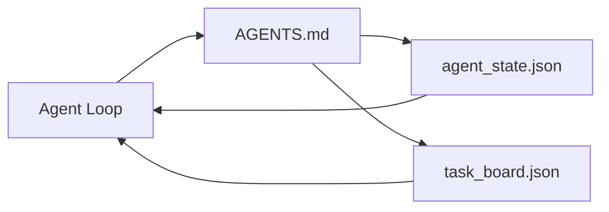

#  Minimal Agen Workbench

>  terkecil useful workbench adalah tiga file: sebuah root instructions router, sebuah state file, dan sebuah tugas board. Everything else adalah layered pada top. Jika sebuah repo cannot carry ini tiga, tidak model akan save itu.

**Type:** Build
**Languages:** Python (stdlib)
**Prerequisites:** Phase 14 · 31 (Why Capable Models Still Fail)
**Time:** ~45 minutes

## Tujuan Pembelajaran

- Definisikan tiga file itu form minimum viable workbench.
- Jelaskan mengapa sebuah short root router beats sebuah long monolithic `AGENTS.md`.
- Build sebuah state file agen itu bisa baca pada setiap giliran dan tulis pada berakhir.
- Build sebuah tugas board itu survives multi-sesi kerja tanpa chat history.

## Masalahnya

Sebagian besar teams reach untuk sebuah workbench oleh writing sebuah 3000-line `AGENTS.md` dan pemanggilan itu selesai. model loads itu, ignores bagian itu cannot summarize, dan tetap gagal pada sama surfaces itu selalu failed pada.

Kamu butuhkan opposite. SEBUAH tiny root file itu routes agen itu menjadi deeper file hanya ketika relevant. Durable state agen itu membaca sebelum bertindak dan menulis setelah. SEBUAH tugas board itu menyatakan apa adalah di flight, apa adalah blocked, dan apa adalah up berikut.

Tiga file. Setiap satu dengan sebuah job. Setiap satu machine-readable enough ke evolve menjadi sebuah nyata sistem later.

## Konsepnya



### AGEN.md adalah sebuah router, tidak sebuah manual

SEBUAH baik `AGENTS.md` adalah short. Itu points agen itu pada:

-  state file (di mana kamu adalah).
-  tugas board (apa adalah left).
-  deeper rules (di bawah `docs/agent-rules.md`).
-  verifikasi command (bagaimana ke know itu bekerja).

Anything longer goes di deeper docs, loaded hanya ketika needed. Long manuals dapatkan ignored. Short routers dapatkan followed.

### agent_state.json adalah sistem dari record

State carries: active tugas id, touched file, asumsi made, blockers, dan berikut aksi. Agen itu membaca itu pada setiap giliran. berikut sesi membaca itu alih-alih replaying chat.

State lives di sebuah file karena chat history adalah unreliable. Sesi die. Conversations dapatkan trimmed. file melakukan tidak.

### task_board.json adalah queue

 tugas board carries setiap tugas dengan status `todo | in_progress | done | blocked`. Itu adalah queue agen itu pulls dari ketika state adalah kosong, dan queue kamu baca ketika kamu inginkan ke know whether agen itu adalah pada lacak.

SEBUAH tugas pada board memiliki sebuah id, sebuah tujuan, sebuah owner (`builder`, `reviewer`, atau `human`), dan acceptance criteria. board adalah kecil pada purpose: ketika itu yang terus bertambah past sebuah screen, kamu punya sebuah perencanaan masalah, tidak sebuah board masalah.

### Tiga file adalah floor, tidak ceiling

Later pelajaran add scope contracts, feedback runners, verifikasi gates, reviewer checklists, dan handoff packets. tiga file here adalah apa mereka semua assume.

```figure
wb-three-files
```

## Bangun Sendiri

`code/main.py` menulis minimal workbench menjadi sebuah kosong repo dan demonstrates sebuah tunggal agen giliran itu:

1. Membaca `agent_state.json`.
2. Pulls berikut tugas dari `task_board.json` jika state adalah kosong.
3. Touches sebuah tunggal file di dalam scope.
4. Menulis back updated state.

Jalankan:

```
python3 code/main.py
```

 script membuat `workdir/` berikut ke itself, lays down tiga file, berjalan satu giliran, dan prints diff. Re-jalankan ke see bagaimana kedua giliran picks up di mana pertama left off.

## Gunakan

Di dalam produksi agen products, sama tiga file tunjukkan up di bawah berbeda names:

- **Claude Code:** `AGENTS.md` atau `CLAUDE.md` untuk router, `.claude/state.json`-style stores untuk state, hooks untuk board.
- **Codex / Cursor:** workspace rules untuk router, sesi memori untuk state, queued tugas di chat sidebar untuk board.
- **Custom Python agent:**  sama file kamu just wrote.

 names change. bentuk melakukan tidak.

## Produksi polas di wild

 minimum workbench survives contact dengan nyata monorepos ketika tiga polas adalah layered di atas itu. Mereka adalah independent; pick ones kamu repo actually membutuhkan.

**Nested `AGENTS.md` with nearest-wins precedence.** OpenAI ships 88 `AGENTS.md` file lintas miliknya utama repo, satu per subcomponent. Codex, Cursor, Claude Kode, dan Copilot semua walk dari working file menuju repo root dan concatenate setiap `AGENTS.md` mereka find pada way. Sub-directory file Perluas root file. Codex adds `AGENTS.override.md` ke Ganti rather than Perluas; override mechanism adalah Codex-specific dan avoid itu untuk cross-tool kerja. Augment Kode's measurement adalah line itu matters: best `AGENTS.md` file beri sebuah quality jump equivalent ke upgrading dari Haiku ke Opus; worst ones buat output worse than tidak file pada semua.

**Anti-patterns to refuse, even when they look like coverage.** Conflicting instructions silently drop agen itu dari interactive ke greedy mode (ICLR 2026 AMBIG-SWE: 48.8% → 28% resolve rate); number priorities alih-alih stacking mereka flat. Unverifiable style rules ("follow Google Python Style Panduan") dengan tidak enforcement command let agen itu invent compliance; pair setiap style aturan dengan exact lint command. Leading dengan style alih-alih commands buries verifikasi path; commands pertama, style terakhir. Writing untuk humans alih-alih agen wastes context budget; terseness adalah sebuah feature.

**Cross-tool symlinks.** SEBUAH tunggal root file dengan symlinks (`ln -s AGENTS.md CLAUDE.md`, `ln -s AGENTS.md .github/copilot-instructions.md`, `ln -s AGENTS.md .cursorrules`) keeps setiap coding agen pada sama source dari truth. Nx's `nx ai-setup` automates ini lintas Claude Kode, Cursor, Copilot, Gemini, Codex, dan OpenCode dari sebuah tunggal config.

## Rilis

`outputs/skill-minimal-workbench.md` menghasilkan tiga-file workbench untuk apa pun baru repo: sebuah `AGENTS.md` router tuned ke project, sebuah `agent_state.json` dengan right keys, dan sebuah `task_board.json` seeded dengan current backlog.

## Latihan

1. Tambahkan sebuah `last_run` timestamp ke `agent_state.json`. Refuse ke jalankan jika file adalah older than 24 hours unless sebuah operator confirms.
2. Tambahkan sebuah `priority` field ke tugas board dan change puller ke selalu pick highest priority `todo`.
3. Migrate `task_board.json` ke JSON Lines so setiap tugas adalah sebuah line dan diffs adalah clean di version kontrol.
4. Tulis sebuah `lint_workbench.py` itu gagal jika `AGENTS.md` adalah atas 80 lines atau references sebuah file itu melakukan tidak exist.
5. Putuskan yang satu dari tiga file akan hurt sebagian besar ke lose. Defend itu.

## Istilah Kunci

| Term | What people say | What it actually means |
|------|----------------|------------------------|
| Router | `AGENTS.md` | Short root file that points the agent at deeper docs and files |
| State file | "The notes" | Machine-readable record of where the agent is, written every turn |
| Task board | "The backlog" | JSON queue of work with status, owner, acceptance |
| System of record | "Source of truth" | The file the workbench treats as authoritative when chat is gone |

## Bacaan Lanjutan

- [agen.md — buka spec](https://agents.md/) — adopted oleh Cursor, Codex, Claude Kode, Copilot, Gemini, OpenCode
- [Augment Kode, SEBUAH baik AGEN.md adalah sebuah model upgrade. SEBUAH buruk satu adalah worse than tidak docs pada semua](https://www.augmentcode.com/blog/how-to-write-good-agents-dot-md-files) — measured quality jumps
- [Blake Crosley, AGEN.md Polas: Apa Actually Changes Agen Perilaku](https://blakecrosley.com/blog/agents-md-patterns) — apa bekerja empirically, apa melakukan tidak
- [Datadog Frontend, Steering AI Agen di Monorepos dengan AGEN.md](https://dev.to/datadog-frontend-dev/steering-ai-agents-in-monorepos-with-agentsmd-13g0) — nested precedence dalam praktik
- [Nx Blog, Teach Kamu AI Agen Bagaimana ke Kerja di sebuah Monorepo](https://nx.dev/blog/nx-ai-agent-skills) — tunggal-source generation lintas six tool
- [ Prompt Shelf, AGEN.md Best Practices: Structure, Scope, dan Nyata Contoh](https://thepromptshelf.dev/blog/agents-md-best-practices/) — bagian ordering itu survives review
- [Anthropic, Claude Kode subagents](https://code.claude.com/docs/en/sub-agents)
- Fase 14 · 31 — mode kegagalan ini minimum absorbs
- Fase 14 · 34 — durable state schema ini pelajaran previews
