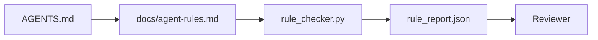

# Agen Instructions sebagai Executable Constraints

> Instructions written sebagai prose adalah wishes. Instructions written sebagai constraints adalah tes. workbench giliran setiap aturan menjadi something sebuah agen bisa check pada runtime dan sebuah reviewer bisa verifikasi setelah fact.

**Type:** Build
**Languages:** Python (stdlib)
**Prerequisites:** Phase 14 · 32 (Minimal Workbench)
**Time:** ~50 minutes

## Tujuan Pembelajaran

- Terpisah routing prose dari operasional rules.
- Express startup rules, forbidden aksi, definition dari selesai, uncertainty handling, dan approval boundaries sebagai machine-checkable constraints.
- Implementasikan sebuah aturan checker itu scores sebuah jalankan terhadap aturan set.
- Buat aturan set diff-friendly so review bisa see apa changed.

## Masalahnya

SEBUAH typical `AGENTS.md` membaca like onboarding dokumentasi. Itu tells agen itu ke "menjadi careful" dan "tes thoroughly" dan "tanya jika unsure." Tiga days later, agen itu ships sebuah change dengan tidak tes, menulis ke sebuah forbidden directory, dan tidak pernah bertanya karena itu tidak pernah knew di mana line adalah.

Instructions adalah powerful ketika mereka adalah operasional dan weak ketika mereka adalah aspirational. fix adalah ke tulis rules workbench bisa interpret dan reviewer bisa score.

## Konsepnya

Rules belong di `docs/agent-rules.md`, away dari short root router. Setiap aturan memiliki sebuah name, sebuah category, dan sebuah check.



### Lima categories itu cover sebagian besar rules

| Category | Question the rule answers | Example |
|----------|---------------------------|---------|
| Startup | What must be true before work begins? | "state file exists and is fresh" |
| Forbidden | What must never happen? | "do not edit `scripts/release.sh`" |
| Definition of done | What proves the task is complete? | "pytest exits 0 and acceptance line passes" |
| Uncertainty | What does the agent do when unsure? | "open a question note instead of guessing" |
| Approval | What requires human approval? | "any new dependency, any prod write" |

SEBUAH aturan itu melakukan tidak fit satu dari ini lima usually menginginkan ke menjadi dua rules. Force split.

### Rules adalah machine-readable

Setiap aturan memiliki sebuah slug, sebuah category, sebuah satu-line description, dan sebuah `check` field itu names sebuah function di `rule_checker.py`. Adding sebuah aturan means adding sebuah check; checker yang terus bertambah dengan workbench.

### Rules adalah diff-friendly

Rules live satu per heading di sebuah tunggal markdown file. Renames adalah visible di diffs. Baru rules sit pada top dari mereka category. Stale rules dapatkan deleted, tidak commented out, karena workbench adalah source dari truth, tidak chat log dari bagaimana tim felt terakhir quarter.

### Rules vs framework guardrail

Framework guardrail (OpenAI Agen SDK guardrail, LangGraph interrupts) enforce rules pada runtime level. aturan set di ini pelajaran adalah manusia-readable, reviewable kontrak itu itu guardrail implementasikan. Kamu butuhkan keduanya: runtime catches violations selama sebuah giliran, aturan set proves runtime adalah doing right hal.

### Progressive disclosure: sebuah map, tidak sebuah encyclopedia

 reason `AGENTS.md` keeps growing adalah itu setiap incident adds sebuah aturan dan tidak incident removes satu. SEBUAH year di, file adalah dua thousand lines, dan agen itu membaca pertama screen, berjalan out dari attention budget, dan bertindak pada sebuah fraction dari apa itu adalah told. SEBUAH giant instruction file gagal untuk sama reason sebuah forty-page onboarding doc gagal: reader skims itu once dan tidak pernah mengembalikan ke bagian itu mattered.

 fix adalah tidak sebuah shorter file. Itu adalah sebuah layered satu. root router stays kecil enough ke baca setiap sesi dan holds nothing but pointers. depth lives di topic file agen itu loads hanya ketika tugas touches mereka. Beri agen itu sebuah map, tidak seluruh encyclopedia, dan let itu walk ke page itu membutuhkan.

```
AGENTS.md                  # router, < 50 lines: what this repo is, where to look, the 5 hard rules
docs/
  agent-rules.md           # the full rule set (this lesson)
  architecture.md          # loaded when the task touches module boundaries
  testing.md               # loaded when the task writes or runs tests
  deploy.md                # loaded only for release work, gated behind an approval rule
feature_list.json          # the backlog (Phase 14 · 36)
```

| Tier | Lives in | Read when | Size budget |
|------|----------|-----------|-------------|
| Router | `AGENTS.md` | Every session, always | Under ~50 lines |
| Rules | `docs/agent-rules.md` | Every session, on startup | One screen per category |
| Topic docs | `docs/<topic>.md` | Only when the task touches that topic | As deep as needed |

Dua tes keep layering honest. reachability tes: sebuah agen sebaiknya reach apa pun aturan di pada sebagian besar dua hops dari router, so router harus link setiap topic doc oleh path, tidak deskripsikan itu di prose. freshness tes: router adalah short enough itu sebuah reviewer rereads itu pada setiap PR, yang adalah hanya hal itu berhenti itu dari silently growing back menjadi encyclopedia itu Gantid. SEBUAH pointer itu tidak longer resolves adalah sebuah worse kegagalan than sebuah missing aturan, so sebuah broken link di router adalah itself sebuah startup-check violation.

```figure
wb-rule-checkoff
```

## Bangun Sendiri

`code/main.py` ships:

- `agent-rules.md` parser itu loads rules menjadi sebuah dataclass.
- `rule_checker.py` style checker functions, satu per `check` reference.
- SEBUAH demo agen jalankan itu violates dua rules dan sebuah check pass itu catches mereka.

Jalankan:

```
python3 code/main.py
```

Output: parsed aturan set, jalankan trace, pass/gagal per aturan, dan sebuah `rule_report.json` saved berikut ke script.

## Produksi polas di wild

Tiga polas terpisah sebuah aturan set itu lasts sebuah quarter dari satu itu decays di sebuah week.

**Severity tagging at write time.** Setiap aturan carries `severity`: `block`, `warn`, atau `info`. checker reports semua tiga; runtime hanya refuses pada `block`. Sebagian besar teams overstate severity early maka quietly weaken itu di bawah deadline pressure; tagging pada tulis time forces calibration up front. Pair dengan verifikasi gate (Fase 14 · 38), yang signs apa pun override dari sebuah `block` aturan menjadi sebuah `overrides.jsonl` audit log.

**Rule expiry as a forcing function.** Setiap aturan carries sebuah `expires_at` date (default 90 days dari authoring). checker meng-emit sebuah warning ketika sebuah unexpired aturan memiliki memiliki zero violations untuk 60 consecutive days; berikut quarterly review either justifies keeping itu, weakens itu ke `info`, atau deletes itu. Cloudflare's produksi AI Kode Review data (April 2026, 131,246 review berjalan lintas 5,169 repo di 30 days) showed itu aturan sets dengan eksplisit expiry stayed di bawah 30 rules per repo; sets tanpa grew ke 80+ dengan sebagian besar tidak pernah firing.

**Markdown-as-source, JSON-as-cache.** `agent-rules.md` adalah authored file; `agent-rules.lock.json` adalah sebuah cache checker membaca di hot path. lock adalah regenerated oleh sebuah pre-commit hook. Markdown diffs adalah reviewable; JSON parsing stays out dari setiap giliran. Sama bentuk sebagai `package.json` / `package-lock.json` dan `Cargo.toml` / `Cargo.lock`.

## Gunakan

Di produksi:

- Claude Kode, Codex, Cursor baca rules pada sesi mulai dan quote mereka ketika refusing aksi. checker re-berjalan mereka di CI ke catch silent drift.
- OpenAI Agen SDK guardrail register sama checks sebagai input dan output guardrail. markdown adalah docs surface; SDK adalah runtime surface.
- LangGraph interrupts fire ketika sebuah di-flight node violates sebuah aturan. interrupt handler membaca aturan, bertanya manusia, dan resumes.

 aturan set adalah portable lintas semua tiga karena itu adalah just markdown plus function names.

## Rilis

`outputs/skill-rule-set-builder.md` interviews sebuah project owner, classifies mereka existing prose instructions menjadi lima categories, dan meng-emit sebuah versioned `agent-rules.md` plus sebuah checker stub.

## Latihan

1. Tambahkan sebuah sixth category jika kamu product genuinely membutuhkan itu. Defend mengapa itu melakukan tidak collapse menjadi satu dari lima.
2. Perluas checker so sebuah aturan bisa carry sebuah severity (`block`, `warn`, `info`) dan report aggregates accordingly.
3. Wire checker menjadi CI: gagal build jika sebuah block-severity aturan gagal pada latest agen jalankan.
4. Tambahkan sebuahn "expiry" field per aturan. Setelah 90 days tanpa sebuah check gagal, aturan adalah up untuk review.
5. Find sebuah nyata `AGENTS.md` dan rewrite itu sebagai lima-category rules. Bagaimana banyak dari miliknya lines adalah operasional? Bagaimana banyak adalah aspirational?

## Istilah Kunci

| Term | What people say | What it actually means |
|------|----------------|------------------------|
| Operational rule | "A real instruction" | A rule the workbench can check at runtime |
| Aspirational rule | "Be careful" | A rule with no check; either delete or upgrade |
| Definition of done | "Acceptance" | An objective, file-backed proof the task is complete |
| Block severity | "Hard rule" | Violation halts the run; cannot be silenced without an operator |
| Rule expiry | "Stale rule sweep" | A rule with no fails in N days is up for retirement |

## Bacaan Lanjutan

- [OpenAI Agen SDK guardrail](https://openai.github.io/openai-agents-python/guardrails/)
- [LangGraph interrupts](https://langchain-ai.github.io/langgraph/how-tos/human_in_the_loop/breakpoints/)
- [Anthropic, Building Efektif Agen](https://www.anthropic.com/research/building-effective-agents)
- [Rick Hightower, Agen RuleZ: SEBUAH Deterministik Kebijakan Engine](https://medium.com/@richardhightower/agent-rulez-a-deterministic-policy-engine-for-ai-coding-agents-9489e0561edf) — block/warn/info severity di produksi
- [Cloudflare, Orchestrating AI Kode Review pada Scale](https://blog.cloudflare.com/ai-code-review/) — 131k review berjalan, aturan composition pelajaran
- [microservices.io, GenAI development platform — bagian 1: guardrail](https://microservices.io/post/architecture/2026/03/09/genai-development-platform-part-1-development-guardrails.html) — pertahanan di depth antara rules dan CI
- [Type-Checked Compliance: Deterministik Guardrail (arXiv 2604.01483)](https://arxiv.org/pdf/2604.01483) — Lean 4 sebagai upper bound pada aturan-sebagai-check
- [logi-cmd/agen-guardrail](https://github.com/logi-cmd/agent-guardrails) — merge-gate implementasi: scope, mutation testing, violation budgets
- Fase 14 · 32 — minimal workbench ini aturan set drops menjadi
- Fase 14 · 38 — verifikasi gate itu consumes aturan report
- Fase 14 · 39 — reviewer agen itu scores aturan compliance
