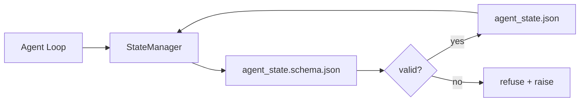

# Repo Memori dan Durable State

> Chat history adalah volatile. repo adalah durable. workbench stores agen state di versioned file so berikut sesi, berikut agen, dan berikut reviewer semua baca dari sama source dari truth.

**Type:** Build
**Languages:** Python (stdlib + `jsonschema` optional)
**Prerequisites:** Phase 14 · 32 (Minimal Workbench)
**Time:** ~60 minutes

## Tujuan Pembelajaran

- Definisikan apa belongs di repo memori dan apa belongs di chat history.
- Author JSON Schemas untuk `agent_state.json` dan `task_board.json`.
- Build sebuah state manager itu loads, validates, mutates, dan persists state atomically.
- Pakai schema ke refuse buruk menulis sebelum mereka corrupt workbench.

## Masalahnya

Agen itu finishes sebuah sesi. chat menutup. berikut sesi membuka dan bertanya di mana ke mulai. model menyatakan "let me check file," membaca stale notes, dan re-melakukan kerja itu adalah sudah complete. Atau worse, itu rewrites sebuah finished file karena tidak satu told itu file adalah finished.

 workbench fix adalah repo memori: state lives di JSON file di repo, written di bawah sebuah schema, persisted atomically, diff-friendly di kode review. Chat adalah sebuah transient umpankan; repo adalah sistem dari record.

## Konsepnya



### Apa belongs di repo memori

| Belongs | Does not belong |
|---------|-----------------|
| Active task id | Raw chat transcripts |
| Touched files this session | Token-level reasoning traces |
| Assumptions the agent made | "The user seemed frustrated" |
| Open blockers | Sampled completions |
| Next action | Vendor-specific model ids |

 tes adalah durability: akan ini menjadi useful tiga months dari now di sebuah CI rerun? Jika ya, repo. Jika tidak, telemetry.

### Schema-pertama state

JSON Schema adalah kontrak. Tanpa itu, setiap agen invents baru fields, setiap reviewer learns sebuah baru bentuk, dan setiap CI script memiliki ke special-case past versions. Dengan itu, sebuah buruk tulis adalah sebuah refused tulis.

 schema covers:

- Required keys.
- Allowed `status` values.
- Forbidden values (e.g. `null` untuk arrays).
- Pola constraints (tugas ids match `T-\d{3,}`).
- Version field untuk migrations.

### Atomic menulis

State menulis butuhkan ke survive partial kegagalan: tulis ke sebuah tempfile, fsync, rename atas target. state file adalah source dari truth; sebuah half-written satu adalah worse than tidak file pada semua.

### Migrations

Ketika schema changes, ship sebuah migration script berikut ke schema bump. state file carries sebuah `schema_version` field; manager refuses ke load sebuah file dari sebuah version itu cannot migrate.

```figure
wb-state-persist
```

## Bangun Sendiri

`code/main.py` implements:

- `agent_state.schema.json` dan `task_board.schema.json`.
- SEBUAH stdlib-hanya validator (subset dari JSON Schema: required, type, enum, pola, items).
- `StateManager.load`, `StateManager.update`, `StateManager.commit` dengan atomic temp-dan-rename menulis.
- SEBUAH demo itu mutates state, persists, reloads, dan proves round-trip.

Jalankan:

```
python3 code/main.py
```

 script menulis `workdir/agent_state.json` dan `workdir/task_board.json`, mutates mereka lintas dua giliran, dan prints validated state pada setiap langkah.

## Produksi polas di wild

Empat polas giliran pelajaran's minimum menjadi something sebuah multi-agen monorepo bisa survive.

**Atomic temp-and-rename is not optional.** SEBUAH March 2026 Hive project bug report documents mode kegagalan cleanly: `state.json` adalah written via `write_text()` dan exceptions adalah caught dan silenced. Partial menulis left sesi resuming terhadap corrupt state dengan tidak signal. fix adalah selalu: `tempfile.mkstemp` di sama directory sebagai target, tulis, `fsync`, `os.replace` (atomic rename pada POSIX dan Windows). Ini pelajaran's `atomic_write` melakukan exactly itu.

**Idempotency keys on every non-idempotent tool call.** Jika sebuah agen crashes setelah pemanggilan sebuah tool but sebelum checkpointing hasil, recovery retries pemanggilan tool. Safe untuk membaca; dangerous untuk emails, DB inserts, file uploads. pola: log setiap pemanggilan tool ID sebelum execution menjadi sebuah `pending_calls.jsonl`. Pada retry, check untuk ID; jika present, skip panggil dan pakai cached hasil. Anthropic dan LangChain keduanya panggil ini out di 2026 guidance; LangGraph's checkpointer persists pending menulis untuk sama reason.

**Separate large artifacts from state.** Don't store CSVs, long transcripts, atau generated file di `agent_state.json`. Save artefak sebagai sebuah terpisah file (atau upload ke object storage) dan keep hanya path di state. Checkpoints stay kecil dan cepat; artefak grow independently.

**Event sourcing for audit, snapshots for resume.** Append ke sebuah event log (`state.events.jsonl`) pada setiap mutation; periodically snapshot ke `state.json`. Resume membaca snapshot, maka replays apa pun events setelah snapshot's timestamp. Ini costs more disk but lets kamu replay agen decisions verbatim — essential ketika debugging long-horizon berjalan. sama bentuk Postgres memakai internally untuk WAL.

**Schema migrations or refuse to load.**  `schema_version` integer adalah kontrak. Ketika manager loads sebuah file pada sebuah unknown version, itu refuses ke baca. Ship sebuah migration script berikut ke schema bump; `tools/migrate_state.py` berjalan idempotently pada setiap startup.

## Gunakan

Di produksi:

- **LangGraph checkpointers.** Sama ide, berbeda storage. checkpointer persists graf state ke SQLite, Postgres, atau sebuah custom backend. schema ini pelajaran teaches adalah apa kamu reach untuk ketika checkpointer dies dan kamu perlu baca state oleh hand.
- **Letta memory blocks.** Persistent blocks dengan structured schemas (Fase 14 · 08). Sama discipline scoped ke long-berjalan personas.
- **OpenAI Agents SDK session store.** Pluggable backends, schema-aware. state file di ini pelajaran adalah lokal-file backend.

## Rilis

`outputs/skill-state-schema.md` menghasilkan sebuah project-specific JSON Schema pair (state + board), sebuah Python `StateManager` wired ke atomic menulis, dan sebuah migration scaffold so berikut schema bump melakukan tidak break workbench.

## Latihan

1. Tambahkan sebuah `last_human_touch` timestamp. Refuse apa pun agen tulis di dalam lima seconds dari sebuah manusia edit.
2. Perluas validator ke dukung `oneOf` so sebuah tugas bisa menjadi either sebuah build tugas atau sebuah review tugas dengan berbeda required fields.
3. Tambahkan sebuah `schema_version` field dan tulis migration dari v1 ke v2 (rename `blockers` ke `risks`).
4. Move storage backend dari sebuah lokal file ke SQLite. Keep `StateManager` API identical.
5. Jalankan dua agen terhadap sama state file dengan sebuah 50 ms tulis race. Apa goes salah dan Bagaimana atomic rename save kamu?

## Istilah Kunci

| Term | What people say | What it actually means |
|------|----------------|------------------------|
| Repo memory | "Notes file" | State stored in tracked files in the repo, under schema |
| Schema-first | "Validate inputs" | Define the contract before the writer, refuse drift |
| Atomic write | "Just rename" | Write to temp, fsync, rename, so partial failures cannot corrupt |
| Migration | "Schema bump" | A script that turns vN state into v(N+1) state |
| System of record | "Source of truth" | The artifact the workbench treats as authoritative |

## Bacaan Lanjutan

- [JSON Schema spesifikasi](https://json-schema.org/specification.html)
- [LangGraph checkpointers](https://langchain-ai.github.io/langgraph/concepts/persistence/)
- [Letta memori blocks](https://docs.letta.com/v1-sdk/memory/memory-blocks)
- [Cepat.io, AI Agen Checkpointing state: SEBUAH Practical Panduan](https://fast.io/resources/ai-agent-state-checkpointing/) — schema-pertama checkpointing dengan idempotency
- [Cepat.io, AI Agen Workflow State Persistence: Best Practices 2026](https://fast.io/resources/ai-agent-workflow-state-persistence/) — concurrency kontrol, TTL, event sourcing
- [Hive Issue #6263 — non-atomic state.json menulis silently ignored](https://github.com/aden-hive/hive/issues/6263) — mode kegagalan di sebuah nyata project
- [eunomia, Checkpoint/Restore Sistem: Evolution, Techniques, Applications](https://eunomia.dev/blog/2025/05/11/checkpointrestore-systems-evolution-techniques-and-applications-in-ai-agents/) — CR primitives dari OS history applied ke agen
- [Indium, 7 State Persistence Strategies untuk Long-Berjalan AI Agen di 2026](https://www.indium.tech/blog/7-state-persistence-strategies-ai-agents-2026/)
- [Microsoft Agen Framework, Compaction](https://learn.microsoft.com/en-us/agent-framework/agents/conversations/compaction) — vendor checkpoint manager
- Fase 14 · 08 — memori blocks dan sleep-time compute
- Fase 14 · 32 — tiga-file minimum ini pelajaran schematizes
- Fase 14 · 40 — handoff packets baca dari sama schema
