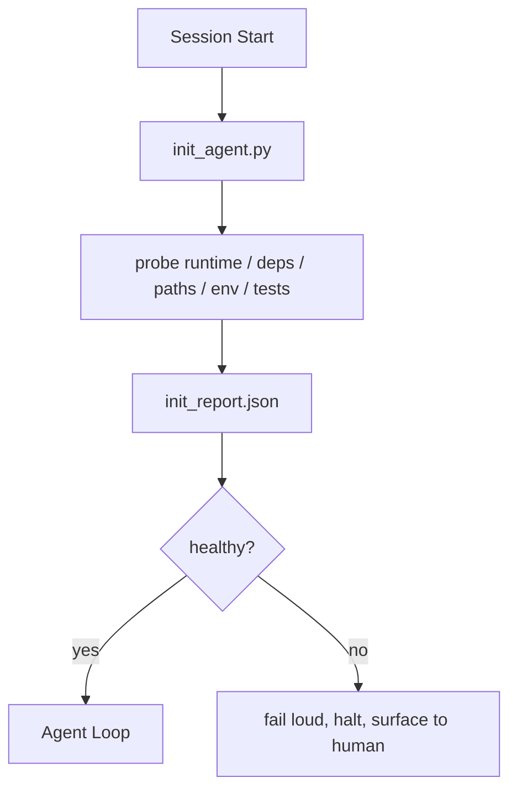

# Inisialisasi Scripts untuk Agen

> Setiap sesi itu memulai cold pays sebuah tax. Agen itu membaca sama file, retries sama probes, dan rediscovers sama paths. Sebuah init script pays tax once dan menulis menjawab menjadi state.

**Type:** Build
**Languages:** Python (stdlib)
**Prerequisites:** Phase 14 · 32 (Minimal Workbench), Phase 14 · 34 (Repo Memory)
**Time:** ~45 minutes

## Tujuan Pembelajaran

- Identifikasi kerja sebuah agen sebaiknya tidak pernah memiliki ke redo per sesi.
- Build sebuah deterministik init script itu probes runtime, dependencies, dan repo health.
- Persist probe hasil so agen itu membaca itu alih-alih re-berjalan checks.
- Gagal loud, cepat, dan dengan satu place ke look ketika inisialisasi gagal.

## Masalahnya

Buka sebuah sesi. Agen itu guesses Python version. Guesses tes command. Lists repo root lima times ke find entry inti. Tries ke import sebuah package itu adalah tidak installed. Bertanya user di mana config file lives. Oleh time itu membuat sebuah nyata edit, ten thousand token memiliki gone ke setup kerja itu sebaiknya memiliki menjadi sebuah tunggal script.

 fix adalah satu inisialisasi script itu berjalan sebelum agen itu melakukan anything else dan menulis sebuah `init_report.json` agen itu membaca pada startup.

## Konsepnya



### Apa init script probes

| Probe | Why it matters |
|-------|----------------|
| Runtime versions | Wrong Python or Node version means silent wrong-version bugs |
| Dependency availability | A missing package later costs ten times the cost of catching it now |
| Test command | The agent must know how to verify; if the command is missing the workbench is broken |
| Repo paths | Hard-coded paths drift; resolve them once and pin |
| Environment variables | Missing `OPENAI_API_KEY` is a failure surface, not a runtime mystery |
| State + board freshness | Stale state from a crashed session is a footgun |
| Last-known-good commit | Anchor for the handoff diff at the end of the session |

### Gagal loud, gagal cepat, gagal di satu place

SEBUAH probe kegagalan means halt dan surface ke manusia. Tidak "agen itu akan figure itu out." seluruh inti dari init adalah ke refuse ke mulai ketika workbench adalah broken.

### Idempotent

Jalankan twice di sebuah row. kedua jalankan sebaiknya menjadi sebuah tidak-op except untuk sebuah fresh timestamp. Idempotency adalah apa lets kamu wire script menjadi CI, hooks, atau sebuah pre-tugas slash command.

### Init vs startup rules

Rules (Fase 14 · 33) deskripsikan apa harus menjadi true ke bertindak. Init adalah script itu establishes itu itu rules bisa menjadi checked. Rules tanpa init become "menjadi careful." Init tanpa rules becomes sebuah polished kegagalan.

```figure
wb-init-probes
```

## Bangun Sendiri

`code/main.py` implements `init_agent.py`:

- Lima probes: Python version, listed dependencies via `importlib.util.find_spec`, tes command resolvability, required env vars, state file freshness.
- Setiap probe mengembalikan `(name, status, detail)`.
-  script menulis `init_report.json` dengan penuh probe set dan exits non-zero jika apa pun block-severity probe gagal.

Jalankan:

```
python3 code/main.py
```

 script prints table dari probes, menulis `init_report.json`, dan exits zero pada happy path atau non-zero dengan sebuah list dari failed probes.

## Produksi polas di wild

Tiga polas terpisah sebuah useful init script dari sebuah ceremony.

**Last-known-good commit anchoring.** Probe current commit terhadap sebuah `LKG` file written pada terakhir successful merge. Jika diff exceeds sebuah budget (default 50 file), refuse ke mulai dan butuhkan sebuah manusia ke ratify baru baseline. Ini adalah apa Cloudflare's AI Kode Review memakai ke scope reviewer agen: setiap review sesi anchors terhadap sama terakhir-known-baik dan tidak pernah compounds drift lintas sesi.

**Lock files with TTL.** Tulis sebuah `prereqs.lock` setelah pertama successful probe pass. Subsequent berjalan trust lock untuk N hours (24h default) dan skip expensive probes. init script membaca lock pertama; jika itu adalah fresh dan dependency manifest hash matches, itu short-circuits. Ini adalah sama pola Docker memakai untuk layer caches: idempotent probe + content hash = skip.

**No network, no LLM, no surprises in the hot path.** Init probes adalah deterministik plumbing. SEBUAH probe itu memanggil sebuah LLM ke classify sebuah kegagalan atau itu hits sebuah eksternal service ke check sebuah license adalah tidak sebuah probe; itu adalah sebuah workflow. Jika sebuah probe mengambil longer than tiga seconds di sebuah dry jalankan, treat itu sebagai sebuah workbench smell dan either move itu out dari init atau cache miliknya hasil.

## Gunakan

Di produksi:

- **Claude Code hooks.** `pre-task` hook memanggil init script dan refuses ke launch agen itu jika itu gagal.
- **GitHub Actions.** SEBUAH `setup-agent` job berjalan init script; agen itu job depends pada itu.
- **Docker entrypoint.** Agen itu container berjalan init script sebelum exec-ing agen itu runtime; logs surface pada kegagalan.

 init script adalah portable karena itu membuat tidak memanggil ke sebuah specific framework. Bash, Buat, atau sebuah tugas file bisa semua wrap itu.

## Rilis

`outputs/skill-init-script.md` interviews project, classifies miliknya setup kerja menjadi probes, dan meng-emit sebuah project-specific `init_agent.py` plus sebuah CI workflow itu berjalan itu sebelum apa pun agen langkah.

## Latihan

1. Tambahkan sebuah probe itu diffs current commit terhadap terakhir-known-baik commit dan refuses ke mulai jika more than 50 file changed.
2. Wire script ke tulis sebuah `prereqs.lock` file dan refuse ke mulai jika lock adalah older than seven days.
3. Tambahkan sebuah `--fix` flag itu auto-installs missing dev dependencies but tidak pernah modifies runtime dependencies tanpa approval.
4. Move probes dari hardcoded functions ke sebuah YAML registry. Defend trade-off.
5. Tambahkan sebuah timing budget per probe. SEBUAH probe itu berjalan longer than tiga seconds adalah sebuah workbench smell.

## Istilah Kunci

| Term | What people say | What it actually means |
|------|----------------|------------------------|
| Probe | "A check" | A deterministic function returning `(name, status, detail)` |
| Init report | "Setup output" | JSON written next to state with the probe results |
| Idempotent | "Safe to re-run" | Two runs in a row produce identical reports modulo timestamp |
| Fail loud | "Don't swallow" | Halt and surface to the human; no silent fallback |
| Setup tax | "Bootstrap cost" | The tokens the agent spends per session rediscovering the obvious |

## Bacaan Lanjutan

- [Anthropic, Efektif harnesses untuk long-berjalan agen](https://www.anthropic.com/engineering/effective-harnesses-for-long-running-agents)
- [GitHub Aksi, composite aksi untuk setup](https://docs.github.com/en/actions/sharing-automations/creating-actions/creating-a-composite-action)
- [microservices.io, GenAI dev platform: guardrail](https://microservices.io/post/architecture/2026/03/09/genai-development-platform-part-1-development-guardrails.html) — pre-commit + CI checks sebagai init
- [Augment Kode, Bagaimana ke Build Kamu AGEN.md (2026)](https://www.augmentcode.com/guides/how-to-build-agents-md) — init expectations
- [Codex Blog, Codex CLI Context Compaction](https://codex.danielvaughan.com/2026/03/31/codex-cli-context-compaction-architecture/) — sesi mulai sebagai compaction-aware init
- Fase 14 · 33 — aturan set ini script memungkinkan
- Fase 14 · 34 — state file ini script seeds
- Fase 14 · 38 — verifikasi gate init script mengumpankan
- Fase 14 · 40 — handoff itu consumes init report's terakhir-known-baik
