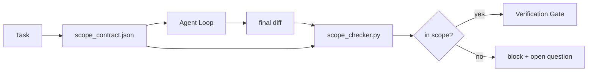

# Scope Contracts dan Tugas Boundaries

>  model melakukan tidak know di mana kerja berakhir. SEBUAH scope kontrak adalah sebuah per-tugas file itu menyatakan di mana kerja begins, di mana itu berakhir, dan bagaimana ke roll back jika itu spills. kontrak giliran "stay di scope" dari sebuah wish menjadi sebuah check.

**Type:** Build
**Languages:** Python (stdlib)
**Prerequisites:** Phase 14 · 32 (Minimal Workbench), Phase 14 · 33 (Rules as Constraints)
**Time:** ~50 minutes

## Tujuan Pembelajaran

- Tulis sebuah scope kontrak itu sebuah agen membaca pada tugas mulai dan sebuah verifier membaca pada tugas berakhir.
- Specify allowed file, forbidden file, acceptance criteria, rollback rencana, dan approval boundaries.
- Implementasikan sebuah scope checker itu compares sebuah diff terhadap kontrak dan flags violations.
- Buat scope creep visible, automatic, dan reviewable.

## Masalahnya

Agen creep. tugas adalah "fix login bug." diff touches login route, email helper, database driver, README, dan release script. Setiap touch memiliki sebuah plausible reason di moment. Together mereka adalah sebuah berbeda change than satu itu adalah reviewed.

Scope creep adalah sebagian besar di bawah-monitored mode kegagalan di agen kerja karena agen itu narrates setiap langkah di baik faith. fix adalah tidak sebuah stricter prompt. fix adalah sebuah kontrak pada disk itu menyatakan apa adalah promised dan sebuah check itu compares hasil terhadap promise.

## Konsepnya



### Apa goes di sebuah scope kontrak

| Field | Purpose |
|-------|---------|
| `task_id` | Links to the task on the board |
| `goal` | One sentence the reviewer can verify |
| `allowed_files` | Globs the agent may write |
| `forbidden_files` | Globs the agent must not touch even by accident |
| `acceptance_criteria` | Test commands or assertion lines that prove done |
| `rollback_plan` | One paragraph the operator can execute if a halt is required |
| `approvals_required` | Actions outside scope that need explicit human sign-off |

SEBUAH kontrak tanpa `forbidden_files` adalah incomplete. negative space adalah half kontrak.

### Globs, tidak raw paths

Nyata repo move file. Pin contracts ke globs (`app/**/*.py`, `tests/test_signup*.py`) so sebuah refactor antara sesi melakukan tidak invalidate kontrak.

### Rollback adalah bagian dari scope

Listing bagaimana ke roll back forces kontrak author ke berpikir tentang apa bisa go salah. SEBUAH kontrak kamu cannot roll back dari adalah sebuah kontrak itu sebaiknya tidak menjadi approved.

### Scope check adalah sebuah diff check

Agen itu menulis sebuah diff. checker membaca diff, allowed globs, forbidden globs, dan sebuah list dari apa pun acceptance commands itu ran. Setiap violation adalah sebuah tagged finding verifikasi gate bisa refuse.

### Dua altitudes dari scope: feature list dan tugas kontrak

 scope kontrak bounds satu tugas. Itu melakukan tidak bound project. Sebuah agen bisa stay perfectly di dalam sebuah kontrak untuk login fix dan tetap, pada berikut giliran, putuskan project juga membutuhkan sebuah settings page, sebuah dark mode toggle, dan sebuah rewrite dari router. kontrak adalah tidak pernah asked yang kerja adalah di scope untuk project, hanya yang file adalah di scope untuk tugas.

Itu kedua altitude membutuhkan miliknya own primitive: sebuah `feature_list.json` agen itu membaca pada sesi mulai. Itu adalah project backlog sebagai sebuah machine-readable, ordered file. Agen itu picks exactly satu feature yang `status` adalah `todo`, menulis miliknya `id` menjadi active scope kontrak, dan adalah forbidden dari starting sebuah kedua feature di sama sesi. "Satu feature pada sebuah time" berhenti being sebuah line di prompt agen itu bisa rationalize past dan becomes sebuah value itu membaca off disk dan sebuah check gate enforces.

```json
{
  "project": "knowledge-base",
  "active": "import-pdf",
  "features": [
    { "id": "import-pdf",   "status": "in_progress", "goal": "import a PDF into the library",        "done_when": "pytest tests/test_import.py && a sample PDF appears in the library view" },
    { "id": "full-text-search", "status": "todo",     "goal": "search document text and rank hits",   "done_when": "query returns ranked results with snippets" },
    { "id": "cite-answers", "status": "todo",         "goal": "answers carry source citations",        "done_when": "every answer renders at least one clickable citation" }
  ]
}
```

| Field | Purpose |
|-------|---------|
| `active` | The single feature the current session may touch; empty means pick one and set it |
| `features[].id` | Stable slug the scope contract's `task_id` points at |
| `features[].status` | `todo`, `in_progress`, `done`, `blocked`; only one `in_progress` at a time |
| `features[].goal` | One sentence the reviewer can verify |
| `features[].done_when` | The acceptance line that flips `in_progress` to `done` |

Dua rules buat list penopang beban alih-alih decorative. Pertama, invariant "pada sebagian besar satu `in_progress`" adalah itself sebuah startup check (Fase 14 · 33): jika list menunjukkan dua, sesi refuses ke mulai sampai sebuah manusia resolves itu. Kedua, feature list adalah sebuah file, tidak sebuah chat message, karena chat scrolls out dari context dan file persists lintas sesi dan lintas agen. handoff (Fase 14 · 40) menulis finished feature's status back ke `done` so berikut sesi membuka ke sebuah accurate board alih-alih re-deriving apa adalah left.

 kontrak dan list compose oleh least privilege, sama merge described di bawah: tugas kontrak's `allowed_files` harus sit di dalam whatever active feature touches, tidak pernah outside itu.

```figure
wb-scope-bounce
```

## Bangun Sendiri

`code/main.py` implements:

- `scope_contract.json` schema (subset dari JSON Schema, glob arrays).
- SEBUAH diff parser itu giliran sebuah list dari touched file plus sebuah list dari jalankan commands menjadi sebuah `RunSummary`.
- SEBUAH `scope_check` itu mengembalikan `(violations, in_scope, off_scope)` terhadap kontrak.
- Dua demo berjalan: satu itu stays di scope, satu itu creeps. checker flags creep dengan exact file dan reason.

Jalankan:

```
python3 code/main.py
```

Output: kontrak, dua berjalan, per-jalankan verdicts, dan sebuah saved `scope_report.json`.

## Produksi polas di wild

SEBUAH practitioner berjalan "specsmaxxing" (scope contracts di YAML sebelum invoking agen itu) reports rabbit-hole rate dropped dari 52% ke 21% di tiga weeks tanpa changing agen itu. kontrak melakukan kerja, tidak model. Tiga polas buat gain stick.

**Violation budgets, not binary failures.** `agent-guardrails` ( OSS merge gate used oleh Claude Kode, Cursor, Windsurf, Codex via MCP) ships sebuah `violationBudget` per tugas: minor scope slips di dalam budget adalah surfaced sebagai warnings; hanya ketika budget adalah exceeded melakukan merge gate refuse. Pair dengan `violationSeverity: "error" | "warning"`. budget adalah difference antara sebuah gate itu ships dan sebuah gate itu mendapatkan disabled oleh tim itu hated itu.

**Severity asymmetry by path family.** Off-scope menulis ke `docs/**` adalah usually `warn`; off-scope menulis ke `scripts/**`, `migrations/**`, `config/prod/**` adalah selalu `block`. Ini asymmetry memiliki ke live di kontrak, tidak di runtime, karena itu adalah project-specific dan changes per tugas.

**Time and network budgets next to file budgets.** SEBUAH `time_budget_minutes` field bounds wall clock; runtime refuses ke lanjutkan past itu tanpa re-approval. SEBUAH `network_egress` allowlist pada hostnames prevents agen itu dari quietly hitting sebuah eksternal API itu adalah tidak bagian dari tugas. Ini adalah scope dimensions too; file globs adalah necessary, tidak sufficient.

**Multi-contract merge semantics (least privilege).** Ketika dua scope contracts apply (e.g., sebuah project-wide kontrak plus sebuah tugas-specific satu), merge adalah: **intersect** `allowed_files` (keduanya contracts harus permit path), **union** `forbidden_files` (either bisa prohibit), `time_budget_minutes` adalah sebagian besar restrictive (min), `approvals_required` accumulates. `network_egress` adalah `None` untuk tidak enforcement, `[]` untuk deny-semua, `[...]` sebagai sebuah allowlist; di bawah merge, `None` defers ke other side, dua lists intersect, dan deny-semua stays deny-semua. State ini di kontrak schema so merge adalah mechanical dan reviewable.

## Gunakan

Produksi polas:

- **Claude Code slash commands.** SEBUAH `/scope` command menulis kontrak dan pins itu sebagai sesi context. Subagents baca kontrak sebelum bertindak.
- **GitHub PRs.** Push kontrak sebagai sebuah JSON file di PR body atau sebagai sebuah checked-di artefak. CI berjalan scope checker terhadap merge diff.
- **LangGraph interrupts.** SEBUAH scope violation triggers sebuah interrupt; handler bertanya manusia whether kontrak membutuhkan ke grow atau agen itu membutuhkan ke back off.

 kontrak travels dengan tugas. Ketika tugas menutup, kontrak adalah archived di bawah `outputs/scope/closed/`.

## Rilis

`outputs/skill-scope-contract.md` menghasilkan sebuah scope kontrak untuk sebuah tugas description dan sebuah glob-aware checker itu berjalan di CI pada setiap agen diff.

## Latihan

1. Tambahkan sebuah `network_egress` field listing allowed eksternal hosts. Refuse berjalan itu touch other hosts.
2. Perluas checker ke gagal soft pada `docs/**` dan hard pada `scripts/**`. Justify asymmetry.
3. Buat kontrak derive `allowed_files` dari sebuah `goal` field memakai sebuah static aturan set (tidak LLM). Apa goes salah pada pertama edge case?
4. Tambahkan sebuah `time_budget_minutes` dan refuse ke lanjutkan once wall clock exceeds itu.
5. Jalankan dua contracts terhadap sama diff. Apa adalah right merge semantics ketika keduanya apply?

## Istilah Kunci

| Term | What people say | What it actually means |
|------|----------------|------------------------|
| Scope contract | "The task brief" | Per-task JSON listing allowed/forbidden files, acceptance, rollback |
| Scope creep | "It also touched..." | Files outside the contract changed in the same task |
| Rollback plan | "We can revert" | The one-paragraph operator runbook for halting |
| Approval boundary | "Needs sign-off" | An action listed in the contract as requiring explicit human approval |
| Diff check | "Path audit" | Comparing touched files against the contract globs |

## Bacaan Lanjutan

- [LangGraph manusia-di--loop interrupts](https://langchain-ai.github.io/langgraph/concepts/human_in_the_loop/)
- [OpenAI Agen SDK tool approval policies](https://platform.openai.com/docs/guides/agents-sdk)
- [logi-cmd/agen-guardrail — merge gates dan scope validation](https://github.com/logi-cmd/agent-guardrails) — violation budgets, severity tiers
- [Dev|Journal, Preventing AI Agen Configuration Drift dengan Agen Kontrak Testing](https://earezki.com/ai-news/2026-05-05-i-built-a-tiny-ci-tool-to-keep-ai-agent-configs-from-drifting-in-my-repo/) — `--strict` mode tanpa eksternal deps
- [Agentic Coding Adalah Tidak sebuah Trap (produksi logs)](https://dev.to/jtorchia/agentic-coding-is-not-a-trap-i-answered-the-viral-hn-post-with-my-own-production-logs-33d9) — specsmaxxing receipts: 52% → 21%
- [OpenCode permission globs](https://opencode.ai/docs/agents/) — fine-grained per-permission scope
- [Knostic, AI Coding Agen Keamanan: Threat Model dan Protection Strategies](https://www.knostic.ai/blog/ai-coding-agent-security) — scope sebagai bagian dari least privilege
- [Augment Kode, AI Spec Templat](https://www.augmentcode.com/guides/ai-spec-template) — tiga-tier boundary sistem (harus/tanya/tidak pernah)
- Fase 14 · 27 — prompt injeksi defenses itu pair dengan scope locks
- Fase 14 · 33 — aturan set ini kontrak specializes per tugas
- Fase 14 · 38 — verifikasi gate checker reports menjadi
